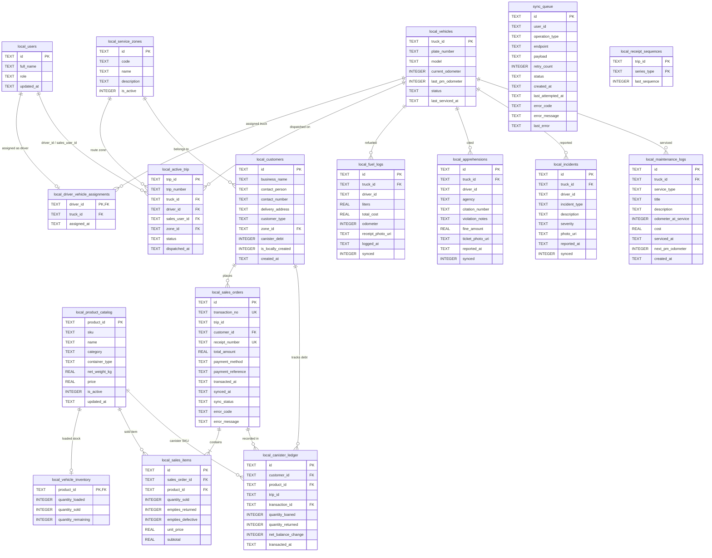

# MadayawGas Mobile — Local SQLite Database ERD

**Schema Version:** `2` (3NF Normalized)  
**Source of Truth:** [`src/database/schema.ts`](../src/database/schema.ts)  
**Isolation & Engine:** `expo-sqlite` with WAL mode, `PRAGMA foreign_keys = ON`, `PRAGMA busy_timeout = 5000`, and per-account isolated database files (`madayawgas_<userId>.db` / `madayawgas_guest.db`).

---

## Entity Relationship Diagram

---

## Domain Grouping & Notes

| Domain | Tables | Notes |
| --- | --- | --- |
| **Identity, Fleet & Trip Dispatch** | `local_users`, `local_service_zones`, `local_vehicles`, `local_driver_vehicle_assignments`, `local_active_trip` | `local_service_zones` is pre-seeded with 7 canonical Davao delivery routes. `local_active_trip` references `truck_id`, `driver_id`, `sales_user_id`, and `zone_id` via FKs. |
| **Catalog & Truck Inventory** | `local_product_catalog`, `local_vehicle_inventory` | `local_vehicle_inventory` enforces `CHECK (quantity_remaining >= 0)` and resolves SKU/name via `local_product_catalog`. |
| **Customers, Sales & Canister Ledger** | `local_customers`, `local_sales_orders`, `local_sales_items`, `local_canister_ledger`, `local_receipt_sequences` | `local_sales_orders.trip_id` and `local_canister_ledger.trip_id` are logical trip references (not SQL FKs) so historical orders survive trip clears. `local_receipt_sequences` uses a composite PK `(trip_id, series_type)` for monotonic `INV` / `CD` numbering. |
| **Driver Operations & Maintenance** | `local_fuel_logs`, `local_apprehensions`, `local_incidents`, `local_maintenance_logs` | All four reference `local_vehicles(truck_id)`; `driver_id` is stored as a logical user identifier. |
| **Offline Store-and-Forward Sync** | `sync_queue` | Standalone mutation queue partitioned by `user_id` (`PENDING`, `PROCESSING`, `SYNCED`, `FAILED`, `QUARANTINED`). |
