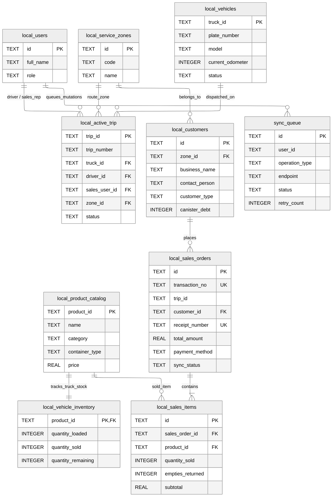

# MadayawGas Mobile — Simplified Offline-First SQLite ERD

> **Database Engine**: `expo-sqlite` (WAL mode, `PRAGMA foreign_keys = ON`, per-account isolated `.db`)  
> **Schema Version**: `2` (3NF Normalized)  
> **Scope**: 10 Core Offline-First Tables (distilled from the 17-table [`local-database-erd.md`](./local-database-erd.md))  
> **Purpose**: Presentation-friendly (PPT) entity-relationship diagram highlighting the core local tables, keys, essential fields, and store-and-forward sync architecture.

---

## 1. Simplified Core SQLite ERD

---

## 2. Core Offline-First Layer Breakdown

| Offline Layer | Core Tables Included | Role in Offline-First Flow |
| :--- | :--- | :--- |
| **1. Identity, Fleet & Active Trip** | `local_users`, `local_service_zones`, `local_vehicles`, `local_active_trip` | Caches authenticated crew, Davao delivery zones, assigned truck telemetry, and the active shift/trip context. |
| **2. Catalog & Truck Inventory** | `local_product_catalog`, `local_vehicle_inventory` | Stores product pricing/metadata and enforces real-time truck stock counters (`quantity_remaining >= 0`) while offline. |
| **3. Offline Customers & Sales** | `local_customers`, `local_sales_orders`, `local_sales_items` | Enables offline customer lookup/creation, sales order capture, empty-cylinder return tracking, and local receipt generation. |
| **4. Store-and-Forward Sync** | `sync_queue` | Persists outbound API mutations (`PENDING`, `PROCESSING`, `SYNCED`, `FAILED`, `QUARANTINED`) for reliable background replay when connectivity returns. |

> For the complete 17-table local schema including `local_canister_ledger`, `local_receipt_sequences`, driver assignments, fuel logs, apprehensions, incidents, and maintenance logs, see [`local-database-erd.md`](./local-database-erd.md).
