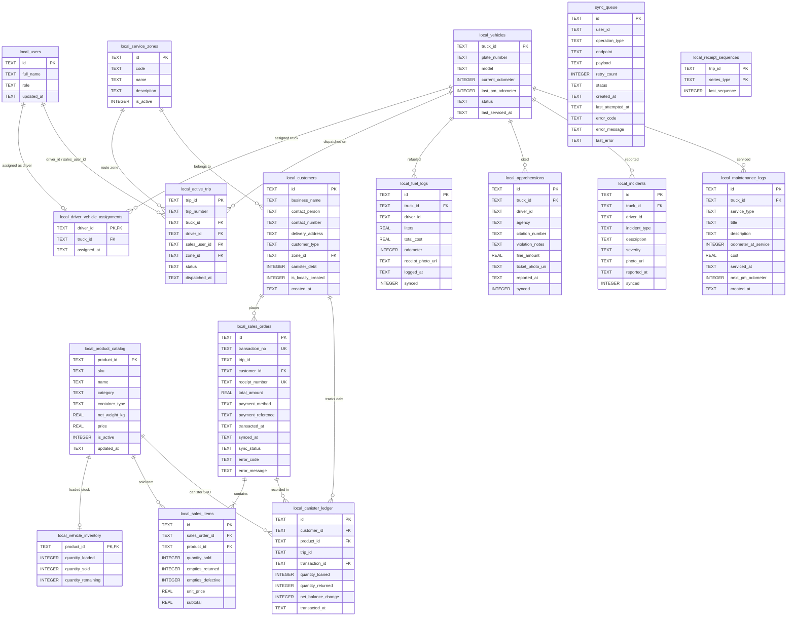

This file is a merged representation of a subset of the codebase, containing files not matching ignore patterns, combined into a single document by Repomix.

# File Summary

## Purpose
This file contains a packed representation of a subset of the repository's contents that is considered the most important context.
It is designed to be easily consumable by AI systems for analysis, code review,
or other automated processes.

## File Format
The content is organized as follows:
1. This summary section
2. Repository information
3. Directory structure
4. Repository files (if enabled)
5. Multiple file entries, each consisting of:
  a. A header with the file path (## File: path/to/file)
  b. The full contents of the file in a code block

## Usage Guidelines
- This file should be treated as read-only. Any changes should be made to the
  original repository files, not this packed version.
- When processing this file, use the file path to distinguish
  between different files in the repository.
- Be aware that this file may contain sensitive information. Handle it with
  the same level of security as you would the original repository.

## Notes
- Some files may have been excluded based on .gitignore rules and Repomix's configuration
- Binary files are not included in this packed representation. Please refer to the Repository Structure section for a complete list of file paths, including binary files
- Files matching these patterns are excluded: **/.agents/**, **/.codex/**, **/.claude/**, **/.github/**, **/.vscode/**, **/.expo/**, **/.gradle/**, **/coverage/**, **/build/**, **/scratch/**, **/*.log, .env, .env.*, **/*.min.js, **/*.map
- Files matching patterns in .gitignore are excluded
- Files matching default ignore patterns are excluded
- Files are sorted by Git change count (files with more changes are at the bottom)

# Directory Structure
`````
assets/
  images/
    android-icon-background.png
    android-icon-foreground.png
    android-icon-monochrome.png
    favicon.png
    icon copy 2.png
    icon copy.png
    icon.png
    placeholder.png
    splash-icon.png
  svg/
    dashboard-bg.svg
    driver-dashboard-bg.svg
    flame.svg
    login-bg.svg
    logo.svg
    logo2.svg
    placeholder.svg
    profile-bg.svg
docs/
  local-database-erd.md
src/
  api/
    endpoints/
      authApi.ts
      customerApi.ts
      driverApi.ts
      productApi.ts
      scheduleApi.ts
      syncApi.ts
      tripApi.ts
      userApi.ts
    client.ts
    index.ts
  components/
    driver/
      ApprehensionModal.jsx
      EmergencySosModal.jsx
      EndTripModal.jsx
      FuelEntryModal.jsx
      VehicleIssueModal.jsx
    navigation/
      BottomNav.js
    profile/
      AvatarEditModal.jsx
      EditProfileModal.jsx
    sales/
      CustomerCard.js
      OrderSummaryDrawer.js
      ProductOrderCard.js
      QuantityControl.js
      TransactionDetailsModal.js
    ui/
      BottomSheetModal.jsx
      ContactField.js
      FadeInView.js
      InputField.js
      KeyboardAwareScrollView.jsx
      PasswordField.js
      PrimaryButton.js
  config/
    env.ts
    index.ts
  database/
    repositories/
      customerRepository.ts
      driverRepository.ts
      inventoryRepository.ts
      salesRepository.ts
      syncQueueRepository.ts
      tripRepository.ts
      zoneRepository.ts
    connection.ts
    index.ts
    schema.ts
  hooks/
    useBackHandler.ts
    useKeyboardHeight.js
  realtime/
    driverRealtimeManager.ts
    index.ts
    socketClient.ts
  screens/
    auth/
      ChangePasswordScreen.js
      LoginScreen.js
      SplashScreen.js
    driver/
      DriverDashboardScreen.jsx
      DriverMaintenanceScreen.jsx
      DriverProfileScreen.jsx
    sales/
      AddCustomerScreen.js
      ConfirmOrderScreen.js
      CustomerDetailsScreen.js
      DashboardScreen.js
      NewOrderScreen.js
      ReceiptScreen.js
      SalesScreen.js
    shared/
      ProfileScreen.js
  services/
    authService.ts
    dataRevalidator.ts
    driverService.ts
    hydrationService.ts
    index.ts
    mediaService.ts
    printService.ts
    salesService.ts
    sessionStore.ts
  sync/
    index.ts
    networkSentinel.ts
    syncScheduler.ts
    syncWorker.ts
  types/
    api.ts
    domain.ts
    index.ts
  utils/
    fuelValidation.ts
    imageCompressor.ts
    mediaResolver.ts
    syncErrorFormatter.ts
.gitignore
.repomixignore
AGENTS.md
App.js
app.json
babel.config.js
eas.json
eslint.config.js
global.css
LICENSE
madayawgas-mobile-code.md
metro.config.js
nativewind-env.d.ts
package.json
README.md
repomix.config.json
skills-lock.json
tailwind.config.js
tsconfig.json
`````

# Files

## File: assets/svg/driver-dashboard-bg.svg
`````xml
<svg width="390" height="326" viewBox="0 0 390 326" fill="none" xmlns="http://www.w3.org/2000/svg">
<rect y="-64" width="390" height="286" fill="#0A4B6E"/>
<path d="M-12.8221 171.277L-33.9985 203.747V310.284C-33.9985 310.284 -34.3137 318.2 -25.6893 321.957C-15.4581 326.414 -6.9032 325.989 -6.9032 325.989H445.408C445.408 325.989 454.801 324.079 459.497 321.108C464.194 318.137 466 313.256 466 313.256V210.114L427.177 192.924L385.412 213.085L363.059 189.74L306 213.085L265.412 163L234.824 210.114L211.295 183.586L201.883 213.085L166.589 200.352L151.883 210.114L115.413 163L86.0011 196.532L58.9424 179.978L16.0013 200.352L-12.8221 171.277Z" fill="#f1f5f9"/>
</svg>
`````

## File: assets/svg/flame.svg
`````xml
<svg width="392" height="431" viewBox="0 0 392 431" fill="none" xmlns="http://www.w3.org/2000/svg" xmlns:xlink="http://www.w3.org/1999/xlink">
<rect opacity="0.15" y="82.6865" width="304.254" height="361.737" transform="rotate(-15.7694 0 82.6865)" fill="url(#pattern0_1792_308)" fill-opacity="0.42"/>
<defs>
<pattern id="pattern0_1792_308" patternContentUnits="objectBoundingBox" width="1" height="1">
<use xlink:href="#image0_1792_308" transform="matrix(0.00176962 0 0 0.00148841 -2.17695 -0.881064)"/>
</pattern>
<image id="image0_1792_308" width="3000" height="3000" preserveAspectRatio="none" xlink:href=""/>
</defs>
</svg>
`````

## File: assets/svg/login-bg.svg
`````xml
<svg width="390" height="299" viewBox="0 0 390 299" fill="none" xmlns="http://www.w3.org/2000/svg">
<rect width="390" height="171" fill="#0A4B6E"/>
<path d="M466.34 289.657L488.998 253.003V132.74C488.998 132.74 489.336 123.805 480.108 119.564C469.16 114.533 460.006 115.012 460.006 115.012H-23.9662C-23.9662 115.012 -34.0167 117.168 -39.0419 120.522C-44.0673 123.876 -46 129.386 -46 129.386V245.816L-4.45889 265.221L40.2292 242.462L64.1468 268.815L125.199 242.462L168.629 299L201.358 245.816L226.535 275.762L236.605 242.462L274.37 256.836L290.105 245.816L329.128 299L360.599 261.148L389.552 279.835L435.499 256.836L466.34 289.657Z" fill="#0A4B6E"/>
</svg>
`````

## File: assets/svg/logo.svg
`````xml
<svg width="80" height="94" viewBox="0 0 80 94" fill="none" xmlns="http://www.w3.org/2000/svg" xmlns:xlink="http://www.w3.org/1999/xlink">
<rect width="80" height="94" fill="url(#pattern0_1442_446)"/>
<defs>
<pattern id="pattern0_1442_446" patternContentUnits="objectBoundingBox" width="1" height="1">
<use xlink:href="#image0_1442_446" transform="matrix(0.0011875 0 0 0.00101064 -1.25 -0.478723)"/>
</pattern>
<image id="image0_1442_446" width="3000" height="3000" preserveAspectRatio="none" xlink:href=""/>
</defs>
</svg>
`````

## File: assets/svg/logo2.svg
`````xml
<svg width="245" height="245" viewBox="0 0 245 245" fill="none" xmlns="http://www.w3.org/2000/svg" xmlns:xlink="http://www.w3.org/1999/xlink">
<rect width="245" height="245" fill="url(#pattern0_1442_549)"/>
<defs>
<pattern id="pattern0_1442_549" patternContentUnits="objectBoundingBox" width="1" height="1">
<use xlink:href="#image0_1442_549" transform="scale(0.000333333)"/>
</pattern>
<image id="image0_1442_549" width="3000" height="3000" preserveAspectRatio="none" xlink:href=""/>
</defs>
</svg>
`````

## File: assets/svg/placeholder.svg
`````xml
<svg width="88" height="102" viewBox="0 0 88 102" fill="none" xmlns="http://www.w3.org/2000/svg" xmlns:xlink="http://www.w3.org/1999/xlink">
<g filter="url(#filter0_d_1640_492)">
<rect x="4" width="80" height="94" fill="url(#pattern0_1640_492)" shape-rendering="crispEdges"/>
</g>
<defs>
<filter id="filter0_d_1640_492" x="0" y="0" width="88" height="102" filterUnits="userSpaceOnUse" color-interpolation-filters="sRGB">
<feFlood flood-opacity="0" result="BackgroundImageFix"/>
<feColorMatrix in="SourceAlpha" type="matrix" values="0 0 0 0 0 0 0 0 0 0 0 0 0 0 0 0 0 0 127 0" result="hardAlpha"/>
<feOffset dy="4"/>
<feGaussianBlur stdDeviation="2"/>
<feComposite in2="hardAlpha" operator="out"/>
<feColorMatrix type="matrix" values="0 0 0 0 0.0392157 0 0 0 0 0.294118 0 0 0 0 0.431373 0 0 0 1 0"/>
<feBlend mode="normal" in2="BackgroundImageFix" result="effect1_dropShadow_1640_492"/>
<feBlend mode="normal" in="SourceGraphic" in2="effect1_dropShadow_1640_492" result="shape"/>
</filter>
<pattern id="pattern0_1640_492" patternContentUnits="objectBoundingBox" width="1" height="1">
<use xlink:href="#image0_1640_492" transform="matrix(0.0011875 0 0 0.00101064 -1.25 -0.478723)"/>
</pattern>
<image id="image0_1640_492" width="3000" height="3000" preserveAspectRatio="none" xlink:href=""/>
</defs>
</svg>
`````

## File: docs/local-database-erd.md
`````markdown
# MadayawGas Mobile — Local SQLite Database ERD

**Schema Version:** `2` (3NF Normalized)  
**Source of Truth:** [`src/database/schema.ts`](../src/database/schema.ts)  
**Isolation & Engine:** `expo-sqlite` with WAL mode, `PRAGMA foreign_keys = ON`, `PRAGMA busy_timeout = 5000`, and per-account isolated database files (`madayawgas_<userId>.db` / `madayawgas_guest.db`).

---

## Entity Relationship Diagram



---

## Domain Grouping & Notes

| Domain | Tables | Notes |
| --- | --- | --- |
| **Identity, Fleet & Trip Dispatch** | `local_users`, `local_service_zones`, `local_vehicles`, `local_driver_vehicle_assignments`, `local_active_trip` | `local_service_zones` is pre-seeded with 7 canonical Davao delivery routes. `local_active_trip` references `truck_id`, `driver_id`, `sales_user_id`, and `zone_id` via FKs. |
| **Catalog & Truck Inventory** | `local_product_catalog`, `local_vehicle_inventory` | `local_vehicle_inventory` enforces `CHECK (quantity_remaining >= 0)` and resolves SKU/name via `local_product_catalog`. |
| **Customers, Sales & Canister Ledger** | `local_customers`, `local_sales_orders`, `local_sales_items`, `local_canister_ledger`, `local_receipt_sequences` | `local_sales_orders.trip_id` and `local_canister_ledger.trip_id` are logical trip references (not SQL FKs) so historical orders survive trip clears. `local_receipt_sequences` uses a composite PK `(trip_id, series_type)` for monotonic `INV` / `CD` numbering. |
| **Driver Operations & Maintenance** | `local_fuel_logs`, `local_apprehensions`, `local_incidents`, `local_maintenance_logs` | All four reference `local_vehicles(truck_id)`; `driver_id` is stored as a logical user identifier. |
| **Offline Store-and-Forward Sync** | `sync_queue` | Standalone mutation queue partitioned by `user_id` (`PENDING`, `PROCESSING`, `SYNCED`, `FAILED`, `QUARANTINED`). |
`````

## File: src/api/endpoints/scheduleApi.ts
`````typescript
import { apiClient } from '../client';
import { ServiceZone } from '@/types';

export const scheduleApi = {
  /**
   * Fetches all delivery service zones from the backend API.
   * Authorized via `route.view` or `route.view_own`.
   */
  async fetchZones(): Promise<ServiceZone[]> {
    const res = await apiClient<any>('/schedules/zones', {
      method: 'GET',
    });
    const list = Array.isArray(res.data)
      ? res.data
      : (Array.isArray(res.data?.zones) ? res.data.zones : []);
    return list;
  },
};
`````

## File: src/api/endpoints/userApi.ts
`````typescript
import * as FileSystem from 'expo-file-system/legacy';
import { Platform } from 'react-native';
import { ENV } from '@/config';
import { apiClient, ApiError } from '../client';
import { sessionStore } from '@/services/sessionStore';
import { networkSentinel } from '@/sync/networkSentinel';
import { resolveMediaUrl } from '@/utils/mediaResolver';
import {
  UserProfileResponseData,
  UploadAvatarResponseData,
  UpdateProfileRequest,
} from '@/types';

const AVATAR_UPLOAD_TIMEOUT_MS = 10000; // 10s timeout limit

const normalizeProfileUser = (user: any) => {
  if (!user) return user;
  return {
    ...user,
    avatarUrl: resolveMediaUrl(user.avatarUrl),
  };
};

export const userApi = {
  /**
   * Fetches current user profile and permissions from /api/users/me
   */
  async getProfile(): Promise<UserProfileResponseData> {
    const res = await apiClient<UserProfileResponseData>('/users/me', {
      method: 'GET',
    });
    if (res.data?.user) {
      res.data.user = normalizeProfileUser(res.data.user);
    }
    if (res.data?.avatarUrl) {
      res.data.avatarUrl = resolveMediaUrl(res.data.avatarUrl);
    }
    return res.data;
  },

  /**
   * Updates personal profile information (firstName, lastName, phone, birthdate, avatarMediaKey)
   */
  async updateProfile(data: UpdateProfileRequest): Promise<UserProfileResponseData> {
    const res = await apiClient<UserProfileResponseData>('/users/me', {
      method: 'PATCH',
      body: JSON.stringify(data),
    });
    if (res.data?.user) {
      res.data.user = normalizeProfileUser(res.data.user);
    }
    if (res.data?.avatarUrl) {
      res.data.avatarUrl = resolveMediaUrl(res.data.avatarUrl);
    }
    return res.data;
  },

  /**
   * Uploads/replaces own profile picture via POST /api/users/me/avatar
   * Uses multipart/form-data with field 'avatar'.
   */
  async uploadAvatar(localUri: string): Promise<UploadAvatarResponseData> {
    const uploadUrl = `${ENV.API_URL}/users/me/avatar`;
    const token = await sessionStore.getStoredToken();

    try {
      if (Platform.OS === 'web') {
        const blob = await fetch(localUri).then((r) => r.blob());
        const formData = new FormData();
        formData.append('avatar', blob, 'avatar.jpg');

        const controller = new AbortController();
        const timeoutId = setTimeout(() => controller.abort(), AVATAR_UPLOAD_TIMEOUT_MS);

        const response = await fetch(uploadUrl, {
          method: 'POST',
          headers: {
            Accept: 'application/json',
            ...(token ? { Authorization: `Bearer ${token}` } : {}),
          },
          body: formData,
          signal: controller.signal,
        });

        clearTimeout(timeoutId);

        if (!response.ok) {
          const errData = await response.json().catch(() => null);
          throw new ApiError(
            errData?.message || `HTTP ${response.status}: Avatar upload failed`,
            response.status,
            errData
          );
        }

        const json = await response.json();
        const rawUrl = json.data?.avatarUrl || json.data?.user?.avatarUrl;
        return {
          user: normalizeProfileUser(json.data?.user),
          avatarUrl: resolveMediaUrl(rawUrl) || rawUrl,
          avatarMediaKey: json.data?.avatarMediaKey || json.data?.user?.avatarMediaKey,
        };
      }

      // Native iOS / Android upload via FileSystem
      const uploadPromise = FileSystem.uploadAsync(uploadUrl, localUri, {
        httpMethod: 'POST',
        uploadType: FileSystem.FileSystemUploadType.MULTIPART,
        fieldName: 'avatar',
        headers: {
          Accept: 'application/json',
          ...(token ? { Authorization: `Bearer ${token}` } : {}),
        },
      });

      const timeoutPromise = new Promise<never>((_, reject) =>
        setTimeout(
          () => reject(new ApiError(`Avatar upload timed out (${AVATAR_UPLOAD_TIMEOUT_MS}ms limit)`, 408)),
          AVATAR_UPLOAD_TIMEOUT_MS
        )
      );

      const uploadTask = await Promise.race([uploadPromise, timeoutPromise]);

      if (uploadTask.status >= 200 && uploadTask.status < 300) {
        const json = JSON.parse(uploadTask.body);
        const rawUrl = json.data?.avatarUrl || json.data?.user?.avatarUrl;
        return {
          user: normalizeProfileUser(json.data?.user),
          avatarUrl: resolveMediaUrl(rawUrl) || rawUrl,
          avatarMediaKey: json.data?.avatarMediaKey || json.data?.user?.avatarMediaKey,
        };
      }

      let parsedErr: any = null;
      try {
        parsedErr = JSON.parse(uploadTask.body);
      } catch {}

      if (uploadTask.status === 401) {
        await sessionStore.clearSession('revoked');
      }

      throw new ApiError(
        parsedErr?.message || `HTTP ${uploadTask.status}: Avatar upload failed`,
        uploadTask.status,
        parsedErr
      );
    } catch (error: any) {
      if (error instanceof ApiError && error.status === 408) {
        networkSentinel.reportNetworkFailure();
      } else if (!(error instanceof ApiError)) {
        networkSentinel.reportNetworkFailure();
      }
      throw error;
    }
  },

  /**
   * Removes current user's profile picture via DELETE /api/users/me/avatar
   */
  async deleteAvatar(): Promise<UserProfileResponseData> {
    const res = await apiClient<UserProfileResponseData>('/users/me/avatar', {
      method: 'DELETE',
    });
    return res.data;
  },
};
`````

## File: src/components/driver/EmergencySosModal.jsx
`````javascript
import React, { useState, useEffect } from 'react';
import {
  View,
  Text,
  Modal,
  TouchableOpacity,
  TextInput,
  ActivityIndicator,
  Alert,
} from 'react-native';
import { Ionicons } from '@expo/vector-icons';
import { driverService } from '@/services/driverService';

const EMERGENCY_TYPES = [
  { id: 'ACCIDENT', label: 'Accident / Collision', icon: 'car-sport-outline' },
  { id: 'MECHANICAL', label: 'Breakdown / Blown Tire', icon: 'construct-outline' },
  { id: 'MEDICAL', label: 'Medical Emergency', icon: 'medkit-outline' },
  { id: 'SECURITY', label: 'Security / Hazard', icon: 'shield-outline' },
  { id: 'OTHER', label: 'Other Urgent Assistance', icon: 'alert-circle-outline' },
];

const EmergencySosModal = ({ visible, onClose, user, onSosDispatched }) => {
  const [emergencyType, setEmergencyType] = useState('ACCIDENT');
  const [notes, setNotes] = useState('');
  const [submitting, setSubmitting] = useState(false);

  useEffect(() => {
    if (visible) {
      setEmergencyType('ACCIDENT');
      setNotes('');
    }
  }, [visible]);

  const handleSendSos = async () => {
    try {
      setSubmitting(true);
      const result = await driverService.triggerEmergencySos(
        user,
        emergencyType,
        notes.trim() || `Urgent driver SOS: ${emergencyType}`
      );

      Alert.alert(
        '🚨 EMERGENCY ALERT DISPATCHED',
        'Dispatchers and supervisors have been alerted with your truck ID and GPS coordinates. A 60-second cooldown is now active in the cabin.'
      );

      if (onSosDispatched) {
        onSosDispatched(result);
      }
      onClose();
    } catch (err) {
      Alert.alert('SOS Error', err.message || 'Failed to dispatch emergency SOS');
    } finally {
      setSubmitting(false);
    }
  };

  return (
    <Modal
      visible={visible}
      animationType="fade"
      transparent={true}
      onRequestClose={onClose}
    >
      <View className="flex-1 justify-center items-center bg-black/75 px-5">
        <View className="bg-white rounded-[28px] w-full p-6 border-2 border-red-500">
          {/* Header */}
          <View className="flex-row items-center justify-between pb-3 border-b border-gray-100">
            <View className="flex-row items-center">
              <View className="w-10 h-10 rounded-full bg-red-100 items-center justify-center mr-3">
                <Ionicons name="warning" size={24} color="#dc2626" />
              </View>
              <View>
                <Text className="text-xl font-bold text-red-600">EMERGENCY SOS</Text>
                <Text className="text-xs text-gray-500">Immediate Dispatch Notification</Text>
              </View>
            </View>
            <TouchableOpacity
              onPress={onClose}
              className="w-8 h-8 rounded-full bg-gray-100 items-center justify-center"
            >
              <Ionicons name="close" size={18} color="#6b7280" />
            </TouchableOpacity>
          </View>

          {/* Emergency Category */}
          <View className="my-4">
            <Text className="text-xs font-bold text-[#0d4761] uppercase tracking-wider mb-2">
              Select Situation Type:
            </Text>
            <View className="gap-2">
              {EMERGENCY_TYPES.map((type) => (
                <TouchableOpacity
                  key={type.id}
                  onPress={() => setEmergencyType(type.id)}
                  className={`flex-row items-center p-3 rounded-xl border ${
                    emergencyType === type.id
                      ? 'bg-red-50 border-red-500'
                      : 'bg-[#f4f5f7] border-gray-200'
                  }`}
                >
                  <Ionicons
                    name={type.icon}
                    size={20}
                    color={emergencyType === type.id ? '#dc2626' : '#0d4761'}
                  />
                  <Text
                    className={`text-xs font-bold ml-3 ${
                      emergencyType === type.id ? 'text-red-700' : 'text-[#0d4761]'
                    }`}
                  >
                    {type.label}
                  </Text>
                </TouchableOpacity>
              ))}
            </View>
          </View>

          {/* Quick Notes */}
          <View className="mb-5">
            <Text className="text-xs font-bold text-[#0d4761] uppercase tracking-wider mb-1.5">
              Quick Details / Location Note (Optional):
            </Text>
            <TextInput
              value={notes}
              onChangeText={setNotes}
              placeholder="e.g. Near Bunawan junction, blown rear tire"
              placeholderTextColor="#9ca3af"
              className="bg-[#f4f5f7] border border-gray-200 rounded-xl p-3 text-sm text-[#0d4761]"
            />
          </View>

          {/* High-Affordance Trigger Button */}
          <TouchableOpacity
            onPress={handleSendSos}
            disabled={submitting}
            className="bg-red-600 rounded-full py-4 items-center justify-center shadow-lg"
          >
            {submitting ? (
              <ActivityIndicator color="#ffffff" />
            ) : (
              <View className="flex-row items-center">
                <Ionicons name="radio" size={20} color="#ffffff" />
                <Text className="text-white text-base font-bold tracking-wider uppercase ml-2">
                  TRANSMIT SOS ALERT NOW
                </Text>
              </View>
            )}
          </TouchableOpacity>

          <TouchableOpacity onPress={onClose} className="mt-3 py-2 items-center">
            <Text className="text-xs font-semibold text-gray-500">Cancel & Return</Text>
          </TouchableOpacity>
        </View>
      </View>
    </Modal>
  );
};

export default EmergencySosModal;
`````

## File: src/components/ui/ContactField.js
`````javascript
import React from 'react';
import { View, Text, TextInput } from 'react-native';

const ContactField = ({
  label = "Contact Number",
  value,
  onChangeText,
  error
}) => {
  // Auto-formats 10 raw digits into "999 9999 999" (3 - 4 - 3 split)
  const handleTextChange = (text) => {
    const cleaned = text.replace(/\D/g, '').slice(0, 10);

    let formatted = cleaned;
    if (cleaned.length > 3 && cleaned.length <= 7) {
      formatted = `${cleaned.slice(0, 3)} ${cleaned.slice(3)}`;
    } else if (cleaned.length > 7) {
      formatted = `${cleaned.slice(0, 3)} ${cleaned.slice(3, 7)} ${cleaned.slice(7)}`;
    }

    if (onChangeText) {
      // Pass formatted value back to parent (e.g. "999 9999 999")
      onChangeText(formatted);
    }
  };

  return (
    <View className="mb-4 w-full">
      {label ? <Text className="text-[#0d4761] font-bold mb-2">{label}</Text> : null}

      <View className="flex-row items-center bg-[#f4f5f7] px-4 py-3.5 rounded-xl border border-transparent">
        {/* Fixed Country Code */}
        <Text className="text-[#0d4761] font-bold text-base">+(63)</Text>

        {/* Vertical Divider */}
        <View className="w-[1px] h-5 bg-gray-300 mx-3" />

        {/* 10-Digit User Input */}
        <TextInput
          className="flex-1 text-[#0d4761] font-medium text-base tracking-wider py-0"
          placeholder="999 9999 999"
          placeholderTextColor="#9ca3af"
          keyboardType="number-pad"
          maxLength={12} // 10 digits + 2 spaces
          value={value}
          onChangeText={handleTextChange}
        />
      </View>

      {error ? <Text className="text-red-500 text-xs mt-1 ml-1">{error}</Text> : null}
    </View>
  );
};

export default ContactField;
`````

## File: src/components/ui/KeyboardAwareScrollView.jsx
`````javascript
import React from 'react';
import {
  KeyboardAvoidingView,
  Platform,
  ScrollView,
  View,
} from 'react-native';
import { useSafeAreaInsets } from 'react-native-safe-area-context';
import { useKeyboardHeight } from '../../hooks/useKeyboardHeight';

/**
 * Cross-platform keyboard-aware scrollable form container.
 * Uses KeyboardAvoidingView on iOS and explicit keyboard-height bottom padding
 * on Android so inputs and submit actions remain reachable under edge-to-edge layouts.
 */
const KeyboardAwareScrollView = ({
  children,
  className = 'flex-1 bg-white',
  contentContainerStyle,
  extraBottomPadding = 24,
  scrollRef,
  ...scrollViewProps
}) => {
  const { keyboardHeight } = useKeyboardHeight();
  const insets = useSafeAreaInsets();

  const baseBottomPadding =
    contentContainerStyle && typeof contentContainerStyle.paddingBottom === 'number'
      ? contentContainerStyle.paddingBottom
      : extraBottomPadding;

  const androidKeyboardPadding =
    Platform.OS === 'android' && keyboardHeight > 0
      ? Math.max(0, keyboardHeight - insets.bottom) + extraBottomPadding
      : baseBottomPadding;

  const mergedContentStyle = [
    contentContainerStyle,
    Platform.OS === 'android'
      ? { paddingBottom: androidKeyboardPadding }
      : { paddingBottom: baseBottomPadding },
  ];

  const scrollNode = (
    <ScrollView
      ref={scrollRef}
      className={className}
      bounces={false}
      showsVerticalScrollIndicator={false}
      keyboardShouldPersistTaps="handled"
      automaticallyAdjustKeyboardInsets={Platform.OS === 'ios'}
      contentContainerStyle={mergedContentStyle}
      {...scrollViewProps}
    >
      {children}
    </ScrollView>
  );

  if (Platform.OS === 'ios') {
    return (
      <KeyboardAvoidingView behavior="padding" className="flex-1">
        {scrollNode}
      </KeyboardAvoidingView>
    );
  }

  return <View className="flex-1">{scrollNode}</View>;
};

export default KeyboardAwareScrollView;
`````

## File: src/config/index.ts
`````typescript
export * from './env';
`````

## File: src/database/repositories/zoneRepository.ts
`````typescript
import { getDatabase } from '../connection';
import { ServiceZone } from '@/types';

export const zoneRepository = {
  /**
   * Retrieves all active service zones sorted alphabetically by name.
   */
  async getAllZones(): Promise<ServiceZone[]> {
    const db = await getDatabase();
    const rows = await db.getAllAsync<any>(
      'SELECT * FROM local_service_zones WHERE is_active = 1 ORDER BY name ASC;'
    );
    return rows.map((r) => ({
      id: r.id,
      code: r.code || '',
      name: r.name || r.code || 'Zone',
      description: r.description || null,
      is_active: Boolean(r.is_active),
      isActive: Boolean(r.is_active),
    }));
  },

  /**
   * Retrieves a single service zone by UUID.
   */
  async getZoneById(id: string): Promise<ServiceZone | null> {
    const db = await getDatabase();
    const row = await db.getFirstAsync<any>(
      'SELECT * FROM local_service_zones WHERE id = ?;',
      [id]
    );
    if (!row) return null;
    return {
      id: row.id,
      code: row.code || '',
      name: row.name || row.code || 'Zone',
      description: row.description || null,
      is_active: Boolean(row.is_active),
      isActive: Boolean(row.is_active),
    };
  },

  /**
   * Upserts remote or local service zones into SQLite.
   */
  async upsertZones(zones: ServiceZone[]): Promise<void> {
    if (!zones || zones.length === 0) return;
    const db = await getDatabase();
    for (const z of zones) {
      await db.runAsync(
        `INSERT INTO local_service_zones (id, code, name, description, is_active)
         VALUES (?, ?, ?, ?, ?)
         ON CONFLICT(id) DO UPDATE SET
           code = excluded.code,
           name = excluded.name,
           description = excluded.description,
           is_active = excluded.is_active;`,
        [
          z.id,
          z.code || null,
          z.name || z.code || 'Zone',
          z.description || null,
          z.is_active ?? (z.isActive ?? true) ? 1 : 0,
        ]
      );
    }
  },
};
`````

## File: src/hooks/useBackHandler.ts
`````typescript
import { useEffect, useRef } from 'react';
import { BackHandler } from 'react-native';

export type BackHandlerCallback = () => boolean | null | undefined;

/**
 * Custom React hook to register an Android hardware back press listener.
 * Maintains LIFO registration order while always executing the latest callback closure.
 *
 * @param handler Callback returning `true` if handled, `false` to propagate.
 * @param isEnabled Whether the listener is currently active.
 */
export function useBackHandler(
  handler: BackHandlerCallback,
  isEnabled: boolean = true
): void {
  const handlerRef = useRef<BackHandlerCallback>(handler);
  handlerRef.current = handler;

  useEffect(() => {
    if (!isEnabled) return;

    const subscription = BackHandler.addEventListener('hardwareBackPress', () => {
      if (handlerRef.current) {
        return Boolean(handlerRef.current());
      }
      return false;
    });

    return () => subscription.remove();
  }, [isEnabled]);
}
`````

## File: src/hooks/useKeyboardHeight.js
`````javascript
import { useEffect, useState } from 'react';
import { Keyboard, Platform } from 'react-native';

/**
 * Tracks the active on-screen keyboard height across iOS and Android,
 * including inside native <Modal> windows where Android's windowSoftInputMode
 * and KeyboardAvoidingView are unreliable.
 */
export function useKeyboardHeight(enabled = true) {
  const [keyboardHeight, setKeyboardHeight] = useState(0);

  useEffect(() => {
    if (!enabled) {
      setKeyboardHeight(0);
      return;
    }

    const showEvent = Platform.OS === 'ios' ? 'keyboardWillShow' : 'keyboardDidShow';
    const hideEvent = Platform.OS === 'ios' ? 'keyboardWillHide' : 'keyboardDidHide';

    const onShow = (event) => {
      const nextHeight = event?.endCoordinates?.height ?? 0;
      setKeyboardHeight(nextHeight);
    };

    const onHide = () => {
      setKeyboardHeight(0);
    };

    const showSub = Keyboard.addListener(showEvent, onShow);
    const hideSub = Keyboard.addListener(hideEvent, onHide);

    return () => {
      showSub.remove();
      hideSub.remove();
    };
  }, [enabled]);

  return {
    keyboardHeight,
    isKeyboardVisible: keyboardHeight > 0,
  };
}

export default useKeyboardHeight;
`````

## File: src/realtime/index.ts
`````typescript
export * from './socketClient';
export * from './driverRealtimeManager';
`````

## File: src/screens/auth/SplashScreen.js
`````javascript
import React, { useEffect, useRef } from 'react';
import { View, Animated } from 'react-native';
import Logo from '../../../assets/svg/logo.svg';

const SplashScreen = () => {
  const fadeAnim = useRef(new Animated.Value(0)).current;
  const scaleAnim = useRef(new Animated.Value(0.85)).current;

  useEffect(() => {
    Animated.parallel([
      Animated.timing(fadeAnim, {
        toValue: 1,
        duration: 800,
        useNativeDriver: true,
      }),
      Animated.spring(scaleAnim, {
        toValue: 1,
        friction: 6,
        tension: 40,
        useNativeDriver: true,
      }),
    ]).start();
  }, []);

  return (
    <View className="flex-1 bg-[#0d4761] items-center justify-center">
      <Animated.View
        style={{
          opacity: fadeAnim,
          transform: [{ scale: scaleAnim }],
        }}
      >
        <Logo width={220} height={140} />
      </Animated.View>
    </View>
  );
};

export default SplashScreen;
`````

## File: src/services/dataRevalidator.ts
`````typescript
import { networkSentinel } from '@/sync/networkSentinel';
import { sessionStore } from './sessionStore';

export type DataRefreshEventType =
  | 'TRIP_UPDATED'
  | 'INVENTORY_UPDATED'
  | 'CUSTOMERS_UPDATED'
  | 'CATALOG_UPDATED'
  | 'ZONES_UPDATED'
  | 'TELEMETRY_UPDATED'
  | 'FUEL_LOGS_UPDATED'
  | 'MAINTENANCE_LOGS_UPDATED'
  | 'PROFILE_UPDATED';

export interface DataRefreshPayload {
  event: DataRefreshEventType;
  resourceId?: string;
}

export type DataRefreshListener = (payload: DataRefreshPayload) => void;

const DEFAULT_COOLDOWN_MS = 15000; // 15s freshness window for automatic background revalidations

class DataRevalidator {
  private listeners = new Set<DataRefreshListener>();
  private inFlight = new Map<string, Promise<void>>();
  private lastSuccessAt = new Map<string, number>();
  private activeEpoch = 0;

  constructor() {
    // Automatically clear in-flight tracking and cooldowns on logout or user switch
    sessionStore.subscribe((session, reason) => {
      if (!session || reason === 'logout' || reason === 'revoked' || reason === 'login') {
        this.reset();
      }
    });
  }

  public reset(): void {
    this.activeEpoch += 1;
    this.inFlight.clear();
    this.lastSuccessAt.clear();
  }

  public subscribe(listener: DataRefreshListener): () => void {
    this.listeners.add(listener);
    return () => {
      this.listeners.delete(listener);
    };
  }

  public emit(event: DataRefreshEventType, resourceId?: string): void {
    const payload: DataRefreshPayload = { event, resourceId };
    this.listeners.forEach((listener) => {
      try {
        listener(payload);
      } catch (err) {
        console.warn('[DataRevalidator] Listener error:', err);
      }
    });
  }

  /**
   * Executes a deduplicated, auth-gated background revalidation task.
   * - Silently no-ops if offline, unauthenticated, or mustChangePassword is true.
   * - Deduplicates concurrent requests for the same resource key.
   * - Enforces a cooldown window unless `force` is true.
   * - Passes `isSessionStillValid()` so callers can abort SQLite writes if the user logged out or switched mid-flight.
   */
  public async run(
    key: string,
    task: (ctx: { userId: string; isSessionStillValid: () => Promise<boolean> }) => Promise<void>,
    options: { force?: boolean; cooldownMs?: number } = {}
  ): Promise<void> {
    if (!networkSentinel.isOnline()) {
      return;
    }

    const session = await sessionStore.getSession();
    if (!session || !session.token || !session.id || session.mustChangePassword) {
      return;
    }

    const expectedUserId = session.id;
    const scopedKey = `${expectedUserId}:${key}`;
    const cooldownMs = options.cooldownMs ?? DEFAULT_COOLDOWN_MS;

    // 1. Return existing in-flight promise if already running for this user & key
    const existingPromise = this.inFlight.get(scopedKey);
    if (existingPromise) {
      return existingPromise;
    }

    // 2. Skip if within freshness cooldown and not forced
    if (!options.force) {
      const lastRun = this.lastSuccessAt.get(scopedKey);
      if (lastRun && Date.now() - lastRun < cooldownMs) {
        return;
      }
    }

    const capturedEpoch = this.activeEpoch;

    const isSessionStillValid = async (): Promise<boolean> => {
      if (this.activeEpoch !== capturedEpoch) return false;
      const latest = await sessionStore.getSession();
      return Boolean(latest && latest.token && latest.id === expectedUserId && !latest.mustChangePassword);
    };

    let runner: Promise<void> | undefined;
    runner = (async () => {
      try {
        await task({ userId: expectedUserId, isSessionStillValid });
        if (this.activeEpoch === capturedEpoch) {
          this.lastSuccessAt.set(scopedKey, Date.now());
        }
      } catch {
        // Background revalidation must fail silently without disrupting UI
      } finally {
        if (runner && this.inFlight.get(scopedKey) === runner) {
          this.inFlight.delete(scopedKey);
        }
      }
    })();

    this.inFlight.set(scopedKey, runner);
    return runner;
  }
}

export const dataRevalidator = new DataRevalidator();
`````

## File: src/services/printService.ts
`````typescript
import { SalesOrder, SalesOrderItem, Customer, ActiveTrip } from '@/types';

export interface ThermalReceiptData {
  order: SalesOrder;
  items: SalesOrderItem[];
  customer?: Customer | null;
  trip?: ActiveTrip | null;
}

export const printService = {
  /**
   * Formats a simulated 58mm/80mm thermal receipt text slip.
   */
  generateReceiptText(data: ThermalReceiptData): string {
    const { order, items, customer, trip } = data;
    const isZeroSale = order.receipt_number.startsWith('CD-');
    const title = isZeroSale ? 'CANISTER DECLARATION' : 'SALES INVOICE';

    const line = '--------------------------------';
    const doubleLine = '================================';

    const dateFormatted = new Date(order.transacted_at).toLocaleString('en-PH', {
      timeZone: 'Asia/Manila',
    });

    let receipt = '';
    receipt += '     MADAYAW GAS CORPORATION    \n';
    receipt += '   Central Plant, Bunawan Yard  \n';
    receipt += '     Davao City, Philippines    \n';
    receipt += '    TIN: 009-876-543-00000-VAT  \n';
    receipt += `${doubleLine}\n`;
    receipt += `        ${title}        \n`;
    receipt += `${doubleLine}\n`;
    receipt += `Doc No. : ${order.receipt_number}\n`;
    receipt += `Ref No. : ${order.transaction_no}\n`;
    receipt += `Date    : ${dateFormatted}\n`;
    receipt += `Plate   : ${trip?.vehicle_plate || 'ABC-1001'}\n`;
    receipt += `Driver  : ${trip?.driver_name || 'Danilo Driver'}\n`;
    receipt += `${line}\n`;
    receipt += `Customer: ${order.customer_name || customer?.business_name || 'Walk-in Customer'}\n`;
    receipt += `Address : ${customer?.delivery_address || 'On-Route Delivery'}\n`;
    receipt += `${line}\n`;

    if (!isZeroSale) {
      receipt += 'ITEM         QTY    PRICE    TOTAL\n';
      receipt += `${line}\n`;
      for (const item of items) {
        const name = (item.product_name || 'Product').slice(0, 12).padEnd(12);
        const qty = String(item.quantity_sold).padStart(3);
        const price = item.unit_price.toFixed(0).padStart(7);
        const subtotal = item.subtotal.toFixed(0).padStart(8);
        receipt += `${name} ${qty} ${price} ${subtotal}\n`;
      }
      receipt += `${line}\n`;
      receipt += `TOTAL AMOUNT:        PHP ${order.total_amount.toLocaleString('en-US', { minimumFractionDigits: 2 })}\n`;
      receipt += `Payment Method:      ${order.payment_method}\n`;
      if (order.payment_reference) {
        receipt += `Payment Ref:         ${order.payment_reference}\n`;
      }
      receipt += `${line}\n`;
    }

    // Canister Return Ledger
    receipt += '     CANISTER SWAP LEDGER       \n';
    receipt += `${line}\n`;
    for (const item of items) {
      const net = Math.max(0, item.quantity_sold - item.empties_returned) -
                  Math.max(0, item.empties_returned - item.quantity_sold);
      const netStr = net >= 0 ? `+${net}` : `${net}`;
      receipt += `${(item.product_name || 'Item').slice(0, 14)}: Ret:${item.empties_returned} Net:${netStr}\n`;
    }
    if (customer) {
      receipt += `Customer Total Debt: ${customer.canister_debt} unit(s)\n`;
    }
    receipt += `${doubleLine}\n`;
    receipt += '    THIS IS AN OFFICIAL SLIP    \n';
    receipt += '   Thank you for your business! \n';
    receipt += '  Direct Store Delivery (DSD)   \n\n\n';

    return receipt;
  },
};
`````

## File: src/sync/index.ts
`````typescript
export * from './networkSentinel';
export * from './syncWorker';
export * from './syncScheduler';
`````

## File: src/types/index.ts
`````typescript
export * from './domain';
export * from './api';
`````

## File: src/utils/fuelValidation.ts
`````typescript
export const FUEL_LIMITS = {
  MIN_LITERS: 0.01,
  MAX_LITERS: 1000,
  MIN_COST_PHP: 1,
  MAX_COST_PHP: 150000,
  MAX_ODOMETER_KM: 999999,
} as const;

export interface FuelValidationInput {
  liters: number;
  totalCost: number;
  odometer: number;
  currentOdometer: number;
}

export interface FuelFieldErrors {
  liters?: string;
  totalCost?: string;
  odometer?: string;
}

export interface FuelValidationResult {
  valid: boolean;
  fieldErrors: FuelFieldErrors;
  message?: string;
}

/**
 * Validates fuel refill inputs against physical truck limits and monotonic odometer rules.
 */
export function validateFuelInput(input: FuelValidationInput): FuelValidationResult {
  const fieldErrors: FuelFieldErrors = {};
  const baselineOdo = Number.isFinite(input.currentOdometer) ? input.currentOdometer : 0;

  if (!Number.isFinite(input.liters) || input.liters < FUEL_LIMITS.MIN_LITERS) {
    fieldErrors.liters = 'Enter a valid volume greater than 0 L.';
  } else if (input.liters > FUEL_LIMITS.MAX_LITERS) {
    fieldErrors.liters = `Volume cannot exceed ${FUEL_LIMITS.MAX_LITERS.toLocaleString()} L per refill.`;
  }

  if (!Number.isFinite(input.totalCost) || input.totalCost < FUEL_LIMITS.MIN_COST_PHP) {
    fieldErrors.totalCost = `Total cost must be at least ₱${FUEL_LIMITS.MIN_COST_PHP}.`;
  } else if (input.totalCost > FUEL_LIMITS.MAX_COST_PHP) {
    fieldErrors.totalCost = `Total cost cannot exceed ₱${FUEL_LIMITS.MAX_COST_PHP.toLocaleString()} per refill.`;
  }

  if (!Number.isFinite(input.odometer) || !Number.isInteger(input.odometer)) {
    fieldErrors.odometer = 'Enter a valid whole-number odometer reading.';
  } else if (input.odometer < baselineOdo) {
    fieldErrors.odometer = `Odometer must be ≥ ${baselineOdo.toLocaleString()} km.`;
  } else if (input.odometer > FUEL_LIMITS.MAX_ODOMETER_KM) {
    fieldErrors.odometer = `Odometer cannot exceed 6 digits (${FUEL_LIMITS.MAX_ODOMETER_KM.toLocaleString()} km).`;
  }

  const firstMessage = fieldErrors.liters || fieldErrors.totalCost || fieldErrors.odometer;

  return {
    valid: !firstMessage,
    fieldErrors,
    message: firstMessage,
  };
}

/**
 * Strips non-numeric characters while keeping at most one decimal point.
 */
export function sanitizeDecimalInput(value: string): string {
  const cleaned = value.replace(/[^0-9.]/g, '');
  const dotIdx = cleaned.indexOf('.');
  if (dotIdx === -1) return cleaned;
  return cleaned.slice(0, dotIdx + 1) + cleaned.slice(dotIdx + 1).replace(/\./g, '');
}

/**
 * Strips all non-digit characters for integer-only inputs.
 */
export function sanitizeIntegerInput(value: string): string {
  return value.replace(/[^0-9]/g, '');
}
`````

## File: src/utils/imageCompressor.ts
`````typescript
import * as ImageManipulator from 'expo-image-manipulator';
import * as FileSystem from 'expo-file-system/legacy';
import { Platform } from 'react-native';

export interface CompressedImageResult {
  uri: string;
  width: number;
  height: number;
  fileSize?: number;
}

export interface CompressOptions {
  maxDimension?: number;
  maxSizeBytes?: number;
  quality?: number;
}

const DEFAULT_MAX_DIMENSION = 1920;
const DEFAULT_MAX_SIZE_BYTES = 5 * 1024 * 1024; // 5 MB ceiling matching backend
const DEFAULT_INITIAL_QUALITY = 0.82;

/**
 * Prepares and compresses an image matching the web MadayawGas imageCompressor:
 * - 5 MB hard limit enforcement.
 * - Dimension downscaling: max width/height scaled to 1920px.
 * - Progressive JPEG quality compression (0.82 -> 0.50 -> 0.35).
 * - Normalized output format: JPEG.
 */
export async function compressAndPrepareImage(
  uri: string,
  options: CompressOptions = {}
): Promise<CompressedImageResult> {
  if (!uri) {
    throw new Error('No image URI provided for compression.');
  }

  const maxDimension = options.maxDimension ?? DEFAULT_MAX_DIMENSION;
  const maxSizeBytes = options.maxSizeBytes ?? DEFAULT_MAX_SIZE_BYTES;
  let quality = options.quality ?? DEFAULT_INITIAL_QUALITY;

  try {
    // 1. Initial manipulation with dimension resize and initial quality
    let result = await ImageManipulator.manipulateAsync(
      uri,
      [{ resize: { width: maxDimension } }],
      {
        compress: quality,
        format: ImageManipulator.SaveFormat.JPEG,
      }
    );

    // 2. Check resulting file size if on native platform
    if (Platform.OS !== 'web') {
      let fileInfo = await FileSystem.getInfoAsync(result.uri);

      // If file size exceeds maxSizeBytes, step down quality
      if (fileInfo.exists && typeof fileInfo.size === 'number' && fileInfo.size > maxSizeBytes) {
        // Pass 2: medium quality (0.50)
        quality = 0.5;
        result = await ImageManipulator.manipulateAsync(
          uri,
          [{ resize: { width: Math.round(maxDimension * 0.85) } }],
          {
            compress: quality,
            format: ImageManipulator.SaveFormat.JPEG,
          }
        );

        fileInfo = await FileSystem.getInfoAsync(result.uri);

        // Pass 3: lowest quality (0.35) if still over limit
        if (fileInfo.exists && typeof fileInfo.size === 'number' && fileInfo.size > maxSizeBytes) {
          quality = 0.35;
          result = await ImageManipulator.manipulateAsync(
            uri,
            [{ resize: { width: Math.round(maxDimension * 0.7) } }],
            {
              compress: quality,
              format: ImageManipulator.SaveFormat.JPEG,
            }
          );

          fileInfo = await FileSystem.getInfoAsync(result.uri);
          if (fileInfo.exists && typeof fileInfo.size === 'number' && fileInfo.size > maxSizeBytes) {
            const mb = (fileInfo.size / (1024 * 1024)).toFixed(1);
            throw new Error(`Image size (${mb} MB) could not be compressed below 5 MB ceiling.`);
          }
        }
      }

      return {
        uri: result.uri,
        width: result.width,
        height: result.height,
        fileSize: fileInfo.exists && typeof fileInfo.size === 'number' ? fileInfo.size : undefined,
      };
    }

    return {
      uri: result.uri,
      width: result.width,
      height: result.height,
    };
  } catch (error: any) {
    console.error('[ImageCompressor] Error compressing image:', error);
    throw new Error(error.message || 'Failed to compress image');
  }
}
`````

## File: src/utils/mediaResolver.ts
`````typescript
import { ENV } from '@/config';

/**
 * Normalizes relative keys, localhost URLs, and absolute remote URLs
 * to a fully qualified, loadable URL for mobile devices.
 */
export function resolveMediaUrl(urlOrKey?: string | null): string | null {
  if (!urlOrKey) return null;
  const trimmed = urlOrKey.trim();
  if (!trimmed) return null;

  // Local file / data / blob URI
  if (trimmed.startsWith('file://') || trimmed.startsWith('data:') || trimmed.startsWith('blob:')) {
    return trimmed;
  }

  const backendOrigin = ENV.API_URL.replace(/\/api\/?$/, '');

  // Backend returned http://localhost:5000 or http://127.0.0.1:5000
  if (/^https?:\/\/(localhost|127\.0\.0\.1)(:\d+)?/i.test(trimmed)) {
    const path = trimmed.replace(/^https?:\/\/(localhost|127\.0\.0\.1)(:\d+)?/i, '');
    return `${backendOrigin}${path.startsWith('/') ? path : `/${path}`}`;
  }

  // Already a full remote URL (e.g. public Supabase bucket or cloud backend)
  if (trimmed.startsWith('http://') || trimmed.startsWith('https://')) {
    return trimmed;
  }

  // Relative path starting with /
  if (trimmed.startsWith('/')) {
    return `${backendOrigin}${trimmed}`;
  }

  // Canonical storage key like "users/avatars/..."
  return `${backendOrigin}/media/${trimmed}`;
}
`````

## File: src/utils/syncErrorFormatter.ts
`````typescript
import { SyncStatus } from '@/types';

const TRANSIENT_ERROR_CODES = new Set([
  'NETWORK_TIMEOUT',
  'NETWORK_ERROR',
  'OFFLINE',
  'MEDIA_UPLOAD_FAILED',
  'SERVICE_UNAVAILABLE',
  'GATEWAY_TIMEOUT',
  'RATE_LIMITED',
]);

/**
 * Determines whether a sync error is transient (network, timeout, 5xx, 429)
 * and should remain queued for automatic retry rather than being quarantined.
 */
export function isTransientSyncError(error: any): boolean {
  if (!error) return true;

  const status = Number(error?.status ?? error?.response?.status ?? 0);
  if (status === 0 || status === 408 || status === 429 || (status >= 500 && status <= 599)) {
    return true;
  }

  const code = String(error?.data?.code || error?.code || '').toUpperCase();
  if (TRANSIENT_ERROR_CODES.has(code)) {
    return true;
  }

  const msg = String(error?.message || '').toLowerCase();
  if (
    msg.includes('timeout') ||
    msg.includes('offline') ||
    msg.includes('network request failed') ||
    msg.includes('failed to fetch') ||
    msg.includes('aborted') ||
    msg.includes('econnrefused') ||
    msg.includes('enotfound')
  ) {
    return true;
  }

  return false;
}

/**
 * Extracts a normalized error code from an API error or network exception.
 */
export function extractSyncErrorCode(error: any, fallback: string = 'SYNC_FAILED'): string {
  const backendCode = error?.data?.code || error?.code;
  if (backendCode && typeof backendCode === 'string') {
    return backendCode.toUpperCase();
  }

  const status = Number(error?.status ?? 0);
  if (status === 408) return 'NETWORK_TIMEOUT';
  if (status === 0) return 'NETWORK_ERROR';
  if (status === 429) return 'RATE_LIMITED';
  if (status >= 500) return `HTTP_${status}`;
  if (status >= 400) return `HTTP_${status}`;

  return fallback;
}

export interface FormattedSyncStatus {
  label: string;
  tone: 'synced' | 'pending' | 'error';
  summary: string;
  detail?: string;
}

function cleanRawMessage(raw?: string | null): string | undefined {
  if (!raw) return undefined;
  const cleaned = raw.replace(/^HTTP\s+\d+:\s*/i, '').trim();
  return cleaned || undefined;
}

/**
 * Translates sync status, error codes, and server messages into clear,
 * natural-language copy for the UI.
 */
export function formatSyncStatus(
  syncStatus?: SyncStatus | string | null,
  errorCode?: string | null,
  errorMessage?: string | null,
  syncedAt?: string | null
): FormattedSyncStatus {
  const status = (syncStatus || 'PENDING').toUpperCase();
  const code = (errorCode || '').toUpperCase();
  const cleanedMsg = cleanRawMessage(errorMessage);

  if (status === 'SYNCED') {
    const syncedTime = syncedAt
      ? new Date(syncedAt).toLocaleTimeString([], { hour: '2-digit', minute: '2-digit' })
      : null;
    return {
      label: 'Synced',
      tone: 'synced',
      summary: syncedTime ? `Uploaded at ${syncedTime}.` : 'Uploaded to server.',
    };
  }

  if (status === 'QUARANTINED') {
    let summary = 'This order could not be uploaded to the server.';
    let detail = cleanedMsg;

    switch (code) {
      case 'MISSING_PAYMENT_PROOF':
        summary = 'This GCash order is missing its payment screenshot, so it cannot be uploaded.';
        detail = undefined;
        break;
      case 'INVALID_CUSTOMER_ID':
        summary = 'The customer for this order was not found on the server.';
        break;
      case 'INVALID_TRANSACTION_HEADER':
      case 'INVALID_ITEM_PAYLOAD':
      case 'INVALID_INVOICE_PAYLOAD':
        summary = 'Some details in this order were rejected by the server.';
        break;
      case 'CANISTER_LEDGER_ERROR':
        summary = 'The cylinder return or loan count could not be saved on the server.';
        break;
      case 'DUPLICATE_ORDER_CONFLICT':
        summary = 'This order number conflicts with an existing order on the server.';
        break;
      case 'DB_CONSTRAINT_ERROR':
        summary = 'The server had a database error while saving this order after multiple tries.';
        break;
      default:
        if (cleanedMsg) {
          summary = cleanedMsg;
          detail = undefined;
        }
        break;
    }

    return {
      label: 'Needs attention',
      tone: 'error',
      summary,
      detail: detail && detail !== summary ? detail : undefined,
    };
  }

  // PENDING, PROCESSING, or transient FAILED (still retrying)
  let summary = 'Saved on this device. Waiting to upload.';
  if (status === 'FAILED' || cleanedMsg) {
    if (
      code === 'NETWORK_TIMEOUT' ||
      code === 'NETWORK_ERROR' ||
      code === 'OFFLINE' ||
      (cleanedMsg && /timeout|offline|network/i.test(cleanedMsg))
    ) {
      summary = 'Waiting for an internet connection to finish uploading.';
    } else if (code === 'MEDIA_UPLOAD_FAILED') {
      summary = 'Waiting for a stable connection to upload the photo attachment.';
    } else if (code === 'DB_CONSTRAINT_ERROR') {
      summary = 'Temporary server issue while saving. Will try again automatically.';
    } else if (cleanedMsg) {
      summary = `Last attempt did not go through (${cleanedMsg}). Will try again automatically.`;
    }
  }

  return {
    label: 'Pending upload',
    tone: 'pending',
    summary,
  };
}
`````

## File: .repomixignore
`````
# Add patterns to ignore here, one per line
# Example:
# *.log
# tmp/
`````

## File: babel.config.js
`````javascript
module.exports = function (api) {
  api.cache(true);
  return {
    presets: [
      ["babel-preset-expo", { jsxImportSource: "nativewind" }],
      "nativewind/babel",
    ],
  };
};
`````

## File: eas.json
`````json
{
  "cli": {
    "version": ">= 25.2.0",
    "appVersionSource": "remote"
  },
  "build": {
    "development": {
      "developmentClient": true,
      "distribution": "internal"
    },
    "preview": {
      "distribution": "internal",
      "android": {
        "buildType": "apk"
      },
      "env": {
        "EXPO_PUBLIC_API_URL": "https://madayawgas-api.onrender.com/api",
        "EXPO_PUBLIC_API_TIMEOUT_MS": "10000",
        "EXPO_PUBLIC_SYNC_INTERVAL_MS": "30000",
        "EXPO_PUBLIC_APP_ENV": "production",
        "EXPO_PUBLIC_DEFAULT_ZONE_ID": "7b8f9e6a-5432-41a9-83bc-9d0e12345678"
      }
    },
    "production": {
      "autoIncrement": true,
      "env": {
        "EXPO_PUBLIC_API_URL": "https://madayawgas-api.onrender.com/api",
        "EXPO_PUBLIC_API_TIMEOUT_MS": "10000",
        "EXPO_PUBLIC_SYNC_INTERVAL_MS": "30000",
        "EXPO_PUBLIC_APP_ENV": "production",
        "EXPO_PUBLIC_DEFAULT_ZONE_ID": "7b8f9e6a-5432-41a9-83bc-9d0e12345678"
      }
    }
  },
  "submit": {
    "production": {}
  }
}
`````

## File: global.css
`````css
@tailwind base;
@tailwind components;
@tailwind utilities;
`````

## File: LICENSE
`````
The MIT License (MIT)

Copyright (c) 2015-present 650 Industries, Inc. (aka Expo)

Permission is hereby granted, free of charge, to any person obtaining a copy
of this software and associated documentation files (the "Software"), to deal
in the Software without restriction, including without limitation the rights
to use, copy, modify, merge, publish, distribute, sublicense, and/or sell
copies of the Software, and to permit persons to whom the Software is
furnished to do so, subject to the following conditions:

The above copyright notice and this permission notice shall be included in all
copies or substantial portions of the Software.

THE SOFTWARE IS PROVIDED "AS IS", WITHOUT WARRANTY OF ANY KIND, EXPRESS OR
IMPLIED, INCLUDING BUT NOT LIMITED TO THE WARRANTIES OF MERCHANTABILITY,
FITNESS FOR A PARTICULAR PURPOSE AND NONINFRINGEMENT. IN NO EVENT SHALL THE
AUTHORS OR COPYRIGHT HOLDERS BE LIABLE FOR ANY CLAIM, DAMAGES OR OTHER
LIABILITY, WHETHER IN AN ACTION OF CONTRACT, TORT OR OTHERWISE, ARISING FROM,
OUT OF OR IN CONNECTION WITH THE SOFTWARE OR THE USE OR OTHER DEALINGS IN THE
SOFTWARE.
`````

## File: madayawgas-mobile-code.md
`````markdown
This file is a merged representation of a subset of the codebase, containing specifically included files and files not matching ignore patterns, combined into a single document by Repomix.

# File Summary

## Purpose
This file contains a packed representation of a subset of the repository's contents that is considered the most important context.
It is designed to be easily consumable by AI systems for analysis, code review,
or other automated processes.

## File Format
The content is organized as follows:
1. This summary section
2. Repository information
3. Directory structure
4. Repository files (if enabled)
5. Multiple file entries, each consisting of:
  a. A header with the file path (## File: path/to/file)
  b. The full contents of the file in a code block

## Usage Guidelines
- This file should be treated as read-only. Any changes should be made to the
  original repository files, not this packed version.
- When processing this file, use the file path to distinguish
  between different files in the repository.
- Be aware that this file may contain sensitive information. Handle it with
  the same level of security as you would the original repository.

## Notes
- Some files may have been excluded based on .gitignore rules and Repomix's configuration
- Binary files are not included in this packed representation. Please refer to the Repository Structure section for a complete list of file paths, including binary files
- Only files matching these patterns are included: AGENTS.md, package.json, app.json, eas.json, App.js, App.tsx, src/**
- Files matching these patterns are excluded: src/assets/**, assets/**, graphify-out/**, package-lock.json, bun.lock
- Files matching patterns in .gitignore are excluded
- Files matching default ignore patterns are excluded
- Files are sorted by Git change count (files with more changes are at the bottom)

# Directory Structure
````
src/
  api/
    endpoints/
      authApi.ts
      customerApi.ts
      driverApi.ts
      productApi.ts
      scheduleApi.ts
      syncApi.ts
      tripApi.ts
      userApi.ts
    client.ts
    index.ts
  components/
    driver/
      ApprehensionModal.jsx
      EmergencySosModal.jsx
      EndTripModal.jsx
      FuelEntryModal.jsx
      VehicleIssueModal.jsx
    navigation/
      BottomNav.js
    profile/
      AvatarEditModal.jsx
      EditProfileModal.jsx
    sales/
      CustomerCard.js
      OrderSummaryDrawer.js
      ProductOrderCard.js
      QuantityControl.js
    ui/
      ContactField.js
      FadeInView.js
      InputField.js
      PasswordField.js
      PrimaryButton.js
  config/
    env.ts
    index.ts
  database/
    repositories/
      customerRepository.ts
      driverRepository.ts
      inventoryRepository.ts
      salesRepository.ts
      syncQueueRepository.ts
      tripRepository.ts
      zoneRepository.ts
    connection.ts
    index.ts
    schema.ts
  hooks/
    useBackHandler.ts
  realtime/
    driverRealtimeManager.ts
    index.ts
    socketClient.ts
  screens/
    auth/
      ChangePasswordScreen.js
      LoginScreen.js
      SplashScreen.js
    driver/
      DriverDashboardScreen.jsx
      DriverMaintenanceScreen.jsx
      DriverProfileScreen.jsx
    sales/
      AddCustomerScreen.js
      ConfirmOrderScreen.js
      CustomerDetailsScreen.js
      DashboardScreen.js
      NewOrderScreen.js
      ReceiptScreen.js
      SalesScreen.js
    shared/
      ProfileScreen.js
  services/
    authService.ts
    driverService.ts
    hydrationService.ts
    index.ts
    mediaService.ts
    printService.ts
    salesService.ts
    sessionStore.ts
  sync/
    index.ts
    networkSentinel.ts
    syncScheduler.ts
    syncWorker.ts
  types/
    api.ts
    domain.ts
    index.ts
  utils/
    imageCompressor.ts
    mediaResolver.ts
AGENTS.md
App.js
app.json
eas.json
package.json
````

# Files

## File: src/api/endpoints/userApi.ts
````typescript
import * as FileSystem from 'expo-file-system/legacy';
import { Platform } from 'react-native';
import { ENV } from '@/config';
import { apiClient, ApiError } from '../client';
import { sessionStore } from '@/services/sessionStore';
import { networkSentinel } from '@/sync/networkSentinel';
import { resolveMediaUrl } from '@/utils/mediaResolver';
import {
  UserProfileResponseData,
  UploadAvatarResponseData,
  UpdateProfileRequest,
} from '@/types';

const AVATAR_UPLOAD_TIMEOUT_MS = 10000; // 10s timeout limit

const normalizeProfileUser = (user: any) => {
  if (!user) return user;
  return {
    ...user,
    avatarUrl: resolveMediaUrl(user.avatarUrl),
  };
};

export const userApi = {
  /**
   * Fetches current user profile and permissions from /api/users/me
   */
  async getProfile(): Promise<UserProfileResponseData> {
    const res = await apiClient<UserProfileResponseData>('/users/me', {
      method: 'GET',
    });
    if (res.data?.user) {
      res.data.user = normalizeProfileUser(res.data.user);
    }
    if (res.data?.avatarUrl) {
      res.data.avatarUrl = resolveMediaUrl(res.data.avatarUrl);
    }
    return res.data;
  },

  /**
   * Updates personal profile information (firstName, lastName, phone, birthdate, avatarMediaKey)
   */
  async updateProfile(data: UpdateProfileRequest): Promise<UserProfileResponseData> {
    const res = await apiClient<UserProfileResponseData>('/users/me', {
      method: 'PATCH',
      body: JSON.stringify(data),
    });
    if (res.data?.user) {
      res.data.user = normalizeProfileUser(res.data.user);
    }
    if (res.data?.avatarUrl) {
      res.data.avatarUrl = resolveMediaUrl(res.data.avatarUrl);
    }
    return res.data;
  },

  /**
   * Uploads/replaces own profile picture via POST /api/users/me/avatar
   * Uses multipart/form-data with field 'avatar'.
   */
  async uploadAvatar(localUri: string): Promise<UploadAvatarResponseData> {
    const uploadUrl = `${ENV.API_URL}/users/me/avatar`;
    const token = await sessionStore.getStoredToken();

    try {
      if (Platform.OS === 'web') {
        const blob = await fetch(localUri).then((r) => r.blob());
        const formData = new FormData();
        formData.append('avatar', blob, 'avatar.jpg');

        const controller = new AbortController();
        const timeoutId = setTimeout(() => controller.abort(), AVATAR_UPLOAD_TIMEOUT_MS);

        const response = await fetch(uploadUrl, {
          method: 'POST',
          headers: {
            Accept: 'application/json',
            ...(token ? { Authorization: `Bearer ${token}` } : {}),
          },
          body: formData,
          signal: controller.signal,
        });

        clearTimeout(timeoutId);

        if (!response.ok) {
          const errData = await response.json().catch(() => null);
          throw new ApiError(
            errData?.message || `HTTP ${response.status}: Avatar upload failed`,
            response.status,
            errData
          );
        }

        const json = await response.json();
        const rawUrl = json.data?.avatarUrl || json.data?.user?.avatarUrl;
        return {
          user: normalizeProfileUser(json.data?.user),
          avatarUrl: resolveMediaUrl(rawUrl) || rawUrl,
          avatarMediaKey: json.data?.avatarMediaKey || json.data?.user?.avatarMediaKey,
        };
      }

      // Native iOS / Android upload via FileSystem
      const uploadPromise = FileSystem.uploadAsync(uploadUrl, localUri, {
        httpMethod: 'POST',
        uploadType: FileSystem.FileSystemUploadType.MULTIPART,
        fieldName: 'avatar',
        headers: {
          Accept: 'application/json',
          ...(token ? { Authorization: `Bearer ${token}` } : {}),
        },
      });

      const timeoutPromise = new Promise<never>((_, reject) =>
        setTimeout(
          () => reject(new ApiError(`Avatar upload timed out (${AVATAR_UPLOAD_TIMEOUT_MS}ms limit)`, 408)),
          AVATAR_UPLOAD_TIMEOUT_MS
        )
      );

      const uploadTask = await Promise.race([uploadPromise, timeoutPromise]);

      if (uploadTask.status >= 200 && uploadTask.status < 300) {
        const json = JSON.parse(uploadTask.body);
        const rawUrl = json.data?.avatarUrl || json.data?.user?.avatarUrl;
        return {
          user: normalizeProfileUser(json.data?.user),
          avatarUrl: resolveMediaUrl(rawUrl) || rawUrl,
          avatarMediaKey: json.data?.avatarMediaKey || json.data?.user?.avatarMediaKey,
        };
      }

      let parsedErr: any = null;
      try {
        parsedErr = JSON.parse(uploadTask.body);
      } catch {}

      if (uploadTask.status === 401) {
        await sessionStore.clearSession('revoked');
      }

      throw new ApiError(
        parsedErr?.message || `HTTP ${uploadTask.status}: Avatar upload failed`,
        uploadTask.status,
        parsedErr
      );
    } catch (error: any) {
      if (error instanceof ApiError && error.status === 408) {
        networkSentinel.reportNetworkFailure();
      } else if (!(error instanceof ApiError)) {
        networkSentinel.reportNetworkFailure();
      }
      throw error;
    }
  },

  /**
   * Removes current user's profile picture via DELETE /api/users/me/avatar
   */
  async deleteAvatar(): Promise<UserProfileResponseData> {
    const res = await apiClient<UserProfileResponseData>('/users/me/avatar', {
      method: 'DELETE',
    });
    return res.data;
  },
};
````

## File: src/components/driver/ApprehensionModal.jsx
````javascript
import React, { useState, useEffect } from 'react';
import {
  View,
  Text,
  Modal,
  ScrollView,
  TouchableOpacity,
  TextInput,
  Image,
  ActivityIndicator,
  Alert,
} from 'react-native';
import { Ionicons } from '@expo/vector-icons';
import { driverService } from '@/services/driverService';
import { mediaService } from '@/services/mediaService';

const AGENCIES = ['CTTMO', 'LTO', 'PNP', 'OTHER'];

const ApprehensionModal = ({ visible, onClose, user, telemetry, onSuccess }) => {
  const [agency, setAgency] = useState('CTTMO');
  const [citationNumber, setCitationNumber] = useState('');
  const [violationNotes, setViolationNotes] = useState('');
  const [fineAmount, setFineAmount] = useState('');
  const [ticketPhotoUri, setTicketPhotoUri] = useState(null);
  const [photoLoading, setPhotoLoading] = useState(false);
  const [submitting, setSubmitting] = useState(false);

  useEffect(() => {
    if (visible) {
      setAgency('CTTMO');
      setCitationNumber('');
      setViolationNotes('');
      setFineAmount('');
      setTicketPhotoUri(null);
    }
  }, [visible]);

  const handleCapturePhoto = async () => {
    try {
      setPhotoLoading(true);
      const uri = await mediaService.capturePhoto();
      if (uri) {
        setTicketPhotoUri(uri);
      }
    } catch (err) {
      Alert.alert('Camera Error', err.message || 'Unable to open camera');
    } finally {
      setPhotoLoading(false);
    }
  };

  const handlePickGallery = async () => {
    try {
      setPhotoLoading(true);
      const uri = await mediaService.pickFromGallery();
      if (uri) {
        setTicketPhotoUri(uri);
      }
    } catch (err) {
      Alert.alert('Gallery Error', err.message || 'Unable to select photo');
    } finally {
      setPhotoLoading(false);
    }
  };

  const isFormValid = Boolean(violationNotes.trim()) && Boolean(ticketPhotoUri);

  const handleSubmit = async () => {
    if (!violationNotes.trim()) {
      Alert.alert('Validation Error', 'Please describe the violation remarks.');
      return;
    }
    if (!ticketPhotoUri) {
      Alert.alert(
        'Mandatory Photo Proof',
        'A clear photo of the roadside apprehension/citation ticket is mandatory before submitting.'
      );
      return;
    }

    try {
      setSubmitting(true);
      const report = await driverService.reportApprehension(user, {
        agency,
        violationType: violationNotes.trim() || 'TRAFFIC_CITATION',
        violationNotes: violationNotes.trim(),
        citationNumber: citationNumber.trim() || null,
        fineAmount: fineAmount ? parseFloat(fineAmount) : null,
        ticketPhotoUri,
        truckId: telemetry?.truck_id,
      });

      Alert.alert(
        'Citation Reported',
        `Apprehension report under ${agency} recorded successfully. Logistics supervisors will review the ticket.`
      );
      if (onSuccess) {
        onSuccess(report);
      }
      onClose();
    } catch (err) {
      Alert.alert('Submission Error', err.message || 'Failed to submit citation report');
    } finally {
      setSubmitting(false);
    }
  };

  return (
    <Modal
      visible={visible}
      animationType="slide"
      transparent={true}
      onRequestClose={onClose}
    >
      <View className="flex-1 justify-end bg-black/60">
        <View className="bg-white rounded-t-[32px] max-h-[90%] p-6">
          {/* Header */}
          <View className="flex-row items-center justify-between pb-4 border-b border-gray-100">
            <View>
              <Text className="text-xl font-bold text-[#0d4761]">Report Citation</Text>
              <Text className="text-xs text-gray-500 mt-0.5">
                Truck: <Text className="font-bold text-[#0d4761]">{telemetry?.plate_number || 'ABC-1001'}</Text>
              </Text>
            </View>
            <TouchableOpacity
              onPress={onClose}
              className="w-9 h-9 rounded-full bg-gray-100 items-center justify-center"
            >
              <Ionicons name="close" size={20} color="#6b7280" />
            </TouchableOpacity>
          </View>

          <ScrollView
            showsVerticalScrollIndicator={false}
            contentContainerStyle={{ paddingTop: 16, paddingBottom: 24 }}
          >
            {/* Apprehending Agency Selector */}
            <View className="mb-4">
              <Text className="text-xs font-bold text-[#0d4761] uppercase tracking-wider mb-2">
                Apprehending Agency *
              </Text>
              <View className="flex-row gap-2">
                {AGENCIES.map((item) => (
                  <TouchableOpacity
                    key={item}
                    onPress={() => setAgency(item)}
                    className={`flex-1 py-2.5 rounded-xl border items-center justify-center ${
                      agency === item
                        ? 'bg-[#0d4761] border-[#0d4761]'
                        : 'bg-[#f4f5f7] border-gray-200'
                    }`}
                  >
                    <Text
                      className={`text-xs font-bold ${
                        agency === item ? 'text-white' : 'text-[#0d4761]'
                      }`}
                    >
                      {item}
                    </Text>
                  </TouchableOpacity>
                ))}
              </View>
            </View>

            {/* Citation Number */}
            <View className="mb-4">
              <Text className="text-xs font-bold text-[#0d4761] uppercase tracking-wider mb-1.5">
                Citation / Ticket Number (Optional)
              </Text>
              <TextInput
                value={citationNumber}
                onChangeText={setCitationNumber}
                placeholder="e.g. CTTMO-2026-0814"
                placeholderTextColor="#9ca3af"
                className="bg-[#f4f5f7] border border-gray-200 rounded-xl px-4 py-3 text-base text-[#0d4761] font-semibold"
              />
            </View>

            {/* Fine Amount */}
            <View className="mb-4">
              <Text className="text-xs font-bold text-[#0d4761] uppercase tracking-wider mb-1.5">
                Fine Amount (Optional)
              </Text>
              <View className="flex-row items-center bg-[#f4f5f7] border border-gray-200 rounded-xl px-4 py-3">
                <Text className="text-base font-bold text-[#0d4761] mr-2">₱</Text>
                <TextInput
                  value={fineAmount}
                  onChangeText={setFineAmount}
                  placeholder="e.g. 1000.00"
                  placeholderTextColor="#9ca3af"
                  keyboardType="numeric"
                  className="flex-1 text-base text-[#0d4761] font-semibold p-0"
                />
              </View>
            </View>

            {/* Violation Remarks */}
            <View className="mb-4">
              <Text className="text-xs font-bold text-[#0d4761] uppercase tracking-wider mb-1.5">
                Violation Remarks / Notes *
              </Text>
              <TextInput
                value={violationNotes}
                onChangeText={setViolationNotes}
                placeholder="Describe reason for citation (e.g. Obstructed loading zone on Macarthur Hwy)"
                placeholderTextColor="#9ca3af"
                multiline
                numberOfLines={3}
                textAlignVertical="top"
                className="bg-[#f4f5f7] border border-gray-200 rounded-xl p-3 text-sm text-[#0d4761] min-h-[80px]"
              />
            </View>

            {/* Mandatory Ticket Photo Proof */}
            <View className="mb-6">
              <View className="flex-row items-center justify-between mb-2">
                <Text className="text-xs font-bold text-[#0d4761] uppercase tracking-wider">
                  Ticket Photo Proof *
                </Text>
                <Text className="text-[11px] text-red-600 font-bold">MANDATORY</Text>
              </View>

              {photoLoading ? (
                <View className="bg-[#f4f5f7] rounded-xl p-6 items-center justify-center border border-dashed border-gray-300">
                  <ActivityIndicator color="#0d4761" />
                  <Text className="text-xs text-gray-500 font-medium mt-2">Compressing photo...</Text>
                </View>
              ) : ticketPhotoUri ? (
                <View className="relative bg-[#f4f5f7] rounded-xl p-2 border border-gray-200">
                  <Image
                    source={{ uri: ticketPhotoUri }}
                    className="w-full h-44 rounded-lg"
                    resizeMode="cover"
                  />
                  <View className="flex-row justify-between items-center mt-2 px-1">
                    <View className="flex-row items-center">
                      <Ionicons name="checkmark-circle" size={16} color="#10b981" />
                      <Text className="text-[11px] text-green-700 font-semibold ml-1">
                        Ticket Proof Attached
                      </Text>
                    </View>
                    <TouchableOpacity
                      onPress={() => setTicketPhotoUri(null)}
                      className="px-2 py-1 bg-red-50 rounded"
                    >
                      <Text className="text-xs font-bold text-red-600">Retake</Text>
                    </TouchableOpacity>
                  </View>
                </View>
              ) : (
                <View className="flex-row gap-3">
                  <TouchableOpacity
                    onPress={handleCapturePhoto}
                    className="flex-1 bg-red-50/50 border border-dashed border-red-300 rounded-xl py-4 items-center justify-center"
                  >
                    <Ionicons name="camera-outline" size={24} color="#dc2626" />
                    <Text className="text-xs font-bold text-red-600 mt-1">Capture Ticket</Text>
                  </TouchableOpacity>

                  <TouchableOpacity
                    onPress={handlePickGallery}
                    className="flex-1 bg-red-50/50 border border-dashed border-red-300 rounded-xl py-4 items-center justify-center"
                  >
                    <Ionicons name="images-outline" size={24} color="#dc2626" />
                    <Text className="text-xs font-bold text-red-600 mt-1">Photo Library</Text>
                  </TouchableOpacity>
                </View>
              )}
            </View>

            {/* Submit Action */}
            <TouchableOpacity
              onPress={handleSubmit}
              disabled={submitting || !isFormValid}
              className={`rounded-full py-4 items-center justify-center ${
                submitting || !isFormValid ? 'bg-gray-300' : 'bg-red-600'
              }`}
            >
              {submitting ? (
                <ActivityIndicator color="#ffffff" />
              ) : (
                <Text className="text-white text-base font-bold tracking-wide uppercase">
                  {!ticketPhotoUri ? 'Attach Ticket Photo to Submit' : 'Submit Citation Report'}
                </Text>
              )}
            </TouchableOpacity>
          </ScrollView>
        </View>
      </View>
    </Modal>
  );
};

export default ApprehensionModal;
````

## File: src/components/driver/EmergencySosModal.jsx
````javascript
import React, { useState, useEffect } from 'react';
import {
  View,
  Text,
  Modal,
  TouchableOpacity,
  TextInput,
  ActivityIndicator,
  Alert,
} from 'react-native';
import { Ionicons } from '@expo/vector-icons';
import { driverService } from '@/services/driverService';

const EMERGENCY_TYPES = [
  { id: 'ACCIDENT', label: 'Accident / Collision', icon: 'car-sport-outline' },
  { id: 'MECHANICAL', label: 'Breakdown / Blown Tire', icon: 'construct-outline' },
  { id: 'MEDICAL', label: 'Medical Emergency', icon: 'medkit-outline' },
  { id: 'SECURITY', label: 'Security / Hazard', icon: 'shield-outline' },
  { id: 'OTHER', label: 'Other Urgent Assistance', icon: 'alert-circle-outline' },
];

const EmergencySosModal = ({ visible, onClose, user, onSosDispatched }) => {
  const [emergencyType, setEmergencyType] = useState('ACCIDENT');
  const [notes, setNotes] = useState('');
  const [submitting, setSubmitting] = useState(false);

  useEffect(() => {
    if (visible) {
      setEmergencyType('ACCIDENT');
      setNotes('');
    }
  }, [visible]);

  const handleSendSos = async () => {
    try {
      setSubmitting(true);
      const result = await driverService.triggerEmergencySos(
        user,
        emergencyType,
        notes.trim() || `Urgent driver SOS: ${emergencyType}`
      );

      Alert.alert(
        '🚨 EMERGENCY ALERT DISPATCHED',
        'Dispatchers and supervisors have been alerted with your truck ID and GPS coordinates. A 60-second cooldown is now active in the cabin.'
      );

      if (onSosDispatched) {
        onSosDispatched(result);
      }
      onClose();
    } catch (err) {
      Alert.alert('SOS Error', err.message || 'Failed to dispatch emergency SOS');
    } finally {
      setSubmitting(false);
    }
  };

  return (
    <Modal
      visible={visible}
      animationType="fade"
      transparent={true}
      onRequestClose={onClose}
    >
      <View className="flex-1 justify-center items-center bg-black/75 px-5">
        <View className="bg-white rounded-[28px] w-full p-6 border-2 border-red-500">
          {/* Header */}
          <View className="flex-row items-center justify-between pb-3 border-b border-gray-100">
            <View className="flex-row items-center">
              <View className="w-10 h-10 rounded-full bg-red-100 items-center justify-center mr-3">
                <Ionicons name="warning" size={24} color="#dc2626" />
              </View>
              <View>
                <Text className="text-xl font-bold text-red-600">EMERGENCY SOS</Text>
                <Text className="text-xs text-gray-500">Immediate Dispatch Notification</Text>
              </View>
            </View>
            <TouchableOpacity
              onPress={onClose}
              className="w-8 h-8 rounded-full bg-gray-100 items-center justify-center"
            >
              <Ionicons name="close" size={18} color="#6b7280" />
            </TouchableOpacity>
          </View>

          {/* Emergency Category */}
          <View className="my-4">
            <Text className="text-xs font-bold text-[#0d4761] uppercase tracking-wider mb-2">
              Select Situation Type:
            </Text>
            <View className="gap-2">
              {EMERGENCY_TYPES.map((type) => (
                <TouchableOpacity
                  key={type.id}
                  onPress={() => setEmergencyType(type.id)}
                  className={`flex-row items-center p-3 rounded-xl border ${
                    emergencyType === type.id
                      ? 'bg-red-50 border-red-500'
                      : 'bg-[#f4f5f7] border-gray-200'
                  }`}
                >
                  <Ionicons
                    name={type.icon}
                    size={20}
                    color={emergencyType === type.id ? '#dc2626' : '#0d4761'}
                  />
                  <Text
                    className={`text-xs font-bold ml-3 ${
                      emergencyType === type.id ? 'text-red-700' : 'text-[#0d4761]'
                    }`}
                  >
                    {type.label}
                  </Text>
                </TouchableOpacity>
              ))}
            </View>
          </View>

          {/* Quick Notes */}
          <View className="mb-5">
            <Text className="text-xs font-bold text-[#0d4761] uppercase tracking-wider mb-1.5">
              Quick Details / Location Note (Optional):
            </Text>
            <TextInput
              value={notes}
              onChangeText={setNotes}
              placeholder="e.g. Near Bunawan junction, blown rear tire"
              placeholderTextColor="#9ca3af"
              className="bg-[#f4f5f7] border border-gray-200 rounded-xl p-3 text-sm text-[#0d4761]"
            />
          </View>

          {/* High-Affordance Trigger Button */}
          <TouchableOpacity
            onPress={handleSendSos}
            disabled={submitting}
            className="bg-red-600 rounded-full py-4 items-center justify-center shadow-lg"
          >
            {submitting ? (
              <ActivityIndicator color="#ffffff" />
            ) : (
              <View className="flex-row items-center">
                <Ionicons name="radio" size={20} color="#ffffff" />
                <Text className="text-white text-base font-bold tracking-wider uppercase ml-2">
                  TRANSMIT SOS ALERT NOW
                </Text>
              </View>
            )}
          </TouchableOpacity>

          <TouchableOpacity onPress={onClose} className="mt-3 py-2 items-center">
            <Text className="text-xs font-semibold text-gray-500">Cancel & Return</Text>
          </TouchableOpacity>
        </View>
      </View>
    </Modal>
  );
};

export default EmergencySosModal;
````

## File: src/components/driver/EndTripModal.jsx
````javascript
import React, { useState, useEffect } from 'react';
import {
  View,
  Text,
  Modal,
  ScrollView,
  TouchableOpacity,
  TextInput,
  ActivityIndicator,
  Alert,
} from 'react-native';
import { Ionicons } from '@expo/vector-icons';
import { driverService } from '@/services/driverService';

const EndTripModal = ({ visible, onClose, user, activeTrip, telemetry, onSuccess }) => {
  const [odometer, setOdometer] = useState('');
  const [notes, setNotes] = useState('');
  const [submitting, setSubmitting] = useState(false);
  const [validationError, setValidationError] = useState('');

  const currentOdo = telemetry?.current_odometer || 0;
  const tripNumber = activeTrip?.trip_number || 'Active Trip';
  const plateNumber = telemetry?.plate_number || activeTrip?.vehicle_plate || 'N/A';

  useEffect(() => {
    if (visible) {
      setOdometer(currentOdo > 0 ? String(currentOdo) : '');
      setNotes('');
      setValidationError('');
    }
  }, [visible, currentOdo]);

  const handleOdometerChange = (val) => {
    setOdometer(val);
    const num = parseFloat(val);
    if (!isNaN(num) && num < currentOdo) {
      setValidationError(`Odometer must be at least ${currentOdo.toLocaleString()} km`);
    } else {
      setValidationError('');
    }
  };

  const handleSubmit = async () => {
    const parsedOdo = parseInt(odometer, 10);

    if (isNaN(parsedOdo) || parsedOdo <= 0) {
      Alert.alert('Validation Error', 'Please enter a valid numeric odometer reading.');
      return;
    }

    if (parsedOdo < currentOdo) {
      Alert.alert(
        'Monotonic Odometer Error',
        `Return odometer cannot be lower than registered vehicle odometer (${currentOdo.toLocaleString()} km).`
      );
      return;
    }

    if (!activeTrip?.trip_id) {
      Alert.alert('Error', 'No active trip identifier found.');
      return;
    }

    try {
      setSubmitting(true);
      const result = await driverService.endTrip(user, {
        tripId: activeTrip.trip_id,
        currentOdometer: parsedOdo,
        notes,
      });

      Alert.alert(
        'Trip Ended',
        `Vehicle return logged at ${parsedOdo.toLocaleString()} km. Trip is now awaiting plant stock reconciliation.`
      );

      if (onSuccess) {
        onSuccess(result);
      }
      onClose();
    } catch (err) {
      Alert.alert('Submission Error', err.message || 'Failed to end trip.');
    } finally {
      setSubmitting(false);
    }
  };

  const isInvalid = !odometer || Boolean(validationError) || submitting;

  return (
    <Modal
      visible={visible}
      animationType="slide"
      transparent={true}
      onRequestClose={onClose}
    >
      <View className="flex-1 justify-end bg-black/60">
        <View className="bg-white rounded-t-[32px] max-h-[90%] p-6">
          {/* Header */}
          <View className="flex-row items-center justify-between pb-4 border-b border-gray-100">
            <View className="flex-1 mr-3">
              <Text className="text-xl font-bold text-[#0d4761]">End Delivery Trip</Text>
              <Text className="text-xs text-gray-500 mt-0.5">
                {tripNumber} • <Text className="font-bold text-[#0d4761]">{plateNumber}</Text>
              </Text>
            </View>
            <TouchableOpacity
              onPress={onClose}
              disabled={submitting}
              className="w-9 h-9 rounded-full bg-gray-100 items-center justify-center"
            >
              <Ionicons name="close" size={20} color="#6b7280" />
            </TouchableOpacity>
          </View>

          <ScrollView
            showsVerticalScrollIndicator={false}
            contentContainerStyle={{ paddingTop: 16, paddingBottom: 24 }}
          >
            {/* Odometer Baseline Card */}
            <View className="bg-slate-50 border border-slate-200/80 rounded-2xl p-4 mb-4 flex-row items-center justify-between">
              <View className="flex-row items-center">
                <View className="w-9 h-9 rounded-full bg-blue-100/70 items-center justify-center mr-3">
                  <Ionicons name="speedometer-outline" size={20} color="#0d4761" />
                </View>
                <View>
                  <Text className="text-[11px] font-semibold text-gray-500 uppercase tracking-wider">
                    Registered Odometer
                  </Text>
                  <Text className="text-base font-bold text-[#0d4761]">
                    {currentOdo.toLocaleString()} km
                  </Text>
                </View>
              </View>
              <View className="bg-emerald-100 px-2.5 py-1 rounded-full">
                <Text className="text-[10px] font-bold text-emerald-800 uppercase tracking-wide">
                  Current baseline
                </Text>
              </View>
            </View>

            {/* Final Odometer Input */}
            <View className="mb-4">
              <Text className="text-xs font-bold text-[#0d4761] uppercase tracking-wider mb-1.5">
                Final Odometer Reading (km) *
              </Text>
              <View
                className={`flex-row items-center bg-[#f4f5f7] border rounded-xl px-4 py-3 ${
                  validationError ? 'border-red-500 bg-red-50/20' : 'border-gray-200'
                }`}
              >
                <TextInput
                  value={odometer}
                  onChangeText={handleOdometerChange}
                  placeholder={`Min ${currentOdo}`}
                  placeholderTextColor="#9ca3af"
                  keyboardType="numeric"
                  className="flex-1 text-base text-[#0d4761] font-semibold p-0"
                  editable={!submitting}
                />
                <Text className="text-sm font-bold text-gray-400">km</Text>
              </View>
              {validationError ? (
                <Text className="text-xs text-red-500 font-semibold mt-1.5 ml-1">
                  {validationError}
                </Text>
              ) : null}
            </View>

            {/* Trip Notes Input (Optional) */}
            <View className="mb-5">
              <Text className="text-xs font-bold text-[#0d4761] uppercase tracking-wider mb-1.5">
                Trip Notes (Optional)
              </Text>
              <View className="bg-[#f4f5f7] border border-gray-200 rounded-xl px-4 py-3">
                <TextInput
                  value={notes}
                  onChangeText={setNotes}
                  placeholder="e.g. Arrived back at plant yard, route completed"
                  placeholderTextColor="#9ca3af"
                  multiline={true}
                  numberOfLines={3}
                  textAlignVertical="top"
                  className="text-sm text-[#0d4761] p-0 min-h-[60px]"
                  editable={!submitting}
                />
              </View>
            </View>

            {/* Operational Reassurance Note */}
            <View className="bg-blue-50/70 border border-blue-100 rounded-xl p-3.5 mb-6 flex-row items-start">
              <Ionicons name="information-circle-outline" size={18} color="#0d4761" style={{ marginRight: 8, marginTop: 1 }} />
              <Text className="text-xs text-[#0d4761] leading-relaxed flex-1">
                Ending the trip records vehicle return telemetry and queues the delivery for plant physical count and stock settlement.
              </Text>
            </View>

            {/* Submit Action Button */}
            <TouchableOpacity
              onPress={handleSubmit}
              disabled={isInvalid}
              className={`rounded-full py-4 items-center justify-center shadow-sm ${
                isInvalid ? 'bg-gray-300' : 'bg-[#0d4761] active:opacity-90'
              }`}
            >
              {submitting ? (
                <ActivityIndicator color="#ffffff" />
              ) : (
                <View className="flex-row items-center">
                  <Ionicons name="flag" size={18} color="#ffffff" style={{ marginRight: 8 }} />
                  <Text className="text-white text-base font-bold tracking-wide uppercase">
                    Confirm End Trip
                  </Text>
                </View>
              )}
            </TouchableOpacity>
          </ScrollView>
        </View>
      </View>
    </Modal>
  );
};

export default EndTripModal;
````

## File: src/components/driver/FuelEntryModal.jsx
````javascript
import React, { useState, useEffect } from 'react';
import {
  View,
  Text,
  Modal,
  ScrollView,
  TouchableOpacity,
  TextInput,
  Image,
  ActivityIndicator,
  Alert,
} from 'react-native';
import { Ionicons } from '@expo/vector-icons';
import { driverService } from '@/services/driverService';
import { mediaService } from '@/services/mediaService';

const FuelEntryModal = ({ visible, onClose, user, telemetry, onSuccess }) => {
  const [liters, setLiters] = useState('');
  const [totalCost, setTotalCost] = useState('');
  const [odometer, setOdometer] = useState('');
  const [receiptPhotoUri, setReceiptPhotoUri] = useState(null);
  const [photoLoading, setPhotoLoading] = useState(false);
  const [submitting, setSubmitting] = useState(false);
  const [validationError, setValidationError] = useState('');

  const currentOdo = telemetry?.current_odometer || 0;

  useEffect(() => {
    if (visible) {
      setLiters('');
      setTotalCost('');
      setOdometer(currentOdo > 0 ? String(currentOdo) : '');
      setReceiptPhotoUri(null);
      setValidationError('');
    }
  }, [visible, currentOdo]);

  const handleOdometerChange = (val) => {
    setOdometer(val);
    const num = parseFloat(val);
    if (!isNaN(num) && num < currentOdo) {
      setValidationError(
        `Odometer must be ≥ ${currentOdo.toLocaleString()} km`
      );
    } else {
      setValidationError('');
    }
  };

  const handleCapturePhoto = async () => {
    try {
      setPhotoLoading(true);
      const uri = await mediaService.capturePhoto();
      if (uri) {
        setReceiptPhotoUri(uri);
      }
    } catch (err) {
      Alert.alert('Camera Error', err.message || 'Unable to open camera');
    } finally {
      setPhotoLoading(false);
    }
  };

  const handlePickGallery = async () => {
    try {
      setPhotoLoading(true);
      const uri = await mediaService.pickFromGallery();
      if (uri) {
        setReceiptPhotoUri(uri);
      }
    } catch (err) {
      Alert.alert('Gallery Error', err.message || 'Unable to select photo');
    } finally {
      setPhotoLoading(false);
    }
  };

  const handleSubmit = async () => {
    const parsedLiters = parseFloat(liters);
    const parsedCost = parseFloat(totalCost);
    const parsedOdo = parseInt(odometer, 10);

    if (isNaN(parsedLiters) || parsedLiters <= 0) {
      Alert.alert('Validation', 'Please enter a valid volume of liters pumped.');
      return;
    }
    if (isNaN(parsedCost) || parsedCost <= 0) {
      Alert.alert('Validation', 'Please enter a valid total monetary cost.');
      return;
    }
    if (isNaN(parsedOdo) || parsedOdo < currentOdo) {
      Alert.alert(
        'Monotonic Odometer Error',
        `Current odometer reading cannot be lower than registered odometer (${currentOdo.toLocaleString()} km).`
      );
      return;
    }

    try {
      setSubmitting(true);
      const result = await driverService.logFuel(user, {
        liters: parsedLiters,
        totalCost: parsedCost,
        odometer: parsedOdo,
        receiptPhotoUri,
        truckId: telemetry?.truck_id,
      });

      Alert.alert(
        'Refill Recorded',
        `Logged ${parsedLiters} L (₱${parsedCost.toLocaleString()}). Vehicle odometer updated to ${parsedOdo.toLocaleString()} km.`
      );
      if (onSuccess) {
        onSuccess(result);
      }
      onClose();
    } catch (err) {
      Alert.alert('Submission Error', err.message || 'Failed to record fuel intake');
    } finally {
      setSubmitting(false);
    }
  };

  return (
    <Modal
      visible={visible}
      animationType="slide"
      transparent={true}
      onRequestClose={onClose}
    >
      <View className="flex-1 justify-end bg-black/60">
        <View className="bg-white rounded-t-[32px] max-h-[90%] p-6">
          {/* Header */}
          <View className="flex-row items-center justify-between pb-4 border-b border-gray-100">
            <View>
              <Text className="text-xl font-bold text-[#0d4761]">Log Fuel Refill</Text>
              <Text className="text-xs text-gray-500 mt-0.5">
                Assigned Truck: <Text className="font-bold text-[#0d4761]">{telemetry?.plate_number || 'ABC-1001'}</Text>
              </Text>
            </View>
            <TouchableOpacity
              onPress={onClose}
              className="w-9 h-9 rounded-full bg-gray-100 items-center justify-center"
            >
              <Ionicons name="close" size={20} color="#6b7280" />
            </TouchableOpacity>
          </View>

          <ScrollView
            showsVerticalScrollIndicator={false}
            contentContainerStyle={{ paddingTop: 16, paddingBottom: 24 }}
          >
            {/* Odometer Info Banner */}
            <View className="bg-[#f4f5f7] rounded-xl p-3 mb-4 flex-row items-center justify-between">
              <View className="flex-row items-center">
                <Ionicons name="speedometer-outline" size={18} color="#0d4761" />
                <Text className="text-xs text-gray-600 font-medium ml-2">Registered Odometer:</Text>
              </View>
              <Text className="text-xs font-bold text-[#0d4761]">{currentOdo.toLocaleString()} km</Text>
            </View>

            {/* Liters Pumped */}
            <View className="mb-4">
              <Text className="text-xs font-bold text-[#0d4761] uppercase tracking-wider mb-1.5">
                Liters Pumped (L) *
              </Text>
              <View className="flex-row items-center bg-[#f4f5f7] border border-gray-200 rounded-xl px-4 py-3">
                <TextInput
                  value={liters}
                  onChangeText={setLiters}
                  placeholder="e.g. 45.5"
                  placeholderTextColor="#9ca3af"
                  keyboardType="numeric"
                  className="flex-1 text-base text-[#0d4761] font-semibold p-0"
                />
                <Text className="text-sm font-bold text-gray-400">Liters</Text>
              </View>
            </View>

            {/* Total Monetary Cost */}
            <View className="mb-4">
              <Text className="text-xs font-bold text-[#0d4761] uppercase tracking-wider mb-1.5">
                Total Cost (PHP) *
              </Text>
              <View className="flex-row items-center bg-[#f4f5f7] border border-gray-200 rounded-xl px-4 py-3">
                <Text className="text-base font-bold text-[#0d4761] mr-2">₱</Text>
                <TextInput
                  value={totalCost}
                  onChangeText={setTotalCost}
                  placeholder="e.g. 2500.00"
                  placeholderTextColor="#9ca3af"
                  keyboardType="numeric"
                  className="flex-1 text-base text-[#0d4761] font-semibold p-0"
                />
              </View>
            </View>

            {/* Current Odometer Reading */}
            <View className="mb-4">
              <Text className="text-xs font-bold text-[#0d4761] uppercase tracking-wider mb-1.5">
                Current Odometer Reading *
              </Text>
              <View
                className={`flex-row items-center bg-[#f4f5f7] border rounded-xl px-4 py-3 ${
                  validationError ? 'border-red-500' : 'border-gray-200'
                }`}
              >
                <TextInput
                  value={odometer}
                  onChangeText={handleOdometerChange}
                  placeholder={`Min ${currentOdo}`}
                  placeholderTextColor="#9ca3af"
                  keyboardType="numeric"
                  className="flex-1 text-base text-[#0d4761] font-semibold p-0"
                />
                <Text className="text-sm font-bold text-gray-400">km</Text>
              </View>
              {validationError ? (
                <Text className="text-xs text-red-500 font-semibold mt-1">
                  {validationError}
                </Text>
              ) : null}
            </View>

            {/* Receipt Photo (Optional) */}
            <View className="mb-6">
              <Text className="text-xs font-bold text-[#0d4761] uppercase tracking-wider mb-2">
                Fuel Receipt Photo (Optional)
              </Text>

              {photoLoading ? (
                <View className="bg-[#f4f5f7] rounded-xl p-6 items-center justify-center border border-dashed border-gray-300">
                  <ActivityIndicator color="#0d4761" />
                  <Text className="text-xs text-gray-500 font-medium mt-2">Compressing photo...</Text>
                </View>
              ) : receiptPhotoUri ? (
                <View className="relative bg-[#f4f5f7] rounded-xl p-2 border border-gray-200">
                  <Image
                    source={{ uri: receiptPhotoUri }}
                    className="w-full h-44 rounded-lg"
                    resizeMode="cover"
                  />
                  <View className="flex-row justify-between items-center mt-2 px-1">
                    <View className="flex-row items-center">
                      <Ionicons name="checkmark-circle" size={16} color="#10b981" />
                      <Text className="text-[11px] text-green-700 font-semibold ml-1">
                        Receipt Attached
                      </Text>
                    </View>
                    <TouchableOpacity
                      onPress={() => setReceiptPhotoUri(null)}
                      className="px-2 py-1 bg-red-50 rounded"
                    >
                      <Text className="text-xs font-bold text-red-600">Remove</Text>
                    </TouchableOpacity>
                  </View>
                </View>
              ) : (
                <View className="flex-row gap-3">
                  <TouchableOpacity
                    onPress={handleCapturePhoto}
                    className="flex-1 bg-[#f4f5f7] border border-dashed border-gray-300 rounded-xl py-4 items-center justify-center"
                  >
                    <Ionicons name="camera-outline" size={22} color="#0d4761" />
                    <Text className="text-xs font-bold text-[#0d4761] mt-1">Take Photo</Text>
                  </TouchableOpacity>

                  <TouchableOpacity
                    onPress={handlePickGallery}
                    className="flex-1 bg-[#f4f5f7] border border-dashed border-gray-300 rounded-xl py-4 items-center justify-center"
                  >
                    <Ionicons name="images-outline" size={22} color="#0d4761" />
                    <Text className="text-xs font-bold text-[#0d4761] mt-1">Photo Library</Text>
                  </TouchableOpacity>
                </View>
              )}
            </View>

            {/* Submit Action */}
            <TouchableOpacity
              onPress={handleSubmit}
              disabled={submitting || Boolean(validationError)}
              className={`rounded-full py-4 items-center justify-center ${
                submitting || Boolean(validationError) ? 'bg-gray-300' : 'bg-[#0d4761]'
              }`}
            >
              {submitting ? (
                <ActivityIndicator color="#ffffff" />
              ) : (
                <Text className="text-white text-base font-bold tracking-wide uppercase">
                  Confirm Fuel Refill
                </Text>
              )}
            </TouchableOpacity>
          </ScrollView>
        </View>
      </View>
    </Modal>
  );
};

export default FuelEntryModal;
````

## File: src/components/driver/VehicleIssueModal.jsx
````javascript
import React, { useState, useEffect } from 'react';
import {
  View,
  Text,
  Modal,
  ScrollView,
  TouchableOpacity,
  TextInput,
  Image,
  ActivityIndicator,
  Alert,
} from 'react-native';
import { Ionicons } from '@expo/vector-icons';
import { driverService } from '@/services/driverService';
import { mediaService } from '@/services/mediaService';

const ISSUE_TYPES = [
  'Tire Puncture',
  'Brake System',
  'Engine / Overheating',
  'Electrical',
  'Transmission',
  'Other',
];

const SEVERITIES = [
  { id: 'LOW', label: 'Low (Driveable)', color: 'text-green-700', bg: 'bg-green-50', border: 'border-green-300' },
  { id: 'MEDIUM', label: 'Medium (Caution)', color: 'text-amber-700', bg: 'bg-amber-50', border: 'border-amber-300' },
  { id: 'HIGH', label: 'High (Ground Truck)', color: 'text-red-700', bg: 'bg-red-50', border: 'border-red-300' },
];

const VehicleIssueModal = ({ visible, onClose, user, telemetry, onSuccess }) => {
  const [incidentType, setIncidentType] = useState('Tire Puncture');
  const [severity, setSeverity] = useState('MEDIUM');
  const [description, setDescription] = useState('');
  const [photoUri, setPhotoUri] = useState(null);
  const [photoLoading, setPhotoLoading] = useState(false);
  const [submitting, setSubmitting] = useState(false);

  useEffect(() => {
    if (visible) {
      setIncidentType('Tire Puncture');
      setSeverity('MEDIUM');
      setDescription('');
      setPhotoUri(null);
    }
  }, [visible]);

  const handleCapturePhoto = async () => {
    try {
      setPhotoLoading(true);
      const uri = await mediaService.capturePhoto();
      if (uri) setPhotoUri(uri);
    } catch (err) {
      Alert.alert('Camera Error', err.message || 'Unable to open camera');
    } finally {
      setPhotoLoading(false);
    }
  };

  const handlePickGallery = async () => {
    try {
      setPhotoLoading(true);
      const uri = await mediaService.pickFromGallery();
      if (uri) setPhotoUri(uri);
    } catch (err) {
      Alert.alert('Gallery Error', err.message || 'Unable to select photo');
    } finally {
      setPhotoLoading(false);
    }
  };

  const handleSubmit = async () => {
    if (!description.trim()) {
      Alert.alert('Validation Error', 'Please describe the vehicle issue or symptoms.');
      return;
    }

    try {
      setSubmitting(true);
      const issue = await driverService.reportVehicleIssue(user, {
        incidentType,
        description: description.trim(),
        severity,
        photoUri,
        truckId: telemetry?.truck_id,
      });

      Alert.alert(
        'Vehicle Issue Logged',
        `Incident reported under "${incidentType}" (${severity} severity). Fleet maintenance has been alerted.`
      );
      if (onSuccess) onSuccess(issue);
      onClose();
    } catch (err) {
      Alert.alert('Submission Error', err.message || 'Failed to submit issue report');
    } finally {
      setSubmitting(false);
    }
  };

  return (
    <Modal
      visible={visible}
      animationType="slide"
      transparent={true}
      onRequestClose={onClose}
    >
      <View className="flex-1 justify-end bg-black/60">
        <View className="bg-white rounded-t-[32px] max-h-[90%] p-6">
          {/* Header */}
          <View className="flex-row items-center justify-between pb-4 border-b border-gray-100">
            <View>
              <Text className="text-xl font-bold text-[#0d4761]">Report Vehicle Finding</Text>
              <Text className="text-xs text-gray-500 mt-0.5">
                Truck: <Text className="font-bold text-[#0d4761]">{telemetry?.plate_number || 'ABC-1001'}</Text>
              </Text>
            </View>
            <TouchableOpacity
              onPress={onClose}
              className="w-9 h-9 rounded-full bg-gray-100 items-center justify-center"
            >
              <Ionicons name="close" size={20} color="#6b7280" />
            </TouchableOpacity>
          </View>

          <ScrollView
            showsVerticalScrollIndicator={false}
            contentContainerStyle={{ paddingTop: 16, paddingBottom: 24 }}
          >
            {/* Issue Type Selector */}
            <View className="mb-4">
              <Text className="text-xs font-bold text-[#0d4761] uppercase tracking-wider mb-2">
                Issue Category *
              </Text>
              <View className="flex-row flex-wrap gap-2">
                {ISSUE_TYPES.map((type) => (
                  <TouchableOpacity
                    key={type}
                    onPress={() => setIncidentType(type)}
                    className={`px-3 py-2 rounded-xl border ${
                      incidentType === type
                        ? 'bg-[#0d4761] border-[#0d4761]'
                        : 'bg-[#f4f5f7] border-gray-200'
                    }`}
                  >
                    <Text
                      className={`text-xs font-semibold ${
                        incidentType === type ? 'text-white' : 'text-[#0d4761]'
                      }`}
                    >
                      {type}
                    </Text>
                  </TouchableOpacity>
                ))}
              </View>
            </View>

            {/* Severity Level */}
            <View className="mb-4">
              <Text className="text-xs font-bold text-[#0d4761] uppercase tracking-wider mb-2">
                Severity Level *
              </Text>
              <View className="flex-row gap-2">
                {SEVERITIES.map((s) => (
                  <TouchableOpacity
                    key={s.id}
                    onPress={() => setSeverity(s.id)}
                    className={`flex-1 py-2.5 rounded-xl border items-center justify-center ${
                      severity === s.id
                        ? `${s.bg} ${s.border}`
                        : 'bg-[#f4f5f7] border-gray-200'
                    }`}
                  >
                    <Text
                      className={`text-[11px] font-bold ${
                        severity === s.id ? s.color : 'text-gray-500'
                      }`}
                    >
                      {s.label}
                    </Text>
                  </TouchableOpacity>
                ))}
              </View>
            </View>

            {/* Description */}
            <View className="mb-4">
              <Text className="text-xs font-bold text-[#0d4761] uppercase tracking-wider mb-1.5">
                Issue Description & Symptoms *
              </Text>
              <TextInput
                value={description}
                onChangeText={setDescription}
                placeholder="Describe what you observed (e.g. Unusual grinding noise on front brake rotor)"
                placeholderTextColor="#9ca3af"
                multiline
                numberOfLines={3}
                textAlignVertical="top"
                className="bg-[#f4f5f7] border border-gray-200 rounded-xl p-3 text-sm text-[#0d4761] min-h-[80px]"
              />
            </View>

            {/* Optional Photo Attachment */}
            <View className="mb-6">
              <Text className="text-xs font-bold text-[#0d4761] uppercase tracking-wider mb-2">
                Photo of Defect (Optional)
              </Text>

              {photoLoading ? (
                <View className="bg-[#f4f5f7] rounded-xl p-6 items-center justify-center border border-dashed border-gray-300">
                  <ActivityIndicator color="#0d4761" />
                  <Text className="text-xs text-gray-500 font-medium mt-2">Compressing photo...</Text>
                </View>
              ) : photoUri ? (
                <View className="relative bg-[#f4f5f7] rounded-xl p-2 border border-gray-200">
                  <Image
                    source={{ uri: photoUri }}
                    className="w-full h-44 rounded-lg"
                    resizeMode="cover"
                  />
                  <View className="flex-row justify-between items-center mt-2 px-1">
                    <Text className="text-[11px] text-green-700 font-semibold">Photo Attached</Text>
                    <TouchableOpacity
                      onPress={() => setPhotoUri(null)}
                      className="px-2 py-1 bg-red-50 rounded"
                    >
                      <Text className="text-xs font-bold text-red-600">Remove</Text>
                    </TouchableOpacity>
                  </View>
                </View>
              ) : (
                <View className="flex-row gap-3">
                  <TouchableOpacity
                    onPress={handleCapturePhoto}
                    className="flex-1 bg-[#f4f5f7] border border-dashed border-gray-300 rounded-xl py-4 items-center justify-center"
                  >
                    <Ionicons name="camera-outline" size={22} color="#0d4761" />
                    <Text className="text-xs font-bold text-[#0d4761] mt-1">Take Photo</Text>
                  </TouchableOpacity>

                  <TouchableOpacity
                    onPress={handlePickGallery}
                    className="flex-1 bg-[#f4f5f7] border border-dashed border-gray-300 rounded-xl py-4 items-center justify-center"
                  >
                    <Ionicons name="images-outline" size={22} color="#0d4761" />
                    <Text className="text-xs font-bold text-[#0d4761] mt-1">Photo Library</Text>
                  </TouchableOpacity>
                </View>
              )}
            </View>

            {/* Submit Action */}
            <TouchableOpacity
              onPress={handleSubmit}
              disabled={submitting || !description.trim()}
              className={`rounded-full py-4 items-center justify-center ${
                submitting || !description.trim() ? 'bg-gray-300' : 'bg-[#0d4761]'
              }`}
            >
              {submitting ? (
                <ActivityIndicator color="#ffffff" />
              ) : (
                <Text className="text-white text-base font-bold tracking-wide uppercase">
                  Submit Issue Report
                </Text>
              )}
            </TouchableOpacity>
          </ScrollView>
        </View>
      </View>
    </Modal>
  );
};

export default VehicleIssueModal;
````

## File: src/components/profile/AvatarEditModal.jsx
````javascript
import React, { useState } from 'react';
import {
  View,
  Text,
  Modal,
  TouchableOpacity,
  Image,
  ActivityIndicator,
  Alert,
} from 'react-native';
import { Ionicons } from '@expo/vector-icons';
import { mediaService } from '@/services/mediaService';
import { authService } from '@/services/authService';
import PrimaryButton from '@/components/ui/PrimaryButton';

const AvatarEditModal = ({
  visible,
  onClose,
  currentAvatarUrl,
  onAvatarUpdated,
}) => {
  const [previewUri, setPreviewUri] = useState(null);
  const [picking, setPicking] = useState(false);
  const [submitting, setSubmitting] = useState(false);

  const resetState = () => {
    setPreviewUri(null);
    setPicking(false);
    setSubmitting(false);
  };

  const handleClose = () => {
    if (submitting) return;
    resetState();
    onClose();
  };

  const handlePick = async (source) => {
    try {
      setPicking(true);
      const uri = await mediaService.pickAndCompressAvatar(source);
      if (uri) {
        setPreviewUri(uri);
      }
    } catch (err) {
      Alert.alert(
        'Image Error',
        err.message || 'Unable to process image. Please try again.'
      );
    } finally {
      setPicking(false);
    }
  };

  const handleConfirmSave = async () => {
    if (!previewUri) return;

    try {
      setSubmitting(true);
      const result = await mediaService.uploadAvatar(previewUri);

      const resolvedUrl = result.avatarUrl || previewUri;
      const resolvedKey = result.avatarMediaKey || null;

      await authService.updateUser({
        avatarUrl: resolvedUrl,
        avatarMediaKey: resolvedKey,
      });

      if (onAvatarUpdated) {
        onAvatarUpdated(resolvedUrl);
      }

      Alert.alert(
        'Photo Updated',
        'Your profile photo has been updated successfully.'
      );
      handleClose();
    } catch (err) {
      Alert.alert(
        'Upload Failed',
        err.message || 'Failed to upload profile photo. Please check your internet connection.'
      );
    } finally {
      setSubmitting(false);
    }
  };

  const handleRemovePhoto = () => {
    Alert.alert(
      'Remove Photo',
      'Are you sure you want to remove your profile photo? This will revert your avatar to the default image.',
      [
        { text: 'Cancel', style: 'cancel' },
        {
          text: 'Remove',
          style: 'destructive',
          onPress: async () => {
            try {
              setSubmitting(true);
              await mediaService.deleteAvatar();

              await authService.updateUser({
                avatarUrl: null,
                avatarMediaKey: null,
              });

              if (onAvatarUpdated) {
                onAvatarUpdated(null);
              }

              Alert.alert(
                'Photo Removed',
                'Your profile photo has been reset to default.'
              );
              handleClose();
            } catch (err) {
              Alert.alert(
                'Remove Failed',
                err.message || 'Failed to remove profile photo. Please check your internet connection.'
              );
            } finally {
              setSubmitting(false);
            }
          },
        },
      ]
    );
  };

  return (
    <Modal
      visible={visible}
      animationType="slide"
      transparent={true}
      onRequestClose={handleClose}
    >
      <View className="flex-1 justify-end bg-black/60">
        <View className="bg-white rounded-t-[32px] p-6 pb-8">
          {/* DRAG HANDLE BAR */}
          <View className="w-12 h-1.5 bg-slate-200 rounded-full mx-auto mb-4" />

          {/* PREVIEW STATE */}
          {previewUri ? (
            <View className="items-center">
              <Text className="text-xl font-bold text-[#104D6B] mb-1">
                Preview Photo
              </Text>
              <Text className="text-xs text-slate-500 mb-6 text-center">
                Review your cropped photo before saving as your profile picture.
              </Text>

              {/* CIRCULAR PREVIEW */}
              <View
                style={{
                  height: 140,
                  width: 140,
                  borderRadius: 70,
                  backgroundColor: '#E2E8F0',
                  borderWidth: 4,
                  borderColor: '#104D6B',
                  overflow: 'hidden',
                  justifyContent: 'center',
                  alignItems: 'center',
                  elevation: 5,
                  shadowColor: '#000',
                  shadowOffset: { width: 0, height: 2 },
                  shadowOpacity: 0.2,
                  shadowRadius: 4,
                  marginBottom: 24,
                }}
              >
                <Image
                  source={{ uri: previewUri }}
                  style={{ height: '100%', width: '100%' }}
                  resizeMode="cover"
                />
              </View>

              {/* ACTION BUTTONS */}
              <View className="w-full">
                <PrimaryButton
                  title="SAVE PROFILE PHOTO"
                  onPress={handleConfirmSave}
                  loading={submitting}
                  className="mb-2"
                />

                <PrimaryButton
                  title="CHOOSE ANOTHER"
                  variant="outline"
                  onPress={() => setPreviewUri(null)}
                  disabled={submitting}
                  className="mb-2"
                />

                <TouchableOpacity
                  onPress={handleClose}
                  disabled={submitting}
                  className="py-3 items-center"
                >
                  <Text className="text-sm font-semibold text-slate-400">
                    Cancel
                  </Text>
                </TouchableOpacity>
              </View>
            </View>
          ) : (
            /* ACTION SHEET SELECTION STATE */
            <View>
              {/* HEADER */}
              <View className="flex-row items-center justify-between pb-3 border-b border-slate-100 mb-4">
                <View>
                  <Text className="text-xl font-bold text-[#104D6B]">
                    Profile Photo
                  </Text>
                  <Text className="text-xs text-slate-500 mt-0.5">
                    Update or manage your cabin avatar
                  </Text>
                </View>

                <TouchableOpacity
                  onPress={handleClose}
                  disabled={picking || submitting}
                  hitSlop={{ top: 10, bottom: 10, left: 10, right: 10 }}
                  className="p-1 rounded-full bg-slate-100"
                >
                  <Ionicons name="close" size={20} color="#64748B" />
                </TouchableOpacity>
              </View>

              {/* LOADING INDICATOR FOR PICKER */}
              {picking && (
                <View className="py-6 items-center justify-center">
                  <ActivityIndicator size="large" color="#0d4761" />
                  <Text className="text-xs text-slate-500 mt-2 font-medium">
                    Opening camera or gallery...
                  </Text>
                </View>
              )}

              {!picking && (
                <View className="space-y-3">
                  {/* OPTION: TAKE PHOTO */}
                  <TouchableOpacity
                    activeOpacity={0.7}
                    onPress={() => handlePick('camera')}
                    className="flex-row items-center p-3.5 rounded-2xl bg-slate-50 border border-slate-100 active:bg-slate-100"
                  >
                    <View className="w-11 h-11 rounded-full bg-sky-100 items-center justify-center mr-3.5">
                      <Ionicons name="camera-outline" size={22} color="#0284C7" />
                    </View>
                    <View className="flex-1">
                      <Text className="text-sm font-bold text-slate-800">
                        Take Photo
                      </Text>
                      <Text className="text-xs text-slate-500">
                        Capture a new photo with your camera
                      </Text>
                    </View>
                    <Ionicons name="chevron-forward" size={18} color="#94A3B8" />
                  </TouchableOpacity>

                  {/* OPTION: CHOOSE FROM GALLERY */}
                  <TouchableOpacity
                    activeOpacity={0.7}
                    onPress={() => handlePick('gallery')}
                    className="flex-row items-center p-3.5 rounded-2xl bg-slate-50 border border-slate-100 active:bg-slate-100"
                  >
                    <View className="w-11 h-11 rounded-full bg-amber-100 items-center justify-center mr-3.5">
                      <Ionicons name="images-outline" size={22} color="#D97706" />
                    </View>
                    <View className="flex-1">
                      <Text className="text-sm font-bold text-slate-800">
                        Choose from Gallery
                      </Text>
                      <Text className="text-xs text-slate-500">
                        Select an existing picture from your device
                      </Text>
                    </View>
                    <Ionicons name="chevron-forward" size={18} color="#94A3B8" />
                  </TouchableOpacity>

                  {/* OPTION: REMOVE PHOTO (CONDITIONAL) */}
                  {Boolean(currentAvatarUrl) && (
                    <TouchableOpacity
                      activeOpacity={0.7}
                      onPress={handleRemovePhoto}
                      disabled={submitting}
                      className="flex-row items-center p-3.5 rounded-2xl bg-red-50/60 border border-red-100 active:bg-red-100"
                    >
                      <View className="w-11 h-11 rounded-full bg-red-100 items-center justify-center mr-3.5">
                        <Ionicons name="trash-outline" size={20} color="#DC2626" />
                      </View>
                      <View className="flex-1">
                        <Text className="text-sm font-bold text-red-600">
                          Remove Current Photo
                        </Text>
                        <Text className="text-xs text-red-400">
                          Reset to the default system avatar
                        </Text>
                      </View>
                      {submitting ? (
                        <ActivityIndicator size="small" color="#DC2626" />
                      ) : (
                        <Ionicons name="chevron-forward" size={18} color="#F87171" />
                      )}
                    </TouchableOpacity>
                  )}

                  {/* CANCEL BUTTON */}
                  <TouchableOpacity
                    onPress={handleClose}
                    className="py-3 items-center mt-2"
                  >
                    <Text className="text-sm font-bold text-slate-500">
                      Cancel
                    </Text>
                  </TouchableOpacity>
                </View>
              )}
            </View>
          )}
        </View>
      </View>
    </Modal>
  );
};

export default AvatarEditModal;
````

## File: src/components/profile/EditProfileModal.jsx
````javascript
import React, { useState, useEffect } from 'react';
import {
  View,
  Text,
  Modal,
  ScrollView,
  TouchableOpacity,
  Image,
  ActivityIndicator,
  Alert,
  KeyboardAvoidingView,
  Platform,
} from 'react-native';
import { Ionicons } from '@expo/vector-icons';
import { mediaService, resolveMediaUrl } from '@/services/mediaService';
import { userApi } from '@/api/endpoints/userApi';
import { authService } from '@/services/authService';
import InputField from '@/components/ui/InputField';
import ContactField from '@/components/ui/ContactField';
import PrimaryButton from '@/components/ui/PrimaryButton';

const EditProfileModal = ({
  visible,
  onClose,
  user,
  onProfileUpdated,
}) => {
  const [firstName, setFirstName] = useState('');
  const [lastName, setLastName] = useState('');
  const [birthdate, setBirthdate] = useState('');
  const [phoneDigits, setPhoneDigits] = useState('');
  const [photoUri, setPhotoUri] = useState(null); // local or remote preview
  const [isPhotoRemoved, setIsPhotoRemoved] = useState(false);
  const [showPhotoOptions, setShowPhotoOptions] = useState(false);
  const [pickingPhoto, setPickingPhoto] = useState(false);
  const [saving, setSaving] = useState(false);
  const [errors, setErrors] = useState({});

  // Populate form on open
  useEffect(() => {
    if (visible && user) {
      setFirstName(user.firstName || '');
      setLastName(user.lastName || '');

      // Format birthdate to YYYY-MM-DD if ISO string
      let formattedBday = '';
      if (user.birthdate) {
        try {
          const d = new Date(user.birthdate);
          if (!isNaN(d.getTime())) {
            formattedBday = d.toISOString().split('T')[0];
          } else {
            formattedBday = String(user.birthdate);
          }
        } catch {
          formattedBday = String(user.birthdate);
        }
      }
      setBirthdate(formattedBday);

      // Clean phone to 10 digits for ContactField
      const rawPhone = user.phone || '';
      const digits = rawPhone.replace(/\D/g, '');
      const last10 = digits.startsWith('63') ? digits.slice(2, 12) : digits.slice(-10);

      // Format with 3-4-3 split for ContactField
      let formattedPhone = last10;
      if (last10.length > 3 && last10.length <= 7) {
        formattedPhone = `${last10.slice(0, 3)} ${last10.slice(3)}`;
      } else if (last10.length > 7) {
        formattedPhone = `${last10.slice(0, 3)} ${last10.slice(3, 7)} ${last10.slice(7)}`;
      }
      setPhoneDigits(formattedPhone);

      setPhotoUri(resolveMediaUrl(user.avatarUrl) || null);
      setIsPhotoRemoved(false);
      setShowPhotoOptions(false);
      setErrors({});
    }
  }, [visible, user]);

  const handlePickPhoto = async (source) => {
    try {
      setPickingPhoto(true);
      const uri = await mediaService.pickAndCompressAvatar(source);
      if (uri) {
        setPhotoUri(uri);
        setIsPhotoRemoved(false);
        setShowPhotoOptions(false);
      }
    } catch (err) {
      Alert.alert('Photo Error', err.message || 'Unable to select photo.');
    } finally {
      setPickingPhoto(false);
    }
  };

  const handleRemovePhoto = () => {
    Alert.alert(
      'Remove Photo',
      'Are you sure you want to remove your profile photo? It will reset to default upon saving.',
      [
        { text: 'Cancel', style: 'cancel' },
        {
          text: 'Remove',
          style: 'destructive',
          onPress: () => {
            setPhotoUri(null);
            setIsPhotoRemoved(true);
            setShowPhotoOptions(false);
          },
        },
      ]
    );
  };

  const handleSave = async () => {
    const newErrors = {};

    if (!firstName.trim()) {
      newErrors.firstName = 'First name is required.';
    }
    if (!lastName.trim()) {
      newErrors.lastName = 'Last name is required.';
    }

    const cleanPhone = phoneDigits.replace(/\D/g, '');
    if (cleanPhone.length > 0 && cleanPhone.length !== 10) {
      newErrors.phone = 'Please enter a valid 10-digit mobile number.';
    }

    if (birthdate.trim()) {
      const dateRegex = /^\d{4}-\d{2}-\d{2}$/;
      if (!dateRegex.test(birthdate.trim())) {
        newErrors.birthdate = 'Please use format YYYY-MM-DD (e.g. 1995-08-25).';
      }
    }

    if (Object.keys(newErrors).length > 0) {
      setErrors(newErrors);
      return;
    }

    try {
      setSaving(true);
      setErrors({});

      let finalAvatarMediaKey = user?.avatarMediaKey;
      let finalAvatarUrl = user?.avatarUrl;

      // 1. Process avatar upload if a new local photo was selected
      if (photoUri && (photoUri.startsWith('file://') || photoUri.startsWith('content://'))) {
        try {
          const uploadRes = await mediaService.uploadAvatar(photoUri);
          finalAvatarMediaKey = uploadRes.avatarMediaKey;
          finalAvatarUrl = uploadRes.avatarUrl || photoUri;
        } catch (uploadErr) {
          console.warn('[EditProfile] Direct avatar upload error:', uploadErr);
          // If avatar upload fails due to network, notify user
          Alert.alert(
            'Avatar Upload Failed',
            'Could not upload new profile photo. Please check your internet connection.'
          );
          setSaving(false);
          return;
        }
      } else if (isPhotoRemoved) {
        try {
          await mediaService.deleteAvatar();
          finalAvatarMediaKey = null;
          finalAvatarUrl = null;
        } catch (delErr) {
          console.warn('[EditProfile] Delete avatar error:', delErr);
        }
      }

      // 2. Format international phone number
      const fullPhone = cleanPhone ? `+63${cleanPhone}` : user?.phone || '';

      // 3. Dispatch PATCH /api/users/me
      const updatePayload = {
        firstName: firstName.trim(),
        lastName: lastName.trim(),
        phone: fullPhone,
        birthdate: birthdate.trim() || undefined,
        avatarMediaKey: finalAvatarMediaKey,
      };

      const res = await userApi.updateProfile(updatePayload);
      const updatedUser = res?.user || {
        ...user,
        ...updatePayload,
        avatarUrl: finalAvatarUrl,
      };

      // Ensure local photoUri is preserved in session if remote URL was resolved
      if (finalAvatarUrl) {
        updatedUser.avatarUrl = resolveMediaUrl(finalAvatarUrl);
      }

      // 4. Update session store and notify application subscribers
      await authService.updateUser(updatedUser);

      if (onProfileUpdated) {
        onProfileUpdated(updatedUser);
      }

      Alert.alert('Profile Updated', 'Your basic information has been updated successfully.');
      onClose();
    } catch (err) {
      Alert.alert(
        'Update Failed',
        err.message || 'Unable to update profile. Please check your connection and try again.'
      );
    } finally {
      setSaving(false);
    }
  };

  return (
    <Modal
      visible={visible}
      animationType="slide"
      transparent={true}
      onRequestClose={saving ? undefined : onClose}
    >
      <KeyboardAvoidingView
        behavior={Platform.OS === 'ios' ? 'padding' : undefined}
        className="flex-1 justify-end bg-black/60"
      >
        <View className="bg-white rounded-t-[32px] max-h-[92%] p-6 pb-8">
          {/* DRAG HANDLE BAR */}
          <View className="w-12 h-1.5 bg-slate-200 rounded-full mx-auto mb-3" />

          {/* HEADER */}
          <View className="flex-row items-center justify-between pb-3 border-b border-slate-100 mb-4">
            <View>
              <Text className="text-xl font-bold text-[#104D6B]">
                Edit Profile
              </Text>
              <Text className="text-xs text-slate-500 mt-0.5">
                Update your personal basic information
              </Text>
            </View>

            <TouchableOpacity
              onPress={onClose}
              disabled={saving}
              hitSlop={{ top: 10, bottom: 10, left: 10, right: 10 }}
              className="p-1.5 rounded-full bg-slate-100"
            >
              <Ionicons name="close" size={20} color="#64748B" />
            </TouchableOpacity>
          </View>

          <ScrollView
            showsVerticalScrollIndicator={false}
            keyboardShouldPersistTaps="handled"
            contentContainerStyle={{ paddingBottom: 24 }}
          >
            {/* AVATAR EDIT SECTION */}
            <View className="items-center my-3">
              <TouchableOpacity
                activeOpacity={0.85}
                onPress={() => setShowPhotoOptions((prev) => !prev)}
                disabled={saving || pickingPhoto}
                style={{ position: 'relative' }}
              >
                <View
                  style={{
                    height: 104,
                    width: 104,
                    borderRadius: 52,
                    backgroundColor: '#E2E8F0',
                    borderWidth: 3.5,
                    borderColor: '#104D6B',
                    overflow: 'hidden',
                    justifyContent: 'center',
                    alignItems: 'center',
                    elevation: 3,
                    shadowColor: '#000',
                    shadowOffset: { width: 0, height: 2 },
                    shadowOpacity: 0.18,
                    shadowRadius: 3,
                  }}
                >
                  <Image
                    source={
                      photoUri
                        ? { uri: photoUri }
                        : require('../../../assets/images/placeholder.png')
                    }
                    style={{ height: '100%', width: '100%' }}
                    resizeMode="cover"
                  />
                  {pickingPhoto && (
                    <View
                      style={{
                        position: 'absolute',
                        top: 0,
                        left: 0,
                        right: 0,
                        bottom: 0,
                        backgroundColor: 'rgba(0,0,0,0.45)',
                        justifyContent: 'center',
                        alignItems: 'center',
                      }}
                    >
                      <ActivityIndicator size="small" color="#FFFFFF" />
                    </View>
                  )}
                </View>

                {/* CAMERA BADGE */}
                <View
                  style={{
                    position: 'absolute',
                    bottom: 0,
                    right: 0,
                    backgroundColor: '#0d4761',
                    borderRadius: 16,
                    width: 32,
                    height: 32,
                    borderWidth: 2.5,
                    borderColor: '#FFFFFF',
                    justifyContent: 'center',
                    alignItems: 'center',
                    elevation: 4,
                  }}
                >
                  <Ionicons name="camera" size={15} color="#FFFFFF" />
                </View>
              </TouchableOpacity>

              <TouchableOpacity
                onPress={() => setShowPhotoOptions((prev) => !prev)}
                disabled={saving || pickingPhoto}
                className="mt-2"
              >
                <Text className="text-xs font-bold text-[#104D6B]">
                  Change Photo
                </Text>
              </TouchableOpacity>

              {/* PHOTO SOURCE OPTIONS DRAWER */}
              {showPhotoOptions && (
                <View className="w-full mt-3 p-3.5 rounded-2xl bg-slate-50 border border-slate-200">
                  <Text className="text-xs font-bold text-slate-600 mb-2.5">
                    Select Photo Source:
                  </Text>
                  <View className="flex-row space-x-2">
                    <TouchableOpacity
                      onPress={() => handlePickPhoto('camera')}
                      className="flex-1 flex-row items-center justify-center py-2.5 px-3 rounded-xl bg-sky-50 border border-sky-200"
                    >
                      <Ionicons name="camera-outline" size={18} color="#0284C7" />
                      <Text className="ml-1.5 text-xs font-bold text-sky-700">
                        Camera
                      </Text>
                    </TouchableOpacity>

                    <TouchableOpacity
                      onPress={() => handlePickPhoto('gallery')}
                      className="flex-1 flex-row items-center justify-center py-2.5 px-3 rounded-xl bg-amber-50 border border-amber-200"
                    >
                      <Ionicons name="images-outline" size={18} color="#D97706" />
                      <Text className="ml-1.5 text-xs font-bold text-amber-700">
                        Gallery
                      </Text>
                    </TouchableOpacity>

                    {Boolean(photoUri) && (
                      <TouchableOpacity
                        onPress={handleRemovePhoto}
                        className="flex-1 flex-row items-center justify-center py-2.5 px-3 rounded-xl bg-red-50 border border-red-200"
                      >
                        <Ionicons name="trash-outline" size={18} color="#DC2626" />
                        <Text className="ml-1.5 text-xs font-bold text-red-600">
                          Remove
                        </Text>
                      </TouchableOpacity>
                    )}
                  </View>
                </View>
              )}
            </View>

            {/* BASIC INFORMATION FIELDS */}
            <View className="mt-2">
              <InputField
                label="First Name"
                placeholder="e.g. Juan"
                value={firstName}
                onChangeText={(val) => {
                  setFirstName(val);
                  if (errors.firstName) setErrors((prev) => ({ ...prev, firstName: null }));
                }}
                error={errors.firstName}
              />

              <InputField
                label="Last Name"
                placeholder="e.g. Dela Cruz"
                value={lastName}
                onChangeText={(val) => {
                  setLastName(val);
                  if (errors.lastName) setErrors((prev) => ({ ...prev, lastName: null }));
                }}
                error={errors.lastName}
              />

              <InputField
                label="Birthday"
                placeholder="YYYY-MM-DD (e.g. 1992-06-15)"
                value={birthdate}
                onChangeText={(val) => {
                  setBirthdate(val);
                  if (errors.birthdate) setErrors((prev) => ({ ...prev, birthdate: null }));
                }}
                error={errors.birthdate}
                keyboardType="numbers-and-punctuation"
              />

              <ContactField
                label="Mobile Number"
                value={phoneDigits}
                onChangeText={(val) => {
                  setPhoneDigits(val);
                  if (errors.phone) setErrors((prev) => ({ ...prev, phone: null }));
                }}
                error={errors.phone}
              />
            </View>

            {/* SUPERVISOR SCOPE NOTICE */}
            <View className="my-2 p-3.5 rounded-2xl bg-slate-50 border border-slate-200/80 flex-row items-start">
              <Ionicons name="information-circle-outline" size={18} color="#64748B" style={{ marginTop: 1 }} />
              <Text className="flex-1 ml-2 text-[11px] leading-4 text-slate-500">
                Account credentials (username, password, roles) and assigned vehicle details are managed by plant supervisors and cannot be altered here.
              </Text>
            </View>

            {/* ACTION BUTTONS */}
            <View className="mt-4">
              <PrimaryButton
                title="SAVE CHANGES"
                onPress={handleSave}
                loading={saving}
                className="mb-2"
              />

              <TouchableOpacity
                onPress={onClose}
                disabled={saving}
                className="py-3 items-center"
              >
                <Text className="text-sm font-semibold text-slate-500">
                  Cancel
                </Text>
              </TouchableOpacity>
            </View>
          </ScrollView>
        </View>
      </KeyboardAvoidingView>
    </Modal>
  );
};

export default EditProfileModal;
````

## File: src/utils/mediaResolver.ts
````typescript
import { ENV } from '@/config';

/**
 * Normalizes relative keys, localhost URLs, and absolute remote URLs
 * to a fully qualified, loadable URL for mobile devices.
 */
export function resolveMediaUrl(urlOrKey?: string | null): string | null {
  if (!urlOrKey) return null;
  const trimmed = urlOrKey.trim();
  if (!trimmed) return null;

  // Local file / data / blob URI
  if (trimmed.startsWith('file://') || trimmed.startsWith('data:') || trimmed.startsWith('blob:')) {
    return trimmed;
  }

  const backendOrigin = ENV.API_URL.replace(/\/api\/?$/, '');

  // Backend returned http://localhost:5000 or http://127.0.0.1:5000
  if (/^https?:\/\/(localhost|127\.0\.0\.1)(:\d+)?/i.test(trimmed)) {
    const path = trimmed.replace(/^https?:\/\/(localhost|127\.0\.0\.1)(:\d+)?/i, '');
    return `${backendOrigin}${path.startsWith('/') ? path : `/${path}`}`;
  }

  // Already a full remote URL (e.g. public Supabase bucket or cloud backend)
  if (trimmed.startsWith('http://') || trimmed.startsWith('https://')) {
    return trimmed;
  }

  // Relative path starting with /
  if (trimmed.startsWith('/')) {
    return `${backendOrigin}${trimmed}`;
  }

  // Canonical storage key like "users/avatars/..."
  return `${backendOrigin}/media/${trimmed}`;
}
````

## File: src/api/endpoints/scheduleApi.ts
````typescript
import { apiClient } from '../client';
import { ServiceZone } from '@/types';

export const scheduleApi = {
  /**
   * Fetches all delivery service zones from the backend API.
   * Authorized via `route.view` or `route.view_own`.
   */
  async fetchZones(): Promise<ServiceZone[]> {
    const res = await apiClient<any>('/schedules/zones', {
      method: 'GET',
    });
    const list = Array.isArray(res.data)
      ? res.data
      : (Array.isArray(res.data?.zones) ? res.data.zones : []);
    return list;
  },
};
````

## File: src/components/ui/ContactField.js
````javascript
import React from 'react';
import { View, Text, TextInput } from 'react-native';

const ContactField = ({
  label = "Contact Number",
  value,
  onChangeText,
  error
}) => {
  // Auto-formats 10 raw digits into "999 9999 999" (3 - 4 - 3 split)
  const handleTextChange = (text) => {
    const cleaned = text.replace(/\D/g, '').slice(0, 10);

    let formatted = cleaned;
    if (cleaned.length > 3 && cleaned.length <= 7) {
      formatted = `${cleaned.slice(0, 3)} ${cleaned.slice(3)}`;
    } else if (cleaned.length > 7) {
      formatted = `${cleaned.slice(0, 3)} ${cleaned.slice(3, 7)} ${cleaned.slice(7)}`;
    }

    if (onChangeText) {
      // Pass formatted value back to parent (e.g. "999 9999 999")
      onChangeText(formatted);
    }
  };

  return (
    <View className="mb-4 w-full">
      {label ? <Text className="text-[#0d4761] font-bold mb-2">{label}</Text> : null}

      <View className="flex-row items-center bg-[#f4f5f7] px-4 py-3.5 rounded-xl border border-transparent">
        {/* Fixed Country Code */}
        <Text className="text-[#0d4761] font-bold text-base">+(63)</Text>

        {/* Vertical Divider */}
        <View className="w-[1px] h-5 bg-gray-300 mx-3" />

        {/* 10-Digit User Input */}
        <TextInput
          className="flex-1 text-[#0d4761] font-medium text-base tracking-wider py-0"
          placeholder="999 9999 999"
          placeholderTextColor="#9ca3af"
          keyboardType="number-pad"
          maxLength={12} // 10 digits + 2 spaces
          value={value}
          onChangeText={handleTextChange}
        />
      </View>

      {error ? <Text className="text-red-500 text-xs mt-1 ml-1">{error}</Text> : null}
    </View>
  );
};

export default ContactField;
````

## File: src/components/ui/FadeInView.js
````javascript
import React, { useEffect, useRef } from 'react';
import { Animated } from 'react-native';

const FadeInView = ({ children, duration = 300, translateYOffset = 12 }) => {
  const fadeAnim = useRef(new Animated.Value(0)).current;
  const translateYAnim = useRef(new Animated.Value(translateYOffset)).current;

  useEffect(() => {
    Animated.parallel([
      Animated.timing(fadeAnim, {
        toValue: 1,
        duration: duration,
        useNativeDriver: true,
      }),
      Animated.timing(translateYAnim, {
        toValue: 0,
        duration: duration,
        useNativeDriver: true,
      }),
    ]).start();
  }, []);

  return (
    <Animated.View
      style={{
        flex: 1,
        opacity: fadeAnim,
        transform: [{ translateY: translateYAnim }],
      }}
    >
      {children}
    </Animated.View>
  );
};

export default FadeInView;
````

## File: src/config/index.ts
````typescript
export * from './env';
````

## File: src/database/repositories/zoneRepository.ts
````typescript
import { getDatabase } from '../connection';
import { ServiceZone } from '@/types';

export const zoneRepository = {
  /**
   * Retrieves all active service zones sorted alphabetically by name.
   */
  async getAllZones(): Promise<ServiceZone[]> {
    const db = await getDatabase();
    const rows = await db.getAllAsync<any>(
      'SELECT * FROM local_service_zones WHERE is_active = 1 ORDER BY name ASC;'
    );
    return rows.map((r) => ({
      id: r.id,
      code: r.code || '',
      name: r.name || r.code || 'Zone',
      description: r.description || null,
      is_active: Boolean(r.is_active),
      isActive: Boolean(r.is_active),
    }));
  },

  /**
   * Retrieves a single service zone by UUID.
   */
  async getZoneById(id: string): Promise<ServiceZone | null> {
    const db = await getDatabase();
    const row = await db.getFirstAsync<any>(
      'SELECT * FROM local_service_zones WHERE id = ?;',
      [id]
    );
    if (!row) return null;
    return {
      id: row.id,
      code: row.code || '',
      name: row.name || row.code || 'Zone',
      description: row.description || null,
      is_active: Boolean(row.is_active),
      isActive: Boolean(row.is_active),
    };
  },

  /**
   * Upserts remote or local service zones into SQLite.
   */
  async upsertZones(zones: ServiceZone[]): Promise<void> {
    if (!zones || zones.length === 0) return;
    const db = await getDatabase();
    for (const z of zones) {
      await db.runAsync(
        `INSERT INTO local_service_zones (id, code, name, description, is_active)
         VALUES (?, ?, ?, ?, ?)
         ON CONFLICT(id) DO UPDATE SET
           code = excluded.code,
           name = excluded.name,
           description = excluded.description,
           is_active = excluded.is_active;`,
        [
          z.id,
          z.code || null,
          z.name || z.code || 'Zone',
          z.description || null,
          z.is_active ?? (z.isActive ?? true) ? 1 : 0,
        ]
      );
    }
  },
};
````

## File: src/hooks/useBackHandler.ts
````typescript
import { useEffect, useRef } from 'react';
import { BackHandler } from 'react-native';

export type BackHandlerCallback = () => boolean | null | undefined;

/**
 * Custom React hook to register an Android hardware back press listener.
 * Maintains LIFO registration order while always executing the latest callback closure.
 *
 * @param handler Callback returning `true` if handled, `false` to propagate.
 * @param isEnabled Whether the listener is currently active.
 */
export function useBackHandler(
  handler: BackHandlerCallback,
  isEnabled: boolean = true
): void {
  const handlerRef = useRef<BackHandlerCallback>(handler);
  handlerRef.current = handler;

  useEffect(() => {
    if (!isEnabled) return;

    const subscription = BackHandler.addEventListener('hardwareBackPress', () => {
      if (handlerRef.current) {
        return Boolean(handlerRef.current());
      }
      return false;
    });

    return () => subscription.remove();
  }, [isEnabled]);
}
````

## File: src/realtime/index.ts
````typescript
export * from './socketClient';
export * from './driverRealtimeManager';
````

## File: src/screens/auth/ChangePasswordScreen.js
````javascript
import React, { useState } from 'react';
import { View, Text, ScrollView, Alert, KeyboardAvoidingView, Platform } from 'react-native';
import { Ionicons } from '@expo/vector-icons';
import PasswordField from '../../components/ui/PasswordField';
import PrimaryButton from '../../components/ui/PrimaryButton';
import LoginDesign from '../../../assets/svg/login-bg.svg';
import Logo2 from '../../../assets/svg/logo2.svg';
import { authService } from '../../services/authService';
import { useBackHandler } from '../../hooks/useBackHandler';

const ChangePasswordScreen = ({ user, onLogout }) => {
  const [newPassword, setNewPassword] = useState('');
  const [confirmPassword, setConfirmPassword] = useState('');
  const [loading, setLoading] = useState(false);

  const isMinLength = newPassword.length >= 8;
  const isMatching = confirmPassword.length > 0 && newPassword === confirmPassword;

  const handleChangePassword = async () => {
    if (!newPassword || !confirmPassword) {
      Alert.alert('Incomplete Form', 'Please enter and confirm your new password.');
      return;
    }

    if (!isMinLength) {
      Alert.alert('Password Too Short', 'Your new password must be at least 8 characters long.');
      return;
    }

    if (!isMatching) {
      Alert.alert('Passwords Do Not Match', 'The confirmation password does not match the new password.');
      return;
    }

    setLoading(true);

    try {
      await authService.changePassword(newPassword);

      Alert.alert(
        'Password Changed',
        'Your password has been changed successfully. Please log in with your new password to continue.',
        [
          {
            text: 'Log In',
            onPress: async () => {
              try {
                await authService.clearSession('logout');
              } catch (_e) {
                // ignore
              }
              if (onLogout) {
                onLogout();
              }
            },
          },
        ],
        { cancelable: false }
      );
    } catch (error) {
      Alert.alert(
        'Update Failed',
        error.message || 'Unable to update password. Please check your internet connection and try again.'
      );
    } finally {
      setLoading(false);
    }
  };

  const handleCancelLogout = () => {
    Alert.alert(
      'Log Out?',
      'You are logging in with a temporary password. If you exit now, you will need to log in again before accessing the system.',
      [
        { text: 'Stay Here', style: 'cancel' },
        {
          text: 'Log Out',
          style: 'destructive',
          onPress: async () => {
            try {
              await authService.clearSession('logout');
            } catch (_e) {
              // ignore
            }
            if (onLogout) {
              onLogout();
            }
          },
        },
      ]
    );
  };

  useBackHandler(() => {
    handleCancelLogout();
    return true;
  }, true);

  const userRole = user?.role || (user?.roleNames && user?.roleNames[0]) || 'Operator';
  const username = user?.username || 'User';

  return (
    <KeyboardAvoidingView
      behavior={Platform.OS === 'ios' ? 'padding' : undefined}
      className="flex-1 bg-white"
    >
      <ScrollView
        className="flex-1 bg-white"
        bounces={false}
        showsVerticalScrollIndicator={false}
        contentContainerStyle={{ flexGrow: 1, paddingBottom: 40 }}
      >
        {/* Header Branding */}
        <View className="relative w-full h-56 bg-white">
          <View className="absolute top-0 left-0 right-0 bottom-0 w-full">
            <LoginDesign width="100%" height="100%" preserveAspectRatio="none" />
          </View>

          <View className="flex-1 items-center justify-center pt-6">
            <Logo2 width={180} height={90} />
          </View>
        </View>

        {/* Security Alert Header */}
        <View className="px-6 pt-2 pb-4">
          <View className="flex-row items-center mb-2">
            <View className="w-10 h-10 rounded-full bg-[#fef3c7] items-center justify-center mr-3">
              <Ionicons name="key-outline" size={22} color="#b45309" />
            </View>
            <View className="flex-1">
              <Text className="text-2xl font-bold text-[#0d4761]">Change Password</Text>
              <Text className="text-xs font-semibold text-[#b45309] uppercase tracking-wider">
                First Login Requirement
              </Text>
            </View>
          </View>

          <Text className="text-[#4b5563] text-sm leading-5 mt-1">
            Your account was initialized with a temporary password. To secure your account, you must create a new password before accessing system operations.
          </Text>

          {/* User Identity Pill */}
          <View className="flex-row items-center bg-[#f4f5f7] rounded-xl px-4 py-3 mt-4 border border-[#e5e7eb]">
            <Ionicons name="person-circle-outline" size={24} color="#0d4761" />
            <View className="ml-2.5 flex-1">
              <Text className="text-xs text-[#6b7280] font-medium">Logged in as</Text>
              <Text className="text-sm font-bold text-[#0d4761]">
                {username} <Text className="text-xs font-normal text-[#6b7280]">({userRole})</Text>
              </Text>
            </View>
          </View>
        </View>

        {/* Password Form */}
        <View className="px-6 pt-2">
          <PasswordField
            label="New Password"
            placeholder="Enter new password (min. 8 characters)"
            value={newPassword}
            onChangeText={setNewPassword}
          />

          <PasswordField
            label="Confirm New Password"
            placeholder="Re-enter new password"
            value={confirmPassword}
            onChangeText={setConfirmPassword}
          />

          {/* Dynamic Validation Checklist */}
          <View className="bg-[#f9fafb] p-3.5 rounded-xl border border-[#e5e7eb] mb-6">
            <Text className="text-xs font-bold text-[#374151] mb-2 uppercase tracking-wide">
              Password Requirements
            </Text>

            <View className="flex-row items-center mb-1.5">
              <Ionicons
                name={isMinLength ? 'checkmark-circle' : 'ellipse-outline'}
                size={16}
                color={isMinLength ? '#16a34a' : '#9ca3af'}
              />
              <Text
                className={`text-xs ml-2 font-medium ${
                  isMinLength ? 'text-[#16a34a]' : 'text-[#6b7280]'
                }`}
              >
                At least 8 characters
              </Text>
            </View>

            <View className="flex-row items-center">
              <Ionicons
                name={isMatching ? 'checkmark-circle' : 'ellipse-outline'}
                size={16}
                color={isMatching ? '#16a34a' : '#9ca3af'}
              />
              <Text
                className={`text-xs ml-2 font-medium ${
                  isMatching ? 'text-[#16a34a]' : 'text-[#6b7280]'
                }`}
              >
                Passwords match
              </Text>
            </View>
          </View>

          {/* Action Buttons */}
          <PrimaryButton
            title="SET NEW PASSWORD"
            onPress={handleChangePassword}
            loading={loading}
          />

          <View className="mt-2">
            <PrimaryButton
              title="CANCEL & LOG OUT"
              variant="outline"
              borderColor="border-[#DFE8EF]"
              onPress={handleCancelLogout}
              disabled={loading}
            />
          </View>
        </View>
      </ScrollView>
    </KeyboardAvoidingView>
  );
};

export default ChangePasswordScreen;
````

## File: src/screens/auth/SplashScreen.js
````javascript
import React, { useEffect, useRef } from 'react';
import { View, Animated } from 'react-native';
import Logo from '../../../assets/svg/logo.svg';

const SplashScreen = () => {
  const fadeAnim = useRef(new Animated.Value(0)).current;
  const scaleAnim = useRef(new Animated.Value(0.85)).current;

  useEffect(() => {
    Animated.parallel([
      Animated.timing(fadeAnim, {
        toValue: 1,
        duration: 800,
        useNativeDriver: true,
      }),
      Animated.spring(scaleAnim, {
        toValue: 1,
        friction: 6,
        tension: 40,
        useNativeDriver: true,
      }),
    ]).start();
  }, []);

  return (
    <View className="flex-1 bg-[#0d4761] items-center justify-center">
      <Animated.View
        style={{
          opacity: fadeAnim,
          transform: [{ scale: scaleAnim }],
        }}
      >
        <Logo width={220} height={140} />
      </Animated.View>
    </View>
  );
};

export default SplashScreen;
````

## File: src/screens/driver/DriverDashboardScreen.jsx
````javascript
import React, { useState, useEffect, useRef, useCallback } from 'react';
import {
  View,
  Text,
  ScrollView,
  TouchableOpacity,
  Alert,
  ActivityIndicator,
  RefreshControl,
} from 'react-native';
import { Ionicons } from '@expo/vector-icons';
import BottomNav from '../../components/navigation/BottomNav';
import { driverService } from '@/services/driverService';
import { syncScheduler } from '@/sync/syncScheduler';
import { socketClient } from '@/realtime';
import FuelEntryModal from '../../components/driver/FuelEntryModal';
import ApprehensionModal from '../../components/driver/ApprehensionModal';
import VehicleIssueModal from '../../components/driver/VehicleIssueModal';
import EmergencySosModal from '../../components/driver/EmergencySosModal';
import EndTripModal from '../../components/driver/EndTripModal';

const DRIVER_TABS = [
  { id: 'dashboard', label: 'Cabin', iconName: 'speedometer-outline', activeIconName: 'speedometer' },
  { id: 'maintenance', label: 'Vehicle', iconName: 'construct-outline', activeIconName: 'construct' },
  { id: 'profile', label: 'Profile', iconName: 'person-circle-outline', activeIconName: 'person-circle' },
];

const DriverDashboardScreen = ({ user, activeTab = 'dashboard', onSelectTab }) => {
  const [loading, setLoading] = useState(true);
  const [context, setContext] = useState(null);
  const [isOnline, setIsOnline] = useState(true);
  const [isSocketConnected, setIsSocketConnected] = useState(false);

  // Emergency SOS Cooldown State (60 seconds)
  const [sosCooldown, setSosCooldown] = useState(0);
  const cooldownTimerRef = useRef(null);

  // Modals
  const [showFuelModal, setShowFuelModal] = useState(false);
  const [showApprehensionModal, setShowApprehensionModal] = useState(false);
  const [showIssueModal, setShowIssueModal] = useState(false);
  const [showSosModal, setShowSosModal] = useState(false);
  const [showEndTripModal, setShowEndTripModal] = useState(false);
  const [isSyncing, setIsSyncing] = useState(false);
  const [refreshing, setRefreshing] = useState(false);

  // Load operational context
  const loadDashboardData = useCallback(async () => {
    try {
      const data = await driverService.getDashboardContext(user);
      setContext(data);
    } catch (e) {
      console.warn('[DriverDashboardScreen] Error loading data:', e);
    } finally {
      setLoading(false);
    }
  }, [user]);

  // Pull-to-refresh handler
  const onRefresh = useCallback(async () => {
    setRefreshing(true);
    try {
      await loadDashboardData();
      if (isOnline) {
        await syncScheduler.syncNow();
      }
    } catch (e) {
      console.warn('[DriverDashboardScreen] Error refreshing:', e);
    } finally {
      setRefreshing(false);
    }
  }, [loadDashboardData, isOnline]);

  // Sync engine & network status listener
  useEffect(() => {
    const unsubscribe = syncScheduler.subscribe((status) => {
      setIsOnline(status.isOnline);
      setIsSyncing(status.isSyncing);
      setContext((prev) => (prev ? { ...prev, pendingSyncCount: status.pendingCount } : prev));
    });
    return () => unsubscribe();
  }, []);

  // Real-Time Socket Connection & Frontline Events Listener
  useEffect(() => {
    const unsubSocket = socketClient.subscribeConnection((connected) => {
      setIsSocketConnected(connected);
    });

    const unsubRealtime = driverService.subscribeRealtime((event, data) => {
      console.log('[DriverDashboardScreen] Realtime event received:', event);

      switch (event) {
        case 'TRIP_DISPATCHED':
          loadDashboardData();
          Alert.alert(
            '🚚 New Trip Dispatched',
            `Trip ${data?.tripNumber || ''} has been assigned and dispatched to your cabin. Have a safe route delivery!`
          );
          break;

        case 'TRIP_LOAD_RECORDED':
          loadDashboardData();
          Alert.alert(
            '📦 Load Slip Recorded',
            `Slip ${data?.slipNumber || ''} recorded with ${data?.itemCount || 0} unit(s). Onboard inventory updated.`
          );
          break;

        case 'TRIP_ENDED':
        case 'TRIP_COMPLETED':
        case 'TRIP_RECONCILED':
          loadDashboardData();
          break;

        case 'TRIP_CANCELLED':
          loadDashboardData();
          Alert.alert(
            '⚠️ Route Trip Cancelled',
            `Trip ${data?.tripNumber || ''} was cancelled by logistics dispatch. Reason: ${data?.reason || 'Route cancelled'}.`
          );
          break;

        case 'VEHICLE_DRIVER_ASSIGNED':
          loadDashboardData();
          Alert.alert(
            '🚛 Vehicle Assigned',
            `You have been assigned to delivery vehicle ${data?.plateNumber || ''}. Telemetry updated.`
          );
          break;

        case 'EMERGENCY_ALERT_STATUS_UPDATED':
          if (data?.status === 'ACKNOWLEDGED') {
            Alert.alert(
              '🚨 Emergency SOS Acknowledged',
              `Supervisor ${data?.acknowledgedByName || 'Supervisor'} has acknowledged your emergency alert. Operations team is responding!`
            );
          } else if (data?.status === 'RESOLVED') {
            Alert.alert(
              '✅ Emergency SOS Resolved',
              `Your emergency SOS has been marked resolved: ${data?.resolutionNotes || 'Situation resolved'}.`
            );
          }
          break;

        default:
          break;
      }
    });

    return () => {
      unsubSocket();
      unsubRealtime();
    };
  }, [loadDashboardData]);

  // Initial load
  useEffect(() => {
    loadDashboardData();
  }, [loadDashboardData]);

  // SOS Cooldown timer
  useEffect(() => {
    if (sosCooldown > 0) {
      cooldownTimerRef.current = setTimeout(() => {
        setSosCooldown((prev) => prev - 1);
      }, 1000);
    }
    return () => {
      if (cooldownTimerRef.current) clearTimeout(cooldownTimerRef.current);
    };
  }, [sosCooldown]);

  const handleSosDispatched = () => {
    setSosCooldown(60); // 60-second debounce cooldown
  };

  const handleManualSync = async () => {
    if (isSyncing) return;

    if (!isOnline) {
      Alert.alert(
        'Offline',
        'Backend server is currently unreachable. Your logs and orders are safely stored on this device and will automatically upload once connection is restored.'
      );
      return;
    }

    setIsSyncing(true);
    try {
      const result = await syncScheduler.syncNow();
      await loadDashboardData();

      if (result.offline) {
        Alert.alert(
          'Offline',
          'Backend server is currently unreachable. Items remain safely stored on this device.'
        );
      } else if (result.synced === 0 && result.failed > 0) {
        Alert.alert(
          'Sync Incomplete',
          'Could not reach server or upload media. Items remain queued offline and will retry automatically.'
        );
      } else if (result.synced > 0 && result.failed > 0) {
        Alert.alert(
          'Partial Sync',
          `Successfully synced ${result.synced} item(s). ${result.failed} item(s) remain queued.`
        );
      } else if (result.synced > 0 && result.failed === 0) {
        Alert.alert(
          'Sync Complete',
          `All ${result.synced} queued item(s) uploaded successfully.`
        );
      } else {
        Alert.alert('Queue Empty', 'All records are already up to date.');
      }
    } catch (e) {
      Alert.alert('Sync Notice', e.message || 'Sync cycle completed. Check connectivity if items remain queued.');
      await loadDashboardData();
    } finally {
      setIsSyncing(false);
    }
  };

  const activeTrip = context?.trip;
  const telemetry = context?.telemetry;
  const plateNumber = telemetry?.plate_number || activeTrip?.vehicle_plate || 'ABC-1001';
  const isTripReturned = Boolean(activeTrip && activeTrip.status === 'RETURNED');
  const isTripActive = Boolean(activeTrip && !isTripReturned);

  return (
    <View className="flex-1 bg-slate-100">
      <ScrollView
        className="flex-1"
        showsVerticalScrollIndicator={false}
        contentContainerStyle={{ paddingBottom: 110 }}
        refreshControl={
          <RefreshControl
            refreshing={refreshing}
            onRefresh={onRefresh}
            tintColor="#ffffff"
            colors={['#0d4761']}
          />
        }
      >
        {/* Top App Bar / Hero Header */}
        <View className="bg-[#0d4761] pt-14 pb-11 px-6 rounded-b-[36px] shadow-sm">
          <View className="flex-row justify-between items-center mb-4">
            {/* Online / Offline Pill */}
            <View className="flex-row items-center bg-white/10 px-3.5 py-1.5 rounded-full border border-white/10">
              <View
                className={`w-2.5 h-2.5 rounded-full mr-2 ${
                  isOnline ? (isSocketConnected ? 'bg-emerald-400' : 'bg-emerald-300') : 'bg-amber-400'
                }`}
              />
              <Text className="text-white text-xs font-bold tracking-wide">
                {isOnline ? 'Online' : 'Offline'}
              </Text>
              {context?.pendingSyncCount && context.pendingSyncCount > 0 ? (
                <TouchableOpacity
                  onPress={handleManualSync}
                  disabled={isSyncing}
                  className={`${
                    isOnline ? 'bg-amber-400' : 'bg-amber-400/90'
                  } px-2.5 py-0.5 rounded-full ml-2 flex-row items-center active:opacity-75`}
                >
                  {isSyncing ? (
                    <ActivityIndicator size="small" color="#0d4761" style={{ transform: [{ scale: 0.6 }], marginRight: 2 }} />
                  ) : (
                    <Ionicons
                      name={isOnline ? 'cloud-upload-outline' : 'cloud-offline-outline'}
                      size={11}
                      color="#0d4761"
                      style={{ marginRight: 2 }}
                    />
                  )}
                  <Text className="text-[#0d4761] text-[10px] font-bold">
                    {context.pendingSyncCount} queued
                  </Text>
                </TouchableOpacity>
              ) : null}
            </View>

            {/* Assigned Truck Badge */}
            <View className="flex-row items-center bg-[#facc15] px-3.5 py-1.5 rounded-full shadow-sm">
              <Ionicons name="bus" size={14} color="#0d4761" />
              <Text className="text-[#0d4761] text-xs font-bold ml-1.5 uppercase tracking-wide">
                {plateNumber}
              </Text>
            </View>
          </View>

          {/* Greeting */}
          <Text className="text-white/70 text-xs font-bold uppercase tracking-widest">
            Driver Cabin Control
          </Text>
          <Text className="text-white text-3xl font-extrabold tracking-tight mt-0.5">
            Good day, {user?.firstName || 'Danilo'}!
          </Text>
        </View>

        {loading ? (
          <View className="py-24 items-center justify-center">
            <ActivityIndicator size="large" color="#0d4761" />
            <Text className="text-xs text-slate-500 font-semibold mt-3">Loading cabin telemetry...</Text>
          </View>
        ) : (
          <View className="px-5 -mt-6 z-10 space-y-5">
            {/* Emergency SOS Action Button */}
            <TouchableOpacity
              onPress={() => setShowSosModal(true)}
              disabled={sosCooldown > 0}
              activeOpacity={0.88}
              className={`py-4 px-4.5 rounded-2xl flex-row items-center justify-between shadow-sm border ${
                sosCooldown > 0
                  ? 'bg-amber-500 border-amber-600'
                  : 'bg-red-600 border-red-700'
              }`}
            >
              <View className="flex-row items-center flex-1 mr-3">
                <View className="w-10 h-10 rounded-full bg-white/20 items-center justify-center mr-3">
                  <Ionicons
                    name={sosCooldown > 0 ? 'time-outline' : 'warning'}
                    size={22}
                    color="#ffffff"
                  />
                </View>
                <View className="flex-1">
                  <Text className="text-white text-sm font-extrabold uppercase tracking-wide">
                    {sosCooldown > 0
                      ? `Dispatchers Notified (${sosCooldown}s)`
                      : 'Emergency Cabin SOS'}
                  </Text>
                  <Text className="text-white/80 text-[11px] leading-tight mt-0.5">
                    {sosCooldown > 0
                      ? 'GPS alert sent. Stand by for response.'
                      : 'Tap for immediate medical or breakdown triage'}
                  </Text>
                </View>
              </View>
              <Ionicons name="chevron-forward" size={18} color="#ffffff" />
            </TouchableOpacity>

            {/* Dynamic Active Trip / Dispatch Hero Card */}
            <View className="bg-white rounded-2xl p-5 shadow-sm border border-slate-200/90">
              {/* Header with State Pill */}
              <View className="flex-row justify-between items-center mb-4">
                <View className="flex-row items-center">
                  <View
                    className={`w-2.5 h-2.5 rounded-full mr-2 ${
                      isTripReturned
                        ? 'bg-amber-500'
                        : isTripActive
                        ? 'bg-emerald-500'
                        : 'bg-slate-400'
                    }`}
                  />
                  <Text className="text-xs font-extrabold text-[#0d4761] uppercase tracking-wider">
                    {isTripReturned
                      ? 'Trip Returned to Yard'
                      : isTripActive
                      ? 'Active Route Delivery'
                      : 'Trip Dispatch Status'}
                  </Text>
                </View>

                {activeTrip ? (
                  <View
                    className={`px-3 py-1 rounded-full ${
                      isTripReturned
                        ? 'bg-amber-100 border border-amber-300'
                        : 'bg-emerald-100 border border-emerald-300'
                    }`}
                  >
                    <Text
                      className={`text-[10px] font-extrabold uppercase tracking-wide ${
                        isTripReturned ? 'text-amber-900' : 'text-emerald-800'
                      }`}
                    >
                      {isTripReturned ? 'RETURNED' : 'IN PROGRESS'}
                    </Text>
                  </View>
                ) : (
                  <View className="bg-slate-100 border border-slate-200 px-3 py-1 rounded-full">
                    <Text className="text-slate-600 text-[10px] font-bold uppercase tracking-wide">
                      IDLE AT YARD
                    </Text>
                  </View>
                )}
              </View>

              {/* Trip Information Body */}
              {activeTrip ? (
                <View>
                  {/* Trip Number Header */}
                  <View className="bg-slate-50 border border-slate-200/80 rounded-xl px-3.5 py-2.5 mb-4 flex-row justify-between items-center">
                    <Text className="text-[11px] font-bold text-slate-600 uppercase tracking-wide">
                      Trip ID
                    </Text>
                    <Text className="text-xs font-extrabold text-[#0d4761]">
                      {activeTrip.trip_number || `TRIP-${activeTrip.trip_id.substring(0, 8)}`}
                    </Text>
                  </View>

                  {/* 4-Item Grid */}
                  <View className="flex-row flex-wrap gap-2.5">
                    {/* Route Zone */}
                    <View className="w-[48%] bg-slate-50 border border-slate-200/80 rounded-xl p-3">
                      <View className="flex-row items-center mb-1">
                        <Ionicons name="navigate-outline" size={13} color="#0d4761" style={{ marginRight: 4 }} />
                        <Text className="text-[10px] font-bold text-slate-600 uppercase tracking-wider">
                          Route Zone
                        </Text>
                      </View>
                      <Text className="text-xs font-extrabold text-[#0d4761]" numberOfLines={1}>
                        {activeTrip.zone_name || activeTrip.zone_id || 'Assigned Zone'}
                      </Text>
                    </View>

                    {/* Sales Partner */}
                    <View className="w-[48%] bg-slate-50 border border-slate-200/80 rounded-xl p-3">
                      <View className="flex-row items-center mb-1">
                        <Ionicons name="person-outline" size={13} color="#0d4761" style={{ marginRight: 4 }} />
                        <Text className="text-[10px] font-bold text-slate-600 uppercase tracking-wider">
                          Sales Partner
                        </Text>
                      </View>
                      <Text className="text-xs font-extrabold text-[#0d4761]" numberOfLines={1}>
                        {activeTrip.sales_user_name || 'Assigned Sales Agent'}
                      </Text>
                    </View>

                    {/* Departure Time */}
                    <View className="w-[48%] bg-slate-50 border border-slate-200/80 rounded-xl p-3">
                      <View className="flex-row items-center mb-1">
                        <Ionicons name="time-outline" size={13} color="#0d4761" style={{ marginRight: 4 }} />
                        <Text className="text-[10px] font-bold text-slate-600 uppercase tracking-wider">
                          Departure
                        </Text>
                      </View>
                      <Text className="text-xs font-extrabold text-[#0d4761]">
                        {new Date(activeTrip.dispatched_at).toLocaleTimeString([], {
                          hour: '2-digit',
                          minute: '2-digit',
                        })}
                      </Text>
                    </View>

                    {/* Vehicle Plate */}
                    <View className="w-[48%] bg-slate-50 border border-slate-200/80 rounded-xl p-3">
                      <View className="flex-row items-center mb-1">
                        <Ionicons name="bus-outline" size={13} color="#0d4761" style={{ marginRight: 4 }} />
                        <Text className="text-[10px] font-bold text-slate-600 uppercase tracking-wider">
                          Vehicle
                        </Text>
                      </View>
                      <Text className="text-xs font-extrabold text-[#0d4761]" numberOfLines={1}>
                        {plateNumber}
                      </Text>
                    </View>
                  </View>

                  {/* State Actions & Reassurances */}
                  {isTripActive ? (
                    <TouchableOpacity
                      onPress={() => setShowEndTripModal(true)}
                      activeOpacity={0.88}
                      className="mt-4 bg-[#0d4761] active:bg-[#093548] py-4 px-4 rounded-xl flex-row items-center justify-between shadow-sm"
                    >
                      <View className="flex-row items-center">
                        <View className="w-8 h-8 rounded-full bg-white/15 items-center justify-center mr-3">
                          <Ionicons name="flag" size={16} color="#ffffff" />
                        </View>
                        <Text className="text-white text-sm font-extrabold uppercase tracking-wider">
                          End Delivery Trip
                        </Text>
                      </View>
                      <Ionicons name="chevron-forward" size={18} color="#ffffff" />
                    </TouchableOpacity>
                  ) : isTripReturned ? (
                    <View className="mt-4 bg-amber-50/90 border border-amber-200 rounded-xl p-3.5 flex-row items-start">
                      <Ionicons
                        name="hourglass-outline"
                        size={18}
                        color="#b45309"
                        style={{ marginRight: 8, marginTop: 1 }}
                      />
                      <View className="flex-1">
                        <Text className="text-xs font-bold text-amber-900">
                          Awaiting Plant Stock Reconciliation
                        </Text>
                        <Text className="text-[11px] text-amber-800 leading-relaxed mt-0.5 font-medium">
                          Delivery completed. Plant supervisor will verify returned physical cylinders and settle reconciliation.
                        </Text>
                      </View>
                    </View>
                  ) : null}
                </View>
              ) : (
                <View className="py-7 items-center justify-center">
                  <View className="w-14 h-14 rounded-full bg-slate-100 items-center justify-center mb-3 border border-slate-200/60">
                    <Ionicons name="storefront-outline" size={26} color="#64748b" />
                  </View>
                  <Text className="text-sm font-bold text-[#0d4761] text-center mb-1">
                    Truck in Yard Standby
                  </Text>
                  <Text className="text-xs text-slate-500 text-center font-medium max-w-[280px]">
                    No active route dispatch at this time. You will receive a notification once a trip is dispatched.
                  </Text>
                </View>
              )}
            </View>

            {/* Cabin Quick-Action Bar */}
            <View>
              <Text className="text-xs font-bold text-slate-600 uppercase tracking-wider mb-2.5 ml-0.5">
                Cabin Quick Actions
              </Text>
              <View className="flex-row gap-3">
                {/* Log Fuel */}
                <TouchableOpacity
                  onPress={() => setShowFuelModal(true)}
                  activeOpacity={0.85}
                  className="flex-1 bg-white border border-slate-200/90 rounded-2xl p-4 items-center justify-center shadow-sm"
                >
                  <View className="w-11 h-11 rounded-2xl bg-sky-50 items-center justify-center mb-2">
                    <Ionicons name="water-outline" size={22} color="#0d4761" />
                  </View>
                  <Text className="text-xs font-bold text-[#0d4761] text-center">Log Fuel</Text>
                  <Text className="text-[10px] text-slate-500 mt-0.5 font-medium">Record refill</Text>
                </TouchableOpacity>

                {/* Report Citation */}
                <TouchableOpacity
                  onPress={() => setShowApprehensionModal(true)}
                  activeOpacity={0.85}
                  className="flex-1 bg-white border border-slate-200/90 rounded-2xl p-4 items-center justify-center shadow-sm"
                >
                  <View className="w-11 h-11 rounded-2xl bg-amber-50 items-center justify-center mb-2">
                    <Ionicons name="document-text-outline" size={22} color="#d97706" />
                  </View>
                  <Text className="text-xs font-bold text-[#0d4761] text-center">Citation</Text>
                  <Text className="text-[10px] text-slate-500 mt-0.5 font-medium">Traffic ticket</Text>
                </TouchableOpacity>

                {/* Report Issue */}
                <TouchableOpacity
                  onPress={() => setShowIssueModal(true)}
                  activeOpacity={0.85}
                  className="flex-1 bg-white border border-slate-200/90 rounded-2xl p-4 items-center justify-center shadow-sm"
                >
                  <View className="w-11 h-11 rounded-2xl bg-rose-50 items-center justify-center mb-2">
                    <Ionicons name="construct-outline" size={22} color="#dc2626" />
                  </View>
                  <Text className="text-xs font-bold text-[#0d4761] text-center">Report Defect</Text>
                  <Text className="text-[10px] text-slate-500 mt-0.5 font-medium">Vehicle issue</Text>
                </TouchableOpacity>
              </View>
            </View>
          </View>
        )}
      </ScrollView>

      {/* Floating Bottom Nav for Driver */}
      <BottomNav activeTab={activeTab} onSelectTab={onSelectTab} tabs={DRIVER_TABS} />

      {/* Operational Modals */}
      <EndTripModal
        visible={showEndTripModal}
        onClose={() => setShowEndTripModal(false)}
        user={user}
        activeTrip={activeTrip}
        telemetry={telemetry}
        onSuccess={() => loadDashboardData()}
      />

      <FuelEntryModal
        visible={showFuelModal}
        onClose={() => setShowFuelModal(false)}
        user={user}
        telemetry={telemetry}
        onSuccess={() => loadDashboardData()}
      />

      <ApprehensionModal
        visible={showApprehensionModal}
        onClose={() => setShowApprehensionModal(false)}
        user={user}
        telemetry={telemetry}
        onSuccess={() => loadDashboardData()}
      />

      <VehicleIssueModal
        visible={showIssueModal}
        onClose={() => setShowIssueModal(false)}
        user={user}
        telemetry={telemetry}
        onSuccess={() => loadDashboardData()}
      />

      <EmergencySosModal
        visible={showSosModal}
        onClose={() => setShowSosModal(false)}
        user={user}
        onSosDispatched={handleSosDispatched}
      />
    </View>
  );
};

export default DriverDashboardScreen;
````

## File: src/screens/driver/DriverMaintenanceScreen.jsx
````javascript
import { driverService } from "@/services/driverService";
import { Ionicons } from "@expo/vector-icons";
import { useCallback, useEffect, useState } from "react";
import {
  ActivityIndicator,
  Alert,
  RefreshControl,
  ScrollView,
  Text,
  TouchableOpacity,
  View,
} from "react-native";
import { ProgressBar } from "react-native-paper";
import BottomNav from "../../components/navigation/BottomNav";
import FuelEntryModal from "../../components/driver/FuelEntryModal";

const DRIVER_TABS = [
  {
    id: "dashboard",
    label: "Cabin",
    iconName: "speedometer-outline",
    activeIconName: "speedometer",
  },
  {
    id: "maintenance",
    label: "Vehicle",
    iconName: "construct-outline",
    activeIconName: "construct",
  },
  {
    id: "profile",
    label: "Profile",
    iconName: "person-circle-outline",
    activeIconName: "person-circle",
  },
];

const DriverMaintenanceScreen = ({
  user,
  activeTab = "maintenance",
  onSelectTab,
}) => {
  const [loading, setLoading] = useState(true);
  const [healthData, setHealthData] = useState(null);
  const [activeSubTab, setActiveSubTab] = useState("pm"); // 'pm' | 'service' | 'fuel'
  const [showFuelModal, setShowFuelModal] = useState(false);
  const [refreshing, setRefreshing] = useState(false);

  const loadData = useCallback(async () => {
    try {
      const data = await driverService.getVehicleHealthData();
      setHealthData(data);
    } catch (e) {
      console.warn("[DriverMaintenanceScreen] Error loading data:", e);
    } finally {
      setLoading(false);
    }
  }, []);

  const onRefresh = useCallback(async () => {
    setRefreshing(true);
    try {
      await loadData();
    } catch (e) {
      console.warn("[DriverMaintenanceScreen] Error refreshing:", e);
    } finally {
      setRefreshing(false);
    }
  }, [loadData]);

  useEffect(() => {
    loadData();
  }, [loadData]);

  // Frontline Vehicle Fleet Real-Time Events Listener
  useEffect(() => {
    const unsubscribe = driverService.subscribeRealtime((event, data) => {
      switch (event) {
        case "FLEET_VEHICLE_GROUNDED":
          loadData();
          Alert.alert(
            "⚠️ Vehicle Grounded",
            `Truck ${data?.plateNumber || ""} has been grounded for maintenance (${data?.findings || data?.reason || "Failed inspection"}). Do not depart yard until cleared.`,
          );
          break;

        case "FLEET_VEHICLE_RELEASED":
          loadData();
          Alert.alert(
            "✅ Vehicle Cleared",
            `Maintenance servicing complete. Truck ${data?.plateNumber || ""} has been cleared and released for active route operations!`,
          );
          break;

        case "VEHICLE_STATUS_UPDATED":
        case "VEHICLE_DRIVER_ASSIGNED":
          loadData();
          break;

        default:
          break;
      }
    });

    return () => unsubscribe();
  }, [loadData]);

  const telemetry = healthData?.telemetry;
  const fuelLogs = Array.isArray(healthData?.fuelLogs)
    ? healthData.fuelLogs
    : [];
  const maintenanceLogs = Array.isArray(healthData?.maintenanceLogs)
    ? healthData.maintenanceLogs
    : [];

  const currentOdo = telemetry?.current_odometer || 0;
  const lastPmOdo = telemetry?.last_pm_odometer || 0;
  const distanceSinceLastPm = Math.max(0, currentOdo - lastPmOdo);
  const isPmDue = distanceSinceLastPm >= 5000;
  const remainingKm = Math.max(0, 5000 - distanceSinceLastPm);
  const progressRatio = Math.min(1, distanceSinceLastPm / 5000);
  const isGrounded = telemetry?.status === "UNDER_MAINTENANCE";

  return (
    <View className="flex-1 bg-white">
      <ScrollView
        className="flex-1"
        showsVerticalScrollIndicator={false}
        contentContainerStyle={{ paddingBottom: 110 }}
        refreshControl={
          <RefreshControl
            refreshing={refreshing}
            onRefresh={onRefresh}
            tintColor="#ffffff"
            colors={["#0d4761"]}
          />
        }
      >
        {/* Header Section */}
        <View className="bg-[#0d4761] pt-14 pb-8 px-6 rounded-b-[32px]">
          <View className="flex-row justify-between items-center mb-3">
            <View>
              <Text className="text-white/80 text-xs font-semibold uppercase tracking-wider">
                Fleet Diagnostics & Health
              </Text>
              <Text className="text-white text-3xl font-bold mt-0.5">
                Vehicle Status
              </Text>
            </View>
            <View className="bg-[#facc15] px-3 py-1.5 rounded-full flex-row items-center">
              <Ionicons name="bus" size={14} color="#0d4761" />
              <Text className="text-[#0d4761] text-xs font-bold ml-1.5 uppercase">
                {telemetry?.plate_number || "ABC-1001"}
              </Text>
            </View>
          </View>
        </View>

        {loading ? (
          <View className="py-20 items-center justify-center">
            <ActivityIndicator size="large" color="#0d4761" />
            <Text className="text-xs text-gray-500 font-semibold mt-3">
              Loading vehicle diagnostics...
            </Text>
          </View>
        ) : (
          <View className="px-6 -mt-4 z-10">
            {/* Grounding State Notice (Strict exception alert) */}
            {isGrounded && (
              <View className="bg-red-50 border-2 border-red-500 rounded-2xl p-4 mb-4 flex-row items-center">
                <Ionicons name="alert-circle" size={28} color="#dc2626" />
                <View className="ml-3 flex-1">
                  <Text className="text-red-700 text-sm font-bold uppercase">
                    VEHICLE GROUNDED
                  </Text>
                  <Text className="text-red-600 text-xs mt-0.5">
                    This truck is currently flagged UNDER_MAINTENANCE. Do not
                    depart yard until cleared by maintenance supervisor.
                  </Text>
                </View>
              </View>
            )}

            {/* Vehicle Telemetry Card */}
            <View className="bg-white rounded-2xl p-5 shadow-sm border border-gray-100 mb-4">
              <View className="flex-row justify-between items-center mb-4">
                <View>
                  <Text className="text-xs text-gray-400 font-medium">
                    Model / Make
                  </Text>
                  <Text className="text-base font-bold text-[#0d4761]">
                    {telemetry?.model || "Hanabi Kagura / Isuzu Forward"}
                  </Text>
                </View>
                <View
                  className={`px-3 py-1 rounded-full ${
                    isGrounded ? "bg-red-100" : "bg-emerald-100"
                  }`}
                >
                  <Text
                    className={`text-xs font-bold ${
                      isGrounded ? "text-red-800" : "text-emerald-800"
                    }`}
                  >
                    {isGrounded ? "UNDER MAINTENANCE" : "ACTIVE / READY"}
                  </Text>
                </View>
              </View>

              {/* Odometer Display */}
              <View className="bg-[#f4f5f7] rounded-xl p-4 flex-row justify-between items-center">
                <View>
                  <Text className="text-xs text-gray-500 font-semibold">
                    Registered Odometer
                  </Text>
                  <Text className="text-2xl font-extrabold text-[#0d4761] mt-0.5">
                    {currentOdo.toLocaleString()} km
                  </Text>
                </View>
                <View className="w-10 h-10 rounded-full bg-blue-50 items-center justify-center">
                  <Ionicons
                    name="speedometer-outline"
                    size={20}
                    color="#0d4761"
                  />
                </View>
              </View>
            </View>

            {/* 5,000-km Preventive Maintenance (PM) Card */}
            <View className="bg-white rounded-2xl p-5 shadow-sm border border-gray-100 mb-5">
              <View className="flex-row justify-between items-center mb-2">
                <View className="flex-row items-center">
                  <Ionicons
                    name="shield-checkmark-outline"
                    size={18}
                    color="#0d4761"
                  />
                  <Text className="text-xs font-bold text-[#0d4761] uppercase tracking-wider ml-1.5">
                    5,000-km Preventive Maintenance
                  </Text>
                </View>
                {isPmDue ? (
                  <View className="bg-red-100 px-2.5 py-0.5 rounded-full">
                    <Text className="text-red-700 text-[11px] font-bold">
                      PM OVERDUE
                    </Text>
                  </View>
                ) : (
                  <View className="bg-emerald-100 px-2.5 py-0.5 rounded-full">
                    <Text className="text-emerald-700 text-[11px] font-bold">
                      ON TRACK
                    </Text>
                  </View>
                )}
              </View>

              {/* Progress metrics */}
              <View className="flex-row justify-between items-baseline my-2">
                <Text className="text-xl font-bold text-[#0d4761]">
                  {distanceSinceLastPm.toLocaleString()}{" "}
                  <Text className="text-xs text-gray-400 font-medium">
                    / 5,000 km
                  </Text>
                </Text>
                <Text className="text-xs font-bold text-gray-500">
                  {Math.round(progressRatio * 100)}% reached
                </Text>
              </View>

              {/* Paper Progress Bar */}
              <ProgressBar
                progress={progressRatio}
                color={
                  isPmDue
                    ? "#dc2626"
                    : progressRatio > 0.8
                      ? "#f59e0b"
                      : "#0d4761"
                }
                style={{
                  height: 10,
                  borderRadius: 5,
                  backgroundColor: "#e5e7eb",
                }}
              />

              <View className="flex-row justify-between items-center mt-3 pt-2 border-t border-gray-100">
                <Text className="text-xs text-gray-500">
                  Remaining to PM Check:
                </Text>
                <Text
                  className={`text-xs font-bold ${
                    isPmDue ? "text-red-600 font-extrabold" : "text-[#0d4761]"
                  }`}
                >
                  {isPmDue
                    ? "Maintenance Due Now!"
                    : `${remainingKm.toLocaleString()} km remaining`}
                </Text>
              </View>

              {isPmDue && (
                <View className="mt-3 bg-red-50 p-2.5 rounded-xl flex-row items-center">
                  <Ionicons
                    name="information-circle"
                    size={18}
                    color="#dc2626"
                  />
                  <Text className="text-xs text-red-700 font-semibold ml-2 flex-1">
                    Please notify Logistics Supervisor Danilo / Fleet Plant for
                    scheduled inspection.
                  </Text>
                </View>
              )}
            </View>

            {/* Segmented Switcher: Service History vs Fuel Logs */}
            <View className="flex-row bg-[#f4f5f7] p-1 rounded-2xl mb-4 border border-gray-200">
              <TouchableOpacity
                onPress={() => setActiveSubTab("service")}
                className={`flex-1 py-2.5 rounded-xl items-center ${
                  activeSubTab === "service" ? "bg-[#0d4761]" : ""
                }`}
              >
                <Text
                  className={`text-xs font-bold ${
                    activeSubTab === "service" ? "text-white" : "text-[#0d4761]"
                  }`}
                >
                  Service History
                </Text>
              </TouchableOpacity>

              <TouchableOpacity
                onPress={() => setActiveSubTab("fuel")}
                className={`flex-1 py-2.5 rounded-xl items-center ${
                  activeSubTab === "fuel" ? "bg-[#0d4761]" : ""
                }`}
              >
                <Text
                  className={`text-xs font-bold ${
                    activeSubTab === "fuel" ? "text-white" : "text-[#0d4761]"
                  }`}
                >
                  Fuel Log History
                </Text>
              </TouchableOpacity>
            </View>

            {/* Tab 1: Service History */}
            {activeSubTab === "service" && (
              <View className="space-y-3">
                <Text className="text-xs font-bold text-[#0d4761] uppercase tracking-wider mb-2">
                  Completed Work Orders & Maintenance
                </Text>
                {maintenanceLogs.length === 0 ? (
                  <View className="bg-[#f4f5f7] rounded-xl p-6 items-center">
                    <Text className="text-xs text-gray-500 font-medium">
                      No service records found.
                    </Text>
                  </View>
                ) : (
                  maintenanceLogs.map((item) => (
                    <View
                      key={item.id}
                      className="bg-white border border-gray-200 rounded-2xl p-4 shadow-sm mb-3"
                    >
                      <View className="flex-row justify-between items-start mb-1">
                        <Text className="text-sm font-bold text-[#0d4761] flex-1 mr-2">
                          {item.title}
                        </Text>
                        <View className="bg-blue-50 px-2 py-0.5 rounded">
                          <Text className="text-[10px] font-bold text-[#0d4761]">
                            {item.serviceType}
                          </Text>
                        </View>
                      </View>
                      {item.description ? (
                        <Text className="text-xs text-gray-600 mb-2">
                          {item.description}
                        </Text>
                      ) : null}
                      <View className="flex-row justify-between items-center pt-2 border-t border-gray-100">
                        <Text className="text-[11px] text-gray-400">
                          {new Date(item.completedAt).toLocaleDateString([], {
                            year: "numeric",
                            month: "short",
                            day: "numeric",
                          })}
                        </Text>
                        <Text className="text-[11px] font-bold text-[#0d4761]">
                          @ {item.odometerAtService.toLocaleString()} km
                        </Text>
                      </View>
                    </View>
                  ))
                )}
              </View>
            )}

            {/* Tab 2: Fuel Log History */}
            {activeSubTab === "fuel" && (
              <View className="space-y-3">
                <View className="flex-row justify-between items-center mb-2">
                  <Text className="text-xs font-bold text-[#0d4761] uppercase tracking-wider">
                    Past Refills ({fuelLogs.length})
                  </Text>
                  <TouchableOpacity
                    onPress={() => setShowFuelModal(true)}
                    className="bg-[#0d4761] px-3 py-1.5 rounded-full flex-row items-center"
                  >
                    <Ionicons name="add" size={14} color="#facc15" />
                    <Text className="text-white text-xs font-bold ml-1">
                      Log Refill
                    </Text>
                  </TouchableOpacity>
                </View>

                {fuelLogs.length === 0 ? (
                  <View className="bg-[#f4f5f7] rounded-xl p-6 items-center">
                    <Text className="text-xs text-gray-500 font-medium">
                      No fuel logs recorded yet.
                    </Text>
                  </View>
                ) : (
                  fuelLogs.map((log) => (
                    <View
                      key={log.id}
                      className="bg-white border border-gray-200 rounded-2xl p-4 shadow-sm mb-3"
                    >
                      <View className="flex-row justify-between items-center mb-1">
                        <View className="flex-row items-center">
                          <Ionicons name="water" size={16} color="#0d4761" />
                          <Text className="text-sm font-bold text-[#0d4761] ml-1.5">
                            {log.liters} Liters
                          </Text>
                        </View>
                        <Text className="text-sm font-extrabold text-[#0d4761]">
                          ₱{log.total_cost.toLocaleString()}
                        </Text>
                      </View>
                      <View className="flex-row justify-between items-center pt-2 border-t border-gray-100">
                        <Text className="text-[11px] text-gray-400">
                          {new Date(log.logged_at).toLocaleDateString([], {
                            year: "numeric",
                            month: "short",
                            day: "numeric",
                          })}
                        </Text>
                        <Text className="text-[11px] font-bold text-gray-500">
                          {log.odometer.toLocaleString()} km
                        </Text>
                      </View>
                    </View>
                  ))
                )}
              </View>
            )}
          </View>
        )}
      </ScrollView>

      {/* Floating Bottom Nav for Driver */}
      <BottomNav
        activeTab={activeTab}
        onSelectTab={onSelectTab}
        tabs={DRIVER_TABS}
      />

      {/* Fuel Entry Modal */}
      <FuelEntryModal
        visible={showFuelModal}
        onClose={() => setShowFuelModal(false)}
        user={user}
        telemetry={telemetry}
        onSuccess={() => loadData()}
      />
    </View>
  );
};

export default DriverMaintenanceScreen;
````

## File: src/screens/driver/DriverProfileScreen.jsx
````javascript
import React from 'react';
import ProfileScreen from '../shared/ProfileScreen';

const DRIVER_TABS = [
  { id: 'dashboard', label: 'Cabin', iconName: 'speedometer-outline', activeIconName: 'speedometer' },
  { id: 'maintenance', label: 'Vehicle', iconName: 'construct-outline', activeIconName: 'construct' },
  { id: 'profile', label: 'Profile', iconName: 'person-circle-outline', activeIconName: 'person-circle' },
];

const DriverProfileScreen = (props) => {
  return <ProfileScreen {...props} tabs={DRIVER_TABS} />;
};

export default DriverProfileScreen;
````

## File: src/screens/sales/ReceiptScreen.js
````javascript
import React, { useState } from 'react';
import {
  View,
  Text,
  ScrollView,
  TouchableOpacity,
  Image,
  Modal,
  Share,
  Alert,
} from 'react-native';
import { SafeAreaView } from 'react-native-safe-area-context';
import { Ionicons } from '@expo/vector-icons';
import PrimaryButton from '../../components/ui/PrimaryButton';
import FadeInView from '../../components/ui/FadeInView';
import { printService } from '../../services/printService';

const ReceiptScreen = ({ orderData, onDone }) => {
  const [showPhotoModal, setShowPhotoModal] = useState(false);

  const order = orderData?.order || {};
  const items = orderData?.items || [];
  const customer = orderData?.customer || null;
  const trip = orderData?.trip || null;
  const paymentProofUri = orderData?.paymentProofUri || order?.payment_reference || null;

  const isZeroSale = order?.receipt_number?.startsWith('CD-');
  const docTitle = isZeroSale ? 'CANISTER RETURN DECLARATION' : 'OFFICIAL SALES INVOICE';
  const isSynced = order?.sync_status === 'SYNCED';

  const customerName =
    customer?.business_name ||
    customer?.name ||
    order?.customer_name ||
    'Valued Customer';
  const customerAddress =
    customer?.delivery_address ||
    customer?.address ||
    'On-Route Direct Delivery';
  const customerPhone =
    customer?.contact_number ||
    customer?.contactNumber ||
    customer?.phone ||
    null;

  const formattedDate = order?.transacted_at
    ? new Date(order.transacted_at).toLocaleString('en-PH', {
        timeZone: 'Asia/Manila',
        year: 'numeric',
        month: 'short',
        day: 'numeric',
        hour: '2-digit',
        minute: '2-digit',
      })
    : new Date().toLocaleString();

  const handleShareReceipt = async () => {
    try {
      const receiptText = printService.generateReceiptText({
        order,
        items,
        customer,
        trip,
      });

      await Share.share({
        message: receiptText,
        title: `Receipt - ${order?.receipt_number || 'MadayawGas'}`,
      });
    } catch (err) {
      console.warn('[ReceiptScreen] Share error:', err);
      Alert.alert('Share Failed', 'Could not share the receipt text.');
    }
  };

  return (
    <SafeAreaView className="flex-1 bg-[#f4f6f8]">
      <FadeInView className="flex-1">
        <ScrollView
          className="flex-1"
          showsVerticalScrollIndicator={false}
          contentContainerStyle={{ paddingHorizontal: 20, paddingTop: 16, paddingBottom: 40 }}
        >
          {/* Official Receipt Card */}
          <View
            style={{
              backgroundColor: '#ffffff',
              borderRadius: 24,
              borderWidth: 1,
              borderColor: '#e2e8f0',
              shadowColor: '#000',
              shadowOffset: { width: 0, height: 4 },
              shadowOpacity: 0.06,
              shadowRadius: 12,
              elevation: 4,
            }}
            className="p-6 mb-5"
          >
            {/* Business Header */}
            <View className="items-center pb-4 border-b border-gray-100">
              <View className="w-14 h-14 bg-[#0d4761]/10 rounded-full items-center justify-center mb-2">
                <Ionicons name="receipt" size={28} color="#0d4761" />
              </View>
              <Text className="text-[#0d4761] font-bold text-lg text-center tracking-tight">
                Madayaw Gas Petroleum and Gas Corporation
              </Text>
              <Text className="text-gray-500 text-xs text-center mt-0.5">
                Central Plant, Bunawan Yard, Davao City
              </Text>
              <Text className="text-gray-400 text-[11px] text-center">
                TIN: 009-876-543-00000-VAT
              </Text>
              <Text className="text-[#0d4761] font-bold text-[11px] uppercase tracking-wider mt-1.5">
                {docTitle}
              </Text>

              {/* Sync Status Badge */}
              <View
                className={`mt-3 px-3 py-1 rounded-full flex-row items-center ${
                  isSynced
                    ? 'bg-emerald-50 border border-emerald-300'
                    : 'bg-amber-50 border border-amber-300'
                }`}
              >
                <Ionicons
                  name={isSynced ? 'checkmark-circle' : 'cloud-offline-outline'}
                  size={14}
                  color={isSynced ? '#16a34a' : '#d97706'}
                  className="mr-1.5"
                />
                <Text
                  className={`text-[11px] font-bold ${
                    isSynced ? 'text-emerald-800' : 'text-amber-800'
                  }`}
                >
                  {isSynced ? 'SYNCED (SERVER CONFIRMED)' : 'RECORDED (OFFLINE / PENDING SYNC)'}
                </Text>
              </View>
              {!isSynced && (
                <Text className="text-amber-700/80 text-[10px] text-center mt-1">
                  Saved securely in local database. Will sync automatically when connected.
                </Text>
              )}
            </View>

            {/* Document Identifiers */}
            <View className="py-4 border-b border-gray-100 space-y-1.5">
              <View className="flex-row justify-between items-center">
                <Text className="text-gray-500 text-xs font-medium">Document No.:</Text>
                <Text className="text-[#0d4761] text-xs font-bold font-mono">
                  {order?.receipt_number || 'INV-PENDING'}
                </Text>
              </View>

              <View className="flex-row justify-between items-center">
                <Text className="text-gray-500 text-xs font-medium">Transaction Ref:</Text>
                <Text className="text-[#0d4761] text-xs font-bold font-mono">
                  {order?.transaction_no || 'TX-PENDING'}
                </Text>
              </View>

              <View className="flex-row justify-between items-center">
                <Text className="text-gray-500 text-xs font-medium">Date & Time:</Text>
                <Text className="text-gray-700 text-xs font-medium">{formattedDate}</Text>
              </View>

              {trip?.vehicle_plate && (
                <View className="flex-row justify-between items-center">
                  <Text className="text-gray-500 text-xs font-medium">Delivery Vehicle:</Text>
                  <Text className="text-gray-700 text-xs font-medium">{trip.vehicle_plate}</Text>
                </View>
              )}
            </View>

            {/* Customer Information */}
            <View className="py-4 border-b border-gray-100">
              <Text className="text-gray-400 text-[10px] font-bold uppercase tracking-wider mb-1">
                Customer Details
              </Text>
              <Text className="text-[#0d4761] font-bold text-sm">{customerName}</Text>
              <Text className="text-gray-600 text-xs mt-0.5">{customerAddress}</Text>
              {customerPhone && (
                <Text className="text-gray-500 text-xs mt-0.5">Contact: {customerPhone}</Text>
              )}
            </View>

            {/* Itemized Line Items */}
            <View className="py-4 border-b border-gray-100">
              <Text className="text-gray-400 text-[10px] font-bold uppercase tracking-wider mb-2">
                Purchased Items
              </Text>

              {items.length === 0 ? (
                <Text className="text-gray-400 text-xs italic py-2">No line items recorded.</Text>
              ) : (
                items.map((item, idx) => {
                  const qty = item.quantity || item.quantity_sold || item.quantitySold || 0;
                  const price = item.price || item.unit_price || item.unitPrice || 0;
                  const subtotal = item.subtotal || item.subtotalAmount || (qty * price);

                  return (
                    <View key={item.id || idx} className="py-2 border-b border-gray-50">
                      <View className="flex-row justify-between items-center">
                        <Text className="text-[#0d4761] font-semibold text-xs flex-1 mr-2" numberOfLines={1}>
                          {item.name || item.product_name || item.productName || 'Product SKU'}
                        </Text>
                        <Text className="text-[#0d4761] font-bold text-xs">
                          ₱ {subtotal.toLocaleString('en-US', { minimumFractionDigits: 2 })}
                        </Text>
                      </View>
                      <View className="flex-row justify-between items-center mt-0.5">
                        <Text className="text-gray-500 text-[11px]">
                          {qty} unit(s) × ₱{price.toLocaleString()}
                        </Text>
                        {(item.empties_returned || item.emptiesReturned) ? (
                          <Text className="text-emerald-700 text-[10px] font-medium">
                            Returns: {item.empties_returned || item.emptiesReturned}
                          </Text>
                        ) : null}
                      </View>
                    </View>
                  );
                })
              )}
            </View>

            {/* Financial Summary */}
            <View className="py-4 border-b border-gray-100 space-y-2">
              <View className="flex-row justify-between items-center">
                <Text className="text-gray-600 text-sm font-medium">Total Amount:</Text>
                <Text className="text-[#0d4761] text-2xl font-bold tracking-tight">
                  ₱ {(order?.total_amount || 0).toLocaleString('en-US', {
                    minimumFractionDigits: 2,
                    maximumFractionDigits: 2,
                  })}
                </Text>
              </View>

              <View className="flex-row justify-between items-center pt-1">
                <Text className="text-gray-500 text-xs font-medium">Payment Method:</Text>
                <View className="flex-row items-center">
                  <Ionicons
                    name={order?.payment_method === 'GCASH' ? 'phone-portrait-outline' : 'cash-outline'}
                    size={14}
                    color="#0d4761"
                    className="mr-1"
                  />
                  <Text className="text-[#0d4761] font-bold text-xs">
                    {order?.payment_method === 'GCASH' ? 'GCash' : 'Cash'}
                  </Text>
                </View>
              </View>

              <View className="flex-row justify-between items-center">
                <Text className="text-gray-500 text-xs font-medium">Payment Status:</Text>
                <Text className="text-emerald-700 font-bold text-xs">PAID (UNVERIFIED)</Text>
              </View>
            </View>

            {/* GCash Payment Evidence Preview (if GCash transaction) */}
            {order?.payment_method === 'GCASH' && (
              <View className="pt-4">
                <Text className="text-gray-400 text-[10px] font-bold uppercase tracking-wider mb-2">
                  GCash Payment Evidence
                </Text>

                {paymentProofUri ? (
                  <View className="bg-[#f8fafc] border border-blue-100 rounded-xl p-3 flex-row items-center justify-between">
                    <View className="flex-row items-center flex-1 mr-2">
                      <Image
                        source={{ uri: paymentProofUri }}
                        style={{ width: 48, height: 48, borderRadius: 8 }}
                        resizeMode="cover"
                      />
                      <View className="ml-3 flex-1">
                        <Text className="text-[#0d4761] font-bold text-xs" numberOfLines={1}>
                          Payment Proof Attached
                        </Text>
                        <Text className="text-gray-400 text-[10px]">
                          Available for audit & reconciliation
                        </Text>
                      </View>
                    </View>

                    <TouchableOpacity
                      onPress={() => setShowPhotoModal(true)}
                      activeOpacity={0.7}
                      className="bg-[#0d4761] px-3 py-1.5 rounded-lg flex-row items-center"
                    >
                      <Ionicons name="eye-outline" size={13} color="#ffffff" className="mr-1" />
                      <Text className="text-white text-xs font-semibold">Inspect</Text>
                    </TouchableOpacity>
                  </View>
                ) : (
                  <Text className="text-gray-400 text-xs italic">
                    No payment receipt image found.
                  </Text>
                )}
              </View>
            )}

            {/* Official Slip Notice */}
            <View className="mt-5 pt-3 border-t border-dashed border-gray-200 items-center">
              <Text className="text-gray-400 text-[10.5px] italic text-center">
                Thank you for your business! Direct Store Delivery (DSD)
              </Text>
            </View>
          </View>

          {/* Action Buttons */}
          <View className="space-y-3">
            <PrimaryButton title="DONE / BACK TO SALES" onPress={onDone} />

            <TouchableOpacity
              onPress={handleShareReceipt}
              activeOpacity={0.8}
              className="w-full bg-white border border-[#0d4761] py-3.5 px-4 rounded-full flex-row items-center justify-center mt-2"
            >
              <Ionicons name="share-social-outline" size={18} color="#0d4761" className="mr-2" />
              <Text className="text-[#0d4761] font-bold text-sm tracking-wide">
                SHARE RECEIPT
              </Text>
            </TouchableOpacity>
          </View>
        </ScrollView>

        {/* Modal: High-Resolution Payment Evidence Inspector */}
        <Modal
          visible={showPhotoModal}
          transparent={true}
          animationType="fade"
          onRequestClose={() => setShowPhotoModal(false)}
        >
          <View className="flex-1 bg-black/90 justify-center items-center px-4">
            <SafeAreaView className="w-full h-full justify-between py-6">
              <View className="flex-row justify-between items-center px-2">
                <Text className="text-white font-bold text-base">GCash Receipt Photo</Text>
                <TouchableOpacity
                  onPress={() => setShowPhotoModal(false)}
                  className="w-10 h-10 rounded-full bg-white/20 items-center justify-center"
                  activeOpacity={0.7}
                >
                  <Ionicons name="close" size={24} color="#ffffff" />
                </TouchableOpacity>
              </View>

              <View className="flex-1 justify-center items-center my-4">
                {paymentProofUri && (
                  <Image
                    source={{ uri: paymentProofUri }}
                    style={{ width: '100%', height: '80%', borderRadius: 12 }}
                    resizeMode="contain"
                  />
                )}
              </View>

              <View className="items-center px-4">
                <TouchableOpacity
                  onPress={() => setShowPhotoModal(false)}
                  className="bg-white/20 px-6 py-2.5 rounded-full"
                >
                  <Text className="text-white font-bold text-xs uppercase tracking-wider">Close Preview</Text>
                </TouchableOpacity>
              </View>
            </SafeAreaView>
          </View>
        </Modal>
      </FadeInView>
    </SafeAreaView>
  );
};

export default ReceiptScreen;
````

## File: src/services/printService.ts
````typescript
import { SalesOrder, SalesOrderItem, Customer, ActiveTrip } from '@/types';

export interface ThermalReceiptData {
  order: SalesOrder;
  items: SalesOrderItem[];
  customer?: Customer | null;
  trip?: ActiveTrip | null;
}

export const printService = {
  /**
   * Formats a simulated 58mm/80mm thermal receipt text slip.
   */
  generateReceiptText(data: ThermalReceiptData): string {
    const { order, items, customer, trip } = data;
    const isZeroSale = order.receipt_number.startsWith('CD-');
    const title = isZeroSale ? 'CANISTER DECLARATION' : 'SALES INVOICE';

    const line = '--------------------------------';
    const doubleLine = '================================';

    const dateFormatted = new Date(order.transacted_at).toLocaleString('en-PH', {
      timeZone: 'Asia/Manila',
    });

    let receipt = '';
    receipt += '     MADAYAW GAS CORPORATION    \n';
    receipt += '   Central Plant, Bunawan Yard  \n';
    receipt += '     Davao City, Philippines    \n';
    receipt += '    TIN: 009-876-543-00000-VAT  \n';
    receipt += `${doubleLine}\n`;
    receipt += `        ${title}        \n`;
    receipt += `${doubleLine}\n`;
    receipt += `Doc No. : ${order.receipt_number}\n`;
    receipt += `Ref No. : ${order.transaction_no}\n`;
    receipt += `Date    : ${dateFormatted}\n`;
    receipt += `Plate   : ${trip?.vehicle_plate || 'ABC-1001'}\n`;
    receipt += `Driver  : ${trip?.driver_name || 'Danilo Driver'}\n`;
    receipt += `${line}\n`;
    receipt += `Customer: ${order.customer_name || customer?.business_name || 'Walk-in Customer'}\n`;
    receipt += `Address : ${customer?.delivery_address || 'On-Route Delivery'}\n`;
    receipt += `${line}\n`;

    if (!isZeroSale) {
      receipt += 'ITEM         QTY    PRICE    TOTAL\n';
      receipt += `${line}\n`;
      for (const item of items) {
        const name = (item.product_name || 'Product').slice(0, 12).padEnd(12);
        const qty = String(item.quantity_sold).padStart(3);
        const price = item.unit_price.toFixed(0).padStart(7);
        const subtotal = item.subtotal.toFixed(0).padStart(8);
        receipt += `${name} ${qty} ${price} ${subtotal}\n`;
      }
      receipt += `${line}\n`;
      receipt += `TOTAL AMOUNT:        PHP ${order.total_amount.toLocaleString('en-US', { minimumFractionDigits: 2 })}\n`;
      receipt += `Payment Method:      ${order.payment_method}\n`;
      if (order.payment_reference) {
        receipt += `Payment Ref:         ${order.payment_reference}\n`;
      }
      receipt += `${line}\n`;
    }

    // Canister Return Ledger
    receipt += '     CANISTER SWAP LEDGER       \n';
    receipt += `${line}\n`;
    for (const item of items) {
      const net = Math.max(0, item.quantity_sold - item.empties_returned) -
                  Math.max(0, item.empties_returned - item.quantity_sold);
      const netStr = net >= 0 ? `+${net}` : `${net}`;
      receipt += `${(item.product_name || 'Item').slice(0, 14)}: Ret:${item.empties_returned} Net:${netStr}\n`;
    }
    if (customer) {
      receipt += `Customer Total Debt: ${customer.canister_debt} unit(s)\n`;
    }
    receipt += `${doubleLine}\n`;
    receipt += '    THIS IS AN OFFICIAL SLIP    \n';
    receipt += '   Thank you for your business! \n';
    receipt += '  Direct Store Delivery (DSD)   \n\n\n';

    return receipt;
  },
};
````

## File: src/services/sessionStore.ts
````typescript
import * as SecureStore from 'expo-secure-store';
import { Platform } from 'react-native';
import { UserSession } from '@/types';

export const TOKEN_KEY = 'mg_session_token';
export const USER_KEY = 'mg_session_user';

export type AuthSessionReason = 'login' | 'logout' | 'revoked' | 'update';
export type AuthSessionListener = (session: UserSession | null, reason?: AuthSessionReason) => void;

const listeners = new Set<AuthSessionListener>();
let isRevoking = false;

// Safe wrapper for Web fallback where SecureStore might not be supported
export async function setSecureItem(key: string, value: string): Promise<void> {
  if (Platform.OS === 'web') {
    try {
      localStorage.setItem(key, value);
    } catch {
      // fallback
    }
    return;
  }
  await SecureStore.setItemAsync(key, value);
}

export async function getSecureItem(key: string): Promise<string | null> {
  if (Platform.OS === 'web') {
    try {
      return localStorage.getItem(key);
    } catch {
      return null;
    }
  }
  return SecureStore.getItemAsync(key);
}

export async function deleteSecureItem(key: string): Promise<void> {
  if (Platform.OS === 'web') {
    try {
      localStorage.removeItem(key);
    } catch {
      // fallback
    }
    return;
  }
  await SecureStore.deleteItemAsync(key);
}

export const sessionStore = {
  /**
   * Subscribes to authentication session state changes.
   */
  subscribe(listener: AuthSessionListener): () => void {
    listeners.add(listener);
    return () => {
      listeners.delete(listener);
    };
  },

  /**
   * Retrieves the stored auth Bearer token.
   */
  async getStoredToken(): Promise<string | null> {
    return getSecureItem(TOKEN_KEY);
  },

  /**
   * Retrieves the parsed cached UserSession.
   */
  async getSession(): Promise<UserSession | null> {
    try {
      const userJson = await getSecureItem(USER_KEY);
      const token = await getSecureItem(TOKEN_KEY);
      if (!userJson || !token) return null;

      const user = JSON.parse(userJson);
      return {
        ...user,
        token,
      };
    } catch (e) {
      console.warn('Failed to parse cached session:', e);
      return null;
    }
  },

  /**
   * Persists user and token into SecureStore and broadcasts to subscribers.
   */
  async saveSession(user: Omit<UserSession, 'token' | 'savedAt'>, token: string): Promise<UserSession> {
    const session: UserSession = {
      ...user,
      token,
      savedAt: new Date().toISOString(),
    };

    await setSecureItem(TOKEN_KEY, token);
    await setSecureItem(USER_KEY, JSON.stringify(session));

    listeners.forEach((listener) => {
      try {
        listener(session, 'login');
      } catch (e) {
        console.error('[SessionStore] Listener error on login:', e);
      }
    });

    return session;
  },

  /**
   * Updates fields of the currently cached user session without re-authenticating.
   * Persists changes to SecureStore and broadcasts to subscribers with reason 'update'.
   */
  async updateUser(partial: Partial<UserSession>): Promise<UserSession | null> {
    const current = await this.getSession();
    if (!current) return null;

    const updated: UserSession = {
      ...current,
      ...partial,
    };

    await setSecureItem(USER_KEY, JSON.stringify(updated));

    listeners.forEach((listener) => {
      try {
        listener(updated, 'update');
      } catch (e) {
        console.error('[SessionStore] Listener error on updateUser:', e);
      }
    });

    return updated;
  },

  /**
   * Clears the current persistent session.
   * Debounces revocation events to prevent alert spamming from concurrent requests.
   */
  async clearSession(reason: AuthSessionReason = 'logout'): Promise<void> {
    if (reason === 'revoked') {
      if (isRevoking) return;
      isRevoking = true;
      setTimeout(() => {
        isRevoking = false;
      }, 3000);
    }

    await deleteSecureItem(TOKEN_KEY);
    await deleteSecureItem(USER_KEY);

    listeners.forEach((listener) => {
      try {
        listener(null, reason);
      } catch (e) {
        console.error('[SessionStore] Listener error on clearSession:', e);
      }
    });
  },

  /**
   * Checks if an authentication token exists in storage.
   */
  async isAuthenticated(): Promise<boolean> {
    const token = await getSecureItem(TOKEN_KEY);
    return Boolean(token);
  },
};
````

## File: src/sync/index.ts
````typescript
export * from './networkSentinel';
export * from './syncWorker';
export * from './syncScheduler';
````

## File: src/types/index.ts
````typescript
export * from './domain';
export * from './api';
````

## File: src/utils/imageCompressor.ts
````typescript
import * as ImageManipulator from 'expo-image-manipulator';
import * as FileSystem from 'expo-file-system/legacy';
import { Platform } from 'react-native';

export interface CompressedImageResult {
  uri: string;
  width: number;
  height: number;
  fileSize?: number;
}

export interface CompressOptions {
  maxDimension?: number;
  maxSizeBytes?: number;
  quality?: number;
}

const DEFAULT_MAX_DIMENSION = 1920;
const DEFAULT_MAX_SIZE_BYTES = 5 * 1024 * 1024; // 5 MB ceiling matching backend
const DEFAULT_INITIAL_QUALITY = 0.82;

/**
 * Prepares and compresses an image matching the web MadayawGas imageCompressor:
 * - 5 MB hard limit enforcement.
 * - Dimension downscaling: max width/height scaled to 1920px.
 * - Progressive JPEG quality compression (0.82 -> 0.50 -> 0.35).
 * - Normalized output format: JPEG.
 */
export async function compressAndPrepareImage(
  uri: string,
  options: CompressOptions = {}
): Promise<CompressedImageResult> {
  if (!uri) {
    throw new Error('No image URI provided for compression.');
  }

  const maxDimension = options.maxDimension ?? DEFAULT_MAX_DIMENSION;
  const maxSizeBytes = options.maxSizeBytes ?? DEFAULT_MAX_SIZE_BYTES;
  let quality = options.quality ?? DEFAULT_INITIAL_QUALITY;

  try {
    // 1. Initial manipulation with dimension resize and initial quality
    let result = await ImageManipulator.manipulateAsync(
      uri,
      [{ resize: { width: maxDimension } }],
      {
        compress: quality,
        format: ImageManipulator.SaveFormat.JPEG,
      }
    );

    // 2. Check resulting file size if on native platform
    if (Platform.OS !== 'web') {
      let fileInfo = await FileSystem.getInfoAsync(result.uri);

      // If file size exceeds maxSizeBytes, step down quality
      if (fileInfo.exists && typeof fileInfo.size === 'number' && fileInfo.size > maxSizeBytes) {
        // Pass 2: medium quality (0.50)
        quality = 0.5;
        result = await ImageManipulator.manipulateAsync(
          uri,
          [{ resize: { width: Math.round(maxDimension * 0.85) } }],
          {
            compress: quality,
            format: ImageManipulator.SaveFormat.JPEG,
          }
        );

        fileInfo = await FileSystem.getInfoAsync(result.uri);

        // Pass 3: lowest quality (0.35) if still over limit
        if (fileInfo.exists && typeof fileInfo.size === 'number' && fileInfo.size > maxSizeBytes) {
          quality = 0.35;
          result = await ImageManipulator.manipulateAsync(
            uri,
            [{ resize: { width: Math.round(maxDimension * 0.7) } }],
            {
              compress: quality,
              format: ImageManipulator.SaveFormat.JPEG,
            }
          );

          fileInfo = await FileSystem.getInfoAsync(result.uri);
          if (fileInfo.exists && typeof fileInfo.size === 'number' && fileInfo.size > maxSizeBytes) {
            const mb = (fileInfo.size / (1024 * 1024)).toFixed(1);
            throw new Error(`Image size (${mb} MB) could not be compressed below 5 MB ceiling.`);
          }
        }
      }

      return {
        uri: result.uri,
        width: result.width,
        height: result.height,
        fileSize: fileInfo.exists && typeof fileInfo.size === 'number' ? fileInfo.size : undefined,
      };
    }

    return {
      uri: result.uri,
      width: result.width,
      height: result.height,
    };
  } catch (error: any) {
    console.error('[ImageCompressor] Error compressing image:', error);
    throw new Error(error.message || 'Failed to compress image');
  }
}
````

## File: eas.json
````json
{
  "cli": {
    "version": ">= 25.2.0",
    "appVersionSource": "remote"
  },
  "build": {
    "development": {
      "developmentClient": true,
      "distribution": "internal"
    },
    "preview": {
      "distribution": "internal",
      "android": {
        "buildType": "apk"
      },
      "env": {
        "EXPO_PUBLIC_API_URL": "https://madayawgas-api.onrender.com/api",
        "EXPO_PUBLIC_API_TIMEOUT_MS": "10000",
        "EXPO_PUBLIC_SYNC_INTERVAL_MS": "30000",
        "EXPO_PUBLIC_APP_ENV": "production",
        "EXPO_PUBLIC_DEFAULT_ZONE_ID": "7b8f9e6a-5432-41a9-83bc-9d0e12345678"
      }
    },
    "production": {
      "autoIncrement": true,
      "env": {
        "EXPO_PUBLIC_API_URL": "https://madayawgas-api.onrender.com/api",
        "EXPO_PUBLIC_API_TIMEOUT_MS": "10000",
        "EXPO_PUBLIC_SYNC_INTERVAL_MS": "30000",
        "EXPO_PUBLIC_APP_ENV": "production",
        "EXPO_PUBLIC_DEFAULT_ZONE_ID": "7b8f9e6a-5432-41a9-83bc-9d0e12345678"
      }
    }
  },
  "submit": {
    "production": {}
  }
}
````

## File: src/api/endpoints/syncApi.ts
````typescript
import { apiClient } from '../client';
import { SyncBatchRequest, SyncBatchResponseData } from '@/types';

export const syncApi = {
  async postSyncBatch(batch: SyncBatchRequest): Promise<SyncBatchResponseData> {
    const res = await apiClient<SyncBatchResponseData>('/sales/sync-batch', {
      method: 'POST',
      body: JSON.stringify(batch),
    });
    return res.data;
  },
};
````

## File: src/components/navigation/BottomNav.js
````javascript
import React, { useRef } from 'react';
import { View, Text, TouchableOpacity, Animated } from 'react-native';
import { Ionicons } from '@expo/vector-icons';

const NavTab = ({ iconName, activeIconName, label, isActive, onPress }) => {
  const scaleAnim = useRef(new Animated.Value(1)).current;

  const handlePress = () => {
    Animated.sequence([
      Animated.timing(scaleAnim, {
        toValue: 0.88,
        duration: 90,
        useNativeDriver: true,
      }),
      Animated.spring(scaleAnim, {
        toValue: 1,
        friction: 4,
        useNativeDriver: true,
      }),
    ]).start();

    onPress();
  };

  return (
    <TouchableOpacity onPress={handlePress} activeOpacity={0.8}>
      <Animated.View
        style={{ transform: [{ scale: scaleAnim }] }}
        className={`items-center justify-center px-4 py-2 rounded-full ${
          isActive ? 'bg-[#0d4761]' : ''
        }`}
      >
        <Ionicons
          name={isActive ? activeIconName : iconName}
          size={24}
          color={isActive ? '#facc15' : '#0d4761'}
        />
        {!isActive && (
          <Text className="text-[10px] text-[#0d4761] font-bold mt-1 uppercase">
            {label}
          </Text>
        )}
      </Animated.View>
    </TouchableOpacity>
  );
};

const DEFAULT_TABS = [
  { id: 'dashboard', label: 'Home', iconName: 'server-outline', activeIconName: 'server' },
  { id: 'sales', label: 'Sales', iconName: 'cart-outline', activeIconName: 'cart' },
  { id: 'profile', label: 'Profile', iconName: 'person-circle-outline', activeIconName: 'person-circle' },
];

const BottomNav = ({ activeTab = 'dashboard', onSelectTab, tabs = DEFAULT_TABS }) => {
  return (
    <View className="absolute bottom-20 self-center flex-row bg-white rounded-[2rem] shadow-lg border border-gray-200 px-4 py-2 items-center justify-between w-11/12 z-20">
      {tabs.map((tab) => (
        <NavTab
          key={tab.id}
          label={tab.label}
          iconName={tab.iconName}
          activeIconName={tab.activeIconName}
          isActive={activeTab === tab.id || (tab.id === 'sales' && activeTab === 'customer')}
          onPress={() => onSelectTab && onSelectTab(tab.id)}
        />
      ))}
    </View>
  );
};

export default BottomNav;
````

## File: src/components/sales/CustomerCard.js
````javascript
import React from 'react';
import { View, Text, TouchableOpacity, Image } from 'react-native';
import { Ionicons } from '@expo/vector-icons';

const CustomerCard = ({
  customer,
  name,
  contact,
  dateString,
  customerType,
  isLocallyCreated,
  onPress,
}) => {
  const getTimeAgo = (date) => {
    if (!date) return 'Recently';
    const parsed = new Date(date);
    if (isNaN(parsed.getTime())) return 'Recently';
    const diffDays = Math.floor((new Date() - parsed) / (1000 * 60 * 60 * 24));
    if (diffDays <= 0) return 'Today';
    if (diffDays === 1) return '1 day ago';
    if (diffDays < 7) return `${diffDays} days ago`;
    if (diffDays < 30) return `${Math.floor(diffDays / 7)} weeks ago`;
    return `${Math.floor(diffDays / 365)} years ago`;
  };

  const rawBusinessName = (customer?.business_name || customer?.businessName || customer?.store_name || '').trim();
  const rawContactPerson = (customer?.contact_person || customer?.contactPerson || '').trim();
  const rawCustomerName = (customer?.name || name || '').trim();

  // Determine distinct personal name vs store/business name
  let storeName = '';
  let personalName = '';

  if (rawBusinessName && rawContactPerson && rawBusinessName.toLowerCase() !== rawContactPerson.toLowerCase()) {
    storeName = rawBusinessName;
    personalName = rawContactPerson;
  } else if (rawBusinessName && rawCustomerName && rawBusinessName.toLowerCase() !== rawCustomerName.toLowerCase()) {
    storeName = rawBusinessName;
    personalName = rawCustomerName;
  } else if (rawContactPerson && rawCustomerName && rawContactPerson.toLowerCase() !== rawCustomerName.toLowerCase()) {
    storeName = rawCustomerName;
    personalName = rawContactPerson;
  } else if (rawBusinessName) {
    storeName = rawBusinessName;
    personalName = rawContactPerson || rawCustomerName || '';
  } else {
    personalName = rawContactPerson || rawCustomerName || 'Customer';
  }

  // Heading logic: Store Name is title if present, otherwise Personal Name
  const primaryTitle = storeName || personalName;
  // Sub-heading: Display the customer personal name prominently when storeName is title
  const customerPersonSubtitle = storeName && personalName && storeName.toLowerCase() !== personalName.toLowerCase()
    ? personalName
    : null;

  const rawPhone = customer?.contact_number || customer?.contactNumber || customer?.phone || contact || '';
  const displayDate = customer?.created_at || customer?.createdAt || dateString;
  const displayType = customer?.customer_type || customer?.customerType || customerType;
  const isOffline =
    customer?.is_locally_created === 1 ||
    customer?.is_locally_created === true ||
    Boolean(isLocallyCreated);

  return (
    <TouchableOpacity
      onPress={onPress}
      activeOpacity={0.7}
      className="flex-row items-center border border-gray-200 rounded-2xl p-3 mb-3 bg-white shadow-sm"
    >
      {/* Customer Avatar */}
      <View className="w-12 h-12 rounded-full overflow-hidden bg-slate-100 items-center justify-center mr-3.5 shrink-0 border border-gray-100">
        <Image
          source={require('../../../assets/images/placeholder.png')}
          style={{ width: '100%', height: '100%' }}
          resizeMode="cover"
        />
      </View>

      {/* Customer Info */}
      <View className="flex-1 justify-center pr-2">
        <View className="flex-row items-center">
          <Text className="text-[#0d4761] font-bold text-base leading-tight mb-0.5 flex-1" numberOfLines={1}>
            {primaryTitle}
          </Text>
          {isOffline && (
            <Ionicons name="cloud-upload-outline" size={13} color="#f59e0b" style={{ marginLeft: 4 }} />
          )}
        </View>

        {/* Customer Personal Name Row (if different from store/title) */}
        {customerPersonSubtitle ? (
          <View className="flex-row items-center mt-0.5 mb-0.5">
            <Ionicons name="person-circle-outline" size={13} color="#0d4761" style={{ marginRight: 4 }} />
            <Text className="text-[#0d4761] font-semibold text-xs flex-1" numberOfLines={1}>
              Customer: {customerPersonSubtitle}
            </Text>
          </View>
        ) : null}

        {/* Contact info & customer classification */}
        <View className="flex-row items-center mt-0.5">
          <Text className="text-gray-500 text-[11px]" numberOfLines={1}>
            {rawPhone ? `${rawPhone}` : 'No phone'}
            {displayType ? ` • ${displayType}` : ''}
          </Text>
        </View>
      </View>

      {/* Time Label */}
      <Text className="text-gray-400 text-[10px] italic pr-2 shrink-0">
        {getTimeAgo(displayDate)}
      </Text>
    </TouchableOpacity>
  );
};

export default CustomerCard;
````

## File: src/components/sales/ProductOrderCard.js
````javascript
import React from 'react';
import { View, Text, TouchableOpacity, Image } from 'react-native';
import { Ionicons } from '@expo/vector-icons';

const ProductOrderCard = ({
  item,
  isSelected = false,
  quantity = 0,
  onPress,
  imageSource = require('../../../assets/images/placeholder.png'),
}) => {
  const isOutOfStock =
    typeof item.quantityRemaining === 'number' && item.quantityRemaining <= 0;
  const isDisabled = isOutOfStock && !isSelected;

  return (
    <TouchableOpacity
      onPress={onPress}
      disabled={isDisabled}
      activeOpacity={0.85}
      style={{
        borderRadius: 28,
        borderWidth: isSelected ? 2 : 1,
        borderColor: isSelected ? '#0d4761' : '#D9D9D9',
        backgroundColor: isDisabled
          ? '#F9FAFB'
          : isSelected
          ? '#f0f7fa'
          : '#FFFFFF',
        opacity: isDisabled ? 0.55 : 1,
        height: 250,
        overflow: 'hidden',
      }}
      className="w-[48%] p-4 mb-4 justify-between relative shadow-xs"
    >
      {/* Top Left Selection Indicator */}
      <View
        style={{
          position: 'absolute',
          top: 13,
          left: 10,
          zIndex: 10,
        }}
      >
        {isSelected ? (
          <Ionicons
            name="checkmark-circle"
            size={22}
            color="#0d4761"
          />
        ) : (
          <Ionicons
            name="ellipse-outline"
            size={22}
            color="#d1d5db"
          />
        )}
      </View>

      {/* Top Right Cart Quantity Pill */}
      {isSelected && quantity > 0 && (
        <View
          style={{
            position: 'absolute',
            top: 12,
            right: 10,
            zIndex: 10,
          }}
          className="bg-[#0d4761] px-2.5 py-0.5 rounded-full shadow-xs"
        >
          <Text className="text-white text-[10px] font-bold">
            Qty: {quantity}
          </Text>
        </View>
      )}

      {/* Centered Product Image */}
      <View className="flex-1 items-center justify-center pt-2">
        <Image
          source={imageSource}
          className="w-20 h-20"
          resizeMode="contain"
        />
      </View>

      {/* Product Name, Price & Stock Info */}
      <View className="pt-2 pl-1 pb-2">
        <Text
          className="text-[#0d4761] font-bold text-base mb-0.5"
          numberOfLines={1}
        >
          {item.name}
        </Text>
        <View className="flex-row items-center justify-between">
          <Text className="text-[#0d4761] text-xs font-semibold">
            ₱ {item.price.toFixed(2)}
          </Text>
          {item.quantityRemaining !== undefined && (
            <Text
              className={`text-[10px] font-medium ${
                item.quantityRemaining <= 0 ? 'text-red-500 font-bold' : 'text-gray-400'
              }`}
            >
              {item.quantityRemaining <= 0 ? 'Out of stock' : `${item.quantityRemaining} on board`}
            </Text>
          )}
        </View>
      </View>
    </TouchableOpacity>
  );
};

export default ProductOrderCard;
````

## File: src/components/sales/QuantityControl.js
````javascript
import React from 'react';
import { View, Text, TouchableOpacity, TextInput } from 'react-native';
import { Ionicons } from '@expo/vector-icons';

const QuantityControl = ({ quantity, onUpdateQuantity, maxQuantity }) => {
  const hasMax = typeof maxQuantity === 'number';
  const isAtLimit = hasMax && (quantity || 0) >= maxQuantity;

  const handleTextChange = (text) => {
    const cleanNumber = text.replace(/[^0-9]/g, '');
    const rawValue = cleanNumber === '' ? 0 : parseInt(cleanNumber, 10);
    const cappedValue = hasMax ? Math.min(rawValue, maxQuantity) : rawValue;
    onUpdateQuantity(cappedValue);
  };

  const adjustQuantity = (delta) => {
    let nextQty = (quantity || 0) + delta;
    if (nextQty < 0) nextQty = 0;
    if (hasMax && nextQty > maxQuantity) nextQty = maxQuantity;
    onUpdateQuantity(nextQty);
  };

  return (
    <View className="items-end">
      {/* Light Grey Pill Container (Turns Red at Limit) */}
      <View
        style={{
          borderRadius: 9999,
          backgroundColor: isAtLimit ? '#fef2f2' : '#E5E7EB',
          borderWidth: 1,
          borderColor: isAtLimit ? '#ef4444' : '#D9D9D9',
        }}
        className="flex-row items-center justify-between px-3 py-1.5"
      >
        <TouchableOpacity
          onPress={() => adjustQuantity(-1)}
          disabled={(quantity || 0) <= 0}
          style={{ opacity: (quantity || 0) <= 0 ? 0.35 : 1 }}
          className="w-7 h-7 bg-white rounded-full items-center justify-center border border-[#D9D9D9]"
          activeOpacity={0.7}
        >
          <Ionicons name="remove" size={14} color={isAtLimit ? '#dc2626' : '#0d4761'} />
        </TouchableOpacity>

        <TextInput
          style={{ color: isAtLimit ? '#dc2626' : '#0d4761' }}
          className="font-bold text-sm text-center px-2 py-0 min-w-[40px]"
          keyboardType="number-pad"
          value={String(quantity ?? 0)}
          onChangeText={handleTextChange}
          selectTextOnFocus
        />

        <TouchableOpacity
          onPress={() => adjustQuantity(1)}
          disabled={isAtLimit}
          style={{ opacity: isAtLimit ? 0.35 : 1 }}
          className="w-7 h-7 bg-white rounded-full items-center justify-center border border-[#D9D9D9]"
          activeOpacity={0.7}
        >
          <Ionicons name="add" size={14} color={isAtLimit ? '#dc2626' : '#0d4761'} />
        </TouchableOpacity>
      </View>

      {/* Inline Non-Intrusive Limit Notice */}
      {hasMax && isAtLimit && (
        <Text className="text-red-500 text-[10px] font-semibold mt-1">
          Max: {maxQuantity} available on board
        </Text>
      )}
    </View>
  );
};

export default QuantityControl;
````

## File: src/components/ui/InputField.js
````javascript
import React from 'react';
import { View, Text, TextInput } from 'react-native';

const InputField = ({ label, placeholder, value, onChangeText, error, ...props }) => {
  return (
    <View className="mb-4 w-full">
      {label ? <Text className="text-[#0d4761] font-bold mb-2">{label}</Text> : null}
      <TextInput
        className={`bg-[#f4f5f7] px-4 py-4 rounded-xl text-[#0d4761] w-full ${
          error ? 'border border-red-400' : ''
        }`}
        placeholder={placeholder}
        placeholderTextColor="#9ca3af"
        value={value}
        onChangeText={onChangeText}
        autoCapitalize="none"
        {...props}
      />
      {error ? <Text className="text-red-500 text-xs mt-1 ml-1">{error}</Text> : null}
    </View>
  );
};
export default InputField;
````

## File: src/components/ui/PasswordField.js
````javascript
import React, { useState } from 'react';
import { View, Text, TextInput, TouchableOpacity } from 'react-native';
import { Ionicons } from '@expo/vector-icons';

const PasswordField = ({ label, placeholder, value, onChangeText }) => {
  const [isSecure, setIsSecure] = useState(true);
  return (
    <View className="mb-6 w-full">
      <Text className="text-[#0d4761] font-bold mb-2">{label}</Text>
      <View className="flex-row items-center bg-[#f4f5f7] rounded-xl px-4">
        <TextInput
          className="flex-1 py-4 text-[#0d4761]"
          placeholder={placeholder}
          value={value}
          onChangeText={onChangeText}
          secureTextEntry={isSecure}
          autoCapitalize="none"
          autoCorrect={false}
        />
        <TouchableOpacity onPress={() => setIsSecure(!isSecure)}>
          <Ionicons name={isSecure ? "eye-off" : "eye"} size={20} color="#9ca3af" />
        </TouchableOpacity>
      </View>
    </View>
  );
};
export default PasswordField;
````

## File: src/screens/auth/LoginScreen.js
````javascript
import React, { useState } from 'react';
import { View, Text, TouchableOpacity, ScrollView, Alert } from 'react-native';
import InputField from '../../components/ui/InputField';
import PasswordField from '../../components/ui/PasswordField';
import PrimaryButton from '../../components/ui/PrimaryButton';
import LoginDesign from '../../../assets/svg/login-bg.svg';
import Logo2 from '../../../assets/svg/logo2.svg';
import { authService } from '../../services/authService';

const LoginScreen = ({ onLogin }) => {
  const [username, setUsername] = useState('');
  const [password, setPassword] = useState('');
  const [loading, setLoading] = useState(false);

  const handleLogin = async () => {
    if (!username || !password) {
      Alert.alert("Error", "Please enter credentials");
      return;
    }

    setLoading(true);

    try {
      const session = await authService.login({ username, password });
      onLogin(session);
    } catch (error) {
      Alert.alert("Failed", error.message);
    } finally {
      setLoading(false);
    }
  };

  return (
    <ScrollView
      className="flex-1 bg-white"
      bounces={false}
      showsVerticalScrollIndicator={false}
      contentContainerStyle={{ flexGrow: 1, paddingBottom: 30 }}
    >
      {/* Top Header Section with SVGs */}
      <View className="relative w-full h-80 bg-white">
        <View className="absolute top-0 left-0 right-0 bottom-0 w-full">
          <LoginDesign width="100%" height="100%" preserveAspectRatio="none" />
        </View>

        <View className="flex-1 items-center justify-center pt-10">
          <Logo2 width={200} height={120} />
        </View>
      </View>

      {/* Form Section */}
      <View className="flex-1 px-8 py-6 items-center">
        <Text className="text-3xl font-bold text-[#0d4761] mb-2">Let’s get started!</Text>
        <Text className="text-[#6b7280] font-medium mb-8">Let’s save lives and properties</Text>

        <InputField
          label="Username"
          placeholder="Enter username"
          value={username}
          onChangeText={setUsername}
        />

        <PasswordField
          label="Password"
          placeholder="Enter password"
          value={password}
          onChangeText={setPassword}
        />

        <PrimaryButton
          title="Log In"
          onPress={handleLogin}
          loading={loading}
        />

        <TouchableOpacity className="mt-auto">
          <Text className="text-[#0d4761] font-semibold text-base">Forgot Password?</Text>
        </TouchableOpacity>
      </View>
    </ScrollView>
  );
};

export default LoginScreen;
````

## File: src/screens/sales/NewOrderScreen.js
````javascript
import React, { useState, useEffect } from 'react';
import {
  View,
  Text,
  TouchableOpacity,
  ScrollView,
  ActivityIndicator,
} from 'react-native';
import { SafeAreaView } from 'react-native-safe-area-context';
import { Ionicons } from '@expo/vector-icons';
import ProductOrderCard from '../../components/sales/ProductOrderCard';
import PrimaryButton from '../../components/ui/PrimaryButton';
import FadeInView from '../../components/ui/FadeInView';
import { salesService } from '../../services/salesService';

const NewOrderScreen = ({
  customer,
  initialSelectedProductIds = [],
  initialQuantities = {},
  onBack,
  onContinue,
}) => {
  const [products, setProducts] = useState([]);
  const [loading, setLoading] = useState(true);
  const [selectedProductIds, setSelectedProductIds] = useState(initialSelectedProductIds);

  useEffect(() => {
    salesService.getProductCatalog().then((data) => {
      setProducts(data);
      setLoading(false);
    });
  }, []);

  const toggleSelectProduct = (id) => {
    setSelectedProductIds((prev) =>
      prev.includes(id)
        ? prev.filter((item) => item !== id)
        : [...prev, id]
    );
  };

  const selectedCount = selectedProductIds.length;
  
  // Extract clean customer identity
  const customerContactPerson = (customer?.contact_person || customer?.contactPerson || '').trim();
  const customerBusinessName = (customer?.business_name || customer?.businessName || customer?.store_name || '').trim();
  const customerName = (customer?.name || '').trim();
  const customerType = customer?.customer_type || customer?.customerType || 'RETAIL';

  const primaryCustomerTitle = customerContactPerson || customerName || customerBusinessName || 'Customer';
  const secondaryStoreTitle = customerBusinessName && customerBusinessName !== primaryCustomerTitle ? customerBusinessName : null;

  return (
    <SafeAreaView className="flex-1 bg-white">
      <FadeInView className="flex-1">
        <View className="flex-1 px-6 pt-4 relative">

          {/* Header Row */}
          <View className="flex-row items-center mb-3">
            <TouchableOpacity
              onPress={onBack}
              className="w-12 h-12 bg-white rounded-full items-center justify-center border border-[#D9D9D9] shadow-sm mr-4"
              activeOpacity={0.8}
            >
              <Ionicons
                name="chevron-back"
                size={24}
                color="#0d4761"
              />
            </TouchableOpacity>

            <View className="flex-1">
              <Text className="text-[#0d4761] text-2xl font-bold tracking-tight">
                New Order
              </Text>
              <Text className="text-gray-400 text-xs">
                Select products from vehicle inventory
              </Text>
            </View>
          </View>

          {/* Active Customer Identity Banner */}
          <View className="bg-[#f0f7fa] border border-[#0d4761]/20 rounded-2xl px-4 py-3 mb-3 flex-row items-center justify-between shadow-2xs">
            <View className="flex-1 mr-2">
              <View className="flex-row items-center">
                <Ionicons name="person-circle" size={18} color="#0d4761" className="mr-1.5" />
                <Text className="text-[#0d4761] font-bold text-sm" numberOfLines={1}>
                  {primaryCustomerTitle}
                </Text>
              </View>
              {secondaryStoreTitle ? (
                <Text className="text-gray-500 text-xs font-medium ml-6 mt-0.5" numberOfLines={1}>
                  Store: {secondaryStoreTitle}
                </Text>
              ) : null}
            </View>
            <View className="bg-white border border-[#0d4761]/20 px-2.5 py-1 rounded-full shadow-2xs">
              <Text className="text-[#0d4761] text-[10px] font-bold uppercase tracking-wider">
                {customerType}
              </Text>
            </View>
          </View>

          {/* Separator Line */}
          <View className="border-b border-[#D9D9D9] w-full mb-3" />

          {/* Subtitle */}
          <Text className="text-center text-gray-400 text-xs italic mb-3">
            Tap to select or deselect products
          </Text>

          {/* Product Cards Grid */}
          {loading ? (
            <View className="flex-1 items-center justify-center">
              <ActivityIndicator color="#0d4761" size="large" />
            </View>
          ) : (
            <ScrollView
              className="flex-1"
              showsVerticalScrollIndicator={false}
              contentContainerStyle={{
                paddingBottom: selectedCount > 0 ? 100 : 16,
              }}
            >
              <View className="flex-row flex-wrap justify-between">
                {products.map((item) => (
                  <ProductOrderCard
                    key={item.id}
                    item={item}
                    isSelected={selectedProductIds.includes(item.id)}
                    quantity={initialQuantities[item.id] || 0}
                    onPress={() => toggleSelectProduct(item.id)}
                  />
                ))}
              </View>
            </ScrollView>
          )}

          {/* Floating Continue Button */}
          {selectedCount > 0 && (
            <View
              style={{
                position: 'absolute',
                bottom: 8,
                left: 24,
                right: 24,
                zIndex: 20,
                elevation: 8,
              }}
            >
              <FadeInView duration={250}>
                <PrimaryButton
                  title="CONTINUE"
                  onPress={() => onContinue(selectedProductIds)}
                />
              </FadeInView>
            </View>
          )}

        </View>
      </FadeInView>
    </SafeAreaView>
  );
};

export default NewOrderScreen;
````

## File: src/services/hydrationService.ts
````typescript
import { tripApi, customerApi } from '@/api';
import { tripRepository, inventoryRepository, customerRepository, resetShiftDatabase } from '@/database';
import { ActiveTrip, VehicleInventory } from '@/types';

export interface ShiftHydrationResult {
  success: boolean;
  trip: ActiveTrip;
  inventoryCount: number;
  customerCount: number;
  message?: string;
}

export const hydrationService = {
  /**
   * Orchestrates the Morning Shift Hydration ("Start Shift"):
   * 1. Fetches active assignment and truck loaded stock manifest from backend.
   * 2. Clears stale shift data from local SQLite.
   * 3. Seeds active trip, loaded stock, and route zone customers.
   */
  async hydrateShift(): Promise<ShiftHydrationResult> {
    try {
      // 1. Fetch active assignment
      const assignmentData = await tripApi.fetchActiveAssignment();
      const tripRaw = assignmentData?.trip;

      if (!tripRaw) {
        throw new Error('No active delivery trip assigned to this account today. Please contact dispatch.');
      }

      // 2. Fetch loaded stock for this trip
      const stockItems = await tripApi.fetchTripStock(tripRaw.id);

      // 3. Clear stale shift data from SQLite
      await resetShiftDatabase();

      // 4. Save Active Trip
      const activeTrip: ActiveTrip = {
        trip_id: tripRaw.id,
        trip_number: tripRaw.tripNumber,
        vehicle_plate: tripRaw.truckPlateNumber,
        driver_name: tripRaw.driverName,
        sales_user_id: tripRaw.salesUserId,
        zone_id: tripRaw.zoneId,
        status: tripRaw.status,
        dispatched_at: tripRaw.departureTime,
      };
      await tripRepository.saveActiveTrip(activeTrip);

      // 5. Seed Vehicle Inventory
      const inventoryToSeed: VehicleInventory[] = stockItems.map((item) => ({
        product_id: item.productId,
        sku: item.sku as any,
        product_name: item.productName,
        quantity_loaded: item.quantityUnits,
        quantity_sold: 0,
        quantity_remaining: item.quantityUnits,
      }));
      await inventoryRepository.seedInventory(inventoryToSeed);

      // 6. Fetch and seed Zone Customers
      const zoneCustomers = await customerApi.fetchZoneCustomers(tripRaw.zoneId);
      await customerRepository.upsertCustomers(zoneCustomers);

      return {
        success: true,
        trip: activeTrip,
        inventoryCount: inventoryToSeed.length,
        customerCount: zoneCustomers.length,
        message: 'Shift hydrated successfully. You are ready to start route deliveries.',
      };
    } catch (error: any) {
      console.error('[HydrationService] Error during shift hydration:', error);
      throw new Error(error.message || 'Failed to hydrate morning shift data');
    }
  },

  async isShiftActive(): Promise<boolean> {
    const trip = await tripRepository.getActiveTrip();
    return Boolean(trip && trip.status === 'IN_PROGRESS');
  },
};
````

## File: src/services/mediaService.ts
````typescript
import * as ImagePicker from 'expo-image-picker';
import * as FileSystem from 'expo-file-system/legacy';
import { Platform } from 'react-native';
import { ENV } from '@/config';
import { authService } from './authService';
import { networkSentinel } from '@/sync/networkSentinel';
import { compressAndPrepareImage } from '@/utils/imageCompressor';
import { resolveMediaUrl } from '@/utils/mediaResolver';
import { userApi } from '@/api/endpoints/userApi';

export { resolveMediaUrl };

const OFFLINE_MEDIA_DIR = `${FileSystem.documentDirectory || ''}offline_media/`;
const MEDIA_UPLOAD_TIMEOUT_MS = 6000; // 6s timeout to prevent 60s native socket hangs

export interface CachedMediaResult {
  localUri: string;
  fileSize?: number;
  width: number;
  height: number;
}

export interface UploadMediaResponse {
  storageKey: string;
  url: string;
}

export const mediaService = {
  /**
   * Resolves a media key or URL to a fully qualified URL for mobile rendering.
   */
  resolveUrl: resolveMediaUrl,

  /**
   * Ensures the persistent offline media directory exists.
   */
  async ensureOfflineDirectory(): Promise<string> {
    if (Platform.OS === 'web') return '';
    try {
      const dirInfo = await FileSystem.getInfoAsync(OFFLINE_MEDIA_DIR);
      if (!dirInfo.exists) {
        await FileSystem.makeDirectoryAsync(OFFLINE_MEDIA_DIR, { intermediates: true });
      }
      return OFFLINE_MEDIA_DIR;
    } catch (e) {
      console.warn('[MediaService] Could not ensure offline media directory:', e);
      return '';
    }
  },

  /**
   * Prompts the user to capture a photo via camera.
   */
  async capturePhoto(options?: Partial<ImagePicker.ImagePickerOptions>): Promise<string | null> {
    try {
      const permission = await ImagePicker.requestCameraPermissionsAsync();
      if (!permission.granted) {
        throw new Error('Camera permission is required to capture photos.');
      }

      const result = await ImagePicker.launchCameraAsync({
        mediaTypes: ['images'],
        allowsEditing: false,
        quality: 1, // Full resolution input for compression pipeline
        ...options,
      });

      if (result.canceled || !result.assets || result.assets.length === 0) {
        return null;
      }

      return result.assets[0].uri;
    } catch (error: any) {
      console.error('[MediaService] Camera capture failed:', error);
      throw error;
    }
  },

  /**
   * Prompts the user to select an existing photo from the gallery.
   */
  async pickFromGallery(options?: Partial<ImagePicker.ImagePickerOptions>): Promise<string | null> {
    try {
      const permission = await ImagePicker.requestMediaLibraryPermissionsAsync();
      if (!permission.granted) {
        throw new Error('Photo library permission is required to select photos.');
      }

      const result = await ImagePicker.launchImageLibraryAsync({
        mediaTypes: ['images'],
        allowsEditing: false,
        quality: 1,
        ...options,
      });

      if (result.canceled || !result.assets || result.assets.length === 0) {
        return null;
      }

      return result.assets[0].uri;
    } catch (error: any) {
      console.error('[MediaService] Gallery pick failed:', error);
      throw error;
    }
  },

  /**
   * Captures or picks an image specifically for user profile avatars:
   * Enforces square aspect ratio ([1, 1]) and compresses to max 1024px JPEG.
   */
  async pickAndCompressAvatar(source: 'camera' | 'gallery'): Promise<string | null> {
    const rawUri =
      source === 'camera'
        ? await this.capturePhoto({ allowsEditing: true, aspect: [1, 1], quality: 0.9 })
        : await this.pickFromGallery({ allowsEditing: true, aspect: [1, 1], quality: 0.9 });

    if (!rawUri) return null;

    // Compress to 1024px maximum dimension with 0.85 initial quality
    const compressed = await compressAndPrepareImage(rawUri, {
      maxDimension: 1024,
      quality: 0.85,
    });

    return compressed.uri;
  },

  /**
   * Uploads an avatar image directly to the user profile avatar endpoint.
   */
  async uploadAvatar(localUri: string) {
    return userApi.uploadAvatar(localUri);
  },

  /**
   * Removes current user's profile avatar.
   */
  async deleteAvatar() {
    return userApi.deleteAvatar();
  },

  /**
   * Compresses an image and persists it into the offline media cache.
   */
  async processAndCacheImage(rawUri: string, prefix: string = 'media'): Promise<CachedMediaResult> {
    try {
      // 1. Compress image to <= 1920px and JPEG quality
      const compressed = await compressAndPrepareImage(rawUri);

      if (Platform.OS === 'web') {
        return {
          localUri: compressed.uri,
          width: compressed.width,
          height: compressed.height,
        };
      }

      // 2. Ensure persistent offline folder exists
      await this.ensureOfflineDirectory();

      // 3. Copy to persistent offline directory
      const filename = `${prefix}_${Date.now()}_${Math.random().toString(36).substring(2, 8)}.jpg`;
      const persistentPath = `${OFFLINE_MEDIA_DIR}${filename}`;

      await FileSystem.copyAsync({
        from: compressed.uri,
        to: persistentPath,
      });

      const fileInfo = await FileSystem.getInfoAsync(persistentPath);

      return {
        localUri: persistentPath,
        fileSize: fileInfo.exists && typeof fileInfo.size === 'number' ? fileInfo.size : compressed.fileSize,
        width: compressed.width,
        height: compressed.height,
      };
    } catch (error: any) {
      console.error('[MediaService] Failed to process and cache image:', error);
      throw error;
    }
  },

  /**
   * Uploads binary file to the backend media subsystem (/api/media/upload).
   */
  async uploadMedia(localUri: string, domain: string = 'maintenance/receipts'): Promise<UploadMediaResponse> {
    try {
      const token = await authService.getStoredToken();
      const uploadUrl = `${ENV.API_URL}/media/upload`;

      const uploadPromise = FileSystem.uploadAsync(uploadUrl, localUri, {
        httpMethod: 'POST',
        uploadType: FileSystem.FileSystemUploadType.MULTIPART,
        fieldName: 'file',
        parameters: { domain },
        headers: {
          Accept: 'application/json',
          ...(token ? { Authorization: `Bearer ${token}` } : {}),
        },
      });

      const timeoutPromise = new Promise<never>((_, reject) =>
        setTimeout(
          () => reject(new Error(`Media upload timed out (${MEDIA_UPLOAD_TIMEOUT_MS}ms limit)`)),
          MEDIA_UPLOAD_TIMEOUT_MS
        )
      );

      const uploadTask = await Promise.race([uploadPromise, timeoutPromise]);

      if (uploadTask.status >= 200 && uploadTask.status < 300) {
        const json = JSON.parse(uploadTask.body);
        return {
          storageKey: json.data.storageKey,
          url: json.data.url,
        };
      }

      throw new Error(`Upload failed with HTTP ${uploadTask.status}: ${uploadTask.body}`);
    } catch (error: any) {
      console.warn('[MediaService] Media upload failed, deferring to sync queue:', error?.message || error);
      networkSentinel.reportNetworkFailure();
      throw error;
    }
  },

  /**
   * Cleans up local cached file once safely synced or discarded.
   */
  async cleanupFile(uri: string): Promise<void> {
    if (Platform.OS === 'web' || !uri) return;
    try {
      const info = await FileSystem.getInfoAsync(uri);
      if (info.exists) {
        await FileSystem.deleteAsync(uri, { idempotent: true });
      }
    } catch (e) {
      console.warn('[MediaService] Cleanup warning:', e);
    }
  },
};
````

## File: src/api/endpoints/customerApi.ts
````typescript
import { apiClient } from '../client';
import { Customer } from '@/types';

export const customerApi = {
  async fetchZoneCustomers(zoneId?: string): Promise<Customer[]> {
    const query = zoneId ? `?zoneId=${encodeURIComponent(zoneId)}` : '';
    const res = await apiClient<any>(`/sales/customers${query}`, {
      method: 'GET',
    });
    const rawList = Array.isArray(res.data)
      ? res.data
      : (Array.isArray(res.data?.customers) ? res.data.customers : []);
    return rawList;
  },

  async getCustomerById(id: string): Promise<any> {
    const res = await apiClient<any>(`/sales/customers/${encodeURIComponent(id)}`, {
      method: 'GET',
    });
    return res.data?.customer || res.data;
  },

  async registerCustomer(customer: any): Promise<Customer> {
    const payload = {
      name: customer.name || customer.business_name || customer.businessName || customer.contact_person || customer.contactPerson,
      businessName: customer.business_name || customer.businessName || null,
      contactPerson: customer.contact_person || customer.contactPerson || customer.name || 'Customer',
      contactNumber: customer.contact_number || customer.contactNumber || '',
      alternateContactNumber: customer.alternate_contact_number || customer.alternateContactNumber || null,
      deliveryAddress: customer.delivery_address || customer.deliveryAddress || customer.address || '',
      address: customer.delivery_address || customer.deliveryAddress || customer.address || '',
      customerType: customer.customer_type || customer.customerType || 'RETAIL',
      tin: customer.tin || null,
      zoneId: customer.zone_id || customer.zoneId || null,
      isActive: customer.isActive !== undefined ? customer.isActive : true,
    };

    const res = await apiClient<any>('/sales/customers', {
      method: 'POST',
      body: JSON.stringify(payload),
    });
    return res.data?.customer || res.data;
  },

  async updateCustomer(id: string, customer: any): Promise<Customer> {
    const payload = {
      name: customer.name || customer.business_name || customer.businessName || customer.contact_person || customer.contactPerson,
      businessName: customer.business_name !== undefined ? customer.business_name : (customer.businessName !== undefined ? customer.businessName : null),
      contactPerson: customer.contact_person || customer.contactPerson || customer.name || 'Customer',
      contactNumber: customer.contact_number || customer.contactNumber || '',
      alternateContactNumber: customer.alternate_contact_number !== undefined ? customer.alternate_contact_number : (customer.alternateContactNumber !== undefined ? customer.alternateContactNumber : null),
      deliveryAddress: customer.delivery_address || customer.deliveryAddress || customer.address || '',
      address: customer.delivery_address || customer.deliveryAddress || customer.address || '',
      customerType: customer.customer_type || customer.customerType || 'RETAIL',
      tin: customer.tin !== undefined ? customer.tin : null,
      zoneId: customer.zone_id !== undefined ? customer.zone_id : (customer.zoneId !== undefined ? customer.zoneId : null),
    };

    const res = await apiClient<any>(`/sales/customers/${encodeURIComponent(id)}`, {
      method: 'PATCH',
      body: JSON.stringify(payload),
    });
    return res.data?.customer || res.data;
  },
};
````

## File: src/api/endpoints/productApi.ts
````typescript
import { apiClient } from '../client';
import { ProductCatalogItem } from '@/types';

export const productApi = {
  async fetchProductCatalog(): Promise<ProductCatalogItem[]> {
    const res = await apiClient<any>('/inventory/products', {
      method: 'GET',
    });
    const rawList = Array.isArray(res.data)
      ? res.data
      : (Array.isArray(res.data?.products) ? res.data.products : []);
    return rawList;
  },
};
````

## File: src/api/index.ts
````typescript
export * from './client';
export * from './endpoints/authApi';
export * from './endpoints/tripApi';
export * from './endpoints/customerApi';
export * from './endpoints/productApi';
export * from './endpoints/syncApi';
export * from './endpoints/driverApi';
export * from './endpoints/scheduleApi';
export * from './endpoints/userApi';
````

## File: src/components/sales/OrderSummaryDrawer.js
````javascript
import React, { useRef, useState } from 'react';
import {
  View,
  Text,
  Animated,
  PanResponder,
  Dimensions,
  ScrollView,
  TouchableOpacity,
  Image,
  ActivityIndicator,
  Alert,
  Modal,
} from 'react-native';
import { SafeAreaView } from 'react-native-safe-area-context';
import { Ionicons } from '@expo/vector-icons';
import PrimaryButton from '../ui/PrimaryButton';
import { mediaService } from '../../services/mediaService';
import { useBackHandler } from '../../hooks/useBackHandler';

const { height: SCREEN_HEIGHT } = Dimensions.get('window');

// 80px leaves room for header and divider line
const HEADER_OFFSET = 80;
const DRAWER_HEIGHT = SCREEN_HEIGHT - HEADER_OFFSET;

// Resting peek height accommodating the bottom anchored block
const PEEK_HEIGHT = 245;

const EXPANDED_OFFSET = 0;
const PEEK_OFFSET = DRAWER_HEIGHT - PEEK_HEIGHT;

const OrderSummaryDrawer = ({
  customerName = 'Customer',
  selectedProducts = [],
  quantities = {},
  totalAmount = 0,
  isSubmitting = false,
  onConfirm,
}) => {
  const [isExpanded, setIsExpanded] = useState(false);
  const [paymentMethod, setPaymentMethod] = useState('CASH'); // 'CASH' | 'GCASH'
  const [showPaymentOptions, setShowPaymentOptions] = useState(false);
  const [receiptPhotoUri, setReceiptPhotoUri] = useState(null);
  const [isProcessingMedia, setIsProcessingMedia] = useState(false);
  const [showPhotoModal, setShowPhotoModal] = useState(false);

  // Starts minimized at PEEK_OFFSET
  const translateY = useRef(new Animated.Value(PEEK_OFFSET)).current;
  const currentOffset = useRef(PEEK_OFFSET);

  // Interpolate counter-translation so the bottom block remains stationary on screen
  const bottomTranslateY = translateY.interpolate({
    inputRange: [EXPANDED_OFFSET, PEEK_OFFSET],
    outputRange: [0, -PEEK_OFFSET],
    extrapolate: 'clamp',
  });

  const animateToOffset = (toValue) => {
    currentOffset.current = toValue;
    setIsExpanded(toValue === EXPANDED_OFFSET);
    // Hide payment options if drawer is dismissed
    if (toValue !== EXPANDED_OFFSET) setShowPaymentOptions(false);

    Animated.spring(translateY, {
      toValue,
      useNativeDriver: true,
      tension: 65,
      friction: 10,
    }).start();
  };

  useBackHandler(() => {
    if (isExpanded) {
      animateToOffset(PEEK_OFFSET);
      return true;
    }
    return false;
  }, isExpanded);

  const panResponder = useRef(
    PanResponder.create({
      onStartShouldSetPanResponder: () => true,
      onMoveShouldSetPanResponder: () => true,
      onPanResponderMove: (_, gestureState) => {
        let newY = currentOffset.current + gestureState.dy;
        if (newY < EXPANDED_OFFSET) newY = EXPANDED_OFFSET;
        if (newY > PEEK_OFFSET) newY = PEEK_OFFSET;
        translateY.setValue(newY);
      },
      onPanResponderRelease: (_, gestureState) => {
        if (gestureState.dy < -40 || gestureState.vy < -0.5) {
          animateToOffset(EXPANDED_OFFSET);
        } else if (gestureState.dy > 40 || gestureState.vy > 0.5) {
          animateToOffset(PEEK_OFFSET);
        } else {
          const closest =
            Math.abs(currentOffset.current - EXPANDED_OFFSET) <
            Math.abs(currentOffset.current - PEEK_OFFSET)
              ? EXPANDED_OFFSET
              : PEEK_OFFSET;
          animateToOffset(closest);
        }
      },
    })
  ).current;

  const handleCapturePhoto = async () => {
    try {
      setIsProcessingMedia(true);
      const uri = await mediaService.capturePhoto();
      if (uri) {
        setReceiptPhotoUri(uri);
      }
    } catch (err) {
      console.warn('[OrderSummaryDrawer] Camera capture error:', err);
      Alert.alert('Camera Error', err?.message || 'Could not access the camera.');
    } finally {
      setIsProcessingMedia(false);
    }
  };

  const handlePickFromGallery = async () => {
    try {
      setIsProcessingMedia(true);
      const uri = await mediaService.pickFromGallery();
      if (uri) {
        setReceiptPhotoUri(uri);
      }
    } catch (err) {
      console.warn('[OrderSummaryDrawer] Gallery pick error:', err);
      Alert.alert('Gallery Error', err?.message || 'Could not access photo library.');
    } finally {
      setIsProcessingMedia(false);
    }
  };

  const hasOverstockedItems = selectedProducts.some((item) => {
    const max = item.quantityRemaining;
    return typeof max === 'number' && (quantities[item.id] || 0) > max;
  });

  const handleActionPress = () => {
    if (hasOverstockedItems) return;

    if (!isExpanded) {
      animateToOffset(EXPANDED_OFFSET); // Slide up below header
    } else {
      if (isSubmitting) return;

      if (paymentMethod === 'GCASH' && !receiptPhotoUri) {
        Alert.alert(
          'Receipt Photo Required',
          'Please take or select a photo of the GCash payment receipt before confirming.'
        );
        return;
      }

      onConfirm({
        paymentMethod,
        receiptPhotoUri,
      });
    }
  };

  const isGcashValid = paymentMethod !== 'GCASH' || Boolean(receiptPhotoUri);
  const isButtonDisabled = isSubmitting || hasOverstockedItems || (isExpanded && !isGcashValid);

  const getButtonTitle = () => {
    if (isSubmitting) return 'PROCESSING...';
    if (hasOverstockedItems) return 'EXCEEDS AVAILABLE STOCK';
    if (!isExpanded) return 'PROCEED';
    if (paymentMethod === 'CASH') return 'CONFIRM CASH PAYMENT';
    if (paymentMethod === 'GCASH') {
      return receiptPhotoUri ? 'CONFIRM GCASH PAYMENT' : 'RECEIPT PHOTO REQUIRED';
    }
    return 'CONFIRM';
  };

  return (
    /* Outer Shadow & Animated Wrapper */
    <Animated.View
      style={{
        transform: [{ translateY }],
        height: DRAWER_HEIGHT,
        shadowColor: '#000',
        shadowOffset: { width: 0, height: -8 },
        shadowOpacity: 0.12,
        shadowRadius: 16,
        elevation: 20,
      }}
      className="absolute bottom-0 left-0 right-0 bg-transparent"
    >
      {/* Inner Rounded Top Container */}
      <View
        style={{
          borderTopLeftRadius: 40,
          borderTopRightRadius: 40,
          borderWidth: 1,
          borderColor: '#D9D9D9',
          borderBottomWidth: 0,
        }}
        className="flex-1 bg-white pt-3 relative overflow-hidden"
      >
        {/* Scrollable Content Area (Only visible when expanded) */}
        <ScrollView
          showsVerticalScrollIndicator={false}
          contentContainerStyle={{ paddingBottom: 240, paddingHorizontal: 24 }}
          bounces={false}
        >
          {/* Top Drag Handle */}
          <View {...panResponder.panHandlers} className="w-full items-center pt-1 pb-4 bg-white">
            <View className="w-14 h-1.5 bg-[#0d4761] rounded-full mb-2" />
            <Text className="text-gray-400 text-[10px] italic">Order details</Text>
          </View>

          {/* Expanded Content View */}
          {isExpanded && (
            <View className="mt-2">
              <Text className="text-[#0d4761] font-bold text-lg mb-4">Order Summary</Text>

              {/* Product List */}
              {selectedProducts.map((p) => {
                const qty = quantities[p.id] || 0;
                const lineTotal = qty * p.price;
                return (
                  <View key={p.id} className="flex-row items-center mb-4">
                    {/* Placeholder Image container */}
                    <View className="w-14 h-14 rounded-2xl border border-gray-100 bg-white items-center justify-center shadow-xs mr-3">
                      <Image
                        source={require('../../../assets/images/placeholder.png')}
                        style={{ width: 36, height: 36, resizeMode: 'contain' }}
                      />
                    </View>

                    {/* Product Details */}
                    <View className="flex-1 justify-center">
                      <Text className="text-[#0d4761] font-bold text-sm mb-0.5" numberOfLines={1}>
                        {p.name}
                      </Text>
                      <Text className="text-[#0d4761] text-xs font-semibold">
                        Qty: {qty} × ₱{p.price?.toLocaleString()}
                      </Text>
                    </View>

                    {/* Price */}
                    <Text className="text-[#0d4761] font-bold text-sm">
                      ₱ {lineTotal.toLocaleString('en-US', { minimumFractionDigits: 2 })}
                    </Text>
                  </View>
                );
              })}

              {/* Payment Method Section */}
              <View className="mt-5 mb-2 flex-row items-center">
                <Text className="text-[#0d4761] font-bold text-base mr-2">Payment Method</Text>
                <Text className="text-gray-400 text-[10px] italic">Select Cash or GCash</Text>
              </View>

              {!showPaymentOptions ? (
                <TouchableOpacity
                  activeOpacity={0.7}
                  onPress={() => setShowPaymentOptions(true)}
                  className="flex-row items-center justify-between border border-gray-200 rounded-full py-3.5 px-6 mb-3"
                >
                  <View className="flex-row items-center">
                    <Ionicons
                      name={paymentMethod === 'GCASH' ? 'phone-portrait-outline' : 'cash-outline'}
                      size={18}
                      color="#0d4761"
                      className="mr-2"
                    />
                    <Text className="text-[#0d4761] font-bold text-sm mr-2">
                      {paymentMethod === 'GCASH' ? 'GCash' : 'Cash'}
                    </Text>
                    <Text className="text-gray-400 text-[11px] italic">
                      {paymentMethod === 'GCASH' ? '(Online Payment Proof)' : '(Pay on Delivery)'}
                    </Text>
                  </View>
                  <Ionicons name="chevron-down" size={16} color="#0d4761" />
                </TouchableOpacity>
              ) : (
                <View className="border border-gray-200 rounded-[24px] overflow-hidden mb-3">
                  {/* Cash Option */}
                  <TouchableOpacity
                    activeOpacity={0.7}
                    onPress={() => {
                      setPaymentMethod('CASH');
                      setShowPaymentOptions(false);
                    }}
                    className={`flex-row items-center justify-between py-4 px-6 border-b border-gray-100 ${
                      paymentMethod === 'CASH' ? 'bg-[#f0f7fa]' : 'bg-white'
                    }`}
                  >
                    <View className="flex-row items-center">
                      <Ionicons name="cash-outline" size={20} color="#0d4761" className="mr-3" />
                      <View>
                        <Text className="text-[#0d4761] font-bold text-sm">Cash</Text>
                        <Text className="text-gray-400 text-[11px] italic">Pay directly on delivery</Text>
                      </View>
                    </View>
                    {paymentMethod === 'CASH' && (
                      <Ionicons name="checkmark-circle" size={20} color="#0d4761" />
                    )}
                  </TouchableOpacity>

                  {/* GCash Option */}
                  <TouchableOpacity
                    activeOpacity={0.7}
                    onPress={() => {
                      setPaymentMethod('GCASH');
                      setShowPaymentOptions(false);
                    }}
                    className={`flex-row items-center justify-between py-4 px-6 ${
                      paymentMethod === 'GCASH' ? 'bg-[#f0f7fa]' : 'bg-white'
                    }`}
                  >
                    <View className="flex-row items-center">
                      <Ionicons name="phone-portrait-outline" size={20} color="#0d4761" className="mr-3" />
                      <View>
                        <Text className="text-[#0d4761] font-bold text-sm">GCash</Text>
                        <Text className="text-gray-400 text-[11px] italic">Mandatory payment receipt photo</Text>
                      </View>
                    </View>
                    {paymentMethod === 'GCASH' && (
                      <Ionicons name="checkmark-circle" size={20} color="#0d4761" />
                    )}
                  </TouchableOpacity>
                </View>
              )}

              {/* Mandatory GCash Payment Evidence Capture Card */}
              {paymentMethod === 'GCASH' && (
                <View className="mt-2 bg-[#f8fafc] border border-blue-200 rounded-2xl p-4 mb-4">
                  <View className="flex-row items-center justify-between mb-2">
                    <View className="flex-row items-center">
                      <Ionicons name="receipt-outline" size={18} color="#0284c7" className="mr-1.5" />
                      <Text className="text-[#0d4761] font-bold text-sm">
                        GCash Receipt Photo
                      </Text>
                    </View>
                    <View className="bg-amber-100 px-2 py-0.5 rounded-md">
                      <Text className="text-amber-800 text-[10px] font-bold uppercase">Mandatory</Text>
                    </View>
                  </View>

                  <Text className="text-gray-500 text-xs mb-3">
                    Capture or select a clear photo of the customer&apos;s GCash receipt as transaction evidence.
                  </Text>

                  {isProcessingMedia ? (
                    <View className="py-6 items-center justify-center">
                      <ActivityIndicator size="small" color="#0d4761" />
                      <Text className="text-gray-500 text-xs mt-2 font-medium">Processing receipt image...</Text>
                    </View>
                  ) : receiptPhotoUri ? (
                    <View className="bg-white rounded-xl p-3 border border-gray-200 shadow-2xs">
                      <View className="flex-row items-center">
                        <TouchableOpacity
                          onPress={() => setShowPhotoModal(true)}
                          activeOpacity={0.8}
                          className="relative"
                        >
                          <Image
                            source={{ uri: receiptPhotoUri }}
                            style={{ width: 70, height: 70, borderRadius: 8 }}
                            resizeMode="cover"
                          />
                          <View className="absolute bottom-1 right-1 bg-black/60 rounded-full p-1">
                            <Ionicons name="scan-outline" size={10} color="#ffffff" />
                          </View>
                        </TouchableOpacity>
                        <View className="flex-1 ml-3">
                          <View className="flex-row items-center">
                            <Ionicons name="checkmark-circle" size={16} color="#16a34a" className="mr-1" />
                            <Text className="text-emerald-700 font-bold text-xs">Receipt Photo Attached</Text>
                          </View>
                          <Text className="text-gray-400 text-[10px] mt-0.5" numberOfLines={1}>
                            Tap photo to inspect & verify
                          </Text>
                          <View className="flex-row mt-2 space-x-2">
                            <TouchableOpacity
                              onPress={() => setShowPhotoModal(true)}
                              activeOpacity={0.7}
                              className="bg-sky-50 border border-sky-200 px-2.5 py-1 rounded-md flex-row items-center mr-1.5"
                            >
                              <Ionicons name="eye-outline" size={12} color="#0d4761" className="mr-1" />
                              <Text className="text-[#0d4761] text-[10px] font-bold">Inspect</Text>
                            </TouchableOpacity>
                            <TouchableOpacity
                              onPress={handleCapturePhoto}
                              activeOpacity={0.7}
                              className="bg-gray-100 px-2.5 py-1 rounded-md flex-row items-center mr-1.5"
                            >
                              <Ionicons name="camera-outline" size={12} color="#0d4761" className="mr-1" />
                              <Text className="text-[#0d4761] text-[10px] font-semibold">Retake</Text>
                            </TouchableOpacity>
                            <TouchableOpacity
                              onPress={handlePickFromGallery}
                              activeOpacity={0.7}
                              className="bg-gray-100 px-2.5 py-1 rounded-md flex-row items-center"
                            >
                              <Ionicons name="images-outline" size={12} color="#0d4761" className="mr-1" />
                              <Text className="text-[#0d4761] text-[10px] font-semibold">Gallery</Text>
                            </TouchableOpacity>
                          </View>
                        </View>
                      </View>
                    </View>
                  ) : (
                    <View className="space-y-2">
                      <View className="flex-row space-x-2">
                        <TouchableOpacity
                          onPress={handleCapturePhoto}
                          activeOpacity={0.8}
                          className="flex-1 bg-[#0d4761] py-3 px-3 rounded-xl flex-row items-center justify-center mr-2 shadow-xs"
                        >
                          <Ionicons name="camera" size={16} color="#facc15" className="mr-1.5" />
                          <Text className="text-white font-bold text-xs">Take Photo</Text>
                        </TouchableOpacity>

                        <TouchableOpacity
                          onPress={handlePickFromGallery}
                          activeOpacity={0.8}
                          className="flex-1 bg-white border border-[#0d4761] py-3 px-3 rounded-xl flex-row items-center justify-center shadow-xs"
                        >
                          <Ionicons name="images-outline" size={16} color="#0d4761" className="mr-1.5" />
                          <Text className="text-[#0d4761] font-bold text-xs">Choose Photo</Text>
                        </TouchableOpacity>
                      </View>

                      <View className="flex-row items-center mt-2 bg-amber-50 border border-amber-200/80 rounded-lg p-2">
                        <Ionicons name="alert-circle-outline" size={14} color="#b45309" className="mr-1.5" />
                        <Text className="text-amber-800 text-[10.5px] flex-1 font-medium">
                          Receipt image must be readable before confirming GCash payment.
                        </Text>
                      </View>
                    </View>
                  )}
                </View>
              )}
            </View>
          )}
        </ScrollView>

        {/* Fixed Position Bottom Block (Customer, Total, Button) */}
        <Animated.View
          style={{
            position: 'absolute',
            bottom: 24,
            left: 24,
            right: 24,
            transform: [{ translateY: bottomTranslateY }],
            backgroundColor: 'white',
          }}
        >
          {/* Fading Top Gradient */}
          <View className="absolute -top-6 left-0 right-0 h-6 bg-white opacity-90" />

          {/* Customer Name Row */}
          <View className="flex-row justify-between items-center mb-3 px-2">
            <Text className="text-[#8c9fAB] text-sm">Customer Name</Text>
            <Text className="text-[#0d4761] font-bold text-sm" numberOfLines={1}>
              {customerName}
            </Text>
          </View>

          {/* Total Capsule */}
          <View className="bg-white border border-[#D9D9D9] rounded-full px-6 py-4 flex-row items-center justify-between mb-4">
            <Text className="text-[#0d4761] font-medium text-sm">Order Total</Text>
            <Text className="text-[#0d4761] font-bold text-[22px] tracking-tight">
              ₱ {totalAmount.toLocaleString('en-US', { minimumFractionDigits: 2, maximumFractionDigits: 2 })}
            </Text>
          </View>

          {/* Action Button */}
          <PrimaryButton
            title={getButtonTitle()}
            disabled={isButtonDisabled}
            onPress={handleActionPress}
          />
        </Animated.View>

        {/* Modal: High-Resolution Payment Evidence Inspector */}
        <Modal
          visible={showPhotoModal}
          transparent={true}
          animationType="fade"
          onRequestClose={() => setShowPhotoModal(false)}
        >
          <View className="flex-1 bg-black/95 justify-center items-center px-4">
            <SafeAreaView className="w-full h-full justify-between py-6">
              <View className="flex-row justify-between items-center px-2">
                <Text className="text-white font-bold text-base">GCash Receipt Photo</Text>
                <TouchableOpacity
                  onPress={() => setShowPhotoModal(false)}
                  className="w-10 h-10 rounded-full bg-white/20 items-center justify-center"
                  activeOpacity={0.7}
                >
                  <Ionicons name="close" size={24} color="#ffffff" />
                </TouchableOpacity>
              </View>

              <View className="flex-1 justify-center items-center my-4">
                {receiptPhotoUri && (
                  <Image
                    source={{ uri: receiptPhotoUri }}
                    style={{ width: '100%', height: '80%', borderRadius: 12 }}
                    resizeMode="contain"
                  />
                )}
              </View>

              <View className="items-center px-4">
                <TouchableOpacity
                  onPress={() => setShowPhotoModal(false)}
                  className="bg-white/20 px-6 py-2.5 rounded-full"
                >
                  <Text className="text-white font-bold text-xs uppercase tracking-wider">Close Preview</Text>
                </TouchableOpacity>
              </View>
            </SafeAreaView>
          </View>
        </Modal>
      </View>
    </Animated.View>
  );
};

export default OrderSummaryDrawer;
````

## File: src/components/ui/PrimaryButton.js
````javascript
import React from 'react';
import { TouchableOpacity, Text, ActivityIndicator } from 'react-native';

const PrimaryButton = ({
  title,
  onPress,
  loading,
  variant = 'primary', // 'primary' | 'outline' | 'danger-outline' | 'danger'
  bgColor = 'bg-[#facc15]',
  textColor = 'text-[#0d4761]',
  borderColor = 'border-[#DFE8EF]', // gray border for white buttons
  className = '',
}) => {
  const isOutline = variant === 'outline';
  const isDangerOutline = variant === 'danger-outline';
  const isDanger = variant === 'danger';

  let baseBg = isOutline ? 'bg-white' : bgColor;
  let baseBorder = isOutline ? `border ${borderColor}` : 'border-0';
  let baseText = isOutline ? 'text-[#104D6B]' : textColor;

  if (isDangerOutline) {
    baseBg = 'bg-red-50/70';
    baseBorder = 'border border-red-200';
    baseText = 'text-red-600';
  } else if (isDanger) {
    baseBg = 'bg-red-600';
    baseBorder = 'border-0';
    baseText = 'text-white';
  }

  return (
    <TouchableOpacity
      className={`w-full py-3.5 rounded-full items-center my-1.5 ${baseBg} ${baseBorder} ${className}`}
      onPress={onPress}
      disabled={loading}
      activeOpacity={0.8}
    >
      {loading ? (
        <ActivityIndicator
          color={
            isDanger
              ? '#FFFFFF'
              : isDangerOutline
              ? '#DC2626'
              : isOutline
              ? '#104D6B'
              : '#0d4761'
          }
        />
      ) : (
        <Text className={`font-bold text-md tracking-wider ${baseText}`}>
          {title}
        </Text>
      )}
    </TouchableOpacity>
  );
};

export default PrimaryButton;
````

## File: src/config/env.ts
````typescript
/**
 * Application environment configuration
 * Statically reads EXPO_PUBLIC_* variables for Expo bundle-time inlining.
 */


const parseNumber = (value: string | undefined, defaultValue: number): number => {
  if (!value) return defaultValue;
  const parsed = Number(value);
  return isNaN(parsed) ? defaultValue : parsed;
};

export const ENV = {
  // Backend base URL
  API_URL: process.env.EXPO_PUBLIC_API_URL || 'https://madayawgas-api.onrender.com/api',

  // Network request timeout (default: 10 seconds)
  API_TIMEOUT_MS: parseNumber(process.env.EXPO_PUBLIC_API_TIMEOUT_MS, 10000),

  // Sync polling heartbeat interval (default: 30 seconds)
  SYNC_INTERVAL_MS: parseNumber(process.env.EXPO_PUBLIC_SYNC_INTERVAL_MS, 30000),

  // Application environment ('development' | 'staging' | 'production')
  APP_ENV: (process.env.EXPO_PUBLIC_APP_ENV || 'development') as 'development' | 'staging' | 'production',

  // Operational route zone ID
  DEFAULT_ZONE_ID: process.env.EXPO_PUBLIC_DEFAULT_ZONE_ID || '7b8f9e6a-5432-41a9-83bc-9d0e12345678',
} as const;

export type AppConfig = typeof ENV;
````

## File: src/database/repositories/customerRepository.ts
````typescript
import { getDatabase } from '../connection';
import { Customer } from '@/types';

function mapCustomerRow(r: any): Customer {
  const businessName = r.business_name || r.name || '';
  const contactPerson = r.contact_person || r.name || 'Customer';
  const displayName = r.name || businessName || contactPerson || 'Customer';
  const address = r.delivery_address || r.address || '';
  const contactNumber = r.contact_number || r.contactNumber || '';
  const customerType = r.customer_type || r.customerType || 'COMMERCIAL';
  const zoneId = r.zone_id || r.zoneId || null;

  return {
    ...r,
    name: displayName,
    business_name: businessName,
    businessName: businessName,
    contact_person: contactPerson,
    contactPerson: contactPerson,
    contact_number: contactNumber,
    contactNumber: contactNumber,
    delivery_address: address,
    deliveryAddress: address,
    address: address,
    customer_type: customerType,
    customerType: customerType,
    zone_id: zoneId,
    zoneId: zoneId,
    canister_debt: Number(r.canister_debt || 0),
    canisterDebt: Number(r.canister_debt || 0),
    is_locally_created: Boolean(r.is_locally_created),
    created_at: r.created_at,
    createdAt: r.created_at,
  };
}

export const customerRepository = {
  async getAllCustomers(
    searchQuery?: string,
    zoneId?: string,
    sortOrder: 'ASC' | 'DESC' | 'RECENT' = 'ASC'
  ): Promise<Customer[]> {
    const db = await getDatabase();
    const conditions: string[] = [];
    const params: any[] = [];

    if (zoneId && zoneId !== 'ALL') {
      conditions.push('zone_id = ?');
      params.push(zoneId);
    }

    if (searchQuery && searchQuery.trim() !== '') {
      const term = `%${searchQuery.trim().toLowerCase()}%`;
      conditions.push(
        `(LOWER(COALESCE(business_name, '')) LIKE ?
          OR LOWER(COALESCE(contact_person, '')) LIKE ?
          OR LOWER(COALESCE(name, '')) LIKE ?
          OR contact_number LIKE ?
          OR LOWER(COALESCE(delivery_address, '')) LIKE ?)`
      );
      params.push(term, term, term, term, term);
    }

    const whereClause = conditions.length > 0 ? `WHERE ${conditions.join(' AND ')}` : '';
    const orderByClause =
      sortOrder === 'RECENT'
        ? 'ORDER BY created_at DESC'
        : sortOrder === 'DESC'
        ? 'ORDER BY COALESCE(name, business_name, contact_person) DESC'
        : 'ORDER BY COALESCE(name, business_name, contact_person) ASC';

    const rows = await db.getAllAsync<any>(
      `SELECT * FROM local_customers ${whereClause} ${orderByClause};`,
      params
    );
    return rows.map(mapCustomerRow);
  },

  async getCustomerById(id: string): Promise<Customer | null> {
    const db = await getDatabase();
    const row = await db.getFirstAsync<any>(
      'SELECT * FROM local_customers WHERE id = ?;',
      [id]
    );
    if (!row) return null;
    return mapCustomerRow(row);
  },

  async upsertCustomers(customers: Customer[]): Promise<void> {
    if (!customers || customers.length === 0) return;
    const db = await getDatabase();
    for (const c of customers) {
      const businessName = c.business_name || (c as any).businessName || c.name || '';
      const contactPerson = c.contact_person || (c as any).contactPerson || c.name || 'Customer';
      const contactNumber = c.contact_number || c.contactNumber || '';
      const deliveryAddress = c.delivery_address || (c as any).deliveryAddress || c.address || '';
      const customerType = c.customer_type || c.customerType || 'COMMERCIAL';
      const zoneId = c.zone_id || c.zoneId || null;
      const canisterDebt = c.canister_debt ?? c.canisterDebt ?? (c as any).total_net_canister_debt ?? (c as any).totalNetCanisterDebt ?? 0;
      const createdAt = c.created_at || c.createdAt || new Date().toISOString();
      const displayName = c.name || businessName || contactPerson;

      await db.runAsync(
        `INSERT INTO local_customers (
          id, business_name, contact_person, contact_number, delivery_address,
          customer_type, zone_id, canister_debt, is_locally_created, created_at,
          name, address
        ) VALUES (?, ?, ?, ?, ?, ?, ?, ?, ?, ?, ?, ?)
        ON CONFLICT(id) DO UPDATE SET
          business_name = excluded.business_name,
          contact_person = excluded.contact_person,
          contact_number = excluded.contact_number,
          delivery_address = excluded.delivery_address,
          customer_type = excluded.customer_type,
          zone_id = excluded.zone_id,
          canister_debt = excluded.canister_debt,
          name = excluded.name,
          address = excluded.address;`,
        [
          c.id,
          businessName,
          contactPerson,
          contactNumber,
          deliveryAddress,
          customerType,
          zoneId,
          canisterDebt,
          c.is_locally_created ? 1 : 0,
          createdAt,
          displayName,
          deliveryAddress,
        ]
      );
    }
  },

  async createOfflineCustomer(customer: Customer): Promise<void> {
    const db = await getDatabase();
    const businessName = customer.business_name || (customer as any).businessName || customer.name || '';
    const contactPerson = customer.contact_person || (customer as any).contactPerson || customer.name || 'Customer';
    const contactNumber = customer.contact_number || customer.contactNumber || '';
    const deliveryAddress = customer.delivery_address || (customer as any).deliveryAddress || customer.address || '';
    const customerType = customer.customer_type || customer.customerType || 'COMMERCIAL';
    const zoneId = customer.zone_id || customer.zoneId || null;
    const canisterDebt = customer.canister_debt ?? customer.canisterDebt ?? 0;
    const createdAt = customer.created_at || customer.createdAt || new Date().toISOString();
    const displayName = customer.name || businessName || contactPerson;

    await db.runAsync(
      `INSERT INTO local_customers (
        id, business_name, contact_person, contact_number, delivery_address,
        customer_type, zone_id, canister_debt, is_locally_created, created_at,
        name, address
      ) VALUES (?, ?, ?, ?, ?, ?, ?, ?, 1, ?, ?, ?);`,
      [
        customer.id,
        businessName,
        contactPerson,
        contactNumber,
        deliveryAddress,
        customerType,
        zoneId,
        canisterDebt,
        createdAt,
        displayName,
        deliveryAddress,
      ]
    );
  },

  async updateCustomerDebt(customerId: string, netDebtChange: number): Promise<void> {
    const db = await getDatabase();
    await db.runAsync(
      `UPDATE local_customers
       SET canister_debt = canister_debt + ?
       WHERE id = ?;`,
      [netDebtChange, customerId]
    );
  },

  async setCustomerCanisterDebt(customerId: string, debt: number): Promise<void> {
    const db = await getDatabase();
    await db.runAsync(
      `UPDATE local_customers
       SET canister_debt = ?
       WHERE id = ?;`,
      [debt, customerId]
    );
  },

  async getLocallyCreatedCustomers(): Promise<Customer[]> {
    const db = await getDatabase();
    const rows = await db.getAllAsync<any>(
      'SELECT * FROM local_customers WHERE is_locally_created = 1 ORDER BY created_at ASC;'
    );
    return rows.map(mapCustomerRow);
  },

  async markBatchCustomersSynced(customerIds: string[]): Promise<void> {
    if (customerIds.length === 0) return;
    const db = await getDatabase();
    const placeholders = customerIds.map(() => '?').join(',');
    await db.runAsync(
      `UPDATE local_customers
       SET is_locally_created = 0
       WHERE id IN (${placeholders});`,
      customerIds
    );
  },

  async getAvailableZones(): Promise<{ id: string; name: string; code?: string }[]> {
    const db = await getDatabase();
    const rows = await db.getAllAsync<{ zone_id: string; zone_name: string | null; zone_code: string | null }>(
      `SELECT DISTINCT c.zone_id, z.name AS zone_name, z.code AS zone_code
       FROM local_customers c
       LEFT JOIN local_service_zones z ON c.zone_id = z.id
       WHERE c.zone_id IS NOT NULL AND c.zone_id != '';`
    );
    return rows.map((r) => ({
      id: r.zone_id,
      name: r.zone_name || r.zone_code || r.zone_id,
      code: r.zone_code || undefined,
    }));
  },

  async getCustomerCanisterBalances(
    customerId: string
  ): Promise<{ productId: string; productName: string; netBalance: number; pendingBalance: number }[]> {
    const db = await getDatabase();
    const rows = await db.getAllAsync<{
      product_id: string;
      product_name: string | null;
      net_balance: number;
      pending_balance: number;
    }>(
      `SELECT
         cl.product_id,
         COALESCE(
           (SELECT product_name FROM local_vehicle_inventory WHERE product_id = cl.product_id LIMIT 1),
           (SELECT product_name FROM local_sales_items WHERE product_id = cl.product_id LIMIT 1),
           CASE 
             WHEN cl.product_id LIKE '%canister%' THEN '170g Butane Canister'
             WHEN cl.product_id LIKE '%11kg%' THEN '11kg LPG Cylinder'
             WHEN cl.product_id LIKE '%50kg%' THEN '50kg LPG Cylinder'
             ELSE 'LPG / Butane Cylinder'
           END
         ) AS product_name,
         SUM(cl.net_balance_change) AS net_balance,
         SUM(CASE WHEN so.sync_status != 'SYNCED' THEN cl.net_balance_change ELSE 0 END) AS pending_balance
       FROM local_canister_ledger cl
       LEFT JOIN local_sales_orders so ON so.id = cl.transaction_id
       WHERE cl.customer_id = ?
       GROUP BY cl.product_id
       HAVING net_balance > 0 OR pending_balance > 0
       ORDER BY net_balance DESC;`,
      [customerId]
    );

    return rows.map((r) => ({
      productId: r.product_id,
      productName: r.product_name || 'Gas Product',
      netBalance: Number(r.net_balance || 0),
      pendingBalance: Number(r.pending_balance || 0),
    }));
  },
};
````

## File: src/database/repositories/inventoryRepository.ts
````typescript
import { getDatabase } from '../connection';
import { VehicleInventory, TripStockItem } from '@/types';

export const inventoryRepository = {
  async getAllInventory(): Promise<VehicleInventory[]> {
    const db = await getDatabase();
    return db.getAllAsync<VehicleInventory>(
      'SELECT * FROM local_vehicle_inventory ORDER BY product_name ASC;'
    );
  },

  async getInventoryByProductId(productId: string): Promise<VehicleInventory | null> {
    const db = await getDatabase();
    const row = await db.getFirstAsync<VehicleInventory>(
      'SELECT * FROM local_vehicle_inventory WHERE product_id = ?;',
      [productId]
    );
    return row || null;
  },

  async clearInventory(): Promise<void> {
    const db = await getDatabase();
    await db.runAsync('DELETE FROM local_vehicle_inventory;');
  },

  async syncTripInventory(tripId: string, stockItems: TripStockItem[]): Promise<void> {
    const db = await getDatabase();
    await db.withExclusiveTransactionAsync(async (txn) => {
      // 1. Calculate local sales recorded for this trip so offline sales remain accounted for
      const soldRows = await txn.getAllAsync<{ product_id: string; total_sold: number }>(
        `SELECT si.product_id, COALESCE(SUM(si.quantity_sold), 0) AS total_sold
         FROM local_sales_items si
         JOIN local_sales_orders so ON si.sales_order_id = so.id
         WHERE so.trip_id = ?
         GROUP BY si.product_id;`,
        [tripId]
      );

      const soldMap = new Map<string, number>();
      for (const row of soldRows) {
        soldMap.set(row.product_id, row.total_sold);
      }

      const activeProductIds: string[] = [];

      // 2. Upsert each dispatched stock item
      for (const item of stockItems) {
        if (!item.productId) continue;
        activeProductIds.push(item.productId);

        const loadedUnits = Number(item.loadedFull ?? item.quantityUnits ?? 0);
        const soldUnits = soldMap.get(item.productId) || 0;
        const remainingUnits = Math.max(0, loadedUnits - soldUnits);

        await txn.runAsync(
          `INSERT INTO local_vehicle_inventory (
            product_id, sku, product_name, quantity_loaded, quantity_sold, quantity_remaining
          ) VALUES (?, ?, ?, ?, ?, ?)
          ON CONFLICT(product_id) DO UPDATE SET
            sku = excluded.sku,
            product_name = excluded.product_name,
            quantity_loaded = excluded.quantity_loaded,
            quantity_sold = excluded.quantity_sold,
            quantity_remaining = excluded.quantity_remaining;`,
          [
            item.productId,
            item.sku || null,
            item.productName,
            loadedUnits,
            soldUnits,
            remainingUnits,
          ]
        );
      }

      // 3. Remove products no longer in the active trip manifest
      if (activeProductIds.length > 0) {
        const placeholders = activeProductIds.map(() => '?').join(',');
        await txn.runAsync(
          `DELETE FROM local_vehicle_inventory WHERE product_id NOT IN (${placeholders});`,
          activeProductIds
        );
      } else {
        await txn.runAsync('DELETE FROM local_vehicle_inventory;');
      }
    });
  },

  async seedInventory(items: VehicleInventory[]): Promise<void> {
    const db = await getDatabase();
    await db.withExclusiveTransactionAsync(async (txn) => {
      await txn.runAsync('DELETE FROM local_vehicle_inventory;');
      for (const item of items) {
        await txn.runAsync(
          `INSERT INTO local_vehicle_inventory (
            product_id, sku, product_name, quantity_loaded, quantity_sold, quantity_remaining
          ) VALUES (?, ?, ?, ?, ?, ?);`,
          [
            item.product_id,
            item.sku || null,
            item.product_name,
            item.quantity_loaded,
            item.quantity_sold,
            item.quantity_remaining,
          ]
        );
      }
    });
  },

  async decrementStock(productId: string, soldQty: number): Promise<void> {
    const db = await getDatabase();
    const res = await db.runAsync(
      `UPDATE local_vehicle_inventory
       SET quantity_sold = quantity_sold + ?,
           quantity_remaining = quantity_remaining - ?
       WHERE product_id = ? AND quantity_remaining >= ?;`,
      [soldQty, soldQty, productId, soldQty]
    );
    if (res.changes === 0) {
      const err: any = new Error(
        `INSUFFICIENT_STOCK: Cannot deduct ${soldQty} units for product ${productId}; insufficient stock on board.`
      );
      err.code = 'INSUFFICIENT_STOCK';
      throw err;
    }
  },
};
````

## File: src/database/index.ts
````typescript
export * from './connection';
export * from './schema';
export * from './repositories/tripRepository';
export * from './repositories/inventoryRepository';
export * from './repositories/customerRepository';
export * from './repositories/salesRepository';
export * from './repositories/syncQueueRepository';
export * from './repositories/driverRepository';
export * from './repositories/zoneRepository';
````

## File: src/realtime/socketClient.ts
````typescript
import { io, Socket } from 'socket.io-client';
import { Platform } from 'react-native';
import { ENV } from '@/config';
import { authService } from '@/services/authService';
import { networkSentinel } from '@/sync/networkSentinel';

export interface RealtimeEnvelope<T = any> {
  event: string;
  data: T;
  meta?: {
    timestamp: string;
    version: string;
  };
}

export type RealtimeEventHandler<T = any> = (data: T, envelope: RealtimeEnvelope<T>) => void;
export type ConnectionStateListener = (isConnected: boolean) => void;

class SocketClient {
  private socket: Socket | null = null;
  private currentToken: string | null = null;
  private isConnecting: boolean = false;
  private isConnected: boolean = false;
  private listeners: Map<string, Set<RealtimeEventHandler>> = new Map();
  private stateListeners: Set<ConnectionStateListener> = new Set();
  private initialized: boolean = false;

  private getSocketUrl(): string {
    return ENV.API_URL.replace(/\/api\/?$/, '');
  }

  /**
   * Initializes reactive lifecycle bindings:
   * 1. Listens to authService session changes (login/logout/revoked).
   * 2. Listens to networkSentinel offline/online transitions.
   */
  public init(): void {
    if (this.initialized) return;
    this.initialized = true;

    // 1. Reactive Session State
    authService.subscribe((session, reason) => {
      if (session && session.token) {
        if (session.token !== this.currentToken || !this.isConnected) {
          this.connect(session.token);
        }
      } else {
        this.disconnect(reason === 'logout' ? 'User logged out' : 'Session invalidated');
      }
    });

    // 2. Network Recovery
    networkSentinel.onOnlineTransition(() => {
      if (this.currentToken && !this.isConnected && !this.isConnecting) {
        console.log('[SocketClient] Network restored. Re-establishing socket connection...');
        this.connect(this.currentToken);
      }
    });

    // 3. Network Offline Drop
    networkSentinel.subscribe((isOnline) => {
      if (!isOnline && this.socket && this.isConnected) {
        console.log('[SocketClient] Device offline in dead zone. Closing socket transport.');
        this.socket.disconnect();
        this.setConnectedState(false);
      }
    });

    // Initial session check
    authService.getSession().then((session) => {
      if (session?.token && networkSentinel.isOnline()) {
        this.connect(session.token);
      }
    }).catch((err) => {
      console.warn('[SocketClient] Failed to check initial session:', err);
    });
  }

  /**
   * Connect to backend Socket.IO server with Bearer auth token
   */
  public connect(token: string): void {
    if (!token) {
      console.warn('[SocketClient] Cannot connect without authentication token.');
      return;
    }

    // Reuse existing healthy socket if token matches
    if (this.socket && this.isConnected && this.currentToken === token) {
      return;
    }

    this.currentToken = token;

    if (this.socket) {
      this.socket.removeAllListeners();
      this.socket.disconnect();
      this.socket = null;
    }

    const socketUrl = this.getSocketUrl();
    console.log(`[SocketClient] Connecting to Socket.IO at ${socketUrl}...`);
    this.isConnecting = true;

    try {
      this.socket = io(socketUrl, {
        transports: ['polling', 'websocket'],
        extraHeaders: {
          Authorization: `Bearer ${token}`,
          ...(Platform.OS !== 'web' ? { Origin: 'https://madayawgas.vercel.app' } : {}),
        },
        auth: {
          token,
        },
        reconnection: true,
        reconnectionAttempts: 10,
        reconnectionDelay: 1000,
        reconnectionDelayMax: 5000,
        timeout: 10000,
        autoConnect: true,
      });

      this.socket.on('connect', () => {
        console.log(`[SocketClient] Connected successfully (ID: ${this.socket?.id}).`);
        this.isConnecting = false;
        this.setConnectedState(true);
      });

      this.socket.on('disconnect', (reason) => {
        console.log(`[SocketClient] Disconnected: ${reason}`);
        this.isConnecting = false;
        this.setConnectedState(false);
      });

      this.socket.on('connect_error', (err) => {
        console.warn(`[SocketClient] Connection error:`, err.message);
        this.isConnecting = false;
        this.setConnectedState(false);

        // Check if unauthorized handshake rejection
        if (err.message && err.message.toLowerCase().includes('unauthorized')) {
          console.warn('[SocketClient] Handshake unauthorized. Clearing invalid session.');
          authService.clearSession('revoked');
        }
      });

      // Bind all registered event listeners to socket
      this.listeners.forEach((handlers, event) => {
        this.bindSocketEvent(event);
      });

      // Global security event: Session revoked by server
      this.socket.on('AUTH_SESSION_REVOKED', (rawEnvelope: any) => {
        const envelope = this.normalizeEnvelope('AUTH_SESSION_REVOKED', rawEnvelope);
        console.warn('[SocketClient] Received AUTH_SESSION_REVOKED:', envelope.data);
        this.disconnect('Session revoked by server');
        authService.clearSession('revoked');
      });
    } catch (e) {
      console.error('[SocketClient] Exception establishing socket:', e);
      this.isConnecting = false;
      this.setConnectedState(false);
    }
  }

  /**
   * Disconnects the socket cleanly
   */
  public disconnect(reason?: string): void {
    if (reason) {
      console.log(`[SocketClient] Disconnecting: ${reason}`);
    }
    if (this.socket) {
      this.socket.removeAllListeners();
      this.socket.disconnect();
      this.socket = null;
    }
    this.currentToken = null;
    this.isConnecting = false;
    this.setConnectedState(false);
  }

  /**
   * Subscribes a listener to a specific standardized application event
   */
  public on<T = any>(event: string, handler: RealtimeEventHandler<T>): () => void {
    if (!this.listeners.has(event)) {
      this.listeners.set(event, new Set());
      if (this.socket) {
        this.bindSocketEvent(event);
      }
    }

    const handlers = this.listeners.get(event)!;
    handlers.add(handler);

    return () => {
      handlers.delete(handler);
      if (handlers.size === 0) {
        this.listeners.delete(event);
        if (this.socket) {
          this.socket.off(event);
        }
      }
    };
  }

  /**
   * Binds incoming socket event to dispatch to all registered handlers
   */
  private bindSocketEvent(event: string): void {
    if (!this.socket) return;
    this.socket.off(event);
    this.socket.on(event, (raw: any) => {
      const envelope = this.normalizeEnvelope(event, raw);
      this.dispatchToListeners(event, envelope.data, envelope);
    });
  }

  /**
   * Normalizes incoming raw payloads into standard RealtimeEnvelope
   */
  private normalizeEnvelope<T = any>(event: string, raw: any): RealtimeEnvelope<T> {
    if (raw && typeof raw === 'object' && raw.event && raw.data !== undefined) {
      return raw as RealtimeEnvelope<T>;
    }
    return {
      event,
      data: (raw?.data !== undefined ? raw.data : raw) as T,
      meta: raw?.meta || {
        timestamp: new Date().toISOString(),
        version: '1.0',
      },
    };
  }

  /**
   * Dispatches an event to local subscribers
   */
  private dispatchToListeners(event: string, data: any, envelope: RealtimeEnvelope): void {
    const handlers = this.listeners.get(event);
    if (!handlers || handlers.size === 0) return;

    handlers.forEach((handler) => {
      try {
        handler(data, envelope);
      } catch (err) {
        console.error(`[SocketClient] Error in handler for event ${event}:`, err);
      }
    });
  }

  /**
   * Simulates an incoming real-time event for testing, development, and mock mode
   */
  public simulateEvent<T = any>(event: string, data: T): void {
    const envelope: RealtimeEnvelope<T> = {
      event,
      data,
      meta: {
        timestamp: new Date().toISOString(),
        version: '1.0',
      },
    };
    console.log(`[SocketClient] Simulated event: ${event}`, data);
    this.dispatchToListeners(event, data, envelope);
  }

  /**
   * Subscribe to connection status changes
   */
  public subscribeConnection(listener: ConnectionStateListener): () => void {
    this.stateListeners.add(listener);
    listener(this.isConnected);
    return () => {
      this.stateListeners.delete(listener);
    };
  }

  private setConnectedState(state: boolean): void {
    if (this.isConnected !== state) {
      this.isConnected = state;
      this.stateListeners.forEach((l) => {
        try {
          l(state);
        } catch (err) {
          console.error('[SocketClient] Error notifying state listener:', err);
        }
      });
    }
  }

  public getIsConnected(): boolean {
    return this.isConnected;
  }
}

export const socketClient = new SocketClient();
````

## File: src/screens/sales/AddCustomerScreen.js
````javascript
import React, { useState, useEffect } from 'react';
import { View, Text, TouchableOpacity, ScrollView, Alert, Modal } from 'react-native';
import { SafeAreaView } from 'react-native-safe-area-context';
import { Ionicons } from '@expo/vector-icons';
import InputField from '../../components/ui/InputField';
import ContactField from '../../components/ui/ContactField';
import PrimaryButton from '../../components/ui/PrimaryButton';
import FadeInView from '../../components/ui/FadeInView';
import { zoneRepository } from '../../database';
import { useBackHandler } from '../../hooks/useBackHandler';

const CUSTOMER_TYPES = [
  { id: 'RETAIL', label: 'Retail' },
  { id: 'COMMERCIAL', label: 'Commercial' },
  { id: 'WHOLESALE', label: 'Wholesale' },
  { id: 'HOUSEHOLD', label: 'Household' },
];

const extractTenDigits = (num) => {
  if (!num) return '';
  const digits = num.replace(/\D/g, '');
  if (digits.startsWith('63') && digits.length >= 12) return digits.slice(2, 12);
  if (digits.startsWith('0') && digits.length >= 11) return digits.slice(1, 11);
  if (digits.length >= 10) return digits.slice(-10);
  return digits;
};

const AddCustomerScreen = ({ activeTrip, initialCustomer, onBack, onSubmit }) => {
  const isEditMode = Boolean(initialCustomer && initialCustomer.id);

  const [availableZones, setAvailableZones] = useState([]);
  const [selectedZoneId, setSelectedZoneId] = useState(
    initialCustomer?.zone_id || initialCustomer?.zoneId || activeTrip?.zone_id || ''
  );
  const [showZonePicker, setShowZonePicker] = useState(false);

  useEffect(() => {
    let isMounted = true;
    zoneRepository.getAllZones().then((zones) => {
      if (isMounted) {
        setAvailableZones(zones || []);
        setSelectedZoneId((prev) => (!prev && activeTrip?.zone_id ? activeTrip.zone_id : prev));
      }
    });
    return () => {
      isMounted = false;
    };
  }, [activeTrip?.zone_id]);

  const [customerType, setCustomerType] = useState(
    initialCustomer?.customerType || initialCustomer?.customer_type || 'RETAIL'
  );
  const [contactPerson, setContactPerson] = useState(
    initialCustomer?.contact_person || initialCustomer?.contactPerson || initialCustomer?.name || ''
  );
  const [businessName, setBusinessName] = useState(
    initialCustomer?.business_name || initialCustomer?.businessName || ''
  );
  const [contact, setContact] = useState(
    extractTenDigits(initialCustomer?.contactNumber || initialCustomer?.contact_number || initialCustomer?.phone)
  );
  const [altContact, setAltContact] = useState(
    extractTenDigits(initialCustomer?.alternateContactNumber || initialCustomer?.alternate_contact_number)
  );
  const [address, setAddress] = useState(
    initialCustomer?.delivery_address || initialCustomer?.deliveryAddress || initialCustomer?.address || ''
  );
  const [tin, setTin] = useState(initialCustomer?.tin || '');

  const [errors, setErrors] = useState({});
  const [isSubmitting, setIsSubmitting] = useState(false);

  const initialContact = extractTenDigits(
    initialCustomer?.contactNumber || initialCustomer?.contact_number || initialCustomer?.phone
  );
  const initialAltContact = extractTenDigits(
    initialCustomer?.alternateContactNumber || initialCustomer?.alternate_contact_number
  );
  const initialContactPerson =
    initialCustomer?.contact_person || initialCustomer?.contactPerson || initialCustomer?.name || '';
  const initialBusinessName =
    initialCustomer?.business_name || initialCustomer?.businessName || '';
  const initialAddress =
    initialCustomer?.delivery_address || initialCustomer?.deliveryAddress || initialCustomer?.address || '';
  const initialTin = initialCustomer?.tin || '';

  const hasUnsavedChanges =
    contactPerson !== initialContactPerson ||
    businessName !== initialBusinessName ||
    contact !== initialContact ||
    altContact !== initialAltContact ||
    address !== initialAddress ||
    tin !== initialTin;

  const handleBackPress = () => {
    if (showZonePicker) {
      setShowZonePicker(false);
      return;
    }
    if (hasUnsavedChanges) {
      Alert.alert(
        'Discard Changes?',
        'You have unsaved changes. Are you sure you want to discard them and go back?',
        [
          { text: 'Keep Editing', style: 'cancel' },
          { text: 'Discard', style: 'destructive', onPress: onBack },
        ]
      );
      return;
    }
    if (onBack) onBack();
  };

  useBackHandler(() => {
    handleBackPress();
    return true;
  }, true);

  const validate = () => {
    const errs = {};

    if (!contactPerson || contactPerson.trim().length === 0) {
      errs.contactPerson = 'Customer / Contact person name is required.';
    } else if (contactPerson.trim().length > 255) {
      errs.contactPerson = 'Name cannot exceed 255 characters.';
    }

    const cleanedContact = contact.replace(/\D/g, '');
    if (!cleanedContact || cleanedContact.length === 0) {
      errs.contact = 'Primary contact number is required.';
    } else if (cleanedContact.length !== 10) {
      errs.contact = 'Please enter a valid 10-digit mobile number (e.g. 917 123 4567).';
    }

    if (altContact) {
      const cleanedAlt = altContact.replace(/\D/g, '');
      if (cleanedAlt.length > 0 && cleanedAlt.length !== 10) {
        errs.altContact = 'Alternate contact must be 10 digits or left empty.';
      }
    }

    if (!address || address.trim().length === 0) {
      errs.address = 'Delivery address is required.';
    }

    setErrors(errs);
    return Object.keys(errs).length === 0;
  };

  const handleSave = async () => {
    if (!validate()) return;
    if (isSubmitting) return;

    try {
      setIsSubmitting(true);

      const cleanedContact = contact.replace(/\D/g, '');
      const fullContactNumber = `+63${cleanedContact}`;

      const cleanedAlt = altContact ? altContact.replace(/\D/g, '') : '';
      const fullAltContact = cleanedAlt ? `+63${cleanedAlt}` : undefined;

      const customerPayload = {
        customerType,
        contactPerson: contactPerson.trim(),
        businessName: businessName.trim() || undefined,
        name: businessName.trim() || contactPerson.trim(),
        contactNumber: fullContactNumber,
        alternateContactNumber: fullAltContact,
        deliveryAddress: address.trim(),
        address: address.trim(),
        tin: tin.trim() || undefined,
        zoneId: selectedZoneId || activeTrip?.zone_id || null,
        zone_id: selectedZoneId || activeTrip?.zone_id || null,
      };

      await onSubmit(customerPayload, initialCustomer?.id);
    } catch (err) {
      console.warn('[AddCustomerScreen] Submission failed:', err);
      Alert.alert(isEditMode ? 'Update Error' : 'Registration Error', err?.message || 'Could not save customer.');
    } finally {
      setIsSubmitting(false);
    }
  };

  const currentZone = availableZones.find((z) => z.id === selectedZoneId);
  const currentZoneName =
    currentZone?.name ||
    (activeTrip && selectedZoneId === activeTrip.zone_id ? activeTrip.zone_name : null) ||
    initialCustomer?.zone_name ||
    (selectedZoneId ? 'Selected Zone' : 'Select Delivery Zone');

  return (
    <SafeAreaView className="flex-1 bg-white">
      <FadeInView>
        <View className="flex-1 px-6 pt-4 justify-between pb-6">
          <View className="flex-1">
            {/* Header */}
            <View className="flex-row items-center mb-3">
              <TouchableOpacity
                onPress={handleBackPress}
                disabled={isSubmitting}
                activeOpacity={0.7}
                className="w-12 h-12 bg-white rounded-full items-center justify-center border border-gray-100 shadow-sm mr-4"
              >
                <Ionicons name="chevron-back" size={24} color="#0d4761" />
              </TouchableOpacity>
              <View className="flex-1">
                <Text className="text-[#0d4761] text-2xl font-bold">
                  {isEditMode ? 'Edit Customer' : 'Add Customer'}
                </Text>
                <Text className="text-gray-400 text-xs">
                  {isEditMode ? 'Update customer profile details' : 'Register new customer profile'}
                </Text>
              </View>
            </View>

            <View className="border-b border-gray-100 w-full mb-4" />

            <ScrollView showsVerticalScrollIndicator={false} contentContainerStyle={{ paddingBottom: 24 }}>
              {/* Interactive Delivery Zone Selector */}
              <Text className="text-[#0d4761] font-bold mb-2">Delivery Zone *</Text>
              <TouchableOpacity
                onPress={() => setShowZonePicker(true)}
                activeOpacity={0.8}
                className="bg-slate-50 border border-slate-200/80 rounded-2xl p-3.5 mb-4 flex-row items-center justify-between"
              >
                <View className="flex-row items-center flex-1 mr-2">
                  <View className="w-9 h-9 rounded-full bg-[#0d4761]/10 items-center justify-center mr-3">
                    <Ionicons name="navigate-outline" size={18} color="#0d4761" />
                  </View>
                  <View className="flex-1">
                    <View className="flex-row items-center flex-wrap">
                      <Text className="text-[#0d4761] text-sm font-bold mr-2" numberOfLines={1}>
                        {currentZoneName}
                      </Text>
                      {activeTrip && selectedZoneId === activeTrip.zone_id && (
                        <View className="bg-emerald-100 px-2 py-0.5 rounded-full">
                          <Text className="text-emerald-700 text-[9px] font-bold">CURRENT ROUTE</Text>
                        </View>
                      )}
                    </View>
                    <Text className="text-gray-400 text-[11px] mt-0.5">
                      Tap to choose or change delivery service zone
                    </Text>
                  </View>
                </View>
                <Ionicons name="chevron-forward" size={18} color="#94a3b8" />
              </TouchableOpacity>

              {/* Customer Type Selector */}
              <Text className="text-[#0d4761] font-bold mb-2">Customer Segment *</Text>
              <View className="flex-row flex-wrap gap-2 mb-4">
                {CUSTOMER_TYPES.map((type) => {
                  const isSelected = customerType === type.id;
                  return (
                    <TouchableOpacity
                      key={type.id}
                      onPress={() => setCustomerType(type.id)}
                      activeOpacity={0.8}
                      className={`px-4 py-2 rounded-full border ${
                        isSelected
                          ? 'bg-[#0d4761] border-[#0d4761]'
                          : 'bg-gray-50 border-gray-200'
                      }`}
                    >
                      <Text
                        className={`text-xs font-bold ${
                          isSelected ? 'text-white' : 'text-gray-600'
                        }`}
                      >
                        {type.label}
                      </Text>
                    </TouchableOpacity>
                  );
                })}
              </View>

              {/* Contact Person / Customer Name */}
              <InputField
                label="Customer / Contact Person Name *"
                placeholder="e.g. Juan Dela Cruz"
                value={contactPerson}
                onChangeText={(text) => {
                  setContactPerson(text);
                  if (errors.contactPerson) setErrors((prev) => ({ ...prev, contactPerson: null }));
                }}
                error={errors.contactPerson}
              />

              {/* Business / Store Name */}
              <InputField
                label="Store or Business Name (Optional)"
                placeholder="e.g. Davao Central Bakery"
                value={businessName}
                onChangeText={setBusinessName}
              />

              {/* Primary Contact Number */}
              <ContactField
                label="Primary Contact Number *"
                value={contact}
                onChangeText={(text) => {
                  setContact(text);
                  if (errors.contact) setErrors((prev) => ({ ...prev, contact: null }));
                }}
                error={errors.contact}
              />

              {/* Alternate Contact Number */}
              <ContactField
                label="Alternate Contact Number (Optional)"
                value={altContact}
                onChangeText={(text) => {
                  setAltContact(text);
                  if (errors.altContact) setErrors((prev) => ({ ...prev, altContact: null }));
                }}
                error={errors.altContact}
              />

              {/* Delivery Address */}
              <InputField
                label="Delivery Address *"
                placeholder="e.g. Corner San Pedro St, Davao City"
                value={address}
                onChangeText={(text) => {
                  setAddress(text);
                  if (errors.address) setErrors((prev) => ({ ...prev, address: null }));
                }}
                error={errors.address}
                multiline
                numberOfLines={2}
              />

              {/* Tax Identification Number (TIN) */}
              <InputField
                label="Tax Identification Number (TIN) (Optional)"
                placeholder="e.g. 123-456-789-000"
                value={tin}
                onChangeText={setTin}
              />
            </ScrollView>
          </View>

          {/* Save Button */}
          <PrimaryButton
            title={
              isSubmitting
                ? isEditMode
                  ? 'UPDATING CUSTOMER...'
                  : 'SAVING CUSTOMER...'
                : isEditMode
                ? 'UPDATE CUSTOMER'
                : 'SAVE CUSTOMER'
            }
            loading={isSubmitting}
            onPress={handleSave}
          />
        </View>
      </FadeInView>

      {/* Zone Picker Modal */}
      <Modal
        visible={showZonePicker}
        transparent
        animationType="slide"
        onRequestClose={() => setShowZonePicker(false)}
      >
        <View className="flex-1 bg-black/50 justify-end">
          <View className="bg-white rounded-t-3xl p-6 max-h-[75%] shadow-xl">
            {/* Modal Header */}
            <View className="flex-row items-center justify-between pb-4 border-b border-gray-100 mb-3">
              <View>
                <Text className="text-[#0d4761] text-lg font-bold">Select Delivery Zone</Text>
                <Text className="text-gray-400 text-xs">Choose the service zone for this customer</Text>
              </View>
              <TouchableOpacity
                onPress={() => setShowZonePicker(false)}
                className="w-8 h-8 rounded-full bg-gray-100 items-center justify-center"
              >
                <Ionicons name="close" size={18} color="#64748b" />
              </TouchableOpacity>
            </View>

            {/* Zone Options List */}
            <ScrollView showsVerticalScrollIndicator={false} contentContainerStyle={{ paddingBottom: 20 }}>
              {availableZones.map((zone) => {
                const isSelected = selectedZoneId === zone.id;
                const isCurrentRoute = Boolean(activeTrip && zone.id === activeTrip.zone_id);
                return (
                  <TouchableOpacity
                    key={zone.id}
                    onPress={() => {
                      setSelectedZoneId(zone.id);
                      setShowZonePicker(false);
                    }}
                    activeOpacity={0.7}
                    className={`flex-row items-center justify-between p-3.5 mb-2 rounded-2xl border ${
                      isSelected
                        ? 'bg-[#0d4761]/5 border-[#0d4761]'
                        : 'bg-white border-gray-100'
                    }`}
                  >
                    <View className="flex-1 mr-3">
                      <View className="flex-row items-center flex-wrap">
                        <Text
                          className={`text-sm font-bold mr-2 ${
                            isSelected ? 'text-[#0d4761]' : 'text-gray-800'
                          }`}
                        >
                          {zone.name}
                        </Text>
                        {isCurrentRoute && (
                          <View className="bg-emerald-100 px-2 py-0.5 rounded-full">
                            <Text className="text-emerald-700 text-[9px] font-bold">CURRENT ROUTE</Text>
                          </View>
                        )}
                      </View>
                      {zone.description && (
                        <Text className="text-gray-400 text-xs mt-0.5" numberOfLines={1}>
                          {zone.description}
                        </Text>
                      )}
                    </View>
                    <View
                      className={`w-5 h-5 rounded-full border items-center justify-center ${
                        isSelected ? 'border-[#0d4761] bg-[#0d4761]' : 'border-gray-300'
                      }`}
                    >
                      {isSelected && <Ionicons name="checkmark" size={12} color="white" />}
                    </View>
                  </TouchableOpacity>
                );
              })}
            </ScrollView>
          </View>
        </View>
      </Modal>
    </SafeAreaView>
  );
};

export default AddCustomerScreen;
````

## File: src/screens/sales/ConfirmOrderScreen.js
````javascript
import React, { useState, useEffect } from 'react';
import { View, Text, TouchableOpacity, ScrollView, Image, Alert, Modal } from 'react-native';
import { SafeAreaView } from 'react-native-safe-area-context';
import { Ionicons } from '@expo/vector-icons';
import QuantityControl from '../../components/sales/QuantityControl';
import OrderSummaryDrawer from '../../components/sales/OrderSummaryDrawer';
import FadeInView from '../../components/ui/FadeInView';
import { useBackHandler } from '../../hooks/useBackHandler';

const ConfirmOrderScreen = ({
  selectedProducts: initialProducts = [],
  allProducts = [],
  customer,
  initialQuantities = {},
  isSubmitting = false,
  onBack,
  onConfirm,
  onQuantitiesChange,
  onAddMoreProducts,
}) => {
  const [products, setProducts] = useState(initialProducts);
  const [showAddProductModal, setShowAddProductModal] = useState(false);
  const [quantities, setQuantities] = useState(() => {
    const initial = {};
    initialProducts.forEach((item) => {
      const maxStock =
        typeof item.quantityRemaining === 'number'
          ? Math.max(0, item.quantityRemaining)
          : 0;
      const desiredQty =
        initialQuantities[item.id] !== undefined && initialQuantities[item.id] > 0
          ? initialQuantities[item.id]
          : 1;
      initial[item.id] = Math.min(desiredQty, maxStock);
    });
    return initial;
  });

  // Sync if initialProducts changes (e.g. returning from catalog selection)
  useEffect(() => {
    setProducts((currentProducts) => {
      const prevIds = currentProducts.map((p) => p.id).sort().join(',');
      const newIds = initialProducts.map((p) => p.id).sort().join(',');
      if (prevIds !== newIds) {
        return initialProducts;
      }
      return currentProducts;
    });

    setQuantities((prev) => {
      const next = {};
      initialProducts.forEach((item) => {
        const maxStock =
          typeof item.quantityRemaining === 'number'
            ? Math.max(0, item.quantityRemaining)
            : 0;
        const desiredQty =
          prev[item.id] !== undefined && prev[item.id] > 0
            ? prev[item.id]
            : initialQuantities[item.id] !== undefined && initialQuantities[item.id] > 0
            ? initialQuantities[item.id]
            : 1;
        next[item.id] = Math.min(desiredQty, maxStock);
      });
      return next;
    });
  }, [initialProducts, initialQuantities]);

  const handleUpdateQuantity = (id, newQty) => {
    const updated = { ...quantities, [id]: Math.max(0, newQty) };
    setQuantities(updated);
    if (onQuantitiesChange) {
      onQuantitiesChange(updated, products.map((p) => p.id));
    }
  };

  const handleRemoveProduct = (id) => {
    const updatedProducts = products.filter((item) => item.id !== id);
    const updated = { ...quantities };
    delete updated[id];
    setProducts(updatedProducts);
    setQuantities(updated);
    if (onQuantitiesChange) {
      onQuantitiesChange(updated, updatedProducts.map((p) => p.id));
    }
  };

  const handleQuickAddProduct = (productToAdd) => {
    if (typeof productToAdd.quantityRemaining === 'number' && productToAdd.quantityRemaining <= 0) {
      return;
    }
    const max = typeof productToAdd.quantityRemaining === 'number' ? productToAdd.quantityRemaining : 9999;
    const initialQty = Math.min(
      initialQuantities[productToAdd.id] !== undefined && initialQuantities[productToAdd.id] > 0
        ? initialQuantities[productToAdd.id]
        : 1,
      max
    );
    const updatedProducts = [...products, productToAdd];
    const updated = { ...quantities, [productToAdd.id]: initialQty };
    setProducts(updatedProducts);
    setQuantities(updated);
    if (onQuantitiesChange) {
      onQuantitiesChange(updated, updatedProducts.map((p) => p.id));
    }
  };

  const handleBack = () => {
    if (onBack) {
      onBack(quantities, products.map((p) => p.id));
    }
  };

  const handleBrowseCatalog = () => {
    if (onAddMoreProducts) {
      onAddMoreProducts(quantities, products.map((p) => p.id));
    } else if (onBack) {
      onBack(quantities, products.map((p) => p.id));
    }
  };

  useBackHandler(() => {
    if (showAddProductModal) {
      setShowAddProductModal(false);
      return true;
    }
    handleBack();
    return true;
  }, true);

  const unselectedProducts = (allProducts || []).filter(
    (ap) => !products.some((p) => p.id === ap.id)
  );

  const calculateTotalAmount = () => {
    return products.reduce((sum, item) => {
      return sum + item.price * (quantities[item.id] || 0);
    }, 0);
  };

  const handleDrawerConfirm = (paymentData) => {
    const totalQty = Object.values(quantities).reduce((acc, q) => acc + (q || 0), 0);
    if (totalQty === 0) {
      Alert.alert(
        'Empty Quantities',
        'Please enter a quantity of at least 1 for your selected products.'
      );
      return;
    }

    const total = calculateTotalAmount();
    if (total <= 0) {
      Alert.alert('Invalid Order', 'Total order amount must be greater than zero.');
      return;
    }

    // Strict guard against any product exceeding remaining stock on board
    const overstockedItem = products.find((item) => {
      const max =
        typeof item.quantityRemaining === 'number'
          ? item.quantityRemaining
          : 0;
      return (quantities[item.id] || 0) > max;
    });
    if (overstockedItem) {
      Alert.alert(
        'Insufficient Stock',
        `Cannot sell ${quantities[overstockedItem.id] || 0} of "${overstockedItem.name}". Only ${overstockedItem.quantityRemaining ?? 0} remaining on board.`
      );
      return;
    }

    onConfirm({
      quantities,
      total,
      paymentMethod: paymentData.paymentMethod || 'CASH',
      receiptPhotoUri: paymentData.receiptPhotoUri || null,
    });
  };

  // Clean customer identity
  const customerContactPerson = (customer?.contact_person || customer?.contactPerson || '').trim();
  const customerBusinessName = (customer?.business_name || customer?.businessName || customer?.store_name || '').trim();
  const customerName = (customer?.name || '').trim();
  const customerType = customer?.customer_type || customer?.customerType || 'RETAIL';

  const primaryCustomerTitle = customerContactPerson || customerName || customerBusinessName || 'Customer';
  const secondaryStoreTitle = customerBusinessName && customerBusinessName !== primaryCustomerTitle ? customerBusinessName : null;
  const customerDisplayName = customerBusinessName && customerContactPerson ? `${customerContactPerson} (${customerBusinessName})` : primaryCustomerTitle;

  return (
    <SafeAreaView className="flex-1 bg-white">
      <FadeInView>
        <View className="flex-1 px-6 pt-4 relative">
          {/* Header Row */}
          <View className="flex-row items-center mb-2">
            <TouchableOpacity
              onPress={handleBack}
              disabled={isSubmitting}
              className="w-12 h-12 bg-white rounded-full items-center justify-center border border-[#D9D9D9] shadow-sm mr-4"
              activeOpacity={0.8}
            >
              <Ionicons name="chevron-back" size={24} color="#0d4761" />
            </TouchableOpacity>

            <View className="flex-1">
              <Text className="text-[#0d4761] text-2xl font-bold tracking-tight">
                Confirm Order
              </Text>
              <Text className="text-gray-400 text-xs">
                Review products & adjust quantities
              </Text>
            </View>
          </View>

          {/* Active Customer Identity Banner */}
          <View className="bg-[#f0f7fa] border border-[#0d4761]/20 rounded-2xl px-4 py-2.5 mb-3 flex-row items-center justify-between shadow-2xs">
            <View className="flex-1 mr-2">
              <View className="flex-row items-center">
                <Ionicons name="person-circle" size={17} color="#0d4761" className="mr-1.5" />
                <Text className="text-[#0d4761] font-bold text-xs" numberOfLines={1}>
                  {primaryCustomerTitle}
                </Text>
              </View>
              {secondaryStoreTitle ? (
                <Text className="text-gray-500 text-[11px] font-medium ml-5 mt-0.5" numberOfLines={1}>
                  Store: {secondaryStoreTitle}
                </Text>
              ) : null}
            </View>
            <View className="bg-white border border-[#0d4761]/20 px-2.5 py-0.5 rounded-full shadow-2xs">
              <Text className="text-[#0d4761] text-[10px] font-bold uppercase tracking-wider">
                {customerType}
              </Text>
            </View>
          </View>

          {/* Separator Line */}
          <View className="border-b border-[#D9D9D9] w-full mb-3" />

          {/* Section Header with direct Add Product trigger */}
          <View className="flex-row items-center justify-between mb-2 px-1">
            <Text className="text-[#0d4761] text-xs font-bold uppercase tracking-wider">
              Selected Products ({products.length})
            </Text>
            {unselectedProducts.length > 0 && (
              <TouchableOpacity
                onPress={() => setShowAddProductModal(true)}
                activeOpacity={0.8}
                className="bg-[#0d4761] px-3 py-1 rounded-full flex-row items-center shadow-2xs"
              >
                <Ionicons name="add" size={14} color="#facc15" />
                <Text className="text-white text-xs font-bold ml-1">Add Product</Text>
              </TouchableOpacity>
            )}
          </View>

          {/* Scrollable Products List */}
          <ScrollView
            showsVerticalScrollIndicator={false}
            contentContainerStyle={{
              paddingBottom: products.length > 0 ? 360 : 100,
            }}
          >
            {products.length === 0 ? (
              <View className="py-10 items-center justify-center">
                <Ionicons name="cart-outline" size={48} color="#cbd5e1" />
                <Text className="text-center text-gray-500 font-bold text-sm mt-3">
                  All products removed from order
                </Text>
                <Text className="text-center text-gray-400 text-xs mt-1">
                  Add products below or return to catalog.
                </Text>
              </View>
            ) : (
              products.map((item) => (
                <View
                  key={item.id}
                  style={{
                    borderRadius: 24,
                    borderWidth: 1,
                    borderColor: '#D9D9D9',
                  }}
                  className="bg-white p-4 mb-3 flex-row items-center shadow-xs"
                >
                  {/* Left Side: Image Placeholder */}
                  <View className="w-16 h-16 mr-3 items-center justify-center bg-gray-50 rounded-xl">
                    <Image
                      source={require('../../../assets/images/placeholder.png')}
                      className="w-full h-full"
                      resizeMode="contain"
                    />
                  </View>

                  {/* Right Side: Product Details & Controls */}
                  <View className="flex-1 justify-center">
                    <View className="flex-row justify-between items-center mb-0.5">
                      <Text
                        className="text-[#0d4761] font-bold text-base flex-1 mr-2"
                        numberOfLines={1}
                      >
                        {item.name}
                      </Text>

                      {/* Trash Delete Icon */}
                      <TouchableOpacity
                        onPress={() => handleRemoveProduct(item.id)}
                        disabled={isSubmitting}
                        hitSlop={{ top: 10, bottom: 10, left: 10, right: 10 }}
                        activeOpacity={0.6}
                      >
                        <Ionicons name="trash-outline" size={20} color="#0d4761" />
                      </TouchableOpacity>
                    </View>

                    <View className="flex-row items-center justify-between mb-2">
                      <Text className="text-[#0d4761] text-xs font-semibold">
                        ₱ {item.price ? item.price.toLocaleString('en-US', { minimumFractionDigits: 2 }) : '0.00'}
                      </Text>
                      {item.quantityRemaining !== undefined && (
                        <Text
                          className={`text-[10px] font-medium ${
                            item.quantityRemaining <= 0 ? 'text-red-500 font-bold' : 'text-gray-400'
                          }`}
                        >
                          {item.quantityRemaining <= 0 ? 'Out of stock' : `${item.quantityRemaining} on board`}
                        </Text>
                      )}
                    </View>

                    {/* Quantity Control Pill with Stock Guard */}
                    <QuantityControl
                      quantity={quantities[item.id] ?? 1}
                      maxQuantity={item.quantityRemaining}
                      onUpdateQuantity={(newQty) =>
                        handleUpdateQuantity(item.id, newQty)
                      }
                    />
                  </View>
                </View>
              ))
            )}

            {/* Direct "+ Add Another Product" Callout Button */}
            {unselectedProducts.length > 0 && (
              <TouchableOpacity
                onPress={() => setShowAddProductModal(true)}
                activeOpacity={0.8}
                className="border border-dashed border-[#0d4761]/40 bg-sky-50/60 rounded-2xl py-3 px-4 mb-4 flex-row items-center justify-center shadow-2xs"
              >
                <Ionicons name="add-circle" size={18} color="#0d4761" className="mr-1.5" />
                <Text className="text-[#0d4761] font-bold text-xs uppercase tracking-wider">
                  + Add Another Product to Order
                </Text>
              </TouchableOpacity>
            )}

            {/* Quick Add Section for Unselected Products */}
            {unselectedProducts.length > 0 && (
              <View className="mt-2 mb-6">
                <View className="flex-row items-center justify-between mb-3 px-1">
                  <View className="flex-row items-center">
                    <Ionicons name="add-circle-outline" size={16} color="#0d4761" />
                    <Text className="text-[#0d4761] text-xs font-bold uppercase tracking-wider ml-1.5">
                      Available to Add ({unselectedProducts.length})
                    </Text>
                  </View>

                  <TouchableOpacity
                    onPress={handleBrowseCatalog}
                    activeOpacity={0.7}
                    className="flex-row items-center bg-sky-50 border border-sky-200 px-2.5 py-1 rounded-full"
                  >
                    <Ionicons name="grid-outline" size={12} color="#0d4761" />
                    <Text className="text-[#0d4761] text-[11px] font-bold ml-1">
                      Browse Catalog
                    </Text>
                  </TouchableOpacity>
                </View>

                {unselectedProducts.map((p) => (
                  <View
                    key={p.id}
                    style={{
                      borderRadius: 18,
                      borderWidth: 1,
                      borderColor: '#e2e8f0',
                    }}
                    className="bg-gray-50/80 p-3 mb-2 flex-row items-center justify-between shadow-2xs"
                  >
                    <View className="flex-1 mr-3">
                      <Text
                        className="text-[#0d4761] font-bold text-sm"
                        numberOfLines={1}
                      >
                        {p.name}
                      </Text>
                      <View className="flex-row items-center mt-0.5">
                        <Text className="text-[#0d4761] text-xs font-semibold mr-2">
                          ₱ {p.price ? p.price.toLocaleString('en-US', { minimumFractionDigits: 2 }) : '0.00'}
                        </Text>
                        {p.quantityRemaining !== undefined && (
                          <Text
                            className={`text-[10px] ${
                              p.quantityRemaining <= 0 ? 'text-red-500 font-bold' : 'text-gray-400'
                            }`}
                          >
                            {p.quantityRemaining <= 0 ? 'Out of stock' : `${p.quantityRemaining} on board`}
                          </Text>
                        )}
                      </View>
                    </View>

                    <TouchableOpacity
                      onPress={() => handleQuickAddProduct(p)}
                      disabled={isSubmitting || p.quantityRemaining === 0}
                      style={{ opacity: p.quantityRemaining === 0 ? 0.4 : 1 }}
                      activeOpacity={0.8}
                      className="bg-[#0d4761] px-3.5 py-2 rounded-full flex-row items-center shadow-xs"
                    >
                      <Ionicons name="add" size={16} color="#ffffff" />
                      <Text className="text-white text-xs font-bold ml-1">
                        {p.quantityRemaining === 0 ? 'Out' : 'Add'}
                      </Text>
                    </TouchableOpacity>
                  </View>
                ))}
              </View>
            )}

            {/* If all products are already selected, provide Browse Catalog link */}
            {unselectedProducts.length === 0 && products.length > 0 && (
              <View className="mt-3 mb-4 items-center">
                <TouchableOpacity
                  onPress={handleBrowseCatalog}
                  activeOpacity={0.7}
                  className="flex-row items-center py-2 px-4 rounded-full border border-gray-200 bg-gray-50"
                >
                  <Ionicons name="grid-outline" size={14} color="#64748b" />
                  <Text className="text-gray-600 text-xs font-semibold ml-1.5">
                    Browse Full Catalog
                  </Text>
                </TouchableOpacity>
              </View>
            )}
          </ScrollView>

          {/* Modal: Quick Add Product from Catalog */}
          <Modal
            visible={showAddProductModal}
            transparent={true}
            animationType="slide"
            onRequestClose={() => setShowAddProductModal(false)}
          >
            <View className="flex-1 bg-black/60 justify-end">
              <View className="bg-white rounded-t-3xl max-h-[80%] pt-4 pb-8 px-6">
                {/* Modal Header */}
                <View className="flex-row items-center justify-between pb-3 border-b border-gray-100 mb-3">
                  <View>
                    <Text className="text-[#0d4761] font-bold text-lg">Add Products to Order</Text>
                    <Text className="text-gray-400 text-xs">Select from vehicle inventory</Text>
                  </View>
                  <TouchableOpacity
                    onPress={() => setShowAddProductModal(false)}
                    className="w-9 h-9 rounded-full bg-gray-100 items-center justify-center"
                    activeOpacity={0.7}
                  >
                    <Ionicons name="close" size={20} color="#0d4761" />
                  </TouchableOpacity>
                </View>

                {/* Unselected Products List */}
                <ScrollView showsVerticalScrollIndicator={false} className="max-h-[350px]">
                  {unselectedProducts.map((p) => (
                    <View
                      key={p.id}
                      className="flex-row items-center justify-between p-3 mb-2 bg-gray-50 rounded-2xl border border-gray-200"
                    >
                      <View className="flex-row items-center flex-1 mr-3">
                        <View className="w-12 h-12 bg-white rounded-xl items-center justify-center border border-gray-100 mr-3">
                          <Image
                            source={require('../../../assets/images/placeholder.png')}
                            style={{ width: 28, height: 28, resizeMode: 'contain' }}
                          />
                        </View>
                        <View className="flex-1">
                          <Text className="text-[#0d4761] font-bold text-sm" numberOfLines={1}>
                            {p.name}
                          </Text>
                          <View className="flex-row items-center mt-0.5">
                            <Text className="text-[#0d4761] text-xs font-semibold mr-2">
                              ₱ {p.price ? p.price.toLocaleString('en-US', { minimumFractionDigits: 2 }) : '0.00'}
                            </Text>
                            {p.quantityRemaining !== undefined && (
                              <Text
                                className={`text-[10px] ${
                                  p.quantityRemaining <= 0 ? 'text-red-500 font-bold' : 'text-gray-400'
                                }`}
                              >
                                {p.quantityRemaining <= 0 ? 'Out of stock' : `${p.quantityRemaining} on board`}
                              </Text>
                            )}
                          </View>
                        </View>
                      </View>

                      <TouchableOpacity
                        onPress={() => {
                          handleQuickAddProduct(p);
                          if (unselectedProducts.length <= 1) {
                            setShowAddProductModal(false);
                          }
                        }}
                        disabled={p.quantityRemaining === 0}
                        style={{ opacity: p.quantityRemaining === 0 ? 0.4 : 1 }}
                        activeOpacity={0.8}
                        className="bg-[#0d4761] px-4 py-2 rounded-full flex-row items-center shadow-xs"
                      >
                        <Ionicons name="add" size={16} color="#ffffff" />
                        <Text className="text-white text-xs font-bold ml-1">
                          {p.quantityRemaining === 0 ? 'Out' : 'Add'}
                        </Text>
                      </TouchableOpacity>
                    </View>
                  ))}
                </ScrollView>

                <TouchableOpacity
                  onPress={() => setShowAddProductModal(false)}
                  activeOpacity={0.8}
                  className="w-full bg-[#0d4761] py-3 rounded-full items-center mt-3"
                >
                  <Text className="text-white font-bold text-xs uppercase tracking-wider">
                    Done
                  </Text>
                </TouchableOpacity>
              </View>
            </View>
          </Modal>

          {/* Draggable Bottom Sheet Drawer */}
          {products.length > 0 && (
            <OrderSummaryDrawer
              customerName={customerDisplayName}
              selectedProducts={products}
              quantities={quantities}
              totalAmount={calculateTotalAmount()}
              isSubmitting={isSubmitting}
              onConfirm={handleDrawerConfirm}
            />
          )}
        </View>
      </FadeInView>
    </SafeAreaView>
  );
};

export default ConfirmOrderScreen;
````

## File: src/screens/sales/SalesScreen.js
````javascript
import React, { useState, useEffect, useCallback } from 'react';
import {
  View,
  Text,
  TextInput,
  TouchableOpacity,
  FlatList,
  ScrollView,
  ActivityIndicator,
  Alert,
  RefreshControl,
} from 'react-native';
import { SafeAreaView } from 'react-native-safe-area-context';
import { Ionicons } from '@expo/vector-icons';
import CustomerCard from '../../components/sales/CustomerCard';
import BottomNav from '../../components/navigation/BottomNav';
import AddCustomerScreen from './AddCustomerScreen';
import CustomerDetailsScreen from './CustomerDetailsScreen';
import NewOrderScreen from './NewOrderScreen';
import ConfirmOrderScreen from './ConfirmOrderScreen';
import ReceiptScreen from './ReceiptScreen';
import { salesService } from '../../services/salesService';
import { customerRepository } from '../../database';
import { useBackHandler } from '../../hooks/useBackHandler';

const SalesScreen = ({ activeTab = 'sales', onSelectTab }) => {
  const [customers, setCustomers] = useState([]);
  const [allProducts, setAllProducts] = useState([]);
  const [searchQuery, setSearchQuery] = useState('');
  const [loading, setLoading] = useState(true);
  const [refreshing, setRefreshing] = useState(false);
  const [isSubmitting, setIsSubmitting] = useState(false);

  // Active delivery and zone filter context (default 'ALL' to display all zones)
  const [activeTrip, setActiveTrip] = useState(null);
  const [availableZones, setAvailableZones] = useState([]);
  const [selectedZoneFilter, setSelectedZoneFilter] = useState('ALL');
  const [sortOrder, setSortOrder] = useState('ASC'); // 'ASC' | 'DESC' | 'RECENT'

  // Sub-screen navigation states: 'list' | 'add' | 'edit' | 'details' | 'new_order' | 'confirm' | 'receipt'
  const [subStep, setSubStep] = useState('list');
  const [selectedCustomer, setSelectedCustomer] = useState(null);
  const [selectedProductIds, setSelectedProductIds] = useState([]);
  const [orderQuantities, setOrderQuantities] = useState({});
  const [completedOrderData, setCompletedOrderData] = useState(null);

  // 1. Load active delivery trip context and available service zones with friendly names
  const loadTripContext = useCallback(async () => {
    try {
      const [trip, allZones, custZones] = await Promise.all([
        salesService.resolveActiveTripForUser(),
        salesService.syncZones(),
        customerRepository.getAvailableZones(),
      ]);
      setActiveTrip(trip);

      // Combine service zones and customer zone associations into a distinct named list
      const zoneMap = new Map();
      (allZones || []).forEach((z) => {
        if (z && z.id) {
          zoneMap.set(z.id, { id: z.id, name: z.name || z.code || z.id, code: z.code });
        }
      });
      (custZones || []).forEach((cz) => {
        if (cz && cz.id && !zoneMap.has(cz.id)) {
          zoneMap.set(cz.id, { id: cz.id, name: cz.name || cz.id, code: cz.code });
        }
      });

      setAvailableZones(Array.from(zoneMap.values()));
    } catch (err) {
      console.warn('[SalesScreen] Failed to load active trip / zones:', err);
    }
  }, []);

  // 2. Load customer catalog and products
  const loadData = useCallback(async (zoneIdOverride, sortOverride) => {
    try {
      const effectiveZone = zoneIdOverride !== undefined ? zoneIdOverride : selectedZoneFilter;
      const effectiveSort = sortOverride !== undefined ? sortOverride : sortOrder;

      const [customerRes, productData] = await Promise.all([
        salesService.getCustomers(effectiveZone, searchQuery, effectiveSort),
        salesService.getProductCatalog(),
      ]);

      setCustomers(customerRes?.customers || []);
      setAllProducts(productData || []);
    } catch (error) {
      console.error('[SalesScreen] Error loading customer data:', error);
    } finally {
      setLoading(false);
      setRefreshing(false);
    }
  }, [searchQuery, selectedZoneFilter, sortOrder]);

  // Initial load
  useEffect(() => {
    const init = async () => {
      await loadTripContext();
      await loadData();
    };
    init();
  }, [loadTripContext, loadData]);

  // Reload data when zone filter or sort order changes
  const handleZoneFilterChange = (newZone) => {
    setSelectedZoneFilter(newZone);
    loadData(newZone, sortOrder);
  };

  const handleToggleSort = () => {
    let nextSort = 'ASC';
    if (sortOrder === 'ASC') nextSort = 'DESC';
    else if (sortOrder === 'DESC') nextSort = 'RECENT';
    else nextSort = 'ASC';

    setSortOrder(nextSort);
    loadData(selectedZoneFilter, nextSort);
  };

  const onRefresh = useCallback(async () => {
    setRefreshing(true);
    await loadTripContext();
    await loadData();
  }, [loadData, loadTripContext]);

  // Search filtering in UI
  const filteredCustomers = customers.filter((item) => {
    if (!searchQuery || searchQuery.trim() === '') return true;
    const query = searchQuery.toLowerCase();
    const nameMatch = (item.name || '').toLowerCase().includes(query);
    const businessMatch = (item.business_name || '').toLowerCase().includes(query);
    const contactPersonMatch = (item.contact_person || '').toLowerCase().includes(query);
    const phoneMatch = (item.contactNumber || item.contact_number || '').includes(query);
    const addressMatch = (item.delivery_address || item.address || '').toLowerCase().includes(query);
    return nameMatch || businessMatch || contactPersonMatch || phoneMatch || addressMatch;
  });

  const selectedProductsList = allProducts.filter((p) =>
    selectedProductIds.includes(p.id)
  );

  // Hardware Back Press Navigation Handler for Sales sub-steps
  useBackHandler(() => {
    if (subStep === 'receipt') {
      handleDoneReceipt();
      return true;
    }
    if (subStep === 'confirm') {
      setSubStep('new_order');
      return true;
    }
    if (subStep === 'new_order') {
      setSubStep('details');
      return true;
    }
    if (subStep === 'edit') {
      setSubStep('details');
      return true;
    }
    if (subStep === 'add') {
      setSubStep('list');
      return true;
    }
    if (subStep === 'details') {
      setSubStep('list');
      return true;
    }
    if (subStep === 'list') {
      if (searchQuery && searchQuery.trim().length > 0) {
        setSearchQuery('');
        return true;
      }
      return false;
    }
    return false;
  }, activeTab === 'sales' || activeTab === 'customer');

  const handleConfirmOrder = async (orderSummaryData) => {
    if (isSubmitting) return;

    if (!activeTrip || activeTrip.status !== 'IN_PROGRESS') {
      Alert.alert(
        'No Active Trip',
        'You cannot complete a transaction without an assigned active delivery trip.'
      );
      return;
    }

    try {
      setIsSubmitting(true);

      const formattedItems = Object.keys(orderSummaryData.quantities)
        .filter((pId) => (orderSummaryData.quantities[pId] || 0) > 0)
        .map((pId) => {
          const product = allProducts.find((p) => p.id === pId);
          return {
            id: pId,
            productId: pId,
            name: product?.name || 'Unknown Product',
            price: product?.price || 0,
            quantity: orderSummaryData.quantities[pId],
            quantitySold: orderSummaryData.quantities[pId],
            emptiesReturned: 0,
            emptiesDefective: 0,
            unitPrice: product?.price || 0,
            subtotal: (orderSummaryData.quantities[pId] || 0) * (product?.price || 0),
          };
        });

      if (formattedItems.length === 0) {
        Alert.alert('Empty Order', 'Please select at least one product with a quantity.');
        setIsSubmitting(false);
        return;
      }

      const payload = {
        customerId: selectedCustomer?.id,
        customerName: selectedCustomer?.business_name || selectedCustomer?.name,
        items: formattedItems,
        totalAmount: orderSummaryData.total,
        paymentMethod: orderSummaryData.paymentMethod || 'CASH',
        paymentProofUri: orderSummaryData.receiptPhotoUri || null,
      };

      const result = await salesService.createOrder(payload);

      if (result.success) {
        const updatedCustomer = selectedCustomer
          ? {
              ...selectedCustomer,
              canister_debt:
                result.data?.newCustomerDebt !== undefined
                  ? result.data.newCustomerDebt
                  : selectedCustomer.canister_debt,
            }
          : selectedCustomer;

        if (updatedCustomer) {
          setSelectedCustomer(updatedCustomer);
          setCustomers((prev) =>
            prev.map((c) => (c.id === updatedCustomer.id ? updatedCustomer : c))
          );
        }

        setCompletedOrderData({
          order: result.data ? {
            id: result.data.orderId,
            transaction_no: result.data.transactionNo || `TX-${result.data.orderId.slice(0, 8)}`,
            receipt_number: result.data.receiptNumber,
            total_amount: result.data.totalAmount,
            payment_method: payload.paymentMethod,
            payment_reference: payload.paymentProofUri,
            customer_id: selectedCustomer?.id,
            customer_name: payload.customerName,
            transacted_at: result.data.createdAt || new Date().toISOString(),
            sync_status: result.data.status || 'PENDING',
          } : null,
          items: formattedItems,
          customer: updatedCustomer,
          trip: activeTrip,
          paymentProofUri: orderSummaryData.receiptPhotoUri,
        });

        setSubStep('receipt');
      } else if (result?.code === 'INSUFFICIENT_STOCK') {
        Alert.alert(
          'Insufficient Stock',
          result.message || 'Order quantity exceeds available stock on board.'
        );
      } else {
        Alert.alert('Order Failed', result?.message || 'Could not record sale.');
      }
    } catch (err) {
      console.error('[SalesScreen] Order creation failed:', err);
      Alert.alert('Transaction Error', err?.message || 'Failed to complete sales transaction.');
    } finally {
      setIsSubmitting(false);
    }
  };

  function handleDoneReceipt() {
    setSubStep('list');
    setSelectedProductIds([]);
    setOrderQuantities({});
    setSelectedCustomer(null);
    setCompletedOrderData(null);
    loadData();
  }

  const handleAddCustomer = async (customerData) => {
    try {
      const newCust = await salesService.registerCustomer(customerData);
      setCustomers((prev) => [newCust, ...prev]);
      setSubStep('list');
      Alert.alert(
        'Customer Added',
        newCust.is_locally_created
          ? `Customer "${newCust.name}" saved offline. Will sync automatically when online.`
          : `Customer "${newCust.name}" has been registered.`
      );
    } catch (e) {
      console.warn('[SalesScreen] Failed to add customer:', e);
      Alert.alert('Registration Failed', e?.message || 'Could not register customer.');
    }
  };

  const handleUpdateCustomer = async (customerData, customerId) => {
    try {
      const updated = await salesService.updateCustomer(customerId, customerData);
      setCustomers((prev) => prev.map((c) => (c.id === customerId ? { ...c, ...updated } : c)));
      setSelectedCustomer((prev) => (prev && prev.id === customerId ? { ...prev, ...updated } : prev));
      setSubStep('details');
      Alert.alert('Customer Updated', `Customer "${updated.name}" has been updated.`);
    } catch (e) {
      console.warn('[SalesScreen] Failed to update customer:', e);
      Alert.alert('Update Failed', e?.message || 'Could not update customer details.');
    }
  };

  if (subStep === 'receipt' && completedOrderData) {
    return (
      <ReceiptScreen
        orderData={completedOrderData}
        onDone={handleDoneReceipt}
      />
    );
  }

  if (subStep === 'add') {
    return (
      <AddCustomerScreen
        activeTrip={activeTrip}
        onBack={() => setSubStep('list')}
        onSubmit={handleAddCustomer}
      />
    );
  }

  if (subStep === 'edit') {
    return (
      <AddCustomerScreen
        initialCustomer={selectedCustomer}
        activeTrip={activeTrip}
        onBack={() => setSubStep('details')}
        onSubmit={handleUpdateCustomer}
      />
    );
  }

  if (subStep === 'details') {
    return (
      <CustomerDetailsScreen
        customer={selectedCustomer}
        activeTrip={activeTrip}
        onBack={() => setSubStep('list')}
        onEdit={() => setSubStep('edit')}
        onAddOrder={() => {
          if (!activeTrip || activeTrip.status !== 'IN_PROGRESS') {
            Alert.alert(
              'No Active Trip',
              'You cannot make a sale without an assigned active delivery trip. Please check your trip assignment.'
            );
            return;
          }
          setSelectedProductIds([]);
          setOrderQuantities({});
          setSubStep('new_order');
        }}
      />
    );
  }

  if (subStep === 'new_order') {
    return (
      <NewOrderScreen
        customer={selectedCustomer}
        initialSelectedProductIds={selectedProductIds}
        initialQuantities={orderQuantities}
        onBack={() => setSubStep('details')}
        onContinue={(productIds) => {
          setSelectedProductIds(productIds);
          setOrderQuantities((prev) => {
            const next = {};
            productIds.forEach((id) => {
              const product = allProducts.find((p) => p.id === id);
              const maxStock =
                typeof product?.quantityRemaining === 'number'
                  ? Math.max(0, product.quantityRemaining)
                  : 0;
              const desiredQty =
                orderQuantities[id] !== undefined && orderQuantities[id] > 0
                  ? orderQuantities[id]
                  : prev[id] !== undefined && prev[id] > 0
                  ? prev[id]
                  : 1;
              next[id] = Math.min(desiredQty, maxStock);
            });
            return next;
          });
          setSubStep('confirm');
        }}
      />
    );
  }

  if (subStep === 'confirm') {
    return (
      <ConfirmOrderScreen
        customer={selectedCustomer}
        selectedProducts={selectedProductsList}
        allProducts={allProducts}
        initialQuantities={orderQuantities}
        isSubmitting={isSubmitting}
        onQuantitiesChange={(newQtys, newProductIds) => {
          setOrderQuantities(newQtys);
          if (newProductIds) {
            setSelectedProductIds(newProductIds);
          }
        }}
        onAddMoreProducts={(currentQtys, currentProductIds) => {
          if (currentQtys) {
            setOrderQuantities(currentQtys);
          }
          if (currentProductIds) {
            setSelectedProductIds(currentProductIds);
          }
          setSubStep('new_order');
        }}
        onBack={(currentQtys, currentProductIds) => {
          if (currentQtys) {
            setOrderQuantities(currentQtys);
          }
          if (currentProductIds) {
            setSelectedProductIds(currentProductIds);
          }
          setSubStep('new_order');
        }}
        onConfirm={handleConfirmOrder}
      />
    );
  }

  const getSortLabel = () => {
    if (sortOrder === 'ASC') return 'A - Z';
    if (sortOrder === 'DESC') return 'Z - A';
    return 'RECENT';
  };

  const activeFilterZone = availableZones.find((z) => z.id === selectedZoneFilter);
  const activeZoneLabel =
    activeFilterZone?.name ||
    (activeTrip && selectedZoneFilter === activeTrip.zone_id
      ? activeTrip.zone_name || 'Active Route'
      : selectedZoneFilter);

  const zoneOptions = [
    { id: 'ALL', label: 'All Zones', isActiveTrip: false },
    ...(activeTrip && activeTrip.zone_id
      ? [
          {
            id: activeTrip.zone_id,
            label: `Route: ${
              activeTrip.zone_name ||
              availableZones.find((z) => z.id === activeTrip.zone_id)?.name ||
              'Current Route'
            }`,
            isActiveTrip: true,
          },
        ]
      : []),
    ...availableZones
      .filter((z) => !activeTrip || z.id !== activeTrip.zone_id)
      .map((z) => ({
        id: z.id,
        label: z.name || z.code || z.id,
        isActiveTrip: false,
      })),
  ];

  return (
    <SafeAreaView className="flex-1 bg-[#f9fafb]">
      <View className="flex-1 px-6 pt-4 pb-0">
        {/* Header */}
        <View className="flex-row justify-between items-center mb-4">
          <View>
            <Text className="text-[#0d4761] text-3xl font-bold tracking-tight">Sales</Text>
            <Text className="text-gray-400 text-xs">Customer directory & field sales register</Text>
          </View>

          {/* Quick Route Status Pill */}
          {activeTrip ? (
            <View className="bg-emerald-50 border border-emerald-300 px-3 py-1 rounded-full flex-row items-center">
              <View className="w-2 h-2 rounded-full bg-emerald-500 mr-1.5" />
              <Text className="text-emerald-800 text-[11px] font-bold">
                {activeTrip.trip_number || 'ACTIVE TRIP'}
              </Text>
            </View>
          ) : (
            <View className="bg-gray-100 border border-gray-300 px-3 py-1 rounded-full flex-row items-center">
              <Text className="text-gray-600 text-[11px] font-medium">Standby</Text>
            </View>
          )}
        </View>

        {/* Search Bar & Sort Button */}
        <View className="flex-row items-center space-x-2 mb-3">
          <View className="flex-1 flex-row items-center bg-white border border-[#D9D9D9] rounded-full px-4 py-2.5 shadow-sm mr-2">
            <Ionicons name="search" size={18} color="#0d4761" className="mr-2" />
            <TextInput
              placeholder="Search customer, store, address..."
              placeholderTextColor="#9ca3af"
              value={searchQuery}
              onChangeText={setSearchQuery}
              className="flex-1 text-[#0d4761] text-sm py-0"
              returnKeyType="search"
            />
            {searchQuery.length > 0 && (
              <TouchableOpacity onPress={() => setSearchQuery('')} hitSlop={{ top: 10, bottom: 10, left: 10, right: 10 }}>
                <Ionicons name="close-circle" size={18} color="#9ca3af" />
              </TouchableOpacity>
            )}
          </View>

          {/* Sort Toggle Button */}
          <TouchableOpacity
            onPress={handleToggleSort}
            activeOpacity={0.8}
            className="bg-white border border-[#D9D9D9] px-3 py-2.5 rounded-full flex-row items-center shadow-sm"
          >
            <Ionicons name="swap-vertical" size={16} color="#0d4761" className="mr-1" />
            <Text className="text-[#0d4761] text-xs font-bold">{getSortLabel()}</Text>
          </TouchableOpacity>
        </View>

        {/* Zone Horizontal Filter Bar */}
        <View className="mb-4">
          <ScrollView
            horizontal
            showsHorizontalScrollIndicator={false}
            contentContainerStyle={{ paddingRight: 16 }}
            className="flex-row"
          >
            {zoneOptions.map((opt) => {
              const isSelected = selectedZoneFilter === opt.id;
              return (
                <TouchableOpacity
                  key={opt.id}
                  onPress={() => handleZoneFilterChange(opt.id)}
                  activeOpacity={0.7}
                  className={`px-3.5 py-1.5 rounded-full mr-2 border flex-row items-center ${
                    isSelected
                      ? 'bg-[#0d4761] border-[#0d4761]'
                      : 'bg-white border-gray-300'
                  }`}
                >
                  {opt.isActiveTrip && (
                    <Ionicons
                      name="navigate"
                      size={12}
                      color={isSelected ? '#facc15' : '#0d4761'}
                      className="mr-1"
                    />
                  )}
                  <Text
                    className={`text-xs font-bold ${
                      isSelected ? 'text-white' : 'text-gray-700'
                    }`}
                  >
                    {opt.label}
                  </Text>
                </TouchableOpacity>
              );
            })}
          </ScrollView>
        </View>

        {/* Customer Catalog List */}
        {loading ? (
          <View className="flex-1 items-center justify-center">
            <ActivityIndicator size="large" color="#0d4761" />
            <Text className="text-gray-400 text-xs mt-2">Loading customer directory...</Text>
          </View>
        ) : (
          <FlatList
            data={filteredCustomers}
            keyExtractor={(item) => item.id}
            renderItem={({ item }) => (
              <CustomerCard
                customer={item}
                name={item.business_name || item.name}
                contact={item.contact_person || item.phone || item.contact_number}
                dateString={item.created_at}
                customerType={item.customer_type}
                isLocallyCreated={item.is_locally_created === 1 || item.is_locally_created === true}
                onPress={() => {
                  setSelectedCustomer(item);
                  setSubStep('details');
                }}
              />
            )}
            showsVerticalScrollIndicator={false}
            contentContainerStyle={{ paddingBottom: 170 }}
            refreshControl={
              <RefreshControl
                refreshing={refreshing}
                onRefresh={onRefresh}
                tintColor="#0d4761"
                colors={['#0d4761']}
              />
            }
            ListEmptyComponent={
              <View className="py-12 items-center justify-center">
                <Ionicons name="people-outline" size={48} color="#cbd5e1" />
                <Text className="text-gray-500 font-bold text-sm mt-3">No customers found</Text>
                <Text className="text-gray-400 text-xs text-center mt-1 px-4">
                  {searchQuery
                    ? `No matches for "${searchQuery}" in ${activeZoneLabel}.`
                    : `No customers registered under ${activeZoneLabel}.`}
                </Text>

                {selectedZoneFilter !== 'ALL' && (
                  <TouchableOpacity
                    onPress={() => handleZoneFilterChange('ALL')}
                    activeOpacity={0.8}
                    className="mt-4 bg-[#0d4761] px-4 py-2 rounded-full"
                  >
                    <Text className="text-white text-xs font-bold">View Customers in All Zones</Text>
                  </TouchableOpacity>
                )}
              </View>
            }
          />
        )}

        {/* Floating Add Customer Button */}
        <TouchableOpacity
          onPress={() => setSubStep('add')}
          activeOpacity={0.8}
          className="absolute right-6 bottom-40 w-14 h-14 bg-[#0d4761] rounded-full items-center justify-center shadow-lg border border-white z-30"
          style={{ elevation: 6 }}
        >
          <Ionicons name="person-add" size={24} color="#facc15" />
        </TouchableOpacity>
      </View>

      {/* Persistent Bottom Navigation */}
      <BottomNav activeTab="sales" onSelectTab={onSelectTab} />
    </SafeAreaView>
  );
};

export default SalesScreen;
````

## File: src/services/index.ts
````typescript
export * from './sessionStore';
export * from './authService';
export * from './hydrationService';
export * from './salesService';
export * from './printService';
export * from './driverService';
export * from './mediaService';
````

## File: src/sync/networkSentinel.ts
````typescript
import NetInfo, { NetInfoState } from '@react-native-community/netinfo';
import { AppState, AppStateStatus } from 'react-native';
import { ENV } from '@/config';

export type NetworkStatusListener = (isOnline: boolean, state: NetInfoState) => void;

const BACKEND_HEALTH_URL = ENV.API_URL.replace(/\/api\/?$/, '') + '/health';
const ONLINE_PROBE_INTERVAL_MS = 15000; // 15 seconds while online
const OFFLINE_PROBE_INTERVAL_MS = 5000; // 5 seconds while offline for rapid recovery detection
const PROBE_TIMEOUT_MS = 2500; // 2.5s quick timeout

// Configure NetInfo to target our backend /health endpoint
try {
  NetInfo.configure({
    reachabilityUrl: BACKEND_HEALTH_URL,
    reachabilityTest: async (response) => response.status === 200,
    reachabilityShortTimeout: 2000,
    reachabilityLongTimeout: 6000,
    reachabilityRequestTimeout: 2500,
  });
} catch (e) {
  console.warn('[NetworkSentinel] NetInfo configuration skipped:', e);
}

let isCurrentlyOnline = false;
let isProbing = false;
let heartbeatTimer: any = null;
const listeners = new Set<NetworkStatusListener>();
const transitionCallbacks = new Set<() => void>();
let isInitialized = false;

/**
 * Actively probes backend /health with a fast timeout.
 * Does not rely on generic WAN internet reachability.
 */
export async function probeBackendHealth(): Promise<boolean> {
  const controller = new AbortController();
  const timer = setTimeout(() => controller.abort(), PROBE_TIMEOUT_MS);
  try {
    const res = await fetch(BACKEND_HEALTH_URL, {
      method: 'GET',
      signal: controller.signal,
    });
    clearTimeout(timer);
    return res.status === 200;
  } catch {
    clearTimeout(timer);
    return false;
  }
}

function notifyAllListeners(isOnline: boolean, state?: NetInfoState) {
  const s = state || ({ isConnected: isOnline, isInternetReachable: isOnline } as NetInfoState);
  listeners.forEach((listener) => {
    try {
      listener(isOnline, s);
    } catch (e) {
      console.error('[NetworkSentinel] Error in listener:', e);
    }
  });
}

/**
 * Updates reachability state and schedules adaptive heartbeat.
 */
function updateReachabilityState(isOnline: boolean, state?: NetInfoState) {
  const wasOffline = !isCurrentlyOnline;
  const changed = isCurrentlyOnline !== isOnline;

  isCurrentlyOnline = isOnline;

  if (changed) {
    console.log(`[NetworkSentinel] State changed: ${isOnline ? 'ONLINE' : 'OFFLINE'}`);
    notifyAllListeners(isOnline, state);

    if (wasOffline && isOnline) {
      console.log('[NetworkSentinel] Backend connection restored. Triggering online transition callbacks.');
      transitionCallbacks.forEach((cb) => {
        try {
          cb();
        } catch (err) {
          console.error('[NetworkSentinel] Error in transition callback:', err);
        }
      });
    }
  }

  scheduleHeartbeat(isOnline ? ONLINE_PROBE_INTERVAL_MS : OFFLINE_PROBE_INTERVAL_MS);
}

function scheduleHeartbeat(delayMs: number) {
  if (heartbeatTimer) clearTimeout(heartbeatTimer);
  heartbeatTimer = setTimeout(async () => {
    if (isProbing) return;
    isProbing = true;
    try {
      const netState = await NetInfo.fetch();
      if (!netState.isConnected) {
        updateReachabilityState(false, netState);
      } else {
        const alive = await probeBackendHealth();
        updateReachabilityState(alive, netState);
      }
    } catch {
      updateReachabilityState(false);
    } finally {
      isProbing = false;
    }
  }, delayMs);
}

function setupSentinel() {
  if (isInitialized) return;
  isInitialized = true;

  // 1. Listen for device network interface events (Wi-Fi / Cellular toggle)
  NetInfo.addEventListener(async (state) => {
    if (!state.isConnected) {
      updateReachabilityState(false, state);
      return;
    }

    // When connection is up, actively verify backend health
    const alive = await probeBackendHealth();
    updateReachabilityState(alive, state);
  });

  // 2. Listen for app foregrounding to immediately re-check backend reachability
  AppState.addEventListener('change', (nextAppState: AppStateStatus) => {
    if (nextAppState === 'active') {
      networkSentinel.checkOnline().catch(() => {});
    }
  });

  // 3. Immediate initial check on startup
  NetInfo.fetch().then(async (state) => {
    if (!state.isConnected) {
      updateReachabilityState(false, state);
    } else {
      const alive = await probeBackendHealth();
      updateReachabilityState(alive, state);
    }
  }).catch(() => {
    updateReachabilityState(false);
  });
}

// Auto-initialize immediately on module import
setupSentinel();

export const networkSentinel = {
  /**
   * Registers a callback for offline -> online transition.
   */
  init(onTransitionToOnline?: () => void): () => void {
    setupSentinel();
    if (onTransitionToOnline) {
      transitionCallbacks.add(onTransitionToOnline);
    }
    return () => {
      if (onTransitionToOnline) {
        transitionCallbacks.delete(onTransitionToOnline);
      }
    };
  },

  /**
   * Dedicated registration for offline -> online transition events.
   */
  onOnlineTransition(callback: () => void): () => void {
    return networkSentinel.init(callback);
  },

  isOnline(): boolean {
    return isCurrentlyOnline;
  },

  /**
   * Immediately probes backend health and updates state.
   */
  async checkOnline(): Promise<boolean> {
    try {
      const state = await NetInfo.fetch();
      if (!state.isConnected) {
        updateReachabilityState(false, state);
        return false;
      }
      const alive = await probeBackendHealth();
      updateReachabilityState(alive, state);
      return alive;
    } catch {
      updateReachabilityState(false);
      return false;
    }
  },

  /**
   * Called by API client or media service when a network request fails
   * due to connection refusal, timeout, or unreachable host.
   * Immediately drops the sentinel into offline mode and triggers rapid recovery probing.
   */
  reportNetworkFailure(): void {
    if (isCurrentlyOnline) {
      console.warn('[NetworkSentinel] Network failure reported from active operation. Dropping to OFFLINE.');
      updateReachabilityState(false);
    }
  },

  getHealthUrl(): string {
    return BACKEND_HEALTH_URL;
  },

  subscribe(listener: NetworkStatusListener): () => void {
    listeners.add(listener);
    // Immediately notify subscriber with current reachability
    listener(isCurrentlyOnline, { isConnected: isCurrentlyOnline, isInternetReachable: isCurrentlyOnline } as NetInfoState);
    // Also trigger an asynchronous probe to update if needed
    networkSentinel.checkOnline().catch(() => {});
    return () => {
      listeners.delete(listener);
    };
  },
};
````

## File: src/database/repositories/driverRepository.ts
````typescript
import { getDatabase } from '../connection';
import {
  VehicleTelemetry,
  FuelLog,
  ApprehensionReport,
  VehicleIssueReport,
} from '@/types';

export const driverRepository = {
  // ==========================================
  // 1. Vehicle Telemetry & 5,000-km PM
  // ==========================================
  async getVehicleTelemetry(truckId?: string): Promise<VehicleTelemetry | null> {
    const db = await getDatabase();
    const row = truckId
      ? await db.getFirstAsync<{
          truck_id: string;
          plate_number: string;
          model: string;
          current_odometer: number;
          last_pm_odometer: number;
          status: string;
          last_serviced_at: string | null;
        }>(
          `SELECT * FROM local_vehicle_telemetry WHERE truck_id = ? LIMIT 1;`,
          [truckId]
        )
      : await db.getFirstAsync<{
          truck_id: string;
          plate_number: string;
          model: string;
          current_odometer: number;
          last_pm_odometer: number;
          status: string;
          last_serviced_at: string | null;
        }>(
          `SELECT * FROM local_vehicle_telemetry ORDER BY rowid DESC LIMIT 1;`
        );

    if (!row) return null;

    const distanceSinceLastPm = Math.max(0, row.current_odometer - row.last_pm_odometer);
    const isPmDue = distanceSinceLastPm >= 5000;
    const remainingKmBeforePm = Math.max(0, 5000 - distanceSinceLastPm);

    return {
      truck_id: row.truck_id,
      plate_number: row.plate_number,
      model: row.model,
      current_odometer: row.current_odometer,
      last_pm_odometer: row.last_pm_odometer,
      status: row.status as any,
      isPmDue,
      distanceSinceLastPm,
      remainingKmBeforePm,
      last_serviced_at: row.last_serviced_at,
    };
  },

  async saveVehicleTelemetry(telemetry: Omit<VehicleTelemetry, 'isPmDue' | 'distanceSinceLastPm' | 'remainingKmBeforePm'>): Promise<void> {
    const db = await getDatabase();
    await db.runAsync(
      `INSERT INTO local_vehicle_telemetry (
        truck_id, plate_number, model, current_odometer, last_pm_odometer, status, last_serviced_at
      ) VALUES (?, ?, ?, ?, ?, ?, ?)
      ON CONFLICT(truck_id) DO UPDATE SET
        plate_number = excluded.plate_number,
        model = excluded.model,
        current_odometer = excluded.current_odometer,
        last_pm_odometer = excluded.last_pm_odometer,
        status = excluded.status,
        last_serviced_at = excluded.last_serviced_at;`,
      [
        telemetry.truck_id,
        telemetry.plate_number,
        telemetry.model,
        telemetry.current_odometer,
        telemetry.last_pm_odometer,
        telemetry.status,
        telemetry.last_serviced_at || null,
      ]
    );
  },

  async updateOdometer(truckId: string, newOdometer: number): Promise<void> {
    const db = await getDatabase();
    await db.runAsync(
      `UPDATE local_vehicle_telemetry SET current_odometer = ? WHERE truck_id = ?;`,
      [newOdometer, truckId]
    );
  },

  // ==========================================
  // 3. Fuel Intake Logs
  // ==========================================
  async getFuelLogs(truckId?: string, limit: number = 20): Promise<FuelLog[]> {
    const db = await getDatabase();
    const rows = await db.getAllAsync<{
      id: string;
      truck_id: string;
      driver_id: string;
      liters: number;
      total_cost: number;
      odometer: number;
      receipt_photo_uri: string | null;
      logged_at: string;
      synced: number;
    }>(
      truckId
        ? `SELECT * FROM local_fuel_logs WHERE truck_id = ? ORDER BY logged_at DESC LIMIT ?;`
        : `SELECT * FROM local_fuel_logs ORDER BY logged_at DESC LIMIT ?;`,
      truckId ? [truckId, limit] : [limit]
    );

    return rows.map((r) => ({
      id: r.id,
      truck_id: r.truck_id,
      driver_id: r.driver_id,
      liters: r.liters,
      total_cost: r.total_cost,
      odometer: r.odometer,
      receipt_photo_uri: r.receipt_photo_uri,
      logged_at: r.logged_at,
      synced: Boolean(r.synced),
    }));
  },

  async saveFuelLog(log: FuelLog): Promise<void> {
    const db = await getDatabase();
    await db.runAsync(
      `INSERT INTO local_fuel_logs (
        id, truck_id, driver_id, liters, total_cost, odometer, receipt_photo_uri, logged_at, synced
      ) VALUES (?, ?, ?, ?, ?, ?, ?, ?, ?);`,
      [
        log.id,
        log.truck_id,
        log.driver_id,
        log.liters,
        log.total_cost,
        log.odometer,
        log.receipt_photo_uri || null,
        log.logged_at,
        log.synced ? 1 : 0,
      ]
    );
  },

  // ==========================================
  // 4. Apprehensions / Citations
  // ==========================================
  async getApprehensions(truckId: string, limit: number = 20): Promise<ApprehensionReport[]> {
    const db = await getDatabase();
    const rows = await db.getAllAsync<{
      id: string;
      truck_id: string;
      driver_id: string;
      agency: string;
      citation_number: string | null;
      violation_notes: string;
      fine_amount: number | null;
      ticket_photo_uri: string;
      reported_at: string;
      synced: number;
    }>(
      `SELECT * FROM local_apprehensions WHERE truck_id = ? ORDER BY reported_at DESC LIMIT ?;`,
      [truckId, limit]
    );

    return rows.map((r) => ({
      id: r.id,
      truck_id: r.truck_id,
      driver_id: r.driver_id,
      agency: r.agency as any,
      citation_number: r.citation_number,
      violation_notes: r.violation_notes,
      fine_amount: r.fine_amount,
      ticket_photo_uri: r.ticket_photo_uri,
      reported_at: r.reported_at,
      synced: Boolean(r.synced),
    }));
  },

  async saveApprehension(report: ApprehensionReport): Promise<void> {
    const db = await getDatabase();
    await db.runAsync(
      `INSERT INTO local_apprehensions (
        id, truck_id, driver_id, agency, citation_number, violation_notes, fine_amount, ticket_photo_uri, reported_at, synced
      ) VALUES (?, ?, ?, ?, ?, ?, ?, ?, ?, ?);`,
      [
        report.id,
        report.truck_id,
        report.driver_id,
        report.agency,
        report.citation_number || null,
        report.violation_notes,
        report.fine_amount || null,
        report.ticket_photo_uri,
        report.reported_at,
        report.synced ? 1 : 0,
      ]
    );
  },

  // ==========================================
  // 5. Vehicle Incidents
  // ==========================================
  async saveVehicleIssue(issue: VehicleIssueReport): Promise<void> {
    const db = await getDatabase();
    await db.runAsync(
      `INSERT INTO local_incidents (
        id, truck_id, driver_id, incident_type, description, severity, photo_uri, reported_at, synced
      ) VALUES (?, ?, ?, ?, ?, ?, ?, ?, ?);`,
      [
        issue.id,
        issue.truck_id,
        issue.driver_id,
        issue.incident_type,
        issue.description,
        issue.severity,
        issue.photo_uri || null,
        issue.reported_at,
        issue.synced ? 1 : 0,
      ]
    );
  },

  // ==========================================
  // 5. Sync Queue Status Synchronization
  // ==========================================
  async markFuelLogSynced(id: string): Promise<void> {
    const db = await getDatabase();
    await db.runAsync(`UPDATE local_fuel_logs SET synced = 1 WHERE id = ?;`, [id]);
  },

  async markApprehensionSynced(id: string): Promise<void> {
    const db = await getDatabase();
    await db.runAsync(`UPDATE local_apprehensions SET synced = 1 WHERE id = ?;`, [id]);
  },

  async markVehicleIssueSynced(id: string): Promise<void> {
    const db = await getDatabase();
    await db.runAsync(`UPDATE local_incidents SET synced = 1 WHERE id = ?;`, [id]);
  },
};
````

## File: src/database/repositories/tripRepository.ts
````typescript
import { getDatabase } from '../connection';
import { ActiveTrip } from '@/types';

export const tripRepository = {
  async getActiveTrip(): Promise<ActiveTrip | null> {
    const db = await getDatabase();
    const row = await db.getFirstAsync<ActiveTrip>(
      'SELECT * FROM local_active_trip LIMIT 1;'
    );
    return row || null;
  },

  async getActiveTripForUser(userId: string): Promise<ActiveTrip | null> {
    const db = await getDatabase();
    const row = await db.getFirstAsync<ActiveTrip>(
      'SELECT * FROM local_active_trip WHERE sales_user_id = ? OR driver_id = ? LIMIT 1;',
      [userId, userId]
    );
    return row || null;
  },

  async saveActiveTrip(trip: ActiveTrip): Promise<void> {
    const db = await getDatabase();
    const effectiveTripId = trip.trip_id || `TRIP-LOCAL-${Date.now()}`;
    const effectiveTripNumber = trip.trip_number || `TRIP-${effectiveTripId.substring(0, 8)}`;
    await db.runAsync(
      `INSERT OR REPLACE INTO local_active_trip (
        trip_id, trip_number, truck_id, truck_model, vehicle_plate, driver_id, driver_name,
        sales_user_id, sales_user_name, zone_id, zone_name, status, dispatched_at
      ) VALUES (?, ?, ?, ?, ?, ?, ?, ?, ?, ?, ?, ?, ?);`,
      [
        effectiveTripId,
        effectiveTripNumber,
        trip.truck_id || null,
        trip.truck_model || null,
        trip.vehicle_plate || 'N/A',
        trip.driver_id || null,
        trip.driver_name || 'Driver',
        trip.sales_user_id || 'UNKNOWN',
        trip.sales_user_name || null,
        trip.zone_id || 'DEFAULT',
        trip.zone_name || null,
        trip.status || 'IN_PROGRESS',
        trip.dispatched_at || new Date().toISOString(),
      ]
    );
  },

  async clearActiveTrip(): Promise<void> {
    const db = await getDatabase();
    await db.runAsync('DELETE FROM local_active_trip;');
  },

  async updateTripStatus(tripId: string, status: string): Promise<void> {
    const db = await getDatabase();
    await db.runAsync(
      'UPDATE local_active_trip SET status = ? WHERE trip_id = ?;',
      [status, tripId]
    );
  },
};
````

## File: src/screens/sales/CustomerDetailsScreen.js
````javascript
import React, { useState, useEffect, useMemo } from 'react';
import { View, Text, TouchableOpacity, ScrollView, ActivityIndicator, Image } from 'react-native';
import { SafeAreaView } from 'react-native-safe-area-context';
import { Ionicons } from '@expo/vector-icons';
import PrimaryButton from '../../components/ui/PrimaryButton';
import FadeInView from '../../components/ui/FadeInView';
import { customerApi } from '../../api/endpoints/customerApi';
import { customerRepository } from '../../database';
import { networkSentinel } from '../../sync/networkSentinel';

const CustomerDetailsScreen = ({ customer, activeTrip, onBack, onEdit, onAddOrder }) => {
  const isTripActive = Boolean(activeTrip && activeTrip.status === 'IN_PROGRESS');
  const [localCustomer, setLocalCustomer] = useState(customer);
  const [localBalances, setLocalBalances] = useState([]);
  const [enrichedData, setEnrichedData] = useState(null);
  const [fetchingRemote, setFetchingRemote] = useState(false);

  useEffect(() => {
    let isMounted = true;

    const loadLocalAndRemoteData = async () => {
      if (!customer?.id) return;

      // 1. Authoritative local SQLite customer and canister ledger balances
      try {
        const [dbCustomer, dbBalances] = await Promise.all([
          customerRepository.getCustomerById(customer.id),
          customerRepository.getCustomerCanisterBalances(customer.id),
        ]);
        if (isMounted) {
          if (dbCustomer) setLocalCustomer(dbCustomer);
          if (dbBalances) setLocalBalances(dbBalances);
        }
      } catch (err) {
        console.warn('[CustomerDetailsScreen] Failed to load local customer data:', err);
      }

      // 2. If customer has a server UUID and device is online, fetch detailed remote enriched data
      if (!customer?.is_locally_created && networkSentinel.isOnline()) {
        try {
          setFetchingRemote(true);
          const remoteDetails = await customerApi.getCustomerById(customer.id);
          if (isMounted && remoteDetails) {
            setEnrichedData(remoteDetails);
          }
        } catch (_err) {
          // Silent fallback to local customer data
        } finally {
          if (isMounted) setFetchingRemote(false);
        }
      }
    };

    loadLocalAndRemoteData();

    return () => {
      isMounted = false;
    };
  }, [customer?.id, customer?.is_locally_created]);

  const activeCustomer = localCustomer || customer;

  const displayName =
    activeCustomer?.business_name || activeCustomer?.name || activeCustomer?.contact_person || 'Customer';
  const contactPerson = activeCustomer?.contact_person || activeCustomer?.contactPerson;
  const showContactPerson = contactPerson && contactPerson !== displayName;

  const contactNumber =
    activeCustomer?.contactNumber || activeCustomer?.contact_number || activeCustomer?.phone || 'N/A';
  const altContact =
    activeCustomer?.alternateContactNumber || activeCustomer?.alternate_contact_number || null;
  const address =
    activeCustomer?.delivery_address || activeCustomer?.address || activeCustomer?.deliveryAddress || 'No address specified';
  const customerType =
    activeCustomer?.customerType || activeCustomer?.customer_type || 'RETAIL';
  const tinNumber = activeCustomer?.tin || enrichedData?.tin || null;

  const zoneName =
    activeCustomer?.zone_name ||
    enrichedData?.zone?.name ||
    activeCustomer?.zone?.name ||
    activeCustomer?.zone_id ||
    activeTrip?.zone_name ||
    activeTrip?.zone_id ||
    'Standard Zone';

  const canisterBalances = useMemo(() => {
    const balanceMap = new Map();

    // 1. Remote balances from backend if available
    (enrichedData?.canisterBalances || []).forEach((item) => {
      if (item && item.productId) {
        balanceMap.set(item.productId, {
          productId: item.productId,
          productName: item.productName || 'Gas Product',
          netBalance: Number(item.netBalance || item.quantityLoaned || 0),
        });
      }
    });

    // 2. Overlay / add local SQLite canister ledger balances (authoritative for in-field movements)
    (localBalances || []).forEach((item) => {
      if (item && item.productId) {
        const existing = balanceMap.get(item.productId);
        if (existing) {
          // If remote already provided this product, add only the pending (un-synced) balance
          // to avoid double counting once synced.
          const pendingChange = Number(item.pendingBalance || 0);
          balanceMap.set(item.productId, {
            ...existing,
            netBalance: existing.netBalance + pendingChange,
          });
        } else {
          // Product not in remote (new product, or offline mode):
          balanceMap.set(item.productId, {
            productId: item.productId,
            productName: item.productName || 'Gas Product',
            netBalance: Number(item.netBalance || item.pendingBalance || 0),
          });
        }
      }
    });

    return Array.from(balanceMap.values()).filter((b) => b.netBalance > 0);
  }, [enrichedData?.canisterBalances, localBalances]);

  const totalCanisterDebt = useMemo(() => {
    const rawDebt =
      activeCustomer?.canister_debt !== undefined && activeCustomer?.canister_debt !== null
        ? Number(activeCustomer.canister_debt)
        : (enrichedData?.totalNetCanisterDebt !== undefined && enrichedData?.totalNetCanisterDebt !== null
            ? Number(enrichedData.totalNetCanisterDebt)
            : Number(activeCustomer?.canisterDebt ?? 0));

    if (rawDebt === 0 && canisterBalances.length > 0) {
      return canisterBalances.reduce((sum, b) => sum + (Number(b.netBalance) || 0), 0);
    }
    return rawDebt;
  }, [activeCustomer, enrichedData, canisterBalances]);

  const createdDate = activeCustomer?.createdAt || activeCustomer?.created_at;
  const formattedCreatedDate = createdDate
    ? new Date(createdDate).toLocaleDateString('en-US', {
        year: 'numeric',
        month: 'short',
        day: 'numeric',
      })
    : 'Recently';

  const getTypeColor = (type) => {
    switch (type?.toUpperCase()) {
      case 'COMMERCIAL':
        return 'bg-blue-100 text-blue-800';
      case 'WHOLESALE':
        return 'bg-amber-100 text-amber-800';
      case 'HOUSEHOLD':
        return 'bg-purple-100 text-purple-800';
      case 'RETAIL':
      default:
        return 'bg-emerald-100 text-emerald-800';
    }
  };

  return (
    <SafeAreaView className="flex-1 bg-[#f9fafb]">
      <FadeInView>
        <View className="flex-1 px-6 pt-4 pb-6">
          {/* Back Header */}
          <View className="flex-row items-center mb-3">
            <TouchableOpacity
              onPress={onBack}
              activeOpacity={0.7}
              className="w-12 h-12 bg-white rounded-full items-center justify-center border border-gray-100 shadow-sm mr-4"
            >
              <Ionicons name="chevron-back" size={24} color="#0d4761" />
            </TouchableOpacity>
            <View className="flex-1">
              <Text className="text-[#0d4761] text-2xl font-bold">Customer Details</Text>
              <Text className="text-gray-400 text-xs">Profile & Receivables Overview</Text>
            </View>
            {fetchingRemote ? (
              <ActivityIndicator color="#0d4761" size="small" />
            ) : onEdit ? (
              <TouchableOpacity
                onPress={() => onEdit(activeCustomer)}
                activeOpacity={0.7}
                className="flex-row items-center bg-[#0d4761]/10 px-3.5 py-2 rounded-full border border-[#0d4761]/20"
              >
                <Ionicons name="create-outline" size={15} color="#0d4761" style={{ marginRight: 4 }} />
                <Text className="text-[#0d4761] text-xs font-bold">Edit</Text>
              </TouchableOpacity>
            ) : null}
          </View>

          <View className="border-b border-[#D9D9D9] w-full mb-4" />

          {/* Scrollable Details Body */}
          <ScrollView showsVerticalScrollIndicator={false} contentContainerStyle={{ paddingBottom: 24 }}>
            {/* Customer Profile Card */}
            <View className="bg-white border border-gray-100 rounded-3xl p-5 items-center shadow-xs mb-4">
              <View className="w-20 h-20 rounded-full overflow-hidden bg-slate-100 items-center justify-center mb-3 border border-gray-100">
                <Image
                  source={require('../../../assets/images/placeholder.png')}
                  style={{ width: '100%', height: '100%' }}
                  resizeMode="cover"
                />
              </View>

              <Text className="text-[#0d4761] text-xl font-bold text-center mb-0.5">
                {displayName}
              </Text>

              {showContactPerson ? (
                <View className="flex-row items-center justify-center mt-1 mb-2 bg-[#0d4761]/5 px-3 py-1 rounded-full">
                  <Ionicons name="person-circle-outline" size={14} color="#0d4761" style={{ marginRight: 4 }} />
                  <Text className="text-[#0d4761] text-xs font-semibold">
                    Customer: {contactPerson}
                  </Text>
                </View>
              ) : null}

              {/* Status & Type Badges */}
              <View className="flex-row items-center gap-2 mt-1">
                <View className={`px-3 py-1 rounded-full ${getTypeColor(customerType)}`}>
                  <Text className="text-[10px] font-bold uppercase tracking-wider">
                    {customerType}
                  </Text>
                </View>

                <View className="bg-emerald-50 border border-emerald-200 px-3 py-1 rounded-full">
                  <Text className="text-emerald-700 text-[10px] font-bold uppercase">Active</Text>
                </View>

                {activeCustomer?.is_locally_created && (
                  <View className="bg-amber-50 border border-amber-200 px-3 py-1 rounded-full flex-row items-center">
                    <Ionicons name="cloud-offline-outline" size={12} color="#d97706" style={{ marginRight: 3 }} />
                    <Text className="text-amber-700 text-[10px] font-bold uppercase">Pending Sync</Text>
                  </View>
                )}
              </View>
            </View>

            {/* Contact & Delivery Details Card */}
            <View className="bg-white border border-gray-100 rounded-2xl p-4 shadow-xs mb-4">
              <Text className="text-[#0d4761] font-bold text-xs uppercase tracking-wider mb-3">
                Contact & Delivery Details
              </Text>

              {/* Primary Contact Number */}
              <View className="flex-row items-center py-2 border-b border-gray-50">
                <View className="w-8 h-8 rounded-full bg-slate-100 items-center justify-center mr-3">
                  <Ionicons name="call-outline" size={16} color="#0d4761" />
                </View>
                <View className="flex-1">
                  <Text className="text-gray-400 text-[10px]">Primary Contact</Text>
                  <Text className="text-[#0d4761] text-sm font-semibold">{contactNumber}</Text>
                </View>
              </View>

              {/* Alternate Contact Number (if present) */}
              {altContact && (
                <View className="flex-row items-center py-2 border-b border-gray-50">
                  <View className="w-8 h-8 rounded-full bg-slate-100 items-center justify-center mr-3">
                    <Ionicons name="phone-portrait-outline" size={16} color="#0d4761" />
                  </View>
                  <View className="flex-1">
                    <Text className="text-gray-400 text-[10px]">Alternate Contact</Text>
                    <Text className="text-[#0d4761] text-sm font-semibold">{altContact}</Text>
                  </View>
                </View>
              )}

              {/* Delivery Address */}
              <View className="flex-row items-start py-2 border-b border-gray-50">
                <View className="w-8 h-8 rounded-full bg-slate-100 items-center justify-center mr-3 mt-0.5">
                  <Ionicons name="location-outline" size={16} color="#0d4761" />
                </View>
                <View className="flex-1">
                  <Text className="text-gray-400 text-[10px]">Delivery Address</Text>
                  <Text className="text-[#0d4761] text-sm font-medium leading-relaxed">
                    {address}
                  </Text>
                </View>
              </View>

              {/* Service Zone */}
              <View className="flex-row items-center py-2 border-b border-gray-50">
                <View className="w-8 h-8 rounded-full bg-slate-100 items-center justify-center mr-3">
                  <Ionicons name="map-outline" size={16} color="#0d4761" />
                </View>
                <View className="flex-1">
                  <Text className="text-gray-400 text-[10px]">Assigned Service Zone</Text>
                  <Text className="text-[#0d4761] text-sm font-semibold">{zoneName}</Text>
                </View>
              </View>

              {/* Tax Identification Number (TIN) (if present) */}
              {tinNumber && (
                <View className="flex-row items-center py-2">
                  <View className="w-8 h-8 rounded-full bg-slate-100 items-center justify-center mr-3">
                    <Ionicons name="document-text-outline" size={16} color="#0d4761" />
                  </View>
                  <View className="flex-1">
                    <Text className="text-gray-400 text-[10px]">Tax ID (TIN)</Text>
                    <Text className="text-[#0d4761] text-sm font-semibold">{tinNumber}</Text>
                  </View>
                </View>
              )}
            </View>

            {/* Canister Receivables & Balances Card */}
            <View className="bg-white border border-gray-100 rounded-2xl p-4 shadow-xs mb-4">
              <View className="flex-row justify-between items-center mb-3">
                <Text className="text-[#0d4761] font-bold text-xs uppercase tracking-wider">
                  Canister Receivables
                </Text>
                <Text className="text-gray-400 text-[10px]">Cylinders on loan</Text>
              </View>

              {/* Total Debt Number Banner */}
              <View className="bg-[#f4f5f7] rounded-xl p-3 flex-row items-center justify-between mb-3">
                <View>
                  <Text className="text-gray-500 text-xs">Total Running Canister Debt</Text>
                  <Text className="text-[10px] text-gray-400">Net unreturned cylinders</Text>
                </View>
                <View className="items-end">
                  <Text
                    className={`text-2xl font-bold ${
                      totalCanisterDebt > 0 ? 'text-amber-600' : 'text-[#0d4761]'
                    }`}
                  >
                    {totalCanisterDebt}{' '}
                    <Text className="text-xs font-normal text-gray-500">canisters</Text>
                  </Text>
                </View>
              </View>

              {/* SKU Breakdown (if available from backend) */}
              {canisterBalances.length > 0 ? (
                <View className="mt-1 pt-2 border-t border-gray-100">
                  <Text className="text-gray-500 text-[11px] font-semibold mb-2">
                    Receivables by Product SKU:
                  </Text>
                  {canisterBalances.map((item, idx) => (
                    <View
                      key={item.productId || idx}
                      className="flex-row justify-between items-center py-1.5 border-b border-gray-50"
                    >
                      <Text className="text-gray-700 text-xs">{item.productName}</Text>
                      <Text className="text-[#0d4761] text-xs font-bold">
                        {item.netBalance} loaned
                      </Text>
                    </View>
                  ))}
                </View>
              ) : null}

              {/* Member Registration Date */}
              <View className="flex-row justify-between items-center mt-3 pt-2 border-t border-gray-50">
                <Text className="text-gray-400 text-[11px]">Customer Since:</Text>
                <Text className="text-gray-600 text-[11px] font-medium">{formattedCreatedDate}</Text>
              </View>
            </View>
          </ScrollView>

          {/* Action Button */}
          <PrimaryButton
            title={isTripActive ? "ADD ORDER" : "NO ACTIVE TRIP ASSIGNED"}
            onPress={onAddOrder}
            bgColor={isTripActive ? "bg-[#facc15]" : "bg-gray-200"}
            textColor={isTripActive ? "text-[#0d4761]" : "text-gray-400"}
          />
        </View>
      </FadeInView>
    </SafeAreaView>
  );
};

export default CustomerDetailsScreen;
````

## File: src/screens/sales/DashboardScreen.js
````javascript
import React, { useState, useEffect, useCallback } from 'react';
import { View, Text, ScrollView, TouchableOpacity, RefreshControl, ActivityIndicator, Alert } from 'react-native';
import { Ionicons } from '@expo/vector-icons';
import BottomNav from '../../components/navigation/BottomNav';
import DashboardDesign from '../../../assets/svg/dashboard-bg.svg';
import { salesService } from '../../services/salesService';
import { syncScheduler } from '../../sync/syncScheduler';
import { syncWorker } from '../../sync/syncWorker';
import { driverRealtimeManager } from '../../realtime/driverRealtimeManager';

const DashboardScreen = ({ user, activeTab, onSelectTab }) => {
  const [loading, setLoading] = useState(true);
  const [refreshing, setRefreshing] = useState(false);
  const [dashboardData, setDashboardData] = useState({
    trip: null,
    totalSales: 0,
    recentOrders: [],
    inventory: [],
    pendingSyncCount: 0,
    isOnline: true,
  });

  const loadData = useCallback(async () => {
    try {
      const data = await salesService.getDashboardData(user?.id);
      setDashboardData(data);
    } catch (err) {
      console.warn('[DashboardScreen] Failed to load dashboard data:', err);
    } finally {
      setLoading(false);
      setRefreshing(false);
    }
  }, [user]);

  useEffect(() => {
    loadData();

    // Subscribe to sync scheduler updates to reactively refresh on sync completion
    const unsubSync = syncScheduler.subscribe(() => {
      loadData();
    });

    // Subscribe to real-time dispatch and stock events to reload immediately
    const unsubRealtime = driverRealtimeManager.subscribe((event) => {
      if (
        event === 'TRIP_DISPATCHED' ||
        event === 'TRIP_LOAD_RECORDED' ||
        event === 'VEHICLE_STOCK_UPDATED' ||
        event === 'TRIP_COMPLETED' ||
        event === 'TRIP_CANCELLED' ||
        event === 'TRIP_RECONCILED'
      ) {
        loadData();
      }
    });

    return () => {
      if (unsubSync) unsubSync();
      if (unsubRealtime) unsubRealtime();
    };
  }, [loadData]);

  const onRefresh = useCallback(async () => {
    setRefreshing(true);
    if (dashboardData.isOnline) {
      try {
        await syncWorker.runSyncCycle(25, user?.id);
      } catch (_e) {
        // sync error handled internally
      }
    }
    await loadData();
  }, [dashboardData.isOnline, loadData, user]);

  const activeTrip = dashboardData.trip;
  const isTripActive = Boolean(activeTrip && activeTrip.status === 'IN_PROGRESS');
  const inventoryItems = dashboardData.inventory || [];

  return (
    <View className="flex-1 bg-white">
      <ScrollView
        className="flex-1"
        showsVerticalScrollIndicator={false}
        contentContainerStyle={{ paddingBottom: 110 }}
        refreshControl={
          <RefreshControl
            refreshing={refreshing}
            onRefresh={onRefresh}
            tintColor="#ffffff"
            colors={['#0d4761']}
          />
        }
      >
        {/* Header Section with SVG Background */}
        <View className="relative w-full h-72 bg-white">
          <View className="absolute top-0 left-0 right-0 bottom-0 w-full">
            <DashboardDesign width="100%" height="100%" preserveAspectRatio="none" />
          </View>

          <View className="pt-16 px-6 flex-row justify-between items-start">
            <View>
              <Text className="text-white text-4xl font-bold">Welcome,</Text>
              <Text className="text-white text-xl mt-1">
                {user?.firstName || user?.username || 'Sales Agent'}!
              </Text>
            </View>

            {/* Network / Sync Status Pill */}
            <View
              className={`flex-row items-center px-3 py-1.5 rounded-full ${
                dashboardData.isOnline ? 'bg-emerald-500/20 border border-emerald-400/40' : 'bg-amber-500/20 border border-amber-400/40'
              }`}
            >
              <View
                className={`w-2 h-2 rounded-full mr-2 ${
                  dashboardData.isOnline ? 'bg-emerald-400' : 'bg-amber-400'
                }`}
              />
              <Text className="text-white text-[11px] font-semibold tracking-wider">
                {dashboardData.isOnline ? 'ONLINE' : 'OFFLINE'}
              </Text>
            </View>
          </View>
        </View>

        {/* Main Content */}
        <View className="px-6 -mt-24 z-10">
          {/* Active Trip / Delivery Route Card */}
          <View className="bg-white rounded-2xl p-4 shadow-sm border border-gray-100 mb-5">
            <View className="flex-row justify-between items-center mb-3">
              <View className="flex-row items-center">
                <Ionicons
                  name={isTripActive ? 'navigate-circle' : 'time-outline'}
                  size={20}
                  color={isTripActive ? '#10b981' : '#64748b'}
                  className="mr-2"
                />
                <Text className="text-[#0d4761] font-bold text-sm">
                  {isTripActive ? 'ACTIVE ROUTE DELIVERY' : 'DELIVERY ASSIGNMENT'}
                </Text>
              </View>

              <View
                className={`px-2.5 py-0.5 rounded-full ${
                  isTripActive ? 'bg-emerald-100' : 'bg-slate-100'
                }`}
              >
                <Text
                  className={`text-[10px] font-bold uppercase ${
                    isTripActive ? 'text-emerald-700' : 'text-slate-600'
                  }`}
                >
                  {activeTrip?.status || 'STANDBY'}
                </Text>
              </View>
            </View>

            {activeTrip ? (
              <View className="space-y-2">
                <View className="flex-row justify-between items-center py-1 border-b border-gray-50">
                  <Text className="text-gray-500 text-xs font-medium">Trip Number:</Text>
                  <Text className="text-[#0d4761] text-xs font-bold">{activeTrip.trip_number}</Text>
                </View>
                <View className="flex-row justify-between items-center py-1 border-b border-gray-50">
                  <Text className="text-gray-500 text-xs font-medium">Service Zone:</Text>
                  <Text className="text-[#0d4761] text-xs font-bold">
                    {activeTrip.zone_name || activeTrip.zone_id || 'Default Route'}
                  </Text>
                </View>
                <View className="flex-row justify-between items-center py-1 border-b border-gray-50">
                  <Text className="text-gray-500 text-xs font-medium">Driver:</Text>
                  <Text className="text-[#0d4761] text-xs font-bold">{activeTrip.driver_name}</Text>
                </View>
                <View className="flex-row justify-between items-center py-1">
                  <Text className="text-gray-500 text-xs font-medium">Vehicle Plate & Model:</Text>
                  <Text className="text-[#0d4761] text-xs font-bold">
                    {activeTrip.vehicle_plate}
                    {activeTrip.truck_model ? ` (${activeTrip.truck_model})` : ''}
                  </Text>
                </View>
              </View>
            ) : (
              <View className="py-2 items-center">
                <Text className="text-gray-400 text-xs text-center">
                  No active delivery trip assigned today. Pull down to refresh or check with dispatch.
                </Text>
              </View>
            )}
          </View>

          {/* Total Sales Section */}
          <Text className="text-[#0d4761] font-bold mb-2">Total Sales (Active Shift):</Text>
          <View className="bg-[#f4f5f7] rounded-xl flex-row justify-between items-center px-4 py-4 mb-6">
            <View>
              <Text className="text-[#0d4761] text-3xl font-bold">
                ₱{' '}
                {(dashboardData.totalSales || 0).toLocaleString('en-US', {
                  minimumFractionDigits: 2,
                  maximumFractionDigits: 2,
                })}
              </Text>
              <Text className="text-gray-400 text-[10px] mt-0.5">Real-time local recorded gross sales</Text>
            </View>
            <TouchableOpacity
              onPress={() => {
                if (!isTripActive) {
                  Alert.alert(
                    'No Active Trip',
                    'You cannot make a sale without an assigned active delivery trip. Please check your trip assignment.'
                  );
                  return;
                }
                onSelectTab && onSelectTab('sales');
              }}
              activeOpacity={isTripActive ? 0.8 : 0.5}
              className={`${isTripActive ? 'bg-[#facc15]' : 'bg-gray-200'} px-4 py-2.5 rounded-full shadow-sm`}
            >
              <Text className={`${isTripActive ? 'text-[#0d4761]' : 'text-gray-400'} text-xs font-bold uppercase tracking-wider`}>New Order</Text>
            </TouchableOpacity>
          </View>

          {/* Pending Sync Alert Banner (if any) */}
          {dashboardData.pendingSyncCount > 0 && (
            <View className="bg-amber-50 border border-amber-200 rounded-xl p-3 flex-row items-center mb-6">
              <Ionicons name="cloud-upload-outline" size={20} color="#d97706" className="mr-2" />
              <View className="flex-1">
                <Text className="text-amber-900 font-bold text-xs">
                  {dashboardData.pendingSyncCount} record(s) queued for synchronization
                </Text>
                <Text className="text-amber-700 text-[10px] mt-0.5">
                  Transactions and offline customers will upload automatically when online.
                </Text>
              </View>
            </View>
          )}

          {/* Vehicle Inventory Section (Discrete Integer Units) */}
          <View className="flex-row justify-between items-center mb-2">
            <Text className="text-[#0d4761] font-bold">Vehicle Inventory on Board:</Text>
            <Text className="text-gray-400 text-[10px]">Remaining / Loaded</Text>
          </View>

          <View className="bg-[#f4f5f7] rounded-xl p-4 mb-6">
            {inventoryItems.length > 0 ? (
              inventoryItems.map((inv, idx) => (
                <View
                  key={inv.product_id || idx}
                  className={`flex-row justify-between items-center py-2 ${
                    idx < inventoryItems.length - 1 ? 'border-b border-gray-200/60' : ''
                  }`}
                >
                  <View className="flex-1 pr-2">
                    <Text className="text-[#0d4761] font-bold text-xs">
                      {inv.product_name}
                    </Text>
                    <Text className="text-gray-400 text-[10px]">
                      Sold: {inv.quantity_sold || 0} unit(s)
                    </Text>
                  </View>
                  <View className="items-end">
                    <Text className="text-[#0d4761] font-bold text-sm">
                      {inv.quantity_remaining || 0}{' '}
                      <Text className="text-gray-400 text-xs font-normal">
                        / {inv.quantity_loaded || 0}
                      </Text>
                    </Text>
                  </View>
                </View>
              ))
            ) : (
              <View className="py-2 items-center">
                <Text className="text-gray-400 text-xs">
                  Inventory not loaded yet for this shift.
                </Text>
              </View>
            )}
          </View>

          {/* Recent Transactions Section */}
          <View className="flex-row justify-between items-center mb-2">
            <Text className="text-[#0d4761] font-bold">Recent Transactions:</Text>
            {dashboardData.recentOrders?.length > 0 && (
              <Text className="text-gray-400 text-[10px]">
                Showing latest {dashboardData.recentOrders.length}
              </Text>
            )}
          </View>

          {loading ? (
            <View className="bg-[#f4f5f7] rounded-xl h-36 items-center justify-center">
              <ActivityIndicator color="#0d4761" size="small" />
            </View>
          ) : dashboardData.recentOrders && dashboardData.recentOrders.length > 0 ? (
            <View className="bg-[#f4f5f7] rounded-xl p-3 mb-6">
              {dashboardData.recentOrders.map((ord, idx) => {
                const isSynced = ord.sync_status === 'SYNCED';
                const isQuarantined = ord.sync_status === 'QUARANTINED' || ord.sync_status === 'FAILED';
                const formattedTime = ord.transacted_at
                  ? new Date(ord.transacted_at).toLocaleTimeString([], { hour: '2-digit', minute: '2-digit' })
                  : '';

                return (
                  <View
                    key={ord.id || idx}
                    className={`p-2.5 rounded-lg bg-white mb-2 border border-gray-100 ${
                      idx === dashboardData.recentOrders.length - 1 ? 'mb-0' : ''
                    }`}
                  >
                    <View className="flex-row justify-between items-start mb-1">
                      <View className="flex-1 pr-2">
                        <Text className="text-[#0d4761] font-bold text-xs" numberOfLines={1}>
                          {ord.receipt_number || ord.transaction_no}
                        </Text>
                        <Text className="text-gray-600 text-[11px] font-medium" numberOfLines={1}>
                          {ord.customer_name || 'Customer'}
                        </Text>
                      </View>
                      <View className="items-end">
                        <Text className="text-[#0d4761] font-bold text-xs">
                          ₱ {Number(ord.total_amount || 0).toLocaleString('en-US', { minimumFractionDigits: 2 })}
                        </Text>
                        <Text className="text-gray-400 text-[9px]">{formattedTime}</Text>
                      </View>
                    </View>

                    <View className="flex-row justify-between items-center mt-1 pt-1 border-t border-gray-50">
                      <View className="bg-gray-100 px-2 py-0.5 rounded">
                        <Text className="text-gray-600 text-[9px] font-bold uppercase">
                          {ord.payment_method || 'CASH'}
                        </Text>
                      </View>

                      <View
                        className={`px-2 py-0.5 rounded-full ${
                          isSynced
                            ? 'bg-emerald-100'
                            : isQuarantined
                            ? 'bg-rose-100'
                            : 'bg-amber-100'
                        }`}
                      >
                        <Text
                          className={`text-[9px] font-bold uppercase ${
                            isSynced
                              ? 'text-emerald-700'
                              : isQuarantined
                              ? 'text-rose-700'
                              : 'text-amber-700'
                          }`}
                        >
                          {ord.sync_status || 'PENDING'}
                        </Text>
                      </View>
                    </View>
                  </View>
                );
              })}
            </View>
          ) : (
            <View className="bg-[#f4f5f7] rounded-xl p-6 items-center justify-center mb-6">
              <Ionicons name="receipt-outline" size={32} color="#9ca3af" />
              <Text className="text-[#0d4761] font-bold text-sm mt-2">No Transactions Yet</Text>
              <Text className="text-gray-400 text-xs text-center mt-1">
                Completed orders transacted during this delivery shift will appear here.
              </Text>
            </View>
          )}
        </View>
      </ScrollView>

      {/* Floating Bottom Nav */}
      <BottomNav activeTab={activeTab} onSelectTab={onSelectTab} />
    </View>
  );
};

export default DashboardScreen;
````

## File: src/screens/shared/ProfileScreen.js
````javascript
import React, { useState, useEffect } from 'react';
import {
  View,
  Text,
  Image,
  ScrollView,
  Alert,
  TouchableOpacity,
} from 'react-native';
import { SafeAreaView } from 'react-native-safe-area-context';
import { Ionicons } from '@expo/vector-icons';

import BottomNav from '../../components/navigation/BottomNav';
import PrimaryButton from '../../components/ui/PrimaryButton';
import EditProfileModal from '../../components/profile/EditProfileModal';
import ProfileBg from '../../../assets/svg/profile-bg.svg';
import { driverRepository, tripRepository } from '../../database';
import { driverService } from '../../services/driverService';
import { userApi } from '../../api';
import { authService } from '../../services/authService';
import { resolveMediaUrl } from '../../utils/mediaResolver';

const DRIVER_TABS = [
  { id: 'dashboard', label: 'Cabin', iconName: 'speedometer-outline', activeIconName: 'speedometer' },
  { id: 'maintenance', label: 'Vehicle', iconName: 'construct-outline', activeIconName: 'construct' },
  { id: 'profile', label: 'Profile', iconName: 'person-circle-outline', activeIconName: 'person-circle' },
];

const formatPhoneNumber = (phone) => {
  if (!phone) return 'N/A';
  const cleaned = phone.replace(/[^\d+]/g, '');
  const match = cleaned.match(/^(\+63)(\d{3})(\d{4})(\d{3})$/);
  if (match) {
    return `+(63) ${match[2]} ${match[3]} ${match[4]}`;
  }
  return phone;
};

const formatBirthdate = (raw) => {
  if (!raw) return 'Not set';
  try {
    const d = new Date(raw);
    if (!isNaN(d.getTime())) {
      return d.toISOString().split('T')[0];
    }
  } catch {}
  return String(raw);
};

const ProfileScreen = ({
  user,
  onLogout,
  activeTab,
  onSelectTab,
  tabs,
  onEditProfile,
  vehicle,
}) => {
  const isDriver = user?.role === 'Driver' || user?.roleNames?.includes('Driver');
  const resolvedTabs = tabs || (isDriver ? DRIVER_TABS : undefined);
  const [vehicleData, setVehicleData] = useState(vehicle || null);
  const [currentUser, setCurrentUser] = useState(user || null);
  const [avatarUri, setAvatarUri] = useState(resolveMediaUrl(user?.avatarUrl) || null);
  const [imageError, setImageError] = useState(false);
  const [showEditModal, setShowEditModal] = useState(false);

  // Sync when parent user prop updates
  useEffect(() => {
    if (user) {
      setCurrentUser(user);
      const resolved = resolveMediaUrl(user.avatarUrl);
      setAvatarUri(resolved);
      setImageError(false);
    }
  }, [user]);

  // Hydrate latest profile from backend on mount
  useEffect(() => {
    let isMounted = true;
    const fetchLatestProfile = async () => {
      try {
        const res = await userApi.getProfile();
        if (isMounted && res?.user) {
          setCurrentUser(res.user);
          const resolved = resolveMediaUrl(res.user.avatarUrl);
          setAvatarUri(resolved);
          setImageError(false);
          await authService.updateUser(res.user);
        }
      } catch (err) {
        console.log('[ProfileScreen] Could not fetch remote profile on mount, using cached user:', err?.message || err);
      }
    };

    fetchLatestProfile();
    return () => {
      isMounted = false;
    };
  }, []);

  useEffect(() => {
    if (vehicle) {
      setVehicleData(vehicle);
      return;
    }
    if (!isDriver) return;

    let isMounted = true;
    const loadVehicle = async () => {
      try {
        const [telemetry, activeTrip] = await Promise.all([
          driverRepository.getVehicleTelemetry().catch(() => null),
          tripRepository.getActiveTrip().catch(() => null),
        ]);
        if (isMounted) {
          setVehicleData({
            plate_number: telemetry?.plate_number || activeTrip?.vehicle_plate || 'N/A',
            model: telemetry?.model || activeTrip?.truck_model || 'N/A',
          });
        }
      } catch {}
    };

    loadVehicle();

    const unsubRealtime = driverService.subscribeRealtime((event) => {
      if (
        event === 'VEHICLE_DRIVER_ASSIGNED' ||
        event === 'VEHICLE_STATUS_UPDATED' ||
        event === 'FLEET_VEHICLE_RELEASED'
      ) {
        loadVehicle();
      }
    });

    return () => {
      isMounted = false;
      unsubRealtime();
    };
  }, [isDriver, vehicle]);

  const fullName =
    [currentUser?.firstName, currentUser?.lastName].filter(Boolean).join(' ') || 'N/A';
  const birthdate = formatBirthdate(currentUser?.birthdate);
  const username = currentUser?.username || 'N/A';
  const phone = formatPhoneNumber(currentUser?.phone);
  const handleLogoutPress = () => {
    Alert.alert(
      'Log Out',
      'Are you sure you want to log out?',
      [
        { text: 'Cancel', style: 'cancel' },
        {
          text: 'Log Out',
          style: 'destructive',
          onPress: onLogout,
        },
      ]
    );
  };

  return (
    <View className="flex-1 bg-white">
      <ScrollView
        className="flex-1"
        bounces={false}
        showsVerticalScrollIndicator={false}
        contentContainerStyle={{ paddingBottom: 120 }}
      >
        {/* HEADER */}
        <View className="relative h-[310px] w-full">

          {/* PROFILE BACKGROUND SVG */}
          <View
            pointerEvents="none"
            style={{
              position: 'absolute',
              top: 0,
              left: 0,
              right: 0,
              bottom: 0,
            }}
          >
            <ProfileBg
              width="100%"
              height="100%"
              preserveAspectRatio="none"
            />
          </View>

          {/* HEADER TITLE */}
          <SafeAreaView
            edges={['top']}
            className="absolute left-0 right-0 top-0 z-10"
          >
            <Text className="ml-6 mt-10 text-[32px] font-bold tracking-tight text-white">
              My Profile
            </Text>
          </SafeAreaView>

          {/* PROFILE IMAGE */}
          <View className="absolute left-0 right-0 top-[140px] z-10 items-center">
            <TouchableOpacity
              activeOpacity={0.85}
              onPress={() => setShowEditModal(true)}
              style={{ position: 'relative' }}
            >
              <View
                style={{
                  height: 110,
                  width: 110,
                  borderRadius: 55,
                  backgroundColor: '#333333',
                  borderWidth: 4,
                  borderColor: '#FFFFFF',
                  overflow: 'hidden',
                  justifyContent: 'center',
                  alignItems: 'center',
                }}
              >
                <Image
                  source={
                    avatarUri && !imageError
                      ? { uri: avatarUri }
                      : require('../../../assets/images/placeholder.png')
                  }
                  style={{ height: '100%', width: '100%' }}
                  resizeMode="cover"
                  onError={() => {
                    console.log('[ProfileScreen] Remote avatar error, falling back to placeholder');
                    setImageError(true);
                  }}
                />
              </View>

              {/* CAMERA BADGE AFFORDANCE */}
              <View
                style={{
                  position: 'absolute',
                  bottom: 2,
                  right: 2,
                  backgroundColor: '#0d4761',
                  borderRadius: 18,
                  width: 34,
                  height: 34,
                  borderWidth: 3,
                  borderColor: '#FFFFFF',
                  justifyContent: 'center',
                  alignItems: 'center',
                  elevation: 4,
                  shadowColor: '#000',
                  shadowOffset: { width: 0, height: 2 },
                  shadowOpacity: 0.25,
                  shadowRadius: 3,
                }}
              >
                <Ionicons name="camera" size={17} color="#FFFFFF" />
              </View>
            </TouchableOpacity>
          </View>
        </View>

        {/* PROFILE INFORMATION */}
        <View className="px-5 pt-[6px]">
          {/* BASIC INFORMATION */}
          <View className="mb-4 rounded-[34px] border border-[#DFE8EF] bg-white px-5 pb-5 pt-5">
            <Text className="mb-5 text-[14px] font-bold text-[#7893A8]">
              Basic Information
            </Text>

            <View className="mb-3 flex-row items-center">
              <Text className="flex-1 pl-5 text-[13px] text-[#8299AB]">Name</Text>
              <Text numberOfLines={1} className="flex-1 text-[13px] font-bold text-[#104D6B]">
                {fullName}
              </Text>
            </View>

            <View className="mb-3 flex-row items-center">
              <Text className="flex-1 pl-5 text-[13px] text-[#8299AB]">Birthday</Text>
              <Text numberOfLines={1} className="flex-1 text-[13px] font-bold text-[#104D6B]">
                {birthdate}
              </Text>
            </View>

            <View className="flex-row items-center">
              <Text className="flex-1 pl-5 text-[13px] text-[#8299AB]">Mobile No.</Text>
              <Text numberOfLines={1} adjustsFontSizeToFit className="flex-1 text-[13px] font-bold text-[#104D6B]">
                {phone}
              </Text>
            </View>
          </View>

          {/* VEHICLE INFORMATION (DRIVER ONLY) */}
          {isDriver && (
            <View className="mb-4 rounded-[34px] border border-[#DFE8EF] bg-white px-5 pb-5 pt-5">
              <Text className="mb-5 text-[14px] font-bold text-[#7893A8]">
                Vehicle Information
              </Text>

              <View className="mb-3 flex-row items-center">
                <Text className="flex-1 pl-5 text-[13px] text-[#8299AB]">Plate Number</Text>
                <Text numberOfLines={1} className="flex-1 text-[13px] font-bold text-[#104D6B]">
                  {vehicleData?.plate_number || 'N/A'}
                </Text>
              </View>

              <View className="mb-3 flex-row items-center">
                <Text className="flex-1 pl-5 text-[13px] text-[#8299AB]">Truck Model</Text>
                <Text numberOfLines={1} className="flex-1 text-[13px] font-bold text-[#104D6B]">
                  {vehicleData?.model || 'N/A'}
                </Text>
              </View>

              <View className="flex-row items-center">
                <Text className="flex-1 pl-5 text-[13px] text-[#8299AB]">Operational Role</Text>
                <Text numberOfLines={1} className="flex-1 text-[13px] font-bold text-[#104D6B]">
                  Frontline Route Driver
                </Text>
              </View>
            </View>
          )}

          {/* ACCOUNT INFORMATION */}
          <View className="mb-3 rounded-[34px] border border-[#DFE8EF] bg-white px-5 pb-8 pt-5">
            <Text className="mb-5 text-[14px] font-bold text-[#7893A8]">
              Account Information
            </Text>

            <View className="mb-5 flex-row items-center">
              <Text className="flex-1 pl-5 text-[13px] text-[#8299AB]">Username</Text>
              <Text numberOfLines={1} className="flex-1 text-[13px] font-bold text-[#104D6B]">
                {username}
              </Text>
            </View>

            <View className="flex-row items-center">
              <Text className="flex-1 pl-5 text-[13px] text-[#8299AB]">Password</Text>
              <Text className="flex-1 text-[13px] font-bold tracking-widest text-[#104D6B]">
                ••••••••••••
              </Text>
            </View>
          </View>

          {/* ACTION BUTTONS */}
          <View className="px-1 -mt-2">
            <PrimaryButton
              title="EDIT PROFILE"
              variant="outline"
              borderColor="border-[#DFE8EF]"
              textSize="text-base"
              onPress={onEditProfile || (() => setShowEditModal(true))}
            />

            <PrimaryButton
              title="LOG OUT"
              variant="danger-outline"
              textSize="text-base"
              onPress={handleLogoutPress}
            />
          </View>
        </View>
      </ScrollView>

      {/* Floating Bottom Nav */}
      <BottomNav activeTab={activeTab} onSelectTab={onSelectTab} tabs={resolvedTabs} />

      {/* Edit Profile Modal (Basic Information: Name, Birthday, Mobile No, Avatar) */}
      <EditProfileModal
        visible={showEditModal}
        onClose={() => setShowEditModal(false)}
        user={currentUser}
        onProfileUpdated={(updated) => {
          setCurrentUser(updated);
          const resolved = resolveMediaUrl(updated.avatarUrl);
          setAvatarUri(resolved);
          setImageError(false);
        }}
      />
    </View>
  );
};

export default ProfileScreen;
````

## File: src/sync/syncScheduler.ts
````typescript
import { ENV } from '@/config';
import { networkSentinel } from './networkSentinel';
import { syncWorker, SyncResult } from './syncWorker';
import { syncQueueRepository } from '@/database';
import { authService } from '@/services/authService';
import { driverRealtimeManager } from '@/realtime';

export interface SyncSchedulerStatus {
  isOnline: boolean;
  isSyncing: boolean;
  pendingCount: number;
  quarantinedCount: number;
  lastSyncedAt: string | null;
  activeUserId?: string | null;
}

type StatusListener = (status: SyncSchedulerStatus) => void;

let heartbeatTimer: any = null;
let lastSyncedAt: string | null = null;
let activeUserId: string | null = null;
const listeners = new Set<StatusListener>();

async function getStatusSnapshot(): Promise<SyncSchedulerStatus> {
  if (!activeUserId) {
    const session = await authService.getSession();
    if (session?.id) {
      activeUserId = session.id;
    }
  }

  const [pendingCount, quarantinedCount] = await Promise.all([
    syncQueueRepository.getPendingCount(activeUserId),
    syncQueueRepository.getQuarantinedCount(activeUserId),
  ]);

  return {
    isOnline: networkSentinel.isOnline(),
    isSyncing: syncWorker.isBusy(),
    pendingCount,
    quarantinedCount,
    lastSyncedAt,
    activeUserId,
  };
}

async function notifyListeners(): Promise<void> {
  const status = await getStatusSnapshot();
  listeners.forEach((l) => {
    try {
      l(status);
    } catch (e) {
      console.error('[SyncScheduler] Listener error:', e);
    }
  });
}

export const syncScheduler = {
  /**
   * Updates the active authenticated user context.
   * Scopes pending item counts and sync triggers strictly to this user.
   */
  setActiveUser(userId: string | null): void {
    activeUserId = userId;
    notifyListeners();
    if (userId && networkSentinel.isOnline()) {
      console.log(`[SyncScheduler] Active user set to ${userId}. Triggering user-scoped sync.`);
      syncScheduler.syncNow(userId);
    }
  },

  /**
   * Starts the Tri-Trigger Sync Engine:
   * 1. Network Sentinel transition listener (triggers sync immediately on offline -> online recovery)
   * 2. 30-60s interval heartbeat
   */
  start(): () => void {
    // 0. Self-heal any orphaned 'PROCESSING' rows left over from app kill/termination
    syncQueueRepository.resetProcessingItems().catch((err) => {
      console.warn('[SyncScheduler] Self-healing reset of processing items warning:', err);
    });

    // 1. Initialize Network Sentinel transition callback
    const unsubSentinel = networkSentinel.init(() => {
      console.log('[SyncScheduler] Trigger 1: Backend connection recovered. Executing automatic syncNow.');
      syncScheduler.syncNow();
    });

    networkSentinel.subscribe(() => {
      notifyListeners();
    });

    // 2. Start Polling Heartbeat Interval (strictly gated on active session)
    if (heartbeatTimer) clearInterval(heartbeatTimer);
    heartbeatTimer = setInterval(async () => {
      if (syncWorker.isBusy()) return;

      const session = await authService.getSession();
      if (!session || !session.token) {
        return; // No active session, do not poll or sync
      }

      const targetUserId = activeUserId || session.id;
      const pending = await syncQueueRepository.getPendingCount(targetUserId);
      if (pending > 0) {
        let isOnline = networkSentinel.isOnline();
        if (!isOnline) {
          isOnline = await networkSentinel.checkOnline();
        }
        if (isOnline) {
          console.log(`[SyncScheduler] Trigger 2: Polling heartbeat detected ${pending} pending mutations for user ${targetUserId}.`);
          await syncScheduler.syncNow(targetUserId);
        }
      }
    }, ENV.SYNC_INTERVAL_MS);

    // 3. Initialize Frontline Real-Time WebSocket coordinator
    driverRealtimeManager.init();

    notifyListeners();

    return () => {
      unsubSentinel();
      if (heartbeatTimer) {
        clearInterval(heartbeatTimer);
        heartbeatTimer = null;
      }
      driverRealtimeManager.destroy();
    };
  },

  /**
   * Trigger 3: Manual "Sync Now" button invocation
   */
  async syncNow(userId?: string): Promise<SyncResult> {
    notifyListeners();

    // 1. Session verification invariant: Do NOT sync without an authenticated session!
    const session = await authService.getSession();
    if (!session || !session.token) {
      console.log('[SyncScheduler] syncNow skipped: No active authenticated session.');
      notifyListeners();
      return { attempted: 0, synced: 0, failed: 0 };
    }

    const targetUserId = userId || activeUserId || session.id;

    // 2. Verify actual backend reachability before executing
    let isOnline = networkSentinel.isOnline();
    if (!isOnline) {
      isOnline = await networkSentinel.checkOnline();
    }

    if (!isOnline) {
      console.log('[SyncScheduler] syncNow halted: backend is offline.');
      notifyListeners();
      return { attempted: 0, synced: 0, failed: 0, offline: true };
    }

    const result = await syncWorker.runSyncCycle(25, targetUserId);
    if (result.synced > 0) {
      lastSyncedAt = new Date().toISOString();
    }
    notifyListeners();
    return result;
  },

  subscribe(listener: StatusListener): () => void {
    listeners.add(listener);
    getStatusSnapshot().then(listener);
    return () => {
      listeners.delete(listener);
    };
  },

  async getStatus(): Promise<SyncSchedulerStatus> {
    return getStatusSnapshot();
  },
};
````

## File: src/types/api.ts
````typescript
/**
 * API Request & Response DTOs
 * Aligned with docs/api-contracts/ specifications.
 */

import { Customer, ProductCatalogItem } from './domain';

export interface ApiResponse<T> {
  status: 'success' | 'fail' | 'error';
  message?: string;
  data: T;
}

// ==========================================
// AUTH DTOs
// ==========================================

export interface LoginRequest {
  username: string;
  password: string;
}

export interface LoginResponseData {
  user: {
    id: string;
    username: string;
    firstName: string;
    lastName: string;
    phone: string;
    birthdate?: string | null;
    role: string;
    roleId?: string;
    roles?: { id: string; name: string; isPrimary: boolean }[];
    roleNames?: string[];
    permissions: string[];
    isActive: boolean;
    isBlocked: boolean;
    mustChangePassword: boolean;
    avatarMediaKey?: string | null;
    avatarUrl?: string | null;
  };
  token?: string; // In Dual-Auth, mobile receives token alongside cookie
}

export interface UserProfileResponseData {
  user: {
    id: string;
    username: string;
    firstName: string;
    lastName: string;
    phone: string;
    birthdate?: string | null;
    role: string;
    roleId?: string;
    roles?: { id: string; name: string; isPrimary: boolean }[];
    roleNames?: string[];
    permissions?: string[];
    isActive: boolean;
    isBlocked: boolean;
    mustChangePassword: boolean;
    avatarMediaKey?: string | null;
    avatarUrl?: string | null;
  };
  avatarUrl?: string | null;
  avatarMediaKey?: string | null;
}

export interface UploadAvatarResponseData {
  user?: UserProfileResponseData['user'];
  avatarUrl: string;
  avatarMediaKey: string;
}

export interface UpdateProfileRequest {
  firstName?: string;
  lastName?: string;
  phone?: string;
  birthdate?: string;
  avatarMediaKey?: string | null;
}

export interface ChangePasswordRequest {
  currentPassword?: string;
  newPassword: string;
}

// ==========================================
// TRIP & INVENTORY HYDRATION DTOs
// ==========================================

export interface ActiveAssignmentResponseData {
  trip: {
    id: string;
    tripNumber: string;
    truckId: string;
    truckPlateNumber: string;
    truckModel?: string;
    driverId: string;
    driverName: string;
    salesUserId: string;
    salesUserName: string;
    zoneId: string;
    zoneName?: string;
    status: 'IN_PROGRESS' | 'PENDING';
    departureTime: string;
    notes?: string | null;
  };
}

export interface TripStockItem {
  productId: string;
  productName: string;
  sku: string;
  condition: 'FILLED' | 'EMPTY_GOOD' | 'DEFECTIVE';
  quantityUnits: number;
  loadedFull?: number;
  currentOnBoardFull?: number;
}

export interface TripStockResponseData {
  tripId: string;
  stock: TripStockItem[];
}

export interface CustomerDirectoryResponseData {
  customers: Customer[];
  count: number;
}

export interface ProductCatalogResponseData {
  products: ProductCatalogItem[];
  count: number;
}

// ==========================================
// ==========================================
// BATCH SYNC DTOs
// ==========================================

export interface SyncBatchCustomerPayload {
  id: string;
  businessName?: string;
  contactPerson?: string;
  contactNumber?: string;
  deliveryAddress?: string;
  customerType?: string;
  zoneId?: string;
}

export interface SyncBatchTransactionItemPayload {
  id?: string;
  productId: string;
  quantitySold: number;
  emptiesReturned?: number;
  emptiesDefective?: number;
  unitPriceAtSale: number;
  subtotalAmount?: number;
}

export interface SyncBatchInvoicePayload {
  id?: string;
  invoiceNumber?: string | null;
  declarationNumber?: string | null;
  totalAmount: number;
  paymentMethod: string;
  paymentStatus?: string;
  paymentReferenceNumber?: string | null;
  paymentProofKey?: string | null;
}

export interface SyncBatchTransactionPayload {
  id: string;
  transactionNo: string;
  customerId: string;
  transactedAt?: string;
  items: SyncBatchTransactionItemPayload[];
  invoice?: SyncBatchInvoicePayload;
  canisterLedger?: any[];
}

export interface SyncBatchRequest {
  tripId: string;
  salesUserId?: string;
  customers?: SyncBatchCustomerPayload[];
  transactions: SyncBatchTransactionPayload[];
}

export interface FailedTransactionItem {
  id: string;
  transactionNo?: string;
  errorCode: string;
  errorMessage?: string;
  message?: string;
  details?: string;
}

export interface FailedCustomerItem {
  id: string;
  businessName?: string;
  errorCode: string;
  errorMessage?: string;
  details?: string;
}

export interface SyncBatchResponseData {
  tripId?: string;
  syncStatus?: 'success' | 'partial_success' | 'fail';
  summary?: {
    totalSubmitted: number;
    processed: number;
    ignored: number;
    failed: number;
  };
  processedCount: number;
  ignoredCount?: number;
  failedCount?: number;
  totalTransactions?: number;
  syncedTransactionIds?: string[];
  ignoredTransactionIds?: string[];
  transactionIds?: string[];
  syncedCustomerIds?: string[];
  failedTransactions?: FailedTransactionItem[];
  failedCustomers?: FailedCustomerItem[];
  syncedAt?: string;
}
````

## File: app.json
````json
{
  "expo": {
    "name": "madayawmobile",
    "slug": "madayawmobile",
    "version": "1.0.0",
    "orientation": "portrait",
    "icon": "./assets/images/icon.png",
    "scheme": "madayawmobile",
    "userInterfaceStyle": "automatic",
    "ios": {
      "icon": "./assets/images/icon.png"
    },
    "android": {
      "adaptiveIcon": {
        "backgroundColor": "#E6F4FE",
        "foregroundImage": "./assets/images/android-icon-foreground.png",
        "backgroundImage": "./assets/images/android-icon-background.png",
        "monochromeImage": "./assets/images/android-icon-monochrome.png"
      },
      "predictiveBackGestureEnabled": false,
      "package": "com.madayawgas"
    },
    "web": {
      "output": "static",
      "favicon": "./assets/images/favicon.png"
    },
    "plugins": [
      "expo-router",
      [
        "expo-splash-screen",
        {
          "backgroundColor": "#208AEF",
          "image": "./assets/images/splash-icon.png",
          "imageWidth": 76
        }
      ],
      "expo-sqlite",
      "expo-secure-store"
    ],
    "experiments": {
      "typedRoutes": true,
      "reactCompiler": true
    },
    "extra": {
      "router": {},
      "eas": {
        "projectId": "393b205f-65a9-41ee-8e92-8f9f8cb71009"
      }
    }
  }
}
````

## File: src/api/endpoints/authApi.ts
````typescript
import { apiClient, ApiError } from '../client';
import { LoginRequest, LoginResponseData, ChangePasswordRequest } from '@/types';
import { sessionStore } from '@/services/sessionStore';

export const authApi = {
  async login(credentials: LoginRequest): Promise<LoginResponseData> {
    const res = await apiClient<LoginResponseData>('/users/login', {
      method: 'POST',
      body: JSON.stringify(credentials),
      skipAuth: true,
    });
    return res.data;
  },

  async changePassword(data: ChangePasswordRequest): Promise<{ message: string }> {
    const res = await apiClient<{ message: string }>('/users/change-password', {
      method: 'POST',
      body: JSON.stringify(data),
    });
    return res.data || { message: res.message || 'Password changed successfully' };
  },

  /**
   * Validates the active session against the backend.
   * Differentiates explicit 401 Unauthorized (revoked/expired) from network timeouts (offline).
   * - 'valid': Backend accepted session and returned 200 OK.
   * - 'revoked': Backend explicitly rejected the session with 401 Unauthorized.
   * - 'offline': Backend unreachable or request timed out; user can proceed offline with cached session.
   */
  async validateSession(): Promise<'valid' | 'revoked' | 'offline'> {
    try {
      const res = await apiClient<any>('/users/me', {
        method: 'GET',
        timeoutMs: 2500, // Quick timeout to never block app launch
      });
      if (res?.status === 'success') {
        if (res?.data?.user) {
          await sessionStore.updateUser(res.data.user);
        }
        return 'valid';
      }
      return 'revoked';
    } catch (err: any) {
      if (err instanceof ApiError && err.status === 401) {
        return 'revoked';
      }
      return 'offline';
    }
  },

  async verifySession(): Promise<boolean> {
    const status = await this.validateSession();
    return status === 'valid';
  },

  async logout(): Promise<void> {
    try {
      await apiClient('/users/logout', { method: 'POST' });
    } catch (e) {
      console.warn('Backend logout call failed:', e);
    }
  },
};
````

## File: src/api/endpoints/driverApi.ts
````typescript
import { apiClient } from '../client';
import {
  EmergencyAlertPayload,
  VehicleTelemetry,
  MaintenanceServiceLogItem,
  FuelLog,
} from '@/types';

export const UUID_REGEX = /^[0-9a-f]{8}-[0-9a-f]{4}-[0-9a-f]{4}-[0-9a-f]{4}-[0-9a-f]{12}$/i;

export const driverApi = {
  // ==========================================
  // 1. Emergency SOS Alert
  // ==========================================
  async triggerEmergencyAlert(payload: EmergencyAlertPayload): Promise<any> {
    const body: Record<string, any> = {
      driverId: payload.driverId,
      emergencyType: payload.emergencyType || (payload as any).emergency_type || 'OTHER',
      description: payload.description || 'Emergency SOS signal dispatched from mobile cabin.',
      latitude: payload.location?.latitude ?? (payload as any).latitude ?? null,
      longitude: payload.location?.longitude ?? (payload as any).longitude ?? null,
    };

    if (payload.vehicleId && UUID_REGEX.test(payload.vehicleId)) {
      body.vehicleId = payload.vehicleId;
    }
    if (payload.tripId && UUID_REGEX.test(payload.tripId)) {
      body.tripId = payload.tripId;
    }

    try {
      const res = await apiClient<any>('/operations/alerts', {
        method: 'POST',
        body: JSON.stringify(body),
      });
      return res.data;
    } catch (err: any) {
      const errMsg = err?.message || '';
      if (
        body.tripId &&
        (errMsg.includes('emergency_alerts_trip_id_fkey') ||
          errMsg.includes('foreign key constraint') ||
          errMsg.includes('trip_id'))
      ) {
        console.warn('[DriverApi] tripId rejected by server foreign key constraint. Retrying SOS without tripId...');
        delete body.tripId;
        const retryRes = await apiClient<any>('/operations/alerts', {
          method: 'POST',
          body: JSON.stringify(body),
        });
        return retryRes.data;
      }
      throw err;
    }
  },

  // ==========================================
  // 3. Operational Forms (Fuel, Apprehensions, Incidents)
  // ==========================================
  async postFuelLog(payload: any): Promise<any> {
    const res = await apiClient<any>('/operations/fuel', {
      method: 'POST',
      body: JSON.stringify(payload),
    });
    return res.data;
  },

  async postApprehension(payload: any): Promise<any> {
    const res = await apiClient<any>('/operations/apprehensions', {
      method: 'POST',
      body: JSON.stringify(payload),
    });
    return res.data;
  },

  async postVehicleIncident(payload: any): Promise<any> {
    const res = await apiClient<any>('/fleet/maintenance/incidents', {
      method: 'POST',
      body: JSON.stringify(payload),
    });
    return res.data;
  },

  // ==========================================
  // 4. Vehicle Telemetry & History
  // ==========================================
  async fetchMyVehicle(): Promise<VehicleTelemetry> {
    const res = await apiClient<any>('/fleet/my-vehicle', {
      method: 'GET',
    });
    const v = res.data?.vehicle || res.data;
    if (!v) {
      throw new Error('No assigned vehicle found');
    }

    const currentOdo = Number(v.currentOdometer ?? v.current_odometer ?? 0);
    const lastPmOdo = Number(v.lastPmOdometer ?? v.last_pm_odometer ?? 0);
    const distSincePm = Math.max(0, currentOdo - lastPmOdo);
    const remainingPm = Math.max(0, 5000 - distSincePm);

    return {
      truck_id: v.id || v.truck_id,
      plate_number: v.plateNumber || v.plate_number || 'N/A',
      model: v.model || 'Unknown Model',
      current_odometer: currentOdo,
      last_pm_odometer: lastPmOdo,
      status: v.status || 'ACTIVE',
      isPmDue: Boolean(v.isPmDue ?? (distSincePm >= 5000)),
      distanceSinceLastPm: Number(v.distanceSinceLastPm ?? distSincePm),
      remainingKmBeforePm: Number(v.remainingKmBeforePm ?? remainingPm),
      last_serviced_at: v.lastServicedAt || v.last_serviced_at || null,
    };
  },

  async fetchVehicleTelemetry(truckId: string): Promise<VehicleTelemetry> {
    const res = await apiClient<any>(`/fleet/vehicles/${truckId}`, {
      method: 'GET',
    });
    const v = res.data?.vehicle || res.data;
    const currentOdo = Number(v.currentOdometer ?? v.current_odometer ?? 0);
    const lastPmOdo = Number(v.lastPmOdometer ?? v.last_pm_odometer ?? 0);
    const distSincePm = Math.max(0, currentOdo - lastPmOdo);
    const remainingPm = Math.max(0, 5000 - distSincePm);

    return {
      truck_id: v.id || v.truck_id || truckId,
      plate_number: v.plateNumber || v.plate_number || 'N/A',
      model: v.model || 'Unknown Model',
      current_odometer: currentOdo,
      last_pm_odometer: lastPmOdo,
      status: v.status || 'ACTIVE',
      isPmDue: Boolean(v.isPmDue ?? (distSincePm >= 5000)),
      distanceSinceLastPm: Number(v.distanceSinceLastPm ?? distSincePm),
      remainingKmBeforePm: Number(v.remainingKmBeforePm ?? remainingPm),
      last_serviced_at: v.lastServicedAt || v.last_serviced_at || null,
    };
  },

  async fetchMaintenanceLogs(truckId: string): Promise<MaintenanceServiceLogItem[]> {
    const res = await apiClient<any>(`/fleet/maintenance/logs?truckId=${truckId}`, {
      method: 'GET',
    });
    const rawList = res.data?.logs || res.data || [];
    if (!Array.isArray(rawList)) return [];
    return rawList.map((item: any) => ({
      id: String(item.id),
      truckId: item.vehicleId || item.truckId || item.truck_id || truckId,
      serviceType: item.serviceType || item.maintenanceType || item.service_type || 'PREVENTIVE',
      title: item.title || item.maintenance_type || `${item.serviceType || 'Service'} Record`,
      description: item.notes || item.description || '',
      odometerAtService: Number(item.odometerReading ?? item.odometer_reading ?? item.odometer ?? 0),
      completedAt: item.serviceDate || item.performedAt || item.performed_at || item.completedAt || new Date().toISOString(),
      cost: item.cost !== undefined ? Number(item.cost) : undefined,
    }));
  },

  async fetchFuelHistory(truckId: string): Promise<FuelLog[]> {
    const res = await apiClient<any>(`/operations/fuel?truckId=${truckId}`, {
      method: 'GET',
    });
    const rawList = res.data?.logs || res.data || [];
    if (!Array.isArray(rawList)) return [];
    return rawList.map((item: any) => ({
      id: String(item.id),
      truck_id: item.vehicleId || item.truckId || item.truck_id || truckId,
      driver_id: item.driverId || item.driver_id || '',
      liters: Number(item.litersPumped ?? item.liters ?? 0),
      total_cost: Number(item.totalCost ?? item.total_cost ?? 0),
      odometer: Number(item.odometerReading ?? item.odometer_reading ?? item.odometer ?? 0),
      receipt_photo_uri: item.receiptMediaKey || item.receiptPhotoUri || item.receipt_photo_uri || null,
      logged_at: item.fueledAt || item.loggedAt || item.logged_at || new Date().toISOString(),
      synced: true,
    }));
  },
};
````

## File: src/api/endpoints/tripApi.ts
````typescript
import { apiClient } from '../client';
import { ActiveAssignmentResponseData, TripStockItem, EndTripPayload, EndTripResponse } from '@/types';

export const tripApi = {
  async fetchActiveAssignment(): Promise<ActiveAssignmentResponseData> {
    const res = await apiClient<any>('/trips/active-assignment', {
      method: 'GET',
    });
    const rawTrip = res.data?.trip !== undefined ? res.data.trip : res.data;
    const trip = (rawTrip && typeof rawTrip === 'object' && rawTrip.id) ? rawTrip : null;
    return { trip };
  },

  async endTrip(tripId: string, payload: EndTripPayload): Promise<EndTripResponse> {
    const res = await apiClient<any>(`/trips/${tripId}/end`, {
      method: 'POST',
      body: JSON.stringify(payload),
    });
    return res.data;
  },

  async fetchTripStock(tripId: string): Promise<TripStockItem[]> {
    const res = await apiClient<any>(`/inventory/trips/${tripId}/stock`, {
      method: 'GET',
    });
    const rawItems = res.data?.items || res.data?.stock || [];
    if (!Array.isArray(rawItems)) return [];

    return rawItems.map((item: any) => {
      const loadedFull = Number(item.loadedFull ?? item.loaded_full ?? item.quantityUnits ?? item.quantity ?? 0);
      const currentOnBoard = Number(item.currentOnBoardFull ?? item.current_on_board_full ?? loadedFull);
      const defaultSku = item.containerType === 'CANISTER'
        ? 'BUTANE_170G'
        : item.netWeightKg === 50
        ? 'LPG_50KG'
        : 'LPG_11KG';

      return {
        productId: item.productId || item.product_id,
        productName: item.productName || item.product_name || 'Gas Cylinder',
        sku: item.sku || defaultSku,
        condition: item.condition || 'FILLED',
        quantityUnits: currentOnBoard,
        loadedFull,
        currentOnBoardFull: currentOnBoard,
      };
    });
  },
};
````

## File: src/api/client.ts
````typescript
import { ENV } from '@/config';
import { sessionStore } from '@/services/sessionStore';
import { networkSentinel } from '@/sync/networkSentinel';
import { ApiResponse } from '@/types';

export class ApiError extends Error {
  status: number;
  data?: any;

  constructor(message: string, status: number, data?: any) {
    super(message);
    this.name = 'ApiError';
    this.status = status;
    this.data = data;
  }
}

export interface RequestOptions extends RequestInit {
  timeoutMs?: number;
  skipAuth?: boolean;
}

/**
 * Universal API Client for MadayawGas Mobile.
 * Automatically injects Bearer token from SecureStore, handles timeouts,
 * and intercepts 401 Unauthorized for online revocation handling.
 */
export async function apiClient<T>(
  endpoint: string,
  options: RequestOptions = {}
): Promise<ApiResponse<T>> {
  const url = `${ENV.API_URL}${endpoint.startsWith('/') ? endpoint : `/${endpoint}`}`;
  const timeoutMs = options.timeoutMs || Math.min(ENV.API_TIMEOUT_MS, 6000);

  const controller = new AbortController();
  const timeoutId = setTimeout(() => controller.abort(), timeoutMs);

  try {
    const headers: Record<string, string> = {
      'Content-Type': 'application/json',
      Accept: 'application/json',
      ...((options.headers as Record<string, string>) || {}),
    };

    if (!options.skipAuth) {
      const token = await sessionStore.getStoredToken();
      if (token) {
        headers['Authorization'] = `Bearer ${token}`;
      }
    }

    const response = await fetch(url, {
      ...options,
      credentials: options.credentials || 'include',
      headers,
      signal: controller.signal,
    });

    clearTimeout(timeoutId);

    const data = await response.json().catch(() => null);

    if (!response.ok) {
      // Online revocation handler: clear session ONLY if revoked on backend (401 with active token)
      if (response.status === 401 && !options.skipAuth) {
        const storedToken = await sessionStore.getStoredToken();
        if (storedToken) {
          console.warn(`[ApiClient] Received 401 with active token. Session revoked on backend.`);
          await sessionStore.clearSession('revoked');
        }
      }

      throw new ApiError(
        data?.message || `HTTP ${response.status}: Request failed`,
        response.status,
        data
      );
    }

    return data as ApiResponse<T>;
  } catch (error: any) {
    clearTimeout(timeoutId);

    if (
      error.name === 'AbortError' ||
      error.message?.includes('canceled') ||
      error.message?.includes('cancelled')
    ) {
      networkSentinel.reportNetworkFailure();
      throw new ApiError(`Network request timeout or offline (${timeoutMs}ms)`, 408);
    }

    if (error instanceof ApiError) {
      throw error;
    }

    networkSentinel.reportNetworkFailure();
    throw new ApiError(error.message || 'Network request failed', 0);
  }
}
````

## File: src/database/repositories/salesRepository.ts
````typescript
import { getDatabase } from '../connection';
import {
  SalesOrder,
  SalesOrderItem,
  CanisterLedgerEntry,
  SyncQueueItem,
} from '@/types';

export interface CreateSaleParams {
  order: SalesOrder;
  items: SalesOrderItem[];
  canisterEntries: CanisterLedgerEntry[];
  inventoryDeductions: { productId: string; quantitySold: number }[];
  customerDebtChange: number;
  newCustomerDebt?: number;
  syncQueueItem: Omit<SyncQueueItem, 'retry_count' | 'status' | 'created_at'>;
}

export const salesRepository = {
  /**
   * Generates monotonic sequential control identifier:
   * INV-<tripPrefix>-XXXX for sales transactions
   * CD-<tripPrefix>-XXXX for zero-sale canister declarations
   */
  async getNextControlNumber(tripId: string, tripPrefix: string, isZeroSale: boolean): Promise<string> {
    const db = await getDatabase();
    const seriesType = isZeroSale ? 'CD' : 'INV';

    // Retrieve or initialize last sequence
    let row = await db.getFirstAsync<{ last_sequence: number }>(
      'SELECT last_sequence FROM local_receipt_sequences WHERE trip_id = ? AND series_type = ?;',
      [tripId, seriesType]
    );

    const nextSeq = (row?.last_sequence || 0) + 1;

    await db.runAsync(
      `INSERT INTO local_receipt_sequences (trip_id, series_type, last_sequence)
       VALUES (?, ?, ?)
       ON CONFLICT(trip_id, series_type) DO UPDATE SET last_sequence = excluded.last_sequence;`,
      [tripId, seriesType, nextSeq]
    );

    const paddedSeq = String(nextSeq).padStart(4, '0');
    const cleanPrefix = tripPrefix.replace(/^TRIP-/, '');
    return `${seriesType}-${cleanPrefix}-${paddedSeq}`;
  },

  /**
   * Executes atomic sales transaction:
   * 1. Inserts order
   * 2. Inserts line items
   * 3. Inserts canister ledger swaps
   * 4. Decrements remaining truck inventory
   * 5. Updates customer debt balance
   * 6. Enqueues payload to sync_queue
   */
  async createAtomicSale(params: CreateSaleParams): Promise<void> {
    const db = await getDatabase();
    const { order, items, canisterEntries, inventoryDeductions, customerDebtChange, syncQueueItem } = params;

    await db.withExclusiveTransactionAsync(async (txn) => {
      // 1. Insert Sales Order
      await txn.runAsync(
        `INSERT INTO local_sales_orders (
          id, transaction_no, trip_id, customer_id, customer_name, receipt_number,
          total_amount, payment_method, payment_reference, transacted_at, synced_at, sync_status
        ) VALUES (?, ?, ?, ?, ?, ?, ?, ?, ?, ?, ?, ?);`,
        [
          order.id,
          order.transaction_no,
          order.trip_id,
          order.customer_id,
          order.customer_name || null,
          order.receipt_number,
          order.total_amount,
          order.payment_method,
          order.payment_reference || null,
          order.transacted_at,
          order.synced_at || null,
          order.sync_status || 'PENDING',
        ]
      );

      // 2. Insert Line Items
      for (const item of items) {
        await txn.runAsync(
          `INSERT INTO local_sales_items (
            id, sales_order_id, product_id, product_name, quantity_sold,
            empties_returned, empties_defective, unit_price, subtotal
          ) VALUES (?, ?, ?, ?, ?, ?, ?, ?, ?);`,
          [
            item.id,
            item.sales_order_id,
            item.product_id,
            item.product_name || null,
            item.quantity_sold,
            item.empties_returned,
            item.empties_defective,
            item.unit_price,
            item.subtotal,
          ]
        );
      }

      // 3. Insert Canister Ledger Entries
      for (const entry of canisterEntries) {
        await txn.runAsync(
          `INSERT INTO local_canister_ledger (
            id, customer_id, product_id, trip_id, transaction_id,
            quantity_loaned, quantity_returned, net_balance_change, transacted_at
          ) VALUES (?, ?, ?, ?, ?, ?, ?, ?, ?);`,
          [
            entry.id,
            entry.customer_id,
            entry.product_id,
            entry.trip_id,
            entry.transaction_id,
            entry.quantity_loaned,
            entry.quantity_returned,
            entry.net_balance_change,
            entry.transacted_at,
          ]
        );
      }

      // 4. Decrement Remaining Truck Inventory (strictly guarded against negative stock)
      for (const ded of inventoryDeductions) {
        const res = await txn.runAsync(
          `UPDATE local_vehicle_inventory
           SET quantity_sold = quantity_sold + ?,
               quantity_remaining = quantity_remaining - ?
           WHERE product_id = ? AND quantity_remaining >= ?;`,
          [ded.quantitySold, ded.quantitySold, ded.productId, ded.quantitySold]
        );
        if (res.changes === 0) {
          const err: any = new Error(
            `INSUFFICIENT_STOCK: Cannot deduct ${ded.quantitySold} units for product ${ded.productId}; insufficient stock on board.`
          );
          err.code = 'INSUFFICIENT_STOCK';
          throw err;
        }
      }

      // 5. Update Customer Canister Debt Balance
      if (typeof params.newCustomerDebt === 'number') {
        await txn.runAsync(
          `UPDATE local_customers
           SET canister_debt = ?
           WHERE id = ?;`,
          [params.newCustomerDebt, order.customer_id]
        );
      } else if (customerDebtChange !== 0) {
        await txn.runAsync(
          `UPDATE local_customers
           SET canister_debt = canister_debt + ?
           WHERE id = ?;`,
          [customerDebtChange, order.customer_id]
        );
      }

      // 6. Enqueue into sync_queue
      await txn.runAsync(
        `INSERT INTO sync_queue (
          id, user_id, operation_type, endpoint, payload, retry_count, status, created_at
        ) VALUES (?, ?, ?, ?, ?, 0, 'PENDING', ?);`,
        [
          syncQueueItem.id,
          syncQueueItem.user_id || null,
          syncQueueItem.operation_type,
          syncQueueItem.endpoint,
          syncQueueItem.payload,
          order.transacted_at,
        ]
      );
    });
  },

  async getRecentOrders(limit: number = 20, tripId?: string): Promise<SalesOrder[]> {
    if (!tripId) {
      return [];
    }
    const db = await getDatabase();
    return db.getAllAsync<SalesOrder>(
      `SELECT * FROM local_sales_orders
       WHERE trip_id = ?
       ORDER BY transacted_at DESC
       LIMIT ?;`,
      [tripId, limit]
    );
  },

  async getOrdersByCustomerId(customerId: string): Promise<SalesOrder[]> {
    const db = await getDatabase();
    return db.getAllAsync<SalesOrder>(
      `SELECT * FROM local_sales_orders
       WHERE customer_id = ?
       ORDER BY transacted_at DESC;`,
      [customerId]
    );
  },

  async getOrderWithItems(orderId: string): Promise<{ order: SalesOrder | null; items: SalesOrderItem[] }> {
    const db = await getDatabase();
    const order = await db.getFirstAsync<SalesOrder>(
      'SELECT * FROM local_sales_orders WHERE id = ?;',
      [orderId]
    );
    if (!order) {
      return { order: null, items: [] };
    }
    const items = await db.getAllAsync<SalesOrderItem>(
      'SELECT * FROM local_sales_items WHERE sales_order_id = ?;',
      [orderId]
    );
    return { order, items };
  },

  async getTotalSalesAmount(tripId?: string): Promise<number> {
    if (!tripId) {
      return 0;
    }
    const db = await getDatabase();
    const row = await db.getFirstAsync<{ total: number }>(
      'SELECT COALESCE(SUM(total_amount), 0) AS total FROM local_sales_orders WHERE trip_id = ?;',
      [tripId]
    );
    return row?.total || 0;
  },

  async markOrderSynced(orderId: string, syncedAt?: string): Promise<void> {
    const db = await getDatabase();
    await db.runAsync(
      `UPDATE local_sales_orders
       SET sync_status = 'SYNCED', synced_at = ?, error_code = NULL, error_message = NULL
       WHERE id = ?;`,
      [syncedAt || new Date().toISOString(), orderId]
    );
  },

  async markOrderQuarantined(orderId: string, errorCode: string, errorMessage?: string): Promise<void> {
    const db = await getDatabase();
    await db.runAsync(
      `UPDATE local_sales_orders
       SET sync_status = 'QUARANTINED', error_code = ?, error_message = ?
       WHERE id = ?;`,
      [errorCode, errorMessage || null, orderId]
    );
  },

  async markOrderFailed(orderId: string, errorCode?: string, errorMessage?: string): Promise<void> {
    const db = await getDatabase();
    await db.runAsync(
      `UPDATE local_sales_orders
       SET sync_status = 'FAILED', error_code = ?, error_message = ?
       WHERE id = ?;`,
      [errorCode || null, errorMessage || null, orderId]
    );
  },
};
````

## File: src/database/repositories/syncQueueRepository.ts
````typescript
import { getDatabase } from '../connection';
import { SyncQueueItem } from '@/types';

export const syncQueueRepository = {
  async enqueue(item: Omit<SyncQueueItem, 'retry_count' | 'status' | 'created_at'>): Promise<void> {
    const db = await getDatabase();
    const now = new Date().toISOString();
    await db.runAsync(
      `INSERT INTO sync_queue (
        id, user_id, operation_type, endpoint, payload, retry_count, status, created_at
      ) VALUES (?, ?, ?, ?, ?, 0, 'PENDING', ?);`,
      [item.id, item.user_id || null, item.operation_type, item.endpoint, item.payload, now]
    );
  },

  async getPendingItems(userId?: string | null, limit: number = 50): Promise<SyncQueueItem[]> {
    const db = await getDatabase();
    if (userId) {
      return db.getAllAsync<SyncQueueItem>(
        `SELECT * FROM sync_queue
         WHERE (status = 'PENDING' OR (status = 'FAILED' AND retry_count < 3))
           AND status NOT IN ('PROCESSING', 'QUARANTINED', 'SYNCED')
           AND (user_id = ? OR user_id IS NULL)
         ORDER BY created_at ASC
         LIMIT ?;`,
        [userId, limit]
      );
    }
    return db.getAllAsync<SyncQueueItem>(
      `SELECT * FROM sync_queue
       WHERE (status = 'PENDING' OR (status = 'FAILED' AND retry_count < 3))
         AND status NOT IN ('PROCESSING', 'QUARANTINED', 'SYNCED')
       ORDER BY created_at ASC
       LIMIT ?;`,
      [limit]
    );
  },

  async markItemsProcessing(queueIds: string[]): Promise<void> {
    if (queueIds.length === 0) return;
    const db = await getDatabase();
    const now = new Date().toISOString();
    const placeholders = queueIds.map(() => '?').join(',');
    await db.runAsync(
      `UPDATE sync_queue
       SET status = 'PROCESSING', last_attempted_at = ?
       WHERE id IN (${placeholders});`,
      [now, ...queueIds]
    );
  },

  async resetProcessingItems(queueIds?: string[]): Promise<void> {
    const db = await getDatabase();
    if (queueIds && queueIds.length > 0) {
      const placeholders = queueIds.map(() => '?').join(',');
      await db.runAsync(
        `UPDATE sync_queue
         SET status = 'PENDING'
         WHERE status = 'PROCESSING' AND id IN (${placeholders});`,
        queueIds
      );
    } else {
      await db.runAsync(
        `UPDATE sync_queue
         SET status = 'PENDING'
         WHERE status = 'PROCESSING';`
      );
    }
  },

  async markBatchSynced(queueIds: string[]): Promise<void> {
    if (queueIds.length === 0) return;
    const db = await getDatabase();
    const now = new Date().toISOString();
    const placeholders = queueIds.map(() => '?').join(',');

    await db.withExclusiveTransactionAsync(async (txn) => {
      // 1. Mark items in sync_queue as SYNCED
      await txn.runAsync(
        `UPDATE sync_queue
         SET status = 'SYNCED', last_attempted_at = ?
         WHERE id IN (${placeholders});`,
        [now, ...queueIds]
      );

      // 2. Also mark corresponding sales orders as SYNCED
      await txn.runAsync(
        `UPDATE local_sales_orders
         SET sync_status = 'SYNCED', synced_at = ?
         WHERE id IN (${placeholders});`,
        [now, ...queueIds]
      );
    });
  },

  async quarantineItem(id: string, errorCode: string, errorMessage?: string): Promise<void> {
    const db = await getDatabase();
    const now = new Date().toISOString();
    await db.withExclusiveTransactionAsync(async (txn) => {
      await txn.runAsync(
        `UPDATE sync_queue
         SET status = 'QUARANTINED',
             error_code = ?,
             error_message = ?,
             last_error = ?,
             last_attempted_at = ?
         WHERE id = ?;`,
        [errorCode, errorMessage || null, errorMessage || null, now, id]
      );
      await txn.runAsync(
        `UPDATE local_sales_orders
         SET sync_status = 'QUARANTINED',
             error_code = ?,
             error_message = ?
         WHERE id = ?;`,
        [errorCode, errorMessage || null, id]
      );
    });
  },

  async incrementRetry(id: string, errorMessage?: string, errorCode?: string): Promise<void> {
    const db = await getDatabase();
    const now = new Date().toISOString();
    const item = await db.getFirstAsync<{ retry_count: number }>(
      'SELECT retry_count FROM sync_queue WHERE id = ?;',
      [id]
    );
    const newRetryCount = (item?.retry_count || 0) + 1;
    const newStatus = newRetryCount >= 3 ? 'QUARANTINED' : 'FAILED';

    await db.withExclusiveTransactionAsync(async (txn) => {
      await txn.runAsync(
        `UPDATE sync_queue
         SET retry_count = ?,
             status = ?,
             last_attempted_at = ?,
             error_code = COALESCE(?, error_code),
             error_message = ?,
             last_error = ?
         WHERE id = ?;`,
        [newRetryCount, newStatus, now, errorCode || null, errorMessage || null, errorMessage || null, id]
      );
      if (newStatus === 'QUARANTINED') {
        await txn.runAsync(
          `UPDATE local_sales_orders
           SET sync_status = 'QUARANTINED',
               error_code = COALESCE(?, error_code),
               error_message = ?
           WHERE id = ?;`,
          [errorCode || null, errorMessage || null, id]
        );
      }
    });
  },

  async getPendingCount(userId?: string | null): Promise<number> {
    const db = await getDatabase();
    if (userId) {
      const row = await db.getFirstAsync<{ count: number }>(
        `SELECT COUNT(*) AS count FROM sync_queue
         WHERE (status = 'PENDING' OR status = 'PROCESSING' OR (status = 'FAILED' AND retry_count < 3))
           AND (user_id = ? OR user_id IS NULL);`,
        [userId]
      );
      return row?.count || 0;
    }
    const row = await db.getFirstAsync<{ count: number }>(
      `SELECT COUNT(*) AS count FROM sync_queue
       WHERE status = 'PENDING' OR status = 'PROCESSING' OR (status = 'FAILED' AND retry_count < 3);`
    );
    return row?.count || 0;
  },

  async getQuarantinedCount(userId?: string | null): Promise<number> {
    const db = await getDatabase();
    if (userId) {
      const row = await db.getFirstAsync<{ count: number }>(
        `SELECT COUNT(*) AS count FROM sync_queue
         WHERE status = 'QUARANTINED'
           AND (user_id = ? OR user_id IS NULL);`,
        [userId]
      );
      return row?.count || 0;
    }
    const row = await db.getFirstAsync<{ count: number }>(
      `SELECT COUNT(*) AS count FROM sync_queue WHERE status = 'QUARANTINED';`
    );
    return row?.count || 0;
  },

  async getQuarantinedItems(userId?: string | null): Promise<SyncQueueItem[]> {
    const db = await getDatabase();
    if (userId) {
      return db.getAllAsync<SyncQueueItem>(
        `SELECT * FROM sync_queue
         WHERE status = 'QUARANTINED'
           AND (user_id = ? OR user_id IS NULL)
         ORDER BY created_at DESC;`,
        [userId]
      );
    }
    return db.getAllAsync<SyncQueueItem>(
      `SELECT * FROM sync_queue
       WHERE status = 'QUARANTINED'
       ORDER BY created_at DESC;`
    );
  },

  /**
   * Check if a specific operation type is pending in the queue for a given user.
   */
  async hasPendingOperation(userId: string, operationType: string): Promise<boolean> {
    const db = await getDatabase();
    const row = await db.getFirstAsync<{ count: number }>(
      `SELECT COUNT(*) AS count FROM sync_queue
       WHERE (status = 'PENDING' OR status = 'PROCESSING' OR (status = 'FAILED' AND retry_count < 3))
         AND (user_id = ? OR user_id IS NULL)
         AND operation_type = ?;`,
      [userId, operationType]
    );
    return (row?.count || 0) > 0;
  },

  /**
   * Remove pending operations of specified types for a given user.
   */
  async removePendingOperations(userId: string, operationTypes: string[]): Promise<void> {
    if (operationTypes.length === 0) return;
    const db = await getDatabase();
    const placeholders = operationTypes.map(() => '?').join(',');
    await db.runAsync(
      `DELETE FROM sync_queue
       WHERE (user_id = ? OR user_id IS NULL)
         AND operation_type IN (${placeholders});`,
      [userId, ...operationTypes]
    );
  },

  /**
   * Updates payload JSON for a queued item (e.g. after uploading offline media proof).
   */
  async updatePayload(id: string, payload: string): Promise<void> {
    const db = await getDatabase();
    await db.runAsync('UPDATE sync_queue SET payload = ? WHERE id = ?;', [payload, id]);
  },
};
````

## File: src/database/connection.ts
````typescript
import * as SQLite from 'expo-sqlite';
import { SCHEMA_SQL } from './schema';

let dbInstance: SQLite.SQLiteDatabase | null = null;
let initPromise: Promise<SQLite.SQLiteDatabase> | null = null;

/**
 * Initializes and returns the local SQLite database singleton.
 * Configures PRAGMA journal_mode = WAL and foreign_keys = ON.
 */
export async function getDatabase(): Promise<SQLite.SQLiteDatabase> {
  if (dbInstance) {
    return dbInstance;
  }

  if (initPromise) {
    return initPromise;
  }

  initPromise = (async () => {
    try {
      const db = await SQLite.openDatabaseAsync('madayawgas.db');

      // Enable WAL mode for high concurrency and resilience against app kills
      await db.execAsync('PRAGMA journal_mode = WAL;');
      await db.execAsync('PRAGMA foreign_keys = ON;');
      await db.execAsync('PRAGMA busy_timeout = 5000;');

      // 1. PRE-MIGRATION: Ensure required columns exist on sync_queue and local_sales_orders
      try {
        const syncTableCheck = await db.getFirstAsync<{ name: string }>(
          "SELECT name FROM sqlite_master WHERE type='table' AND name='sync_queue';"
        );
        if (syncTableCheck) {
          const columns = await db.getAllAsync<{ name: string }>("PRAGMA table_info(sync_queue);");
          const colNames = new Set(columns.map((c) => c.name));
          if (!colNames.has('user_id')) {
            console.log('[Database] Migrating sync_queue: adding user_id column...');
            await db.execAsync('ALTER TABLE sync_queue ADD COLUMN user_id TEXT;');
          }
          if (!colNames.has('error_code')) {
            console.log('[Database] Migrating sync_queue: adding error_code column...');
            await db.execAsync('ALTER TABLE sync_queue ADD COLUMN error_code TEXT;');
          }
          if (!colNames.has('error_message')) {
            console.log('[Database] Migrating sync_queue: adding error_message column...');
            await db.execAsync('ALTER TABLE sync_queue ADD COLUMN error_message TEXT;');
          }
          if (!colNames.has('last_error')) {
            console.log('[Database] Migrating sync_queue: adding last_error column...');
            await db.execAsync('ALTER TABLE sync_queue ADD COLUMN last_error TEXT;');
          }
        }

        const ordersTableCheck = await db.getFirstAsync<{ name: string }>(
          "SELECT name FROM sqlite_master WHERE type='table' AND name='local_sales_orders';"
        );
        if (ordersTableCheck) {
          const columns = await db.getAllAsync<{ name: string }>("PRAGMA table_info(local_sales_orders);");
          const colNames = new Set(columns.map((c) => c.name));
          if (!colNames.has('error_code')) {
            console.log('[Database] Migrating local_sales_orders: adding error_code column...');
            await db.execAsync('ALTER TABLE local_sales_orders ADD COLUMN error_code TEXT;');
          }
          if (!colNames.has('error_message')) {
            console.log('[Database] Migrating local_sales_orders: adding error_message column...');
            await db.execAsync('ALTER TABLE local_sales_orders ADD COLUMN error_message TEXT;');
          }
        }
      } catch (migErr) {
        console.warn('[Database] Pre-migration check warning:', migErr);
      }

      // 2. Execute schema tables and indexes (including idx_sync_queue_user_status)
      await db.execAsync(SCHEMA_SQL);

      dbInstance = db;
      return db;
    } catch (err) {
      initPromise = null;
      throw err;
    }
  })();

  return initPromise;
}

/**
 * Resets all shift-specific tables in the database (useful when completing shift or testing)
 */
export async function resetShiftDatabase(): Promise<void> {
  const db = await getDatabase();
  await db.execAsync(`
    DELETE FROM local_canister_ledger;
    DELETE FROM local_sales_items;
    DELETE FROM local_sales_orders;
    DELETE FROM local_active_trip;
    DELETE FROM local_vehicle_inventory;
    DELETE FROM local_receipt_sequences;
  `);
}

/**
 * Drops all local SQLite tables and recreates the fresh schema.
 * Clears all pending sync items, active trips, cached inventory, customers, and operational logs.
 */
export async function resetFullDatabase(): Promise<void> {
  const db = await getDatabase();
  try {
    // 1. Temporarily disable foreign keys so tables can be dropped in any order
    await db.execAsync('PRAGMA foreign_keys = OFF;');
    await db.execAsync(`
      DROP TABLE IF EXISTS local_canister_ledger;
      DROP TABLE IF EXISTS local_sales_items;
      DROP TABLE IF EXISTS local_sales_orders;
      DROP TABLE IF EXISTS local_customers;
      DROP TABLE IF EXISTS local_vehicle_inventory;
      DROP TABLE IF EXISTS local_active_trip;
      DROP TABLE IF EXISTS sync_queue;
      DROP TABLE IF EXISTS local_receipt_sequences;
      DROP TABLE IF EXISTS local_vehicle_telemetry;
      DROP TABLE IF EXISTS local_fuel_logs;
      DROP TABLE IF EXISTS local_apprehensions;
      DROP TABLE IF EXISTS local_incidents;
      DROP TABLE IF EXISTS local_service_zones;
    `);
  } finally {
    // 2. Always restore foreign keys
    await db.execAsync('PRAGMA foreign_keys = ON;');
  }

  // 3. Recreate all 13 schema tables and indexes
  await db.execAsync(SCHEMA_SQL);
}
````

## File: src/database/schema.ts
````typescript
/**
 * SQLite Database Schema Definitions for MadayawGas Mobile
 */

export const SCHEMA_SQL = `
-- 1. Active Shift / Trip Metadata
CREATE TABLE IF NOT EXISTS local_active_trip (
  trip_id TEXT PRIMARY KEY,
  trip_number TEXT NOT NULL,
  truck_id TEXT,
  truck_model TEXT,
  vehicle_plate TEXT NOT NULL,
  driver_id TEXT,
  driver_name TEXT NOT NULL,
  sales_user_id TEXT NOT NULL,
  sales_user_name TEXT,
  zone_id TEXT NOT NULL,
  zone_name TEXT,
  status TEXT NOT NULL,
  dispatched_at TEXT NOT NULL
);

-- 2. Vehicle Inventory Counters (Discrete integer units)
CREATE TABLE IF NOT EXISTS local_vehicle_inventory (
  product_id TEXT PRIMARY KEY,
  sku TEXT,
  product_name TEXT NOT NULL,
  quantity_loaded INTEGER NOT NULL DEFAULT 0,
  quantity_sold INTEGER NOT NULL DEFAULT 0,
  quantity_remaining INTEGER NOT NULL DEFAULT 0 CHECK (quantity_remaining >= 0)
);

-- 3. Customer Directory & Running Canister Debt Ledger
CREATE TABLE IF NOT EXISTS local_customers (
  id TEXT PRIMARY KEY,
  business_name TEXT,
  contact_person TEXT,
  contact_number TEXT,
  delivery_address TEXT,
  customer_type TEXT,
  zone_id TEXT,
  canister_debt INTEGER NOT NULL DEFAULT 0,
  is_locally_created INTEGER NOT NULL DEFAULT 0,
  created_at TEXT NOT NULL,
  name TEXT,
  address TEXT
);

-- 4. Sales Orders / Transactions
CREATE TABLE IF NOT EXISTS local_sales_orders (
  id TEXT PRIMARY KEY,
  transaction_no TEXT NOT NULL UNIQUE,
  trip_id TEXT NOT NULL,
  customer_id TEXT NOT NULL,
  customer_name TEXT,
  receipt_number TEXT NOT NULL UNIQUE,
  total_amount REAL NOT NULL,
  payment_method TEXT NOT NULL,
  payment_reference TEXT,
  transacted_at TEXT NOT NULL,
  synced_at TEXT,
  sync_status TEXT NOT NULL DEFAULT 'PENDING',
  error_code TEXT,
  error_message TEXT,
  FOREIGN KEY (customer_id) REFERENCES local_customers (id)
);

-- 5. Sales Order Line Items
CREATE TABLE IF NOT EXISTS local_sales_items (
  id TEXT PRIMARY KEY,
  sales_order_id TEXT NOT NULL,
  product_id TEXT NOT NULL,
  product_name TEXT,
  quantity_sold INTEGER NOT NULL,
  empties_returned INTEGER NOT NULL DEFAULT 0,
  empties_defective INTEGER NOT NULL DEFAULT 0,
  unit_price REAL NOT NULL,
  subtotal REAL NOT NULL,
  FOREIGN KEY (sales_order_id) REFERENCES local_sales_orders (id) ON DELETE CASCADE
);

-- 6. Canister Swap Running Ledger
CREATE TABLE IF NOT EXISTS local_canister_ledger (
  id TEXT PRIMARY KEY,
  customer_id TEXT NOT NULL,
  product_id TEXT NOT NULL,
  trip_id TEXT NOT NULL,
  transaction_id TEXT NOT NULL,
  quantity_loaned INTEGER NOT NULL DEFAULT 0,
  quantity_returned INTEGER NOT NULL DEFAULT 0,
  net_balance_change INTEGER NOT NULL,
  transacted_at TEXT NOT NULL,
  FOREIGN KEY (customer_id) REFERENCES local_customers (id),
  FOREIGN KEY (transaction_id) REFERENCES local_sales_orders (id) ON DELETE CASCADE
);

-- 7. Store-and-Forward Mutation Sync Queue
CREATE TABLE IF NOT EXISTS sync_queue (
  id TEXT PRIMARY KEY,
  user_id TEXT,
  operation_type TEXT NOT NULL,
  endpoint TEXT NOT NULL,
  payload TEXT NOT NULL,
  retry_count INTEGER NOT NULL DEFAULT 0,
  status TEXT NOT NULL DEFAULT 'PENDING',
  created_at TEXT NOT NULL,
  last_attempted_at TEXT,
  error_code TEXT,
  error_message TEXT,
  last_error TEXT
);

-- 8. Monotonic Receipt Sequence Tracking (INV and CD series)
CREATE TABLE IF NOT EXISTS local_receipt_sequences (
  trip_id TEXT NOT NULL,
  series_type TEXT NOT NULL, -- 'INV' or 'CD'
  last_sequence INTEGER NOT NULL DEFAULT 0,
  PRIMARY KEY (trip_id, series_type)
);

-- 9. Vehicle Telemetry & 5,000-km PM Tracking
CREATE TABLE IF NOT EXISTS local_vehicle_telemetry (
  truck_id TEXT PRIMARY KEY,
  plate_number TEXT NOT NULL,
  model TEXT NOT NULL,
  current_odometer INTEGER NOT NULL DEFAULT 0,
  last_pm_odometer INTEGER NOT NULL DEFAULT 0,
  status TEXT NOT NULL DEFAULT 'ACTIVE',
  last_serviced_at TEXT
);

-- 11. Vehicle Fuel Intake Logs
CREATE TABLE IF NOT EXISTS local_fuel_logs (
  id TEXT PRIMARY KEY,
  truck_id TEXT NOT NULL,
  driver_id TEXT NOT NULL,
  liters REAL NOT NULL,
  total_cost REAL NOT NULL,
  odometer INTEGER NOT NULL,
  receipt_photo_uri TEXT,
  logged_at TEXT NOT NULL,
  synced INTEGER NOT NULL DEFAULT 0
);

-- 12. Roadside Traffic Apprehensions & Citations
CREATE TABLE IF NOT EXISTS local_apprehensions (
  id TEXT PRIMARY KEY,
  truck_id TEXT NOT NULL,
  driver_id TEXT NOT NULL,
  agency TEXT NOT NULL,
  citation_number TEXT,
  violation_notes TEXT NOT NULL,
  fine_amount REAL,
  ticket_photo_uri TEXT NOT NULL,
  reported_at TEXT NOT NULL,
  synced INTEGER NOT NULL DEFAULT 0
);

-- 13. Vehicle Incident & Breakdown Reports
CREATE TABLE IF NOT EXISTS local_incidents (
  id TEXT PRIMARY KEY,
  truck_id TEXT NOT NULL,
  driver_id TEXT NOT NULL,
  incident_type TEXT NOT NULL,
  description TEXT NOT NULL,
  severity TEXT NOT NULL,
  photo_uri TEXT,
  reported_at TEXT NOT NULL,
  synced INTEGER NOT NULL DEFAULT 0
);

-- 14. Service Zones Directory
CREATE TABLE IF NOT EXISTS local_service_zones (
  id TEXT PRIMARY KEY,
  code TEXT,
  name TEXT NOT NULL,
  description TEXT,
  is_active INTEGER NOT NULL DEFAULT 1
);

-- Seed canonical MadayawGas delivery routes for offline instant resolution
INSERT OR IGNORE INTO local_service_zones (id, code, name, description, is_active) VALUES
  ('0df0e09d-3cea-4a88-88dc-835bb6d3ad8f', 'BANKEROHAN', 'Bankerohan Hub', 'Bankerohan Public Market and Central Commercial Hub', 1),
  ('de550109-9a9a-4f28-91b5-943c3efcc584', 'BUHANGIN', 'Buhangin Corridor', 'Buhangin Commercial Corridor and Subdivisions', 1),
  ('09a5c157-e23c-43a5-be82-91e5773a5c99', 'CALINAN', 'Calinan Zone', 'Calinan Agricultural and Residential Route', 1),
  ('9b4e4713-8c94-4b70-b08e-3eeaacee514e', 'MATINA', 'Matina Crossing', 'Matina Commercial Crossing and Institutional Area', 1),
  ('abd4f004-8cd0-43fb-88a3-518aeccf195e', 'PANACAN', 'Panacan Industrial', 'Panacan Industrial and Port District', 1),
  ('ab33aec7-f998-488e-aff5-3386007753a5', 'TORIL', 'Toril District', 'Toril Commercial, Agricultural and Residential Route', 1),
  ('7b8f9e6a-5432-41a9-83bc-9d0e12345678', 'DEFAULT', 'Toril Route', 'Primary operational default route', 1);

-- Indexes for performance
CREATE INDEX IF NOT EXISTS idx_customers_search ON local_customers (business_name, contact_person);
CREATE INDEX IF NOT EXISTS idx_sales_orders_trip ON local_sales_orders (trip_id);
CREATE INDEX IF NOT EXISTS idx_sales_items_order ON local_sales_items (sales_order_id);
CREATE INDEX IF NOT EXISTS idx_sync_queue_status ON sync_queue (status, created_at);
CREATE INDEX IF NOT EXISTS idx_sync_queue_user_status ON sync_queue (user_id, status, created_at);
CREATE INDEX IF NOT EXISTS idx_fuel_logs_truck ON local_fuel_logs (truck_id, logged_at);
CREATE INDEX IF NOT EXISTS idx_apprehensions_truck ON local_apprehensions (truck_id, reported_at);
CREATE INDEX IF NOT EXISTS idx_service_zones_code ON local_service_zones (code);
`;
````

## File: src/realtime/driverRealtimeManager.ts
````typescript
import { socketClient } from './socketClient';
import { tripRepository, driverRepository, inventoryRepository } from '@/database';
import { tripApi, driverApi } from '@/api';
import { authService } from '@/services/authService';
import { VehicleTelemetry } from '@/types';

export type DriverRealtimeEventType =
  | 'TRIP_DISPATCHED'
  | 'TRIP_LOAD_RECORDED'
  | 'VEHICLE_STOCK_UPDATED'
  | 'TRIP_ENDED'
  | 'TRIP_COMPLETED'
  | 'TRIP_CANCELLED'
  | 'TRIP_RECONCILED'
  | 'VEHICLE_DRIVER_ASSIGNED'
  | 'VEHICLE_DRIVER_UNASSIGNED'
  | 'FLEET_VEHICLE_GROUNDED'
  | 'FLEET_VEHICLE_RELEASED'
  | 'VEHICLE_STATUS_UPDATED'
  | 'EMERGENCY_ALERT_STATUS_UPDATED'
  | 'APPREHENSION_STATUS_UPDATED';

export type DriverRealtimeListener = (event: DriverRealtimeEventType, data: any) => void;

class DriverRealtimeManager {
  private listeners: Set<DriverRealtimeListener> = new Set();
  private unbinders: (() => void)[] = [];
  private initialized: boolean = false;

  public init(): void {
    if (this.initialized) return;
    this.initialized = true;

    // Ensure socketClient is initialized
    socketClient.init();

    // 1. Trips & Route Planning Events
    this.bindEvent('TRIP_DISPATCHED', async (data) => {
      console.log('[DriverRealtime] TRIP_DISPATCHED received:', data?.tripNumber);
      try {
        const session = await authService.getSession();
        const currentUserId = session?.id;

        // If dispatched to this driver or broadly available
        if (!data?.driverUserId || !currentUserId || data.driverUserId === currentUserId) {
          const assignment = await tripApi.fetchActiveAssignment();
          if (assignment?.trip && assignment.trip.id) {
            const rawTrip = assignment.trip as any;
            const tripId = rawTrip.id;
            const tripNumber = rawTrip.tripNumber || rawTrip.trip_number || `TRIP-${tripId.substring(0, 8)}`;
            const userDisplayName = session ? [session.firstName, session.lastName].filter(Boolean).join(' ') || session.username : 'Driver';

            await tripRepository.saveActiveTrip({
              trip_id: tripId,
              trip_number: tripNumber,
              vehicle_plate: rawTrip.truckPlateNumber || rawTrip.truck_plate_number || data?.vehiclePlate || 'N/A',
              driver_name: rawTrip.driverName || rawTrip.driver_name || userDisplayName,
              sales_user_id: rawTrip.salesUserId || rawTrip.sales_user_id || 'UNKNOWN',
              zone_id: rawTrip.zoneId || rawTrip.zone_id || 'DEFAULT',
              status: rawTrip.status || 'IN_PROGRESS',
              dispatched_at: rawTrip.departureTime || rawTrip.departure_time || data?.dispatchedAt || new Date().toISOString(),
              truck_id: rawTrip.truckId || rawTrip.truck_id || data?.vehicleId || null,
              truck_model: rawTrip.truckModel || rawTrip.truck_model || null,
              driver_id: rawTrip.driverId || rawTrip.driver_id || currentUserId,
              sales_user_name: rawTrip.salesUserName || rawTrip.sales_user_name || null,
              zone_name: rawTrip.zoneName || rawTrip.zone_name || null,
            });

            // Hydrate trip stock manifest
            try {
              const stockItems = await tripApi.fetchTripStock(tripId);
              await inventoryRepository.syncTripInventory(tripId, stockItems);
            } catch (stockErr) {
              console.warn('[DriverRealtime] Error hydrating stock on TRIP_DISPATCHED:', stockErr);
            }
          }
        }
      } catch (e) {
        console.warn('[DriverRealtime] Error hydrating dispatched trip:', e);
      }
      this.notifyListeners('TRIP_DISPATCHED', data);
    });

    this.bindEvent('TRIP_LOAD_RECORDED', async (data) => {
      console.log('[DriverRealtime] TRIP_LOAD_RECORDED received:', data?.slipNumber);
      try {
        const active = await tripRepository.getActiveTrip();
        const targetTripId = data?.tripId || active?.trip_id;
        if (targetTripId) {
          const stockItems = await tripApi.fetchTripStock(targetTripId);
          await inventoryRepository.syncTripInventory(targetTripId, stockItems);
        }
      } catch (e) {
        console.warn('[DriverRealtime] Error updating stock on TRIP_LOAD_RECORDED:', e);
      }
      this.notifyListeners('TRIP_LOAD_RECORDED', data);
    });

    this.bindEvent('VEHICLE_STOCK_UPDATED', async (data) => {
      console.log('[DriverRealtime] VEHICLE_STOCK_UPDATED received:', data?.action);
      try {
        const active = await tripRepository.getActiveTrip();
        const targetTripId = data?.tripId || active?.trip_id;
        if (targetTripId) {
          const stockItems = await tripApi.fetchTripStock(targetTripId);
          await inventoryRepository.syncTripInventory(targetTripId, stockItems);
        }
      } catch (e) {
        console.warn('[DriverRealtime] Error updating stock on VEHICLE_STOCK_UPDATED:', e);
      }
      this.notifyListeners('VEHICLE_STOCK_UPDATED', data);
    });

    this.bindEvent('TRIP_ENDED', async (data) => {
      console.log('[DriverRealtime] TRIP_ENDED received:', data?.tripNumber);
      try {
        const active = await tripRepository.getActiveTrip();
        if (!data?.tripId || active?.trip_id === data.tripId) {
          if (active?.trip_id) {
            await tripRepository.updateTripStatus(active.trip_id, 'RETURNED');
          }
        }
      } catch (e) {
        console.warn('[DriverRealtime] Error handling trip ended:', e);
      }
      this.notifyListeners('TRIP_ENDED', data);
    });

    this.bindEvent('TRIP_COMPLETED', async (data) => {
      console.log('[DriverRealtime] TRIP_COMPLETED received:', data?.tripNumber);
      try {
        const active = await tripRepository.getActiveTrip();
        if (!data?.tripId || active?.trip_id === data.tripId) {
          await tripRepository.clearActiveTrip();
          await inventoryRepository.clearInventory();
        }
      } catch (e) {
        console.warn('[DriverRealtime] Error handling trip completion:', e);
      }
      this.notifyListeners('TRIP_COMPLETED', data);
    });

    this.bindEvent('TRIP_CANCELLED', async (data) => {
      console.log('[DriverRealtime] TRIP_CANCELLED received:', data?.tripNumber, 'Reason:', data?.reason);
      try {
        const active = await tripRepository.getActiveTrip();
        if (!data?.tripId || active?.trip_id === data.tripId) {
          await tripRepository.clearActiveTrip();
          await inventoryRepository.clearInventory();
        }
      } catch (e) {
        console.warn('[DriverRealtime] Error handling trip cancellation:', e);
      }
      this.notifyListeners('TRIP_CANCELLED', data);
    });

    this.bindEvent('TRIP_RECONCILED', async (data) => {
      console.log('[DriverRealtime] TRIP_RECONCILED received:', data?.tripNumber);
      try {
        const active = await tripRepository.getActiveTrip();
        if (!data?.tripId || active?.trip_id === data.tripId) {
          await tripRepository.clearActiveTrip();
          await inventoryRepository.clearInventory();
        }
      } catch (e) {
        console.warn('[DriverRealtime] Error handling trip reconciliation:', e);
      }
      this.notifyListeners('TRIP_RECONCILED', data);
    });

    // 2. Fleet Assets & Vehicle Readiness Events
    this.bindEvent('VEHICLE_DRIVER_ASSIGNED', async (data) => {
      console.log('[DriverRealtime] VEHICLE_DRIVER_ASSIGNED received:', data?.plateNumber);
      try {
        const session = await authService.getSession();
        if (!data?.driverUserId || data.driverUserId === session?.id) {
          const myVehicle = await driverApi.fetchMyVehicle();
          if (myVehicle) {
            await driverRepository.saveVehicleTelemetry(myVehicle);
          }
        }
      } catch (e) {
        console.warn('[DriverRealtime] Error handling vehicle assignment:', e);
      }
      this.notifyListeners('VEHICLE_DRIVER_ASSIGNED', data);
    });

    this.bindEvent('VEHICLE_DRIVER_UNASSIGNED', async (data) => {
      console.log('[DriverRealtime] VEHICLE_DRIVER_UNASSIGNED received:', data?.plateNumber);
      this.notifyListeners('VEHICLE_DRIVER_UNASSIGNED', data);
    });

    this.bindEvent('FLEET_VEHICLE_GROUNDED', async (data) => {
      console.log('[DriverRealtime] FLEET_VEHICLE_GROUNDED received:', data?.plateNumber, 'Findings:', data?.findings);
      try {
        const telem = await driverRepository.getVehicleTelemetry();
        if (telem && (!data?.vehicleId || telem.truck_id === data.vehicleId || telem.plate_number === data.plateNumber)) {
          const updated: VehicleTelemetry = {
            ...telem,
            status: 'UNDER_MAINTENANCE',
          };
          await driverRepository.saveVehicleTelemetry(updated);
        }
      } catch (e) {
        console.warn('[DriverRealtime] Error updating grounded telemetry:', e);
      }
      this.notifyListeners('FLEET_VEHICLE_GROUNDED', data);
    });

    this.bindEvent('FLEET_VEHICLE_RELEASED', async (data) => {
      console.log('[DriverRealtime] FLEET_VEHICLE_RELEASED received:', data?.plateNumber);
      try {
        const telem = await driverRepository.getVehicleTelemetry();
        if (telem && (!data?.vehicleId || telem.truck_id === data.vehicleId || telem.plate_number === data.plateNumber)) {
          const updated: VehicleTelemetry = {
            ...telem,
            status: 'ACTIVE',
          };
          await driverRepository.saveVehicleTelemetry(updated);
        }
      } catch (e) {
        console.warn('[DriverRealtime] Error updating released telemetry:', e);
      }
      this.notifyListeners('FLEET_VEHICLE_RELEASED', data);
    });

    this.bindEvent('VEHICLE_STATUS_UPDATED', async (data) => {
      console.log('[DriverRealtime] VEHICLE_STATUS_UPDATED received:', data?.plateNumber, 'Status:', data?.status);
      try {
        const telem = await driverRepository.getVehicleTelemetry();
        if (telem && (!data?.vehicleId || telem.truck_id === data.vehicleId || telem.plate_number === data.plateNumber)) {
          const updated: VehicleTelemetry = {
            ...telem,
            status: data.status || telem.status,
          };
          await driverRepository.saveVehicleTelemetry(updated);
        }
      } catch (e) {
        console.warn('[DriverRealtime] Error updating telemetry status:', e);
      }
      this.notifyListeners('VEHICLE_STATUS_UPDATED', data);
    });

    // 3. Emergency Alert & Apprehension Events
    this.bindEvent('EMERGENCY_ALERT_STATUS_UPDATED', (data) => {
      console.log('[DriverRealtime] EMERGENCY_ALERT_STATUS_UPDATED received:', data?.status, 'by:', data?.acknowledgedByName);
      this.notifyListeners('EMERGENCY_ALERT_STATUS_UPDATED', data);
    });

    this.bindEvent('APPREHENSION_STATUS_UPDATED', (data) => {
      console.log('[DriverRealtime] APPREHENSION_STATUS_UPDATED received:', data?.status);
      this.notifyListeners('APPREHENSION_STATUS_UPDATED', data);
    });
  }

  private bindEvent(event: DriverRealtimeEventType, handler: (data: any) => Promise<void> | void): void {
    const unbind = socketClient.on(event, async (data) => {
      try {
        await handler(data);
      } catch (err) {
        console.error(`[DriverRealtime] Handler error for ${event}:`, err);
      }
    });
    this.unbinders.push(unbind);
  }

  public subscribe(listener: DriverRealtimeListener): () => void {
    this.listeners.add(listener);
    return () => {
      this.listeners.delete(listener);
    };
  }

  private notifyListeners(event: DriverRealtimeEventType, data: any): void {
    this.listeners.forEach((listener) => {
      try {
        listener(event, data);
      } catch (err) {
        console.error(`[DriverRealtime] Listener error on event ${event}:`, err);
      }
    });
  }

  public destroy(): void {
    this.unbinders.forEach((un) => un());
    this.unbinders = [];
    this.listeners.clear();
    this.initialized = false;
  }
}

export const driverRealtimeManager = new DriverRealtimeManager();
````

## File: src/services/authService.ts
````typescript
import { UserSession } from '@/types';
import { authApi } from '../api/endpoints/authApi';
import {
  sessionStore,
  AuthSessionListener,
  AuthSessionReason,
} from './sessionStore';

export const authService = {
  /**
   * Subscribes to authentication session state changes.
   * Useful for root coordinators (e.g. App.js) to react to login, logout, and revocation events.
   */
  subscribe(listener: AuthSessionListener): () => void {
    return sessionStore.subscribe(listener);
  },

  /**
   * Universal login method for the mobile application.
   * Authenticates against live authApi and persists session in SecureStore.
   */
  async login(credentials: { username: string; password: string }): Promise<UserSession> {
    const authResult = await authApi.login(credentials);
    if (!authResult?.user) {
      throw new Error('Invalid authentication response structure');
    }
    const token = authResult.token || `session-${authResult.user.id}`;
    return sessionStore.saveSession(authResult.user, token);
  },

  /**
   * Retrieves the stored auth Bearer token.
   */
  async getStoredToken(): Promise<string | null> {
    return sessionStore.getStoredToken();
  },

  /**
   * Retrieves the parsed cached UserSession.
   */
  async getSession(): Promise<UserSession | null> {
    return sessionStore.getSession();
  },

  /**
   * Persists user and token into SecureStore and broadcasts to subscribers.
   */
  async saveSession(user: Omit<UserSession, 'token' | 'savedAt'>, token: string): Promise<UserSession> {
    return sessionStore.saveSession(user, token);
  },

  /**
   * Updates cached user fields (e.g. avatar, name) and broadcasts to subscribers.
   */
  async updateUser(updatedFields: Partial<UserSession>): Promise<UserSession | null> {
    return sessionStore.updateUser(updatedFields);
  },

  /**
   * Clears the current persistent session.
   * Accepts an optional reason: 'logout' (default) or 'revoked' (when 401 is received from backend).
   * Revocation calls are debounced to prevent duplicate alerts from concurrent requests.
   */
  async clearSession(reason: AuthSessionReason = 'logout'): Promise<void> {
    return sessionStore.clearSession(reason);
  },

  /**
   * Universal change password method.
   * Submits new password to backend. On backend success, sessions are revoked.
   */
  async changePassword(newPassword: string, currentPassword?: string): Promise<void> {
    await authApi.changePassword({ newPassword, currentPassword });
  },

  /**
   * Checks if an authentication token exists in storage.
   */
  async isAuthenticated(): Promise<boolean> {
    return sessionStore.isAuthenticated();
  },
};
````

## File: src/services/salesService.ts
````typescript
import * as Crypto from 'expo-crypto';
import {
  salesRepository,
  inventoryRepository,
  tripRepository,
  customerRepository,
  syncQueueRepository,
  zoneRepository,
} from '@/database';
import { tripApi, customerApi, productApi, scheduleApi } from '@/api';
import {
  SalesOrder,
  SalesOrderItem,
  CanisterLedgerEntry,
  PaymentMethod,
  ActiveTrip,
  Customer,
  CustomerType,
  VehicleInventory,
  ServiceZone,
  StockShortageItem,
} from '@/types';
import { networkSentinel } from '@/sync/networkSentinel';
import { syncWorker } from '@/sync/syncWorker';
import { mediaService } from './mediaService';
import { authService } from './authService';

export interface SaleItemInput {
  productId: string;
  productName: string;
  quantitySold: number;
  emptiesReturned: number;
  emptiesDefective?: number;
  unitPrice: number;
}

export interface ProcessSaleParams {
  customerId: string;
  customerName?: string;
  items: SaleItemInput[];
  paymentMethod: PaymentMethod;
  paymentReference?: string;
  paymentProofUri?: string;
  paymentProofKey?: string;
}

export interface StockValidationResult {
  hasShortage: boolean;
  warnings: string[];
  shortages: StockShortageItem[];
}

export class InsufficientStockError extends Error {
  code = 'INSUFFICIENT_STOCK';
  details: StockShortageItem[];

  constructor(details: StockShortageItem[]) {
    const message = details
      .map(
        (d) =>
          `Insufficient stock for "${d.productName}". Requested: ${d.requested}, Available: ${d.available}.`
      )
      .join('\n');
    super(message);
    this.name = 'InsufficientStockError';
    this.details = details;
  }
}

export interface SalesDashboardData {
  trip: ActiveTrip | null;
  totalSales: number;
  recentOrders: SalesOrder[];
  inventory: VehicleInventory[];
  pendingSyncCount: number;
  isOnline: boolean;
}

export interface RegisterCustomerInput {
  businessName?: string;
  contactPerson: string;
  contactNumber: string;
  alternateContactNumber?: string;
  deliveryAddress: string;
  customerType: CustomerType;
  tin?: string;
  zoneId?: string;
}

let activeDashboardPromise: Promise<SalesDashboardData> | null = null;
let activeDashboardUserId: string | null = null;

export const salesService = {
    /**
   * Authoritatively checks and resolves the active trip assigned to the specified sales user:
   * - Validates trip details from backend (when online) or local SQLite cache (when offline).
   * - Strict Binding Invariant: Ensures that the user is bound to that trip (trip.sales_user_id === userId).
   * - If the trip belongs to another sales person / driver, or if no trip is assigned:
   *   automatically purges stale active trip and stale vehicle inventory in SQLite, returning null.
   * - If bound to an active trip (status === 'IN_PROGRESS'):
   *   saves the active trip and synchronizes the vehicle stock manifest to local_vehicle_inventory.
   */
  async resolveActiveTripForUser(userId?: string): Promise<ActiveTrip | null> {
    let effectiveUserId = userId;
    if (!effectiveUserId) {
      try {
        const session = await authService.getSession();
        effectiveUserId = session?.id;
      } catch {
        // ignore
      }
    }

    if (!effectiveUserId) {
      // Unauthenticated or unknown operator - purge any stale cabin trip/inventory
      await tripRepository.clearActiveTrip();
      await inventoryRepository.clearInventory();
      return null;
    }

    let activeTrip: ActiveTrip | null = null;

    if (networkSentinel.isOnline()) {
      try {
        const assignment = await tripApi.fetchActiveAssignment();
        if (assignment?.trip && assignment.trip.id) {
          const rawTrip = assignment.trip as any;
          const tripId = rawTrip.id;
          const tripSalesUserId = rawTrip.salesUserId || rawTrip.sales_user_id;
          const tripStatus = rawTrip.status || 'IN_PROGRESS';

          // Validate that the trip is actively assigned to this specific sales user
          if (tripSalesUserId && tripSalesUserId !== effectiveUserId) {
            console.warn(
              `[SalesService] Remote trip ${tripId} belongs to sales user "${tripSalesUserId}", not current operator "${effectiveUserId}". Purging cached assignment.`
            );
            await tripRepository.clearActiveTrip();
            await inventoryRepository.clearInventory();
            return null;
          }

          if (tripStatus !== 'IN_PROGRESS' && tripStatus !== 'PENDING') {
            console.log(`[SalesService] Remote trip ${tripId} status is ${tripStatus}. Purging cached assignment.`);
            await tripRepository.clearActiveTrip();
            await inventoryRepository.clearInventory();
            return null;
          }

          const tripNumber =
            rawTrip.tripNumber ||
            rawTrip.trip_number ||
            `TRIP-${tripId.substring(0, 8)}`;

          activeTrip = {
            trip_id: tripId,
            trip_number: tripNumber,
            vehicle_plate: rawTrip.truckPlateNumber || rawTrip.truck_plate_number || 'N/A',
            driver_name: rawTrip.driverName || rawTrip.driver_name || 'Driver',
            sales_user_id: tripSalesUserId || effectiveUserId,
            zone_id: rawTrip.zoneId || rawTrip.zone_id || 'DEFAULT',
            status: tripStatus,
            dispatched_at: rawTrip.departureTime || rawTrip.departure_time || new Date().toISOString(),
            truck_id: rawTrip.truckId || rawTrip.truck_id || null,
            truck_model: rawTrip.truckModel || rawTrip.truck_model || null,
            driver_id: rawTrip.driverId || rawTrip.driver_id || null,
            sales_user_name: rawTrip.salesUserName || rawTrip.sales_user_name || null,
            zone_name: rawTrip.zoneName || rawTrip.zone_name || null,
          };
          await tripRepository.saveActiveTrip(activeTrip);

          // Authoritatively fetch vehicle stock manifest and sync to local_vehicle_inventory
          try {
            const stockItems = await tripApi.fetchTripStock(activeTrip.trip_id);
            await inventoryRepository.syncTripInventory(activeTrip.trip_id, stockItems);
          } catch (stockErr) {
            console.warn('[SalesService] Could not fetch remote trip stock, keeping cached local inventory:', stockErr);
          }
        } else {
          // Server reports no active trip for this user today
          await tripRepository.clearActiveTrip();
          await inventoryRepository.clearInventory();
          activeTrip = null;
        }
      } catch (err) {
        console.warn('[SalesService] Could not fetch remote trip assignment, falling back to local SQLite:', err);
      }
    }

    if (!activeTrip) {
      const cachedTrip = await tripRepository.getActiveTrip();
      if (cachedTrip) {
        // Verify cached trip belongs to this sales user and is still active
        const belongsToUser = cachedTrip.sales_user_id === effectiveUserId;
        const isActive = cachedTrip.status === 'IN_PROGRESS';

        if (!belongsToUser || !isActive) {
          console.log(
            `[SalesService] Cached trip ${cachedTrip.trip_id} does not belong to operator "${effectiveUserId}" (sales_user_id="${cachedTrip.sales_user_id}", status="${cachedTrip.status}"). Purging.`
          );
          await tripRepository.clearActiveTrip();
          await inventoryRepository.clearInventory();
          activeTrip = null;
        } else {
          activeTrip = cachedTrip;
        }
      }
    }

    return activeTrip;
  },

  /**
   * Helper alias to resolve active delivery trip for user.
   */
  async getActiveTrip(userId?: string): Promise<ActiveTrip | null> {
    return this.resolveActiveTripForUser(userId);
  },

  /**
   * Retrieves operational dashboard data for the sales agent:
   * - Authoritative active trip synchronization scoped to user
   * - Shift total sales amount scoped strictly to active trip
   * - Latest sales orders scoped strictly to active trip
   * - Vehicle inventory counters (discrete integer units) scoped strictly to active trip
   * - Pending sync items scoped to user
   */
  async getDashboardData(userId?: string): Promise<SalesDashboardData> {
    let effectiveUserId = userId;
    if (!effectiveUserId) {
      try {
        const session = await authService.getSession();
        effectiveUserId = session?.id;
      } catch {
        // ignore
      }
    }

    if (activeDashboardPromise && activeDashboardUserId === effectiveUserId) {
      return activeDashboardPromise;
    }

    activeDashboardUserId = effectiveUserId || null;
    activeDashboardPromise = (async () => {
      try {
        const activeTrip = await this.resolveActiveTripForUser(effectiveUserId);
        const isTripActive = Boolean(activeTrip && activeTrip.status === 'IN_PROGRESS');

        const [totalSales, recentOrders, inventory, queueCount, offlineCustomers] = await Promise.all([
          isTripActive && activeTrip ? salesRepository.getTotalSalesAmount(activeTrip.trip_id) : Promise.resolve(0),
          isTripActive && activeTrip ? salesRepository.getRecentOrders(5, activeTrip.trip_id) : Promise.resolve([]),
          isTripActive ? inventoryRepository.getAllInventory() : Promise.resolve([]),
          syncQueueRepository.getPendingCount(effectiveUserId),
          customerRepository.getLocallyCreatedCustomers(),
        ]);

        return {
          trip: activeTrip,
          totalSales,
          recentOrders,
          inventory,
          pendingSyncCount: queueCount + offlineCustomers.length,
          isOnline: networkSentinel.isOnline(),
        };
      } finally {
        activeDashboardPromise = null;
        activeDashboardUserId = null;
      }
    })();

    return activeDashboardPromise;
  },
  /**
   * Strict Stock Enforcement Policy: Validates that requested quantities do not
   * exceed remaining vehicle stock on board.
   */
  async validateStockSufficiency(items: SaleItemInput[]): Promise<StockValidationResult> {
    const warnings: string[] = [];
    const shortages: StockShortageItem[] = [];
    const inventory = await inventoryRepository.getAllInventory();

    const requestedByProduct = new Map<string, { productName: string; quantitySold: number }>();
    for (const item of items) {
      if (item.quantitySold <= 0) continue;
      const existing = requestedByProduct.get(item.productId);
      if (existing) {
        existing.quantitySold += item.quantitySold;
      } else {
        requestedByProduct.set(item.productId, {
          productName: item.productName,
          quantitySold: item.quantitySold,
        });
      }
    }

    for (const [productId, req] of requestedByProduct.entries()) {
      const stock = inventory.find((inv) => inv.product_id === productId);
      const remaining = stock ? stock.quantity_remaining : 0;

      if (req.quantitySold > remaining) {
        shortages.push({
          productId,
          productName: req.productName,
          requested: req.quantitySold,
          available: remaining,
        });
        warnings.push(
          `Insufficient stock for "${req.productName}". Requested: ${req.quantitySold}, Available: ${remaining}.`
        );
      }
    }

    return {
      hasShortage: shortages.length > 0,
      warnings,
      shortages,
    };
  },

  /**
   * Executes atomic sale or zero-sale canister declaration stop.
   * Single local SQLite transaction guaranteeing zero partial writes.
   * Throws InsufficientStockError if any sold quantity exceeds remaining vehicle stock.
   */
  async processSale(params: ProcessSaleParams): Promise<{ order: SalesOrder; receiptNumber: string; newCustomerDebt: number }> {
    const { customerId, customerName, items, paymentMethod, paymentReference, paymentProofUri } = params;

    const session = await authService.getSession();
    const activeTrip = await this.resolveActiveTripForUser(session?.id);
    if (!activeTrip || activeTrip.status !== 'IN_PROGRESS') {
      throw new Error('No active delivery trip assigned to you. You cannot make a sale without an active delivery trip.');
    }

    // Strict stock sufficiency guard before media upload, receipt numbering, or SQLite writes
    const stockValidation = await this.validateStockSufficiency(items);
    if (stockValidation.hasShortage) {
      throw new InsufficientStockError(stockValidation.shortages);
    }

    // Process GCash payment receipt evidence if provided
    let persistentProofUri = paymentProofUri || null;
    let paymentProofKey = params.paymentProofKey || null;

    if (paymentMethod === 'GCASH' && paymentProofUri) {
      try {
        const cached = await mediaService.processAndCacheImage(paymentProofUri, 'gcash_receipt');
        persistentProofUri = cached.localUri;
      } catch (err: any) {
        console.warn('[SalesService] Could not cache GCash payment proof:', err?.message || err);
      }

      // If online and persistent image exists, attempt eager media upload to /api/media/upload
      if (networkSentinel.isOnline() && persistentProofUri && !paymentProofKey) {
        try {
          const uploadRes = await mediaService.uploadMedia(persistentProofUri, 'sales/payments');
          paymentProofKey = uploadRes.storageKey;
        } catch (upErr: any) {
          console.warn('[SalesService] Eager GCash proof upload deferred to sync queue:', upErr?.message || upErr);
        }
      }
    }

    const totalSold = items.reduce((sum, i) => sum + i.quantitySold, 0);
    const totalEmpties = items.reduce((sum, i) => sum + i.emptiesReturned, 0);
    const isZeroSale = totalSold === 0 && totalEmpties > 0;

    // 1. Generate client UUIDs
    const orderId = Crypto.randomUUID();
    const transactionNo = `TX-${activeTrip.trip_number.replace(/^TRIP-/, '')}-${Date.now().toString().slice(-6)}`;
    const transactedAt = new Date().toISOString();

    // 2. Control Receipt Number (INV-... or CD-...)
    const receiptNumber = await salesRepository.getNextControlNumber(
      activeTrip.trip_id,
      activeTrip.trip_number,
      isZeroSale
    );

    // 3. Evaluate Canister Debt Ledger & Line Items
    // Append-only canister debt math:
    // For each product SKU:
    //   quantity_loaned = max(0, quantity_sold - empties_returned)
    //   quantity_returned = max(0, empties_returned - quantity_sold)
    //   net_balance_change = quantity_loaned - quantity_returned
    // new_customer_debt = max(0, current_customer_debt + sum(net_balance_change))
    const customer = await customerRepository.getCustomerById(customerId);
    const currentCustomerDebt = Math.max(0, customer?.canister_debt ?? customer?.canisterDebt ?? 0);

    let orderTotalAmount = 0;
    let transactionNetCanisterChange = 0;

    const salesItems: SalesOrderItem[] = [];
    const canisterEntries: CanisterLedgerEntry[] = [];
    const inventoryDeductions: { productId: string; quantitySold: number }[] = [];

    for (const item of items) {
      const lineSubtotal = item.quantitySold * item.unitPrice;
      orderTotalAmount += lineSubtotal;

      const empties = Math.max(0, item.emptiesReturned || 0);
      const qtyLoaned = Math.max(0, item.quantitySold - empties);
      const qtyReturned = Math.max(0, empties - item.quantitySold);
      const netCanisterChange = qtyLoaned - qtyReturned;

      transactionNetCanisterChange += netCanisterChange;

      const itemId = Crypto.randomUUID();
      salesItems.push({
        id: itemId,
        sales_order_id: orderId,
        product_id: item.productId,
        product_name: item.productName,
        quantity_sold: item.quantitySold,
        empties_returned: empties,
        empties_defective: item.emptiesDefective || 0,
        unit_price: item.unitPrice,
        subtotal: lineSubtotal,
      });

      if (item.quantitySold > 0 || empties > 0) {
        canisterEntries.push({
          id: Crypto.randomUUID(),
          customer_id: customerId,
          product_id: item.productId,
          trip_id: activeTrip.trip_id,
          transaction_id: orderId,
          quantity_loaned: qtyLoaned,
          quantity_returned: qtyReturned,
          net_balance_change: netCanisterChange,
          transacted_at: transactedAt,
        });
      }

      if (item.quantitySold > 0) {
        inventoryDeductions.push({
          productId: item.productId,
          quantitySold: item.quantitySold,
        });
      }
    }

    const newCustomerDebt = Math.max(0, currentCustomerDebt + transactionNetCanisterChange);
    const netCustomerDebtDelta = newCustomerDebt - currentCustomerDebt;

    // 4. Build Sales Order Object
    const effectivePaymentRef = paymentReference || undefined;
    const salesOrder: SalesOrder = {
      id: orderId,
      transaction_no: transactionNo,
      trip_id: activeTrip.trip_id,
      customer_id: customerId,
      customer_name: customerName,
      receipt_number: receiptNumber,
      total_amount: orderTotalAmount,
      payment_method: paymentMethod,
      payment_reference: effectivePaymentRef,
      transacted_at: transactedAt,
      synced_at: null,
      sync_status: 'PENDING',
    };

    // 5. Build Sync Payload (flattened with transaction header at root for backend sync.service.js)
    const syncPayload = {
      id: orderId,
      transactionNo,
      tripId: activeTrip.trip_id,
      customerId,
      recordedBy: activeTrip.sales_user_id,
      status: 'COMPLETED',
      transactedAt,
      // Retain nested transaction object for backward/forward contract compatibility
      transaction: {
        id: orderId,
        transactionNo,
        tripId: activeTrip.trip_id,
        customerId,
        recordedBy: activeTrip.sales_user_id,
        status: 'COMPLETED',
        transactedAt,
      },
      invoice: {
        id: Crypto.randomUUID(),
        transactionId: orderId,
        invoiceNumber: !isZeroSale ? receiptNumber : null,
        declarationNumber: isZeroSale ? receiptNumber : null,
        totalAmount: orderTotalAmount,
        paymentMethod,
        paymentStatus: 'PAID_UNVERIFIED',
        paymentReferenceNumber: paymentReference || null,
        paymentProofKey: paymentProofKey || null,
        paymentProofUri: persistentProofUri || null,
        transactedAt,
      },
      items: salesItems.map((si) => ({
        id: si.id,
        transactionId: orderId,
        productId: si.product_id,
        quantitySold: si.quantity_sold,
        emptiesReturned: si.empties_returned,
        emptiesDefective: si.empties_defective,
        unitPriceAtSale: si.unit_price,
        subtotalAmount: si.subtotal,
      })),
      canisterLedger: canisterEntries.map((ce) => ({
        id: ce.id,
        customerId: ce.customer_id,
        productId: ce.product_id,
        tripId: ce.trip_id,
        transactionId: ce.transaction_id,
        quantityLoaned: ce.quantity_loaned,
        quantityReturned: ce.quantity_returned,
        netBalanceChange: ce.net_balance_change,
        transactedAt: ce.transacted_at,
      })),
    };

    // 6. Execute Atomic Transaction in SQLite
    await salesRepository.createAtomicSale({
      order: salesOrder,
      items: salesItems,
      canisterEntries,
      inventoryDeductions,
      customerDebtChange: netCustomerDebtDelta,
      newCustomerDebt: newCustomerDebt,
      syncQueueItem: {
        id: orderId, // Use order ID for queue item to enforce 1:1 sync tracking
        user_id: activeTrip.sales_user_id || 'sales-user',
        operation_type: isZeroSale ? 'ZERO_SALE_DECLARATION' : 'CREATE_ORDER',
        endpoint: '/sales/sync-batch',
        payload: JSON.stringify(syncPayload),
      },
    });

    // 7. If online, initiate background sync immediately
    if (networkSentinel.isOnline()) {
      syncWorker.runSyncCycle().catch((err) => {
        console.warn('[SalesService] Immediate background sync cycle skipped:', err?.message || err);
      });
    }

    return { order: salesOrder, receiptNumber, newCustomerDebt };
  },

  /**
   * Registers a customer offline from the truck cabin.
   */
  async registerOfflineCustomer(customerData: {
    businessName: string;
    contactPerson: string;
    contactNumber: string;
    deliveryAddress: string;
    customerType: 'COMMERCIAL' | 'RETAIL' | 'WHOLESALE';
  }) {
    const activeTrip = await this.resolveActiveTripForUser();
    const customerId = Crypto.randomUUID();
    const now = new Date().toISOString();

    const newCustomer = {
      id: customerId,
      name: customerData.businessName || customerData.contactPerson,
      business_name: customerData.businessName,
      contact_person: customerData.contactPerson,
      contact_number: customerData.contactNumber,
      delivery_address: customerData.deliveryAddress,
      customer_type: customerData.customerType,
      zone_id: activeTrip?.zone_id,
      canister_debt: 0,
      is_locally_created: true,
      created_at: now,
    };

    await customerRepository.createOfflineCustomer(newCustomer);

    return newCustomer;
  },

  /**
   * Registers a customer following the dual direct-or-queue offline-first pattern:
   * - When online: registers directly via customerApi.registerCustomer and stores in SQLite.
   * - When offline or network error: creates in SQLite with is_locally_created = 1.
   */
  async registerCustomer(customerData: RegisterCustomerInput): Promise<Customer> {
    const activeTrip = await this.resolveActiveTripForUser();
    const effectiveZoneId = customerData.zoneId || activeTrip?.zone_id || null;

    // Standardize Philippine phone number to E.164 (+63...)
    const cleanNumber = (num?: string) => {
      if (!num) return '';
      const digits = num.replace(/\D/g, '');
      if (digits.startsWith('63') && digits.length >= 12) return `+${digits}`;
      if (digits.startsWith('0')) return `+63${digits.slice(1)}`;
      if (digits.length === 10) return `+63${digits}`;
      return `+63${digits}`;
    };

    const formattedContact = cleanNumber(customerData.contactNumber);
    const formattedAltContact = customerData.alternateContactNumber
      ? cleanNumber(customerData.alternateContactNumber)
      : null;

    const customerPayload = {
      name: customerData.businessName || customerData.contactPerson,
      businessName: customerData.businessName || null,
      contactPerson: customerData.contactPerson,
      contactNumber: formattedContact,
      alternateContactNumber: formattedAltContact,
      deliveryAddress: customerData.deliveryAddress,
      customerType: customerData.customerType || 'RETAIL',
      tin: customerData.tin || null,
      zoneId: effectiveZoneId,
    };

    // 1. Try online direct registration if networkSentinel indicates online
    if (networkSentinel.isOnline()) {
      try {
        const createdRemote = await customerApi.registerCustomer(customerPayload);
        if (createdRemote && createdRemote.id) {
          const syncedCustomer: Customer = {
            id: createdRemote.id,
            name: createdRemote.name || customerPayload.name,
            business_name: createdRemote.business_name || (createdRemote as any).businessName || customerPayload.businessName || '',
            contact_person: createdRemote.contact_person || (createdRemote as any).contactPerson || customerPayload.contactPerson,
            contact_number: createdRemote.contact_number || (createdRemote as any).contactNumber || customerPayload.contactNumber,
            delivery_address: createdRemote.delivery_address || (createdRemote as any).deliveryAddress || customerPayload.deliveryAddress,
            customer_type: createdRemote.customer_type || (createdRemote as any).customerType || customerPayload.customerType,
            zone_id: createdRemote.zone_id || (createdRemote as any).zoneId || effectiveZoneId || undefined,
            canister_debt: createdRemote.canister_debt ?? 0,
            is_locally_created: false,
            created_at: createdRemote.created_at || (createdRemote as any).createdAt || new Date().toISOString(),
          };
          await customerRepository.upsertCustomers([syncedCustomer]);
          return syncedCustomer;
        }
      } catch (err: any) {
        // If it's a 400 validation error or 409 conflict, rethrow so UI can notify user
        const status = err?.status || err?.statusCode;
        const msg = err?.message || '';
        if (status === 400 || status === 409 || msg.includes('already exists') || msg.includes('required') || msg.includes('Invalid')) {
          throw err;
        }
        console.warn('[SalesService] Direct customer registration failed, falling back to local SQLite:', err);
      }
    }

    // 2. Offline Fallback: store locally with is_locally_created = 1
    const customerId = Crypto.randomUUID();
    const now = new Date().toISOString();

    const newCustomer: Customer = {
      id: customerId,
      name: customerPayload.name,
      business_name: customerPayload.businessName || '',
      contact_person: customerPayload.contactPerson,
      contact_number: customerPayload.contactNumber,
      delivery_address: customerPayload.deliveryAddress,
      customer_type: customerPayload.customerType,
      zone_id: effectiveZoneId || undefined,
      canister_debt: 0,
      is_locally_created: true,
      created_at: now,
    };

    await customerRepository.createOfflineCustomer(newCustomer);
    return newCustomer;
  },

  /**
   * Updates an existing customer profile:
   * - When online: updates directly via customerApi.updateCustomer and stores in SQLite.
   * - When offline or network error: updates in local SQLite immediately.
   */
  async updateCustomer(id: string, customerData: RegisterCustomerInput): Promise<Customer> {
    const existing = await customerRepository.getCustomerById(id);
    const activeTrip = await tripRepository.getActiveTrip();
    const effectiveZoneId =
      customerData.zoneId !== undefined
        ? customerData.zoneId
        : (existing?.zone_id || activeTrip?.zone_id || null);

    const cleanNumber = (num?: string) => {
      if (!num) return '';
      const digits = num.replace(/\D/g, '');
      if (digits.startsWith('63') && digits.length >= 12) return `+${digits}`;
      if (digits.startsWith('0')) return `+63${digits.slice(1)}`;
      if (digits.length === 10) return `+63${digits}`;
      return `+63${digits}`;
    };

    const formattedContact = cleanNumber(customerData.contactNumber);
    const formattedAltContact = customerData.alternateContactNumber
      ? cleanNumber(customerData.alternateContactNumber)
      : null;

    const customerPayload = {
      name: customerData.businessName || customerData.contactPerson,
      businessName: customerData.businessName || null,
      contactPerson: customerData.contactPerson,
      contactNumber: formattedContact,
      alternateContactNumber: formattedAltContact,
      deliveryAddress: customerData.deliveryAddress,
      customerType: customerData.customerType || 'RETAIL',
      tin: customerData.tin || null,
      zoneId: effectiveZoneId,
    };

    // 1. Try online direct update
    if (networkSentinel.isOnline()) {
      try {
        const updatedRemote = await customerApi.updateCustomer(id, customerPayload);
        if (updatedRemote && updatedRemote.id) {
          const syncedCustomer: Customer = {
            id: updatedRemote.id,
            name: updatedRemote.name || customerPayload.name,
            business_name: updatedRemote.business_name || (updatedRemote as any).businessName || customerPayload.businessName || '',
            contact_person: updatedRemote.contact_person || (updatedRemote as any).contactPerson || customerPayload.contactPerson,
            contact_number: updatedRemote.contact_number || (updatedRemote as any).contactNumber || customerPayload.contactNumber,
            delivery_address: updatedRemote.delivery_address || (updatedRemote as any).deliveryAddress || customerPayload.deliveryAddress,
            customer_type: updatedRemote.customer_type || (updatedRemote as any).customerType || customerPayload.customerType,
            zone_id: updatedRemote.zone_id || (updatedRemote as any).zoneId || effectiveZoneId || undefined,
            canister_debt: updatedRemote.canister_debt ?? existing?.canister_debt ?? 0,
            is_locally_created: existing?.is_locally_created || false,
            created_at: updatedRemote.created_at || (updatedRemote as any).createdAt || existing?.created_at || new Date().toISOString(),
          };
          await customerRepository.upsertCustomers([syncedCustomer]);
          return syncedCustomer;
        }
      } catch (err: any) {
        const status = err?.status || err?.statusCode;
        const msg = err?.message || '';
        if (status === 400 || status === 409 || msg.includes('already exists') || msg.includes('required') || msg.includes('Invalid')) {
          throw err;
        }
        console.warn('[SalesService] Direct customer update failed, falling back to local SQLite:', err);
      }
    }

    // 2. Offline Fallback: update local SQLite record
    const updatedLocal: Customer = {
      id,
      name: customerPayload.name,
      business_name: customerPayload.businessName || '',
      contact_person: customerPayload.contactPerson,
      contact_number: customerPayload.contactNumber,
      delivery_address: customerPayload.deliveryAddress,
      customer_type: customerPayload.customerType,
      zone_id: effectiveZoneId || undefined,
      canister_debt: existing?.canister_debt ?? 0,
      is_locally_created: existing?.is_locally_created || false,
      created_at: existing?.created_at || new Date().toISOString(),
    };

    await customerRepository.upsertCustomers([updatedLocal]);
    return updatedLocal;
  },

  /**
   * Retrieves customers with optional zone, search, and sorting filters.
   * Pulls fresh zone customers if online, and queries authoritative local SQLite.
   */
  async getCustomers(
    zoneId?: string,
    searchQuery?: string,
    sortOrder: 'ASC' | 'DESC' | 'RECENT' = 'ASC'
  ): Promise<{ customers: Customer[]; count: number }> {
    // 1. Sync remote if online and reachable
    if (networkSentinel.isOnline()) {
      try {
        const targetZone = zoneId && zoneId !== 'ALL' ? zoneId : undefined;
        const remoteData = await customerApi.fetchZoneCustomers(targetZone);
        const rawList = Array.isArray(remoteData)
          ? remoteData
          : (Array.isArray((remoteData as any)?.customers)
            ? (remoteData as any).customers
            : []);
        if (rawList.length > 0) {
          await customerRepository.upsertCustomers(rawList);
        }
      } catch {
        // Silent fallback to local database
      }
    }

    // 2. Read from authoritative local SQLite database
    const localCustomers = await customerRepository.getAllCustomers(searchQuery, zoneId, sortOrder);
    return {
      customers: localCustomers,
      count: localCustomers.length,
    };
  },

  /**
   * Product catalog fetcher for sales and inventory selection.
   * Strictly scopes returned products to what is loaded on the vehicle (local_vehicle_inventory).
   * Enriches with authoritative remote catalog metadata (prices, weights) when online.
   */
  async getProductCatalog(): Promise<any[]> {
    const session = await authService.getSession();
    const activeTrip = await this.resolveActiveTripForUser(session?.id);
    if (!activeTrip || activeTrip.status !== 'IN_PROGRESS') {
      return [];
    }

    const localInventory = await inventoryRepository.getAllInventory();
    const loadedMap = new Map<string, VehicleInventory>();
    (localInventory || []).forEach((inv) => {
      if (inv && inv.product_id) {
        loadedMap.set(inv.product_id, inv);
      }
    });

    if (networkSentinel.isOnline()) {
      try {
        const remote = await productApi.fetchProductCatalog();
        const list = Array.isArray(remote) ? remote : ((remote as any)?.products || (remote as any)?.items || []);
        if (Array.isArray(list) && list.length > 0) {
          // Strictly filter remote catalog to products loaded on the vehicle
          const filteredRemote = loadedMap.size > 0
            ? list.filter((p) =>
                loadedMap.has(p.id) ||
                Array.from(loadedMap.values()).some(
                  (inv) => inv.sku === p.sku || inv.product_name.toLowerCase() === (p.name || '').toLowerCase()
                )
              )
            : list;

          return filteredRemote.map((p) => {
            const matchedInv =
              loadedMap.get(p.id) ||
              Array.from(loadedMap.values()).find(
                (inv) => inv.sku === p.sku || inv.product_name.toLowerCase() === (p.name || '').toLowerCase()
              );
            const isCanister =
              p.containerType === 'CANISTER' ||
              p.name?.toLowerCase().includes('canister') ||
              p.sku?.toLowerCase().includes('canister');
            const is50kg =
              p.name?.toLowerCase().includes('50kg') ||
              p.sku?.toLowerCase().includes('50kg') ||
              Number(p.netWeightKg) === 50;
            const defaultPrice = isCanister ? 100 : (is50kg ? 4200 : 1000);
            const defaultNetWeight = isCanister ? 0.17 : (is50kg ? 50 : 11);

            return {
              id: p.id,
              name: p.name || p.sku,
              category: p.category || (isCanister ? 'Canister' : 'LPG Cylinder'),
              containerType: p.containerType || (isCanister ? 'CANISTER' : 'CYLINDER'),
              netWeightKg: Number(p.netWeightKg || defaultNetWeight),
              price: Number(p.price || defaultPrice),
              quantityRemaining: matchedInv ? matchedInv.quantity_remaining : 0,
              quantityLoaded: matchedInv ? matchedInv.quantity_loaded : 0,
              quantitySold: matchedInv ? matchedInv.quantity_sold : 0,
              isActive: p.isActive !== false,
              createdAt: p.createdAt || new Date().toISOString(),
              updatedAt: p.updatedAt || new Date().toISOString(),
            };
          });
        }
      } catch (err) {
        console.warn('[SalesService] Remote catalog fetch failed, falling back to local vehicle inventory:', err);
      }
    }

    // Offline or fallback to loaded vehicle inventory
    if (Array.isArray(localInventory) && localInventory.length > 0) {
      return localInventory.map((item) => ({
        id: item.product_id,
        name: item.product_name,
        category: item.sku?.toLowerCase().includes('canister') ? 'Canister' : 'LPG Cylinder',
        containerType: item.sku?.toLowerCase().includes('canister') ? 'CANISTER' : 'CYLINDER',
        netWeightKg: item.sku?.toLowerCase().includes('11kg') ? 11 : (item.sku?.toLowerCase().includes('50kg') ? 50 : 0.17),
        price: item.sku?.toLowerCase().includes('canister') ? 100 : (item.sku?.toLowerCase().includes('50kg') ? 4200 : 1000),
        quantityRemaining: item.quantity_remaining,
        quantityLoaded: item.quantity_loaded,
        quantitySold: item.quantity_sold,
        isActive: true,
        createdAt: new Date().toISOString(),
        updatedAt: new Date().toISOString(),
      }));
    }

    return [];
  },

  /**
   * Saves a newly placed order atomically to SQLite through salesService.processSale
   * and queues or syncs directly based on connectivity.
   */
  async createOrder(orderPayload: any): Promise<any> {
    const items: SaleItemInput[] = (orderPayload.items || []).map((i: any) => ({
      productId: i.id || i.productId,
      productName: i.name || i.productName || 'Gas Product',
      quantitySold: Number(i.quantity || i.quantitySold || 0),
      emptiesReturned: Number(i.emptiesReturned || 0),
      emptiesDefective: Number(i.emptiesDefective || 0),
      unitPrice: Number(i.price || i.unitPrice || 0),
    }));

    try {
      const result = await this.processSale({
        customerId: orderPayload.customerId,
        customerName: orderPayload.customerName,
        items,
        paymentMethod: orderPayload.paymentMethod || 'CASH',
        paymentReference: orderPayload.paymentReference,
        paymentProofUri: orderPayload.paymentProofUri,
      });

      return {
        success: true,
        message: 'Order created successfully!',
        data: {
          orderId: result.order.id,
          transactionNo: result.order.transaction_no,
          receiptNumber: result.receiptNumber,
          totalAmount: result.order.total_amount,
          customerName: orderPayload.customerName,
          status: result.order.sync_status || 'PENDING',
          createdAt: result.order.transacted_at,
          order: result.order,
          newCustomerDebt: result.newCustomerDebt,
        },
      };
    } catch (err: any) {
      if (err instanceof InsufficientStockError || err?.code === 'INSUFFICIENT_STOCK') {
        return {
          success: false,
          code: 'INSUFFICIENT_STOCK',
          message: err.message,
          details: err.details || [],
        };
      }
      throw err;
    }
  },

  /**
   * Fetches orders placed by a specific customer.
   */
  async getOrdersByCustomer(customerId: string): Promise<any> {
    const filtered = await salesRepository.getOrdersByCustomerId(customerId);
    return {
      success: true,
      data: filtered.map((o) => ({
        orderId: o.id,
        receiptNumber: o.receipt_number,
        customerId: o.customer_id,
        customerName: o.customer_name,
        totalAmount: o.total_amount,
        paymentMethod: o.payment_method,
        status: o.sync_status,
        createdAt: o.transacted_at,
      })),
    };
  },

  /**
   * Synchronizes delivery service zones from backend and local cache.
   */
  async syncZones(): Promise<ServiceZone[]> {
    if (networkSentinel.isOnline()) {
      try {
        const remoteZones = await scheduleApi.fetchZones();
        if (remoteZones.length > 0) {
          await zoneRepository.upsertZones(remoteZones);
        }
      } catch {
        // Fallback to local service zones
      }
    }
    return zoneRepository.getAllZones();
  },
};
````

## File: src/services/driverService.ts
````typescript
import * as Location from 'expo-location';
import * as Crypto from 'expo-crypto';
import {
  driverRepository,
  tripRepository,
  syncQueueRepository,
} from '@/database';
import { driverApi, tripApi } from '@/api';
import { UUID_REGEX } from '@/api/endpoints/driverApi';
import {
  UserSession,
  VehicleTelemetry,
  FuelLog,
  ApprehensionReport,
  VehicleIssueReport,
  EmergencyAlertPayload,
  EmergencyType,
  ApprehendingAgency,
  IssueSeverity,
  MaintenanceServiceLogItem,
  ActiveTrip,
} from '@/types';
import { mediaService } from './mediaService';
import { networkSentinel } from '@/sync/networkSentinel';
import { driverRealtimeManager, DriverRealtimeListener } from '@/realtime';

export interface DriverDashboardContext {
  trip: ActiveTrip | null;
  telemetry: VehicleTelemetry;
  pendingSyncCount: number;
}

export interface VehicleHealthData {
  telemetry: VehicleTelemetry;
  fuelLogs: FuelLog[];
  maintenanceLogs: MaintenanceServiceLogItem[];
}

export const driverService = {
  /**
   * Initializes and retrieves dashboard operational context for the driver.
   */
  async getDashboardContext(user: UserSession): Promise<DriverDashboardContext> {
    // 1. Authoritative active trip synchronization (remote first when online, then local cache fallback)
    let activeTrip: ActiveTrip | null = null;
    if (networkSentinel.isOnline()) {
      try {
        const assignment = await tripApi.fetchActiveAssignment();
        if (assignment?.trip && assignment.trip.id) {
          const rawTrip = assignment.trip as any;
          const tripId = rawTrip.id;
          const tripNumber =
            rawTrip.tripNumber ||
            rawTrip.trip_number ||
            `TRIP-${tripId.substring(0, 8)}`;
          const userDisplayName = [user.firstName, user.lastName].filter(Boolean).join(' ') || user.username || 'Driver';
          const vehiclePlate =
            rawTrip.truckPlateNumber ||
            rawTrip.truck_plate_number ||
            rawTrip.truck?.plateNumber ||
            rawTrip.truck?.plate_number ||
            rawTrip.vehiclePlate ||
            rawTrip.vehicle_plate ||
            'N/A';
          const truckModel =
            rawTrip.truckModel ||
            rawTrip.truck_model ||
            rawTrip.truck?.model ||
            null;
          const truckId =
            rawTrip.truckId ||
            rawTrip.truck_id ||
            rawTrip.truck?.id ||
            null;
          const driverId =
            rawTrip.driverId ||
            rawTrip.driver_id ||
            rawTrip.driver?.id ||
            user.id;
          const driverName =
            rawTrip.driverName ||
            rawTrip.driver_name ||
            rawTrip.driver?.fullName ||
            userDisplayName;
          const salesUserName =
            rawTrip.salesUserName ||
            rawTrip.sales_user_name ||
            rawTrip.salesUser?.fullName ||
            null;
          const zoneName =
            rawTrip.zoneName ||
            rawTrip.zone_name ||
            rawTrip.zone?.name ||
            null;

          activeTrip = {
            trip_id: tripId,
            trip_number: tripNumber,
            vehicle_plate: vehiclePlate,
            driver_name: driverName,
            sales_user_id: rawTrip.salesUserId || rawTrip.sales_user_id || user.id,
            zone_id: rawTrip.zoneId || rawTrip.zone_id || 'DEFAULT',
            status: rawTrip.status || 'IN_PROGRESS',
            dispatched_at: rawTrip.departureTime || rawTrip.departure_time || new Date().toISOString(),
            truck_id: truckId,
            truck_model: truckModel,
            driver_id: driverId,
            sales_user_name: salesUserName,
            zone_name: zoneName,
          };
          await tripRepository.saveActiveTrip(activeTrip);
        } else {
          // Authoritative server state: Driver has no active delivery trip today.
          // Clear stale active trip in SQLite to prevent foreign key errors and ghost trips.
          await tripRepository.clearActiveTrip();
          activeTrip = null;
        }
      } catch (e) {
        console.warn('[DriverService] Could not fetch remote assignment:', e);
      }
    }

    if (!activeTrip) {
      activeTrip = await tripRepository.getActiveTrip();
      // Ensure cached trip belongs to this driver; if belonging to another user, purge it
      if (activeTrip && activeTrip.driver_id && activeTrip.driver_id !== user.id) {
        console.log('[DriverService] Cached trip belongs to another driver. Purging.');
        await tripRepository.clearActiveTrip();
        activeTrip = null;
      }
    }

    // 2. Fetch driver's assigned vehicle telemetry (remote first if online, then local cache fallback)
    let telemetry: VehicleTelemetry | null = null;
    if (networkSentinel.isOnline()) {
      try {
        const myVehicle = await driverApi.fetchMyVehicle();
        if (myVehicle) {
          await driverRepository.saveVehicleTelemetry(myVehicle);
          telemetry = myVehicle;
        }
      } catch (e) {
        console.warn('[DriverService] Remote fetchMyVehicle failed, falling back to local database:', e);
      }
    }

    if (!telemetry) {
      telemetry = await driverRepository.getVehicleTelemetry();
    }

    if (!telemetry) {
      telemetry = {
        truck_id: activeTrip?.truck_id || '',
        plate_number: activeTrip?.vehicle_plate || 'N/A',
        model: activeTrip?.truck_model || 'Delivery Truck',
        current_odometer: 0,
        last_pm_odometer: 0,
        status: 'ACTIVE',
        isPmDue: false,
        distanceSinceLastPm: 0,
        remainingKmBeforePm: 5000,
        last_serviced_at: null,
      };
    }

    // 3. Fetch pending sync count
    const pendingSyncCount = await syncQueueRepository.getPendingCount(user.id);

    return {
      trip: activeTrip,
      telemetry,
      pendingSyncCount,
    };
  },

  /**
   * Emergency SOS Dispatch
   */
  async triggerEmergencySos(
    user: UserSession,
    emergencyType: EmergencyType = 'ACCIDENT',
    description: string = 'Driver pressed emergency SOS in cabin.'
  ): Promise<any> {
    let latitude: number | null = 7.1907; // Davao refilling plant baseline fallback
    let longitude: number | null = 125.4553;

    try {
      const { status } = await Location.requestForegroundPermissionsAsync();
      if (status === 'granted') {
        const loc = await Location.getCurrentPositionAsync({
          accuracy: Location.Accuracy.Balanced,
        });
        latitude = loc.coords.latitude;
        longitude = loc.coords.longitude;
      }
    } catch (e) {
      console.warn('[DriverService] Could not obtain GPS coordinates:', e);
    }

    const activeTrip = await tripRepository.getActiveTrip();
    const localTelemetry = await driverRepository.getVehicleTelemetry();
    const UUID_REGEX = /^[0-9a-f]{8}-[0-9a-f]{4}-[0-9a-f]{4}-[0-9a-f]{4}-[0-9a-f]{12}$/i;

    let vehicleId = localTelemetry?.truck_id || activeTrip?.truck_id || '';

    // Only attach candidateTripId if it belongs to this driver
    const isDriverTrip = !activeTrip?.driver_id || activeTrip.driver_id === user.id;
    let candidateTripId =
      isDriverTrip && activeTrip?.trip_id && UUID_REGEX.test(activeTrip.trip_id)
        ? activeTrip.trip_id
        : null;

    const alertPayload: EmergencyAlertPayload = {
      driverId: user.id,
      vehicleId: UUID_REGEX.test(vehicleId) ? vehicleId : '',
      tripId: candidateTripId,
      emergencyType,
      description,
      location: { latitude, longitude },
    };

    const alertId = `sos-${Date.now()}`;

    // Life-critical Emergency SOS: Always attempt direct HTTP dispatch first
    try {
      const result = await driverApi.triggerEmergencyAlert(alertPayload);
      return result;
    } catch (e: any) {
      const errMsg = e?.message || '';
      if (
        errMsg.includes('emergency_alerts_trip_id_fkey') ||
        errMsg.includes('foreign key constraint') ||
        errMsg.includes('trip_id')
      ) {
        console.warn(
          '[DriverService] Stale trip ID rejected by server foreign key constraint. Retrying SOS without trip ID and clearing stale local trip.'
        );
        await tripRepository.clearActiveTrip();
        candidateTripId = null;
        try {
          const fallbackPayload: EmergencyAlertPayload = {
            ...alertPayload,
            tripId: null,
          };
          const result = await driverApi.triggerEmergencyAlert(fallbackPayload);
          return result;
        } catch (retryErr: any) {
          console.warn('[DriverService] Fallback direct SOS attempt failed:', retryErr.message);
        }
      }
      console.warn('[DriverService] Direct SOS attempt failed/offline, queueing for automatic delivery:', e.message);
    }

    await syncQueueRepository.enqueue({
      id: alertId,
      user_id: user.id,
      operation_type: 'EMERGENCY_SOS',
      endpoint: '/operations/alerts',
      payload: JSON.stringify({
        driverId: user.id,
        emergencyType,
        description,
        latitude,
        longitude,
        ...(UUID_REGEX.test(vehicleId) ? { vehicleId } : {}),
        ...(candidateTripId ? { tripId: candidateTripId } : {}),
      }),
    });

    return {
      id: alertId,
      status: 'QUEUED_OFFLINE',
      message: 'Emergency SOS queued locally. Will transmit automatically when connectivity is restored.',
    };
  },

  /**
   * Log Fuel Intake
   */
  async logFuel(
    user: UserSession,
    data: {
      liters: number;
      totalCost: number;
      odometer: number;
      receiptPhotoUri?: string | null;
      truckId?: string;
    }
  ): Promise<{ fuelLog: FuelLog; telemetry: VehicleTelemetry }> {
    const localTelemetry = await driverRepository.getVehicleTelemetry();
    const activeTrip = await tripRepository.getActiveTrip();
    const truckId = data.truckId || localTelemetry?.truck_id || activeTrip?.truck_id || '';

    // 1. Monotonic validation
    const currentTelemetry = truckId ? await driverRepository.getVehicleTelemetry(truckId) : localTelemetry;
    const baselineOdo = currentTelemetry?.current_odometer || 0;
    if (data.odometer < baselineOdo) {
      throw new Error(
        `Odometer reading (${data.odometer.toLocaleString()} km) cannot be lower than current vehicle odometer (${baselineOdo.toLocaleString()} km).`
      );
    }

    // 2. Compress and cache receipt photo if provided
    let cachedPhotoUri: string | null = null;
    let receiptMediaKey: string | null = null;
    if (data.receiptPhotoUri) {
      const cached = await mediaService.processAndCacheImage(data.receiptPhotoUri, 'fuel_receipt');
      cachedPhotoUri = cached.localUri;
      if (networkSentinel.isOnline()) {
        try {
          const uploadRes = await mediaService.uploadMedia(cached.localUri, 'maintenance/receipts');
          receiptMediaKey = uploadRes.storageKey;
        } catch (err) {
          console.warn('[DriverService] Remote receipt upload postponed to sync:', err);
        }
      }
    }

    const logId = `fuel-${Date.now()}`;
    const now = new Date().toISOString();

    const fuelLog: FuelLog = {
      id: logId,
      truck_id: truckId,
      driver_id: user.id,
      liters: data.liters,
      total_cost: data.totalCost,
      odometer: data.odometer,
      receipt_photo_uri: cachedPhotoUri,
      logged_at: now,
      synced: false,
    };

    // 3. Atomic local writes: Save fuel log & update telemetry odometer
    await driverRepository.saveFuelLog(fuelLog);
    if (truckId) {
      await driverRepository.updateOdometer(truckId, data.odometer);
    }

    // 4. Try remote post or queue
    const payload = {
      truckId,
      vehicleId: truckId,
      driverId: user.id,
      liters: data.liters,
      litersPumped: data.liters,
      totalCost: data.totalCost,
      odometer: data.odometer,
      odometerReading: data.odometer,
      receiptPhotoUri: cachedPhotoUri,
      receiptMediaKey: receiptMediaKey || cachedPhotoUri,
      fueledAt: now,
      timestamp: now,
    };

    let postedDirectly = false;
    if (networkSentinel.isOnline()) {
      try {
        await driverApi.postFuelLog(payload);
        fuelLog.synced = true;
        await driverRepository.markFuelLogSynced(logId);
        postedDirectly = true;
      } catch (e: any) {
        console.warn('[DriverService] Remote fuel log failed, queued offline:', e.message);
      }
    }

    if (!postedDirectly) {
      await syncQueueRepository.enqueue({
        id: logId,
        user_id: user.id,
        operation_type: 'LOG_FUEL',
        endpoint: '/operations/fuel',
        payload: JSON.stringify(payload),
      });
    }

    const updatedTelemetry = truckId
      ? await driverRepository.getVehicleTelemetry(truckId)
      : await driverRepository.getVehicleTelemetry();

    const fallbackTelem: VehicleTelemetry = {
      truck_id: truckId,
      plate_number: activeTrip?.vehicle_plate || 'N/A',
      model: activeTrip?.truck_model || 'Delivery Truck',
      current_odometer: data.odometer,
      last_pm_odometer: currentTelemetry?.last_pm_odometer || 0,
      status: 'ACTIVE',
      isPmDue: false,
      distanceSinceLastPm: Math.max(0, data.odometer - (currentTelemetry?.last_pm_odometer || 0)),
      remainingKmBeforePm: Math.max(0, 5000 - Math.max(0, data.odometer - (currentTelemetry?.last_pm_odometer || 0))),
      last_serviced_at: null,
    };

    return {
      fuelLog,
      telemetry: updatedTelemetry || fallbackTelem,
    };
  },

  /**
   * Report Roadside Traffic Apprehension / Citation
   */
  async reportApprehension(
    user: UserSession,
    data: {
      agency: ApprehendingAgency;
      violationNotes: string;
      citationNumber?: string | null;
      fineAmount?: number | null;
      ticketPhotoUri: string; // Mandatory
      truckId?: string;
    }
  ): Promise<ApprehensionReport> {
    if (!data.ticketPhotoUri) {
      throw new Error('Mandatory citation ticket photo proof is required before submission.');
    }

    const localTelemetry = await driverRepository.getVehicleTelemetry();
    const activeTrip = await tripRepository.getActiveTrip();
    const truckId = data.truckId || localTelemetry?.truck_id || activeTrip?.truck_id || '';

    // Compress & cache mandatory ticket photo
    const cached = await mediaService.processAndCacheImage(data.ticketPhotoUri, 'citation_ticket');
    let ticketMediaKey: string | null = null;
    if (networkSentinel.isOnline()) {
      try {
        const uploadRes = await mediaService.uploadMedia(cached.localUri, 'fleet/apprehensions');
        ticketMediaKey = uploadRes.storageKey;
      } catch (err) {
        console.warn('[DriverService] Ticket upload postponed to sync:', err);
      }
    }

    const reportId = `citation-${Date.now()}`;
    const now = new Date().toISOString();

    const report: ApprehensionReport = {
      id: reportId,
      truck_id: truckId,
      driver_id: user.id,
      agency: data.agency,
      citation_number: data.citationNumber || null,
      violation_notes: data.violationNotes,
      fine_amount: data.fineAmount || null,
      ticket_photo_uri: cached.localUri,
      reported_at: now,
      synced: false,
    };

    await driverRepository.saveApprehension(report);

    const payload = {
      truckId,
      vehicleId: truckId,
      driverId: user.id,
      agency: data.agency,
      citationNumber: data.citationNumber || null,
      violationType: data.violationNotes || 'TRAFFIC_CITATION',
      violationNotes: data.violationNotes,
      fineAmount: data.fineAmount || null,
      ticketPhotoUri: cached.localUri,
      ticketMediaKey: ticketMediaKey || cached.localUri,
      reportedAt: now,
      timestamp: now,
    };

    let postedDirectly = false;
    if (networkSentinel.isOnline()) {
      try {
        await driverApi.postApprehension(payload);
        report.synced = true;
        await driverRepository.markApprehensionSynced(reportId);
        postedDirectly = true;
      } catch (e: any) {
        console.warn('[DriverService] Remote apprehension failed, queued offline:', e.message);
      }
    }

    if (!postedDirectly) {
      await syncQueueRepository.enqueue({
        id: reportId,
        user_id: user.id,
        operation_type: 'REPORT_APPREHENSION',
        endpoint: '/operations/apprehensions',
        payload: JSON.stringify(payload),
      });
    }

    return report;
  },

  /**
   * Report Vehicle Issue / Breakdown
   */
  async reportVehicleIssue(
    user: UserSession,
    data: {
      incidentType: string;
      description: string;
      severity: IssueSeverity;
      photoUri?: string | null;
      truckId?: string;
    }
  ): Promise<VehicleIssueReport> {
    const localTelemetry = await driverRepository.getVehicleTelemetry();
    const activeTrip = await tripRepository.getActiveTrip();
    const truckId = data.truckId || localTelemetry?.truck_id || activeTrip?.truck_id || '';

    let cachedPhotoUri: string | null = null;
    let photoMediaKey: string | null = null;
    if (data.photoUri) {
      const cached = await mediaService.processAndCacheImage(data.photoUri, 'incident');
      cachedPhotoUri = cached.localUri;
      if (networkSentinel.isOnline()) {
        try {
          const uploadRes = await mediaService.uploadMedia(cached.localUri, 'maintenance/incidents');
          photoMediaKey = uploadRes.storageKey;
        } catch (err) {
          console.warn('[DriverService] Incident photo upload postponed to sync:', err);
        }
      }
    }

    const issueId = `incident-${Date.now()}`;
    const now = new Date().toISOString();

    const issue: VehicleIssueReport = {
      id: issueId,
      truck_id: truckId,
      driver_id: user.id,
      incident_type: data.incidentType,
      description: data.description,
      severity: data.severity,
      photo_uri: cachedPhotoUri,
      reported_at: now,
      synced: false,
    };

    await driverRepository.saveVehicleIssue(issue);

    // Map incident type string to integer ID for backend compatibility
    const typeUpper = (data.incidentType || '').toUpperCase();
    let incidentTypeId = 1; // Default MECHANICAL_DEFECT
    if (typeUpper.includes('ACCIDENT') || typeUpper.includes('CRASH')) {
      incidentTypeId = 2; // ROAD_ACCIDENT
    } else if (typeUpper.includes('TIRE') || typeUpper.includes('PUNCTURE') || typeUpper.includes('FLAT')) {
      incidentTypeId = 3; // TIRE_FAILURE
    } else if (typeUpper.includes('LEAK') || typeUpper.includes('OIL') || typeUpper.includes('GAS')) {
      incidentTypeId = 4; // LEAK_ISSUE
    }

    const payload = {
      truckId,
      vehicleId: truckId,
      driverId: user.id,
      incidentTypeId,
      incidentType: data.incidentType,
      description: data.description,
      severity: data.severity,
      photoUri: cachedPhotoUri,
      photoMediaKey: photoMediaKey || cachedPhotoUri,
      reportDate: now,
      timestamp: now,
    };

    let postedDirectly = false;
    if (networkSentinel.isOnline()) {
      try {
        await driverApi.postVehicleIncident(payload);
        issue.synced = true;
        await driverRepository.markVehicleIssueSynced(issueId);
        postedDirectly = true;
      } catch (e: any) {
        console.warn('[DriverService] Remote incident report failed, queued offline:', e.message);
      }
    }

    if (!postedDirectly) {
      await syncQueueRepository.enqueue({
        id: issueId,
        user_id: user.id,
        operation_type: 'REPORT_ISSUE',
        endpoint: '/fleet/maintenance/incidents',
        payload: JSON.stringify(payload),
      });
    }

    return issue;
  },

  /**
   * Query Vehicle Health, PM status, and historical logs
   */
  async getVehicleHealthData(truckId?: string): Promise<VehicleHealthData> {
    let resolvedTruckId = truckId;
    if (!resolvedTruckId) {
      const cached = await driverRepository.getVehicleTelemetry();
      if (cached?.truck_id) {
        resolvedTruckId = cached.truck_id;
      }
    }

    let telemetry = resolvedTruckId ? await driverRepository.getVehicleTelemetry(resolvedTruckId) : null;
    if (!telemetry && networkSentinel.isOnline()) {
      try {
        telemetry = await driverApi.fetchMyVehicle();
        if (telemetry) {
          await driverRepository.saveVehicleTelemetry(telemetry);
          resolvedTruckId = telemetry.truck_id;
        }
      } catch (err) {
        console.warn('[DriverService] Could not fetch my vehicle:', err);
      }
    }

    const activeTrip = await tripRepository.getActiveTrip();
    const effectiveTruckId = resolvedTruckId || telemetry?.truck_id || activeTrip?.truck_id || '';

    let localFuel: FuelLog[] = [];
    try {
      localFuel = effectiveTruckId
        ? await driverRepository.getFuelLogs(effectiveTruckId)
        : await driverRepository.getFuelLogs();
    } catch (e) {
      console.warn('[DriverService] Error getting local fuel logs:', e);
    }

    let fuelLogs = Array.isArray(localFuel) ? localFuel : [];
    if (fuelLogs.length === 0 && effectiveTruckId && networkSentinel.isOnline()) {
      try {
        const remoteFuel = await driverApi.fetchFuelHistory(effectiveTruckId);
        if (Array.isArray(remoteFuel)) {
          fuelLogs = remoteFuel;
          for (const log of remoteFuel) {
            await driverRepository.saveFuelLog(log);
          }
        }
      } catch (e) {
        console.warn('[DriverService] Error fetching remote fuel history:', e);
      }
    }

    let maintenanceLogs: MaintenanceServiceLogItem[] = [];
    if (effectiveTruckId && networkSentinel.isOnline()) {
      try {
        const remoteLogs = await driverApi.fetchMaintenanceLogs(effectiveTruckId);
        if (Array.isArray(remoteLogs)) {
          maintenanceLogs = remoteLogs;
        }
      } catch (e) {
        console.warn('[DriverService] Error fetching maintenance logs:', e);
      }
    }

    const defaultTelemetry: VehicleTelemetry = {
      truck_id: effectiveTruckId,
      plate_number: activeTrip?.vehicle_plate || 'N/A',
      model: activeTrip?.truck_model || 'Delivery Truck',
      current_odometer: 0,
      last_pm_odometer: 0,
      status: 'ACTIVE',
      isPmDue: false,
      distanceSinceLastPm: 0,
      remainingKmBeforePm: 5000,
      last_serviced_at: null,
    };

    return {
      telemetry: telemetry || defaultTelemetry,
      fuelLogs: Array.isArray(fuelLogs) ? fuelLogs : [],
      maintenanceLogs: Array.isArray(maintenanceLogs) ? maintenanceLogs : [],
    };
  },

  /**
   * Ends an active delivery run upon vehicle return to plant yard with mandatory odometer reading.
   */
  async endTrip(
    user: UserSession,
    data: {
      tripId: string;
      currentOdometer: number;
      notes?: string;
    }
  ): Promise<{ trip: any; odometerTelemetry?: any }> {
    const currentTelemetry = await driverRepository.getVehicleTelemetry();
    const baselineOdo = currentTelemetry?.current_odometer || 0;

    // 1. Enforce monotonic odometer rule
    if (data.currentOdometer < baselineOdo) {
      throw new Error(
        `Final odometer reading (${data.currentOdometer.toLocaleString()} km) cannot be less than registered vehicle odometer (${baselineOdo.toLocaleString()} km).`
      );
    }

    const payload = {
      currentOdometer: data.currentOdometer,
      notes: data.notes?.trim() || undefined,
      returnTime: new Date().toISOString(),
    };

    let remoteResult: any = null;
    let postedDirectly = false;

    if (networkSentinel.isOnline()) {
      try {
        remoteResult = await tripApi.endTrip(data.tripId, payload);
        postedDirectly = true;
      } catch (e: any) {
        console.warn('[DriverService] Remote end trip failed, queuing offline:', e.message);
      }
    }

    if (!postedDirectly) {
      await syncQueueRepository.enqueue({
        id: `end-trip-${data.tripId}-${Date.now()}`,
        user_id: user.id,
        operation_type: 'END_TRIP',
        endpoint: `/trips/${data.tripId}/end`,
        payload: JSON.stringify(payload),
      });
    }

    // Update local SQLite active trip status to 'RETURNED'
    await tripRepository.updateTripStatus(data.tripId, 'RETURNED');

    // Update local vehicle telemetry odometer
    const truckId = currentTelemetry?.truck_id;
    if (truckId) {
      await driverRepository.updateOdometer(truckId, data.currentOdometer);
    }

    return {
      trip: remoteResult?.trip || {
        id: data.tripId,
        status: 'RETURNED',
      },
      odometerTelemetry: remoteResult?.odometerTelemetry,
    };
  },

  /**
   * Subscribe to live frontline driver real-time socket events.
   */
  subscribeRealtime(listener: DriverRealtimeListener): () => void {
    driverRealtimeManager.init();
    return driverRealtimeManager.subscribe(listener);
  },
};
````

## File: src/sync/syncWorker.ts
````typescript
import {
  syncQueueRepository,
  tripRepository,
  driverRepository,
  salesRepository,
  customerRepository,
} from '@/database';
import { syncApi } from '@/api';
import { apiClient } from '@/api/client';
import { mediaService } from '@/services/mediaService';
import { authService } from '@/services/authService';
import {
  SyncBatchRequest,
  SyncBatchCustomerPayload,
  SyncBatchTransactionPayload,
  FailedTransactionItem,
} from '@/types';

let isSyncing = false;

export interface SyncResult {
  attempted: number;
  synced: number;
  failed: number;
  quarantined?: number;
  offline?: boolean;
  errors?: string[];
}

export const syncWorker = {
  isBusy(): boolean {
    return isSyncing;
  },

  /**
   * Executes a single batch upload cycle for pending sync_queue records.
   * Strictly gated on an active authenticated session, user_id scoping,
   * in-memory mutex, and SQLite row locking (status = 'PROCESSING').
   */
  async runSyncCycle(batchSize: number = 25, activeUserId?: string): Promise<SyncResult> {
    if (isSyncing) {
      console.log('[SyncWorker] In-flight mutex active. Sync cycle already in progress.');
      return { attempted: 0, synced: 0, failed: 0 };
    }

    // 1. Session verification invariant: Do NOT sync without an authenticated session!
    const session = await authService.getSession();
    if (!session || !session.token) {
      console.log('[SyncWorker] No active authenticated session found. Sync cycle skipped.');
      return { attempted: 0, synced: 0, failed: 0 };
    }

    const currentUserId = activeUserId || session.id;

    isSyncing = true;
    const errors: string[] = [];
    let quarantinedCount = 0;

    try {
      // 2. Fetch pending queue items and offline customers
      const pendingItems = await syncQueueRepository.getPendingItems(currentUserId, batchSize);
      const offlineCustomers = await customerRepository.getLocallyCreatedCustomers();

      if (pendingItems.length === 0 && offlineCustomers.length === 0) {
        return { attempted: 0, synced: 0, failed: 0 };
      }

      console.log(
        `[SyncWorker] Ingesting ${pendingItems.length} queued mutation(s) and ${offlineCustomers.length} offline customer(s) for user ${currentUserId}...`
      );

      // 3. Concurrency Lock: Mark pending items as 'PROCESSING' in SQLite
      const pendingItemIds = pendingItems.map((item) => item.id);
      if (pendingItemIds.length > 0) {
        await syncQueueRepository.markItemsProcessing(pendingItemIds);
      }

      const activeTrip = await tripRepository.getActiveTrip();
      const tripId = activeTrip?.trip_id || 'unassigned-trip';
      const salesUserId = activeTrip?.sales_user_id || currentUserId || 'unassigned-user';

      const successfulQueueIds: string[] = [];

      // 4. Partition items: operational actions (driver) vs sales transactions
      const operationalItems = pendingItems.filter(
        (item) =>
          item.operation_type !== 'CREATE_ORDER' &&
          item.operation_type !== 'ZERO_SALE_DECLARATION' &&
          item.endpoint !== '/sales/sync-batch'
      );
      const salesItems = pendingItems.filter(
        (item) =>
          item.operation_type === 'CREATE_ORDER' ||
          item.operation_type === 'ZERO_SALE_DECLARATION' ||
          item.endpoint === '/sales/sync-batch'
      );

      // =======================================================================
      // 5. Process operational mutations directly via their designated endpoints
      // =======================================================================
      for (const item of operationalItems) {
        let payloadObj: any = null;
        try {
          payloadObj = JSON.parse(item.payload);

          // Handle offline media uploads before posting operational payload
          if (item.operation_type === 'LOG_FUEL') {
            const photoUri = payloadObj.receiptPhotoUri || payloadObj.receiptMediaKey;
            if (photoUri && typeof photoUri === 'string' && photoUri.startsWith('file://')) {
              try {
                const uploadRes = await mediaService.uploadMedia(photoUri, 'maintenance/receipts');
                payloadObj.receiptMediaKey = uploadRes.storageKey;
                payloadObj.receiptPhotoUri = uploadRes.url;
              } catch (upErr: any) {
                console.warn('[SyncWorker] Could not upload cached fuel receipt, keeping queued for next cycle:', upErr.message);
                errors.push(`Media upload failed for fuel receipt: ${upErr.message}`);
                await syncQueueRepository.incrementRetry(item.id, upErr.message);
                continue;
              }
            }
          } else if (item.operation_type === 'REPORT_APPREHENSION') {
            const photoUri = payloadObj.ticketPhotoUri || payloadObj.ticketMediaKey;
            if (photoUri && typeof photoUri === 'string' && photoUri.startsWith('file://')) {
              try {
                const uploadRes = await mediaService.uploadMedia(photoUri, 'fleet/apprehensions');
                payloadObj.ticketMediaKey = uploadRes.storageKey;
                payloadObj.ticketPhotoUri = uploadRes.url;
              } catch (upErr: any) {
                console.warn('[SyncWorker] Could not upload cached ticket proof, keeping queued for next cycle:', upErr.message);
                errors.push(`Media upload failed for citation ticket: ${upErr.message}`);
                await syncQueueRepository.incrementRetry(item.id, upErr.message);
                continue;
              }
            }
          } else if (item.operation_type === 'REPORT_ISSUE') {
            const photoUri = payloadObj.photoUri || payloadObj.photoMediaKey;
            if (photoUri && typeof photoUri === 'string' && photoUri.startsWith('file://')) {
              try {
                const uploadRes = await mediaService.uploadMedia(photoUri, 'maintenance/incidents');
                payloadObj.photoMediaKey = uploadRes.storageKey;
                payloadObj.photoUri = uploadRes.url;
              } catch (upErr: any) {
                console.warn('[SyncWorker] Could not upload cached incident photo, keeping queued for next cycle:', upErr.message);
                errors.push(`Media upload failed for incident photo: ${upErr.message}`);
                await syncQueueRepository.incrementRetry(item.id, upErr.message);
                continue;
              }
            }
          }

          if (item.operation_type === 'EMERGENCY_SOS') {
            const active = await tripRepository.getActiveTrip();
            // If local active trip is missing or doesn't match payload, strip tripId to avoid FK violations
            if (payloadObj.tripId && (!active || active.trip_id !== payloadObj.tripId)) {
              console.log('[SyncWorker] Purging unverified tripId from queued EMERGENCY_SOS payload before dispatch.');
              delete payloadObj.tripId;
            }
          }

          await apiClient(item.endpoint, {
            method: 'POST',
            body: JSON.stringify(payloadObj),
          });

          // Mark corresponding local SQLite entity as synced
          if (item.operation_type === 'LOG_FUEL') {
            await driverRepository.markFuelLogSynced(item.id);
          } else if (item.operation_type === 'REPORT_APPREHENSION') {
            await driverRepository.markApprehensionSynced(item.id);
          } else if (item.operation_type === 'REPORT_ISSUE') {
            await driverRepository.markVehicleIssueSynced(item.id);
          }

          successfulQueueIds.push(item.id);
        } catch (err: any) {
          const errMsg = err?.message || '';
          const errCode = err?.data?.code || '';

          // Self-healing Emergency SOS Foreign Key Recovery:
          if (
            item.operation_type === 'EMERGENCY_SOS' &&
            payloadObj.tripId &&
            (errMsg.includes('emergency_alerts_trip_id_fkey') ||
              errMsg.includes('foreign key constraint') ||
              errMsg.includes('trip_id'))
          ) {
            console.log(
              `[SyncWorker] EMERGENCY_SOS rejected due to stale trip_id foreign key constraint. Retrying immediately without tripId.`
            );
            delete payloadObj.tripId;
            await tripRepository.clearActiveTrip();
            try {
              await apiClient(item.endpoint, {
                method: 'POST',
                body: JSON.stringify(payloadObj),
              });
              successfulQueueIds.push(item.id);
              continue;
            } catch (retryErr: any) {
              console.warn('[SyncWorker] Retry without tripId failed:', retryErr.message);
            }
          }

          console.warn(`[SyncWorker] Operational mutation failed (${item.operation_type}):`, err.message);
          errors.push(err.message || `Sync failed for ${item.operation_type}`);
          await syncQueueRepository.incrementRetry(item.id, err.message);
        }
      }

      // =======================================================================
      // 6. Process sales transaction batches through POST /api/sales/sync-batch
      // =======================================================================
      if (salesItems.length > 0 || offlineCustomers.length > 0) {
        try {
          // Pre-ingestion: Offline customers to register first
          const customerPayloads: SyncBatchCustomerPayload[] = offlineCustomers.map((c) => ({
            id: c.id,
            businessName: c.business_name || c.name || undefined,
            contactPerson: c.contact_person || c.name || 'Customer',
            contactNumber: c.contact_number || '',
            deliveryAddress: c.delivery_address || c.address || '',
            customerType: c.customer_type || 'COMMERCIAL',
            zoneId: c.zone_id || undefined,
          }));

          // Pre-process any GCash transactions requiring media upload:
          const validSalesItems: typeof salesItems = [];

          for (const item of salesItems) {
            const p = JSON.parse(item.payload);
            const method = (p.invoice?.paymentMethod || p.invoice?.payment_method || '').toUpperCase();

            if (method === 'GCASH' && !p.invoice?.paymentProofKey) {
              const photoUri = p.invoice?.paymentProofUri || p.payment_reference;
              if (photoUri && typeof photoUri === 'string' && photoUri.startsWith('file://')) {
                try {
                  const uploadRes = await mediaService.uploadMedia(photoUri, 'sales/payments');
                  p.invoice.paymentProofKey = uploadRes.storageKey;
                  // Persist updated payload so future attempts don't re-upload
                  await syncQueueRepository.updatePayload(item.id, JSON.stringify(p));
                  item.payload = JSON.stringify(p);
                  validSalesItems.push(item);
                } catch (upErr: any) {
                  console.warn('[SyncWorker] Could not upload cached GCash payment proof, deferring transaction:', upErr.message);
                  errors.push(`Media upload failed for GCash payment proof: ${upErr.message}`);
                  await syncQueueRepository.incrementRetry(item.id, upErr.message);
                  continue;
                }
              } else {
                console.warn('[SyncWorker] GCash transaction missing required payment proof URI or key. Deferring.');
                errors.push(`GCash transaction ${item.id} missing payment proof`);
                await syncQueueRepository.incrementRetry(item.id, 'Missing payment proof key');
                continue;
              }
            } else {
              validSalesItems.push(item);
            }
          }

          if (validSalesItems.length === 0 && offlineCustomers.length === 0) {
            console.log('[SyncWorker] No valid sales items or offline customers ready for batch sync.');
            const unhandledIds = salesItems.map((it) => it.id);
            if (unhandledIds.length > 0) {
              await syncQueueRepository.resetProcessingItems(unhandledIds);
            }
          } else {
            // Itemized transactions payload mapping
            const transactionPayloads: SyncBatchTransactionPayload[] = validSalesItems.map((item) => {
              const p = JSON.parse(item.payload);
              const tx = p.transaction || p;
              return {
                id: tx.id || item.id,
                transactionNo: tx.transactionNo || tx.transaction_no || `TX-${item.id.slice(0, 8)}`,
                customerId: tx.customerId || tx.customer_id,
                transactedAt: tx.transactedAt || tx.transacted_at || new Date().toISOString(),
                items: (p.items || []).map((it: any) => ({
                  id: it.id,
                  productId: it.productId || it.product_id,
                  quantitySold: Number(it.quantitySold ?? it.quantity_sold ?? 0),
                  emptiesReturned: Number(it.emptiesReturned ?? it.empties_returned ?? 0),
                  emptiesDefective: Number(it.emptiesDefective ?? it.empties_defective ?? 0),
                  unitPriceAtSale: Number(it.unitPriceAtSale ?? it.unitPrice ?? it.unit_price ?? 0),
                  subtotalAmount: Number(it.subtotalAmount ?? it.subtotal ?? 0),
                })),
                invoice: p.invoice
                  ? {
                      id: p.invoice.id,
                      invoiceNumber: p.invoice.invoiceNumber || p.invoice.invoice_number || null,
                      declarationNumber: p.invoice.declarationNumber || p.invoice.declaration_number || null,
                      totalAmount: Number(p.invoice.totalAmount ?? p.invoice.total_amount ?? 0),
                      paymentMethod: p.invoice.paymentMethod || p.invoice.payment_method || 'CASH',
                      paymentStatus: p.invoice.paymentStatus || p.invoice.payment_status || 'PAID_UNVERIFIED',
                      paymentReferenceNumber:
                        p.invoice.paymentReferenceNumber || p.invoice.payment_reference_number || null,
                      paymentProofKey: p.invoice.paymentProofKey || null,
                    }
                  : undefined,
                canisterLedger: p.canisterLedger || [],
              };
            });

            const batchRequest: SyncBatchRequest = {
              tripId,
              salesUserId,
              customers: customerPayloads.length > 0 ? customerPayloads : undefined,
              transactions: transactionPayloads,
            };

            const rawResponse: any = await syncApi.postSyncBatch(batchRequest);
            const responseData = rawResponse?.data || rawResponse;

            // 1. Process Synced Transactions (including idempotently ignored transactions)
            const syncedTxIds = new Set<string>(
              responseData?.syncedTransactionIds || responseData?.transactionIds || []
            );

            for (const item of validSalesItems) {
              const p = JSON.parse(item.payload);
              const txId = p.id || p.transaction?.id || item.id;
              if (syncedTxIds.has(txId) || syncedTxIds.has(item.id)) {
                successfulQueueIds.push(item.id);
                await salesRepository.markOrderSynced(txId);
              }
            }

            // 2. Process Synced Customers
            const syncedCustIds: string[] = responseData?.syncedCustomerIds || [];
            if (syncedCustIds.length > 0) {
              await customerRepository.markBatchCustomersSynced(syncedCustIds);
            }

            // 3. Process Failed Transactions with Error Taxonomy
            const failedTransactions: FailedTransactionItem[] = responseData?.failedTransactions || [];
            const failedTxIdSet = new Set<string>();

            for (const fail of failedTransactions) {
              failedTxIdSet.add(fail.id);
              const errCode = fail.errorCode || 'UNKNOWN_ERROR';
              const errMsg = fail.errorMessage || fail.message || fail.details || 'Sync failed';

              const matchedItem = salesItems.find((it) => {
                const p = JSON.parse(it.payload);
                return it.id === fail.id || p.id === fail.id || p.transaction?.id === fail.id;
              });
              const queueId = matchedItem ? matchedItem.id : fail.id;

              errors.push(`Order #${fail.transactionNo || fail.id}: [${errCode}] ${errMsg}`);

              if (errCode === 'DB_CONSTRAINT_ERROR') {
                // Transient database error: retry up to 3 times before quarantine
                await syncQueueRepository.incrementRetry(queueId, errMsg, errCode);
              } else {
                // Unrecoverable fatal error: quarantine immediately to stop HoL blocking
                quarantinedCount++;
                await syncQueueRepository.quarantineItem(queueId, errCode, errMsg);
              }
            }

            // 4. Process Failed Customers
            const failedCustomers = responseData?.failedCustomers || [];
            for (const failCust of failedCustomers) {
              const errMsg = failCust.errorMessage || failCust.details || 'Pre-ingestion failed';
              console.warn(`[SyncWorker] Offline customer pre-ingestion failed: [${failCust.errorCode}] ${errMsg}`);
              errors.push(`Customer pre-ingest [${failCust.errorCode}]: ${errMsg}`);
            }

            // 5. Reset any unacknowledged sales items back to PENDING (defensive recovery)
            const unhandledSalesIds = salesItems
              .map((it) => it.id)
              .filter((id) => !syncedTxIds.has(id) && !failedTxIdSet.has(id));
            if (unhandledSalesIds.length > 0) {
              await syncQueueRepository.resetProcessingItems(unhandledSalesIds);
            }
          }
        } catch (salesErr: any) {
          console.error('[SyncWorker] Sales batch sync network error:', salesErr);
          errors.push(salesErr.message || 'Sales batch sync network error');
          // Reset sales items back to PENDING so next sweep or reconnect retries them
          const salesQueueIds = salesItems.map((it) => it.id);
          await syncQueueRepository.resetProcessingItems(salesQueueIds);
        }
      }

      // =======================================================================
      // 7. Mark all successfully ingested items as SYNCED
      // =======================================================================
      if (successfulQueueIds.length > 0) {
        await syncQueueRepository.markBatchSynced(successfulQueueIds);
      }

      return {
        attempted: pendingItems.length,
        synced: successfulQueueIds.length,
        failed: errors.length,
        quarantined: quarantinedCount > 0 ? quarantinedCount : undefined,
        errors: errors.length > 0 ? errors : undefined,
      };
    } catch (error: any) {
      console.error('[SyncWorker] Fatal batch sync error:', error);
      errors.push(error.message || 'Sync error');
      // Reset any stuck processing items back to PENDING
      await syncQueueRepository.resetProcessingItems();
      return { attempted: 0, synced: 0, failed: 1, errors };
    } finally {
      isSyncing = false;
    }
  },
};
````

## File: src/types/domain.ts
````typescript
/**
 * Domain Models for MadayawGas Mobile & SQLite persistence.
 * Aligned with PostgreSQL schema and DSD mobile operational flow.
 */

export type ProductSku = 'BUTANE_170G' | 'LPG_11KG' | 'LPG_50KG';

export type ContainerType = 'CANISTER' | 'CYLINDER';

export interface ProductCatalogItem {
  id: string; // UUID
  sku: ProductSku;
  name: string;
  category: string;
  containerType: ContainerType;
  netWeightKg: number;
  price: number;
  unitsPerCrate?: number; // UI abstraction: 24 units for Butane 170g
  isActive: boolean;
}

export type TripStatus = 'PENDING' | 'IN_PROGRESS' | 'RETURNED' | 'COMPLETED' | 'CANCELLED';

export interface EndTripPayload {
  currentOdometer: number;
  notes?: string;
  returnTime?: string;
}

export interface EndTripResponse {
  trip: {
    id: string;
    tripNumber: string;
    status: 'RETURNED' | string;
    truckId: string;
    driverId: string;
    salesUserId: string;
    endedBy: string;
    returnTime: string;
    returnOdometerLogId?: string;
    departureTime: string;
  };
  odometerTelemetry?: {
    logId: string;
    readingKm: number;
    distanceDriven: number;
    requiresMaintenance: boolean;
  };
}

export interface ActiveTrip {
  trip_id: string; // UUID
  trip_number: string;
  truck_id?: string;
  truck_model?: string;
  vehicle_plate: string;
  driver_id?: string;
  driver_name: string;
  sales_user_id: string;
  sales_user_name?: string;
  zone_id: string;
  zone_name?: string;
  status: TripStatus;
  dispatched_at: string; // ISO string
}

export interface VehicleInventory {
  product_id: string; // UUID
  sku?: ProductSku;
  product_name: string;
  quantity_loaded: number;
  quantity_sold: number;
  quantity_remaining: number;
}

export type CustomerType = 'RETAIL' | 'COMMERCIAL' | 'WHOLESALE' | 'HOUSEHOLD';

export interface Customer {
  id: string; // UUID
  name?: string;
  business_name: string;
  contact_person: string;
  contact_number: string;
  contactNumber?: string;
  delivery_address: string;
  address?: string;
  customer_type: CustomerType;
  customerType?: CustomerType;
  zone_id?: string;
  zoneId?: string;
  canister_debt: number; // Running balance of canisters owed by customer
  canisterDebt?: number;
  total_net_canister_debt?: number;
  is_locally_created: boolean; // Flag if created in cabin while offline
  created_at: string;
  createdAt?: string;
  updatedAt?: string;
}

export type PaymentMethod = 'CASH' | 'GCASH';
export type PaymentStatus = 'PAID_UNVERIFIED' | 'VERIFIED';
export type SyncStatus = 'PENDING' | 'PROCESSING' | 'SYNCING' | 'SYNCED' | 'FAILED' | 'QUARANTINED';

export interface SalesOrder {
  id: string; // UUID
  transaction_no: string; // TX-<prefix>-XXXX
  trip_id: string;
  customer_id: string;
  customer_name?: string;
  receipt_number: string; // INV-<prefix>-XXXX or CD-<prefix>-XXXX
  total_amount: number;
  payment_method: PaymentMethod;
  payment_reference?: string;
  transacted_at: string; // Device wall-clock ISO string
  synced_at?: string | null;
  sync_status: SyncStatus;
  error_code?: string | null;
  error_message?: string | null;
}

export interface SalesOrderItem {
  id: string; // UUID
  sales_order_id: string;
  product_id: string;
  product_name?: string;
  quantity_sold: number;
  empties_returned: number;
  empties_defective: number;
  unit_price: number;
  subtotal: number;
}

export interface CanisterLedgerEntry {
  id: string; // UUID
  customer_id: string;
  product_id: string;
  trip_id: string;
  transaction_id: string;
  quantity_loaned: number;
  quantity_returned: number;
  net_balance_change: number; // quantity_loaned - quantity_returned
  transacted_at: string;
}

export type SyncOperationType =
  | 'CREATE_ORDER'
  | 'CREATE_CUSTOMER'
  | 'ZERO_SALE_DECLARATION'
  | 'LOG_FUEL'
  | 'REPORT_APPREHENSION'
  | 'REPORT_ISSUE'
  | 'EMERGENCY_SOS'
  | 'END_TRIP';

export interface SyncQueueItem {
  id: string; // UUID
  user_id?: string | null;
  operation_type: SyncOperationType;
  endpoint: string;
  payload: string; // JSON serialized string
  retry_count: number;
  status: SyncStatus;
  created_at: string;
  last_attempted_at?: string | null;
  error_code?: string | null;
  error_message?: string | null;
  last_error?: string | null;
}

export interface UserSession {
  id: string;
  username: string;
  firstName: string;
  lastName: string;
  phone: string;
  role: string;
  roles?: { id: string; name: string; isPrimary: boolean }[];
  permissions: string[];
  token: string;
  savedAt: string;
  mustChangePassword?: boolean;
  avatarMediaKey?: string | null;
  avatarUrl?: string | null;
  birthdate?: string | null;
}

// ==========================================
// DRIVER & VEHICLE DOMAIN MODELS
// ==========================================

export type VehicleStatus = 'ACTIVE' | 'UNDER_MAINTENANCE' | 'INACTIVE' | 'RETIRED';

export interface VehicleTelemetry {
  truck_id: string;
  plate_number: string;
  model: string;
  current_odometer: number;
  last_pm_odometer: number;
  status: VehicleStatus;
  isPmDue: boolean;
  distanceSinceLastPm: number;
  remainingKmBeforePm: number;
  last_serviced_at?: string | null;
}

export interface FuelLog {
  id: string; // UUID
  truck_id: string;
  driver_id: string;
  liters: number;
  total_cost: number;
  odometer: number;
  receipt_photo_uri?: string | null;
  logged_at: string;
  synced: boolean;
}

export type ApprehendingAgency = 'CTTMO' | 'LTO' | 'PNP' | 'OTHER';

export interface ApprehensionReport {
  id: string; // UUID
  truck_id: string;
  driver_id: string;
  agency: ApprehendingAgency;
  citation_number?: string | null;
  violation_notes: string;
  fine_amount?: number | null;
  ticket_photo_uri: string; // Mandatory proof
  reported_at: string;
  synced: boolean;
}

export type IssueSeverity = 'LOW' | 'MEDIUM' | 'HIGH';

export interface VehicleIssueReport {
  id: string; // UUID
  truck_id: string;
  driver_id: string;
  incident_type: string;
  description: string;
  severity: IssueSeverity;
  photo_uri?: string | null;
  reported_at: string;
  synced: boolean;
}

export type EmergencyType = 'ACCIDENT' | 'MECHANICAL' | 'MEDICAL' | 'SECURITY' | 'OTHER';

export interface EmergencyAlertPayload {
  driverId: string;
  vehicleId: string;
  tripId?: string | null;
  emergencyType: EmergencyType;
  description?: string;
  location: {
    latitude: number | null;
    longitude: number | null;
  };
}

export interface MaintenanceServiceLogItem {
  id: string;
  truckId: string;
  serviceType: string;
  title: string;
  description?: string;
  odometerAtService: number;
  completedAt: string;
  cost?: number;
}

export interface ServiceZone {
  id: string;
  code: string;
  name: string;
  description?: string | null;
  is_active?: boolean;
  isActive?: boolean;
}

export interface StockShortageItem {
  productId: string;
  productName: string;
  requested: number;
  available: number;
}
````

## File: App.js
````javascript
import './global.css';
import React, { useState, useEffect, useRef } from 'react';
import { StatusBar, Alert, BackHandler, ToastAndroid, Platform } from 'react-native';
import { SafeAreaProvider } from 'react-native-safe-area-context';
import SplashScreen from './src/screens/auth/SplashScreen';
import LoginScreen from './src/screens/auth/LoginScreen';
import ChangePasswordScreen from './src/screens/auth/ChangePasswordScreen';
import DashboardScreen from './src/screens/sales/DashboardScreen';
import SalesScreen from './src/screens/sales/SalesScreen';
import ProfileScreen from './src/screens/shared/ProfileScreen';
import DriverDashboardScreen from './src/screens/driver/DriverDashboardScreen';
import DriverMaintenanceScreen from './src/screens/driver/DriverMaintenanceScreen';
import DriverProfileScreen from './src/screens/driver/DriverProfileScreen';
import FadeInView from './src/components/ui/FadeInView';
import { PaperProvider, MD3LightTheme } from 'react-native-paper';
import { syncScheduler } from './src/sync';
import { getDatabase } from './src/database';
import { authService } from './src/services/authService';
import { authApi } from './src/api/endpoints/authApi';
import { useBackHandler } from './src/hooks/useBackHandler';

const paperTheme = {
  ...MD3LightTheme,
  colors: {
    ...MD3LightTheme.colors,
    primary: '#0d4761',
    secondary: '#facc15',
    error: '#ef4444',
  },
};

export default function App() {
  const [isReady, setIsReady] = useState(false);
  const [user, setUser] = useState(null);
  const [currentTab, setCurrentTab] = useState('dashboard');
  const [tabHistory, setTabHistory] = useState(['dashboard']);
  const lastBackPressRef = useRef(0);

  const handleSelectTab = (tab) => {
    if (tab === currentTab) return;
    if (tab === 'dashboard') {
      setTabHistory(['dashboard']);
    } else {
      setTabHistory((prev) => [...prev.filter((t) => t !== tab), tab]);
    }
    setCurrentTab(tab);
  };

  // Hardware Back Press Handler: Tab navigation history & root exit debounce
  useBackHandler(() => {
    if (!user || user.mustChangePassword) {
      return false;
    }

    if (currentTab !== 'dashboard') {
      if (tabHistory.length > 1) {
        const nextHistory = [...tabHistory];
        nextHistory.pop();
        const prevTab = nextHistory[nextHistory.length - 1] || 'dashboard';
        setTabHistory(nextHistory);
        setCurrentTab(prevTab);
        return true;
      }
      setTabHistory(['dashboard']);
      setCurrentTab('dashboard');
      return true;
    }

    const now = Date.now();
    if (now - lastBackPressRef.current < 2000) {
      BackHandler.exitApp();
      return true;
    }

    lastBackPressRef.current = now;
    if (Platform.OS === 'android') {
      ToastAndroid.show('Press back again to exit', ToastAndroid.SHORT);
    }
    return true;
  }, isReady && Boolean(user) && !user.mustChangePassword);

  useEffect(() => {
    let isMounted = true;

    // 1. Subscribe to reactive session state changes (handles 401 revocation across any service)
    const unsubAuth = authService.subscribe((session, reason) => {
      if (!isMounted) return;

      if (!session) {
        setUser(null);
        setCurrentTab('dashboard');
        setTabHistory(['dashboard']);
        syncScheduler.setActiveUser(null);
        if (reason === 'revoked') {
          Alert.alert(
            'Session Expired',
            'Your session has expired or is no longer valid. Please log in again.'
          );
        }
      } else {
        setUser(session);
        if (!session.mustChangePassword) {
          syncScheduler.setActiveUser(session.id);
        } else {
          syncScheduler.setActiveUser(null);
        }
      }
    });

    const initApp = async () => {
      try {
        // 2. Await local SQLite database schema initialization and pre-migrations
        await getDatabase();

        // 3. Hydrate persistent session if token exists
        const session = await authService.getSession();
        if (!isMounted) return;

        if (session && session.token) {
          // 4. Validate session online, preserving offline usability in cellular dead zones
          const validation = await authApi.validateSession();
          if (!isMounted) return;

          if (validation === 'revoked') {
            setUser(null);
            syncScheduler.setActiveUser(null);
            Alert.alert(
              'Session Expired',
              'Your session has expired or is no longer valid. Please log in again.'
            );
          } else {
            // 'valid' or 'offline'
            setUser(session);
            if (!session.mustChangePassword) {
              syncScheduler.setActiveUser(session.id);
            } else {
              syncScheduler.setActiveUser(null);
            }
          }
        } else {
          setUser(null);
          syncScheduler.setActiveUser(null);
        }
      } catch (err) {
        console.warn('[App] Initialization error:', err);
        if (isMounted) {
          syncScheduler.setActiveUser(null);
          setUser(null);
        }
      }
    };

    initApp();

    // 5. Start the Tri-Trigger Sync Engine (connectivity sentinel + 30s background sync polling)
    const cleanupSync = syncScheduler.start();

    const timer = setTimeout(() => {
      setIsReady(true);
    }, 2000);

    return () => {
      isMounted = false;
      clearTimeout(timer);
      if (cleanupSync) cleanupSync();
      if (unsubAuth) unsubAuth();
    };
  }, []);

  const handleLogin = (userData) => {
    setUser(userData);
    setTabHistory(['dashboard']);
    setCurrentTab('dashboard');
    if (userData && userData.id && !userData.mustChangePassword) {
      syncScheduler.setActiveUser(userData.id);
    } else {
      syncScheduler.setActiveUser(null);
    }
  };

  const handleLogout = async () => {
    try {
      await authService.clearSession('logout');
    } catch (_e) {
      // ignore
    }
    syncScheduler.setActiveUser(null);
    setUser(null);
    setTabHistory(['dashboard']);
    setCurrentTab('dashboard');
  };

  const isDriver = user?.role === 'Driver' || user?.roleNames?.includes('Driver');

  const renderActiveScreen = () => {
    let Content;

    if (isDriver) {
      switch (currentTab) {
        case 'maintenance':
          Content = (
            <DriverMaintenanceScreen
              user={user}
              activeTab={currentTab}
              onSelectTab={handleSelectTab}
            />
          );
          break;
        case 'profile':
          Content = (
            <DriverProfileScreen
              user={user}
              onLogout={handleLogout}
              activeTab={currentTab}
              onSelectTab={handleSelectTab}
            />
          );
          break;
        case 'dashboard':
        default:
          Content = (
            <DriverDashboardScreen
              user={user}
              activeTab={currentTab}
              onSelectTab={handleSelectTab}
            />
          );
          break;
      }
      return <FadeInView key={currentTab}>{Content}</FadeInView>;
    }

    switch (currentTab) {
      case 'sales':
      case 'customer':
        Content = <SalesScreen activeTab={currentTab} onSelectTab={handleSelectTab} />;
        break;
      case 'profile':
        Content = (
          <ProfileScreen
            user={user}
            onLogout={handleLogout}
            activeTab={currentTab}
            onSelectTab={handleSelectTab}
          />
        );
        break;
      case 'dashboard':
      default:
        Content = (
          <DashboardScreen
            user={user}
            activeTab={currentTab}
            onSelectTab={handleSelectTab}
          />
        );
        break;
    }

    return <FadeInView key={currentTab}>{Content}</FadeInView>;
  };

  return (
    <SafeAreaProvider>
      <PaperProvider theme={paperTheme}>
        <StatusBar
          backgroundColor={user ? "#0d4761" : (isReady ? "#ffffff" : "#0d4761")}
          barStyle={isReady && !user ? "dark-content" : "light-content"}
        />
        {!isReady ? (
          <SplashScreen />
        ) : !user ? (
          <FadeInView key="login">
            <LoginScreen onLogin={handleLogin} />
          </FadeInView>
        ) : user.mustChangePassword ? (
          <FadeInView key="change-password">
            <ChangePasswordScreen
              user={user}
              onLogout={handleLogout}
            />
          </FadeInView>
        ) : (
          renderActiveScreen()
        )}
      </PaperProvider>
    </SafeAreaProvider>
  );
}
````

## File: package.json
````json
{
  "name": "madayawmobile",
  "main": "node_modules/expo/AppEntry.js",
  "version": "1.0.0",
  "dependencies": {
    "@expo/ui": "~58.0.27",
    "@expo/vector-icons": "^15.0.2",
    "@react-native-community/netinfo": "12.0.1",
    "expo": "~58.0.23",
    "expo-constants": "~58.0.15",
    "expo-crypto": "~58.0.7",
    "expo-device": "~58.0.5",
    "expo-file-system": "~58.0.13",
    "expo-font": "~58.0.11",
    "expo-glass-effect": "~58.0.5",
    "expo-image": "~58.0.18",
    "expo-image-manipulator": "~58.0.16",
    "expo-image-picker": "~58.0.10",
    "expo-linking": "~58.0.16",
    "expo-location": "~58.0.20",
    "expo-router": "~58.0.30",
    "expo-secure-store": "~58.0.2",
    "expo-splash-screen": "~58.0.13",
    "expo-sqlite": "~58.0.15",
    "expo-status-bar": "~58.0.4",
    "expo-symbols": "~58.0.4",
    "expo-system-ui": "~58.0.7",
    "expo-web-browser": "~58.0.7",
    "nativewind": "^4.2.7",
    "react": "19.3.0",
    "react-dom": "19.3.0",
    "react-native": "0.88.1",
    "react-native-gesture-handler": "~3.3.0",
    "react-native-paper": "^5.15.3",
    "react-native-reanimated": "4.7.1",
    "react-native-safe-area-context": "~5.11.1",
    "react-native-screens": "~4.30.1",
    "react-native-svg": "15.16.0",
    "react-native-web": "^0.21.4",
    "react-native-worklets": "0.13.0",
    "socket.io-client": "^4.8.4"
  },
  "devDependencies": {
    "@expo/ngrok": "^4.1.0",
    "@types/react": "~19.3.0",
    "eslint": "^9.0.0",
    "eslint-config-expo": "~58.0.4",
    "react-native-svg-transformer": "^1.5.3",
    "tailwindcss": "^3.3.2",
    "typescript": "~6.0.3"
  },
  "scripts": {
    "start": "expo start",
    "android": "expo start --android",
    "ios": "expo start --ios",
    "web": "expo start --web",
    "lint": "expo lint"
  },
  "private": true
}
````

## File: AGENTS.md
````markdown
This is an Expo/React Native mobile application for MadayawGas Direct Store Delivery (DSD). Prioritize mobile-first patterns, performance, and cross-platform compatibility.

---

## 🚨 MANDATORY AGENT DIRECTIVES

1. **REFER TO THIS FILE FIRST**: Always review `AGENTS.md` before starting any coding, refactoring, or architectural task in this repository.
2. **MAINTAIN THIS FILE ON EVERY CHANGE**: Whenever you add, modify, or remove database tables, domain services, sync logic, environment variables, dependencies, or architectural patterns, you **MUST update `AGENTS.md`** before completing your task so it always reflects the live state of the codebase.
3. **PRESERVE EXISTING UI SCREENS**: DO NOT alter or modify `App.js` or files in `src/screens/` unless the user explicitly requests UI screen development or modifications. Keep the existing UI pristine while building or modifying the underlying services.
4. **NO TYPESCRIPT SYNTAX IN `.js` FILES**: Standard `.js` files are parsed with Babel's Flow/JS parser. Never introduce TypeScript annotations (e.g. `catch (e: any)` or type annotations) into `.js` files — use plain JavaScript.
5. **KNOWLEDGE GRAPH SYNCHRONIZATION**: After modifying code files in any session, run `graphify update .` to keep the graphify knowledge graph in `graphify-out/` current.
6. **VERIFICATION**: Always run `npx tsc --noEmit` to verify type checking before declaring any task done.

---

## Domain & Operational Context

* **Direct Store Delivery (DSD) Model**:
  Delivery trucks function as autonomous roving storefronts operating across Davao City, Davao del Sur, Samal Island, and Northern Mindanao routes.
* **Cabin Actors**:
  - **Delivery Truck Drivers**: Soft-bound 1:1 to vehicles with NO system login credentials.
  - **Sales Agent (`sales_user`)**: The sole authenticated operator on this device responsible for logging in, starting the shift, recording all transactions, handling payments, and syncing data.
* **Core Product Scope (Strictly Discrete Integer Units)**:
  Exactly 3 canonical SKUs are handled:
  1. `170g Butane Canisters` (handled as raw integer units in DB; crates of 24 units are strictly a UI abstraction)
  2. `11kg LPG Cylinders`
  3. `50kg LPG Cylinders`
* **Cellular Dead Zones & Disconnected Operations**:
  Delivery routes traverse rural areas with zero cellular reception for hours. The app must operate fully offline for an 8–10 hour shift without blocking sales, customer onboarding, canister swaps, or receipt generation.

---

## Offline-First Architecture & Local Stack

### SDK & Runtime Environment
- **Expo SDK 58**: Powered by React Native 0.88.1, React 19.3.0, and Continuous Native Generation (CNG).
- **React Compiler & New Architecture**: Default New Architecture enabled with React Compiler optimizations (`experiments.reactCompiler: true`).
- **Dependencies Management**: All native modules strictly pinned and validated against SDK 58 via `npx expo-doctor` and `npx expo install --check`.

### Local SQLite Database (`madayawgas.db`)
- Created and accessed asynchronously via `expo-sqlite` with **WAL mode**, foreign keys enabled, and `PRAGMA busy_timeout = 5000;` to ensure transaction concurrency resilience (`src/database/connection.ts`). In-flight promise deduplication (`activeDashboardPromise`) protects against simultaneous query locks.
- **Core Schema Tables (`src/database/schema.ts`)**:
  - `local_active_trip`: Active shift metadata (`trip_id`, `trip_number`, `vehicle_plate`, `driver_name`, `sales_user_id`, `zone_id`, `status`, `dispatched_at`, `truck_id`, `truck_model`, `driver_id`, `sales_user_name`, `zone_name`).
  - `local_vehicle_inventory`: Truck loaded stock counters (`quantity_loaded`, `quantity_sold`, `quantity_remaining`).
  - `local_customers`: Zone customer directory (`id`, `name`, `store_name`, `address`, `phone`, `current_debt`, `zone_id`, `business_name`, `contact_person`, `contact_number`, `delivery_address`, `customer_type`, `canister_debt`, `is_locally_created`, `created_at`).
  - `local_sales_orders`: In-field sales records (`id`, `transaction_no`, `customer_id`, `customer_name`, `receipt_number`, `trip_id`, `total_amount`, `payment_method`, `payment_reference`, `transacted_at`, `synced_at`, `sync_status`, `error_code`, `error_message`).
  - `local_sales_items`: Line items for sales (`id`, `sales_order_id`, `product_id`, `product_name`, `quantity_sold`, `empties_returned`, `empties_defective`, `unit_price`, `subtotal`).
  - `local_canister_ledger`: Append-only tracking of cylinder swaps and loaned canisters.
  - `sync_queue`: Mutation queue for store-and-forward syncing (`id`, `user_id`, `endpoint`, `operation_type`, `payload`, `status`, `retry_count`, `last_attempted_at`, `error_code`, `error_message`, `last_error`, `created_at`).
  - `local_receipt_sequences`: Sequential counters for document numbers (`INV-...` for sales, `CD-...` for canister returns).
  - `local_vehicle_telemetry`: Distance-based 5,000-km PM and odometer telemetry (`truck_id`, `plate_number`, `model`, `current_odometer`, `last_pm_odometer`, `status`, `last_serviced_at`).
  - `local_fuel_logs`: Fuel refills (`id`, `truck_id`, `driver_id`, `liters`, `total_cost`, `odometer`, `receipt_photo_uri`, `logged_at`, `synced`).
  - `local_apprehensions`: Roadside citations (`id`, `truck_id`, `driver_id`, `agency`, `citation_number`, `violation_notes`, `fine_amount`, `ticket_photo_uri`, `reported_at`, `synced`).
  - `local_incidents`: Breakdown/defect findings (`id`, `truck_id`, `driver_id`, `incident_type`, `description`, `severity`, `photo_uri`, `reported_at`, `synced`).
  - `local_service_zones`: Delivery service zones (`id`, `code`, `name`, `description`, `is_active`).
- **Database Reset & Re-initialization (`resetFullDatabase()`)**:
  - Disables foreign keys (`PRAGMA foreign_keys = OFF;`), drops all 13 local SQLite tables in reverse dependency order, re-enables foreign keys, and re-executes `SCHEMA_SQL` to return the client to a clean slate without foreign key constraint violations.
  - Retained as a programmatic utility in `src/database/connection.ts`. Testing-only UI reset triggers have been removed from Profile screens (`ProfileScreen.js`) for the production APK build.
  - **Explicit Logout Confirmation**: The shared profile screen (`ProfileScreen.js`, utilized across both Driver and Sales roles with red danger-outline button styling) enforces a confirmation dialog (`Alert.alert`) before executing `onLogout`, guarding frontline operators against accidental sign-outs.

### Business Logic Invariants
- **Vehicle Manifest Scoped Catalog**: Both online and offline catalog views strictly restrict displayed products to items loaded on the active trip vehicle (`local_vehicle_inventory`), preserving data integrity so sales agents cannot sell products that were not loaded onto the vehicle. When online, metadata (prices, net weights) is enriched from `productApi.fetchProductCatalog()`.
- **Inline Frontend Stock Guard**: Visual validation in `QuantityControl.js`, `ProductOrderCard.js`, `ConfirmOrderScreen.js`, `SalesScreen.js`, and `OrderSummaryDrawer.js` disables selecting out-of-stock products (`quantity_remaining <= 0`), caps default quantities to available stock, and blocks entering or confirming quantities greater than remaining vehicle stock (`quantity_remaining`). Exceeding stock turns the quantity pill and label red (`#ef4444`, `#dc2626`) with inline text `Max: X available on board`, disables drawer confirmation (`EXCEEDS AVAILABLE STOCK`), and displays an `Insufficient Stock` alert on confirmation attempts.
- **Append-Only Canister Debt & Receivables Model (`salesService.ts`, `customerRepository.ts`, `local_canister_ledger`)**:
  When a customer purchases gas products or returns empties:
  ```
  quantity_loaned = max(0, quantity_sold - empties_returned)
  quantity_returned = max(0, empties_returned - quantity_sold)
  net_balance_change = quantity_loaned - quantity_returned
  new_customer_debt = max(0, current_customer_debt + sum(net_balance_change))
  ```
  Every canister loan or return is recorded per SKU in `local_canister_ledger`. Outstanding receivables for each product reflect the net cylinders on loan (total loaned - total returned). Newly purchased products immediately record positive net balance changes and appear in the customer's Canister Receivables SKU breakdown. In `CustomerDetailsScreen`, local SQLite canister ledger records seamlessly overlay with server balances, adding pending changes without duplicate counts.
- **Strict Stock Enforcement Policy (`INSUFFICIENT_STOCK`)**: Selling quantities that exceed `local_vehicle_inventory.quantity_remaining` is strictly blocked across all layers to preserve post-trip plant reconciliation integrity and prevent negative inventory variances (`FLAGGED_VARIANCE`). `salesService.processSale` validates aggregated SKU quantities via `validateStockSufficiency` and throws `InsufficientStockError` (`code: 'INSUFFICIENT_STOCK'`); `salesService.createOrder` returns `{ success: false, code: 'INSUFFICIENT_STOCK', ... }`; `local_vehicle_inventory` enforces `CHECK (quantity_remaining >= 0)` in `schema.ts`; and `salesRepository.createAtomicSale` / `inventoryRepository.decrementStock` guard updates with `WHERE product_id = ? AND quantity_remaining >= ?`. Zero-sale empty canister declarations (`quantitySold === 0`, `emptiesReturned > 0`) continue to be permitted.
- **Monotonic Odometer Integrity**: Client-side enforcement ensuring all new odometer readings must be greater than or equal to current registered odometer (`new_odometer >= current_odometer`).
- **Mandatory Citation Photo Proof**: Block submission of roadside apprehension reports until ticket photo proof is attached and validated.
- **Emergency SOS Resilience & Foreign Key Self-Healing**: High-affordance cabin SOS button with current GPS coordinates and an immediate 60-second cooldown timer. Life-critical SOS signals always attempt rapid direct HTTP dispatch (`/operations/alerts`) first, falling back to `sync_queue` only if offline. Emergency alerts are never blocked by optional relational metadata (`trip_id`). If an active trip ID is unverified or rejected by PostgreSQL (`emergency_alerts_trip_id_fkey`), mobile automatically clears stale `local_active_trip`, strips `tripId`, and immediately re-dispatches with `tripId: null`. In the background sync queue, `syncWorker` purges unverified trip IDs and recovers from foreign key rejections without dropping alerts.
- **Web-Aligned Media Compression & Caching**: 5 MB ceiling enforcement, max 1920px dimension scaling, progressive JPEG compression (0.82 -> 0.35), and persistent offline caching in `${FileSystem.documentDirectory}offline_media/`.
- **Atomic Local Writes & Transaction Safety**: Every completed transaction decrements local vehicle inventory, updates canister debt math, logs order items, and inserts a pending mutation into `sync_queue` within a single SQLite transaction using the explicit `txn` connection.

### Store-and-Forward Sync Engine (`src/sync/`)
- **Network Sentinel (`networkSentinel.ts`)**:
  - Probes `BACKEND_HEALTH_URL` (derived dynamically from `ENV.API_URL.replace(/\/api\/?$/, '') + '/health'`) rather than public third-party WAN servers (e.g. Google `generate_204`). This ensures accurate reachability detection on private LAN development setups and offline intranet deployments.
  - **Adaptive Heartbeat Polling**: Probes `/health` every 15s while online, and every 5s while offline for rapid backend recovery detection. Probes immediately when the app returns to the foreground via `AppState`.
  - **Fail-Fast Trigger (`reportNetworkFailure()`)**: Invoked by `apiClient` and `mediaService` whenever a request encounters a network error (status 0 or 408 timeout), immediately dropping state to offline and starting rapid 5s recovery polling.
- **Dual Direct-or-Queue Path & Multi-User Partitioning**:
  - When device is online: Operations attempt direct upload with short timeouts. If successful, local records are marked `synced = 1`. If upload times out or fails, mutations automatically enqueue to `sync_queue` tagged with `user_id`.
  - When device is offline: Operations instantly persist to local SQLite and enqueue to `sync_queue` tagged with `user_id` in single-digit milliseconds without triggering network timeouts.
  - **Multi-User Data Isolation on Shared Cabin Devices**: Every mutation in `sync_queue` records `user_id`. When User A logs out and User B logs in on the same roving device, sync runs strictly scoped to User B's pending mutations under User B's Bearer token. User A's items remain untouched in SQLite, preventing 403 Forbidden errors or data cross-contamination.
- **Auth-Gated Sync Coordinator (`syncScheduler.ts`)**:
  - Strictly requires an active authenticated session (`authService.getSession()`). Unauthenticated boots or logged-out states halt sync cycles completely, producing zero network calls and zero 401 Unauthorized errors.
  - On login, `syncScheduler.setActiveUser(userId)` hydrates active user context, scopes pending item counts, and triggers an immediate sync if online. On logout, active context clears and sync halts.
  - **Reactive UI Badge Updates**: Components subscribe to `syncScheduler.subscribe` to receive real-time updates for `isOnline`, `isSyncing`, and `pendingCount`. When an automatic background sync succeeds, the badge reactively drops to 0 and clears from view.
- **Cache-First Media Architecture (`mediaService.ts`)**:
  - Images are compressed and stored in persistent offline storage (`offline_media/`) first.
  - When offline, form submissions (fuel receipts, apprehension citations, incident photos) completely bypass remote uploads, queueing with the local cached `file://` URI in < 50ms.
  - When online, `mediaService.uploadMedia` races `FileSystem.uploadAsync` against a 6-second timeout to prevent 60-second native socket hangs.
- **Tri-Trigger Coordinator (`syncScheduler.ts`)**:
  1. Network connectivity restored (offline -> online transition automatically detected by 5s probe).
  2. 30-second heartbeat interval while online (authenticated only).
  3. Immediate sales trigger / Manual user trigger (`syncNow()`).
  - **Guarded Manual Syncing**: `syncNow()` verifies backend reachability and blocks execution when offline (`offline: true`). Screen UI validates `SyncResult` counts (`synced`, `failed`) to prevent false-positive success notifications.
- **Sync Worker (`syncWorker.ts`)**:
  - **In-Flight Mutex & SQLite Concurrency Locking**: Guarded by an in-memory lock (`isSyncing`) and an immediate SQLite status transition (`status = 'PROCESSING'`) on all picked queue rows. Tri-trigger invocations (network recovery, 30s heartbeat, manual "Sync Now") never fire duplicate network requests for identical queue rows.
  - Operational mutations (`LOG_FUEL`, `REPORT_APPREHENSION`, `REPORT_ISSUE`, `EMERGENCY_SOS`) replay directly to their designated REST endpoints (`item.endpoint`) scoped to the active user's `user_id`.
  - Automatically checks for offline cached file URIs (`file:///`) in operational payloads, uploads the image to `/api/media/upload`, updates the payload with the storage key and remote URL, and marks the corresponding local SQLite row (`local_fuel_logs`, `local_apprehensions`, `local_incidents`) as `synced = 1`. If media upload fails, the mutation is kept queued for the next cycle without sending invalid local URIs to the endpoint.
  - **Itemized Partial-Success Batch Ingestion & Customer Pre-Ingestion (`POST /api/sales/sync-batch`)**:
    - Gathers pending sales orders alongside offline-created customers (`is_locally_created = 1`) to satisfy foreign key relational integrity before orders are committed.
    - Handles backend itemized responses (`success`, `partial_success`, `fail`).
    - Successfully ingested entities (`syncedTransactionIds`, `syncedCustomerIds`, including idempotently acknowledged ignored duplicates) are marked `SYNCED` in `sync_queue`, `local_sales_orders`, and `local_customers`.
    - Unrecoverable failed transactions (`INVALID_TRANSACTION_HEADER`, `INVALID_CUSTOMER_ID`, `INVALID_ITEM_PAYLOAD`, `INVALID_INVOICE_PAYLOAD`, `CANISTER_LEDGER_ERROR`, `DUPLICATE_ORDER_CONFLICT`) are quarantined (`status = 'QUARANTINED'`), recording `error_code` and `error_message`. Quarantined items are strictly excluded from subsequent automatic sweeps, permanently eliminating Head-of-Line blocking.
    - Transient database errors (`DB_CONSTRAINT_ERROR`) increment `retry_count` up to 3 before transitioning to quarantine.
- **Session & Invalidation Invariants (`sessionStore.ts`, `apiClient.ts`, `authService.ts`, `App.js`)**:
  - **Acyclic Session Architecture**: Token and persistent session storage are decoupled into `sessionStore.ts` (Level 0, zero internal dependencies). Low-level `apiClient.ts` reads the active Bearer token and triggers 401 revocation via `sessionStore`, while high-level `authService.ts` coordinates authentication workflows with `authApi.ts` and delegates storage to `sessionStore`. This strictly eliminates Metro require cycles (`sessionStore` <- `client` <- `authApi` <- `authService`).
  - `apiClient` preserves authenticated sessions on `403 Forbidden` (permission denied on specific resources). Sessions are only cleared on genuine `401 Unauthorized` responses where an active token was provided, passing reason `'revoked'`.
  - **Reactive Session Subscription (`authService.ts`)**: `authService.subscribe((session, reason) => void)` emits session state changes across the application. When backend revokes a session (401), `authService.clearSession('revoked')` debounces concurrent requests with a 3-second guard to prevent alert spamming and broadcasts to subscribers.
  - **Auto-Logout & UI Synchronization (`App.js`)**: `App.js` listens to `authService.subscribe`, immediately clearing active `user`, resetting `currentTab`, halting `syncScheduler`, and displaying a clean `Alert.alert('Session Expired', ...)` prompt.
  - **Boot-Time Auto-Login Validation (`authApi.validateSession()`)**: During `initApp()`, cached credentials are validated against `GET /api/users/me` with a fast 2.5-second timeout.
    - If valid (200 OK): auto-login proceeds.
    - If revoked (401): session is purged, auto-login halts, and the user remains on `LoginScreen` with the session expired prompt.
    - If offline / timeout (408 or 0): user is allowed to proceed offline with cached session, upholding the critical offline-first DSD operational requirement.
  - Timeout defaults to 6s with clean `408 Timeout/Offline` classification and automated failover notification to `networkSentinel`.
  - **Universal First-Login Password Change Flow (`ChangePasswordScreen.js`, `authApi.ts`, `authService.ts`, `App.js`)**:
    - **Role-Agnostic Interception Invariant**: When an admin creates an account or resets credentials, the user is issued a temporary password with `mustChangePassword: true`. In `App.js`, this flag intercepts the screen lifecycle at the root level before any role evaluation (`isDriver`) or screen dispatch (`renderActiveScreen()`). Neither Drivers nor Sales Agents can view dashboards, hydrations, or tabs until the password is changed.
    - **Sync Suppression Invariant**: Background operational sync (`syncScheduler.setActiveUser`) is withheld while `mustChangePassword === true`, preventing backend `403 MUST_CHANGE_PASSWORD` errors.
    - **Session Revocation & Clean Re-login**: The user provides a new password (min. 8 characters with confirmation match), which is dispatched to `POST /api/users/change-password`. On backend success (where `must_change_password` is updated to `false` and all active sessions are revoked), the app displays a success prompt, clears local SecureStore sessions (`authService.clearSession('logout')`), and routes the operator back to `LoginScreen` to sign in cleanly with their newly established credentials.
- **Dynamic Truck & Driver Context Hydration & Trip Lifecycle (`driverService.ts`, `DriverDashboardScreen.jsx`)**:
  - **4-Stage Operational Trip Lifecycle**:
    `Dispatch (Supervisor) ➔ Active Trip (IN_PROGRESS) ➔ End Trip (Driver only, mandatory odometer) ➔ Reconciliation (Plant physical count & settlement)`.
  - **Driver-Only End Trip Flow (`EndTripModal.jsx`, `driverService.endTrip`, `tripApi.endTrip`)**:
    - Accessible directly via the primary action button on the **Active Route Delivery Hero Card** when `status === 'IN_PROGRESS'`.
    - Opens bottom sheet modal requiring mandatory `currentOdometer` input with real-time monotonic enforcement (`currentOdometer >= baseline`).
    - Dispatches to `POST /api/trips/:id/end` when online, or enqueues mutation `END_TRIP` into `sync_queue` if offline.
    - Transitions trip `status` to `'RETURNED'` in local SQLite (`local_active_trip`), updates `local_vehicle_telemetry.current_odometer`, and updates UI to display the amber `RETURNED / AWAITING RECONCILIATION` badge while cleanly hiding the End Trip action.
  - **Driver Dashboard Ergonomics & Visual Hierarchy**:
    - High-contrast card system with generous spacing (`space-y-5`) replacing plain flat gray surfaces with elevated pure white cards (`bg-white shadow-sm border border-slate-200/90`) on a crisp canvas (`bg-slate-100`).
    - **Separation of Concerns**: Odometer and 5,000-km PM telemetry are strictly isolated to the dedicated Vehicle tab (`DriverMaintenanceScreen.jsx`), eliminating clutter from the Cabin dashboard.
    - **Dynamic Trip Dispatch Hero Card**: Features real-time state badge (`IN PROGRESS` vs `RETURNED`), trip number chip, 4-metric grid (Zone, Sales Partner, Departure Window, Vehicle), and a streamlined, bold single-line `End Delivery Trip` primary CTA.
    - **Simplified Connectivity Language**: Uses clear, natural "Online" and "Offline" status copy in place of technical jargon.
    - **Refined Quick Actions**: Re-styled `Log Fuel`, `Citation`, and `Report Defect` cards with distinct colored icon pills and concise microcopy.
  - Resolves active trip assignments via `GET /api/trips/active-assignment` and vehicle telemetry via `GET /api/fleet/my-vehicle`, caching to `local_active_trip` and `local_vehicle_telemetry`.
  - **Authoritative Trip Synchronization & Constraint Integrity**: When a driver or salesperson has no assigned active trip, backend returns `{ data: { trip: null } }`. When online, `driverService.getDashboardContext` authoritatively synchronizes this state and clears stale `local_active_trip` rows, preventing ghost trips and relational foreign key errors. If a cached trip belongs to a different driver, it is purged. When active trips exist, robust multi-layer property fallbacks (`tripNumber ?? trip_number ?? TRIP-<id>`) guarantee constraint compliance.
  - Zero hardcoded vehicle/user UUIDs in business services; dynamic fallback based on loaded trip and cache.
  - **Zero Mock Policy**: 100% of mock fixtures, dummy generators, and mock flags (`USE_MOCK`, `EXPO_PUBLIC_USE_MOCK`) are purged. All operations strictly source from live local SQLite or backend endpoints.
- **Frontline Real-Time WebSocket Engine (`src/realtime/`)**:
  - **Socket.IO v4.8.x Architecture (`socketClient.ts`)**:
    - Connects to backend Socket.IO server via `['polling', 'websocket']` transports with session Bearer token in handshake `auth`, `Authorization` header, and fallback whitelisted origin on native platforms to ensure seamless connectivity across development tunnels (`npx expo start --tunnel`), firewalls, and production deployments.
    - Reactive lifecycle bound to `authService.subscribe` (connects on login, disconnects on logout) and `networkSentinel` (disconnects when entering cellular dead zones, reconnects on `networkSentinel.onOnlineTransition()`).
    - Standardized application envelope `{ event, data, meta }` with safe parsing.
    - Central listener for `AUTH_SESSION_REVOKED`: immediately terminates socket connection, invokes `authService.clearSession('revoked')`, and routes back to login.
  - **Frontline Driver Event Dispatcher (`driverRealtimeManager.ts`)**:
    - **Live Trip Lifecycle**: Handles `TRIP_DISPATCHED`, `TRIP_LOAD_RECORDED`, `TRIP_ENDED`, `TRIP_COMPLETED`, `TRIP_CANCELLED`, and `TRIP_RECONCILED`. Automatically hydrates `local_active_trip` in SQLite and reactively updates `DriverDashboardScreen` from idle standby to active trip delivery and returned state.
    - **Fleet Readiness & Grounding**: Handles `FLEET_VEHICLE_GROUNDED` and `FLEET_VEHICLE_RELEASED`, updating `local_vehicle_telemetry.status` in SQLite. Reactively renders or dismisses the prominent red `VEHICLE GROUNDED` exception banner in `DriverMaintenanceScreen` without pull-to-refresh.
    - **Emergency SOS Supervisor Triage**: Handles `EMERGENCY_ALERT_STATUS_UPDATED`, immediately notifying frontline drivers via alerts/prompts when supervisors acknowledge or resolve their emergency alerts.
    - **Additive Write Independence**: Sockets are strictly additive observers. All field mutations (orders, SOS alerts, shifts) persist atomically to local SQLite and `sync_queue` regardless of socket connection state.
- **Sales Person Dashboard Context & Invariants (`salesService.ts`, `DashboardScreen.js`)**:
  - **Authoritative Sales User Trip Binding & Auto-Purging (`salesService.resolveActiveTripForUser`)**:
    - Validates trip details from backend (`GET /api/trips/active-assignment` when online) or SQLite cache (`local_active_trip` when offline).
    - **Strict User Binding Invariant**: Verifies that the authenticated sales person is strictly bound to the trip (`trip.sales_user_id === userId`) and status is active (`status === 'IN_PROGRESS'`).
    - **Multi-User Isolation on Shared Devices**: If a cached or returned trip belongs to another sales person or driver, or if the user has no active trip assigned, `local_active_trip` and `local_vehicle_inventory` are automatically purged immediately, returning `null`. Newly created sales persons or unassigned operators never inherit another operator's inventory or shift metrics.
    - If bound, saves to SQLite and authoritatively ingests stock manifest via `inventoryRepository.syncTripInventory(tripId, stockItems)`.
  - **Trip-Scoped Transactions & Shift Metrics (`salesRepository.ts`, `salesService.ts`)**:
    - Shift gross sales counters (`salesRepository.getTotalSalesAmount(tripId)`) and recent transactions (`salesRepository.getRecentOrders(5, tripId)`) are strictly scoped to the active `trip_id`.
    - When no active trip is bound, total sales is strictly `₱ 0.00`, recent transactions is empty (`[]`), and vehicle inventory on board is empty (`[]`).
  - **Active Trip Requirement for Field Sales**:
    - Sales agents cannot initiate, browse catalog, or record orders without an active delivery trip.
    - `salesService.processSale` and `salesService.createOrder` throw an explicit error if `!activeTrip || activeTrip.status !== 'IN_PROGRESS'`.
    - `salesService.getProductCatalog` returns an empty array (`[]`) without an active trip manifest.
    - UI triggers ("New Order" on `DashboardScreen.js` and "ADD ORDER" on `CustomerDetailsScreen.js`) are disabled and visually indicated as inactive when no trip is active.
  - **Offline Sales Preservation**: During sync, `syncTripInventory` queries `local_sales_items` for the active `trip_id`, ensuring in-flight offline sales made in the field correctly deduct from loaded inventory: `quantity_remaining = max(0, quantity_loaded - quantity_sold)`.
  - **Real-time reactivity**: `DashboardScreen.js` subscribes to `driverRealtimeManager` on mount, immediately reloading when `TRIP_DISPATCHED`, `TRIP_LOAD_RECORDED`, or `VEHICLE_STOCK_UPDATED` events fire without requiring a manual pull-to-refresh.
  - **Vehicle Fleet Terminology Standardization**: User-facing references across the application use "Vehicle" instead of "Truck" (e.g., "Vehicle Inventory on Board", "Vehicle Plate & Model") to accurately reflect MadayawGas's diverse fleet.
  - **Reactive Badge & Connectivity**: Subscribes to `syncScheduler` to reflect live online/offline state and pending queue mutation counts.
- **Customer Catalog & Zone Filter Controls (`CustomerScreen.js`, `customerRepository.ts`, `zoneRepository.ts`, `salesService.ts`)**:
  - **All Zones by Default**: The catalog displays all zones by default (`selectedZoneFilter = 'ALL'`) rather than auto-locking to the active delivery route.
  - **Human-Readable Zone Name Resolution**: Zone filter chips display actual human-readable zone names (e.g. `All Zones`, `Route: Toril District`, `Bankerohan Hub`, `Buhangin Corridor`, `Matina Crossing`, `Panacan Industrial`) by joining with `local_service_zones` and querying `zoneRepository`. Raw UUIDs are completely eliminated.
  - **Zone Filter Chips & Sort Controls**: Provides an intuitive horizontal filter bar with clickable chips alongside dynamic sorting options (`A-Z`, `Z-A`, `RECENT`).
  - **Contextual Empty-State Reset**: If a selected zone filter returns zero matching customers, an explanatory empty-state prompt appears detailing the active filter with an immediate one-tap reset button ("View Customers in All Zones").
  - **Interactive Multi-Field Search**: Supports live search across customer name, business name, contact person, phone number, and delivery address.
- **Customer Details & Dynamic Canister Receivables (`CustomerDetailsScreen.js`, `customerApi.ts`)**:
  - Instant local rendering from SQLite (`local_customers`) for sub-millisecond navigation.
  - When online, asynchronously enriches profile with dynamic canister receivables breakdown by product SKU via `GET /api/sales/customers/:id`.
  - Displays customer segment badges (`RETAIL`, `COMMERCIAL`, `WHOLESALE`, `HOUSEHOLD`), contact persons, primary & alternate phone numbers, delivery addresses, and pending sync indicators.
  - **Customer Profile Editing**: Header includes an "Edit" button routing to `AddCustomerScreen` in edit mode (`initialCustomer`). Sales users can update customer details (name, contact person, numbers, address, TIN, customer type) via `PATCH /api/sales/customers/:id` or local offline SQLite updates. In accordance with backend RBAC, customer deletion is strictly disallowed and excluded from the UI.
- **Offline-First Customer Registration & Interactive Zone Picker (`AddCustomerScreen.js`, `salesService.ts`, `zoneRepository.ts`)**:
  - **Delivery Zone Selection**: Interactive zone picker card with a modal selector allowing sales agents to select or change the delivery zone for new or edited customers, defaulting to the current delivery route zone.
  - Complete backend contract coverage: `contactPerson`, `businessName`, `customerType`, `contactNumber`, `alternateContactNumber`, `deliveryAddress`, `tin`, and route `zoneId`.
  - Phone numbers standardized to canonical E.164 (`+639XXXXXXXXX`), with automatic 10-digit extraction when pre-populating existing phone numbers.
  - Dual direct-or-queue pattern: attempts direct API calls (`POST /api/sales/customers` or `PATCH /api/sales/customers/:id`) when online; persists locally with `is_locally_created = 1` and client UUID when offline or on network failure, allowing immediate in-field operations and subsequent batch synchronization via `/api/sales/sync-batch`.
- **Unified Sales Workflow & Navigation Consolidation (`SalesScreen.js`, `BottomNav.js`, `ReceiptScreen.js`)**:
  - **3-Tab Navigation Architecture**: The Sales Agent role uses a clean 3-tab layout (**Home**, **Sales** with cart icon, and **Profile**), eliminating the redundant dummy `OrderScreen.js` and mirroring the Driver role's 3-tab layout.
  - **Customer Card Name & Identity Resolution (`CustomerCard.js`, `SalesScreen.js`)**:
    - `CustomerCard` reliably resolves customer identity through prioritized fallbacks (`customer?.business_name || customer?.name || customer?.store_name || name`), contact info (`contact_person` with contact number), customer type badges, and local creation offline indicator icons (`is_locally_created`), ensuring customer names are never blank in the directory.
    - **Basic Information Profile Editing & Avatar Architecture (`EditProfileModal.jsx`, `ProfileScreen.js`, `userApi.ts`, `mediaService.ts`, `mediaResolver.ts`)**:
      - **Editable Scope**: Restricted strictly to the Basic Information section: First Name, Last Name, Birthday (`YYYY-MM-DD`), Mobile Number (`+(63) 9XX XXXX XXX`), and Avatar Photo. Account credentials (username, password, roles) and assigned vehicle details remain strictly read-only in the frontline mobile client.
      - **URL Normalization & Mobile Resolution (`resolveMediaUrl`)**: Transparently resolves relative keys (`users/avatars/...`), relative paths (`/media/...`), development `localhost:5000` URLs, and cloud bucket URLs to the active backend origin (`ENV.API_URL`), permanently eliminating broken avatar image loads and placeholder regressions on physical mobile devices and emulators.
      - **Immediate Local Cache Fallback & Mount Hydration**: On mount, `ProfileScreen` synchronizes live profile metadata via `GET /api/users/me` and updates `sessionStore`. Local image URIs are retained as immediate fallbacks, guaranteeing that newly chosen photos render without flickering or placeholder reversions.
      - **Interactive Camera Badge & Dedicated Form Modal**: Tapping the avatar circle, camera badge, or "EDIT PROFILE" button opens `EditProfileModal`, which provides native square cropping (`allowsEditing: true`, `aspect: [1, 1]`), compression (max 1024px JPEG <= 5MB), and atomic persistence via `PATCH /api/users/me` and `POST /api/users/me/avatar`.
      - **Reactive In-Session Updates**: On successful save, `sessionStore.updateUser` updates the cached session in `SecureStore` and broadcasts with reason `'update'`, immediately refreshing the avatar and basic information across the application without requiring a re-login.
  - **Floating Action Button & BottomNav Stacking Invariant (`SalesScreen.js`, `BottomNav.js`)**:
    - The floating Add Customer button in `SalesScreen` is positioned at `bottom-40` with `z-30` and `elevation: 6`, maintaining a clean 16px vertical clearance above the persistent floating `BottomNav` pill (`bottom-20 z-20`) to prevent visual or interactive overlap.
    - Customer catalog `FlatList` specifies `contentContainerStyle={{ paddingBottom: 170 }}` alongside parent `pb-0`, ensuring the terminal item can scroll completely above both `BottomNav` and the Add Customer FAB without occlusion.
  - **End-to-End Field Sales Pipeline**: Catalog & Zone Search -> Customer Details -> Product Selection (`NewOrderScreen.js`) -> Line Item Quantities & Summary Drawer (`ConfirmOrderScreen.js`, `OrderSummaryDrawer.js`) -> Atomic Local Persistence -> Dedicated Full-Screen Receipt (`ReceiptScreen.js`).
  - **Seamless Product Addition & Quantity Preservation Across Screens (`ConfirmOrderScreen.js`, `NewOrderScreen.js`, `SalesScreen.js`)**:
    - **In-Screen Quick Add**: For the 3 canonical SKUs (170g Butane Canister, 11kg LPG Cylinder, 50kg LPG Cylinder), `ConfirmOrderScreen` provides an inline "Add More Products" section displaying unselected catalog items with single-tap `[+ Add]` buttons that immediately append products to the active order without leaving the confirmation screen.
    - **Quantity & Selection Preservation**: Returning to `NewOrderScreen` via "+ Browse Catalog" or back navigation maintains all pre-selected products (`initialSelectedProductIds`) and preserves previously entered custom quantities without data loss. Newly added products default to 1 unit.
  - **Cash & GCash Payment Settlement**:
    - **Cash**: Direct confirmation via "CONFIRM CASH PAYMENT", recorded as `payment_method = 'CASH'`. Guarded by in-flight submission lock to prevent duplicate orders.
    - **Mandatory GCash Payment Evidence**: Capturing or selecting a photo of the customer's payment receipt via `mediaService.capturePhoto()` or `mediaService.pickFromGallery()` is strictly mandatory. Confirmation is blocked and disabled until an image is provided. Manual GCash reference text inputs are eliminated.
    - **Cache-First Offline Media**: GCash receipts are compressed and cached in `${FileSystem.documentDirectory}offline_media/`. The local file URI is stored in `local_sales_orders.payment_reference`.
  - **Media & Transaction Synchronization Invariant (`syncWorker.ts`)**:
    - When online, `salesService.processSale` attempts eager upload to `POST /api/media/upload` (domain: `'sales/payments'`) and attaches `paymentProofKey`.
    - In background sync sweeps (`POST /api/sales/sync-batch`), `syncWorker` validates that every GCash transaction possesses a valid `paymentProofKey`. If offline or missing, `syncWorker` uploads the cached local image first. If media upload fails, the transaction is deferred to the next cycle and **never sent without its payment proof key**.
  - **Dedicated Full-Screen Receipt (`ReceiptScreen.js`)**:
    - Replaces generic alert dialogs with a full-screen official slip for Madayaw Gas Petroleum and Gas Corporation.
    - Renders itemized product rows with unit prices and line subtotals, grand total, document control number (`INV-...` or `CD-...`), transaction reference (`TX-...`), customer details, and dynamic sync badge (`SYNCED` vs `RECORDED (OFFLINE / PENDING SYNC)`).
    - For GCash transactions, displays payment proof thumbnail with a tap-to-inspect full-screen modal viewer.
    - Includes one-tap "Done / Back to Sales" navigation reset and native text receipt sharing (`Share.share`).
- **Manual Pull-to-Refresh Fallback**:
  - `RefreshControl` is implemented on operational screens (`DriverDashboardScreen.jsx`, `DriverMaintenanceScreen.jsx`, `SalesScreen.js`, `DashboardScreen.js`) to allow field operators to manually refetch authoritative state and trigger sync upload if real-time sockets or network connectivity experienced temporary latency. Profile screens are intentionally excluded.
- **Hierarchical Android System Back Button Navigation Architecture (`src/hooks/useBackHandler.ts`, `App.js`, `SalesScreen.js`, `ConfirmOrderScreen.js`, `OrderSummaryDrawer.js`, `AddCustomerScreen.js`, `ChangePasswordScreen.js`)**:
  - **Custom Architecture Adaptation**: Because the app uses a custom React state-based navigation architecture rather than third-party navigators (React Navigation / Expo Router), hardware back button presses on Android are coordinated hierarchically through a custom `useBackHandler` hook preserving React Native's LIFO event stack.
  - **Root Double-Tap Exit Debounce (`App.js`)**: When an authenticated user is on the main `dashboard` tab and presses the Android hardware Back button, an Android toast (`"Press back again to exit"`) is displayed. Pressing Back again within 2,000ms exits the application (`BackHandler.exitApp()`) cleanly. Single back presses never terminate the session, trigger logouts, or abandon active shift telemetry.
  - **Tab History Stack Navigation (`App.js`)**: Secondary tab navigation (`sales`, `customer`, `profile`, `maintenance`) records a visited tab stack (`tabHistory`). Pressing Back on any secondary tab pops backwards through visited tabs until reaching the default `dashboard` tab, where exit debouncing activates. Explicitly tapping `dashboard` clears the tab history.
  - **Workflow Sub-Screen Reversals (`SalesScreen.js`, `ConfirmOrderScreen.js`)**: Pressing Back inside field sales reverses the active workflow: `receipt` returns to customer `list` (clearing completed order context), `confirm` returns to `new_order` (preserving selected products and custom line item quantities), `new_order` returns to `details`, `edit` returns to `details`, and `details` returns to `list`. When at `list`, if a `searchQuery` is active, Back clears the search; if empty, it propagates to `App.js` to pop the tab.
  - **Leaf Drawer & Modal Dismissal (`OrderSummaryDrawer.js`, `<Modal onRequestClose>`)**: When the PanResponder-based `OrderSummaryDrawer` is expanded, Back collapses it to peek (`PEEK_OFFSET`) without exiting the screen. Native `<Modal>` dialogs across both driver operations and sales implement `onRequestClose` to dismiss cleanly on hardware Back press.
  - **Unsaved Form Protection (`AddCustomerScreen.js`)**: Dirty state tracking checks for unsaved form input in both new registration and edit modes. Back presses (hardware button or header chevron) trigger an alert confirmation dialog (`"Discard Changes?"`) before navigation occurs, protecting frontline operators from accidental data loss.
  - **Mandatory Password Reset Guard (`ChangePasswordScreen.js`)**: Intercepts Back presses to show an explicit confirmation prompt (`"Log Out?"`), preventing operators from getting stuck or bypassing the mandatory password change.

---

## Configuration & Live Environment (`.env` / `src/config/`)

- Environment variables are statically inlined via `process.env.EXPO_PUBLIC_*` in `src/config/env.ts`.
- **EAS Build Cloud Environment Configuration (`eas.json`)**:
  - Remote cloud builds (`preview` APK and `production` AAB) execute in isolated containers where local `.env` is omitted by `.gitignore`.
  - Build profiles in `eas.json` define the authoritative build-time `env` block (`EXPO_PUBLIC_API_URL: https://madayawgas-api.onrender.com/api`, `EXPO_PUBLIC_API_TIMEOUT_MS`, `EXPO_PUBLIC_SYNC_INTERVAL_MS`, `EXPO_PUBLIC_APP_ENV`, `EXPO_PUBLIC_DEFAULT_ZONE_ID`).
  - `src/config/env.ts` enforces a safe remote fallback to `https://madayawgas-api.onrender.com/api` instead of `localhost:5000`, preventing physical device `ConnectException` loopback failures if env variables are omitted.
- **Zero Mock Data Policy**: 100% of legacy mock files (`mockApi.js`, `mockCustomerApi.js`, `mockOrderApi.js`, `mockProductApi.js`) have been permanently deleted. All authentication, customer catalog, order creation, and inventory operations strictly source from authoritative live endpoints or local SQLite tables.
- **Default Authentication Credentials**:
  - `sales_user` / `SalesPass123!` (Canonical backend sales agent)
  - `sperson` / `salesperson123` (Legacy test account)
  - `driver_user` / `DriverPass123!` (Canonical frontline driver assigned to `ABC-1001`)
- Handled directly in `src/services/authService.ts` (`authService.login`) connecting `LoginScreen.js` to `src/api/endpoints/authApi.ts`.
- **Remote Product Catalog Integration & Vehicle Manifest Filtering (`salesService.getProductCatalog`, `src/api/endpoints/productApi.ts`)**:
  - When online, queries `GET /api/inventory/products` under the sales agent's Bearer token (authorized via `['inventory.view', 'sales.view', 'sales.view_own', 'sales.create']`).
  - Safely maps remote product catalog items with canonical standard SKU pricing (`Butane Canister`: ₱100, `11kg LPG Cylinder`: ₱1,000, `50kg LPG Cylinder`: ₱4,200) and net weights.
  - Strictly filters remote catalog items by matching against the loaded active trip vehicle inventory (`local_vehicle_inventory`). In-plant products not loaded onto the truck are completely excluded from the product catalog in both online and offline modes.
  - Transparently falls back to loaded vehicle inventory in local SQLite (`local_vehicle_inventory`) when offline or disconnected.

---

## Expo has changed — do not trust your training data

Expo ships breaking changes every SDK release. APIs you remember are likely renamed, moved, or removed. Before writing any code that touches an Expo, EAS, or React Native API:

1. Read the major version of the `expo` package in `package.json`.
2. Fetch the matching versioned docs: `https://docs.expo.dev/versions/v<major>.0.0/`
3. For anything else, fetch https://docs.expo.dev/llms.txt — an index of all Expo docs with corrections to common LLM misconceptions. Follow its links to the specific page you need; never answer from memory.

---

## Commands

Use `bunx` instead of `npx` if the project uses bun (`bun.lock` present).

```bash
npx expo install <package>  # ALWAYS use instead of npm/yarn/pnpm/bun add — resolves SDK-compatible versions
npx expo start              # start the dev server
npx expo lint               # lint
npx tsc --noEmit            # typecheck
npx expo-doctor             # diagnose dependency and config issues
npx expo install --fix      # fix incompatible package versions
```

Run lint and typecheck before declaring any task done.

---

## Navigation, Screens & Codebase Structure

- **Screen Organization (`src/screens/`)**:
  - `auth/`: Pre-login screens (`SplashScreen.js`, `LoginScreen.js`, `ChangePasswordScreen.js`).
  - `sales/`: Unified sales flow screens (`DashboardScreen.js`, `SalesScreen.js`, `CustomerDetailsScreen.js`, `AddCustomerScreen.js`, `NewOrderScreen.js`, `ConfirmOrderScreen.js`, `ReceiptScreen.js`). Redundant stubs (`CustomerScreen.js`, `OrderScreen.js`) are permanently removed.
  - `driver/`: Canonical driver screens (`DriverDashboardScreen.jsx`, `DriverMaintenanceScreen.jsx`, `DriverProfileScreen.jsx`). All proxy re-exports and the legacy `src/features/` directory are permanently eliminated.
  - `shared/`: Screens shared across roles (`ProfileScreen.js` - unified profile screen with Sales User typography, role-aware BottomNav tabs, driver-specific Vehicle Information card, and consolidated Account Information).
- **Component Organization (`src/components/`)**:
  - `driver/`: Driver domain widgets and operational forms (`ApprehensionModal.jsx`, `EmergencySosModal.jsx`, `EndTripModal.jsx`, `FuelEntryModal.jsx`, `VehicleIssueModal.jsx`).
  - `navigation/`: Dynamic navigation components (`BottomNav.js`).
  - `profile/`: User profile management widgets (`EditProfileModal.jsx`, `AvatarEditModal.jsx`).
  - `sales/`: Sales domain widgets (`CustomerCard.js`, `OrderSummaryDrawer.js`, `ProductOrderCard.js`, `QuantityControl.js`).
  - `ui/`: Universal UI primitives (`ContactField.js`, `FadeInView.js`, `InputField.js`, `PasswordField.js`, `PrimaryButton.js`).
- **Pruned Boilerplate & Symmetrical Architecture**:
  - All dead Expo starter template files (`animated-icon.*`, `app-tabs.*`, `themed-text.*`, `themed-view.*`, `web-badge.*`, `hint-row.*`, `collapsible.tsx`, `use-color-scheme.*`, `use-theme.ts`, `constants/theme.ts`, `src/global.css`, `scripts/reset-project.js`) and unreferenced starter assets have been permanently pruned.
  - Symmetrical 1:1 mapping between `src/screens/<domain>` and `src/components/<domain>`.
- **App Entry (`App.js`)**:
  - Root coordinator managing top-level session, PaperProvider theming, and role-based screen routing (`isDriver` -> Driver Dashboard/Maintenance/Profile vs Sales Agent flow). Imports resolve directly to canonical screens in `src/screens/` with zero intermediate re-export hops.


---

## Building with EAS

Use EAS to build, sign, and submit the app in the cloud (`eas build`, `eas submit`) and to ship over-the-air updates (`eas update`) — no local Xcode or Android Studio required. Run EAS CLI as `bunx eas-cli <command>` in Bun projects, or `npx eas-cli@latest <command>` otherwise; substitute that for bare `eas` in docs examples.
Docs: https://docs.expo.dev/eas/index.md

---

## Native Code & Build Rules

- If `ios/` and `android/` directories do not exist, they are generated (Continuous Native Generation). Never create or edit them by hand — configure native behavior in `app.json` and config plugins.
- Expo Go only includes its bundled native modules. After adding a library with native code, the app needs a development build: `npx expo run:ios|android` locally, or `eas build --profile development`.
- Prefer recommended Expo modules over third-party libraries, and check your available skills before adding dependencies. Docs: https://docs.expo.dev/versions/latest/index.md
````
`````

## File: nativewind-env.d.ts
`````typescript
/// <reference types="nativewind/types" />

// NOTE: This file should not be edited and should be committed with your source code. It is generated by NativeWind.
`````

## File: README.md
`````markdown
# Welcome to your Expo app 👋

This is an [Expo](https://expo.dev) project created with [`create-expo-app`](https://www.npmjs.com/package/create-expo-app).

## Get started

1. Install dependencies

   ```bash
   npm install
   ```

2. Start the app

   ```bash
   npx expo start
   ```

In the output, you'll find options to open the app in a

- [development build](https://docs.expo.dev/develop/development-builds/introduction/)
- [Android emulator](https://docs.expo.dev/workflow/android-studio-emulator/)
- [iOS simulator](https://docs.expo.dev/workflow/ios-simulator/)
- [Expo Go](https://expo.dev/go), a limited sandbox for trying out app development with Expo

You can start developing by editing the files inside the **app** directory. This project uses [file-based routing](https://docs.expo.dev/router/introduction).

## Get a fresh project

When you're ready, run:

```bash
npm run reset-project
```

This command will move the starter code to the **app-example** directory and create a blank **app** directory where you can start developing.

### Other setup steps

- To set up ESLint for linting, run `npx expo lint`, or follow our guide on ["Using ESLint and Prettier"](https://docs.expo.dev/guides/using-eslint/)
- If you'd like to set up unit testing, follow our guide on ["Unit Testing with Jest"](https://docs.expo.dev/develop/unit-testing/)
- Learn more about the TypeScript setup in this template in our guide on ["Using TypeScript"](https://docs.expo.dev/guides/typescript/)

## Learn more

To learn more about developing your project with Expo, look at the following resources:

- [Expo documentation](https://docs.expo.dev/): Learn fundamentals, or go into advanced topics with our [guides](https://docs.expo.dev/guides).
- [Learn Expo tutorial](https://docs.expo.dev/tutorial/introduction/): Follow a step-by-step tutorial where you'll create a project that runs on Android, iOS, and the web.

## Join the community

Join our community of developers creating universal apps.

- [Expo on GitHub](https://github.com/expo/expo): View our open source platform and contribute.
- [Discord community](https://chat.expo.dev): Chat with Expo users and ask questions.
`````

## File: repomix.config.json
`````json
{
  "$schema": "https://repomix.com/schemas/latest/schema.json",
  "output": {
    "filePath": "repomix-mobile.md",
    "style": "markdown",
    "fileSummary": true,
    "directoryStructure": true
  },
  "ignore": {
    "useGitignore": true,
    "useDefaultPatterns": true,
    "customPatterns": [
      "**/.agents/**",
      "**/.codex/**",
      "**/.claude/**",
      "**/.github/**",
      "**/.vscode/**",
      "**/.expo/**",
      "**/.gradle/**",
      "**/coverage/**",
      "**/build/**",
      "**/scratch/**",
      "**/*.log",
      ".env",
      ".env.*",
      "!.env.example",
      "**/*.min.js",
      "**/*.map"
    ]
  }
}
`````

## File: skills-lock.json
`````json
{
  "version": 1,
  "skills": {
    "eas-app-stores": {
      "source": "expo/skills",
      "sourceType": "github",
      "skillPath": "plugins/expo/skills/eas-app-stores/SKILL.md",
      "computedHash": "5e6e23df7a7d88aa72bc5dee63bc059e174f044ce46e5df4faee5a872f547cee"
    },
    "eas-hosting": {
      "source": "expo/skills",
      "sourceType": "github",
      "skillPath": "plugins/expo/skills/eas-hosting/SKILL.md",
      "computedHash": "87603d0adca02454d87b4d96c5e33edd94cddccc7d3d98847d2c589913d543d1"
    },
    "eas-observe": {
      "source": "expo/skills",
      "sourceType": "github",
      "skillPath": "plugins/expo/skills/eas-observe/SKILL.md",
      "computedHash": "300d28989e27498fdc23e8bc78add8165f326d4afeebd2b3e81467622ee3aba2"
    },
    "eas-simulator": {
      "source": "expo/skills",
      "sourceType": "github",
      "skillPath": "plugins/expo/skills/eas-simulator/SKILL.md",
      "computedHash": "f2abfe01fb8c9b28d413486564995c02c8a73f421bb34c1d6f0a7e3ce2a85d0b"
    },
    "eas-update": {
      "source": "expo/skills",
      "sourceType": "github",
      "skillPath": "plugins/expo/skills/eas-update/SKILL.md",
      "computedHash": "3c501a0d7a9563574d5f5dcb1a12ab8c0cf9d9f7d9b459c49f00eb3ea2bfc47d"
    },
    "eas-update-insights": {
      "source": "expo/skills",
      "sourceType": "github",
      "skillPath": "plugins/expo/skills/eas-update-insights/SKILL.md",
      "computedHash": "00a3ebec0de9e056488567277a7bc137a0d53ab23584503abfdc93aec541f4b3"
    },
    "eas-workflows": {
      "source": "expo/skills",
      "sourceType": "github",
      "skillPath": "plugins/expo/skills/eas-workflows/SKILL.md",
      "computedHash": "45ae128c7328a149b61b367ca667400543d7f7fc9ba2f3be973fca219c40d490"
    },
    "expo-animation": {
      "source": "expo/skills",
      "sourceType": "github",
      "skillPath": "plugins/expo/skills/expo-animation/SKILL.md",
      "computedHash": "8f37108472fb5bcaa9978049864a09861c1e4a1980dc13c46b317865452300ab"
    },
    "expo-app-clip": {
      "source": "expo/skills",
      "sourceType": "github",
      "skillPath": "plugins/expo/skills/expo-app-clip/SKILL.md",
      "computedHash": "1eec352c85cc1e87a96b376d803d9574ae7d7ed45be3bbace0cd0965ea2016c0"
    },
    "expo-brownfield": {
      "source": "expo/skills",
      "sourceType": "github",
      "skillPath": "plugins/expo/skills/expo-brownfield/SKILL.md",
      "computedHash": "cd0de6bf1dda02e9a8fae084847f1ec7a96bfd4ce5409af89275ffbfff8747df"
    },
    "expo-data-fetching": {
      "source": "expo/skills",
      "sourceType": "github",
      "skillPath": "plugins/expo/skills/expo-data-fetching/SKILL.md",
      "computedHash": "4422e8a6484d0843878bc1b954ae385b9b2deb6271ab1aa42876d800ffcf6276"
    },
    "expo-design-system": {
      "source": "expo/skills",
      "sourceType": "github",
      "skillPath": "plugins/expo/skills/expo-design-system/SKILL.md",
      "computedHash": "83c9772c14be17d62d0ede65bab366aef0ae3ea51eca8638d0492163bef1d76f"
    },
    "expo-dev-client": {
      "source": "expo/skills",
      "sourceType": "github",
      "skillPath": "plugins/expo/skills/expo-dev-client/SKILL.md",
      "computedHash": "c9ae54e5a7e37a3bb02e98ccd63de02167f99c56f0e5131eb832f8d50e6420af"
    },
    "expo-dom": {
      "source": "expo/skills",
      "sourceType": "github",
      "skillPath": "plugins/expo/skills/expo-dom/SKILL.md",
      "computedHash": "815afa9637aa64be34187fb6f984e7c859c6782d96dda96ba41fcfa037b046eb"
    },
    "expo-examples": {
      "source": "expo/skills",
      "sourceType": "github",
      "skillPath": "plugins/expo/skills/expo-examples/SKILL.md",
      "computedHash": "de8d1c92fa0053f4b83c14e976dc855ebb42a6a8fa8c42b22df86b78b58e099c"
    },
    "expo-migrate-module": {
      "source": "expo/skills",
      "sourceType": "github",
      "skillPath": "plugins/expo-experiments/skills/expo-migrate-module/SKILL.md",
      "computedHash": "b2d3e73ef128c1b7e6f40ea22f034cbaa7486fd189fbe0ad8e5a08d2f897ffd3"
    },
    "expo-module": {
      "source": "expo/skills",
      "sourceType": "github",
      "skillPath": "plugins/expo/skills/expo-module/SKILL.md",
      "computedHash": "5e57daebc1ac22109040ffe0ca6f7d0be6b3b2a34f407f7c21af965da1db6f3f"
    },
    "expo-native-ui": {
      "source": "expo/skills",
      "sourceType": "github",
      "skillPath": "plugins/expo/skills/expo-native-ui/SKILL.md",
      "computedHash": "e8b0afc3f853e2248726ff77fc79d91e7d784f4f1db1cda89e0a41b389326591"
    },
    "expo-overview": {
      "source": "expo/skills",
      "sourceType": "github",
      "skillPath": "plugins/expo/skills/expo-overview/SKILL.md",
      "computedHash": "2c36678b83153fdc259ac1cad0866806a9d1c4a48b5dec958b1e85c46ba13870"
    },
    "expo-project-structure": {
      "source": "expo/skills",
      "sourceType": "github",
      "skillPath": "plugins/expo/skills/expo-project-structure/SKILL.md",
      "computedHash": "ceb76a04626e04452890a6b3102e4ac1f5475ade1de7931e3b3dea8a3d4cee3c"
    },
    "expo-router": {
      "source": "expo/skills",
      "sourceType": "github",
      "skillPath": "plugins/expo/skills/expo-router/SKILL.md",
      "computedHash": "feef393db7b7b59c8180c917e3edc2f3db9e3dbfe4b6dcfeb2cfe2e4c47f8e7c"
    },
    "expo-skill-eval": {
      "source": "expo/skills",
      "sourceType": "github",
      "skillPath": ".claude/skills/expo-skill-eval/SKILL.md",
      "computedHash": "e494afa8e07acd87d406da0df5b6a8eb86e5ee8a4a32a3685047d07a7165e19e"
    },
    "expo-skill-feedback": {
      "source": "expo/skills",
      "sourceType": "github",
      "skillPath": "plugins/expo/skills/expo-skill-feedback/SKILL.md",
      "computedHash": "7dbd7e3325d416401fe3d889d6450faee08740e73c3f974aa71ed124d06cec7c"
    },
    "expo-ui": {
      "source": "expo/skills",
      "sourceType": "github",
      "skillPath": "plugins/expo/skills/expo-ui/SKILL.md",
      "computedHash": "a4e73e1a419ac4fe0fee837cb234de211999443cf83d1a6656f7967bfe7643fa"
    },
    "expo-upgrade": {
      "source": "expo/skills",
      "sourceType": "github",
      "skillPath": "plugins/expo/skills/expo-upgrade/SKILL.md",
      "computedHash": "72c4890a8f18181e0df66fd883d040f51ad0b860b7fef426004e4413e2223248"
    },
    "expo-web-to-native": {
      "source": "expo/skills",
      "sourceType": "github",
      "skillPath": "plugins/expo/skills/expo-web-to-native/SKILL.md",
      "computedHash": "e24fcb65a83e6c15f8bed9b4cc4a2481cb5a6bc55d43bc9fc173fbffe9779516"
    }
  }
}
`````

## File: tailwind.config.js
`````javascript
/** @type {import('tailwindcss').Config} */
module.exports = {
  content: ["./App.{js,jsx,ts,tsx}", "./src/**/*.{js,jsx,ts,tsx}"],
  presets: [require("nativewind/preset")],
  theme: {
    extend: {},
  },
  plugins: [],
}
`````

## File: assets/svg/dashboard-bg.svg
`````xml
<svg width="390" height="326" viewBox="0 0 390 326" fill="none" xmlns="http://www.w3.org/2000/svg">
<rect y="-64" width="390" height="286" fill="#0A4B6E"/>
<path d="M-12.8221 171.277L-33.9985 203.747V310.284C-33.9985 310.284 -34.3137 318.2 -25.6893 321.957C-15.4581 326.414 -6.9032 325.989 -6.9032 325.989H445.408C445.408 325.989 454.801 324.079 459.497 321.108C464.194 318.137 466 313.256 466 313.256V210.114L427.177 192.924L385.412 213.085L363.059 189.74L306 213.085L265.412 163L234.824 210.114L211.295 183.586L201.883 213.085L166.589 200.352L151.883 210.114L115.413 163L86.0011 196.532L58.9424 179.978L16.0013 200.352L-12.8221 171.277Z" fill="#f1f5f9"/>
</svg>
`````

## File: assets/svg/profile-bg.svg
`````xml
<svg width="400" height="319" viewBox="0 0 400 319" fill="none" xmlns="http://www.w3.org/2000/svg">
<path d="M43 295.5L0.5 275V0.5H399.5V317L333.5 252.5L284.5 312L246 279.5L230.5 316L173 299.5L147.5 312L89.5 252.5L43 295.5Z" fill="#0B4A6E" stroke="#0A4B6E"/>
</svg>
`````

## File: src/api/endpoints/syncApi.ts
`````typescript
import { apiClient } from '../client';
import { SyncBatchRequest, SyncBatchResponseData } from '@/types';

export const syncApi = {
  async postSyncBatch(batch: SyncBatchRequest): Promise<SyncBatchResponseData> {
    const res = await apiClient<SyncBatchResponseData>('/sales/sync-batch', {
      method: 'POST',
      body: JSON.stringify(batch),
    });
    return res.data;
  },
};
`````

## File: src/components/navigation/BottomNav.js
`````javascript
import React, { useRef } from 'react';
import { View, Text, TouchableOpacity, Animated } from 'react-native';
import { Ionicons } from '@expo/vector-icons';

const NavTab = ({ iconName, activeIconName, label, isActive, onPress }) => {
  const scaleAnim = useRef(new Animated.Value(1)).current;

  const handlePress = () => {
    Animated.sequence([
      Animated.timing(scaleAnim, {
        toValue: 0.88,
        duration: 90,
        useNativeDriver: true,
      }),
      Animated.spring(scaleAnim, {
        toValue: 1,
        friction: 4,
        useNativeDriver: true,
      }),
    ]).start();

    onPress();
  };

  return (
    <TouchableOpacity onPress={handlePress} activeOpacity={0.8}>
      <Animated.View
        style={{ transform: [{ scale: scaleAnim }] }}
        className={`items-center justify-center px-4 py-2 rounded-full ${
          isActive ? 'bg-[#0d4761]' : ''
        }`}
      >
        <Ionicons
          name={isActive ? activeIconName : iconName}
          size={24}
          color={isActive ? '#facc15' : '#0d4761'}
        />
        {!isActive && (
          <Text className="text-[10px] text-[#0d4761] font-bold mt-1 uppercase">
            {label}
          </Text>
        )}
      </Animated.View>
    </TouchableOpacity>
  );
};

const DEFAULT_TABS = [
  { id: 'dashboard', label: 'Home', iconName: 'server-outline', activeIconName: 'server' },
  { id: 'sales', label: 'Sales', iconName: 'cart-outline', activeIconName: 'cart' },
  { id: 'profile', label: 'Profile', iconName: 'person-circle-outline', activeIconName: 'person-circle' },
];

const BottomNav = ({ activeTab = 'dashboard', onSelectTab, tabs = DEFAULT_TABS }) => {
  return (
    <View className="absolute bottom-20 self-center flex-row bg-white rounded-[2rem] shadow-lg border border-gray-200 px-4 py-2 items-center justify-between w-11/12 z-20">
      {tabs.map((tab) => (
        <NavTab
          key={tab.id}
          label={tab.label}
          iconName={tab.iconName}
          activeIconName={tab.activeIconName}
          isActive={activeTab === tab.id || (tab.id === 'sales' && activeTab === 'customer')}
          onPress={() => onSelectTab && onSelectTab(tab.id)}
        />
      ))}
    </View>
  );
};

export default BottomNav;
`````

## File: src/components/profile/AvatarEditModal.jsx
`````javascript
import React, { useState } from 'react';
import {
  View,
  Text,
  TouchableOpacity,
  Image,
  ActivityIndicator,
  Alert,
} from 'react-native';
import { Ionicons } from '@expo/vector-icons';
import { mediaService } from '@/services/mediaService';
import { authService } from '@/services/authService';
import PrimaryButton from '@/components/ui/PrimaryButton';
import BottomSheetModal from '@/components/ui/BottomSheetModal';

const AvatarEditModal = ({
  visible,
  onClose,
  currentAvatarUrl,
  onAvatarUpdated,
}) => {
  const [previewUri, setPreviewUri] = useState(null);
  const [picking, setPicking] = useState(false);
  const [submitting, setSubmitting] = useState(false);

  const resetState = () => {
    setPreviewUri(null);
    setPicking(false);
    setSubmitting(false);
  };

  const handleClose = () => {
    if (submitting) return;
    resetState();
    onClose();
  };

  const handlePick = async (source) => {
    try {
      setPicking(true);
      const uri = await mediaService.pickAndCompressAvatar(source);
      if (uri) {
        setPreviewUri(uri);
      }
    } catch (err) {
      Alert.alert(
        'Image Error',
        err.message || 'Unable to process image. Please try again.'
      );
    } finally {
      setPicking(false);
    }
  };

  const handleConfirmSave = async () => {
    if (!previewUri) return;

    try {
      setSubmitting(true);
      const result = await mediaService.uploadAvatar(previewUri);

      const resolvedUrl = result.avatarUrl || previewUri;
      const resolvedKey = result.avatarMediaKey || null;

      await authService.updateUser({
        avatarUrl: resolvedUrl,
        avatarMediaKey: resolvedKey,
      });

      if (onAvatarUpdated) {
        onAvatarUpdated(resolvedUrl);
      }

      Alert.alert(
        'Photo Updated',
        'Your profile photo has been updated successfully.'
      );
      handleClose();
    } catch (err) {
      Alert.alert(
        'Upload Failed',
        err.message || 'Failed to upload profile photo. Please check your internet connection.'
      );
    } finally {
      setSubmitting(false);
    }
  };

  const handleRemovePhoto = () => {
    Alert.alert(
      'Remove Photo',
      'Are you sure you want to remove your profile photo? This will revert your avatar to the default image.',
      [
        { text: 'Cancel', style: 'cancel' },
        {
          text: 'Remove',
          style: 'destructive',
          onPress: async () => {
            try {
              setSubmitting(true);
              await mediaService.deleteAvatar();

              await authService.updateUser({
                avatarUrl: null,
                avatarMediaKey: null,
              });

              if (onAvatarUpdated) {
                onAvatarUpdated(null);
              }

              Alert.alert(
                'Photo Removed',
                'Your profile photo has been reset to default.'
              );
              handleClose();
            } catch (err) {
              Alert.alert(
                'Remove Failed',
                err.message || 'Failed to remove profile photo. Please check your internet connection.'
              );
            } finally {
              setSubmitting(false);
            }
          },
        },
      ]
    );
  };

  return (
    <BottomSheetModal
      visible={visible}
      onClose={handleClose}
      dismissible={!submitting}
      backdropOpacity={0.6}
    >
      <View className="bg-white rounded-t-[32px] p-6 pb-8">
          {/* DRAG HANDLE BAR */}
          <View className="w-12 h-1.5 bg-slate-200 rounded-full mx-auto mb-4" />

          {/* PREVIEW STATE */}
          {previewUri ? (
            <View className="items-center">
              <Text className="text-xl font-bold text-[#104D6B] mb-1">
                Preview Photo
              </Text>
              <Text className="text-xs text-slate-500 mb-6 text-center">
                Review your cropped photo before saving as your profile picture.
              </Text>

              {/* CIRCULAR PREVIEW */}
              <View
                style={{
                  height: 140,
                  width: 140,
                  borderRadius: 70,
                  backgroundColor: '#E2E8F0',
                  borderWidth: 4,
                  borderColor: '#104D6B',
                  overflow: 'hidden',
                  justifyContent: 'center',
                  alignItems: 'center',
                  elevation: 5,
                  shadowColor: '#000',
                  shadowOffset: { width: 0, height: 2 },
                  shadowOpacity: 0.2,
                  shadowRadius: 4,
                  marginBottom: 24,
                }}
              >
                <Image
                  source={{ uri: previewUri }}
                  style={{ height: '100%', width: '100%' }}
                  resizeMode="cover"
                />
              </View>

              {/* ACTION BUTTONS */}
              <View className="w-full">
                <PrimaryButton
                  title="SAVE PROFILE PHOTO"
                  onPress={handleConfirmSave}
                  loading={submitting}
                  className="mb-2"
                />

                <PrimaryButton
                  title="CHOOSE ANOTHER"
                  variant="outline"
                  onPress={() => setPreviewUri(null)}
                  disabled={submitting}
                  className="mb-2"
                />

                <TouchableOpacity
                  onPress={handleClose}
                  disabled={submitting}
                  className="py-3 items-center"
                >
                  <Text className="text-sm font-semibold text-slate-400">
                    Cancel
                  </Text>
                </TouchableOpacity>
              </View>
            </View>
          ) : (
            /* ACTION SHEET SELECTION STATE */
            <View>
              {/* HEADER */}
              <View className="flex-row items-center justify-between pb-3 border-b border-slate-100 mb-4">
                <View>
                  <Text className="text-xl font-bold text-[#104D6B]">
                    Profile Photo
                  </Text>
                  <Text className="text-xs text-slate-500 mt-0.5">
                    Update or manage your cabin avatar
                  </Text>
                </View>

                <TouchableOpacity
                  onPress={handleClose}
                  disabled={picking || submitting}
                  hitSlop={{ top: 10, bottom: 10, left: 10, right: 10 }}
                  className="p-1 rounded-full bg-slate-100"
                >
                  <Ionicons name="close" size={20} color="#64748B" />
                </TouchableOpacity>
              </View>

              {/* LOADING INDICATOR FOR PICKER */}
              {picking && (
                <View className="py-6 items-center justify-center">
                  <ActivityIndicator size="large" color="#0d4761" />
                  <Text className="text-xs text-slate-500 mt-2 font-medium">
                    Opening camera or gallery...
                  </Text>
                </View>
              )}

              {!picking && (
                <View className="space-y-3">
                  {/* OPTION: TAKE PHOTO */}
                  <TouchableOpacity
                    activeOpacity={0.7}
                    onPress={() => handlePick('camera')}
                    className="flex-row items-center p-3.5 rounded-2xl bg-slate-50 border border-slate-100 active:bg-slate-100"
                  >
                    <View className="w-11 h-11 rounded-full bg-sky-100 items-center justify-center mr-3.5">
                      <Ionicons name="camera-outline" size={22} color="#0284C7" />
                    </View>
                    <View className="flex-1">
                      <Text className="text-sm font-bold text-slate-800">
                        Take Photo
                      </Text>
                      <Text className="text-xs text-slate-500">
                        Capture a new photo with your camera
                      </Text>
                    </View>
                    <Ionicons name="chevron-forward" size={18} color="#94A3B8" />
                  </TouchableOpacity>

                  {/* OPTION: CHOOSE FROM GALLERY */}
                  <TouchableOpacity
                    activeOpacity={0.7}
                    onPress={() => handlePick('gallery')}
                    className="flex-row items-center p-3.5 rounded-2xl bg-slate-50 border border-slate-100 active:bg-slate-100"
                  >
                    <View className="w-11 h-11 rounded-full bg-amber-100 items-center justify-center mr-3.5">
                      <Ionicons name="images-outline" size={22} color="#D97706" />
                    </View>
                    <View className="flex-1">
                      <Text className="text-sm font-bold text-slate-800">
                        Choose from Gallery
                      </Text>
                      <Text className="text-xs text-slate-500">
                        Select an existing picture from your device
                      </Text>
                    </View>
                    <Ionicons name="chevron-forward" size={18} color="#94A3B8" />
                  </TouchableOpacity>

                  {/* OPTION: REMOVE PHOTO (CONDITIONAL) */}
                  {Boolean(currentAvatarUrl) && (
                    <TouchableOpacity
                      activeOpacity={0.7}
                      onPress={handleRemovePhoto}
                      disabled={submitting}
                      className="flex-row items-center p-3.5 rounded-2xl bg-red-50/60 border border-red-100 active:bg-red-100"
                    >
                      <View className="w-11 h-11 rounded-full bg-red-100 items-center justify-center mr-3.5">
                        <Ionicons name="trash-outline" size={20} color="#DC2626" />
                      </View>
                      <View className="flex-1">
                        <Text className="text-sm font-bold text-red-600">
                          Remove Current Photo
                        </Text>
                        <Text className="text-xs text-red-400">
                          Reset to the default system avatar
                        </Text>
                      </View>
                      {submitting ? (
                        <ActivityIndicator size="small" color="#DC2626" />
                      ) : (
                        <Ionicons name="chevron-forward" size={18} color="#F87171" />
                      )}
                    </TouchableOpacity>
                  )}

                  {/* CANCEL BUTTON */}
                  <TouchableOpacity
                    onPress={handleClose}
                    className="py-3 items-center mt-2"
                  >
                    <Text className="text-sm font-bold text-slate-500">
                      Cancel
                    </Text>
                  </TouchableOpacity>
                </View>
              )}
            </View>
          )}
      </View>
    </BottomSheetModal>
  );
};

export default AvatarEditModal;
`````

## File: src/components/sales/CustomerCard.js
`````javascript
import React from 'react';
import { View, Text, TouchableOpacity, Image } from 'react-native';
import { Ionicons } from '@expo/vector-icons';

const CustomerCard = ({
  customer,
  name,
  contact,
  dateString,
  customerType,
  isLocallyCreated,
  onPress,
}) => {
  const getTimeAgo = (date) => {
    if (!date) return 'Recently';
    const parsed = new Date(date);
    if (isNaN(parsed.getTime())) return 'Recently';
    const diffDays = Math.floor((new Date() - parsed) / (1000 * 60 * 60 * 24));
    if (diffDays <= 0) return 'Today';
    if (diffDays === 1) return '1 day ago';
    if (diffDays < 7) return `${diffDays} days ago`;
    if (diffDays < 30) return `${Math.floor(diffDays / 7)} weeks ago`;
    return `${Math.floor(diffDays / 365)} years ago`;
  };

  const rawBusinessName = (customer?.business_name || customer?.businessName || customer?.store_name || '').trim();
  const rawContactPerson = (customer?.contact_person || customer?.contactPerson || '').trim();
  const rawCustomerName = (customer?.name || name || '').trim();

  // Determine distinct personal name vs store/business name
  let storeName = '';
  let personalName = '';

  if (rawBusinessName && rawContactPerson && rawBusinessName.toLowerCase() !== rawContactPerson.toLowerCase()) {
    storeName = rawBusinessName;
    personalName = rawContactPerson;
  } else if (rawBusinessName && rawCustomerName && rawBusinessName.toLowerCase() !== rawCustomerName.toLowerCase()) {
    storeName = rawBusinessName;
    personalName = rawCustomerName;
  } else if (rawContactPerson && rawCustomerName && rawContactPerson.toLowerCase() !== rawCustomerName.toLowerCase()) {
    storeName = rawCustomerName;
    personalName = rawContactPerson;
  } else if (rawBusinessName) {
    storeName = rawBusinessName;
    personalName = rawContactPerson || rawCustomerName || '';
  } else {
    personalName = rawContactPerson || rawCustomerName || 'Customer';
  }

  // Heading logic: Store Name is title if present, otherwise Personal Name
  const primaryTitle = storeName || personalName;
  // Sub-heading: Display the customer personal name prominently when storeName is title
  const customerPersonSubtitle = storeName && personalName && storeName.toLowerCase() !== personalName.toLowerCase()
    ? personalName
    : null;

  const rawPhone = customer?.contact_number || customer?.contactNumber || customer?.phone || contact || '';
  const displayDate = customer?.created_at || customer?.createdAt || dateString;
  const displayType = customer?.customer_type || customer?.customerType || customerType;
  const isOffline =
    customer?.is_locally_created === 1 ||
    customer?.is_locally_created === true ||
    Boolean(isLocallyCreated);

  return (
    <TouchableOpacity
      onPress={onPress}
      activeOpacity={0.7}
      className="flex-row items-center border border-gray-200 rounded-2xl p-3 mb-3 bg-white shadow-sm"
    >
      {/* Customer Avatar */}
      <View className="w-12 h-12 rounded-full overflow-hidden bg-slate-100 items-center justify-center mr-3.5 shrink-0 border border-gray-100">
        <Image
          source={require('../../../assets/images/placeholder.png')}
          style={{ width: '100%', height: '100%' }}
          resizeMode="cover"
        />
      </View>

      {/* Customer Info */}
      <View className="flex-1 justify-center pr-2">
        <View className="flex-row items-center">
          <Text className="text-[#0d4761] font-bold text-base leading-tight mb-0.5 flex-1" numberOfLines={1}>
            {primaryTitle}
          </Text>
          {isOffline && (
            <Ionicons name="cloud-upload-outline" size={13} color="#f59e0b" style={{ marginLeft: 4 }} />
          )}
        </View>

        {/* Customer Personal Name Row (if different from store/title) */}
        {customerPersonSubtitle ? (
          <View className="flex-row items-center mt-0.5 mb-0.5">
            <Ionicons name="person-circle-outline" size={13} color="#0d4761" style={{ marginRight: 4 }} />
            <Text className="text-[#0d4761] font-semibold text-xs flex-1" numberOfLines={1}>
              Customer: {customerPersonSubtitle}
            </Text>
          </View>
        ) : null}

        {/* Contact info & customer classification */}
        <View className="flex-row items-center mt-0.5">
          <Text className="text-gray-500 text-[11px]" numberOfLines={1}>
            {rawPhone ? `${rawPhone}` : 'No phone'}
            {displayType ? ` • ${displayType}` : ''}
          </Text>
        </View>
      </View>

      {/* Time Label */}
      <Text className="text-gray-400 text-[10px] italic pr-2 shrink-0">
        {getTimeAgo(displayDate)}
      </Text>
    </TouchableOpacity>
  );
};

export default CustomerCard;
`````

## File: src/components/ui/FadeInView.js
`````javascript
import React, { useEffect, useRef } from 'react';
import { Animated, Easing } from 'react-native';

const FadeInView = ({ children, duration = 160, translateYOffset = 6 }) => {
  const fadeAnim = useRef(new Animated.Value(0.88)).current;
  const translateYAnim = useRef(new Animated.Value(translateYOffset)).current;

  useEffect(() => {
    Animated.parallel([
      Animated.timing(fadeAnim, {
        toValue: 1,
        duration: duration,
        easing: Easing.out(Easing.cubic),
        useNativeDriver: true,
      }),
      Animated.timing(translateYAnim, {
        toValue: 0,
        duration: duration,
        easing: Easing.out(Easing.cubic),
        useNativeDriver: true,
      }),
    ]).start();
  }, [duration, fadeAnim, translateYAnim]);

  return (
    <Animated.View
      style={{
        flex: 1,
        opacity: fadeAnim,
        transform: [{ translateY: translateYAnim }],
      }}
    >
      {children}
    </Animated.View>
  );
};

export default FadeInView;
`````

## File: src/screens/auth/ChangePasswordScreen.js
`````javascript
import React, { useState } from 'react';
import { View, Text, Alert } from 'react-native';
import { Ionicons } from '@expo/vector-icons';
import PasswordField from '../../components/ui/PasswordField';
import PrimaryButton from '../../components/ui/PrimaryButton';
import KeyboardAwareScrollView from '../../components/ui/KeyboardAwareScrollView';
import LoginDesign from '../../../assets/svg/login-bg.svg';
import Logo2 from '../../../assets/svg/logo2.svg';
import { authService } from '../../services/authService';
import { useBackHandler } from '../../hooks/useBackHandler';

const ChangePasswordScreen = ({ user, onLogout }) => {
  const [newPassword, setNewPassword] = useState('');
  const [confirmPassword, setConfirmPassword] = useState('');
  const [loading, setLoading] = useState(false);

  const isMinLength = newPassword.length >= 8;
  const isMatching = confirmPassword.length > 0 && newPassword === confirmPassword;

  const handleChangePassword = async () => {
    if (!newPassword || !confirmPassword) {
      Alert.alert('Incomplete Form', 'Please enter and confirm your new password.');
      return;
    }

    if (!isMinLength) {
      Alert.alert('Password Too Short', 'Your new password must be at least 8 characters long.');
      return;
    }

    if (!isMatching) {
      Alert.alert('Passwords Do Not Match', 'The confirmation password does not match the new password.');
      return;
    }

    setLoading(true);

    try {
      await authService.changePassword(newPassword);

      Alert.alert(
        'Password Changed',
        'Your password has been changed successfully. Please log in with your new password to continue.',
        [
          {
            text: 'Log In',
            onPress: async () => {
              try {
                await authService.clearSession('logout');
              } catch (_e) {
                // ignore
              }
              if (onLogout) {
                onLogout();
              }
            },
          },
        ],
        { cancelable: false }
      );
    } catch (error) {
      Alert.alert(
        'Update Failed',
        error.message || 'Unable to update password. Please check your internet connection and try again.'
      );
    } finally {
      setLoading(false);
    }
  };

  const handleCancelLogout = () => {
    Alert.alert(
      'Log Out?',
      'You are logging in with a temporary password. If you exit now, you will need to log in again before accessing the system.',
      [
        { text: 'Stay Here', style: 'cancel' },
        {
          text: 'Log Out',
          style: 'destructive',
          onPress: async () => {
            try {
              await authService.clearSession('logout');
            } catch (_e) {
              // ignore
            }
            if (onLogout) {
              onLogout();
            }
          },
        },
      ]
    );
  };

  useBackHandler(() => {
    handleCancelLogout();
    return true;
  }, true);

  const userRole = user?.role || (user?.roleNames && user?.roleNames[0]) || 'Operator';
  const username = user?.username || 'User';

  return (
    <KeyboardAwareScrollView
      className="flex-1 bg-white"
      extraBottomPadding={40}
      contentContainerStyle={{ flexGrow: 1, paddingBottom: 40 }}
    >
        {/* Header Branding */}
        <View className="relative w-full h-56 bg-white">
          <View className="absolute top-0 left-0 right-0 bottom-0 w-full">
            <LoginDesign width="100%" height="100%" preserveAspectRatio="none" />
          </View>

          <View className="flex-1 items-center justify-center pt-6">
            <Logo2 width={180} height={90} />
          </View>
        </View>

        {/* Security Alert Header */}
        <View className="px-6 pt-2 pb-4">
          <View className="flex-row items-center mb-2">
            <View className="w-10 h-10 rounded-full bg-[#fef3c7] items-center justify-center mr-3">
              <Ionicons name="key-outline" size={22} color="#b45309" />
            </View>
            <View className="flex-1">
              <Text className="text-2xl font-bold text-[#0d4761]">Change Password</Text>
              <Text className="text-xs font-semibold text-[#b45309] uppercase tracking-wider">
                First Login Requirement
              </Text>
            </View>
          </View>

          <Text className="text-[#4b5563] text-sm leading-5 mt-1">
            Your account was initialized with a temporary password. To secure your account, you must create a new password before accessing system operations.
          </Text>

          {/* User Identity Pill */}
          <View className="flex-row items-center bg-[#f4f5f7] rounded-xl px-4 py-3 mt-4 border border-[#e5e7eb]">
            <Ionicons name="person-circle-outline" size={24} color="#0d4761" />
            <View className="ml-2.5 flex-1">
              <Text className="text-xs text-[#6b7280] font-medium">Logged in as</Text>
              <Text className="text-sm font-bold text-[#0d4761]">
                {username} <Text className="text-xs font-normal text-[#6b7280]">({userRole})</Text>
              </Text>
            </View>
          </View>
        </View>

        {/* Password Form */}
        <View className="px-6 pt-2">
          <PasswordField
            label="New Password"
            placeholder="Enter new password (min. 8 characters)"
            value={newPassword}
            onChangeText={setNewPassword}
          />

          <PasswordField
            label="Confirm New Password"
            placeholder="Re-enter new password"
            value={confirmPassword}
            onChangeText={setConfirmPassword}
          />

          {/* Dynamic Validation Checklist */}
          <View className="bg-[#f9fafb] p-3.5 rounded-xl border border-[#e5e7eb] mb-6">
            <Text className="text-xs font-bold text-[#374151] mb-2 uppercase tracking-wide">
              Password Requirements
            </Text>

            <View className="flex-row items-center mb-1.5">
              <Ionicons
                name={isMinLength ? 'checkmark-circle' : 'ellipse-outline'}
                size={16}
                color={isMinLength ? '#16a34a' : '#9ca3af'}
              />
              <Text
                className={`text-xs ml-2 font-medium ${
                  isMinLength ? 'text-[#16a34a]' : 'text-[#6b7280]'
                }`}
              >
                At least 8 characters
              </Text>
            </View>

            <View className="flex-row items-center">
              <Ionicons
                name={isMatching ? 'checkmark-circle' : 'ellipse-outline'}
                size={16}
                color={isMatching ? '#16a34a' : '#9ca3af'}
              />
              <Text
                className={`text-xs ml-2 font-medium ${
                  isMatching ? 'text-[#16a34a]' : 'text-[#6b7280]'
                }`}
              >
                Passwords match
              </Text>
            </View>
          </View>

          {/* Action Buttons */}
          <PrimaryButton
            title="SET NEW PASSWORD"
            onPress={handleChangePassword}
            loading={loading}
          />

          <View className="mt-2">
            <PrimaryButton
              title="CANCEL & LOG OUT"
              variant="outline"
              borderColor="border-[#DFE8EF]"
              onPress={handleCancelLogout}
              disabled={loading}
            />
          </View>
        </View>
    </KeyboardAwareScrollView>
  );
};

export default ChangePasswordScreen;
`````

## File: src/screens/driver/DriverProfileScreen.jsx
`````javascript
import React from 'react';
import ProfileScreen from '../shared/ProfileScreen';

const DRIVER_TABS = [
  { id: 'dashboard', label: 'Cabin', iconName: 'speedometer-outline', activeIconName: 'speedometer' },
  { id: 'maintenance', label: 'Vehicle', iconName: 'construct-outline', activeIconName: 'construct' },
  { id: 'profile', label: 'Profile', iconName: 'person-circle-outline', activeIconName: 'person-circle' },
];

const DriverProfileScreen = (props) => {
  return <ProfileScreen {...props} tabs={DRIVER_TABS} />;
};

export default DriverProfileScreen;
`````

## File: src/screens/sales/ReceiptScreen.js
`````javascript
import React, { useState, useEffect } from 'react';
import {
  View,
  Text,
  ScrollView,
  TouchableOpacity,
  Image,
  Modal,
  Share,
  Alert,
} from 'react-native';
import { SafeAreaView } from 'react-native-safe-area-context';
import { Ionicons } from '@expo/vector-icons';
import PrimaryButton from '../../components/ui/PrimaryButton';
import FadeInView from '../../components/ui/FadeInView';
import { printService } from '../../services/printService';
import { salesService } from '../../services/salesService';
import { syncScheduler } from '../../sync/syncScheduler';

const ReceiptScreen = ({ orderData, onDone }) => {
  const [showPhotoModal, setShowPhotoModal] = useState(false);

  const order = orderData?.order || {};
  const items = orderData?.items || [];
  const customer = orderData?.customer || null;
  const trip = orderData?.trip || null;
  const paymentProofUri = orderData?.paymentProofUri || order?.payment_reference || null;

  const [liveSyncStatus, setLiveSyncStatus] = useState(order?.sync_status || 'PENDING');
  const [syncMeta, setSyncMeta] = useState({ isOnline: false, isSyncing: false });

  useEffect(() => {
    setLiveSyncStatus(order?.sync_status || 'PENDING');
  }, [order?.id, order?.sync_status]);

  useEffect(() => {
    if (!order?.id) return undefined;
    let cancelled = false;

    const refreshOrderStatus = async () => {
      try {
        const details = await salesService.getOrderDetails(order.id);
        if (!cancelled && details?.order?.sync_status) {
          setLiveSyncStatus(details.order.sync_status);
        }
      } catch (err) {
        console.warn('[ReceiptScreen] Failed to refresh sync status:', err);
      }
    };

    refreshOrderStatus();
    const unsubscribe = syncScheduler.subscribe((status) => {
      if (cancelled) return;
      setSyncMeta({
        isOnline: Boolean(status?.isOnline),
        isSyncing: Boolean(status?.isSyncing),
      });
      refreshOrderStatus();
    });

    return () => {
      cancelled = true;
      unsubscribe();
    };
  }, [order?.id]);

  const isZeroSale = order?.receipt_number?.startsWith('CD-');
  const docTitle = isZeroSale ? 'CANISTER RETURN DECLARATION' : 'OFFICIAL SALES INVOICE';
  const isSynced = liveSyncStatus === 'SYNCED';
  const isQuarantined = liveSyncStatus === 'QUARANTINED';
  const isActivelySyncing = !isSynced && !isQuarantined && syncMeta.isOnline && syncMeta.isSyncing;

  const customerName =
    customer?.business_name ||
    customer?.name ||
    order?.customer_name ||
    'Valued Customer';
  const customerAddress =
    customer?.delivery_address ||
    customer?.address ||
    'On-Route Direct Delivery';
  const customerPhone =
    customer?.contact_number ||
    customer?.contactNumber ||
    customer?.phone ||
    null;

  const formattedDate = order?.transacted_at
    ? new Date(order.transacted_at).toLocaleString('en-PH', {
        timeZone: 'Asia/Manila',
        year: 'numeric',
        month: 'short',
        day: 'numeric',
        hour: '2-digit',
        minute: '2-digit',
      })
    : new Date().toLocaleString();

  const handleShareReceipt = async () => {
    try {
      const receiptText = printService.generateReceiptText({
        order,
        items,
        customer,
        trip,
      });

      await Share.share({
        message: receiptText,
        title: `Receipt - ${order?.receipt_number || 'MadayawGas'}`,
      });
    } catch (err) {
      console.warn('[ReceiptScreen] Share error:', err);
      Alert.alert('Share Failed', 'Could not share the receipt text.');
    }
  };

  return (
    <SafeAreaView className="flex-1 bg-[#f4f6f8]">
      <FadeInView className="flex-1">
        <ScrollView
          className="flex-1"
          showsVerticalScrollIndicator={false}
          contentContainerStyle={{ paddingHorizontal: 20, paddingTop: 16, paddingBottom: 40 }}
        >
          {/* Official Receipt Card */}
          <View
            style={{
              backgroundColor: '#ffffff',
              borderRadius: 24,
              borderWidth: 1,
              borderColor: '#e2e8f0',
              shadowColor: '#000',
              shadowOffset: { width: 0, height: 4 },
              shadowOpacity: 0.06,
              shadowRadius: 12,
              elevation: 4,
            }}
            className="p-6 mb-5"
          >
            {/* Business Header */}
            <View className="items-center pb-4 border-b border-gray-100">
              <View className="w-14 h-14 bg-[#0d4761]/10 rounded-full items-center justify-center mb-2">
                <Ionicons name="receipt" size={28} color="#0d4761" />
              </View>
              <Text className="text-[#0d4761] font-bold text-lg text-center tracking-tight">
                Madayaw Gas Petroleum and Gas Corporation
              </Text>
              <Text className="text-gray-500 text-xs text-center mt-0.5">
                Central Plant, Bunawan Yard, Davao City
              </Text>
              <Text className="text-gray-400 text-[11px] text-center">
                TIN: 009-876-543-00000-VAT
              </Text>
              <Text className="text-[#0d4761] font-bold text-[11px] uppercase tracking-wider mt-1.5">
                {docTitle}
              </Text>

              {/* Sync Status Badge */}
              <View
                className={`mt-3 px-3 py-1 rounded-full flex-row items-center ${
                  isSynced
                    ? 'bg-emerald-50 border border-emerald-300'
                    : isQuarantined
                    ? 'bg-red-50 border border-red-300'
                    : isActivelySyncing
                    ? 'bg-sky-50 border border-sky-300'
                    : 'bg-amber-50 border border-amber-300'
                }`}
              >
                <Ionicons
                  name={
                    isSynced
                      ? 'checkmark-circle'
                      : isQuarantined
                      ? 'alert-circle-outline'
                      : isActivelySyncing
                      ? 'sync-outline'
                      : 'cloud-offline-outline'
                  }
                  size={14}
                  color={
                    isSynced
                      ? '#16a34a'
                      : isQuarantined
                      ? '#dc2626'
                      : isActivelySyncing
                      ? '#0284c7'
                      : '#d97706'
                  }
                  className="mr-1.5"
                />
                <Text
                  className={`text-[11px] font-bold ${
                    isSynced
                      ? 'text-emerald-800'
                      : isQuarantined
                      ? 'text-red-800'
                      : isActivelySyncing
                      ? 'text-sky-800'
                      : 'text-amber-800'
                  }`}
                >
                  {isSynced
                    ? 'SYNCED (SERVER CONFIRMED)'
                    : isQuarantined
                    ? 'SYNC NEEDS ATTENTION'
                    : isActivelySyncing
                    ? 'SYNCING TO SERVER...'
                    : 'RECORDED (OFFLINE / PENDING SYNC)'}
                </Text>
              </View>
              {!isSynced && (
                <Text
                  className={`text-[10px] text-center mt-1 ${
                    isQuarantined
                      ? 'text-red-700/80'
                      : isActivelySyncing
                      ? 'text-sky-700/80'
                      : 'text-amber-700/80'
                  }`}
                >
                  {isQuarantined
                    ? 'Saved locally, but server sync needs attention. Check Recent Transactions to retry.'
                    : isActivelySyncing
                    ? 'Uploading transaction to server now...'
                    : 'Saved securely in local database. Will sync automatically when connected.'}
                </Text>
              )}
            </View>

            {/* Document Identifiers */}
            <View className="py-4 border-b border-gray-100 space-y-1.5">
              <View className="flex-row justify-between items-center">
                <Text className="text-gray-500 text-xs font-medium">Document No.:</Text>
                <Text className="text-[#0d4761] text-xs font-bold font-mono">
                  {order?.receipt_number || 'INV-PENDING'}
                </Text>
              </View>

              <View className="flex-row justify-between items-center">
                <Text className="text-gray-500 text-xs font-medium">Transaction Ref:</Text>
                <Text className="text-[#0d4761] text-xs font-bold font-mono">
                  {order?.transaction_no || 'TX-PENDING'}
                </Text>
              </View>

              <View className="flex-row justify-between items-center">
                <Text className="text-gray-500 text-xs font-medium">Date & Time:</Text>
                <Text className="text-gray-700 text-xs font-medium">{formattedDate}</Text>
              </View>

              {trip?.vehicle_plate && (
                <View className="flex-row justify-between items-center">
                  <Text className="text-gray-500 text-xs font-medium">Delivery Vehicle:</Text>
                  <Text className="text-gray-700 text-xs font-medium">{trip.vehicle_plate}</Text>
                </View>
              )}
            </View>

            {/* Customer Information */}
            <View className="py-4 border-b border-gray-100">
              <Text className="text-gray-400 text-[10px] font-bold uppercase tracking-wider mb-1">
                Customer Details
              </Text>
              <Text className="text-[#0d4761] font-bold text-sm">{customerName}</Text>
              <Text className="text-gray-600 text-xs mt-0.5">{customerAddress}</Text>
              {customerPhone && (
                <Text className="text-gray-500 text-xs mt-0.5">Contact: {customerPhone}</Text>
              )}
            </View>

            {/* Itemized Line Items */}
            <View className="py-4 border-b border-gray-100">
              <Text className="text-gray-400 text-[10px] font-bold uppercase tracking-wider mb-2">
                Purchased Items
              </Text>

              {items.length === 0 ? (
                <Text className="text-gray-400 text-xs italic py-2">No line items recorded.</Text>
              ) : (
                items.map((item, idx) => {
                  const qty = item.quantity || item.quantity_sold || item.quantitySold || 0;
                  const price = item.price || item.unit_price || item.unitPrice || 0;
                  const subtotal = item.subtotal || item.subtotalAmount || (qty * price);

                  return (
                    <View key={item.id || idx} className="py-2 border-b border-gray-50">
                      <View className="flex-row justify-between items-center">
                        <Text className="text-[#0d4761] font-semibold text-xs flex-1 mr-2" numberOfLines={1}>
                          {item.name || item.product_name || item.productName || 'Product SKU'}
                        </Text>
                        <Text className="text-[#0d4761] font-bold text-xs">
                          ₱ {subtotal.toLocaleString('en-US', { minimumFractionDigits: 2 })}
                        </Text>
                      </View>
                      <View className="flex-row justify-between items-center mt-0.5">
                        <Text className="text-gray-500 text-[11px]">
                          {qty} unit(s) × ₱{price.toLocaleString()}
                        </Text>
                        {(item.empties_returned || item.emptiesReturned) ? (
                          <Text className="text-emerald-700 text-[10px] font-medium">
                            Returns: {item.empties_returned || item.emptiesReturned}
                          </Text>
                        ) : null}
                      </View>
                    </View>
                  );
                })
              )}
            </View>

            {/* Financial Summary */}
            <View className="py-4 border-b border-gray-100 space-y-2">
              <View className="flex-row justify-between items-center">
                <Text className="text-gray-600 text-sm font-medium">Total Amount:</Text>
                <Text className="text-[#0d4761] text-2xl font-bold tracking-tight">
                  ₱ {(order?.total_amount || 0).toLocaleString('en-US', {
                    minimumFractionDigits: 2,
                    maximumFractionDigits: 2,
                  })}
                </Text>
              </View>

              <View className="flex-row justify-between items-center pt-1">
                <Text className="text-gray-500 text-xs font-medium">Payment Method:</Text>
                <View className="flex-row items-center">
                  <Ionicons
                    name={order?.payment_method === 'GCASH' ? 'phone-portrait-outline' : 'cash-outline'}
                    size={14}
                    color="#0d4761"
                    className="mr-1"
                  />
                  <Text className="text-[#0d4761] font-bold text-xs">
                    {order?.payment_method === 'GCASH' ? 'GCash' : 'Cash'}
                  </Text>
                </View>
              </View>

              <View className="flex-row justify-between items-center">
                <Text className="text-gray-500 text-xs font-medium">Payment Status:</Text>
                <Text className="text-emerald-700 font-bold text-xs">PAID (UNVERIFIED)</Text>
              </View>
            </View>

            {/* GCash Payment Evidence Preview (if GCash transaction) */}
            {order?.payment_method === 'GCASH' && (
              <View className="pt-4">
                <Text className="text-gray-400 text-[10px] font-bold uppercase tracking-wider mb-2">
                  GCash Payment Evidence
                </Text>

                {paymentProofUri ? (
                  <View className="bg-[#f8fafc] border border-blue-100 rounded-xl p-3 flex-row items-center justify-between">
                    <View className="flex-row items-center flex-1 mr-2">
                      <Image
                        source={{ uri: paymentProofUri }}
                        style={{ width: 48, height: 48, borderRadius: 8 }}
                        resizeMode="cover"
                      />
                      <View className="ml-3 flex-1">
                        <Text className="text-[#0d4761] font-bold text-xs" numberOfLines={1}>
                          Payment Proof Attached
                        </Text>
                        <Text className="text-gray-400 text-[10px]">
                          Available for audit & reconciliation
                        </Text>
                      </View>
                    </View>

                    <TouchableOpacity
                      onPress={() => setShowPhotoModal(true)}
                      activeOpacity={0.7}
                      className="bg-[#0d4761] px-3 py-1.5 rounded-lg flex-row items-center"
                    >
                      <Ionicons name="eye-outline" size={13} color="#ffffff" className="mr-1" />
                      <Text className="text-white text-xs font-semibold">Inspect</Text>
                    </TouchableOpacity>
                  </View>
                ) : (
                  <Text className="text-gray-400 text-xs italic">
                    No payment receipt image found.
                  </Text>
                )}
              </View>
            )}

            {/* Official Slip Notice */}
            <View className="mt-5 pt-3 border-t border-dashed border-gray-200 items-center">
              <Text className="text-gray-400 text-[10.5px] italic text-center">
                Thank you for your business! Direct Store Delivery (DSD)
              </Text>
            </View>
          </View>

          {/* Action Buttons */}
          <View className="space-y-3">
            <PrimaryButton title="DONE / BACK TO SALES" onPress={onDone} />

            <TouchableOpacity
              onPress={handleShareReceipt}
              activeOpacity={0.8}
              className="w-full bg-white border border-[#0d4761] py-3.5 px-4 rounded-full flex-row items-center justify-center mt-2"
            >
              <Ionicons name="share-social-outline" size={18} color="#0d4761" className="mr-2" />
              <Text className="text-[#0d4761] font-bold text-sm tracking-wide">
                SHARE RECEIPT
              </Text>
            </TouchableOpacity>
          </View>
        </ScrollView>

        {/* Modal: High-Resolution Payment Evidence Inspector */}
        <Modal
          visible={showPhotoModal}
          transparent={true}
          animationType="fade"
          onRequestClose={() => setShowPhotoModal(false)}
        >
          <View className="flex-1 bg-black/90 justify-center items-center px-4">
            <SafeAreaView className="w-full h-full justify-between py-6">
              <View className="flex-row justify-between items-center px-2">
                <Text className="text-white font-bold text-base">GCash Receipt Photo</Text>
                <TouchableOpacity
                  onPress={() => setShowPhotoModal(false)}
                  className="w-10 h-10 rounded-full bg-white/20 items-center justify-center"
                  activeOpacity={0.7}
                >
                  <Ionicons name="close" size={24} color="#ffffff" />
                </TouchableOpacity>
              </View>

              <View className="flex-1 justify-center items-center my-4">
                {paymentProofUri && (
                  <Image
                    source={{ uri: paymentProofUri }}
                    style={{ width: '100%', height: '80%', borderRadius: 12 }}
                    resizeMode="contain"
                  />
                )}
              </View>

              <View className="items-center px-4">
                <TouchableOpacity
                  onPress={() => setShowPhotoModal(false)}
                  className="bg-white/20 px-6 py-2.5 rounded-full"
                >
                  <Text className="text-white font-bold text-xs uppercase tracking-wider">Close Preview</Text>
                </TouchableOpacity>
              </View>
            </SafeAreaView>
          </View>
        </Modal>
      </FadeInView>
    </SafeAreaView>
  );
};

export default ReceiptScreen;
`````

## File: src/services/hydrationService.ts
`````typescript
import { tripApi, customerApi } from '@/api';
import { tripRepository, inventoryRepository, customerRepository, resetShiftDatabase } from '@/database';
import { ActiveTrip, VehicleInventory } from '@/types';

export interface ShiftHydrationResult {
  success: boolean;
  trip: ActiveTrip;
  inventoryCount: number;
  customerCount: number;
  message?: string;
}

export const hydrationService = {
  /**
   * Orchestrates the Morning Shift Hydration ("Start Shift"):
   * 1. Fetches active assignment and truck loaded stock manifest from backend.
   * 2. Clears stale shift data from local SQLite.
   * 3. Seeds active trip, loaded stock, and route zone customers.
   */
  async hydrateShift(): Promise<ShiftHydrationResult> {
    try {
      // 1. Fetch active assignment
      const assignmentData = await tripApi.fetchActiveAssignment();
      const tripRaw = assignmentData?.trip;

      if (!tripRaw) {
        throw new Error('No active delivery trip assigned to this account today. Please contact dispatch.');
      }

      // 2. Fetch loaded stock for this trip
      const stockItems = await tripApi.fetchTripStock(tripRaw.id);

      // 3. Clear stale shift data from SQLite
      await resetShiftDatabase();

      // 4. Save Active Trip
      const activeTrip: ActiveTrip = {
        trip_id: tripRaw.id,
        trip_number: tripRaw.tripNumber,
        vehicle_plate: tripRaw.truckPlateNumber,
        driver_name: tripRaw.driverName,
        sales_user_id: tripRaw.salesUserId,
        zone_id: tripRaw.zoneId,
        status: tripRaw.status,
        dispatched_at: tripRaw.departureTime,
      };
      await tripRepository.saveActiveTrip(activeTrip);

      // 5. Seed Vehicle Inventory
      const inventoryToSeed: VehicleInventory[] = stockItems.map((item) => ({
        product_id: item.productId,
        sku: item.sku as any,
        product_name: item.productName,
        quantity_loaded: item.quantityUnits,
        quantity_sold: 0,
        quantity_remaining: item.quantityUnits,
      }));
      await inventoryRepository.seedInventory(inventoryToSeed);

      // 6. Fetch and seed Zone Customers
      const zoneCustomers = await customerApi.fetchZoneCustomers(tripRaw.zoneId);
      await customerRepository.upsertCustomers(zoneCustomers);

      return {
        success: true,
        trip: activeTrip,
        inventoryCount: inventoryToSeed.length,
        customerCount: zoneCustomers.length,
        message: 'Shift hydrated successfully. You are ready to start route deliveries.',
      };
    } catch (error: any) {
      console.error('[HydrationService] Error during shift hydration:', error);
      throw new Error(error.message || 'Failed to hydrate morning shift data');
    }
  },

  async isShiftActive(): Promise<boolean> {
    const trip = await tripRepository.getActiveTrip();
    return Boolean(trip && trip.status === 'IN_PROGRESS');
  },
};
`````

## File: src/services/sessionStore.ts
`````typescript
import * as SecureStore from 'expo-secure-store';
import { Platform } from 'react-native';
import { UserSession } from '@/types';

export const TOKEN_KEY = 'mg_session_token';
export const USER_KEY = 'mg_session_user';

export type AuthSessionReason = 'login' | 'logout' | 'revoked' | 'update';
export type AuthSessionListener = (session: UserSession | null, reason?: AuthSessionReason) => void;

const listeners = new Set<AuthSessionListener>();
let isRevoking = false;

// Safe wrapper for Web fallback where SecureStore might not be supported
export async function setSecureItem(key: string, value: string): Promise<void> {
  if (Platform.OS === 'web') {
    try {
      localStorage.setItem(key, value);
    } catch {
      // fallback
    }
    return;
  }
  await SecureStore.setItemAsync(key, value);
}

export async function getSecureItem(key: string): Promise<string | null> {
  if (Platform.OS === 'web') {
    try {
      return localStorage.getItem(key);
    } catch {
      return null;
    }
  }
  return SecureStore.getItemAsync(key);
}

export async function deleteSecureItem(key: string): Promise<void> {
  if (Platform.OS === 'web') {
    try {
      localStorage.removeItem(key);
    } catch {
      // fallback
    }
    return;
  }
  await SecureStore.deleteItemAsync(key);
}

export const sessionStore = {
  /**
   * Subscribes to authentication session state changes.
   */
  subscribe(listener: AuthSessionListener): () => void {
    listeners.add(listener);
    return () => {
      listeners.delete(listener);
    };
  },

  /**
   * Retrieves the stored auth Bearer token.
   */
  async getStoredToken(): Promise<string | null> {
    return getSecureItem(TOKEN_KEY);
  },

  /**
   * Retrieves the parsed cached UserSession.
   */
  async getSession(): Promise<UserSession | null> {
    try {
      const userJson = await getSecureItem(USER_KEY);
      const token = await getSecureItem(TOKEN_KEY);
      if (!userJson || !token) return null;

      const user = JSON.parse(userJson);
      return {
        ...user,
        token,
      };
    } catch (e) {
      console.warn('Failed to parse cached session:', e);
      return null;
    }
  },

  /**
   * Persists user and token into SecureStore and broadcasts to subscribers.
   */
  async saveSession(user: Omit<UserSession, 'token' | 'savedAt'>, token: string): Promise<UserSession> {
    const session: UserSession = {
      ...user,
      token,
      savedAt: new Date().toISOString(),
    };

    await setSecureItem(TOKEN_KEY, token);
    await setSecureItem(USER_KEY, JSON.stringify(session));

    listeners.forEach((listener) => {
      try {
        listener(session, 'login');
      } catch (e) {
        console.error('[SessionStore] Listener error on login:', e);
      }
    });

    return session;
  },

  /**
   * Updates fields of the currently cached user session without re-authenticating.
   * Persists changes to SecureStore and broadcasts to subscribers with reason 'update'.
   */
  async updateUser(partial: Partial<UserSession>): Promise<UserSession | null> {
    const current = await this.getSession();
    if (!current) return null;

    const updated: UserSession = {
      ...current,
      ...partial,
    };

    await setSecureItem(USER_KEY, JSON.stringify(updated));

    listeners.forEach((listener) => {
      try {
        listener(updated, 'update');
      } catch (e) {
        console.error('[SessionStore] Listener error on updateUser:', e);
      }
    });

    return updated;
  },

  /**
   * Clears the current persistent session.
   * Debounces revocation events to prevent alert spamming from concurrent requests.
   */
  async clearSession(reason: AuthSessionReason = 'logout'): Promise<void> {
    if (reason === 'revoked') {
      if (isRevoking) return;
      isRevoking = true;
      setTimeout(() => {
        isRevoking = false;
      }, 3000);
    }

    await deleteSecureItem(TOKEN_KEY);
    await deleteSecureItem(USER_KEY);

    listeners.forEach((listener) => {
      try {
        listener(null, reason);
      } catch (e) {
        console.error('[SessionStore] Listener error on clearSession:', e);
      }
    });
  },

  /**
   * Checks if an authentication token exists in storage.
   */
  async isAuthenticated(): Promise<boolean> {
    const token = await getSecureItem(TOKEN_KEY);
    return Boolean(token);
  },
};
`````

## File: .gitignore
`````
# Learn more https://docs.github.com/en/get-started/getting-started-with-git/ignoring-files

# dependencies
node_modules/

# Expo
.expo/
dist/
web-build/
expo-env.d.ts

# Native
.kotlin/
*.orig.*
*.jks
*.p8
*.p12
*.key
*.mobileprovision

# Metro
.metro-health-check*

# debug
npm-debug.*
yarn-debug.*
yarn-error.*

# macOS
.DS_Store
*.pem

# local env files
.env
.env*.local
!.env.example

# typescript
*.tsbuildinfo

example

# generated native folders
/ios
/android

graphify-out/
`````

## File: eslint.config.js
`````javascript
// https://docs.expo.dev/guides/using-eslint/
const { defineConfig } = require('eslint/config');
const expoConfig = require("eslint-config-expo/flat");

module.exports = defineConfig([
  expoConfig,
  {
    rules: {
      "react-hooks/refs": "off",
      "react-hooks/set-state-in-effect": "off",
    },
    ignores: [
      "dist/*",
      "node_modules/**",
      ".expo/**",
      "graphify-out/**",
      ".agents/**",
    ],
  }
]);
`````

## File: metro.config.js
`````javascript
const { getDefaultConfig } = require("expo/metro-config");
const { withNativeWind } = require("nativewind/metro");

const config = getDefaultConfig(__dirname);
const { transformer, resolver } = config;

config.transformer = {
  ...transformer,
  babelTransformerPath: require.resolve("react-native-svg-transformer"),
};
config.resolver = {
  ...resolver,
  assetExts: resolver.assetExts.filter((ext) => ext !== "svg"),
  sourceExts: [...resolver.sourceExts, "svg"],
  blockList: [
    /graphify-out\/.*/,
    /\.agents\/.*/,
    /brain\/.*/,
  ],
};

module.exports = withNativeWind(config, { input: "./global.css" });
`````

## File: tsconfig.json
`````json
{
  "extends": "expo/tsconfig.base",
  "compilerOptions": {
    "strict": true,
    "paths": {
      "@/*": [
        "./src/*"
      ],
      "@/assets/*": [
        "./assets/*"
      ]
    }
  },
  "include": [
    "**/*.ts",
    "**/*.tsx",
    ".expo/types/**/*.ts",
    "expo-env.d.ts",
    "nativewind-env.d.ts"
  ]
}
`````

## File: src/api/endpoints/customerApi.ts
`````typescript
import { apiClient } from '../client';
import { Customer } from '@/types';

export const customerApi = {
  async fetchZoneCustomers(zoneId?: string): Promise<Customer[]> {
    const query = zoneId ? `?zoneId=${encodeURIComponent(zoneId)}` : '';
    const res = await apiClient<any>(`/sales/customers${query}`, {
      method: 'GET',
    });
    const rawList = Array.isArray(res.data)
      ? res.data
      : (Array.isArray(res.data?.customers) ? res.data.customers : []);
    return rawList;
  },

  async getCustomerById(id: string): Promise<any> {
    const res = await apiClient<any>(`/sales/customers/${encodeURIComponent(id)}`, {
      method: 'GET',
    });
    return res.data?.customer || res.data;
  },

  async registerCustomer(customer: any): Promise<Customer> {
    const payload = {
      name: customer.name || customer.business_name || customer.businessName || customer.contact_person || customer.contactPerson,
      businessName: customer.business_name || customer.businessName || null,
      contactPerson: customer.contact_person || customer.contactPerson || customer.name || 'Customer',
      contactNumber: customer.contact_number || customer.contactNumber || '',
      alternateContactNumber: customer.alternate_contact_number || customer.alternateContactNumber || null,
      deliveryAddress: customer.delivery_address || customer.deliveryAddress || customer.address || '',
      address: customer.delivery_address || customer.deliveryAddress || customer.address || '',
      customerType: customer.customer_type || customer.customerType || 'RETAIL',
      tin: customer.tin || null,
      zoneId: customer.zone_id || customer.zoneId || null,
      isActive: customer.isActive !== undefined ? customer.isActive : true,
    };

    const res = await apiClient<any>('/sales/customers', {
      method: 'POST',
      body: JSON.stringify(payload),
    });
    return res.data?.customer || res.data;
  },

  async updateCustomer(id: string, customer: any): Promise<Customer> {
    const payload = {
      name: customer.name || customer.business_name || customer.businessName || customer.contact_person || customer.contactPerson,
      businessName: customer.business_name !== undefined ? customer.business_name : (customer.businessName !== undefined ? customer.businessName : null),
      contactPerson: customer.contact_person || customer.contactPerson || customer.name || 'Customer',
      contactNumber: customer.contact_number || customer.contactNumber || '',
      alternateContactNumber: customer.alternate_contact_number !== undefined ? customer.alternate_contact_number : (customer.alternateContactNumber !== undefined ? customer.alternateContactNumber : null),
      deliveryAddress: customer.delivery_address || customer.deliveryAddress || customer.address || '',
      address: customer.delivery_address || customer.deliveryAddress || customer.address || '',
      customerType: customer.customer_type || customer.customerType || 'RETAIL',
      tin: customer.tin !== undefined ? customer.tin : null,
      zoneId: customer.zone_id !== undefined ? customer.zone_id : (customer.zoneId !== undefined ? customer.zoneId : null),
    };

    const res = await apiClient<any>(`/sales/customers/${encodeURIComponent(id)}`, {
      method: 'PATCH',
      body: JSON.stringify(payload),
    });
    return res.data?.customer || res.data;
  },
};
`````

## File: src/components/driver/ApprehensionModal.jsx
`````javascript
import React, { useState, useEffect } from 'react';
import {
  View,
  Text,
  ScrollView,
  TouchableOpacity,
  TextInput,
  Image,
  ActivityIndicator,
  Alert,
} from 'react-native';
import { Ionicons } from '@expo/vector-icons';
import { driverService } from '@/services/driverService';
import { mediaService } from '@/services/mediaService';
import BottomSheetModal from '@/components/ui/BottomSheetModal';

const AGENCIES = ['CTTMO', 'LTO', 'PNP', 'OTHER'];

const ApprehensionModal = ({ visible, onClose, user, telemetry, onSuccess }) => {
  const [agency, setAgency] = useState('CTTMO');
  const [citationNumber, setCitationNumber] = useState('');
  const [violationNotes, setViolationNotes] = useState('');
  const [fineAmount, setFineAmount] = useState('');
  const [ticketPhotoUri, setTicketPhotoUri] = useState(null);
  const [photoLoading, setPhotoLoading] = useState(false);
  const [submitting, setSubmitting] = useState(false);

  useEffect(() => {
    if (visible) {
      setAgency('CTTMO');
      setCitationNumber('');
      setViolationNotes('');
      setFineAmount('');
      setTicketPhotoUri(null);
    }
  }, [visible]);

  const handleCapturePhoto = async () => {
    try {
      setPhotoLoading(true);
      const uri = await mediaService.capturePhoto();
      if (uri) {
        setTicketPhotoUri(uri);
      }
    } catch (err) {
      Alert.alert('Camera Error', err.message || 'Unable to open camera');
    } finally {
      setPhotoLoading(false);
    }
  };

  const handlePickGallery = async () => {
    try {
      setPhotoLoading(true);
      const uri = await mediaService.pickFromGallery();
      if (uri) {
        setTicketPhotoUri(uri);
      }
    } catch (err) {
      Alert.alert('Gallery Error', err.message || 'Unable to select photo');
    } finally {
      setPhotoLoading(false);
    }
  };

  const isFormValid = Boolean(violationNotes.trim()) && Boolean(ticketPhotoUri);

  const handleSubmit = async () => {
    if (!violationNotes.trim()) {
      Alert.alert('Validation Error', 'Please describe the violation remarks.');
      return;
    }
    if (!ticketPhotoUri) {
      Alert.alert(
        'Mandatory Photo Proof',
        'A clear photo of the roadside apprehension/citation ticket is mandatory before submitting.'
      );
      return;
    }

    try {
      setSubmitting(true);
      const report = await driverService.reportApprehension(user, {
        agency,
        violationType: violationNotes.trim() || 'TRAFFIC_CITATION',
        violationNotes: violationNotes.trim(),
        citationNumber: citationNumber.trim() || null,
        fineAmount: fineAmount ? parseFloat(fineAmount) : null,
        ticketPhotoUri,
        truckId: telemetry?.truck_id,
      });

      Alert.alert(
        'Citation Reported',
        `Apprehension report under ${agency} recorded successfully. Logistics supervisors will review the ticket.`
      );
      if (onSuccess) {
        onSuccess(report);
      }
      onClose();
    } catch (err) {
      Alert.alert('Submission Error', err.message || 'Failed to submit citation report');
    } finally {
      setSubmitting(false);
    }
  };

  return (
    <BottomSheetModal
      visible={visible}
      onClose={onClose}
      dismissible={!submitting}
      backdropOpacity={0.6}
    >
      <View className="bg-white rounded-t-[32px] px-6 pt-7 pb-6">
          {/* Header */}
          <View className="flex-row items-center justify-between pb-4 border-b border-gray-100">
            <View>
              <Text className="text-xl font-bold text-[#0d4761]">Report Citation</Text>
              <Text className="text-xs text-gray-500 mt-0.5">
                Truck: <Text className="font-bold text-[#0d4761]">{telemetry?.plate_number || 'ABC-1001'}</Text>
              </Text>
            </View>
            <TouchableOpacity
              onPress={onClose}
              className="w-9 h-9 rounded-full bg-gray-100 items-center justify-center"
            >
              <Ionicons name="close" size={20} color="#6b7280" />
            </TouchableOpacity>
          </View>

          <ScrollView
            showsVerticalScrollIndicator={false}
            keyboardShouldPersistTaps="handled"
            contentContainerStyle={{ paddingTop: 16, paddingBottom: 24 }}
          >
            {/* Apprehending Agency Selector */}
            <View className="mb-4">
              <Text className="text-xs font-bold text-[#0d4761] uppercase tracking-wider mb-2">
                Apprehending Agency *
              </Text>
              <View className="flex-row gap-2">
                {AGENCIES.map((item) => (
                  <TouchableOpacity
                    key={item}
                    onPress={() => setAgency(item)}
                    className={`flex-1 py-2.5 rounded-xl border items-center justify-center ${
                      agency === item
                        ? 'bg-[#0d4761] border-[#0d4761]'
                        : 'bg-[#f4f5f7] border-gray-200'
                    }`}
                  >
                    <Text
                      className={`text-xs font-bold ${
                        agency === item ? 'text-white' : 'text-[#0d4761]'
                      }`}
                    >
                      {item}
                    </Text>
                  </TouchableOpacity>
                ))}
              </View>
            </View>

            {/* Citation Number */}
            <View className="mb-4">
              <Text className="text-xs font-bold text-[#0d4761] uppercase tracking-wider mb-1.5">
                Citation / Ticket Number (Optional)
              </Text>
              <TextInput
                value={citationNumber}
                onChangeText={setCitationNumber}
                placeholder="e.g. CTTMO-2026-0814"
                placeholderTextColor="#9ca3af"
                className="bg-[#f4f5f7] border border-gray-200 rounded-xl px-4 py-3 text-base text-[#0d4761] font-semibold"
              />
            </View>

            {/* Fine Amount */}
            <View className="mb-4">
              <Text className="text-xs font-bold text-[#0d4761] uppercase tracking-wider mb-1.5">
                Fine Amount (Optional)
              </Text>
              <View className="flex-row items-center bg-[#f4f5f7] border border-gray-200 rounded-xl px-4 py-3">
                <Text className="text-base font-bold text-[#0d4761] mr-2">₱</Text>
                <TextInput
                  value={fineAmount}
                  onChangeText={setFineAmount}
                  placeholder="e.g. 1000.00"
                  placeholderTextColor="#9ca3af"
                  keyboardType="numeric"
                  className="flex-1 text-base text-[#0d4761] font-semibold p-0"
                />
              </View>
            </View>

            {/* Violation Remarks */}
            <View className="mb-4">
              <Text className="text-xs font-bold text-[#0d4761] uppercase tracking-wider mb-1.5">
                Violation Remarks / Notes *
              </Text>
              <TextInput
                value={violationNotes}
                onChangeText={setViolationNotes}
                placeholder="Describe reason for citation (e.g. Obstructed loading zone on Macarthur Hwy)"
                placeholderTextColor="#9ca3af"
                multiline
                numberOfLines={3}
                textAlignVertical="top"
                className="bg-[#f4f5f7] border border-gray-200 rounded-xl p-3 text-sm text-[#0d4761] min-h-[80px]"
              />
            </View>

            {/* Mandatory Ticket Photo Proof */}
            <View className="mb-6">
              <View className="flex-row items-center justify-between mb-2">
                <Text className="text-xs font-bold text-[#0d4761] uppercase tracking-wider">
                  Ticket Photo Proof *
                </Text>
                <Text className="text-[11px] text-red-600 font-bold">MANDATORY</Text>
              </View>

              {photoLoading ? (
                <View className="bg-[#f4f5f7] rounded-xl p-6 items-center justify-center border border-dashed border-gray-300">
                  <ActivityIndicator color="#0d4761" />
                  <Text className="text-xs text-gray-500 font-medium mt-2">Compressing photo...</Text>
                </View>
              ) : ticketPhotoUri ? (
                <View className="relative bg-[#f4f5f7] rounded-xl p-2 border border-gray-200">
                  <Image
                    source={{ uri: ticketPhotoUri }}
                    className="w-full h-44 rounded-lg"
                    resizeMode="cover"
                  />
                  <View className="flex-row justify-between items-center mt-2 px-1">
                    <View className="flex-row items-center">
                      <Ionicons name="checkmark-circle" size={16} color="#10b981" />
                      <Text className="text-[11px] text-green-700 font-semibold ml-1">
                        Ticket Proof Attached
                      </Text>
                    </View>
                    <TouchableOpacity
                      onPress={() => setTicketPhotoUri(null)}
                      className="px-2 py-1 bg-red-50 rounded"
                    >
                      <Text className="text-xs font-bold text-red-600">Retake</Text>
                    </TouchableOpacity>
                  </View>
                </View>
              ) : (
                <View className="flex-row gap-3">
                  <TouchableOpacity
                    onPress={handleCapturePhoto}
                    className="flex-1 bg-red-50/50 border border-dashed border-red-300 rounded-xl py-4 items-center justify-center"
                  >
                    <Ionicons name="camera-outline" size={24} color="#dc2626" />
                    <Text className="text-xs font-bold text-red-600 mt-1">Capture Ticket</Text>
                  </TouchableOpacity>

                  <TouchableOpacity
                    onPress={handlePickGallery}
                    className="flex-1 bg-red-50/50 border border-dashed border-red-300 rounded-xl py-4 items-center justify-center"
                  >
                    <Ionicons name="images-outline" size={24} color="#dc2626" />
                    <Text className="text-xs font-bold text-red-600 mt-1">Photo Library</Text>
                  </TouchableOpacity>
                </View>
              )}
            </View>

            {/* Submit Action */}
            <TouchableOpacity
              onPress={handleSubmit}
              disabled={submitting || !isFormValid}
              className={`rounded-full py-4 items-center justify-center ${
                submitting || !isFormValid ? 'bg-gray-300' : 'bg-red-600'
              }`}
            >
              {submitting ? (
                <ActivityIndicator color="#ffffff" />
              ) : (
                <Text className="text-white text-base font-bold tracking-wide uppercase">
                  {!ticketPhotoUri ? 'Attach Ticket Photo to Submit' : 'Submit Citation Report'}
                </Text>
              )}
            </TouchableOpacity>
          </ScrollView>
      </View>
    </BottomSheetModal>
  );
};

export default ApprehensionModal;
`````

## File: src/components/driver/EndTripModal.jsx
`````javascript
import React, { useState, useEffect } from 'react';
import {
  View,
  Text,
  ScrollView,
  TouchableOpacity,
  TextInput,
  ActivityIndicator,
  Alert,
} from 'react-native';
import { Ionicons } from '@expo/vector-icons';
import { driverService } from '@/services/driverService';
import BottomSheetModal from '@/components/ui/BottomSheetModal';

const EndTripModal = ({ visible, onClose, user, activeTrip, telemetry, onSuccess }) => {
  const [odometer, setOdometer] = useState('');
  const [notes, setNotes] = useState('');
  const [submitting, setSubmitting] = useState(false);
  const [validationError, setValidationError] = useState('');

  const currentOdo = telemetry?.current_odometer || 0;
  const tripNumber = activeTrip?.trip_number || 'Active Trip';
  const plateNumber = telemetry?.plate_number || activeTrip?.vehicle_plate || 'N/A';

  useEffect(() => {
    if (visible) {
      setOdometer(currentOdo > 0 ? String(currentOdo) : '');
      setNotes('');
      setValidationError('');
    }
  }, [visible, currentOdo]);

  const handleOdometerChange = (val) => {
    setOdometer(val);
    const num = parseFloat(val);
    if (!isNaN(num) && num < currentOdo) {
      setValidationError(`Odometer must be at least ${currentOdo.toLocaleString()} km`);
    } else {
      setValidationError('');
    }
  };

  const handleSubmit = async () => {
    const parsedOdo = parseInt(odometer, 10);

    if (isNaN(parsedOdo) || parsedOdo <= 0) {
      Alert.alert('Validation Error', 'Please enter a valid numeric odometer reading.');
      return;
    }

    if (parsedOdo < currentOdo) {
      Alert.alert(
        'Monotonic Odometer Error',
        `Return odometer cannot be lower than registered vehicle odometer (${currentOdo.toLocaleString()} km).`
      );
      return;
    }

    if (!activeTrip?.trip_id) {
      Alert.alert('Error', 'No active trip identifier found.');
      return;
    }

    try {
      setSubmitting(true);
      const result = await driverService.endTrip(user, {
        tripId: activeTrip.trip_id,
        currentOdometer: parsedOdo,
        notes,
      });

      Alert.alert(
        'Trip Ended',
        `Vehicle return logged at ${parsedOdo.toLocaleString()} km. Trip is now awaiting plant stock reconciliation.`
      );

      if (onSuccess) {
        onSuccess(result);
      }
      onClose();
    } catch (err) {
      Alert.alert('Submission Error', err.message || 'Failed to end trip.');
    } finally {
      setSubmitting(false);
    }
  };

  const isInvalid = !odometer || Boolean(validationError) || submitting;

  return (
    <BottomSheetModal
      visible={visible}
      onClose={onClose}
      dismissible={!submitting}
      avoidKeyboard={true}
      backdropOpacity={0.6}
    >
      <View className="bg-white rounded-t-[32px] px-6 pt-7 pb-6">
          {/* Header */}
          <View className="flex-row items-center justify-between pb-4 border-b border-gray-100">
            <View className="flex-1 mr-3">
              <Text className="text-xl font-bold text-[#0d4761]">End Delivery Trip</Text>
              <Text className="text-xs text-gray-500 mt-0.5">
                {tripNumber} • <Text className="font-bold text-[#0d4761]">{plateNumber}</Text>
              </Text>
            </View>
            <TouchableOpacity
              onPress={onClose}
              disabled={submitting}
              className="w-9 h-9 rounded-full bg-gray-100 items-center justify-center"
            >
              <Ionicons name="close" size={20} color="#6b7280" />
            </TouchableOpacity>
          </View>

          <ScrollView
            showsVerticalScrollIndicator={false}
            keyboardShouldPersistTaps="handled"
            contentContainerStyle={{ paddingTop: 16, paddingBottom: 24 }}
          >
            {/* Odometer Baseline Card */}
            <View className="bg-slate-50 border border-slate-200/80 rounded-2xl p-4 mb-4 flex-row items-center justify-between">
              <View className="flex-row items-center">
                <View className="w-9 h-9 rounded-full bg-blue-100/70 items-center justify-center mr-3">
                  <Ionicons name="speedometer-outline" size={20} color="#0d4761" />
                </View>
                <View>
                  <Text className="text-[11px] font-semibold text-gray-500 uppercase tracking-wider">
                    Registered Odometer
                  </Text>
                  <Text className="text-base font-bold text-[#0d4761]">
                    {currentOdo.toLocaleString()} km
                  </Text>
                </View>
              </View>
              <View className="bg-emerald-100 px-2.5 py-1 rounded-full">
                <Text className="text-[10px] font-bold text-emerald-800 uppercase tracking-wide">
                  Current baseline
                </Text>
              </View>
            </View>

            {/* Final Odometer Input */}
            <View className="mb-4">
              <Text className="text-xs font-bold text-[#0d4761] uppercase tracking-wider mb-1.5">
                Final Odometer Reading (km) *
              </Text>
              <View
                className={`flex-row items-center bg-[#f4f5f7] border rounded-xl px-4 py-3 ${
                  validationError ? 'border-red-500 bg-red-50/20' : 'border-gray-200'
                }`}
              >
                <TextInput
                  value={odometer}
                  onChangeText={handleOdometerChange}
                  placeholder={`Min ${currentOdo}`}
                  placeholderTextColor="#9ca3af"
                  keyboardType="numeric"
                  className="flex-1 text-base text-[#0d4761] font-semibold p-0"
                  editable={!submitting}
                />
                <Text className="text-sm font-bold text-gray-400">km</Text>
              </View>
              {validationError ? (
                <Text className="text-xs text-red-500 font-semibold mt-1.5 ml-1">
                  {validationError}
                </Text>
              ) : null}
            </View>

            {/* Trip Notes Input (Optional) */}
            <View className="mb-5">
              <Text className="text-xs font-bold text-[#0d4761] uppercase tracking-wider mb-1.5">
                Trip Notes (Optional)
              </Text>
              <View className="bg-[#f4f5f7] border border-gray-200 rounded-xl px-4 py-3">
                <TextInput
                  value={notes}
                  onChangeText={setNotes}
                  placeholder="e.g. Arrived back at plant yard, route completed"
                  placeholderTextColor="#9ca3af"
                  multiline={true}
                  numberOfLines={3}
                  textAlignVertical="top"
                  className="text-sm text-[#0d4761] p-0 min-h-[60px]"
                  editable={!submitting}
                />
              </View>
            </View>

            {/* Operational Reassurance Note */}
            <View className="bg-blue-50/70 border border-blue-100 rounded-xl p-3.5 mb-6 flex-row items-start">
              <Ionicons name="information-circle-outline" size={18} color="#0d4761" style={{ marginRight: 8, marginTop: 1 }} />
              <Text className="text-xs text-[#0d4761] leading-relaxed flex-1">
                Ending the trip records vehicle return telemetry and queues the delivery for plant physical count and stock settlement.
              </Text>
            </View>

            {/* Submit Action Button */}
            <TouchableOpacity
              onPress={handleSubmit}
              disabled={isInvalid}
              className={`rounded-full py-4 items-center justify-center shadow-sm ${
                isInvalid ? 'bg-gray-300' : 'bg-[#0d4761] active:opacity-90'
              }`}
            >
              {submitting ? (
                <ActivityIndicator color="#ffffff" />
              ) : (
                <View className="flex-row items-center">
                  <Ionicons name="flag" size={18} color="#ffffff" style={{ marginRight: 8 }} />
                  <Text className="text-white text-base font-bold tracking-wide uppercase">
                    Confirm End Trip
                  </Text>
                </View>
              )}
            </TouchableOpacity>
          </ScrollView>
      </View>
    </BottomSheetModal>
  );
};

export default EndTripModal;
`````

## File: src/components/driver/FuelEntryModal.jsx
`````javascript
import React, { useState, useEffect } from 'react';
import {
  View,
  Text,
  ScrollView,
  TouchableOpacity,
  TextInput,
  Image,
  ActivityIndicator,
  Alert,
} from 'react-native';
import { Ionicons } from '@expo/vector-icons';
import { driverService } from '@/services/driverService';
import { mediaService } from '@/services/mediaService';
import BottomSheetModal from '@/components/ui/BottomSheetModal';

const FuelEntryModal = ({ visible, onClose, user, telemetry, onSuccess }) => {
  const [liters, setLiters] = useState('');
  const [totalCost, setTotalCost] = useState('');
  const [odometer, setOdometer] = useState('');
  const [receiptPhotoUri, setReceiptPhotoUri] = useState(null);
  const [photoLoading, setPhotoLoading] = useState(false);
  const [submitting, setSubmitting] = useState(false);
  const [validationError, setValidationError] = useState('');

  const currentOdo = telemetry?.current_odometer || 0;

  useEffect(() => {
    if (visible) {
      setLiters('');
      setTotalCost('');
      setOdometer(currentOdo > 0 ? String(currentOdo) : '');
      setReceiptPhotoUri(null);
      setValidationError('');
    }
  }, [visible, currentOdo]);

  const handleOdometerChange = (val) => {
    setOdometer(val);
    const num = parseFloat(val);
    if (!isNaN(num) && num < currentOdo) {
      setValidationError(
        `Odometer must be ≥ ${currentOdo.toLocaleString()} km`
      );
    } else {
      setValidationError('');
    }
  };

  const handleCapturePhoto = async () => {
    try {
      setPhotoLoading(true);
      const uri = await mediaService.capturePhoto();
      if (uri) {
        setReceiptPhotoUri(uri);
      }
    } catch (err) {
      Alert.alert('Camera Error', err.message || 'Unable to open camera');
    } finally {
      setPhotoLoading(false);
    }
  };

  const handlePickGallery = async () => {
    try {
      setPhotoLoading(true);
      const uri = await mediaService.pickFromGallery();
      if (uri) {
        setReceiptPhotoUri(uri);
      }
    } catch (err) {
      Alert.alert('Gallery Error', err.message || 'Unable to select photo');
    } finally {
      setPhotoLoading(false);
    }
  };

  const handleSubmit = async () => {
    const parsedLiters = parseFloat(liters);
    const parsedCost = parseFloat(totalCost);
    const parsedOdo = parseInt(odometer, 10);

    if (isNaN(parsedLiters) || parsedLiters <= 0) {
      Alert.alert('Validation', 'Please enter a valid volume of liters pumped.');
      return;
    }
    if (isNaN(parsedCost) || parsedCost <= 0) {
      Alert.alert('Validation', 'Please enter a valid total monetary cost.');
      return;
    }
    if (isNaN(parsedOdo) || parsedOdo < currentOdo) {
      Alert.alert(
        'Monotonic Odometer Error',
        `Current odometer reading cannot be lower than registered odometer (${currentOdo.toLocaleString()} km).`
      );
      return;
    }

    try {
      setSubmitting(true);
      const result = await driverService.logFuel(user, {
        liters: parsedLiters,
        totalCost: parsedCost,
        odometer: parsedOdo,
        receiptPhotoUri,
        truckId: telemetry?.truck_id,
      });

      Alert.alert(
        'Refill Recorded',
        `Logged ${parsedLiters} L (₱${parsedCost.toLocaleString()}). Vehicle odometer updated to ${parsedOdo.toLocaleString()} km.`
      );
      if (onSuccess) {
        onSuccess(result);
      }
      onClose();
    } catch (err) {
      Alert.alert('Submission Error', err.message || 'Failed to record fuel intake');
    } finally {
      setSubmitting(false);
    }
  };

  return (
    <BottomSheetModal
      visible={visible}
      onClose={onClose}
      dismissible={!submitting}
      backdropOpacity={0.6}
    >
      <View className="bg-white rounded-t-[32px] px-6 pt-7 pb-6">
          {/* Header */}
          <View className="flex-row items-center justify-between pb-4 border-b border-gray-100">
            <View>
              <Text className="text-xl font-bold text-[#0d4761]">Log Fuel Refill</Text>
              <Text className="text-xs text-gray-500 mt-0.5">
                Assigned Truck: <Text className="font-bold text-[#0d4761]">{telemetry?.plate_number || 'ABC-1001'}</Text>
              </Text>
            </View>
            <TouchableOpacity
              onPress={onClose}
              className="w-9 h-9 rounded-full bg-gray-100 items-center justify-center"
            >
              <Ionicons name="close" size={20} color="#6b7280" />
            </TouchableOpacity>
          </View>

          <ScrollView
            showsVerticalScrollIndicator={false}
            keyboardShouldPersistTaps="handled"
            contentContainerStyle={{ paddingTop: 16, paddingBottom: 24 }}
          >
            {/* Odometer Info Banner */}
            <View className="bg-[#f4f5f7] rounded-xl p-3 mb-4 flex-row items-center justify-between">
              <View className="flex-row items-center">
                <Ionicons name="speedometer-outline" size={18} color="#0d4761" />
                <Text className="text-xs text-gray-600 font-medium ml-2">Registered Odometer:</Text>
              </View>
              <Text className="text-xs font-bold text-[#0d4761]">{currentOdo.toLocaleString()} km</Text>
            </View>

            {/* Liters Pumped */}
            <View className="mb-4">
              <Text className="text-xs font-bold text-[#0d4761] uppercase tracking-wider mb-1.5">
                Liters Pumped (L) *
              </Text>
              <View className="flex-row items-center bg-[#f4f5f7] border border-gray-200 rounded-xl px-4 py-3">
                <TextInput
                  value={liters}
                  onChangeText={setLiters}
                  placeholder="e.g. 45.5"
                  placeholderTextColor="#9ca3af"
                  keyboardType="numeric"
                  className="flex-1 text-base text-[#0d4761] font-semibold p-0"
                />
                <Text className="text-sm font-bold text-gray-400">Liters</Text>
              </View>
            </View>

            {/* Total Monetary Cost */}
            <View className="mb-4">
              <Text className="text-xs font-bold text-[#0d4761] uppercase tracking-wider mb-1.5">
                Total Cost (PHP) *
              </Text>
              <View className="flex-row items-center bg-[#f4f5f7] border border-gray-200 rounded-xl px-4 py-3">
                <Text className="text-base font-bold text-[#0d4761] mr-2">₱</Text>
                <TextInput
                  value={totalCost}
                  onChangeText={setTotalCost}
                  placeholder="e.g. 2500.00"
                  placeholderTextColor="#9ca3af"
                  keyboardType="numeric"
                  className="flex-1 text-base text-[#0d4761] font-semibold p-0"
                />
              </View>
            </View>

            {/* Current Odometer Reading */}
            <View className="mb-4">
              <Text className="text-xs font-bold text-[#0d4761] uppercase tracking-wider mb-1.5">
                Current Odometer Reading *
              </Text>
              <View
                className={`flex-row items-center bg-[#f4f5f7] border rounded-xl px-4 py-3 ${
                  validationError ? 'border-red-500' : 'border-gray-200'
                }`}
              >
                <TextInput
                  value={odometer}
                  onChangeText={handleOdometerChange}
                  placeholder={`Min ${currentOdo}`}
                  placeholderTextColor="#9ca3af"
                  keyboardType="numeric"
                  className="flex-1 text-base text-[#0d4761] font-semibold p-0"
                />
                <Text className="text-sm font-bold text-gray-400">km</Text>
              </View>
              {validationError ? (
                <Text className="text-xs text-red-500 font-semibold mt-1">
                  {validationError}
                </Text>
              ) : null}
            </View>

            {/* Receipt Photo (Optional) */}
            <View className="mb-6">
              <Text className="text-xs font-bold text-[#0d4761] uppercase tracking-wider mb-2">
                Fuel Receipt Photo (Optional)
              </Text>

              {photoLoading ? (
                <View className="bg-[#f4f5f7] rounded-xl p-6 items-center justify-center border border-dashed border-gray-300">
                  <ActivityIndicator color="#0d4761" />
                  <Text className="text-xs text-gray-500 font-medium mt-2">Compressing photo...</Text>
                </View>
              ) : receiptPhotoUri ? (
                <View className="relative bg-[#f4f5f7] rounded-xl p-2 border border-gray-200">
                  <Image
                    source={{ uri: receiptPhotoUri }}
                    className="w-full h-44 rounded-lg"
                    resizeMode="cover"
                  />
                  <View className="flex-row justify-between items-center mt-2 px-1">
                    <View className="flex-row items-center">
                      <Ionicons name="checkmark-circle" size={16} color="#10b981" />
                      <Text className="text-[11px] text-green-700 font-semibold ml-1">
                        Receipt Attached
                      </Text>
                    </View>
                    <TouchableOpacity
                      onPress={() => setReceiptPhotoUri(null)}
                      className="px-2 py-1 bg-red-50 rounded"
                    >
                      <Text className="text-xs font-bold text-red-600">Remove</Text>
                    </TouchableOpacity>
                  </View>
                </View>
              ) : (
                <View className="flex-row gap-3">
                  <TouchableOpacity
                    onPress={handleCapturePhoto}
                    className="flex-1 bg-[#f4f5f7] border border-dashed border-gray-300 rounded-xl py-4 items-center justify-center"
                  >
                    <Ionicons name="camera-outline" size={22} color="#0d4761" />
                    <Text className="text-xs font-bold text-[#0d4761] mt-1">Take Photo</Text>
                  </TouchableOpacity>

                  <TouchableOpacity
                    onPress={handlePickGallery}
                    className="flex-1 bg-[#f4f5f7] border border-dashed border-gray-300 rounded-xl py-4 items-center justify-center"
                  >
                    <Ionicons name="images-outline" size={22} color="#0d4761" />
                    <Text className="text-xs font-bold text-[#0d4761] mt-1">Photo Library</Text>
                  </TouchableOpacity>
                </View>
              )}
            </View>

            {/* Submit Action */}
            <TouchableOpacity
              onPress={handleSubmit}
              disabled={submitting || Boolean(validationError)}
              className={`rounded-full py-4 items-center justify-center ${
                submitting || Boolean(validationError) ? 'bg-gray-300' : 'bg-[#0d4761]'
              }`}
            >
              {submitting ? (
                <ActivityIndicator color="#ffffff" />
              ) : (
                <Text className="text-white text-base font-bold tracking-wide uppercase">
                  Confirm Fuel Refill
                </Text>
              )}
            </TouchableOpacity>
          </ScrollView>
      </View>
    </BottomSheetModal>
  );
};

export default FuelEntryModal;
`````

## File: src/components/driver/VehicleIssueModal.jsx
`````javascript
import React, { useState, useEffect } from 'react';
import {
  View,
  Text,
  ScrollView,
  TouchableOpacity,
  TextInput,
  Image,
  ActivityIndicator,
  Alert,
} from 'react-native';
import { Ionicons } from '@expo/vector-icons';
import { driverService } from '@/services/driverService';
import { mediaService } from '@/services/mediaService';
import BottomSheetModal from '@/components/ui/BottomSheetModal';

const ISSUE_TYPES = [
  'Tire Puncture',
  'Brake System',
  'Engine / Overheating',
  'Electrical',
  'Transmission',
  'Other',
];

const SEVERITIES = [
  { id: 'LOW', label: 'Low (Driveable)', color: 'text-green-700', bg: 'bg-green-50', border: 'border-green-300' },
  { id: 'MEDIUM', label: 'Medium (Caution)', color: 'text-amber-700', bg: 'bg-amber-50', border: 'border-amber-300' },
  { id: 'HIGH', label: 'High (Ground Truck)', color: 'text-red-700', bg: 'bg-red-50', border: 'border-red-300' },
];

const VehicleIssueModal = ({ visible, onClose, user, telemetry, onSuccess }) => {
  const [incidentType, setIncidentType] = useState('Tire Puncture');
  const [severity, setSeverity] = useState('MEDIUM');
  const [description, setDescription] = useState('');
  const [photoUri, setPhotoUri] = useState(null);
  const [photoLoading, setPhotoLoading] = useState(false);
  const [submitting, setSubmitting] = useState(false);

  useEffect(() => {
    if (visible) {
      setIncidentType('Tire Puncture');
      setSeverity('MEDIUM');
      setDescription('');
      setPhotoUri(null);
    }
  }, [visible]);

  const handleCapturePhoto = async () => {
    try {
      setPhotoLoading(true);
      const uri = await mediaService.capturePhoto();
      if (uri) setPhotoUri(uri);
    } catch (err) {
      Alert.alert('Camera Error', err.message || 'Unable to open camera');
    } finally {
      setPhotoLoading(false);
    }
  };

  const handlePickGallery = async () => {
    try {
      setPhotoLoading(true);
      const uri = await mediaService.pickFromGallery();
      if (uri) setPhotoUri(uri);
    } catch (err) {
      Alert.alert('Gallery Error', err.message || 'Unable to select photo');
    } finally {
      setPhotoLoading(false);
    }
  };

  const handleSubmit = async () => {
    if (!description.trim()) {
      Alert.alert('Validation Error', 'Please describe the vehicle issue or symptoms.');
      return;
    }

    try {
      setSubmitting(true);
      const issue = await driverService.reportVehicleIssue(user, {
        incidentType,
        description: description.trim(),
        severity,
        photoUri,
        truckId: telemetry?.truck_id,
      });

      Alert.alert(
        'Vehicle Issue Logged',
        `Incident reported under "${incidentType}" (${severity} severity). Fleet maintenance has been alerted.`
      );
      if (onSuccess) onSuccess(issue);
      onClose();
    } catch (err) {
      Alert.alert('Submission Error', err.message || 'Failed to submit issue report');
    } finally {
      setSubmitting(false);
    }
  };

  return (
    <BottomSheetModal
      visible={visible}
      onClose={onClose}
      dismissible={!submitting}
      backdropOpacity={0.6}
    >
      <View className="bg-white rounded-t-[32px] px-6 pt-7 pb-6">
          {/* Header */}
          <View className="flex-row items-center justify-between pb-4 border-b border-gray-100">
            <View>
              <Text className="text-xl font-bold text-[#0d4761]">Report Vehicle Finding</Text>
              <Text className="text-xs text-gray-500 mt-0.5">
                Truck: <Text className="font-bold text-[#0d4761]">{telemetry?.plate_number || 'ABC-1001'}</Text>
              </Text>
            </View>
            <TouchableOpacity
              onPress={onClose}
              className="w-9 h-9 rounded-full bg-gray-100 items-center justify-center"
            >
              <Ionicons name="close" size={20} color="#6b7280" />
            </TouchableOpacity>
          </View>

          <ScrollView
            showsVerticalScrollIndicator={false}
            keyboardShouldPersistTaps="handled"
            contentContainerStyle={{ paddingTop: 16, paddingBottom: 24 }}
          >
            {/* Issue Type Selector */}
            <View className="mb-4">
              <Text className="text-xs font-bold text-[#0d4761] uppercase tracking-wider mb-2">
                Issue Category *
              </Text>
              <View className="flex-row flex-wrap gap-2">
                {ISSUE_TYPES.map((type) => (
                  <TouchableOpacity
                    key={type}
                    onPress={() => setIncidentType(type)}
                    className={`px-3 py-2 rounded-xl border ${
                      incidentType === type
                        ? 'bg-[#0d4761] border-[#0d4761]'
                        : 'bg-[#f4f5f7] border-gray-200'
                    }`}
                  >
                    <Text
                      className={`text-xs font-semibold ${
                        incidentType === type ? 'text-white' : 'text-[#0d4761]'
                      }`}
                    >
                      {type}
                    </Text>
                  </TouchableOpacity>
                ))}
              </View>
            </View>

            {/* Severity Level */}
            <View className="mb-4">
              <Text className="text-xs font-bold text-[#0d4761] uppercase tracking-wider mb-2">
                Severity Level *
              </Text>
              <View className="flex-row gap-2">
                {SEVERITIES.map((s) => (
                  <TouchableOpacity
                    key={s.id}
                    onPress={() => setSeverity(s.id)}
                    className={`flex-1 py-2.5 rounded-xl border items-center justify-center ${
                      severity === s.id
                        ? `${s.bg} ${s.border}`
                        : 'bg-[#f4f5f7] border-gray-200'
                    }`}
                  >
                    <Text
                      className={`text-[11px] font-bold ${
                        severity === s.id ? s.color : 'text-gray-500'
                      }`}
                    >
                      {s.label}
                    </Text>
                  </TouchableOpacity>
                ))}
              </View>
            </View>

            {/* Description */}
            <View className="mb-4">
              <Text className="text-xs font-bold text-[#0d4761] uppercase tracking-wider mb-1.5">
                Issue Description & Symptoms *
              </Text>
              <TextInput
                value={description}
                onChangeText={setDescription}
                placeholder="Describe what you observed (e.g. Unusual grinding noise on front brake rotor)"
                placeholderTextColor="#9ca3af"
                multiline
                numberOfLines={3}
                textAlignVertical="top"
                className="bg-[#f4f5f7] border border-gray-200 rounded-xl p-3 text-sm text-[#0d4761] min-h-[80px]"
              />
            </View>

            {/* Optional Photo Attachment */}
            <View className="mb-6">
              <Text className="text-xs font-bold text-[#0d4761] uppercase tracking-wider mb-2">
                Photo of Defect (Optional)
              </Text>

              {photoLoading ? (
                <View className="bg-[#f4f5f7] rounded-xl p-6 items-center justify-center border border-dashed border-gray-300">
                  <ActivityIndicator color="#0d4761" />
                  <Text className="text-xs text-gray-500 font-medium mt-2">Compressing photo...</Text>
                </View>
              ) : photoUri ? (
                <View className="relative bg-[#f4f5f7] rounded-xl p-2 border border-gray-200">
                  <Image
                    source={{ uri: photoUri }}
                    className="w-full h-44 rounded-lg"
                    resizeMode="cover"
                  />
                  <View className="flex-row justify-between items-center mt-2 px-1">
                    <Text className="text-[11px] text-green-700 font-semibold">Photo Attached</Text>
                    <TouchableOpacity
                      onPress={() => setPhotoUri(null)}
                      className="px-2 py-1 bg-red-50 rounded"
                    >
                      <Text className="text-xs font-bold text-red-600">Remove</Text>
                    </TouchableOpacity>
                  </View>
                </View>
              ) : (
                <View className="flex-row gap-3">
                  <TouchableOpacity
                    onPress={handleCapturePhoto}
                    className="flex-1 bg-[#f4f5f7] border border-dashed border-gray-300 rounded-xl py-4 items-center justify-center"
                  >
                    <Ionicons name="camera-outline" size={22} color="#0d4761" />
                    <Text className="text-xs font-bold text-[#0d4761] mt-1">Take Photo</Text>
                  </TouchableOpacity>

                  <TouchableOpacity
                    onPress={handlePickGallery}
                    className="flex-1 bg-[#f4f5f7] border border-dashed border-gray-300 rounded-xl py-4 items-center justify-center"
                  >
                    <Ionicons name="images-outline" size={22} color="#0d4761" />
                    <Text className="text-xs font-bold text-[#0d4761] mt-1">Photo Library</Text>
                  </TouchableOpacity>
                </View>
              )}
            </View>

            {/* Submit Action */}
            <TouchableOpacity
              onPress={handleSubmit}
              disabled={submitting || !description.trim()}
              className={`rounded-full py-4 items-center justify-center ${
                submitting || !description.trim() ? 'bg-gray-300' : 'bg-[#0d4761]'
              }`}
            >
              {submitting ? (
                <ActivityIndicator color="#ffffff" />
              ) : (
                <Text className="text-white text-base font-bold tracking-wide uppercase">
                  Submit Issue Report
                </Text>
              )}
            </TouchableOpacity>
          </ScrollView>
      </View>
    </BottomSheetModal>
  );
};

export default VehicleIssueModal;
`````

## File: src/components/profile/EditProfileModal.jsx
`````javascript
import React, { useState, useEffect } from 'react';
import {
  View,
  Text,
  ScrollView,
  TouchableOpacity,
  Image,
  ActivityIndicator,
  Alert,
} from 'react-native';
import { Ionicons } from '@expo/vector-icons';
import { mediaService, resolveMediaUrl } from '@/services/mediaService';
import { userApi } from '@/api/endpoints/userApi';
import { authService } from '@/services/authService';
import InputField from '@/components/ui/InputField';
import ContactField from '@/components/ui/ContactField';
import PrimaryButton from '@/components/ui/PrimaryButton';
import BottomSheetModal from '@/components/ui/BottomSheetModal';

const EditProfileModal = ({
  visible,
  onClose,
  user,
  onProfileUpdated,
}) => {
  const [firstName, setFirstName] = useState('');
  const [lastName, setLastName] = useState('');
  const [birthdate, setBirthdate] = useState('');
  const [phoneDigits, setPhoneDigits] = useState('');
  const [photoUri, setPhotoUri] = useState(null); // local or remote preview
  const [isPhotoRemoved, setIsPhotoRemoved] = useState(false);
  const [showPhotoOptions, setShowPhotoOptions] = useState(false);
  const [pickingPhoto, setPickingPhoto] = useState(false);
  const [saving, setSaving] = useState(false);
  const [errors, setErrors] = useState({});

  // Populate form on open
  useEffect(() => {
    if (visible && user) {
      setFirstName(user.firstName || '');
      setLastName(user.lastName || '');

      // Format birthdate to YYYY-MM-DD if ISO string
      let formattedBday = '';
      if (user.birthdate) {
        try {
          const d = new Date(user.birthdate);
          if (!isNaN(d.getTime())) {
            formattedBday = d.toISOString().split('T')[0];
          } else {
            formattedBday = String(user.birthdate);
          }
        } catch {
          formattedBday = String(user.birthdate);
        }
      }
      setBirthdate(formattedBday);

      // Clean phone to 10 digits for ContactField
      const rawPhone = user.phone || '';
      const digits = rawPhone.replace(/\D/g, '');
      const last10 = digits.startsWith('63') ? digits.slice(2, 12) : digits.slice(-10);

      // Format with 3-4-3 split for ContactField
      let formattedPhone = last10;
      if (last10.length > 3 && last10.length <= 7) {
        formattedPhone = `${last10.slice(0, 3)} ${last10.slice(3)}`;
      } else if (last10.length > 7) {
        formattedPhone = `${last10.slice(0, 3)} ${last10.slice(3, 7)} ${last10.slice(7)}`;
      }
      setPhoneDigits(formattedPhone);

      setPhotoUri(resolveMediaUrl(user.avatarUrl) || null);
      setIsPhotoRemoved(false);
      setShowPhotoOptions(false);
      setErrors({});
    }
  }, [visible, user]);

  const handlePickPhoto = async (source) => {
    try {
      setPickingPhoto(true);
      const uri = await mediaService.pickAndCompressAvatar(source);
      if (uri) {
        setPhotoUri(uri);
        setIsPhotoRemoved(false);
        setShowPhotoOptions(false);
      }
    } catch (err) {
      Alert.alert('Photo Error', err.message || 'Unable to select photo.');
    } finally {
      setPickingPhoto(false);
    }
  };

  const handleRemovePhoto = () => {
    Alert.alert(
      'Remove Photo',
      'Are you sure you want to remove your profile photo? It will reset to default upon saving.',
      [
        { text: 'Cancel', style: 'cancel' },
        {
          text: 'Remove',
          style: 'destructive',
          onPress: () => {
            setPhotoUri(null);
            setIsPhotoRemoved(true);
            setShowPhotoOptions(false);
          },
        },
      ]
    );
  };

  const handleSave = async () => {
    const newErrors = {};

    if (!firstName.trim()) {
      newErrors.firstName = 'First name is required.';
    }
    if (!lastName.trim()) {
      newErrors.lastName = 'Last name is required.';
    }

    const cleanPhone = phoneDigits.replace(/\D/g, '');
    if (cleanPhone.length > 0 && cleanPhone.length !== 10) {
      newErrors.phone = 'Please enter a valid 10-digit mobile number.';
    }

    if (birthdate.trim()) {
      const dateRegex = /^\d{4}-\d{2}-\d{2}$/;
      if (!dateRegex.test(birthdate.trim())) {
        newErrors.birthdate = 'Please use format YYYY-MM-DD (e.g. 1995-08-25).';
      }
    }

    if (Object.keys(newErrors).length > 0) {
      setErrors(newErrors);
      return;
    }

    try {
      setSaving(true);
      setErrors({});

      let finalAvatarMediaKey = user?.avatarMediaKey;
      let finalAvatarUrl = user?.avatarUrl;

      // 1. Process avatar upload if a new local photo was selected
      if (photoUri && (photoUri.startsWith('file://') || photoUri.startsWith('content://'))) {
        try {
          const uploadRes = await mediaService.uploadAvatar(photoUri);
          finalAvatarMediaKey = uploadRes.avatarMediaKey;
          finalAvatarUrl = uploadRes.avatarUrl || photoUri;
        } catch (uploadErr) {
          console.warn('[EditProfile] Direct avatar upload error:', uploadErr);
          // If avatar upload fails due to network, notify user
          Alert.alert(
            'Avatar Upload Failed',
            'Could not upload new profile photo. Please check your internet connection.'
          );
          setSaving(false);
          return;
        }
      } else if (isPhotoRemoved) {
        try {
          await mediaService.deleteAvatar();
          finalAvatarMediaKey = null;
          finalAvatarUrl = null;
        } catch (delErr) {
          console.warn('[EditProfile] Delete avatar error:', delErr);
        }
      }

      // 2. Format international phone number
      const fullPhone = cleanPhone ? `+63${cleanPhone}` : user?.phone || '';

      // 3. Dispatch PATCH /api/users/me
      const updatePayload = {
        firstName: firstName.trim(),
        lastName: lastName.trim(),
        phone: fullPhone,
        birthdate: birthdate.trim() || undefined,
        avatarMediaKey: finalAvatarMediaKey,
      };

      const res = await userApi.updateProfile(updatePayload);
      const updatedUser = res?.user || {
        ...user,
        ...updatePayload,
        avatarUrl: finalAvatarUrl,
      };

      // Ensure local photoUri is preserved in session if remote URL was resolved
      if (finalAvatarUrl) {
        updatedUser.avatarUrl = resolveMediaUrl(finalAvatarUrl);
      }

      // 4. Update session store and notify application subscribers
      await authService.updateUser(updatedUser);

      if (onProfileUpdated) {
        onProfileUpdated(updatedUser);
      }

      Alert.alert('Profile Updated', 'Your basic information has been updated successfully.');
      onClose();
    } catch (err) {
      Alert.alert(
        'Update Failed',
        err.message || 'Unable to update profile. Please check your connection and try again.'
      );
    } finally {
      setSaving(false);
    }
  };

  return (
    <BottomSheetModal
      visible={visible}
      onClose={onClose}
      dismissible={!saving}
      avoidKeyboard={true}
      backdropOpacity={0.6}
    >
      <View className="bg-white rounded-t-[32px] px-6 pt-7 pb-8">
          {/* HEADER */}
          <View className="flex-row items-center justify-between pb-3 border-b border-slate-100 mb-4">
            <View>
              <Text className="text-xl font-bold text-[#104D6B]">
                Edit Profile
              </Text>
              <Text className="text-xs text-slate-500 mt-0.5">
                Update your personal basic information
              </Text>
            </View>

            <TouchableOpacity
              onPress={onClose}
              disabled={saving}
              hitSlop={{ top: 10, bottom: 10, left: 10, right: 10 }}
              className="p-1.5 rounded-full bg-slate-100"
            >
              <Ionicons name="close" size={20} color="#64748B" />
            </TouchableOpacity>
          </View>

          <ScrollView
            showsVerticalScrollIndicator={false}
            keyboardShouldPersistTaps="handled"
            contentContainerStyle={{ paddingBottom: 24 }}
          >
            {/* AVATAR EDIT SECTION */}
            <View className="items-center my-3">
              <TouchableOpacity
                activeOpacity={0.85}
                onPress={() => setShowPhotoOptions((prev) => !prev)}
                disabled={saving || pickingPhoto}
                style={{ position: 'relative' }}
              >
                <View
                  style={{
                    height: 104,
                    width: 104,
                    borderRadius: 52,
                    backgroundColor: '#E2E8F0',
                    borderWidth: 3.5,
                    borderColor: '#104D6B',
                    overflow: 'hidden',
                    justifyContent: 'center',
                    alignItems: 'center',
                    elevation: 3,
                    shadowColor: '#000',
                    shadowOffset: { width: 0, height: 2 },
                    shadowOpacity: 0.18,
                    shadowRadius: 3,
                  }}
                >
                  <Image
                    source={
                      photoUri
                        ? { uri: photoUri }
                        : require('../../../assets/images/placeholder.png')
                    }
                    style={{ height: '100%', width: '100%' }}
                    resizeMode="cover"
                  />
                  {pickingPhoto && (
                    <View
                      style={{
                        position: 'absolute',
                        top: 0,
                        left: 0,
                        right: 0,
                        bottom: 0,
                        backgroundColor: 'rgba(0,0,0,0.45)',
                        justifyContent: 'center',
                        alignItems: 'center',
                      }}
                    >
                      <ActivityIndicator size="small" color="#FFFFFF" />
                    </View>
                  )}
                </View>

                {/* CAMERA BADGE */}
                <View
                  style={{
                    position: 'absolute',
                    bottom: 0,
                    right: 0,
                    backgroundColor: '#0d4761',
                    borderRadius: 16,
                    width: 32,
                    height: 32,
                    borderWidth: 2.5,
                    borderColor: '#FFFFFF',
                    justifyContent: 'center',
                    alignItems: 'center',
                    elevation: 4,
                  }}
                >
                  <Ionicons name="camera" size={15} color="#FFFFFF" />
                </View>
              </TouchableOpacity>

              <TouchableOpacity
                onPress={() => setShowPhotoOptions((prev) => !prev)}
                disabled={saving || pickingPhoto}
                className="mt-2"
              >
                <Text className="text-xs font-bold text-[#104D6B]">
                  Change Photo
                </Text>
              </TouchableOpacity>

              {/* PHOTO SOURCE OPTIONS DRAWER */}
              {showPhotoOptions && (
                <View className="w-full mt-3 p-3.5 rounded-2xl bg-slate-50 border border-slate-200">
                  <Text className="text-xs font-bold text-slate-600 mb-2.5">
                    Select Photo Source:
                  </Text>
                  <View className="flex-row space-x-2">
                    <TouchableOpacity
                      onPress={() => handlePickPhoto('camera')}
                      className="flex-1 flex-row items-center justify-center py-2.5 px-3 rounded-xl bg-sky-50 border border-sky-200"
                    >
                      <Ionicons name="camera-outline" size={18} color="#0284C7" />
                      <Text className="ml-1.5 text-xs font-bold text-sky-700">
                        Camera
                      </Text>
                    </TouchableOpacity>

                    <TouchableOpacity
                      onPress={() => handlePickPhoto('gallery')}
                      className="flex-1 flex-row items-center justify-center py-2.5 px-3 rounded-xl bg-amber-50 border border-amber-200"
                    >
                      <Ionicons name="images-outline" size={18} color="#D97706" />
                      <Text className="ml-1.5 text-xs font-bold text-amber-700">
                        Gallery
                      </Text>
                    </TouchableOpacity>

                    {Boolean(photoUri) && (
                      <TouchableOpacity
                        onPress={handleRemovePhoto}
                        className="flex-1 flex-row items-center justify-center py-2.5 px-3 rounded-xl bg-red-50 border border-red-200"
                      >
                        <Ionicons name="trash-outline" size={18} color="#DC2626" />
                        <Text className="ml-1.5 text-xs font-bold text-red-600">
                          Remove
                        </Text>
                      </TouchableOpacity>
                    )}
                  </View>
                </View>
              )}
            </View>

            {/* BASIC INFORMATION FIELDS */}
            <View className="mt-2">
              <InputField
                label="First Name"
                placeholder="e.g. Juan"
                value={firstName}
                onChangeText={(val) => {
                  setFirstName(val);
                  if (errors.firstName) setErrors((prev) => ({ ...prev, firstName: null }));
                }}
                error={errors.firstName}
              />

              <InputField
                label="Last Name"
                placeholder="e.g. Dela Cruz"
                value={lastName}
                onChangeText={(val) => {
                  setLastName(val);
                  if (errors.lastName) setErrors((prev) => ({ ...prev, lastName: null }));
                }}
                error={errors.lastName}
              />

              <InputField
                label="Birthday"
                placeholder="YYYY-MM-DD (e.g. 1992-06-15)"
                value={birthdate}
                onChangeText={(val) => {
                  setBirthdate(val);
                  if (errors.birthdate) setErrors((prev) => ({ ...prev, birthdate: null }));
                }}
                error={errors.birthdate}
                keyboardType="numbers-and-punctuation"
              />

              <ContactField
                label="Mobile Number"
                value={phoneDigits}
                onChangeText={(val) => {
                  setPhoneDigits(val);
                  if (errors.phone) setErrors((prev) => ({ ...prev, phone: null }));
                }}
                error={errors.phone}
              />
            </View>

            {/* SUPERVISOR SCOPE NOTICE */}
            <View className="my-2 p-3.5 rounded-2xl bg-slate-50 border border-slate-200/80 flex-row items-start">
              <Ionicons name="information-circle-outline" size={18} color="#64748B" style={{ marginTop: 1 }} />
              <Text className="flex-1 ml-2 text-[11px] leading-4 text-slate-500">
                Account credentials (username, password, roles) and assigned vehicle details are managed by plant supervisors and cannot be altered here.
              </Text>
            </View>

            {/* ACTION BUTTONS */}
            <View className="mt-4">
              <PrimaryButton
                title="SAVE CHANGES"
                onPress={handleSave}
                loading={saving}
                className="mb-2"
              />

              <TouchableOpacity
                onPress={onClose}
                disabled={saving}
                className="py-3 items-center"
              >
                <Text className="text-sm font-semibold text-slate-500">
                  Cancel
                </Text>
              </TouchableOpacity>
            </View>
          </ScrollView>
      </View>
    </BottomSheetModal>
  );
};

export default EditProfileModal;
`````

## File: src/components/sales/OrderSummaryDrawer.js
`````javascript
import React, { useRef, useState } from 'react';
import {
  View,
  Text,
  Animated,
  PanResponder,
  Dimensions,
  ScrollView,
  TouchableOpacity,
  Image,
  ActivityIndicator,
  Alert,
  Modal,
} from 'react-native';
import { SafeAreaView } from 'react-native-safe-area-context';
import { Ionicons } from '@expo/vector-icons';
import PrimaryButton from '../ui/PrimaryButton';
import { mediaService } from '../../services/mediaService';
import { useBackHandler } from '../../hooks/useBackHandler';

const { height: SCREEN_HEIGHT } = Dimensions.get('window');

// 80px leaves room for header and divider line
const HEADER_OFFSET = 80;
const DRAWER_HEIGHT = SCREEN_HEIGHT - HEADER_OFFSET;

// Resting peek height accommodating the bottom anchored block
const PEEK_HEIGHT = 245;

const EXPANDED_OFFSET = 0;
const PEEK_OFFSET = DRAWER_HEIGHT - PEEK_HEIGHT;

const OrderSummaryDrawer = ({
  customerName = 'Customer',
  selectedProducts = [],
  quantities = {},
  totalAmount = 0,
  isSubmitting = false,
  onConfirm,
}) => {
  const [isExpanded, setIsExpanded] = useState(false);
  const [paymentMethod, setPaymentMethod] = useState('CASH'); // 'CASH' | 'GCASH'
  const [showPaymentOptions, setShowPaymentOptions] = useState(false);
  const [receiptPhotoUri, setReceiptPhotoUri] = useState(null);
  const [isProcessingMedia, setIsProcessingMedia] = useState(false);
  const [showPhotoModal, setShowPhotoModal] = useState(false);

  // Starts minimized at PEEK_OFFSET
  const translateY = useRef(new Animated.Value(PEEK_OFFSET)).current;
  const currentOffset = useRef(PEEK_OFFSET);

  // Interpolate counter-translation so the bottom block remains stationary on screen
  const bottomTranslateY = translateY.interpolate({
    inputRange: [EXPANDED_OFFSET, PEEK_OFFSET],
    outputRange: [0, -PEEK_OFFSET],
    extrapolate: 'clamp',
  });

  const animateToOffset = (toValue) => {
    currentOffset.current = toValue;
    setIsExpanded(toValue === EXPANDED_OFFSET);
    // Hide payment options if drawer is dismissed
    if (toValue !== EXPANDED_OFFSET) setShowPaymentOptions(false);

    Animated.spring(translateY, {
      toValue,
      useNativeDriver: true,
      tension: 65,
      friction: 10,
    }).start();
  };

  useBackHandler(() => {
    if (isExpanded) {
      animateToOffset(PEEK_OFFSET);
      return true;
    }
    return false;
  }, isExpanded);

  const panResponder = useRef(
    PanResponder.create({
      onStartShouldSetPanResponder: () => true,
      onMoveShouldSetPanResponder: () => true,
      onPanResponderMove: (_, gestureState) => {
        let newY = currentOffset.current + gestureState.dy;
        if (newY < EXPANDED_OFFSET) newY = EXPANDED_OFFSET;
        if (newY > PEEK_OFFSET) newY = PEEK_OFFSET;
        translateY.setValue(newY);
      },
      onPanResponderRelease: (_, gestureState) => {
        if (gestureState.dy < -40 || gestureState.vy < -0.5) {
          animateToOffset(EXPANDED_OFFSET);
        } else if (gestureState.dy > 40 || gestureState.vy > 0.5) {
          animateToOffset(PEEK_OFFSET);
        } else {
          const closest =
            Math.abs(currentOffset.current - EXPANDED_OFFSET) <
            Math.abs(currentOffset.current - PEEK_OFFSET)
              ? EXPANDED_OFFSET
              : PEEK_OFFSET;
          animateToOffset(closest);
        }
      },
    })
  ).current;

  const handleCapturePhoto = async () => {
    try {
      setIsProcessingMedia(true);
      const uri = await mediaService.capturePhoto();
      if (uri) {
        setReceiptPhotoUri(uri);
      }
    } catch (err) {
      console.warn('[OrderSummaryDrawer] Camera capture error:', err);
      Alert.alert('Camera Error', err?.message || 'Could not access the camera.');
    } finally {
      setIsProcessingMedia(false);
    }
  };

  const handlePickFromGallery = async () => {
    try {
      setIsProcessingMedia(true);
      const uri = await mediaService.pickFromGallery();
      if (uri) {
        setReceiptPhotoUri(uri);
      }
    } catch (err) {
      console.warn('[OrderSummaryDrawer] Gallery pick error:', err);
      Alert.alert('Gallery Error', err?.message || 'Could not access photo library.');
    } finally {
      setIsProcessingMedia(false);
    }
  };

  const hasOverstockedItems = selectedProducts.some((item) => {
    const max = item.quantityRemaining;
    return typeof max === 'number' && (quantities[item.id] || 0) > max;
  });

  const handleActionPress = () => {
    if (hasOverstockedItems) return;

    if (!isExpanded) {
      animateToOffset(EXPANDED_OFFSET); // Slide up below header
    } else {
      if (isSubmitting) return;

      if (paymentMethod === 'GCASH' && !receiptPhotoUri) {
        Alert.alert(
          'Receipt Photo Required',
          'Please take or select a photo of the GCash payment receipt before confirming.'
        );
        return;
      }

      onConfirm({
        paymentMethod,
        receiptPhotoUri,
      });
    }
  };

  const isGcashValid = paymentMethod !== 'GCASH' || Boolean(receiptPhotoUri);
  const isButtonDisabled = isSubmitting || hasOverstockedItems || (isExpanded && !isGcashValid);

  const getButtonTitle = () => {
    if (isSubmitting) return 'PROCESSING...';
    if (hasOverstockedItems) return 'EXCEEDS AVAILABLE STOCK';
    if (!isExpanded) return 'PROCEED';
    if (paymentMethod === 'CASH') return 'CONFIRM CASH PAYMENT';
    if (paymentMethod === 'GCASH') {
      return receiptPhotoUri ? 'CONFIRM GCASH PAYMENT' : 'RECEIPT PHOTO REQUIRED';
    }
    return 'CONFIRM';
  };

  return (
    /* Outer Shadow & Animated Wrapper */
    <Animated.View
      style={{
        transform: [{ translateY }],
        height: DRAWER_HEIGHT,
        shadowColor: '#000',
        shadowOffset: { width: 0, height: -8 },
        shadowOpacity: 0.12,
        shadowRadius: 16,
        elevation: 20,
      }}
      className="absolute bottom-0 left-0 right-0 bg-transparent"
    >
      {/* Inner Rounded Top Container */}
      <View
        style={{
          borderTopLeftRadius: 40,
          borderTopRightRadius: 40,
          borderWidth: 1,
          borderColor: '#D9D9D9',
          borderBottomWidth: 0,
        }}
        className="flex-1 bg-white pt-3 relative overflow-hidden"
      >
        {/* Scrollable Content Area (Only visible when expanded) */}
        <ScrollView
          showsVerticalScrollIndicator={false}
          contentContainerStyle={{ paddingBottom: 240, paddingHorizontal: 24 }}
          bounces={false}
        >
          {/* Top Drag Handle */}
          <View {...panResponder.panHandlers} className="w-full items-center pt-1 pb-4 bg-white">
            <View className="w-14 h-1.5 bg-[#0d4761] rounded-full mb-2" />
            <Text className="text-gray-400 text-[10px] italic">Order details</Text>
          </View>

          {/* Expanded Content View */}
          {isExpanded && (
            <View className="mt-2">
              <Text className="text-[#0d4761] font-bold text-lg mb-4">Order Summary</Text>

              {/* Product List */}
              {selectedProducts.map((p) => {
                const qty = quantities[p.id] || 0;
                const lineTotal = qty * p.price;
                return (
                  <View key={p.id} className="flex-row items-center mb-4">
                    {/* Placeholder Image container */}
                    <View className="w-14 h-14 rounded-2xl border border-gray-100 bg-white items-center justify-center shadow-xs mr-3">
                      <Image
                        source={require('../../../assets/images/placeholder.png')}
                        style={{ width: 36, height: 36, resizeMode: 'contain' }}
                      />
                    </View>

                    {/* Product Details */}
                    <View className="flex-1 justify-center">
                      <Text className="text-[#0d4761] font-bold text-sm mb-0.5" numberOfLines={1}>
                        {p.name}
                      </Text>
                      <Text className="text-[#0d4761] text-xs font-semibold">
                        Qty: {qty} × ₱{p.price?.toLocaleString()}
                      </Text>
                    </View>

                    {/* Price */}
                    <Text className="text-[#0d4761] font-bold text-sm">
                      ₱ {lineTotal.toLocaleString('en-US', { minimumFractionDigits: 2 })}
                    </Text>
                  </View>
                );
              })}

              {/* Payment Method Section */}
              <View className="mt-5 mb-2 flex-row items-center">
                <Text className="text-[#0d4761] font-bold text-base mr-2">Payment Method</Text>
                <Text className="text-gray-400 text-[10px] italic">Select Cash or GCash</Text>
              </View>

              {!showPaymentOptions ? (
                <TouchableOpacity
                  activeOpacity={0.7}
                  onPress={() => setShowPaymentOptions(true)}
                  className="flex-row items-center justify-between border border-gray-200 rounded-full py-3.5 px-6 mb-3"
                >
                  <View className="flex-row items-center">
                    <Ionicons
                      name={paymentMethod === 'GCASH' ? 'phone-portrait-outline' : 'cash-outline'}
                      size={18}
                      color="#0d4761"
                      className="mr-2"
                    />
                    <Text className="text-[#0d4761] font-bold text-sm mr-2">
                      {paymentMethod === 'GCASH' ? 'GCash' : 'Cash'}
                    </Text>
                    <Text className="text-gray-400 text-[11px] italic">
                      {paymentMethod === 'GCASH' ? '(Online Payment Proof)' : '(Pay on Delivery)'}
                    </Text>
                  </View>
                  <Ionicons name="chevron-down" size={16} color="#0d4761" />
                </TouchableOpacity>
              ) : (
                <View className="border border-gray-200 rounded-[24px] overflow-hidden mb-3">
                  {/* Cash Option */}
                  <TouchableOpacity
                    activeOpacity={0.7}
                    onPress={() => {
                      setPaymentMethod('CASH');
                      setShowPaymentOptions(false);
                    }}
                    className={`flex-row items-center justify-between py-4 px-6 border-b border-gray-100 ${
                      paymentMethod === 'CASH' ? 'bg-[#f0f7fa]' : 'bg-white'
                    }`}
                  >
                    <View className="flex-row items-center">
                      <Ionicons name="cash-outline" size={20} color="#0d4761" className="mr-3" />
                      <View>
                        <Text className="text-[#0d4761] font-bold text-sm">Cash</Text>
                        <Text className="text-gray-400 text-[11px] italic">Pay directly on delivery</Text>
                      </View>
                    </View>
                    {paymentMethod === 'CASH' && (
                      <Ionicons name="checkmark-circle" size={20} color="#0d4761" />
                    )}
                  </TouchableOpacity>

                  {/* GCash Option */}
                  <TouchableOpacity
                    activeOpacity={0.7}
                    onPress={() => {
                      setPaymentMethod('GCASH');
                      setShowPaymentOptions(false);
                    }}
                    className={`flex-row items-center justify-between py-4 px-6 ${
                      paymentMethod === 'GCASH' ? 'bg-[#f0f7fa]' : 'bg-white'
                    }`}
                  >
                    <View className="flex-row items-center">
                      <Ionicons name="phone-portrait-outline" size={20} color="#0d4761" className="mr-3" />
                      <View>
                        <Text className="text-[#0d4761] font-bold text-sm">GCash</Text>
                        <Text className="text-gray-400 text-[11px] italic">Mandatory payment receipt photo</Text>
                      </View>
                    </View>
                    {paymentMethod === 'GCASH' && (
                      <Ionicons name="checkmark-circle" size={20} color="#0d4761" />
                    )}
                  </TouchableOpacity>
                </View>
              )}

              {/* Mandatory GCash Payment Evidence Capture Card */}
              {paymentMethod === 'GCASH' && (
                <View className="mt-2 bg-[#f8fafc] border border-blue-200 rounded-2xl p-4 mb-4">
                  <View className="flex-row items-center justify-between mb-2">
                    <View className="flex-row items-center">
                      <Ionicons name="receipt-outline" size={18} color="#0284c7" className="mr-1.5" />
                      <Text className="text-[#0d4761] font-bold text-sm">
                        GCash Receipt Photo
                      </Text>
                    </View>
                    <View className="bg-amber-100 px-2 py-0.5 rounded-md">
                      <Text className="text-amber-800 text-[10px] font-bold uppercase">Mandatory</Text>
                    </View>
                  </View>

                  <Text className="text-gray-500 text-xs mb-3">
                    Capture or select a clear photo of the customer&apos;s GCash receipt as transaction evidence.
                  </Text>

                  {isProcessingMedia ? (
                    <View className="py-6 items-center justify-center">
                      <ActivityIndicator size="small" color="#0d4761" />
                      <Text className="text-gray-500 text-xs mt-2 font-medium">Processing receipt image...</Text>
                    </View>
                  ) : receiptPhotoUri ? (
                    <View className="bg-white rounded-xl p-3 border border-gray-200 shadow-2xs">
                      <View className="flex-row items-center">
                        <TouchableOpacity
                          onPress={() => setShowPhotoModal(true)}
                          activeOpacity={0.8}
                          className="relative"
                        >
                          <Image
                            source={{ uri: receiptPhotoUri }}
                            style={{ width: 70, height: 70, borderRadius: 8 }}
                            resizeMode="cover"
                          />
                          <View className="absolute bottom-1 right-1 bg-black/60 rounded-full p-1">
                            <Ionicons name="scan-outline" size={10} color="#ffffff" />
                          </View>
                        </TouchableOpacity>
                        <View className="flex-1 ml-3">
                          <View className="flex-row items-center">
                            <Ionicons name="checkmark-circle" size={16} color="#16a34a" className="mr-1" />
                            <Text className="text-emerald-700 font-bold text-xs">Receipt Photo Attached</Text>
                          </View>
                          <Text className="text-gray-400 text-[10px] mt-0.5" numberOfLines={1}>
                            Tap photo to inspect & verify
                          </Text>
                          <View className="flex-row mt-2 space-x-2">
                            <TouchableOpacity
                              onPress={() => setShowPhotoModal(true)}
                              activeOpacity={0.7}
                              className="bg-sky-50 border border-sky-200 px-2.5 py-1 rounded-md flex-row items-center mr-1.5"
                            >
                              <Ionicons name="eye-outline" size={12} color="#0d4761" className="mr-1" />
                              <Text className="text-[#0d4761] text-[10px] font-bold">Inspect</Text>
                            </TouchableOpacity>
                            <TouchableOpacity
                              onPress={handleCapturePhoto}
                              activeOpacity={0.7}
                              className="bg-gray-100 px-2.5 py-1 rounded-md flex-row items-center mr-1.5"
                            >
                              <Ionicons name="camera-outline" size={12} color="#0d4761" className="mr-1" />
                              <Text className="text-[#0d4761] text-[10px] font-semibold">Retake</Text>
                            </TouchableOpacity>
                            <TouchableOpacity
                              onPress={handlePickFromGallery}
                              activeOpacity={0.7}
                              className="bg-gray-100 px-2.5 py-1 rounded-md flex-row items-center"
                            >
                              <Ionicons name="images-outline" size={12} color="#0d4761" className="mr-1" />
                              <Text className="text-[#0d4761] text-[10px] font-semibold">Gallery</Text>
                            </TouchableOpacity>
                          </View>
                        </View>
                      </View>
                    </View>
                  ) : (
                    <View className="space-y-2">
                      <View className="flex-row space-x-2">
                        <TouchableOpacity
                          onPress={handleCapturePhoto}
                          activeOpacity={0.8}
                          className="flex-1 bg-[#0d4761] py-3 px-3 rounded-xl flex-row items-center justify-center mr-2 shadow-xs"
                        >
                          <Ionicons name="camera" size={16} color="#facc15" className="mr-1.5" />
                          <Text className="text-white font-bold text-xs">Take Photo</Text>
                        </TouchableOpacity>

                        <TouchableOpacity
                          onPress={handlePickFromGallery}
                          activeOpacity={0.8}
                          className="flex-1 bg-white border border-[#0d4761] py-3 px-3 rounded-xl flex-row items-center justify-center shadow-xs"
                        >
                          <Ionicons name="images-outline" size={16} color="#0d4761" className="mr-1.5" />
                          <Text className="text-[#0d4761] font-bold text-xs">Choose Photo</Text>
                        </TouchableOpacity>
                      </View>

                      <View className="flex-row items-center mt-2 bg-amber-50 border border-amber-200/80 rounded-lg p-2">
                        <Ionicons name="alert-circle-outline" size={14} color="#b45309" className="mr-1.5" />
                        <Text className="text-amber-800 text-[10.5px] flex-1 font-medium">
                          Receipt image must be readable before confirming GCash payment.
                        </Text>
                      </View>
                    </View>
                  )}
                </View>
              )}
            </View>
          )}
        </ScrollView>

        {/* Fixed Position Bottom Block (Customer, Total, Button) */}
        <Animated.View
          style={{
            position: 'absolute',
            bottom: 24,
            left: 24,
            right: 24,
            transform: [{ translateY: bottomTranslateY }],
            backgroundColor: 'white',
          }}
        >
          {/* Fading Top Gradient */}
          <View className="absolute -top-6 left-0 right-0 h-6 bg-white opacity-90" />

          {/* Customer Name Row */}
          <View className="flex-row justify-between items-center mb-3 px-2">
            <Text className="text-[#8c9fAB] text-sm">Customer Name</Text>
            <Text className="text-[#0d4761] font-bold text-sm" numberOfLines={1}>
              {customerName}
            </Text>
          </View>

          {/* Total Capsule */}
          <View className="bg-white border border-[#D9D9D9] rounded-full px-6 py-4 flex-row items-center justify-between mb-4">
            <Text className="text-[#0d4761] font-medium text-sm">Order Total</Text>
            <Text className="text-[#0d4761] font-bold text-[22px] tracking-tight">
              ₱ {totalAmount.toLocaleString('en-US', { minimumFractionDigits: 2, maximumFractionDigits: 2 })}
            </Text>
          </View>

          {/* Action Button */}
          <PrimaryButton
            title={getButtonTitle()}
            disabled={isButtonDisabled}
            onPress={handleActionPress}
          />
        </Animated.View>

        {/* Modal: High-Resolution Payment Evidence Inspector */}
        <Modal
          visible={showPhotoModal}
          transparent={true}
          animationType="fade"
          onRequestClose={() => setShowPhotoModal(false)}
        >
          <View className="flex-1 bg-black/95 justify-center items-center px-4">
            <SafeAreaView className="w-full h-full justify-between py-6">
              <View className="flex-row justify-between items-center px-2">
                <Text className="text-white font-bold text-base">GCash Receipt Photo</Text>
                <TouchableOpacity
                  onPress={() => setShowPhotoModal(false)}
                  className="w-10 h-10 rounded-full bg-white/20 items-center justify-center"
                  activeOpacity={0.7}
                >
                  <Ionicons name="close" size={24} color="#ffffff" />
                </TouchableOpacity>
              </View>

              <View className="flex-1 justify-center items-center my-4">
                {receiptPhotoUri && (
                  <Image
                    source={{ uri: receiptPhotoUri }}
                    style={{ width: '100%', height: '80%', borderRadius: 12 }}
                    resizeMode="contain"
                  />
                )}
              </View>

              <View className="items-center px-4">
                <TouchableOpacity
                  onPress={() => setShowPhotoModal(false)}
                  className="bg-white/20 px-6 py-2.5 rounded-full"
                >
                  <Text className="text-white font-bold text-xs uppercase tracking-wider">Close Preview</Text>
                </TouchableOpacity>
              </View>
            </SafeAreaView>
          </View>
        </Modal>
      </View>
    </Animated.View>
  );
};

export default OrderSummaryDrawer;
`````

## File: src/components/sales/ProductOrderCard.js
`````javascript
import React from 'react';
import { View, Text, TouchableOpacity, Image } from 'react-native';
import { Ionicons } from '@expo/vector-icons';

const ProductOrderCard = ({
  item,
  isSelected = false,
  quantity = 0,
  onPress,
  imageSource = require('../../../assets/images/placeholder.png'),
}) => {
  const isOutOfStock =
    typeof item.quantityRemaining === 'number' && item.quantityRemaining <= 0;
  const isDisabled = isOutOfStock && !isSelected;

  return (
    <TouchableOpacity
      onPress={onPress}
      disabled={isDisabled}
      activeOpacity={0.85}
      style={{
        borderRadius: 28,
        borderWidth: isSelected ? 2 : 1,
        borderColor: isSelected ? '#0d4761' : '#D9D9D9',
        backgroundColor: isDisabled
          ? '#F9FAFB'
          : isSelected
          ? '#f0f7fa'
          : '#FFFFFF',
        opacity: isDisabled ? 0.55 : 1,
        height: 250,
        overflow: 'hidden',
      }}
      className="w-[48%] p-4 mb-4 justify-between relative shadow-xs"
    >
      {/* Top Left Selection Indicator */}
      <View
        style={{
          position: 'absolute',
          top: 13,
          left: 10,
          zIndex: 10,
        }}
      >
        {isSelected ? (
          <Ionicons
            name="checkmark-circle"
            size={22}
            color="#0d4761"
          />
        ) : (
          <Ionicons
            name="ellipse-outline"
            size={22}
            color="#d1d5db"
          />
        )}
      </View>

      {/* Top Right Cart Quantity Pill */}
      {isSelected && quantity > 0 && (
        <View
          style={{
            position: 'absolute',
            top: 12,
            right: 10,
            zIndex: 10,
          }}
          className="bg-[#0d4761] px-2.5 py-0.5 rounded-full shadow-xs"
        >
          <Text className="text-white text-[10px] font-bold">
            Qty: {quantity}
          </Text>
        </View>
      )}

      {/* Centered Product Image */}
      <View className="flex-1 items-center justify-center pt-2">
        <Image
          source={imageSource}
          className="w-20 h-20"
          resizeMode="contain"
        />
      </View>

      {/* Product Name, Price & Stock Info */}
      <View className="pt-2 pl-1 pb-2">
        <Text
          className="text-[#0d4761] font-bold text-base mb-0.5"
          numberOfLines={1}
        >
          {item.name}
        </Text>
        <View className="flex-row items-center justify-between">
          <Text className="text-[#0d4761] text-xs font-semibold">
            ₱ {item.price.toFixed(2)}
          </Text>
          {item.quantityRemaining !== undefined && (
            <Text
              className={`text-[10px] font-medium ${
                item.quantityRemaining <= 0 ? 'text-red-500 font-bold' : 'text-gray-400'
              }`}
            >
              {item.quantityRemaining <= 0 ? 'Out of stock' : `${item.quantityRemaining} on board`}
            </Text>
          )}
        </View>
      </View>
    </TouchableOpacity>
  );
};

export default ProductOrderCard;
`````

## File: src/components/sales/QuantityControl.js
`````javascript
import React, { useState, useRef, useEffect } from 'react';
import { View, Text, TouchableOpacity, TextInput } from 'react-native';
import { Ionicons } from '@expo/vector-icons';

const WARNING_DURATION_MS = 2800;

const QuantityControl = ({ quantity, onUpdateQuantity, maxQuantity }) => {
  const hasMax = typeof maxQuantity === 'number';
  const currentQty = quantity || 0;
  const isAtOrOverMax = hasMax && currentQty >= maxQuantity;
  const isOverLimit = hasMax && currentQty > maxQuantity;

  const [exceededAttempt, setExceededAttempt] = useState(false);
  const warningTimerRef = useRef(null);

  const clearWarningTimer = () => {
    if (warningTimerRef.current) {
      clearTimeout(warningTimerRef.current);
      warningTimerRef.current = null;
    }
  };

  const triggerExceededWarning = () => {
    clearWarningTimer();
    setExceededAttempt(true);
    warningTimerRef.current = setTimeout(() => {
      setExceededAttempt(false);
      warningTimerRef.current = null;
    }, WARNING_DURATION_MS);
  };

  const dismissExceededWarning = () => {
    clearWarningTimer();
    if (exceededAttempt) {
      setExceededAttempt(false);
    }
  };

  useEffect(() => {
    return () => clearWarningTimer();
  }, []);

  const showLimitWarning = isOverLimit || exceededAttempt;

  const handleTextChange = (text) => {
    const cleanNumber = text.replace(/[^0-9]/g, '');
    const rawValue = cleanNumber === '' ? 0 : parseInt(cleanNumber, 10);

    if (hasMax && rawValue > maxQuantity) {
      onUpdateQuantity(maxQuantity);
      triggerExceededWarning();
      return;
    }

    dismissExceededWarning();
    onUpdateQuantity(rawValue);
  };

  const adjustQuantity = (delta) => {
    const nextQty = currentQty + delta;
    if (hasMax && delta > 0 && nextQty > maxQuantity) {
      onUpdateQuantity(maxQuantity);
      triggerExceededWarning();
      return;
    }

    dismissExceededWarning();
    onUpdateQuantity(Math.max(0, nextQty));
  };

  return (
    <View className="items-end">
      {/* Light Grey Pill Container (Turns Red Only When Attempting to Exceed Stock) */}
      <View
        style={{
          borderRadius: 9999,
          backgroundColor: showLimitWarning ? '#fef2f2' : '#E5E7EB',
          borderWidth: 1,
          borderColor: showLimitWarning ? '#ef4444' : '#D9D9D9',
        }}
        className="flex-row items-center justify-between px-3 py-1.5"
      >
        <TouchableOpacity
          onPress={() => adjustQuantity(-1)}
          disabled={currentQty <= 0}
          style={{ opacity: currentQty <= 0 ? 0.35 : 1 }}
          className="w-7 h-7 bg-white rounded-full items-center justify-center border border-[#D9D9D9]"
          activeOpacity={0.7}
        >
          <Ionicons name="remove" size={14} color={showLimitWarning ? '#dc2626' : '#0d4761'} />
        </TouchableOpacity>

        <TextInput
          style={{ color: showLimitWarning ? '#dc2626' : '#0d4761' }}
          className="font-bold text-sm text-center px-2 py-0 min-w-[40px]"
          keyboardType="number-pad"
          value={String(quantity ?? 0)}
          onChangeText={handleTextChange}
          selectTextOnFocus
        />

        <TouchableOpacity
          onPress={() => adjustQuantity(1)}
          style={{ opacity: isAtOrOverMax ? 0.35 : 1 }}
          className="w-7 h-7 bg-white rounded-full items-center justify-center border border-[#D9D9D9]"
          activeOpacity={0.7}
        >
          <Ionicons name="add" size={14} color={showLimitWarning ? '#dc2626' : '#0d4761'} />
        </TouchableOpacity>
      </View>

      {/* Inline Limit Notice (Shown Only When Attempting to Exceed Stock) */}
      {hasMax && showLimitWarning && (
        <Text className="text-red-500 text-[10px] font-semibold mt-1">
          Max: {maxQuantity} available on board (cannot exceed)
        </Text>
      )}
    </View>
  );
};

export default QuantityControl;
`````

## File: src/components/sales/TransactionDetailsModal.js
`````javascript
import React from 'react';
import {
  View,
  Text,
  ScrollView,
  TouchableOpacity,
  ActivityIndicator,
  Alert,
} from 'react-native';
import { Ionicons } from '@expo/vector-icons';
import BottomSheetModal from '../ui/BottomSheetModal';
import { formatSyncStatus } from '../../utils/syncErrorFormatter';
import { mediaService } from '../../services/mediaService';

const TransactionDetailsModal = ({
  visible,
  onClose,
  order,
  items = [],
  queueItem = null,
  loading = false,
  retrying = false,
  onRetrySync,
  onAttachPaymentProof,
  onSwitchToCash,
  onRegenerateAndRetry,
}) => {
  if (!order && !visible) {
    return null;
  }

  const effectiveErrorCode = order?.error_code || queueItem?.error_code || null;
  const effectiveErrorMsg = order?.error_message || queueItem?.error_message || null;
  const syncInfo = formatSyncStatus(
    order?.sync_status,
    effectiveErrorCode,
    effectiveErrorMsg,
    order?.synced_at
  );

  const isSynced = syncInfo.tone === 'synced';
  const isError = syncInfo.tone === 'error';

  const totalSold = items.reduce((sum, it) => sum + Number(it.quantity_sold || 0), 0);
  const totalEmpties = items.reduce((sum, it) => sum + Number(it.empties_returned || 0), 0);

  const formattedDate = order?.transacted_at
    ? new Date(order.transacted_at).toLocaleString([], {
        month: 'short',
        day: 'numeric',
        hour: '2-digit',
        minute: '2-digit',
      })
    : '';

  const paymentLabel =
    (order?.payment_method || 'CASH').toUpperCase() === 'GCASH' ? 'GCash' : 'Cash';
  const isGcash = (order?.payment_method || '').toUpperCase() === 'GCASH';
  const isDuplicateConflict = effectiveErrorCode === 'DUPLICATE_ORDER_CONFLICT';

  const handlePickPhoto = async (source) => {
    try {
      const uri =
        source === 'camera'
          ? await mediaService.capturePhoto()
          : await mediaService.pickFromGallery();
      if (uri && onAttachPaymentProof) {
        onAttachPaymentProof(order.id, uri);
      }
    } catch (err) {
      Alert.alert('Photo Error', err?.message || 'Could not capture or select photo.');
    }
  };

  const handlePromptAttachPhoto = () => {
    Alert.alert('Attach GCash Receipt', 'Choose how to attach the payment screenshot.', [
      { text: 'Take Photo', onPress: () => handlePickPhoto('camera') },
      { text: 'Choose from Gallery', onPress: () => handlePickPhoto('gallery') },
      { text: 'Cancel', style: 'cancel' },
    ]);
  };

  const handleConfirmSwitchToCash = () => {
    Alert.alert(
      'Switch Payment to Cash?',
      'This will update the payment method to Cash (keeping all items and totals unchanged) and retry uploading.',
      [
        { text: 'Cancel', style: 'cancel' },
        {
          text: 'Switch to Cash',
          onPress: () => onSwitchToCash && onSwitchToCash(order.id),
        },
      ]
    );
  };

  return (
    <BottomSheetModal visible={visible} onClose={onClose} maxHeight="85%">
      <View className="bg-white rounded-t-[32px] px-5 pt-7 pb-6 overflow-hidden flex-shrink">
        {/* Header */}
        <View className="flex-row justify-between items-start mb-4">
          <View className="flex-1 pr-3">
            <Text className="text-[#0d4761] font-extrabold text-base" numberOfLines={1}>
              {order?.receipt_number || order?.transaction_no || 'Order Details'}
            </Text>
            <Text className="text-slate-600 text-xs font-medium mt-0.5" numberOfLines={1}>
              {order?.customer_name || 'Customer'}
              {formattedDate ? ` · ${formattedDate}` : ''}
            </Text>
          </View>

          <View className="flex-row items-center">
            <View
              className={`px-2.5 py-1 rounded-full mr-2 ${
                isSynced
                  ? 'bg-emerald-100 border border-emerald-200'
                  : isError
                  ? 'bg-rose-100 border border-rose-200'
                  : 'bg-amber-100 border border-amber-200'
              }`}
            >
              <Text
                className={`text-[10px] font-bold ${
                  isSynced
                    ? 'text-emerald-800'
                    : isError
                    ? 'text-rose-800'
                    : 'text-amber-800'
                }`}
              >
                {syncInfo.label}
              </Text>
            </View>

            <TouchableOpacity
              onPress={onClose}
              className="w-8 h-8 rounded-full bg-slate-100 items-center justify-center"
              accessibilityLabel="Close details"
            >
              <Ionicons name="close" size={18} color="#475569" />
            </TouchableOpacity>
          </View>
        </View>

        <ScrollView
          showsVerticalScrollIndicator={false}
          className="flex-shrink"
          contentContainerStyle={{ paddingBottom: 12 }}
        >
          {/* Sync Status / Error Box */}
          <View
            className={`rounded-2xl p-3.5 mb-4 border ${
              isSynced
                ? 'bg-emerald-50/70 border-emerald-200/80'
                : isError
                ? 'bg-rose-50 border-rose-200'
                : 'bg-amber-50/80 border-amber-200/80'
            }`}
          >
            <View className="flex-row items-start">
              <Ionicons
                name={
                  isSynced
                    ? 'checkmark-circle'
                    : isError
                    ? 'alert-circle'
                    : 'cloud-upload-outline'
                }
                size={18}
                color={isSynced ? '#059669' : isError ? '#e11d48' : '#d97706'}
                style={{ marginTop: 1, marginRight: 8 }}
              />
              <View className="flex-1">
                <Text
                  className={`text-xs font-semibold leading-4 ${
                    isSynced
                      ? 'text-emerald-900'
                      : isError
                      ? 'text-rose-900'
                      : 'text-amber-900'
                  }`}
                >
                  {syncInfo.summary}
                </Text>

                {syncInfo.detail ? (
                  <Text className="text-rose-700 text-[11px] mt-1 leading-4">
                    {syncInfo.detail}
                  </Text>
                ) : null}

                {isError && effectiveErrorCode ? (
                  <Text className="text-rose-500 text-[10px] font-medium mt-1">
                    Reference: {effectiveErrorCode}
                  </Text>
                ) : null}
              </View>
            </View>

            {isError ? (
              <View className="mt-3 gap-2">
                {isGcash && onAttachPaymentProof ? (
                  <TouchableOpacity
                    onPress={handlePromptAttachPhoto}
                    disabled={retrying}
                    className="bg-[#0d4761] rounded-xl py-2.5 px-4 flex-row items-center justify-center"
                  >
                    {retrying ? (
                      <ActivityIndicator size="small" color="#ffffff" />
                    ) : (
                      <>
                        <Ionicons name="camera-outline" size={14} color="#ffffff" style={{ marginRight: 6 }} />
                        <Text className="text-white text-xs font-bold">Attach New GCash Photo</Text>
                      </>
                    )}
                  </TouchableOpacity>
                ) : null}

                {isDuplicateConflict && onRegenerateAndRetry ? (
                  <TouchableOpacity
                    onPress={() => onRegenerateAndRetry(order.id)}
                    disabled={retrying}
                    className="bg-[#0d4761] rounded-xl py-2.5 px-4 flex-row items-center justify-center"
                  >
                    {retrying ? (
                      <ActivityIndicator size="small" color="#ffffff" />
                    ) : (
                      <>
                        <Ionicons name="git-branch-outline" size={14} color="#ffffff" style={{ marginRight: 6 }} />
                        <Text className="text-white text-xs font-bold">New Ref & Retry</Text>
                      </>
                    )}
                  </TouchableOpacity>
                ) : null}

                <View className="flex-row gap-2">
                  {onRetrySync ? (
                    <TouchableOpacity
                      onPress={() => onRetrySync(order.id)}
                      disabled={retrying}
                      className="flex-1 bg-rose-600 rounded-xl py-2.5 px-3 flex-row items-center justify-center"
                    >
                      {retrying ? (
                        <ActivityIndicator size="small" color="#ffffff" />
                      ) : (
                        <>
                          <Ionicons name="refresh" size={14} color="#ffffff" style={{ marginRight: 5 }} />
                          <Text className="text-white text-xs font-bold">Try Again</Text>
                        </>
                      )}
                    </TouchableOpacity>
                  ) : null}

                  {isGcash && onSwitchToCash ? (
                    <TouchableOpacity
                      onPress={handleConfirmSwitchToCash}
                      disabled={retrying}
                      className="flex-1 bg-white border border-rose-300 rounded-xl py-2.5 px-3 flex-row items-center justify-center"
                    >
                      <Ionicons name="cash-outline" size={14} color="#be123c" style={{ marginRight: 5 }} />
                      <Text className="text-rose-700 text-xs font-bold">Switch to Cash</Text>
                    </TouchableOpacity>
                  ) : null}
                </View>
              </View>
            ) : null}
          </View>

          {/* Items Section */}
          <View className="bg-slate-50 border border-slate-200/80 rounded-2xl p-4 mb-4">
            <View className="flex-row justify-between items-center mb-3">
              <Text className="text-[#0d4761] text-xs font-extrabold uppercase tracking-wider">
                Items
              </Text>
              <Text className="text-slate-500 text-[11px] font-semibold">
                {totalSold > 0
                  ? `${totalSold} ${totalSold === 1 ? 'item' : 'items'} sold`
                  : totalEmpties > 0
                  ? `${totalEmpties} ${totalEmpties === 1 ? 'empty' : 'empties'} returned`
                  : 'No items'}
              </Text>
            </View>

            {loading ? (
              <View className="py-5 items-center">
                <ActivityIndicator size="small" color="#0d4761" />
              </View>
            ) : items.length > 0 ? (
              items.map((item, idx) => {
                const qtySold = Number(item.quantity_sold || 0);
                const emptiesRet = Number(item.empties_returned || 0);
                const emptiesDef = Number(item.empties_defective || 0);
                const unitPrice = Number(item.unit_price || 0);
                const subtotal = Number(item.subtotal || 0);

                return (
                  <View
                    key={item.id || idx}
                    className={`py-2.5 ${
                      idx < items.length - 1 ? 'border-b border-slate-200/70' : ''
                    }`}
                  >
                    <View className="flex-row justify-between items-start">
                      <View className="flex-1 pr-3">
                        <Text className="text-[#0d4761] font-bold text-xs">
                          {item.product_name || 'LPG Product'}
                        </Text>
                        {qtySold > 0 ? (
                          <Text className="text-slate-500 text-[11px] mt-0.5">
                            {qtySold} × ₱{unitPrice.toLocaleString('en-US', { minimumFractionDigits: 2 })}
                          </Text>
                        ) : (
                          <Text className="text-slate-500 text-[11px] mt-0.5">
                            Empty return only
                          </Text>
                        )}
                      </View>
                      <Text className="text-[#0d4761] font-extrabold text-xs">
                        ₱{subtotal.toLocaleString('en-US', { minimumFractionDigits: 2 })}
                      </Text>
                    </View>

                    {(emptiesRet > 0 || emptiesDef > 0) && (
                      <View className="flex-row items-center mt-1.5">
                        {emptiesRet > 0 && (
                          <View className="bg-white border border-slate-200 px-2 py-0.5 rounded-md mr-1.5">
                            <Text className="text-slate-600 text-[10px] font-semibold">
                              {emptiesRet} {emptiesRet === 1 ? 'empty' : 'empties'} returned
                            </Text>
                          </View>
                        )}
                        {emptiesDef > 0 && (
                          <View className="bg-amber-50 border border-amber-200 px-2 py-0.5 rounded-md">
                            <Text className="text-amber-800 text-[10px] font-semibold">
                              {emptiesDef} defective
                            </Text>
                          </View>
                        )}
                      </View>
                    )}
                  </View>
                );
              })
            ) : (
              <Text className="text-slate-500 text-xs text-center py-3">
                No item details found on this device.
              </Text>
            )}
          </View>

          {/* Payment Summary */}
          <View className="bg-slate-50 border border-slate-200/80 rounded-2xl p-4">
            <View className="flex-row justify-between items-center mb-2">
              <Text className="text-slate-500 text-xs font-medium">Payment Method</Text>
              <Text className="text-[#0d4761] text-xs font-bold">{paymentLabel}</Text>
            </View>

            {order?.payment_reference ? (
              <View className="flex-row justify-between items-center mb-2">
                <Text className="text-slate-500 text-xs font-medium">Reference No.</Text>
                <Text className="text-[#0d4761] text-xs font-semibold">
                  {order.payment_reference}
                </Text>
              </View>
            ) : null}

            <View className="flex-row justify-between items-center pt-2.5 border-t border-slate-200/80">
              <Text className="text-[#0d4761] text-sm font-extrabold">Total</Text>
              <Text className="text-[#0d4761] text-base font-extrabold">
                ₱{Number(order?.total_amount || 0).toLocaleString('en-US', {
                  minimumFractionDigits: 2,
                })}
              </Text>
            </View>
          </View>
        </ScrollView>
      </View>
    </BottomSheetModal>
  );
};

export default TransactionDetailsModal;
`````

## File: src/components/ui/BottomSheetModal.jsx
`````javascript
import React, { useEffect, useRef, useState } from 'react';
import {
  Modal,
  View,
  Animated,
  Easing,
  Pressable,
  KeyboardAvoidingView,
  Platform,
  StyleSheet,
  PanResponder,
  useWindowDimensions,
} from 'react-native';
import { useSafeAreaInsets } from 'react-native-safe-area-context';
import { useKeyboardHeight } from '../../hooks/useKeyboardHeight';

const SLIDE_OFFSET = 320;

/**
 * Reusable bottom-sheet modal with a native-fading dark backdrop,
 * draggable top handle (drag up to expand full height, drag down to collapse/dismiss),
 * and cross-platform keyboard avoidance.
 */
const BottomSheetModal = ({
  visible,
  onClose,
  children,
  dismissible = true,
  avoidKeyboard = true,
  backdropOpacity = 0.6,
  maxHeight = '90%',
  showHandle = true,
  expandable = true,
}) => {
  const { height: screenHeight } = useWindowDimensions();
  const insets = useSafeAreaInsets();
  const { keyboardHeight } = useKeyboardHeight(Boolean(visible) && avoidKeyboard);

  const [isExpanded, setIsExpanded] = useState(false);
  const [hasHeightLock, setHasHeightLock] = useState(false);
  const slideAnim = useRef(new Animated.Value(SLIDE_OFFSET)).current;
  const heightAnim = useRef(new Animated.Value(0)).current;

  const isExpandedRef = useRef(false);
  const hasHeightLockRef = useRef(false);
  const isDraggingRef = useRef(false);
  const isHeightAnimatingRef = useRef(false);
  const collapsedHeightRef = useRef(0);
  const fullExpandedHeightRef = useRef(Math.max(260, screenHeight - insets.top - 12));
  const dismissibleRef = useRef(dismissible);
  const expandableRef = useRef(expandable);
  const onCloseRef = useRef(onClose);

  const fullExpandedHeight = Math.max(260, screenHeight - insets.top - 12);
  isExpandedRef.current = isExpanded;
  hasHeightLockRef.current = hasHeightLock;
  fullExpandedHeightRef.current = fullExpandedHeight;
  dismissibleRef.current = dismissible;
  expandableRef.current = expandable;
  onCloseRef.current = onClose;

  useEffect(() => {
    if (visible) {
      setIsExpanded(false);
      setHasHeightLock(false);
      isExpandedRef.current = false;
      hasHeightLockRef.current = false;
      isDraggingRef.current = false;
      isHeightAnimatingRef.current = false;
      slideAnim.setValue(SLIDE_OFFSET);
      Animated.timing(slideAnim, {
        toValue: 0,
        duration: 240,
        easing: Easing.out(Easing.cubic),
        useNativeDriver: true,
      }).start();
    } else {
      setIsExpanded(false);
      setHasHeightLock(false);
    }
  }, [visible, slideAnim]);

  const springSlideBack = () => {
    Animated.spring(slideAnim, {
      toValue: 0,
      useNativeDriver: true,
      tension: 70,
      friction: 11,
    }).start();
  };

  const animateHeightTo = (targetHeight, unlockOnDone = false) => {
    isHeightAnimatingRef.current = true;
    Animated.spring(heightAnim, {
      toValue: targetHeight,
      useNativeDriver: false,
      tension: 65,
      friction: 11,
    }).start(() => {
      isHeightAnimatingRef.current = false;
      if (unlockOnDone && !isExpandedRef.current && !isDraggingRef.current) {
        hasHeightLockRef.current = false;
        setHasHeightLock(false);
      }
    });
  };

  const panResponder = useRef(
    PanResponder.create({
      onStartShouldSetPanResponder: () => true,
      onMoveShouldSetPanResponder: (_, gestureState) => Math.abs(gestureState.dy) > 4,
      onPanResponderGrant: () => {
        isDraggingRef.current = true;
      },
      onPanResponderMove: (_, gestureState) => {
        const collapsedH = collapsedHeightRef.current;
        const expandedH = fullExpandedHeightRef.current;

        if (isExpandedRef.current) {
          if (gestureState.dy > 0) {
            const collapseRange = Math.max(0, expandedH - collapsedH);
            if (!hasHeightLockRef.current) {
              hasHeightLockRef.current = true;
              setHasHeightLock(true);
            }
            if (gestureState.dy <= collapseRange) {
              heightAnim.setValue(expandedH - gestureState.dy);
              slideAnim.setValue(0);
            } else {
              heightAnim.setValue(collapsedH);
              if (dismissibleRef.current) {
                slideAnim.setValue(gestureState.dy - collapseRange);
              }
            }
          }
          return;
        }

        if (gestureState.dy > 0) {
          // Dragging down from collapsed state
          if (hasHeightLockRef.current && collapsedH > 0) {
            heightAnim.setValue(collapsedH);
          }
          if (dismissibleRef.current) {
            slideAnim.setValue(gestureState.dy);
          }
        } else if (gestureState.dy < 0 && expandableRef.current && collapsedH > 0) {
          // Dragging up from collapsed: smoothly grow height without lifting bottom edge
          if (!hasHeightLockRef.current) {
            hasHeightLockRef.current = true;
            setHasHeightLock(true);
          }
          slideAnim.setValue(0);
          heightAnim.setValue(Math.min(expandedH, collapsedH - gestureState.dy));
        }
      },
      onPanResponderRelease: (_, gestureState) => {
        isDraggingRef.current = false;
        const collapsedH = collapsedHeightRef.current;
        const expandedH = fullExpandedHeightRef.current;
        const isSwipeUp = gestureState.dy < -40 || gestureState.vy < -0.5;
        const isSwipeDown = gestureState.dy > 50 || gestureState.vy > 0.5;

        if (isSwipeUp && expandableRef.current && !isExpandedRef.current && collapsedH > 0) {
          isExpandedRef.current = true;
          hasHeightLockRef.current = true;
          setIsExpanded(true);
          setHasHeightLock(true);
          animateHeightTo(expandedH, false);
          springSlideBack();
          return;
        }

        if (isSwipeDown) {
          if (isExpandedRef.current) {
            isExpandedRef.current = false;
            setIsExpanded(false);
            if (collapsedH > 0) {
              animateHeightTo(collapsedH, true);
            } else {
              hasHeightLockRef.current = false;
              setHasHeightLock(false);
            }
            springSlideBack();
            return;
          }
          if (dismissibleRef.current && onCloseRef.current) {
            Animated.timing(slideAnim, {
              toValue: SLIDE_OFFSET,
              duration: 180,
              easing: Easing.in(Easing.cubic),
              useNativeDriver: true,
            }).start(() => {
              onCloseRef.current?.();
            });
            return;
          }
        }

        if (isExpandedRef.current) {
          animateHeightTo(expandedH, false);
        } else if (hasHeightLockRef.current && collapsedH > 0) {
          animateHeightTo(collapsedH, true);
        }
        springSlideBack();
      },
      onPanResponderTerminate: () => {
        isDraggingRef.current = false;
        if (isExpandedRef.current) {
          animateHeightTo(fullExpandedHeightRef.current, false);
        } else if (hasHeightLockRef.current && collapsedHeightRef.current > 0) {
          animateHeightTo(collapsedHeightRef.current, true);
        }
        springSlideBack();
      },
    })
  ).current;

  const keyboardAvailableHeight =
    avoidKeyboard && keyboardHeight > 0
      ? Math.max(220, screenHeight - keyboardHeight - insets.top - 12)
      : null;

  const computedMaxHeight = keyboardAvailableHeight
    ? keyboardAvailableHeight
    : isExpanded || hasHeightLock
    ? fullExpandedHeight
    : maxHeight;

  const sheetContent = (
    <Animated.View
      collapsable={false}
      style={{
        width: '100%',
        maxHeight: computedMaxHeight,
        transform: [{ translateY: slideAnim }],
      }}
    >
      <Animated.View
        onLayout={(e) => {
          const h = e.nativeEvent.layout.height;
          if (!isExpandedRef.current && !isDraggingRef.current && !isHeightAnimatingRef.current && h > 0) {
            collapsedHeightRef.current = h;
          }
        }}
        style={[
          {
            width: '100%',
            overflow: 'hidden',
            borderTopLeftRadius: 32,
            borderTopRightRadius: 32,
          },
          hasHeightLock && !keyboardAvailableHeight
            ? {
                height: heightAnim,
                backgroundColor: '#ffffff',
              }
            : null,
        ]}
      >
        {showHandle && (
          <View
            {...panResponder.panHandlers}
            style={styles.handleZone}
            accessibilityLabel="Drag drawer handle"
          >
            <View style={styles.handlePill} />
          </View>
        )}
        {children}
      </Animated.View>
    </Animated.View>
  );

  const androidKeyboardPadding =
    Platform.OS === 'android' && avoidKeyboard && keyboardHeight > 0
      ? keyboardHeight
      : 0;

  return (
    <Modal
      visible={Boolean(visible)}
      transparent={true}
      animationType="fade"
      statusBarTranslucent={true}
      onRequestClose={dismissible ? onClose : undefined}
    >
      <View
        style={[
          styles.backdrop,
          { backgroundColor: `rgba(0, 0, 0, ${backdropOpacity})` },
        ]}
      >
        <Pressable
          style={StyleSheet.absoluteFillObject}
          onPress={dismissible ? onClose : undefined}
        />

        {Platform.OS === 'ios' && avoidKeyboard ? (
          <KeyboardAvoidingView
            behavior="padding"
            style={styles.sheetContainer}
            pointerEvents="box-none"
          >
            {sheetContent}
          </KeyboardAvoidingView>
        ) : (
          <View
            style={[
              styles.sheetContainer,
              androidKeyboardPadding > 0 ? { paddingBottom: androidKeyboardPadding } : null,
            ]}
            pointerEvents="box-none"
          >
            {sheetContent}
          </View>
        )}
      </View>
    </Modal>
  );
};

const styles = StyleSheet.create({
  backdrop: {
    flex: 1,
    justifyContent: 'flex-end',
  },
  sheetContainer: {
    flex: 1,
    justifyContent: 'flex-end',
  },
  handleZone: {
    position: 'absolute',
    top: 0,
    left: 0,
    right: 0,
    height: 28,
    zIndex: 30,
    alignItems: 'center',
    justifyContent: 'center',
  },
  handlePill: {
    width: 40,
    height: 4,
    borderRadius: 999,
    backgroundColor: 'rgba(148, 163, 184, 0.75)',
  },
});

export default BottomSheetModal;
`````

## File: src/components/ui/InputField.js
`````javascript
import React, { useState } from 'react';
import { View, Text, TextInput } from 'react-native';
import { Ionicons } from '@expo/vector-icons';

const InputField = ({
  label,
  placeholder,
  value,
  onChangeText,
  error,
  leftIcon,
  inputRef,
  containerClassName = 'mb-4',
  style,
  onFocus,
  onBlur,
  ...props
}) => {
  const [isFocused, setIsFocused] = useState(false);

  const handleFocus = (e) => {
    setIsFocused(true);
    if (onFocus) onFocus(e);
  };

  const handleBlur = (e) => {
    setIsFocused(false);
    if (onBlur) onBlur(e);
  };

  const borderAndBgClass = error
    ? 'bg-red-50/40 border-red-500'
    : isFocused
      ? 'bg-white border-[#0d4761]'
      : 'bg-[#f4f5f7] border-slate-200';

  const iconColor = error ? '#ef4444' : isFocused ? '#0d4761' : '#64748b';

  return (
    <View className={`w-full ${containerClassName}`}>
      {label ? (
        <Text className="text-xs font-bold text-[#0d4761] uppercase tracking-wider mb-1.5">
          {label}
        </Text>
      ) : null}

      <View
        className={`flex-row items-center min-h-[52px] rounded-xl px-4 border ${borderAndBgClass}`}
      >
        {leftIcon ? (
          <Ionicons
            name={leftIcon}
            size={20}
            color={iconColor}
            style={{ marginRight: 10 }}
          />
        ) : null}

        <TextInput
          ref={inputRef}
          className="flex-1 text-base font-medium text-[#0d4761]"
          style={[{ color: '#0d4761', paddingVertical: 0 }, style]}
          placeholder={placeholder}
          placeholderTextColor="#9ca3af"
          selectionColor="rgba(13, 71, 97, 0.22)"
          cursorColor="#0d4761"
          value={value}
          onChangeText={onChangeText}
          autoCapitalize="none"
          onFocus={handleFocus}
          onBlur={handleBlur}
          {...props}
        />
      </View>

      {error ? (
        <Text
          accessibilityRole="alert"
          accessibilityLiveRegion="polite"
          className="text-red-500 text-xs font-medium mt-1.5 ml-1"
        >
          {error}
        </Text>
      ) : null}
    </View>
  );
};

export default InputField;
`````

## File: src/components/ui/PasswordField.js
`````javascript
import React, { useState } from 'react';
import { View, Text, TextInput, TouchableOpacity } from 'react-native';
import { Ionicons } from '@expo/vector-icons';

const PasswordField = ({
  label,
  placeholder,
  value,
  onChangeText,
  error,
  leftIcon,
  inputRef,
  containerClassName = 'mb-4',
  style,
  onFocus,
  onBlur,
  ...props
}) => {
  const [isSecure, setIsSecure] = useState(true);
  const [isFocused, setIsFocused] = useState(false);

  const handleFocus = (e) => {
    setIsFocused(true);
    if (onFocus) onFocus(e);
  };

  const handleBlur = (e) => {
    setIsFocused(false);
    if (onBlur) onBlur(e);
  };

  const borderAndBgClass = error
    ? 'bg-red-50/40 border-red-500'
    : isFocused
      ? 'bg-white border-[#0d4761]'
      : 'bg-[#f4f5f7] border-slate-200';

  const iconColor = error ? '#ef4444' : isFocused ? '#0d4761' : '#64748b';

  return (
    <View className={`w-full ${containerClassName}`}>
      {label ? (
        <Text className="text-xs font-bold text-[#0d4761] uppercase tracking-wider mb-1.5">
          {label}
        </Text>
      ) : null}

      <View
        className={`flex-row items-center min-h-[52px] rounded-xl px-4 border ${borderAndBgClass}`}
      >
        {leftIcon ? (
          <Ionicons
            name={leftIcon}
            size={20}
            color={iconColor}
            style={{ marginRight: 10 }}
          />
        ) : null}

        <TextInput
          ref={inputRef}
          className="flex-1 text-base font-medium text-[#0d4761]"
          style={[{ color: '#0d4761', paddingVertical: 0 }, style]}
          placeholder={placeholder}
          placeholderTextColor="#9ca3af"
          selectionColor="rgba(13, 71, 97, 0.22)"
          cursorColor="#0d4761"
          value={value}
          onChangeText={onChangeText}
          secureTextEntry={isSecure}
          autoCapitalize="none"
          autoCorrect={false}
          onFocus={handleFocus}
          onBlur={handleBlur}
          {...props}
        />

        <TouchableOpacity
          onPress={() => setIsSecure((prev) => !prev)}
          accessibilityRole="button"
          accessibilityLabel={isSecure ? 'Show password' : 'Hide password'}
          hitSlop={{ top: 8, bottom: 8, left: 8, right: 8 }}
          className="min-w-[44px] min-h-[44px] -mr-2 items-center justify-center"
        >
          <Ionicons
            name={isSecure ? 'eye-off-outline' : 'eye-outline'}
            size={20}
            color={isFocused ? '#0d4761' : '#64748b'}
          />
        </TouchableOpacity>
      </View>

      {error ? (
        <Text
          accessibilityRole="alert"
          accessibilityLiveRegion="polite"
          className="text-red-500 text-xs font-medium mt-1.5 ml-1"
        >
          {error}
        </Text>
      ) : null}
    </View>
  );
};

export default PasswordField;
`````

## File: src/components/ui/PrimaryButton.js
`````javascript
import React from 'react';
import { TouchableOpacity, Text, ActivityIndicator } from 'react-native';

const PrimaryButton = ({
  title,
  onPress,
  loading,
  variant = 'primary', // 'primary' | 'outline' | 'danger-outline' | 'danger'
  bgColor = 'bg-[#facc15]',
  textColor = 'text-[#0d4761]',
  borderColor = 'border-[#DFE8EF]', // gray border for white buttons
  className = '',
}) => {
  const isOutline = variant === 'outline';
  const isDangerOutline = variant === 'danger-outline';
  const isDanger = variant === 'danger';

  let baseBg = isOutline ? 'bg-white' : bgColor;
  let baseBorder = isOutline ? `border ${borderColor}` : 'border-0';
  let baseText = isOutline ? 'text-[#104D6B]' : textColor;

  if (isDangerOutline) {
    baseBg = 'bg-red-50/70';
    baseBorder = 'border border-red-200';
    baseText = 'text-red-600';
  } else if (isDanger) {
    baseBg = 'bg-red-600';
    baseBorder = 'border-0';
    baseText = 'text-white';
  }

  return (
    <TouchableOpacity
      className={`w-full py-3.5 rounded-full items-center my-1.5 ${baseBg} ${baseBorder} ${className}`}
      onPress={onPress}
      disabled={loading}
      activeOpacity={0.8}
    >
      {loading ? (
        <ActivityIndicator
          color={
            isDanger
              ? '#FFFFFF'
              : isDangerOutline
              ? '#DC2626'
              : isOutline
              ? '#104D6B'
              : '#0d4761'
          }
        />
      ) : (
        <Text className={`font-bold text-md tracking-wider ${baseText}`}>
          {title}
        </Text>
      )}
    </TouchableOpacity>
  );
};

export default PrimaryButton;
`````

## File: src/config/env.ts
`````typescript
/**
 * Application environment configuration
 * Statically reads EXPO_PUBLIC_* variables for Expo bundle-time inlining.
 */


const parseNumber = (value: string | undefined, defaultValue: number): number => {
  if (!value) return defaultValue;
  const parsed = Number(value);
  return isNaN(parsed) ? defaultValue : parsed;
};

export const ENV = {
  // Backend base URL
  API_URL: process.env.EXPO_PUBLIC_API_URL || 'https://madayawgas-api.onrender.com/api',

  // Network request timeout (default: 10 seconds)
  API_TIMEOUT_MS: parseNumber(process.env.EXPO_PUBLIC_API_TIMEOUT_MS, 10000),

  // Sync polling heartbeat interval (default: 30 seconds)
  SYNC_INTERVAL_MS: parseNumber(process.env.EXPO_PUBLIC_SYNC_INTERVAL_MS, 30000),

  // Application environment ('development' | 'staging' | 'production')
  APP_ENV: (process.env.EXPO_PUBLIC_APP_ENV || 'development') as 'development' | 'staging' | 'production',

  // Operational route zone ID
  DEFAULT_ZONE_ID: process.env.EXPO_PUBLIC_DEFAULT_ZONE_ID || '7b8f9e6a-5432-41a9-83bc-9d0e12345678',
} as const;

export type AppConfig = typeof ENV;
`````

## File: src/database/index.ts
`````typescript
export * from './connection';
export * from './schema';
export * from './repositories/tripRepository';
export * from './repositories/inventoryRepository';
export * from './repositories/customerRepository';
export * from './repositories/salesRepository';
export * from './repositories/syncQueueRepository';
export * from './repositories/driverRepository';
export * from './repositories/zoneRepository';
`````

## File: src/realtime/socketClient.ts
`````typescript
import { io, Socket } from 'socket.io-client';
import { Platform } from 'react-native';
import { ENV } from '@/config';
import { authService } from '@/services/authService';
import { networkSentinel } from '@/sync/networkSentinel';

export interface RealtimeEnvelope<T = any> {
  event: string;
  data: T;
  meta?: {
    timestamp: string;
    version: string;
  };
}

export type RealtimeEventHandler<T = any> = (data: T, envelope: RealtimeEnvelope<T>) => void;
export type ConnectionStateListener = (isConnected: boolean) => void;

class SocketClient {
  private socket: Socket | null = null;
  private currentToken: string | null = null;
  private isConnecting: boolean = false;
  private isConnected: boolean = false;
  private listeners: Map<string, Set<RealtimeEventHandler>> = new Map();
  private stateListeners: Set<ConnectionStateListener> = new Set();
  private initialized: boolean = false;

  private getSocketUrl(): string {
    return ENV.API_URL.replace(/\/api\/?$/, '');
  }

  /**
   * Initializes reactive lifecycle bindings:
   * 1. Listens to authService session changes (login/logout/revoked).
   * 2. Listens to networkSentinel offline/online transitions.
   */
  public init(): void {
    if (this.initialized) return;
    this.initialized = true;

    // 1. Reactive Session State
    authService.subscribe((session, reason) => {
      if (session && session.token) {
        if (session.token !== this.currentToken || !this.isConnected) {
          this.connect(session.token);
        }
      } else {
        this.disconnect(reason === 'logout' ? 'User logged out' : 'Session invalidated');
      }
    });

    // 2. Network Recovery
    networkSentinel.onOnlineTransition(() => {
      if (this.currentToken && !this.isConnected && !this.isConnecting) {
        console.log('[SocketClient] Network restored. Re-establishing socket connection...');
        this.connect(this.currentToken);
      }
    });

    // 3. Network Offline Drop
    networkSentinel.subscribe((isOnline) => {
      if (!isOnline && this.socket && this.isConnected) {
        console.log('[SocketClient] Device offline in dead zone. Closing socket transport.');
        this.socket.disconnect();
        this.setConnectedState(false);
      }
    });

    // Initial session check
    authService.getSession().then((session) => {
      if (session?.token && networkSentinel.isOnline()) {
        this.connect(session.token);
      }
    }).catch((err) => {
      console.warn('[SocketClient] Failed to check initial session:', err);
    });
  }

  /**
   * Connect to backend Socket.IO server with Bearer auth token
   */
  public connect(token: string): void {
    if (!token) {
      console.warn('[SocketClient] Cannot connect without authentication token.');
      return;
    }

    // Reuse existing healthy socket if token matches
    if (this.socket && this.isConnected && this.currentToken === token) {
      return;
    }

    this.currentToken = token;

    if (this.socket) {
      this.socket.removeAllListeners();
      this.socket.disconnect();
      this.socket = null;
    }

    const socketUrl = this.getSocketUrl();
    console.log(`[SocketClient] Connecting to Socket.IO at ${socketUrl}...`);
    this.isConnecting = true;

    try {
      this.socket = io(socketUrl, {
        transports: ['polling', 'websocket'],
        extraHeaders: {
          Authorization: `Bearer ${token}`,
          ...(Platform.OS !== 'web' ? { Origin: 'https://madayawgas.vercel.app' } : {}),
        },
        auth: {
          token,
        },
        reconnection: true,
        reconnectionAttempts: 10,
        reconnectionDelay: 1000,
        reconnectionDelayMax: 5000,
        timeout: 10000,
        autoConnect: true,
      });

      this.socket.on('connect', () => {
        console.log(`[SocketClient] Connected successfully (ID: ${this.socket?.id}).`);
        this.isConnecting = false;
        this.setConnectedState(true);
      });

      this.socket.on('disconnect', (reason) => {
        console.log(`[SocketClient] Disconnected: ${reason}`);
        this.isConnecting = false;
        this.setConnectedState(false);
      });

      this.socket.on('connect_error', (err) => {
        console.warn(`[SocketClient] Connection error:`, err.message);
        this.isConnecting = false;
        this.setConnectedState(false);

        // Check if unauthorized handshake rejection
        if (err.message && err.message.toLowerCase().includes('unauthorized')) {
          console.warn('[SocketClient] Handshake unauthorized. Clearing invalid session.');
          authService.clearSession('revoked');
        }
      });

      // Bind all registered event listeners to socket
      this.listeners.forEach((handlers, event) => {
        this.bindSocketEvent(event);
      });

      // Global security event: Session revoked by server
      this.socket.on('AUTH_SESSION_REVOKED', (rawEnvelope: any) => {
        const envelope = this.normalizeEnvelope('AUTH_SESSION_REVOKED', rawEnvelope);
        console.warn('[SocketClient] Received AUTH_SESSION_REVOKED:', envelope.data);
        this.disconnect('Session revoked by server');
        authService.clearSession('revoked');
      });
    } catch (e) {
      console.error('[SocketClient] Exception establishing socket:', e);
      this.isConnecting = false;
      this.setConnectedState(false);
    }
  }

  /**
   * Disconnects the socket cleanly
   */
  public disconnect(reason?: string): void {
    if (reason) {
      console.log(`[SocketClient] Disconnecting: ${reason}`);
    }
    if (this.socket) {
      this.socket.removeAllListeners();
      this.socket.disconnect();
      this.socket = null;
    }
    this.currentToken = null;
    this.isConnecting = false;
    this.setConnectedState(false);
  }

  /**
   * Subscribes a listener to a specific standardized application event
   */
  public on<T = any>(event: string, handler: RealtimeEventHandler<T>): () => void {
    if (!this.listeners.has(event)) {
      this.listeners.set(event, new Set());
      if (this.socket) {
        this.bindSocketEvent(event);
      }
    }

    const handlers = this.listeners.get(event)!;
    handlers.add(handler);

    return () => {
      handlers.delete(handler);
      if (handlers.size === 0) {
        this.listeners.delete(event);
        if (this.socket) {
          this.socket.off(event);
        }
      }
    };
  }

  /**
   * Binds incoming socket event to dispatch to all registered handlers
   */
  private bindSocketEvent(event: string): void {
    if (!this.socket) return;
    this.socket.off(event);
    this.socket.on(event, (raw: any) => {
      const envelope = this.normalizeEnvelope(event, raw);
      this.dispatchToListeners(event, envelope.data, envelope);
    });
  }

  /**
   * Normalizes incoming raw payloads into standard RealtimeEnvelope
   */
  private normalizeEnvelope<T = any>(event: string, raw: any): RealtimeEnvelope<T> {
    if (raw && typeof raw === 'object' && raw.event && raw.data !== undefined) {
      return raw as RealtimeEnvelope<T>;
    }
    return {
      event,
      data: (raw?.data !== undefined ? raw.data : raw) as T,
      meta: raw?.meta || {
        timestamp: new Date().toISOString(),
        version: '1.0',
      },
    };
  }

  /**
   * Dispatches an event to local subscribers
   */
  private dispatchToListeners(event: string, data: any, envelope: RealtimeEnvelope): void {
    const handlers = this.listeners.get(event);
    if (!handlers || handlers.size === 0) return;

    handlers.forEach((handler) => {
      try {
        handler(data, envelope);
      } catch (err) {
        console.error(`[SocketClient] Error in handler for event ${event}:`, err);
      }
    });
  }

  /**
   * Simulates an incoming real-time event for testing, development, and mock mode
   */
  public simulateEvent<T = any>(event: string, data: T): void {
    const envelope: RealtimeEnvelope<T> = {
      event,
      data,
      meta: {
        timestamp: new Date().toISOString(),
        version: '1.0',
      },
    };
    console.log(`[SocketClient] Simulated event: ${event}`, data);
    this.dispatchToListeners(event, data, envelope);
  }

  /**
   * Subscribe to connection status changes
   */
  public subscribeConnection(listener: ConnectionStateListener): () => void {
    this.stateListeners.add(listener);
    listener(this.isConnected);
    return () => {
      this.stateListeners.delete(listener);
    };
  }

  private setConnectedState(state: boolean): void {
    if (this.isConnected !== state) {
      this.isConnected = state;
      this.stateListeners.forEach((l) => {
        try {
          l(state);
        } catch (err) {
          console.error('[SocketClient] Error notifying state listener:', err);
        }
      });
    }
  }

  public getIsConnected(): boolean {
    return this.isConnected;
  }
}

export const socketClient = new SocketClient();
`````

## File: src/sync/networkSentinel.ts
`````typescript
import NetInfo, { NetInfoState } from '@react-native-community/netinfo';
import { AppState, AppStateStatus } from 'react-native';
import { ENV } from '@/config';

export type NetworkStatusListener = (isOnline: boolean, state: NetInfoState) => void;

const BACKEND_HEALTH_URL = ENV.API_URL.replace(/\/api\/?$/, '') + '/health';
const ONLINE_PROBE_INTERVAL_MS = 15000; // 15 seconds while online
const OFFLINE_PROBE_INTERVAL_MS = 5000; // 5 seconds while offline for rapid recovery detection
const PROBE_TIMEOUT_MS = 2500; // 2.5s quick timeout

// Configure NetInfo to target our backend /health endpoint
try {
  NetInfo.configure({
    reachabilityUrl: BACKEND_HEALTH_URL,
    reachabilityTest: async (response) => response.status === 200,
    reachabilityShortTimeout: 2000,
    reachabilityLongTimeout: 6000,
    reachabilityRequestTimeout: 2500,
  });
} catch (e) {
  console.warn('[NetworkSentinel] NetInfo configuration skipped:', e);
}

let isCurrentlyOnline = false;
let isProbing = false;
let heartbeatTimer: any = null;
const listeners = new Set<NetworkStatusListener>();
const transitionCallbacks = new Set<() => void>();
let isInitialized = false;

/**
 * Actively probes backend /health with a fast timeout.
 * Does not rely on generic WAN internet reachability.
 */
export async function probeBackendHealth(): Promise<boolean> {
  const controller = new AbortController();
  const timer = setTimeout(() => controller.abort(), PROBE_TIMEOUT_MS);
  try {
    const res = await fetch(BACKEND_HEALTH_URL, {
      method: 'GET',
      signal: controller.signal,
    });
    clearTimeout(timer);
    return res.status === 200;
  } catch {
    clearTimeout(timer);
    return false;
  }
}

function notifyAllListeners(isOnline: boolean, state?: NetInfoState) {
  const s = state || ({ isConnected: isOnline, isInternetReachable: isOnline } as NetInfoState);
  listeners.forEach((listener) => {
    try {
      listener(isOnline, s);
    } catch (e) {
      console.error('[NetworkSentinel] Error in listener:', e);
    }
  });
}

/**
 * Updates reachability state and schedules adaptive heartbeat.
 */
function updateReachabilityState(isOnline: boolean, state?: NetInfoState) {
  const wasOffline = !isCurrentlyOnline;
  const changed = isCurrentlyOnline !== isOnline;

  isCurrentlyOnline = isOnline;

  if (changed) {
    console.log(`[NetworkSentinel] State changed: ${isOnline ? 'ONLINE' : 'OFFLINE'}`);
    notifyAllListeners(isOnline, state);

    if (wasOffline && isOnline) {
      console.log('[NetworkSentinel] Backend connection restored. Triggering online transition callbacks.');
      transitionCallbacks.forEach((cb) => {
        try {
          cb();
        } catch (err) {
          console.error('[NetworkSentinel] Error in transition callback:', err);
        }
      });
    }
  }

  scheduleHeartbeat(isOnline ? ONLINE_PROBE_INTERVAL_MS : OFFLINE_PROBE_INTERVAL_MS);
}

function scheduleHeartbeat(delayMs: number) {
  if (heartbeatTimer) clearTimeout(heartbeatTimer);
  heartbeatTimer = setTimeout(async () => {
    if (isProbing) return;
    isProbing = true;
    try {
      const netState = await NetInfo.fetch();
      if (!netState.isConnected) {
        updateReachabilityState(false, netState);
      } else {
        const alive = await probeBackendHealth();
        updateReachabilityState(alive, netState);
      }
    } catch {
      updateReachabilityState(false);
    } finally {
      isProbing = false;
    }
  }, delayMs);
}

function setupSentinel() {
  if (isInitialized) return;
  isInitialized = true;

  // 1. Listen for device network interface events (Wi-Fi / Cellular toggle)
  NetInfo.addEventListener(async (state) => {
    if (!state.isConnected) {
      updateReachabilityState(false, state);
      return;
    }

    // When connection is up, actively verify backend health
    const alive = await probeBackendHealth();
    updateReachabilityState(alive, state);
  });

  // 2. Listen for app foregrounding to immediately re-check backend reachability
  AppState.addEventListener('change', (nextAppState: AppStateStatus) => {
    if (nextAppState === 'active') {
      networkSentinel.checkOnline().catch(() => {});
    }
  });

  // 3. Immediate initial check on startup
  NetInfo.fetch().then(async (state) => {
    if (!state.isConnected) {
      updateReachabilityState(false, state);
    } else {
      const alive = await probeBackendHealth();
      updateReachabilityState(alive, state);
    }
  }).catch(() => {
    updateReachabilityState(false);
  });
}

// Auto-initialize immediately on module import
setupSentinel();

export const networkSentinel = {
  /**
   * Registers a callback for offline -> online transition.
   */
  init(onTransitionToOnline?: () => void): () => void {
    setupSentinel();
    if (onTransitionToOnline) {
      transitionCallbacks.add(onTransitionToOnline);
    }
    return () => {
      if (onTransitionToOnline) {
        transitionCallbacks.delete(onTransitionToOnline);
      }
    };
  },

  /**
   * Dedicated registration for offline -> online transition events.
   */
  onOnlineTransition(callback: () => void): () => void {
    return networkSentinel.init(callback);
  },

  isOnline(): boolean {
    return isCurrentlyOnline;
  },

  /**
   * Immediately probes backend health and updates state.
   */
  async checkOnline(): Promise<boolean> {
    try {
      const state = await NetInfo.fetch();
      if (!state.isConnected) {
        updateReachabilityState(false, state);
        return false;
      }
      const alive = await probeBackendHealth();
      updateReachabilityState(alive, state);
      return alive;
    } catch {
      updateReachabilityState(false);
      return false;
    }
  },

  /**
   * Called by API client or media service when a network request fails
   * due to connection refusal, timeout, or unreachable host.
   * Immediately drops the sentinel into offline mode and triggers rapid recovery probing.
   */
  reportNetworkFailure(): void {
    if (isCurrentlyOnline) {
      console.warn('[NetworkSentinel] Network failure reported from active operation. Dropping to OFFLINE.');
      updateReachabilityState(false);
    }
  },

  getHealthUrl(): string {
    return BACKEND_HEALTH_URL;
  },

  subscribe(listener: NetworkStatusListener): () => void {
    listeners.add(listener);
    // Immediately notify subscriber with current reachability
    listener(isCurrentlyOnline, { isConnected: isCurrentlyOnline, isInternetReachable: isCurrentlyOnline } as NetInfoState);
    // Also trigger an asynchronous probe to update if needed
    networkSentinel.checkOnline().catch(() => {});
    return () => {
      listeners.delete(listener);
    };
  },
};
`````

## File: src/api/endpoints/productApi.ts
`````typescript
import { apiClient } from '../client';
import { ProductCatalogItem } from '@/types';

export const productApi = {
  async fetchProductCatalog(): Promise<ProductCatalogItem[]> {
    const res = await apiClient<any>('/inventory/products', {
      method: 'GET',
    });
    const rawList = Array.isArray(res.data)
      ? res.data
      : (Array.isArray(res.data?.products) ? res.data.products : []);
    return rawList.map((p: any) => {
      const unitPrice = Number(p.unitPrice ?? p.unit_price ?? p.price ?? 0);
      return {
        ...p,
        netWeightKg: Number(p.netWeightKg ?? p.net_weight_kg ?? 0),
        unitPrice,
        price: unitPrice,
      };
    });
  },
};
`````

## File: src/api/index.ts
`````typescript
export * from './client';
export * from './endpoints/authApi';
export * from './endpoints/tripApi';
export * from './endpoints/customerApi';
export * from './endpoints/productApi';
export * from './endpoints/syncApi';
export * from './endpoints/driverApi';
export * from './endpoints/scheduleApi';
export * from './endpoints/userApi';
`````

## File: src/screens/auth/LoginScreen.js
`````javascript
import React, { useState, useRef } from 'react';
import {
  View,
  Text,
  TouchableOpacity,
  Alert,
} from 'react-native';
import { SafeAreaView } from 'react-native-safe-area-context';
import InputField from '../../components/ui/InputField';
import PasswordField from '../../components/ui/PasswordField';
import PrimaryButton from '../../components/ui/PrimaryButton';
import KeyboardAwareScrollView from '../../components/ui/KeyboardAwareScrollView';
import LoginDesign from '../../../assets/svg/login-bg.svg';
import Logo2 from '../../../assets/svg/logo2.svg';
import { authService } from '../../services/authService';

const LoginScreen = ({ onLogin }) => {
  const [username, setUsername] = useState('');
  const [password, setPassword] = useState('');
  const [errors, setErrors] = useState({});
  const [loading, setLoading] = useState(false);

  const passwordInputRef = useRef(null);

  const handleUsernameChange = (text) => {
    setUsername(text);
    if (errors.username) {
      setErrors((prev) => ({ ...prev, username: undefined }));
    }
  };

  const handlePasswordChange = (text) => {
    setPassword(text);
    if (errors.password) {
      setErrors((prev) => ({ ...prev, password: undefined }));
    }
  };

  const handleLogin = async () => {
    const trimmedUsername = username.trim();
    const nextErrors = {};

    if (!trimmedUsername) {
      nextErrors.username = 'Username is required.';
    }
    if (!password) {
      nextErrors.password = 'Password is required.';
    }

    if (Object.keys(nextErrors).length > 0) {
      setErrors(nextErrors);
      return;
    }

    setErrors({});
    setLoading(true);

    try {
      const session = await authService.login({
        username: trimmedUsername,
        password,
      });
      onLogin(session);
    } catch (error) {
      Alert.alert('Login Failed', error.message || 'Unable to sign in. Please try again.');
    } finally {
      setLoading(false);
    }
  };

  const handleForgotPassword = () => {
    Alert.alert(
      'Forgot Password?',
      'Please contact your dispatch supervisor or system administrator to reset your account password.'
    );
  };

  return (
    <SafeAreaView className="flex-1 bg-white" edges={['bottom']}>
      <KeyboardAwareScrollView
        className="flex-1 bg-white"
        extraBottomPadding={32}
        contentContainerStyle={{ flexGrow: 1 }}
      >
          {/* Top Header Section with SVGs */}
          <View className="relative w-full h-72 bg-white">
            <View className="absolute top-0 left-0 right-0 bottom-0 w-full">
              <LoginDesign width="100%" height="100%" preserveAspectRatio="none" />
            </View>

            <View className="flex-1 items-center justify-center pt-8">
              <Logo2 width={200} height={110} />
            </View>
          </View>

          {/* Form Section */}
          <View className="flex-1 px-6 pt-4 pb-6 justify-between">
            <View>
              <View className="mb-6">
                <Text className="text-3xl font-bold text-[#0d4761] mb-1.5">
                  Welcome back
                </Text>
                <Text className="text-sm text-slate-500 font-medium">
                  Sign in to start your delivery shift
                </Text>
              </View>

              <InputField
                label="Username"
                placeholder="Enter your username"
                leftIcon="person-outline"
                value={username}
                onChangeText={handleUsernameChange}
                error={errors.username}
                autoComplete="username"
                textContentType="username"
                returnKeyType="next"
                onSubmitEditing={() => passwordInputRef.current?.focus()}
                blurOnSubmit={false}
                editable={!loading}
              />

              <PasswordField
                inputRef={passwordInputRef}
                label="Password"
                placeholder="Enter your password"
                leftIcon="lock-closed-outline"
                value={password}
                onChangeText={handlePasswordChange}
                error={errors.password}
                containerClassName="mb-6"
                autoComplete="current-password"
                textContentType="password"
                returnKeyType="done"
                onSubmitEditing={handleLogin}
                editable={!loading}
              />

              <PrimaryButton
                title="Log In"
                onPress={handleLogin}
                loading={loading}
              />
            </View>

            <View className="pt-4 items-center">
              <TouchableOpacity
                onPress={handleForgotPassword}
                disabled={loading}
                activeOpacity={0.7}
                accessibilityRole="button"
                accessibilityLabel="Forgot Password"
                className="min-h-[44px] px-4 justify-center items-center"
              >
                <Text className="text-[#0d4761] font-semibold text-sm">
                  Forgot Password?
                </Text>
              </TouchableOpacity>
            </View>
          </View>
      </KeyboardAwareScrollView>
    </SafeAreaView>
  );
};

export default LoginScreen;
`````

## File: src/screens/driver/DriverMaintenanceScreen.jsx
`````javascript
import { driverService } from "@/services/driverService";
import { dataRevalidator } from "@/services/dataRevalidator";
import { Ionicons } from "@expo/vector-icons";
import { useCallback, useEffect, useState } from "react";
import {
  ActivityIndicator,
  Alert,
  RefreshControl,
  ScrollView,
  Text,
  TouchableOpacity,
  View,
} from "react-native";
import { ProgressBar } from "react-native-paper";
import BottomNav from "../../components/navigation/BottomNav";
import FuelEntryModal from "../../components/driver/FuelEntryModal";

const DRIVER_TABS = [
  {
    id: "dashboard",
    label: "Cabin",
    iconName: "speedometer-outline",
    activeIconName: "speedometer",
  },
  {
    id: "maintenance",
    label: "Vehicle",
    iconName: "construct-outline",
    activeIconName: "construct",
  },
  {
    id: "profile",
    label: "Profile",
    iconName: "person-circle-outline",
    activeIconName: "person-circle",
  },
];

const DriverMaintenanceScreen = ({
  user,
  activeTab = "maintenance",
  onSelectTab,
}) => {
  const [loading, setLoading] = useState(true);
  const [healthData, setHealthData] = useState(null);
  const [activeSubTab, setActiveSubTab] = useState("service"); // 'service' | 'fuel'
  const [showFuelModal, setShowFuelModal] = useState(false);
  const [refreshing, setRefreshing] = useState(false);

  const loadData = useCallback(async (options = {}) => {
    try {
      const data = await driverService.getVehicleHealthData(undefined, options);
      setHealthData(data);
    } catch (e) {
      console.warn("[DriverMaintenanceScreen] Error loading data:", e);
    } finally {
      setLoading(false);
    }
  }, []);

  const onRefresh = useCallback(async () => {
    setRefreshing(true);
    try {
      await loadData({ forceRefresh: true });
    } catch (e) {
      console.warn("[DriverMaintenanceScreen] Error refreshing:", e);
    } finally {
      setRefreshing(false);
    }
  }, [loadData]);

  useEffect(() => {
    loadData();
    const unsubReval = dataRevalidator.subscribe(({ event }) => {
      if (
        event === "TELEMETRY_UPDATED" ||
        event === "FUEL_LOGS_UPDATED" ||
        event === "MAINTENANCE_LOGS_UPDATED"
      ) {
        loadData({ skipRevalidate: true });
      }
    });
    return () => unsubReval();
  }, [loadData]);

  // Frontline Vehicle Fleet Real-Time Events Listener
  useEffect(() => {
    const unsubscribe = driverService.subscribeRealtime((event, data) => {
      switch (event) {
        case "FLEET_VEHICLE_GROUNDED":
          loadData();
          Alert.alert(
            "⚠️ Vehicle Grounded",
            `Truck ${data?.plateNumber || ""} has been grounded for maintenance (${data?.findings || data?.reason || "Failed inspection"}). Do not depart yard until cleared.`,
          );
          break;

        case "FLEET_VEHICLE_RELEASED":
          loadData();
          Alert.alert(
            "✅ Vehicle Cleared",
            `Maintenance servicing complete. Truck ${data?.plateNumber || ""} has been cleared and released for active route operations!`,
          );
          break;

        case "VEHICLE_STATUS_UPDATED":
        case "VEHICLE_DRIVER_ASSIGNED":
          loadData();
          break;

        default:
          break;
      }
    });

    return () => unsubscribe();
  }, [loadData]);

  const telemetry = healthData?.telemetry;
  const fuelLogs = Array.isArray(healthData?.fuelLogs)
    ? healthData.fuelLogs
    : [];
  const maintenanceLogs = Array.isArray(healthData?.maintenanceLogs)
    ? healthData.maintenanceLogs
    : [];

  const currentOdo = telemetry?.current_odometer || 0;
  const lastPmOdo = telemetry?.last_pm_odometer || 0;
  const distanceSinceLastPm = Math.max(0, currentOdo - lastPmOdo);
  const isPmDue = distanceSinceLastPm >= 5000;
  const remainingKm = Math.max(0, 5000 - distanceSinceLastPm);
  const progressRatio = Math.min(1, distanceSinceLastPm / 5000);
  const isGrounded = telemetry?.status === "UNDER_MAINTENANCE";

  return (
    <View className="flex-1 bg-white">
      <ScrollView
        className="flex-1"
        showsVerticalScrollIndicator={false}
        contentContainerStyle={{ paddingBottom: 110 }}
        refreshControl={
          <RefreshControl
            refreshing={refreshing}
            onRefresh={onRefresh}
            tintColor="#ffffff"
            colors={["#0d4761"]}
          />
        }
      >
        {/* Header Section */}
        <View className="bg-[#0d4761] pt-14 pb-8 px-6 rounded-b-[32px]">
          <View className="flex-row justify-between items-center mb-3">
            <View>
              <Text className="text-white/80 text-xs font-semibold uppercase tracking-wider">
                Fleet Diagnostics & Health
              </Text>
              <Text className="text-white text-3xl font-bold mt-0.5">
                Vehicle Status
              </Text>
            </View>
            <View className="bg-[#facc15] px-3 py-1.5 rounded-full flex-row items-center">
              <Ionicons name="bus" size={14} color="#0d4761" />
              <Text className="text-[#0d4761] text-xs font-bold ml-1.5 uppercase">
                {telemetry?.plate_number || "ABC-1001"}
              </Text>
            </View>
          </View>
        </View>

        {loading ? (
          <View className="py-20 items-center justify-center">
            <ActivityIndicator size="large" color="#0d4761" />
            <Text className="text-xs text-gray-500 font-semibold mt-3">
              Loading vehicle diagnostics...
            </Text>
          </View>
        ) : (
          <View className="px-6 -mt-4 z-10">
            {/* Grounding State Notice (Strict exception alert) */}
            {isGrounded && (
              <View className="bg-red-50 border-2 border-red-500 rounded-2xl p-4 mb-4 flex-row items-center">
                <Ionicons name="alert-circle" size={28} color="#dc2626" />
                <View className="ml-3 flex-1">
                  <Text className="text-red-700 text-sm font-bold uppercase">
                    VEHICLE GROUNDED
                  </Text>
                  <Text className="text-red-600 text-xs mt-0.5">
                    This truck is currently flagged UNDER_MAINTENANCE. Do not
                    depart yard until cleared by maintenance supervisor.
                  </Text>
                </View>
              </View>
            )}

            {/* Vehicle Telemetry Card */}
            <View className="bg-white rounded-2xl p-5 shadow-sm border border-gray-100 mb-4">
              <View className="flex-row justify-between items-center mb-4">
                <View>
                  <Text className="text-xs text-gray-400 font-medium">
                    Model / Make
                  </Text>
                  <Text className="text-base font-bold text-[#0d4761]">
                    {telemetry?.model || "Hanabi Kagura / Isuzu Forward"}
                  </Text>
                </View>
                <View
                  className={`px-3 py-1 rounded-full ${
                    isGrounded ? "bg-red-100" : "bg-emerald-100"
                  }`}
                >
                  <Text
                    className={`text-xs font-bold ${
                      isGrounded ? "text-red-800" : "text-emerald-800"
                    }`}
                  >
                    {isGrounded ? "UNDER MAINTENANCE" : "ACTIVE / READY"}
                  </Text>
                </View>
              </View>

              {/* Odometer Display */}
              <View className="bg-[#f4f5f7] rounded-xl p-4 flex-row justify-between items-center">
                <View>
                  <Text className="text-xs text-gray-500 font-semibold">
                    Registered Odometer
                  </Text>
                  <Text className="text-2xl font-extrabold text-[#0d4761] mt-0.5">
                    {currentOdo.toLocaleString()} km
                  </Text>
                </View>
                <View className="w-10 h-10 rounded-full bg-blue-50 items-center justify-center">
                  <Ionicons
                    name="speedometer-outline"
                    size={20}
                    color="#0d4761"
                  />
                </View>
              </View>
            </View>

            {/* 5,000-km Preventive Maintenance (PM) Card */}
            <View className="bg-white rounded-2xl p-5 shadow-sm border border-gray-100 mb-5">
              <View className="flex-row justify-between items-center mb-2">
                <View className="flex-row items-center">
                  <Ionicons
                    name="shield-checkmark-outline"
                    size={18}
                    color="#0d4761"
                  />
                  <Text className="text-xs font-bold text-[#0d4761] uppercase tracking-wider ml-1.5">
                    5,000-km Preventive Maintenance
                  </Text>
                </View>
                {isPmDue ? (
                  <View className="bg-red-100 px-2.5 py-0.5 rounded-full">
                    <Text className="text-red-700 text-[11px] font-bold">
                      PM OVERDUE
                    </Text>
                  </View>
                ) : (
                  <View className="bg-emerald-100 px-2.5 py-0.5 rounded-full">
                    <Text className="text-emerald-700 text-[11px] font-bold">
                      ON TRACK
                    </Text>
                  </View>
                )}
              </View>

              {/* Progress metrics */}
              <View className="flex-row justify-between items-baseline my-2">
                <Text className="text-xl font-bold text-[#0d4761]">
                  {distanceSinceLastPm.toLocaleString()}{" "}
                  <Text className="text-xs text-gray-400 font-medium">
                    / 5,000 km
                  </Text>
                </Text>
                <Text className="text-xs font-bold text-gray-500">
                  {Math.round(progressRatio * 100)}% reached
                </Text>
              </View>

              {/* Paper Progress Bar */}
              <ProgressBar
                progress={progressRatio}
                color={
                  isPmDue
                    ? "#dc2626"
                    : progressRatio > 0.8
                      ? "#f59e0b"
                      : "#0d4761"
                }
                style={{
                  height: 10,
                  borderRadius: 5,
                  backgroundColor: "#e5e7eb",
                }}
              />

              <View className="flex-row justify-between items-center mt-3 pt-2 border-t border-gray-100">
                <Text className="text-xs text-gray-500">
                  Remaining to PM Check:
                </Text>
                <Text
                  className={`text-xs font-bold ${
                    isPmDue ? "text-red-600 font-extrabold" : "text-[#0d4761]"
                  }`}
                >
                  {isPmDue
                    ? "Maintenance Due Now!"
                    : `${remainingKm.toLocaleString()} km remaining`}
                </Text>
              </View>

              {isPmDue && (
                <View className="mt-3 bg-red-50 p-2.5 rounded-xl flex-row items-center">
                  <Ionicons
                    name="information-circle"
                    size={18}
                    color="#dc2626"
                  />
                  <Text className="text-xs text-red-700 font-semibold ml-2 flex-1">
                    Please notify Logistics Supervisor Danilo / Fleet Plant for
                    scheduled inspection.
                  </Text>
                </View>
              )}
            </View>

            {/* Segmented Switcher: Service History vs Fuel Logs */}
            <View className="flex-row bg-[#f4f5f7] p-1 rounded-2xl mb-4 border border-gray-200">
              <TouchableOpacity
                onPress={() => setActiveSubTab("service")}
                className={`flex-1 py-2.5 rounded-xl items-center ${
                  activeSubTab === "service" ? "bg-[#0d4761]" : ""
                }`}
              >
                <Text
                  className={`text-xs font-bold ${
                    activeSubTab === "service" ? "text-white" : "text-[#0d4761]"
                  }`}
                >
                  Service History
                </Text>
              </TouchableOpacity>

              <TouchableOpacity
                onPress={() => setActiveSubTab("fuel")}
                className={`flex-1 py-2.5 rounded-xl items-center ${
                  activeSubTab === "fuel" ? "bg-[#0d4761]" : ""
                }`}
              >
                <Text
                  className={`text-xs font-bold ${
                    activeSubTab === "fuel" ? "text-white" : "text-[#0d4761]"
                  }`}
                >
                  Fuel Log History
                </Text>
              </TouchableOpacity>
            </View>

            {/* Tab 1: Service History */}
            {activeSubTab === "service" && (
              <View className="space-y-3">
                <Text className="text-xs font-bold text-[#0d4761] uppercase tracking-wider mb-2">
                  Completed Work Orders & Maintenance
                </Text>
                {maintenanceLogs.length === 0 ? (
                  <View className="bg-[#f4f5f7] rounded-xl p-6 items-center">
                    <Text className="text-xs text-gray-500 font-medium">
                      No service records found.
                    </Text>
                  </View>
                ) : (
                  maintenanceLogs.map((item) => (
                    <View
                      key={item.id}
                      className="bg-white border border-gray-200 rounded-2xl p-4 shadow-sm mb-3"
                    >
                      <View className="flex-row justify-between items-start mb-1">
                        <Text className="text-sm font-bold text-[#0d4761] flex-1 mr-2">
                          {item.title}
                        </Text>
                        <View className="bg-blue-50 px-2 py-0.5 rounded">
                          <Text className="text-[10px] font-bold text-[#0d4761]">
                            {item.serviceType}
                          </Text>
                        </View>
                      </View>
                      {item.description ? (
                        <Text className="text-xs text-gray-600 mb-2">
                          {item.description}
                        </Text>
                      ) : null}
                      <View className="flex-row justify-between items-center pt-2 border-t border-gray-100">
                        <Text className="text-[11px] text-gray-400">
                          {new Date(item.completedAt).toLocaleDateString([], {
                            year: "numeric",
                            month: "short",
                            day: "numeric",
                          })}
                        </Text>
                        <Text className="text-[11px] font-bold text-[#0d4761]">
                          @ {item.odometerAtService.toLocaleString()} km
                        </Text>
                      </View>
                    </View>
                  ))
                )}
              </View>
            )}

            {/* Tab 2: Fuel Log History */}
            {activeSubTab === "fuel" && (
              <View className="space-y-3">
                <View className="flex-row justify-between items-center mb-2">
                  <Text className="text-xs font-bold text-[#0d4761] uppercase tracking-wider">
                    Past Refills ({fuelLogs.length})
                  </Text>
                  <TouchableOpacity
                    onPress={() => setShowFuelModal(true)}
                    className="bg-[#0d4761] px-3 py-1.5 rounded-full flex-row items-center"
                  >
                    <Ionicons name="add" size={14} color="#facc15" />
                    <Text className="text-white text-xs font-bold ml-1">
                      Log Refill
                    </Text>
                  </TouchableOpacity>
                </View>

                {fuelLogs.length === 0 ? (
                  <View className="bg-[#f4f5f7] rounded-xl p-6 items-center">
                    <Text className="text-xs text-gray-500 font-medium">
                      No fuel logs recorded yet.
                    </Text>
                  </View>
                ) : (
                  fuelLogs.map((log) => (
                    <View
                      key={log.id}
                      className="bg-white border border-gray-200 rounded-2xl p-4 shadow-sm mb-3"
                    >
                      <View className="flex-row justify-between items-center mb-1">
                        <View className="flex-row items-center">
                          <Ionicons name="water" size={16} color="#0d4761" />
                          <Text className="text-sm font-bold text-[#0d4761] ml-1.5">
                            {log.liters} Liters
                          </Text>
                        </View>
                        <Text className="text-sm font-extrabold text-[#0d4761]">
                          ₱{log.total_cost.toLocaleString()}
                        </Text>
                      </View>
                      <View className="flex-row justify-between items-center pt-2 border-t border-gray-100">
                        <Text className="text-[11px] text-gray-400">
                          {new Date(log.logged_at).toLocaleDateString([], {
                            year: "numeric",
                            month: "short",
                            day: "numeric",
                          })}
                        </Text>
                        <Text className="text-[11px] font-bold text-gray-500">
                          {log.odometer.toLocaleString()} km
                        </Text>
                      </View>
                    </View>
                  ))
                )}
              </View>
            )}
          </View>
        )}
      </ScrollView>

      {/* Floating Bottom Nav for Driver */}
      <BottomNav
        activeTab={activeTab}
        onSelectTab={onSelectTab}
        tabs={DRIVER_TABS}
      />

      {/* Fuel Entry Modal */}
      <FuelEntryModal
        visible={showFuelModal}
        onClose={() => setShowFuelModal(false)}
        user={user}
        telemetry={telemetry}
        onSuccess={() => loadData()}
      />
    </View>
  );
};

export default DriverMaintenanceScreen;
`````

## File: src/screens/sales/AddCustomerScreen.js
`````javascript
import React, { useState, useEffect } from 'react';
import { View, Text, TouchableOpacity, ScrollView, Alert } from 'react-native';
import { SafeAreaView } from 'react-native-safe-area-context';
import { Ionicons } from '@expo/vector-icons';
import InputField from '../../components/ui/InputField';
import ContactField from '../../components/ui/ContactField';
import PrimaryButton from '../../components/ui/PrimaryButton';
import FadeInView from '../../components/ui/FadeInView';
import BottomSheetModal from '../../components/ui/BottomSheetModal';
import { zoneRepository } from '../../database';
import { useBackHandler } from '../../hooks/useBackHandler';

const CUSTOMER_TYPES = [
  { id: 'RETAIL', label: 'Retail' },
  { id: 'COMMERCIAL', label: 'Commercial' },
  { id: 'WHOLESALE', label: 'Wholesale' },
  { id: 'HOUSEHOLD', label: 'Household' },
];

const extractTenDigits = (num) => {
  if (!num) return '';
  const digits = num.replace(/\D/g, '');
  if (digits.startsWith('63') && digits.length >= 12) return digits.slice(2, 12);
  if (digits.startsWith('0') && digits.length >= 11) return digits.slice(1, 11);
  if (digits.length >= 10) return digits.slice(-10);
  return digits;
};

const AddCustomerScreen = ({ activeTrip, initialCustomer, onBack, onSubmit }) => {
  const isEditMode = Boolean(initialCustomer && initialCustomer.id);

  const [availableZones, setAvailableZones] = useState([]);
  const [selectedZoneId, setSelectedZoneId] = useState(
    initialCustomer?.zone_id || initialCustomer?.zoneId || activeTrip?.zone_id || ''
  );
  const [showZonePicker, setShowZonePicker] = useState(false);

  useEffect(() => {
    let isMounted = true;
    zoneRepository.getAllZones().then((zones) => {
      if (isMounted) {
        setAvailableZones(zones || []);
        setSelectedZoneId((prev) => (!prev && activeTrip?.zone_id ? activeTrip.zone_id : prev));
      }
    });
    return () => {
      isMounted = false;
    };
  }, [activeTrip?.zone_id]);

  const [customerType, setCustomerType] = useState(
    initialCustomer?.customerType || initialCustomer?.customer_type || 'RETAIL'
  );
  const [contactPerson, setContactPerson] = useState(
    initialCustomer?.contact_person || initialCustomer?.contactPerson || initialCustomer?.name || ''
  );
  const [businessName, setBusinessName] = useState(
    initialCustomer?.business_name || initialCustomer?.businessName || ''
  );
  const [contact, setContact] = useState(
    extractTenDigits(initialCustomer?.contactNumber || initialCustomer?.contact_number || initialCustomer?.phone)
  );
  const [altContact, setAltContact] = useState(
    extractTenDigits(initialCustomer?.alternateContactNumber || initialCustomer?.alternate_contact_number)
  );
  const [address, setAddress] = useState(
    initialCustomer?.delivery_address || initialCustomer?.deliveryAddress || initialCustomer?.address || ''
  );
  const [tin, setTin] = useState(initialCustomer?.tin || '');

  const [errors, setErrors] = useState({});
  const [isSubmitting, setIsSubmitting] = useState(false);

  const initialContact = extractTenDigits(
    initialCustomer?.contactNumber || initialCustomer?.contact_number || initialCustomer?.phone
  );
  const initialAltContact = extractTenDigits(
    initialCustomer?.alternateContactNumber || initialCustomer?.alternate_contact_number
  );
  const initialContactPerson =
    initialCustomer?.contact_person || initialCustomer?.contactPerson || initialCustomer?.name || '';
  const initialBusinessName =
    initialCustomer?.business_name || initialCustomer?.businessName || '';
  const initialAddress =
    initialCustomer?.delivery_address || initialCustomer?.deliveryAddress || initialCustomer?.address || '';
  const initialTin = initialCustomer?.tin || '';

  const hasUnsavedChanges =
    contactPerson !== initialContactPerson ||
    businessName !== initialBusinessName ||
    contact !== initialContact ||
    altContact !== initialAltContact ||
    address !== initialAddress ||
    tin !== initialTin;

  const handleBackPress = () => {
    if (showZonePicker) {
      setShowZonePicker(false);
      return;
    }
    if (hasUnsavedChanges) {
      Alert.alert(
        'Discard Changes?',
        'You have unsaved changes. Are you sure you want to discard them and go back?',
        [
          { text: 'Keep Editing', style: 'cancel' },
          { text: 'Discard', style: 'destructive', onPress: onBack },
        ]
      );
      return;
    }
    if (onBack) onBack();
  };

  useBackHandler(() => {
    handleBackPress();
    return true;
  }, true);

  const validate = () => {
    const errs = {};

    if (!contactPerson || contactPerson.trim().length === 0) {
      errs.contactPerson = 'Customer / Contact person name is required.';
    } else if (contactPerson.trim().length > 255) {
      errs.contactPerson = 'Name cannot exceed 255 characters.';
    }

    const cleanedContact = contact.replace(/\D/g, '');
    if (!cleanedContact || cleanedContact.length === 0) {
      errs.contact = 'Primary contact number is required.';
    } else if (cleanedContact.length !== 10) {
      errs.contact = 'Please enter a valid 10-digit mobile number (e.g. 917 123 4567).';
    }

    if (altContact) {
      const cleanedAlt = altContact.replace(/\D/g, '');
      if (cleanedAlt.length > 0 && cleanedAlt.length !== 10) {
        errs.altContact = 'Alternate contact must be 10 digits or left empty.';
      }
    }

    if (!address || address.trim().length === 0) {
      errs.address = 'Delivery address is required.';
    }

    setErrors(errs);
    return Object.keys(errs).length === 0;
  };

  const handleSave = async () => {
    if (!validate()) return;
    if (isSubmitting) return;

    try {
      setIsSubmitting(true);

      const cleanedContact = contact.replace(/\D/g, '');
      const fullContactNumber = `+63${cleanedContact}`;

      const cleanedAlt = altContact ? altContact.replace(/\D/g, '') : '';
      const fullAltContact = cleanedAlt ? `+63${cleanedAlt}` : undefined;

      const customerPayload = {
        customerType,
        contactPerson: contactPerson.trim(),
        businessName: businessName.trim() || undefined,
        name: businessName.trim() || contactPerson.trim(),
        contactNumber: fullContactNumber,
        alternateContactNumber: fullAltContact,
        deliveryAddress: address.trim(),
        address: address.trim(),
        tin: tin.trim() || undefined,
        zoneId: selectedZoneId || activeTrip?.zone_id || null,
        zone_id: selectedZoneId || activeTrip?.zone_id || null,
      };

      await onSubmit(customerPayload, initialCustomer?.id);
    } catch (err) {
      console.warn('[AddCustomerScreen] Submission failed:', err);
      Alert.alert(isEditMode ? 'Update Error' : 'Registration Error', err?.message || 'Could not save customer.');
    } finally {
      setIsSubmitting(false);
    }
  };

  const currentZone = availableZones.find((z) => z.id === selectedZoneId);
  const currentZoneName =
    currentZone?.name ||
    (activeTrip && selectedZoneId === activeTrip.zone_id ? activeTrip.zone_name : null) ||
    initialCustomer?.zone_name ||
    (selectedZoneId ? 'Selected Zone' : 'Select Delivery Zone');

  return (
    <SafeAreaView className="flex-1 bg-white">
      <FadeInView>
        <View className="flex-1 px-6 pt-4 justify-between pb-6">
          <View className="flex-1">
            {/* Header */}
            <View className="flex-row items-center mb-3">
              <TouchableOpacity
                onPress={handleBackPress}
                disabled={isSubmitting}
                activeOpacity={0.7}
                className="w-12 h-12 bg-white rounded-full items-center justify-center border border-gray-100 shadow-sm mr-4"
              >
                <Ionicons name="chevron-back" size={24} color="#0d4761" />
              </TouchableOpacity>
              <View className="flex-1">
                <Text className="text-[#0d4761] text-2xl font-bold">
                  {isEditMode ? 'Edit Customer' : 'Add Customer'}
                </Text>
                <Text className="text-gray-400 text-xs">
                  {isEditMode ? 'Update customer profile details' : 'Register new customer profile'}
                </Text>
              </View>
            </View>

            <View className="border-b border-gray-100 w-full mb-4" />

            <ScrollView showsVerticalScrollIndicator={false} contentContainerStyle={{ paddingBottom: 24 }}>
              {/* Interactive Delivery Zone Selector */}
              <Text className="text-[#0d4761] font-bold mb-2">Delivery Zone *</Text>
              <TouchableOpacity
                onPress={() => setShowZonePicker(true)}
                activeOpacity={0.8}
                className="bg-slate-50 border border-slate-200/80 rounded-2xl p-3.5 mb-4 flex-row items-center justify-between"
              >
                <View className="flex-row items-center flex-1 mr-2">
                  <View className="w-9 h-9 rounded-full bg-[#0d4761]/10 items-center justify-center mr-3">
                    <Ionicons name="navigate-outline" size={18} color="#0d4761" />
                  </View>
                  <View className="flex-1">
                    <View className="flex-row items-center flex-wrap">
                      <Text className="text-[#0d4761] text-sm font-bold mr-2" numberOfLines={1}>
                        {currentZoneName}
                      </Text>
                      {activeTrip && selectedZoneId === activeTrip.zone_id && (
                        <View className="bg-emerald-100 px-2 py-0.5 rounded-full">
                          <Text className="text-emerald-700 text-[9px] font-bold">CURRENT ROUTE</Text>
                        </View>
                      )}
                    </View>
                    <Text className="text-gray-400 text-[11px] mt-0.5">
                      Tap to choose or change delivery service zone
                    </Text>
                  </View>
                </View>
                <Ionicons name="chevron-forward" size={18} color="#94a3b8" />
              </TouchableOpacity>

              {/* Customer Type Selector */}
              <Text className="text-[#0d4761] font-bold mb-2">Customer Segment *</Text>
              <View className="flex-row flex-wrap gap-2 mb-4">
                {CUSTOMER_TYPES.map((type) => {
                  const isSelected = customerType === type.id;
                  return (
                    <TouchableOpacity
                      key={type.id}
                      onPress={() => setCustomerType(type.id)}
                      activeOpacity={0.8}
                      className={`px-4 py-2 rounded-full border ${
                        isSelected
                          ? 'bg-[#0d4761] border-[#0d4761]'
                          : 'bg-gray-50 border-gray-200'
                      }`}
                    >
                      <Text
                        className={`text-xs font-bold ${
                          isSelected ? 'text-white' : 'text-gray-600'
                        }`}
                      >
                        {type.label}
                      </Text>
                    </TouchableOpacity>
                  );
                })}
              </View>

              {/* Contact Person / Customer Name */}
              <InputField
                label="Customer / Contact Person Name *"
                placeholder="e.g. Juan Dela Cruz"
                value={contactPerson}
                onChangeText={(text) => {
                  setContactPerson(text);
                  if (errors.contactPerson) setErrors((prev) => ({ ...prev, contactPerson: null }));
                }}
                error={errors.contactPerson}
              />

              {/* Business / Store Name */}
              <InputField
                label="Store or Business Name (Optional)"
                placeholder="e.g. Davao Central Bakery"
                value={businessName}
                onChangeText={setBusinessName}
              />

              {/* Primary Contact Number */}
              <ContactField
                label="Primary Contact Number *"
                value={contact}
                onChangeText={(text) => {
                  setContact(text);
                  if (errors.contact) setErrors((prev) => ({ ...prev, contact: null }));
                }}
                error={errors.contact}
              />

              {/* Alternate Contact Number */}
              <ContactField
                label="Alternate Contact Number (Optional)"
                value={altContact}
                onChangeText={(text) => {
                  setAltContact(text);
                  if (errors.altContact) setErrors((prev) => ({ ...prev, altContact: null }));
                }}
                error={errors.altContact}
              />

              {/* Delivery Address */}
              <InputField
                label="Delivery Address *"
                placeholder="e.g. Corner San Pedro St, Davao City"
                value={address}
                onChangeText={(text) => {
                  setAddress(text);
                  if (errors.address) setErrors((prev) => ({ ...prev, address: null }));
                }}
                error={errors.address}
                multiline
                numberOfLines={2}
              />

              {/* Tax Identification Number (TIN) */}
              <InputField
                label="Tax Identification Number (TIN) (Optional)"
                placeholder="e.g. 123-456-789-000"
                value={tin}
                onChangeText={setTin}
              />
            </ScrollView>
          </View>

          {/* Save Button */}
          <PrimaryButton
            title={
              isSubmitting
                ? isEditMode
                  ? 'UPDATING CUSTOMER...'
                  : 'SAVING CUSTOMER...'
                : isEditMode
                ? 'UPDATE CUSTOMER'
                : 'SAVE CUSTOMER'
            }
            loading={isSubmitting}
            onPress={handleSave}
          />
        </View>
      </FadeInView>

      {/* Zone Picker Modal */}
      <BottomSheetModal
        visible={showZonePicker}
        onClose={() => setShowZonePicker(false)}
        backdropOpacity={0.5}
        maxHeight="75%"
      >
        <View className="bg-white rounded-t-3xl p-6 max-h-[75%] shadow-xl">
            {/* Modal Header */}
            <View className="flex-row items-center justify-between pb-4 border-b border-gray-100 mb-3">
              <View>
                <Text className="text-[#0d4761] text-lg font-bold">Select Delivery Zone</Text>
                <Text className="text-gray-400 text-xs">Choose the service zone for this customer</Text>
              </View>
              <TouchableOpacity
                onPress={() => setShowZonePicker(false)}
                className="w-8 h-8 rounded-full bg-gray-100 items-center justify-center"
              >
                <Ionicons name="close" size={18} color="#64748b" />
              </TouchableOpacity>
            </View>

            {/* Zone Options List */}
            <ScrollView showsVerticalScrollIndicator={false} contentContainerStyle={{ paddingBottom: 20 }}>
              {availableZones.map((zone) => {
                const isSelected = selectedZoneId === zone.id;
                const isCurrentRoute = Boolean(activeTrip && zone.id === activeTrip.zone_id);
                return (
                  <TouchableOpacity
                    key={zone.id}
                    onPress={() => {
                      setSelectedZoneId(zone.id);
                      setShowZonePicker(false);
                    }}
                    activeOpacity={0.7}
                    className={`flex-row items-center justify-between p-3.5 mb-2 rounded-2xl border ${
                      isSelected
                        ? 'bg-[#0d4761]/5 border-[#0d4761]'
                        : 'bg-white border-gray-100'
                    }`}
                  >
                    <View className="flex-1 mr-3">
                      <View className="flex-row items-center flex-wrap">
                        <Text
                          className={`text-sm font-bold mr-2 ${
                            isSelected ? 'text-[#0d4761]' : 'text-gray-800'
                          }`}
                        >
                          {zone.name}
                        </Text>
                        {isCurrentRoute && (
                          <View className="bg-emerald-100 px-2 py-0.5 rounded-full">
                            <Text className="text-emerald-700 text-[9px] font-bold">CURRENT ROUTE</Text>
                          </View>
                        )}
                      </View>
                      {zone.description && (
                        <Text className="text-gray-400 text-xs mt-0.5" numberOfLines={1}>
                          {zone.description}
                        </Text>
                      )}
                    </View>
                    <View
                      className={`w-5 h-5 rounded-full border items-center justify-center ${
                        isSelected ? 'border-[#0d4761] bg-[#0d4761]' : 'border-gray-300'
                      }`}
                    >
                      {isSelected && <Ionicons name="checkmark" size={12} color="white" />}
                    </View>
                  </TouchableOpacity>
                );
              })}
            </ScrollView>
        </View>
      </BottomSheetModal>
    </SafeAreaView>
  );
};

export default AddCustomerScreen;
`````

## File: src/screens/sales/NewOrderScreen.js
`````javascript
import React, { useState, useEffect } from 'react';
import {
  View,
  Text,
  TouchableOpacity,
  ScrollView,
  ActivityIndicator,
} from 'react-native';
import { SafeAreaView } from 'react-native-safe-area-context';
import { Ionicons } from '@expo/vector-icons';
import ProductOrderCard from '../../components/sales/ProductOrderCard';
import PrimaryButton from '../../components/ui/PrimaryButton';
import FadeInView from '../../components/ui/FadeInView';
import { salesService } from '../../services/salesService';
import { dataRevalidator } from '../../services/dataRevalidator';

const NewOrderScreen = ({
  customer,
  initialSelectedProductIds = [],
  initialQuantities = {},
  onBack,
  onContinue,
}) => {
  const [products, setProducts] = useState([]);
  const [loading, setLoading] = useState(true);
  const [selectedProductIds, setSelectedProductIds] = useState(initialSelectedProductIds);

  useEffect(() => {
    let isMounted = true;
    salesService.getProductCatalog().then((data) => {
      if (isMounted) {
        setProducts(data);
        setLoading(false);
      }
    });

    const unsub = dataRevalidator.subscribe(({ event }) => {
      if (event === 'CATALOG_UPDATED' || event === 'INVENTORY_UPDATED' || event === 'TRIP_UPDATED') {
        salesService.getProductCatalog({ skipRevalidate: true }).then((data) => {
          if (isMounted) setProducts(data);
        });
      }
    });

    return () => {
      isMounted = false;
      unsub();
    };
  }, []);

  const toggleSelectProduct = (id) => {
    setSelectedProductIds((prev) =>
      prev.includes(id)
        ? prev.filter((item) => item !== id)
        : [...prev, id]
    );
  };

  const selectedCount = selectedProductIds.length;
  const hasAnyStock = products.some((p) => (p.quantityRemaining ?? 0) > 0);
  
  // Extract clean customer identity
  const customerContactPerson = (customer?.contact_person || customer?.contactPerson || '').trim();
  const customerBusinessName = (customer?.business_name || customer?.businessName || customer?.store_name || '').trim();
  const customerName = (customer?.name || '').trim();
  const customerType = customer?.customer_type || customer?.customerType || 'RETAIL';

  const primaryCustomerTitle = customerContactPerson || customerName || customerBusinessName || 'Customer';
  const secondaryStoreTitle = customerBusinessName && customerBusinessName !== primaryCustomerTitle ? customerBusinessName : null;

  return (
    <SafeAreaView className="flex-1 bg-white">
      <FadeInView className="flex-1">
        <View className="flex-1 px-6 pt-4 relative">

          {/* Header Row */}
          <View className="flex-row items-center mb-3">
            <TouchableOpacity
              onPress={onBack}
              className="w-12 h-12 bg-white rounded-full items-center justify-center border border-[#D9D9D9] shadow-sm mr-4"
              activeOpacity={0.8}
            >
              <Ionicons
                name="chevron-back"
                size={24}
                color="#0d4761"
              />
            </TouchableOpacity>

            <View className="flex-1">
              <Text className="text-[#0d4761] text-2xl font-bold tracking-tight">
                New Order
              </Text>
              <Text className="text-gray-400 text-xs">
                Select products from vehicle inventory
              </Text>
            </View>
          </View>

          {/* Active Customer Identity Banner */}
          <View className="bg-[#f0f7fa] border border-[#0d4761]/20 rounded-2xl px-4 py-3 mb-3 flex-row items-center justify-between shadow-2xs">
            <View className="flex-1 mr-2">
              <View className="flex-row items-center">
                <Ionicons name="person-circle" size={18} color="#0d4761" className="mr-1.5" />
                <Text className="text-[#0d4761] font-bold text-sm" numberOfLines={1}>
                  {primaryCustomerTitle}
                </Text>
              </View>
              {secondaryStoreTitle ? (
                <Text className="text-gray-500 text-xs font-medium ml-6 mt-0.5" numberOfLines={1}>
                  Store: {secondaryStoreTitle}
                </Text>
              ) : null}
            </View>
            <View className="bg-white border border-[#0d4761]/20 px-2.5 py-1 rounded-full shadow-2xs">
              <Text className="text-[#0d4761] text-[10px] font-bold uppercase tracking-wider">
                {customerType}
              </Text>
            </View>
          </View>

          {/* Separator Line */}
          <View className="border-b border-[#D9D9D9] w-full mb-3" />

          {/* Subtitle */}
          <Text className="text-center text-gray-400 text-xs italic mb-3">
            Tap to select or deselect products
          </Text>

          {/* Product Cards Grid */}
          {loading ? (
            <View className="flex-1 items-center justify-center">
              <ActivityIndicator color="#0d4761" size="large" />
            </View>
          ) : (
            <ScrollView
              className="flex-1"
              showsVerticalScrollIndicator={false}
              contentContainerStyle={{
                paddingBottom: selectedCount > 0 ? 100 : 16,
              }}
            >
              {!hasAnyStock && (
                <View className="bg-red-50 border border-red-200 rounded-2xl p-4 mb-4 flex-row items-center">
                  <Ionicons name="alert-circle" size={20} color="#dc2626" className="mr-2.5" />
                  <View className="flex-1">
                    <Text className="text-red-800 font-bold text-xs">
                      No Stock Remaining on Board
                    </Text>
                    <Text className="text-red-700 text-[11px] mt-0.5">
                      All loaded vehicle inventory has been sold. Sales are blocked until stock is replenished.
                    </Text>
                  </View>
                </View>
              )}

              <View className="flex-row flex-wrap justify-between">
                {products.map((item) => (
                  <ProductOrderCard
                    key={item.id}
                    item={item}
                    isSelected={selectedProductIds.includes(item.id)}
                    quantity={initialQuantities[item.id] || 0}
                    onPress={() => toggleSelectProduct(item.id)}
                  />
                ))}
              </View>
            </ScrollView>
          )}

          {/* Floating Continue Button */}
          {selectedCount > 0 && (
            <View
              style={{
                position: 'absolute',
                bottom: 8,
                left: 24,
                right: 24,
                zIndex: 20,
                elevation: 8,
              }}
            >
              <FadeInView duration={250}>
                <PrimaryButton
                  title="CONTINUE"
                  onPress={() => onContinue(selectedProductIds)}
                />
              </FadeInView>
            </View>
          )}

        </View>
      </FadeInView>
    </SafeAreaView>
  );
};

export default NewOrderScreen;
`````

## File: src/services/index.ts
`````typescript
export * from './sessionStore';
export * from './dataRevalidator';
export * from './authService';
export * from './hydrationService';
export * from './salesService';
export * from './printService';
export * from './driverService';
export * from './mediaService';
`````

## File: src/services/mediaService.ts
`````typescript
import * as ImagePicker from 'expo-image-picker';
import * as FileSystem from 'expo-file-system/legacy';
import { Platform } from 'react-native';
import { ENV } from '@/config';
import { ApiError } from '@/api/client';
import { authService } from './authService';
import { networkSentinel } from '@/sync/networkSentinel';
import { compressAndPrepareImage } from '@/utils/imageCompressor';
import { resolveMediaUrl } from '@/utils/mediaResolver';
import { userApi } from '@/api/endpoints/userApi';

export { resolveMediaUrl };

const OFFLINE_MEDIA_DIR = `${FileSystem.documentDirectory || ''}offline_media/`;
const MEDIA_UPLOAD_TIMEOUT_MS = 6000; // 6s timeout to prevent 60s native socket hangs

export interface CachedMediaResult {
  localUri: string;
  fileSize?: number;
  width: number;
  height: number;
}

export interface UploadMediaResponse {
  storageKey: string;
  url: string;
}

export const mediaService = {
  /**
   * Resolves a media key or URL to a fully qualified URL for mobile rendering.
   */
  resolveUrl: resolveMediaUrl,

  /**
   * Ensures the persistent offline media directory exists.
   */
  async ensureOfflineDirectory(): Promise<string> {
    if (Platform.OS === 'web') return '';
    try {
      const dirInfo = await FileSystem.getInfoAsync(OFFLINE_MEDIA_DIR);
      if (!dirInfo.exists) {
        await FileSystem.makeDirectoryAsync(OFFLINE_MEDIA_DIR, { intermediates: true });
      }
      return OFFLINE_MEDIA_DIR;
    } catch (e) {
      console.warn('[MediaService] Could not ensure offline media directory:', e);
      return '';
    }
  },

  /**
   * Prompts the user to capture a photo via camera.
   */
  async capturePhoto(options?: Partial<ImagePicker.ImagePickerOptions>): Promise<string | null> {
    try {
      const permission = await ImagePicker.requestCameraPermissionsAsync();
      if (!permission.granted) {
        throw new Error('Camera permission is required to capture photos.');
      }

      const result = await ImagePicker.launchCameraAsync({
        mediaTypes: ['images'],
        allowsEditing: false,
        quality: 1, // Full resolution input for compression pipeline
        ...options,
      });

      if (result.canceled || !result.assets || result.assets.length === 0) {
        return null;
      }

      return result.assets[0].uri;
    } catch (error: any) {
      console.error('[MediaService] Camera capture failed:', error);
      throw error;
    }
  },

  /**
   * Prompts the user to select an existing photo from the gallery.
   */
  async pickFromGallery(options?: Partial<ImagePicker.ImagePickerOptions>): Promise<string | null> {
    try {
      const permission = await ImagePicker.requestMediaLibraryPermissionsAsync();
      if (!permission.granted) {
        throw new Error('Photo library permission is required to select photos.');
      }

      const result = await ImagePicker.launchImageLibraryAsync({
        mediaTypes: ['images'],
        allowsEditing: false,
        quality: 1,
        ...options,
      });

      if (result.canceled || !result.assets || result.assets.length === 0) {
        return null;
      }

      return result.assets[0].uri;
    } catch (error: any) {
      console.error('[MediaService] Gallery pick failed:', error);
      throw error;
    }
  },

  /**
   * Captures or picks an image specifically for user profile avatars:
   * Enforces square aspect ratio ([1, 1]) and compresses to max 1024px JPEG.
   */
  async pickAndCompressAvatar(source: 'camera' | 'gallery'): Promise<string | null> {
    const rawUri =
      source === 'camera'
        ? await this.capturePhoto({ allowsEditing: true, aspect: [1, 1], quality: 0.9 })
        : await this.pickFromGallery({ allowsEditing: true, aspect: [1, 1], quality: 0.9 });

    if (!rawUri) return null;

    // Compress to 1024px maximum dimension with 0.85 initial quality
    const compressed = await compressAndPrepareImage(rawUri, {
      maxDimension: 1024,
      quality: 0.85,
    });

    return compressed.uri;
  },

  /**
   * Uploads an avatar image directly to the user profile avatar endpoint.
   */
  async uploadAvatar(localUri: string) {
    return userApi.uploadAvatar(localUri);
  },

  /**
   * Removes current user's profile avatar.
   */
  async deleteAvatar() {
    return userApi.deleteAvatar();
  },

  /**
   * Compresses an image and persists it into the offline media cache.
   */
  async processAndCacheImage(rawUri: string, prefix: string = 'media'): Promise<CachedMediaResult> {
    try {
      // 1. Compress image to <= 1920px and JPEG quality
      const compressed = await compressAndPrepareImage(rawUri);

      if (Platform.OS === 'web') {
        return {
          localUri: compressed.uri,
          width: compressed.width,
          height: compressed.height,
        };
      }

      // 2. Ensure persistent offline folder exists
      await this.ensureOfflineDirectory();

      // 3. Copy to persistent offline directory
      const filename = `${prefix}_${Date.now()}_${Math.random().toString(36).substring(2, 8)}.jpg`;
      const persistentPath = `${OFFLINE_MEDIA_DIR}${filename}`;

      await FileSystem.copyAsync({
        from: compressed.uri,
        to: persistentPath,
      });

      const fileInfo = await FileSystem.getInfoAsync(persistentPath);

      return {
        localUri: persistentPath,
        fileSize: fileInfo.exists && typeof fileInfo.size === 'number' ? fileInfo.size : compressed.fileSize,
        width: compressed.width,
        height: compressed.height,
      };
    } catch (error: any) {
      console.error('[MediaService] Failed to process and cache image:', error);
      throw error;
    }
  },

  /**
   * Uploads binary file to the backend media subsystem (/api/media/upload).
   */
  async uploadMedia(localUri: string, domain: string = 'maintenance/receipts'): Promise<UploadMediaResponse> {
    try {
      const token = await authService.getStoredToken();
      const uploadUrl = `${ENV.API_URL}/media/upload`;

      const uploadPromise = FileSystem.uploadAsync(uploadUrl, localUri, {
        httpMethod: 'POST',
        uploadType: FileSystem.FileSystemUploadType.MULTIPART,
        fieldName: 'file',
        parameters: { domain },
        headers: {
          Accept: 'application/json',
          ...(token ? { Authorization: `Bearer ${token}` } : {}),
        },
      });

      const timeoutPromise = new Promise<never>((_, reject) =>
        setTimeout(
          () => reject(new Error(`Media upload timed out (${MEDIA_UPLOAD_TIMEOUT_MS}ms limit)`)),
          MEDIA_UPLOAD_TIMEOUT_MS
        )
      );

      const uploadTask = await Promise.race([uploadPromise, timeoutPromise]);

      if (uploadTask.status >= 200 && uploadTask.status < 300) {
        const json = JSON.parse(uploadTask.body);
        return {
          storageKey: json.data.storageKey,
          url: json.data.url,
        };
      }

      throw new ApiError(
        `Upload failed with HTTP ${uploadTask.status}: ${uploadTask.body}`,
        uploadTask.status
      );
    } catch (error: any) {
      console.warn('[MediaService] Media upload failed, deferring to sync queue:', error?.message || error);
      // Only report network failure for transport/timeout errors, not HTTP responses from the server
      if (!(error instanceof ApiError)) {
        networkSentinel.reportNetworkFailure();
      }
      throw error;
    }
  },

  /**
   * Cleans up local cached file once safely synced or discarded.
   */
  async cleanupFile(uri: string): Promise<void> {
    if (Platform.OS === 'web' || !uri) return;
    try {
      const info = await FileSystem.getInfoAsync(uri);
      if (info.exists) {
        await FileSystem.deleteAsync(uri, { idempotent: true });
      }
    } catch (e) {
      console.warn('[MediaService] Cleanup warning:', e);
    }
  },
};
`````

## File: src/sync/syncScheduler.ts
`````typescript
import { ENV } from '@/config';
import { networkSentinel } from './networkSentinel';
import { syncWorker, SyncResult } from './syncWorker';
import { syncQueueRepository } from '@/database';
import { authService } from '@/services/authService';
import { driverRealtimeManager } from '@/realtime';

export interface SyncSchedulerStatus {
  isOnline: boolean;
  isSyncing: boolean;
  pendingCount: number;
  quarantinedCount: number;
  lastSyncedAt: string | null;
  activeUserId?: string | null;
}

type StatusListener = (status: SyncSchedulerStatus) => void;

let heartbeatTimer: any = null;
let lastSyncedAt: string | null = null;
let activeUserId: string | null = null;
const listeners = new Set<StatusListener>();

async function getStatusSnapshot(): Promise<SyncSchedulerStatus> {
  if (!activeUserId) {
    const session = await authService.getSession();
    if (session?.id) {
      activeUserId = session.id;
    }
  }

  const [pendingCount, quarantinedCount] = await Promise.all([
    syncQueueRepository.getPendingCount(activeUserId),
    syncQueueRepository.getQuarantinedCount(activeUserId),
  ]);

  return {
    isOnline: networkSentinel.isOnline(),
    isSyncing: syncWorker.isBusy(),
    pendingCount,
    quarantinedCount,
    lastSyncedAt,
    activeUserId,
  };
}

async function notifyListeners(): Promise<void> {
  const status = await getStatusSnapshot();
  listeners.forEach((l) => {
    try {
      l(status);
    } catch (e) {
      console.error('[SyncScheduler] Listener error:', e);
    }
  });
}

export const syncScheduler = {
  /**
   * Updates the active authenticated user context.
   * Scopes pending item counts and sync triggers strictly to this user.
   */
  setActiveUser(userId: string | null): void {
    activeUserId = userId;
    notifyListeners();
    if (userId && networkSentinel.isOnline()) {
      console.log(`[SyncScheduler] Active user set to ${userId}. Triggering user-scoped sync.`);
      syncScheduler.syncNow(userId);
    }
  },

  /**
   * Starts the Tri-Trigger Sync Engine:
   * 1. Network Sentinel transition listener (triggers sync immediately on offline -> online recovery)
   * 2. 30-60s interval heartbeat
   */
  start(): () => void {
    // 0. Self-heal any orphaned 'PROCESSING' rows left over from app kill/termination
    syncQueueRepository.resetProcessingItems().catch((err) => {
      console.warn('[SyncScheduler] Self-healing reset of processing items warning:', err);
    });

    // 1. Initialize Network Sentinel transition callback
    const unsubSentinel = networkSentinel.init(() => {
      console.log('[SyncScheduler] Trigger 1: Backend connection recovered. Executing automatic syncNow.');
      syncScheduler.syncNow();
    });

    networkSentinel.subscribe(() => {
      notifyListeners();
    });

    // 2. Start Polling Heartbeat Interval (strictly gated on active session)
    if (heartbeatTimer) clearInterval(heartbeatTimer);
    heartbeatTimer = setInterval(async () => {
      if (syncWorker.isBusy()) return;

      const session = await authService.getSession();
      if (!session || !session.token) {
        return; // No active session, do not poll or sync
      }

      const targetUserId = activeUserId || session.id;
      const pending = await syncQueueRepository.getPendingCount(targetUserId);
      if (pending > 0) {
        let isOnline = networkSentinel.isOnline();
        if (!isOnline) {
          isOnline = await networkSentinel.checkOnline();
        }
        if (isOnline) {
          console.log(`[SyncScheduler] Trigger 2: Polling heartbeat detected ${pending} pending mutations for user ${targetUserId}.`);
          await syncScheduler.syncNow(targetUserId);
        }
      }
    }, ENV.SYNC_INTERVAL_MS);

    // 3. Initialize Frontline Real-Time WebSocket coordinator
    driverRealtimeManager.init();

    notifyListeners();

    return () => {
      unsubSentinel();
      if (heartbeatTimer) {
        clearInterval(heartbeatTimer);
        heartbeatTimer = null;
      }
      driverRealtimeManager.destroy();
    };
  },

  /**
   * Trigger 3: Manual "Sync Now" button invocation
   */
  async syncNow(userId?: string): Promise<SyncResult> {
    notifyListeners();

    // 1. Session verification invariant: Do NOT sync without an authenticated session!
    const session = await authService.getSession();
    if (!session || !session.token) {
      console.log('[SyncScheduler] syncNow skipped: No active authenticated session.');
      notifyListeners();
      return { attempted: 0, synced: 0, failed: 0 };
    }

    const targetUserId = userId || activeUserId || session.id;

    // 2. Verify actual backend reachability before executing
    let isOnline = networkSentinel.isOnline();
    if (!isOnline) {
      isOnline = await networkSentinel.checkOnline();
    }

    if (!isOnline) {
      console.log('[SyncScheduler] syncNow halted: backend is offline.');
      notifyListeners();
      return { attempted: 0, synced: 0, failed: 0, offline: true };
    }

    const result = await syncWorker.runSyncCycle(25, targetUserId);
    if (result.synced > 0) {
      lastSyncedAt = new Date().toISOString();
    }
    notifyListeners();
    return result;
  },

  subscribe(listener: StatusListener): () => void {
    listeners.add(listener);
    getStatusSnapshot().then(listener);
    return () => {
      listeners.delete(listener);
    };
  },

  async getStatus(): Promise<SyncSchedulerStatus> {
    return getStatusSnapshot();
  },
};
`````

## File: src/api/endpoints/driverApi.ts
`````typescript
import { apiClient } from '../client';
import {
  EmergencyAlertPayload,
  VehicleTelemetry,
  MaintenanceServiceLogItem,
  FuelLog,
} from '@/types';

export const UUID_REGEX = /^[0-9a-f]{8}-[0-9a-f]{4}-[0-9a-f]{4}-[0-9a-f]{4}-[0-9a-f]{12}$/i;

export const driverApi = {
  // ==========================================
  // 1. Emergency SOS Alert
  // ==========================================
  async triggerEmergencyAlert(payload: EmergencyAlertPayload): Promise<any> {
    const body: Record<string, any> = {
      driverId: payload.driverId,
      emergencyType: payload.emergencyType || (payload as any).emergency_type || 'OTHER',
      description: payload.description || 'Emergency SOS signal dispatched from mobile cabin.',
      latitude: payload.location?.latitude ?? (payload as any).latitude ?? null,
      longitude: payload.location?.longitude ?? (payload as any).longitude ?? null,
    };

    if (payload.vehicleId && UUID_REGEX.test(payload.vehicleId)) {
      body.vehicleId = payload.vehicleId;
    }
    if (payload.tripId && UUID_REGEX.test(payload.tripId)) {
      body.tripId = payload.tripId;
    }

    try {
      const res = await apiClient<any>('/operations/alerts', {
        method: 'POST',
        body: JSON.stringify(body),
      });
      return res.data;
    } catch (err: any) {
      const errMsg = err?.message || '';
      if (
        body.tripId &&
        (errMsg.includes('emergency_alerts_trip_id_fkey') ||
          errMsg.includes('foreign key constraint') ||
          errMsg.includes('trip_id'))
      ) {
        console.warn('[DriverApi] tripId rejected by server foreign key constraint. Retrying SOS without tripId...');
        delete body.tripId;
        const retryRes = await apiClient<any>('/operations/alerts', {
          method: 'POST',
          body: JSON.stringify(body),
        });
        return retryRes.data;
      }
      throw err;
    }
  },

  // ==========================================
  // 3. Operational Forms (Fuel, Apprehensions, Incidents)
  // ==========================================
  async postFuelLog(payload: any): Promise<any> {
    const res = await apiClient<any>('/operations/fuel', {
      method: 'POST',
      body: JSON.stringify(payload),
    });
    return res.data;
  },

  async postApprehension(payload: any): Promise<any> {
    const res = await apiClient<any>('/operations/apprehensions', {
      method: 'POST',
      body: JSON.stringify(payload),
    });
    return res.data;
  },

  async postVehicleIncident(payload: any): Promise<any> {
    const res = await apiClient<any>('/fleet/maintenance/incidents', {
      method: 'POST',
      body: JSON.stringify(payload),
    });
    return res.data;
  },

  // ==========================================
  // 4. Vehicle Telemetry & History
  // ==========================================
  async fetchMyVehicle(): Promise<VehicleTelemetry> {
    const res = await apiClient<any>('/fleet/my-vehicle', {
      method: 'GET',
    });
    const v = res.data?.vehicle || res.data;
    if (!v) {
      throw new Error('No assigned vehicle found');
    }

    const currentOdo = Number(v.currentOdometer ?? v.current_odometer ?? 0);
    const lastPmOdo = Number(v.lastPmOdometer ?? v.last_pm_odometer ?? 0);
    const distSincePm = Math.max(0, currentOdo - lastPmOdo);
    const remainingPm = Math.max(0, 5000 - distSincePm);

    return {
      truck_id: v.id || v.truck_id,
      plate_number: v.plateNumber || v.plate_number || 'N/A',
      model: v.model || 'Unknown Model',
      current_odometer: currentOdo,
      last_pm_odometer: lastPmOdo,
      status: v.status || 'ACTIVE',
      isPmDue: Boolean(v.isPmDue ?? (distSincePm >= 5000)),
      distanceSinceLastPm: Number(v.distanceSinceLastPm ?? distSincePm),
      remainingKmBeforePm: Number(v.remainingKmBeforePm ?? remainingPm),
      last_serviced_at: v.lastServicedAt || v.last_serviced_at || null,
    };
  },

  async fetchVehicleTelemetry(truckId: string): Promise<VehicleTelemetry> {
    const res = await apiClient<any>(`/fleet/vehicles/${truckId}`, {
      method: 'GET',
    });
    const v = res.data?.vehicle || res.data;
    const currentOdo = Number(v.currentOdometer ?? v.current_odometer ?? 0);
    const lastPmOdo = Number(v.lastPmOdometer ?? v.last_pm_odometer ?? 0);
    const distSincePm = Math.max(0, currentOdo - lastPmOdo);
    const remainingPm = Math.max(0, 5000 - distSincePm);

    return {
      truck_id: v.id || v.truck_id || truckId,
      plate_number: v.plateNumber || v.plate_number || 'N/A',
      model: v.model || 'Unknown Model',
      current_odometer: currentOdo,
      last_pm_odometer: lastPmOdo,
      status: v.status || 'ACTIVE',
      isPmDue: Boolean(v.isPmDue ?? (distSincePm >= 5000)),
      distanceSinceLastPm: Number(v.distanceSinceLastPm ?? distSincePm),
      remainingKmBeforePm: Number(v.remainingKmBeforePm ?? remainingPm),
      last_serviced_at: v.lastServicedAt || v.last_serviced_at || null,
    };
  },

  async fetchMaintenanceLogs(truckId: string): Promise<MaintenanceServiceLogItem[]> {
    const res = await apiClient<any>(`/fleet/maintenance/logs?truckId=${truckId}`, {
      method: 'GET',
    });
    const rawList = res.data?.logs || res.data || [];
    if (!Array.isArray(rawList)) return [];
    return rawList.map((item: any) => ({
      id: String(item.id),
      truckId: item.vehicleId || item.truckId || item.truck_id || truckId,
      serviceType: item.serviceType || item.maintenanceType || item.service_type || 'PREVENTIVE',
      title: item.title || item.maintenance_type || `${item.serviceType || 'Service'} Record`,
      description: item.notes || item.description || '',
      odometerAtService: Number(item.odometerReading ?? item.odometer_reading ?? item.odometer ?? 0),
      completedAt: item.serviceDate || item.performedAt || item.performed_at || item.completedAt || new Date().toISOString(),
      cost: item.cost !== undefined ? Number(item.cost) : undefined,
    }));
  },

  async fetchFuelHistory(truckId: string): Promise<FuelLog[]> {
    const res = await apiClient<any>(`/operations/fuel?truckId=${truckId}`, {
      method: 'GET',
    });
    const rawList = res.data?.logs || res.data || [];
    if (!Array.isArray(rawList)) return [];
    return rawList.map((item: any) => ({
      id: String(item.id),
      truck_id: item.vehicleId || item.truckId || item.truck_id || truckId,
      driver_id: item.driverId || item.driver_id || '',
      liters: Number(item.litersPumped ?? item.liters ?? 0),
      total_cost: Number(item.totalCost ?? item.total_cost ?? 0),
      odometer: Number(item.odometerReading ?? item.odometer_reading ?? item.odometer ?? 0),
      receipt_photo_uri: item.receiptMediaKey || item.receiptPhotoUri || item.receipt_photo_uri || null,
      logged_at: item.fueledAt || item.loggedAt || item.logged_at || new Date().toISOString(),
      synced: true,
    }));
  },
};
`````

## File: src/api/endpoints/tripApi.ts
`````typescript
import { apiClient } from '../client';
import { ActiveAssignmentResponseData, TripStockItem, EndTripPayload, EndTripResponse } from '@/types';

export const tripApi = {
  async fetchActiveAssignment(): Promise<ActiveAssignmentResponseData> {
    const res = await apiClient<any>('/trips/active-assignment', {
      method: 'GET',
    });
    const rawTrip = res.data?.trip !== undefined ? res.data.trip : res.data;
    const trip = (rawTrip && typeof rawTrip === 'object' && rawTrip.id) ? rawTrip : null;
    return { trip };
  },

  async endTrip(tripId: string, payload: EndTripPayload): Promise<EndTripResponse> {
    const res = await apiClient<any>(`/trips/${tripId}/end`, {
      method: 'POST',
      body: JSON.stringify(payload),
    });
    return res.data;
  },

  async fetchTripStock(tripId: string): Promise<TripStockItem[]> {
    const res = await apiClient<any>(`/inventory/trips/${tripId}/stock`, {
      method: 'GET',
    });
    const rawItems = res.data?.items || res.data?.stock || [];
    if (!Array.isArray(rawItems)) return [];

    return rawItems.map((item: any) => {
      const loadedFull = Number(item.loadedFull ?? item.loaded_full ?? item.quantityUnits ?? item.quantity ?? 0);
      const currentOnBoard = Number(item.currentOnBoardFull ?? item.current_on_board_full ?? loadedFull);
      const defaultSku = item.containerType === 'CANISTER'
        ? 'BUTANE_170G'
        : item.netWeightKg === 50
        ? 'LPG_50KG'
        : 'LPG_11KG';

      return {
        productId: item.productId || item.product_id,
        productName: item.productName || item.product_name || 'Gas Cylinder',
        sku: item.sku || defaultSku,
        condition: item.condition || 'FILLED',
        quantityUnits: currentOnBoard,
        loadedFull,
        currentOnBoardFull: currentOnBoard,
      };
    });
  },
};
`````

## File: src/api/client.ts
`````typescript
import { ENV } from '@/config';
import { sessionStore } from '@/services/sessionStore';
import { networkSentinel } from '@/sync/networkSentinel';
import { ApiResponse } from '@/types';

export class ApiError extends Error {
  status: number;
  data?: any;

  constructor(message: string, status: number, data?: any) {
    super(message);
    this.name = 'ApiError';
    this.status = status;
    this.data = data;
  }
}

export interface RequestOptions extends RequestInit {
  timeoutMs?: number;
  skipAuth?: boolean;
}

/**
 * Universal API Client for MadayawGas Mobile.
 * Automatically injects Bearer token from SecureStore, handles timeouts,
 * and intercepts 401 Unauthorized for online revocation handling.
 */
export async function apiClient<T>(
  endpoint: string,
  options: RequestOptions = {}
): Promise<ApiResponse<T>> {
  const url = `${ENV.API_URL}${endpoint.startsWith('/') ? endpoint : `/${endpoint}`}`;
  const timeoutMs = options.timeoutMs || Math.min(ENV.API_TIMEOUT_MS, 6000);

  const controller = new AbortController();
  const timeoutId = setTimeout(() => controller.abort(), timeoutMs);

  try {
    const headers: Record<string, string> = {
      'Content-Type': 'application/json',
      Accept: 'application/json',
      ...((options.headers as Record<string, string>) || {}),
    };

    if (!options.skipAuth) {
      const token = await sessionStore.getStoredToken();
      if (token) {
        headers['Authorization'] = `Bearer ${token}`;
      }
    }

    const response = await fetch(url, {
      ...options,
      credentials: options.credentials || 'include',
      headers,
      signal: controller.signal,
    });

    clearTimeout(timeoutId);

    const data = await response.json().catch(() => null);

    if (!response.ok) {
      // Online revocation handler: clear session ONLY if revoked on backend (401 with active token)
      if (response.status === 401 && !options.skipAuth) {
        const storedToken = await sessionStore.getStoredToken();
        if (storedToken) {
          console.warn(`[ApiClient] Received 401 with active token. Session revoked on backend.`);
          await sessionStore.clearSession('revoked');
        }
      }

      throw new ApiError(
        data?.message || `HTTP ${response.status}: Request failed`,
        response.status,
        data
      );
    }

    return data as ApiResponse<T>;
  } catch (error: any) {
    clearTimeout(timeoutId);

    if (
      error.name === 'AbortError' ||
      error.message?.includes('canceled') ||
      error.message?.includes('cancelled')
    ) {
      networkSentinel.reportNetworkFailure();
      throw new ApiError(`Network request timeout or offline (${timeoutMs}ms)`, 408);
    }

    if (error instanceof ApiError) {
      throw error;
    }

    networkSentinel.reportNetworkFailure();
    throw new ApiError(error.message || 'Network request failed', 0);
  }
}
`````

## File: src/database/repositories/tripRepository.ts
`````typescript
import { getDatabase } from '../connection';
import { ActiveTrip } from '@/types';

const ACTIVE_TRIP_SELECT = `
  SELECT
    t.trip_id,
    t.trip_number,
    t.truck_id,
    v.model AS truck_model,
    COALESCE(v.plate_number, 'N/A') AS vehicle_plate,
    t.driver_id,
    COALESCE(du.full_name, 'Driver') AS driver_name,
    t.sales_user_id,
    su.full_name AS sales_user_name,
    t.zone_id,
    z.name AS zone_name,
    t.status,
    t.dispatched_at
  FROM local_active_trip t
  LEFT JOIN local_vehicles v ON v.truck_id = t.truck_id
  LEFT JOIN local_users du ON du.id = t.driver_id
  LEFT JOIN local_users su ON su.id = t.sales_user_id
  LEFT JOIN local_service_zones z ON z.id = t.zone_id
`;

export const tripRepository = {
  async getActiveTrip(): Promise<ActiveTrip | null> {
    const db = await getDatabase();
    const row = await db.getFirstAsync<ActiveTrip>(`${ACTIVE_TRIP_SELECT} LIMIT 1;`);
    return row || null;
  },

  async getActiveTripForUser(userId: string): Promise<ActiveTrip | null> {
    const db = await getDatabase();
    const row = await db.getFirstAsync<ActiveTrip>(
      `${ACTIVE_TRIP_SELECT} WHERE t.sales_user_id = ? OR t.driver_id = ? LIMIT 1;`,
      [userId, userId]
    );
    return row || null;
  },

  async saveActiveTrip(trip: ActiveTrip): Promise<void> {
    const db = await getDatabase();
    const effectiveTripId = trip.trip_id || `TRIP-LOCAL-${Date.now()}`;
    const effectiveTripNumber = trip.trip_number || `TRIP-${effectiveTripId.substring(0, 8)}`;
    const effectiveSalesUserId = trip.sales_user_id || 'UNKNOWN';
    const effectiveZoneId = trip.zone_id || '7b8f9e6a-5432-41a9-83bc-9d0e12345678';
    const now = new Date().toISOString();

    await db.withExclusiveTransactionAsync(async (txn) => {
      // 1. Ensure referenced zone exists
      await txn.runAsync(
        `INSERT OR IGNORE INTO local_service_zones (id, code, name, is_active)
         VALUES (?, ?, ?, 1);`,
        [effectiveZoneId, effectiveZoneId, trip.zone_name || 'Delivery Zone']
      );

      // 2. Ensure referenced users exist
      await txn.runAsync(
        `INSERT INTO local_users (id, full_name, role, updated_at)
         VALUES (?, ?, 'SALES', ?)
         ON CONFLICT(id) DO UPDATE SET
           full_name = COALESCE(NULLIF(excluded.full_name, ''), local_users.full_name),
           updated_at = excluded.updated_at;`,
        [effectiveSalesUserId, trip.sales_user_name || 'Sales Agent', now]
      );

      if (trip.driver_id) {
        await txn.runAsync(
          `INSERT INTO local_users (id, full_name, role, updated_at)
           VALUES (?, ?, 'DRIVER', ?)
           ON CONFLICT(id) DO UPDATE SET
             full_name = COALESCE(NULLIF(excluded.full_name, ''), local_users.full_name),
             updated_at = excluded.updated_at;`,
          [trip.driver_id, trip.driver_name || 'Driver', now]
        );
      }

      // 3. Ensure referenced vehicle exists
      if (trip.truck_id) {
        await txn.runAsync(
          `INSERT INTO local_vehicles (truck_id, plate_number, model)
           VALUES (?, ?, ?)
           ON CONFLICT(truck_id) DO UPDATE SET
             plate_number = COALESCE(NULLIF(excluded.plate_number, 'N/A'), local_vehicles.plate_number),
             model = COALESCE(NULLIF(excluded.model, ''), local_vehicles.model);`,
          [trip.truck_id, trip.vehicle_plate || 'N/A', trip.truck_model || 'Delivery Truck']
        );
      }

      // 4. Upsert normalized trip row
      await txn.runAsync(
        `INSERT OR REPLACE INTO local_active_trip (
          trip_id, trip_number, truck_id, driver_id, sales_user_id, zone_id, status, dispatched_at
        ) VALUES (?, ?, ?, ?, ?, ?, ?, ?);`,
        [
          effectiveTripId,
          effectiveTripNumber,
          trip.truck_id || null,
          trip.driver_id || null,
          effectiveSalesUserId,
          effectiveZoneId,
          trip.status || 'IN_PROGRESS',
          trip.dispatched_at || now,
        ]
      );
    });
  },

  async clearActiveTrip(): Promise<void> {
    const db = await getDatabase();
    await db.runAsync('DELETE FROM local_active_trip;');
  },

  async updateTripStatus(tripId: string, status: string): Promise<void> {
    const db = await getDatabase();
    await db.runAsync(
      'UPDATE local_active_trip SET status = ? WHERE trip_id = ?;',
      [status, tripId]
    );
  },
};
`````

## File: app.json
`````json
{
  "expo": {
    "name": "MadayawGas",
    "slug": "madayawmobile",
    "version": "1.0.0",
    "orientation": "portrait",
    "icon": "./assets/images/icon.png",
    "scheme": "madayawmobile",
    "userInterfaceStyle": "automatic",
    "ios": {
      "icon": "./assets/images/icon.png"
    },
    "android": {
      "adaptiveIcon": {
        "backgroundColor": "#E6F4FE",
        "foregroundImage": "./assets/images/icon.png",
        "backgroundImage": "./assets/images/icon.png",
        "monochromeImage": "./assets/images/icon.png"
      },
      "predictiveBackGestureEnabled": false,
      "package": "com.madayawgas"
    },
    "web": {
      "output": "static",
      "favicon": "./assets/images/icon.png"
    },
    "plugins": [
      "expo-router",
      [
        "expo-splash-screen",
        {
          "backgroundColor": "#208AEF",
          "image": "./assets/images/splash-icon.png",
          "imageWidth": 76
        }
      ],
      "expo-sqlite",
      "expo-secure-store"
    ],
    "experiments": {
      "typedRoutes": true,
      "reactCompiler": true
    },
    "extra": {
      "router": {},
      "eas": {
        "projectId": "393b205f-65a9-41ee-8e92-8f9f8cb71009"
      }
    }
  }
}
`````

## File: src/api/endpoints/authApi.ts
`````typescript
import { apiClient, ApiError } from '../client';
import { LoginRequest, LoginResponseData, ChangePasswordRequest } from '@/types';
import { sessionStore } from '@/services/sessionStore';

export const authApi = {
  async login(credentials: LoginRequest): Promise<LoginResponseData> {
    const res = await apiClient<LoginResponseData>('/users/login', {
      method: 'POST',
      body: JSON.stringify(credentials),
      skipAuth: true,
    });
    return res.data;
  },

  async changePassword(data: ChangePasswordRequest): Promise<{ message: string }> {
    const res = await apiClient<{ message: string }>('/users/change-password', {
      method: 'POST',
      body: JSON.stringify(data),
    });
    return res.data || { message: res.message || 'Password changed successfully' };
  },

  /**
   * Validates the active session against the backend.
   * Differentiates explicit 401 Unauthorized (revoked/expired) from network timeouts (offline).
   * - 'valid': Backend accepted session and returned 200 OK.
   * - 'revoked': Backend explicitly rejected the session with 401 Unauthorized.
   * - 'offline': Backend unreachable or request timed out; user can proceed offline with cached session.
   */
  async validateSession(): Promise<'valid' | 'revoked' | 'offline'> {
    try {
      const res = await apiClient<any>('/users/me', {
        method: 'GET',
        timeoutMs: 2500, // Quick timeout to never block app launch
      });
      if (res?.status === 'success') {
        if (res?.data?.user) {
          await sessionStore.updateUser(res.data.user);
        }
        return 'valid';
      }
      return 'revoked';
    } catch (err: any) {
      if (err instanceof ApiError && err.status === 401) {
        return 'revoked';
      }
      return 'offline';
    }
  },

  async verifySession(): Promise<boolean> {
    const status = await this.validateSession();
    return status === 'valid';
  },

  async logout(): Promise<void> {
    try {
      await apiClient('/users/logout', { method: 'POST' });
    } catch (e) {
      console.warn('Backend logout call failed:', e);
    }
  },
};
`````

## File: src/database/repositories/customerRepository.ts
`````typescript
import { getDatabase } from '../connection';
import { Customer } from '@/types';

function mapCustomerRow(r: any): Customer {
  const businessName = r.business_name || r.name || '';
  const contactPerson = r.contact_person || r.name || 'Customer';
  const displayName = r.name || businessName || contactPerson || 'Customer';
  const address = r.delivery_address || r.address || '';
  const contactNumber = r.contact_number || r.contactNumber || '';
  const customerType = r.customer_type || r.customerType || 'COMMERCIAL';
  const zoneId = r.zone_id || r.zoneId || null;

  return {
    ...r,
    name: displayName,
    business_name: businessName,
    businessName: businessName,
    contact_person: contactPerson,
    contactPerson: contactPerson,
    contact_number: contactNumber,
    contactNumber: contactNumber,
    delivery_address: address,
    deliveryAddress: address,
    address: address,
    customer_type: customerType,
    customerType: customerType,
    zone_id: zoneId,
    zoneId: zoneId,
    canister_debt: Number(r.canister_debt || 0),
    canisterDebt: Number(r.canister_debt || 0),
    is_locally_created: Boolean(r.is_locally_created),
    created_at: r.created_at,
    createdAt: r.created_at,
  };
}

export const customerRepository = {
  async getAllCustomers(
    searchQuery?: string,
    zoneId?: string,
    sortOrder: 'ASC' | 'DESC' | 'RECENT' = 'ASC'
  ): Promise<Customer[]> {
    const db = await getDatabase();
    const conditions: string[] = [];
    const params: any[] = [];

    if (zoneId && zoneId !== 'ALL') {
      conditions.push('zone_id = ?');
      params.push(zoneId);
    }

    if (searchQuery && searchQuery.trim() !== '') {
      const term = `%${searchQuery.trim().toLowerCase()}%`;
      conditions.push(
        `(LOWER(COALESCE(business_name, '')) LIKE ?
          OR LOWER(COALESCE(contact_person, '')) LIKE ?
          OR contact_number LIKE ?
          OR LOWER(COALESCE(delivery_address, '')) LIKE ?)`
      );
      params.push(term, term, term, term);
    }

    const whereClause = conditions.length > 0 ? `WHERE ${conditions.join(' AND ')}` : '';
    const orderByClause =
      sortOrder === 'RECENT'
        ? 'ORDER BY created_at DESC'
        : sortOrder === 'DESC'
        ? 'ORDER BY COALESCE(NULLIF(business_name, \'\'), contact_person) DESC'
        : 'ORDER BY COALESCE(NULLIF(business_name, \'\'), contact_person) ASC';

    const rows = await db.getAllAsync<any>(
      `SELECT * FROM local_customers ${whereClause} ${orderByClause};`,
      params
    );
    return rows.map(mapCustomerRow);
  },

  async getCustomerById(id: string): Promise<Customer | null> {
    const db = await getDatabase();
    const row = await db.getFirstAsync<any>(
      'SELECT * FROM local_customers WHERE id = ?;',
      [id]
    );
    if (!row) return null;
    return mapCustomerRow(row);
  },

  async upsertCustomers(customers: Customer[]): Promise<boolean> {
    if (!customers || customers.length === 0) return false;
    const db = await getDatabase();
    let hasChanges = false;

    await db.withExclusiveTransactionAsync(async (txn) => {
      // 1. Identify customers with pending local profile/registration mutations in sync_queue
      const pendingCustomerMutations = await txn.getAllAsync<{ payload: string }>(
        `SELECT payload FROM sync_queue
         WHERE operation_type IN ('REGISTER_CUSTOMER', 'UPDATE_CUSTOMER')
           AND status IN ('PENDING', 'PROCESSING');`
      );
      const protectedCustomerIds = new Set<string>();
      for (const row of pendingCustomerMutations) {
        try {
          const parsed = JSON.parse(row.payload);
          const cid = parsed?.id || parsed?.customerId;
          if (cid) protectedCustomerIds.add(String(cid));
        } catch {
          // ignore malformed payload
        }
      }

      // 2. Compute pending (unsynced) canister debt delta per customer from local_canister_ledger
      const pendingDebtRows = await txn.getAllAsync<{ customer_id: string; pending_delta: number }>(
        `SELECT l.customer_id, COALESCE(SUM(l.net_balance_change), 0) AS pending_delta
         FROM local_canister_ledger l
         JOIN local_sales_orders o ON l.transaction_id = o.id
         WHERE o.sync_status != 'SYNCED'
         GROUP BY l.customer_id;`
      );
      const pendingDebtMap = new Map<string, number>();
      for (const row of pendingDebtRows) {
        pendingDebtMap.set(row.customer_id, Number(row.pending_delta || 0));
      }

      for (const c of customers) {
        if (!c?.id) continue;
        if (protectedCustomerIds.has(c.id)) {
          continue;
        }

        const existing = await txn.getFirstAsync<{
          id: string;
          business_name: string | null;
          contact_person: string | null;
          contact_number: string | null;
          delivery_address: string | null;
          customer_type: string | null;
          zone_id: string | null;
          canister_debt: number;
          is_locally_created: number;
        }>(
          'SELECT id, business_name, contact_person, contact_number, delivery_address, customer_type, zone_id, canister_debt, is_locally_created FROM local_customers WHERE id = ?;',
          [c.id]
        );

        // Never overwrite locally created customers that haven't synced yet
        if (existing && existing.is_locally_created === 1) {
          continue;
        }

        const businessName = c.business_name || (c as any).businessName || c.name || '';
        const contactPerson = c.contact_person || (c as any).contactPerson || c.name || 'Customer';
        const contactNumber = c.contact_number || c.contactNumber || '';
        const deliveryAddress = c.delivery_address || (c as any).deliveryAddress || c.address || '';
        const customerType = c.customer_type || c.customerType || 'COMMERCIAL';
        const zoneId = c.zone_id || c.zoneId || null;
        const serverCanisterDebt = Number(
          c.canister_debt ?? c.canisterDebt ?? (c as any).total_net_canister_debt ?? (c as any).totalNetCanisterDebt ?? 0
        );
        const pendingDelta = pendingDebtMap.get(c.id) || 0;
        const effectiveCanisterDebt = Math.max(0, serverCanisterDebt + pendingDelta);
        const createdAt = c.created_at || c.createdAt || new Date().toISOString();

        if (
          !existing ||
          existing.business_name !== businessName ||
          existing.contact_person !== contactPerson ||
          existing.contact_number !== contactNumber ||
          existing.delivery_address !== deliveryAddress ||
          existing.customer_type !== customerType ||
          existing.zone_id !== zoneId ||
          Number(existing.canister_debt) !== effectiveCanisterDebt
        ) {
          hasChanges = true;
        }

        if (zoneId) {
          await txn.runAsync(
            `INSERT OR IGNORE INTO local_service_zones (id, code, name, is_active)
             VALUES (?, ?, ?, 1);`,
            [zoneId, zoneId, 'Delivery Zone']
          );
        }

        await txn.runAsync(
          `INSERT INTO local_customers (
            id, business_name, contact_person, contact_number, delivery_address,
            customer_type, zone_id, canister_debt, is_locally_created, created_at
          ) VALUES (?, ?, ?, ?, ?, ?, ?, ?, ?, ?)
          ON CONFLICT(id) DO UPDATE SET
            business_name = excluded.business_name,
            contact_person = excluded.contact_person,
            contact_number = excluded.contact_number,
            delivery_address = excluded.delivery_address,
            customer_type = excluded.customer_type,
            zone_id = excluded.zone_id,
            canister_debt = excluded.canister_debt
          WHERE local_customers.is_locally_created = 0;`,
          [
            c.id,
            businessName,
            contactPerson,
            contactNumber,
            deliveryAddress,
            customerType,
            zoneId,
            effectiveCanisterDebt,
            c.is_locally_created ? 1 : 0,
            createdAt,
          ]
        );
      }
    });

    return hasChanges;
  },

  async createOfflineCustomer(customer: Customer): Promise<void> {
    const db = await getDatabase();
    const businessName = customer.business_name || (customer as any).businessName || customer.name || '';
    const contactPerson = customer.contact_person || (customer as any).contactPerson || customer.name || 'Customer';
    const contactNumber = customer.contact_number || customer.contactNumber || '';
    const deliveryAddress = customer.delivery_address || (customer as any).deliveryAddress || customer.address || '';
    const customerType = customer.customer_type || customer.customerType || 'COMMERCIAL';
    const zoneId = customer.zone_id || customer.zoneId || null;
    const canisterDebt = customer.canister_debt ?? customer.canisterDebt ?? 0;
    const createdAt = customer.created_at || customer.createdAt || new Date().toISOString();

    await db.withExclusiveTransactionAsync(async (txn) => {
      if (zoneId) {
        await txn.runAsync(
          `INSERT OR IGNORE INTO local_service_zones (id, code, name, is_active)
           VALUES (?, ?, ?, 1);`,
          [zoneId, zoneId, 'Delivery Zone']
        );
      }
      await txn.runAsync(
        `INSERT INTO local_customers (
          id, business_name, contact_person, contact_number, delivery_address,
          customer_type, zone_id, canister_debt, is_locally_created, created_at
        ) VALUES (?, ?, ?, ?, ?, ?, ?, ?, 1, ?);`,
        [
          customer.id,
          businessName,
          contactPerson,
          contactNumber,
          deliveryAddress,
          customerType,
          zoneId,
          canisterDebt,
          createdAt,
        ]
      );
    });
  },

  async updateCustomerDebt(customerId: string, netDebtChange: number): Promise<void> {
    const db = await getDatabase();
    await db.runAsync(
      `UPDATE local_customers
       SET canister_debt = canister_debt + ?
       WHERE id = ?;`,
      [netDebtChange, customerId]
    );
  },

  async setCustomerCanisterDebt(customerId: string, debt: number): Promise<void> {
    const db = await getDatabase();
    await db.runAsync(
      `UPDATE local_customers
       SET canister_debt = ?
       WHERE id = ?;`,
      [debt, customerId]
    );
  },

  async getLocallyCreatedCustomers(): Promise<Customer[]> {
    const db = await getDatabase();
    const rows = await db.getAllAsync<any>(
      'SELECT * FROM local_customers WHERE is_locally_created = 1 ORDER BY created_at ASC;'
    );
    return rows.map(mapCustomerRow);
  },

  async markBatchCustomersSynced(customerIds: string[]): Promise<void> {
    if (customerIds.length === 0) return;
    const db = await getDatabase();
    const placeholders = customerIds.map(() => '?').join(',');
    await db.runAsync(
      `UPDATE local_customers
       SET is_locally_created = 0
       WHERE id IN (${placeholders});`,
      customerIds
    );
  },

  async markCustomerNeedsPreIngestion(customerId: string): Promise<void> {
    if (!customerId) return;
    const db = await getDatabase();
    await db.runAsync(
      `UPDATE local_customers
       SET is_locally_created = 1
       WHERE id = ?;`,
      [customerId]
    );
  },

  async getAvailableZones(): Promise<{ id: string; name: string; code?: string }[]> {
    const db = await getDatabase();
    const rows = await db.getAllAsync<{ zone_id: string; zone_name: string | null; zone_code: string | null }>(
      `SELECT DISTINCT c.zone_id, z.name AS zone_name, z.code AS zone_code
       FROM local_customers c
       LEFT JOIN local_service_zones z ON c.zone_id = z.id
       WHERE c.zone_id IS NOT NULL AND c.zone_id != '';`
    );
    return rows.map((r) => ({
      id: r.zone_id,
      name: r.zone_name || r.zone_code || r.zone_id,
      code: r.zone_code || undefined,
    }));
  },

  async getCustomerCanisterBalances(
    customerId: string
  ): Promise<{ productId: string; productName: string; netBalance: number; pendingBalance: number }[]> {
    const db = await getDatabase();
    const rows = await db.getAllAsync<{
      product_id: string;
      product_name: string | null;
      net_balance: number;
      pending_balance: number;
    }>(
      `SELECT
         cl.product_id,
         COALESCE(
           p.name,
           CASE 
             WHEN cl.product_id LIKE '%canister%' THEN '170g Butane Canister'
             WHEN cl.product_id LIKE '%11kg%' THEN '11kg LPG Cylinder'
             WHEN cl.product_id LIKE '%50kg%' THEN '50kg LPG Cylinder'
             ELSE 'LPG / Butane Cylinder'
           END
         ) AS product_name,
         SUM(cl.net_balance_change) AS net_balance,
         SUM(CASE WHEN so.sync_status != 'SYNCED' THEN cl.net_balance_change ELSE 0 END) AS pending_balance
       FROM local_canister_ledger cl
       LEFT JOIN local_product_catalog p ON p.product_id = cl.product_id
       LEFT JOIN local_sales_orders so ON so.id = cl.transaction_id
       WHERE cl.customer_id = ?
       GROUP BY cl.product_id
       HAVING net_balance > 0 OR pending_balance > 0
       ORDER BY net_balance DESC;`,
      [customerId]
    );

    return rows.map((r) => ({
      productId: r.product_id,
      productName: r.product_name || 'Gas Product',
      netBalance: Number(r.net_balance || 0),
      pendingBalance: Number(r.pending_balance || 0),
    }));
  },
};
`````

## File: src/database/repositories/driverRepository.ts
`````typescript
import { getDatabase } from '../connection';
import {
  VehicleTelemetry,
  FuelLog,
  ApprehensionReport,
  VehicleIssueReport,
  MaintenanceServiceLogItem,
} from '@/types';

export const driverRepository = {
  // ==========================================
  // 1. Vehicle Telemetry & 5,000-km PM (3NF)
  // ==========================================
  async getVehicleTelemetry(truckId?: string, driverId?: string): Promise<VehicleTelemetry | null> {
    const db = await getDatabase();
    type VehicleRow = {
      truck_id: string;
      plate_number: string;
      model: string;
      current_odometer: number;
      last_pm_odometer: number;
      status: string;
      last_serviced_at: string | null;
    };

    let row: VehicleRow | null = null;
    if (truckId) {
      row = await db.getFirstAsync<VehicleRow>(
        `SELECT * FROM local_vehicles WHERE truck_id = ? LIMIT 1;`,
        [truckId]
      );
    } else if (driverId) {
      row = await db.getFirstAsync<VehicleRow>(
        `SELECT v.*
         FROM local_vehicles v
         INNER JOIN local_driver_vehicle_assignments a ON a.truck_id = v.truck_id
         WHERE a.driver_id = ?
         LIMIT 1;`,
        [driverId]
      );
    } else {
      row = await db.getFirstAsync<VehicleRow>(
        `SELECT * FROM local_vehicles ORDER BY rowid DESC LIMIT 1;`
      );
    }

    if (!row) return null;

    const distanceSinceLastPm = Math.max(0, row.current_odometer - row.last_pm_odometer);
    const isPmDue = distanceSinceLastPm >= 5000;
    const remainingKmBeforePm = Math.max(0, 5000 - distanceSinceLastPm);

    return {
      truck_id: row.truck_id,
      plate_number: row.plate_number,
      model: row.model,
      current_odometer: row.current_odometer,
      last_pm_odometer: row.last_pm_odometer,
      status: row.status as any,
      isPmDue,
      distanceSinceLastPm,
      remainingKmBeforePm,
      last_serviced_at: row.last_serviced_at,
    };
  },

  async saveVehicleTelemetry(
    telemetry: Omit<VehicleTelemetry, 'isPmDue' | 'distanceSinceLastPm' | 'remainingKmBeforePm'>,
    driverId?: string,
    driverName?: string
  ): Promise<boolean> {
    const db = await getDatabase();
    let hasChanges = false;
    const now = new Date().toISOString();

    await db.withExclusiveTransactionAsync(async (txn) => {
      const existing = await txn.getFirstAsync<{
        truck_id: string;
        plate_number: string;
        model: string;
        current_odometer: number;
        last_pm_odometer: number;
        status: string;
        last_serviced_at: string | null;
      }>(
        'SELECT truck_id, plate_number, model, current_odometer, last_pm_odometer, status, last_serviced_at FROM local_vehicles WHERE truck_id = ?;',
        [telemetry.truck_id]
      );

      // Protect monotonic odometer if there are unsynced local fuel logs or pending END_TRIP/LOG_FUEL mutations
      const pendingOdoRow = await txn.getFirstAsync<{ cnt: number }>(
        `SELECT (
          (SELECT COUNT(*) FROM local_fuel_logs WHERE truck_id = ? AND synced = 0) +
          (SELECT COUNT(*) FROM sync_queue WHERE operation_type IN ('LOG_FUEL', 'END_TRIP') AND status IN ('PENDING', 'PROCESSING'))
        ) AS cnt;`,
        [telemetry.truck_id]
      );
      const hasPendingOdometer = Number(pendingOdoRow?.cnt || 0) > 0;
      const effectiveOdometer =
        existing && hasPendingOdometer
          ? Math.max(Number(existing.current_odometer || 0), Number(telemetry.current_odometer || 0))
          : Number(telemetry.current_odometer || 0);

      if (
        !existing ||
        existing.plate_number !== telemetry.plate_number ||
        existing.model !== telemetry.model ||
        Number(existing.current_odometer) !== effectiveOdometer ||
        Number(existing.last_pm_odometer) !== Number(telemetry.last_pm_odometer || 0) ||
        existing.status !== telemetry.status ||
        (existing.last_serviced_at || null) !== (telemetry.last_serviced_at || null)
      ) {
        hasChanges = true;
      }

      await txn.runAsync(
        `INSERT INTO local_vehicles (
          truck_id, plate_number, model, current_odometer, last_pm_odometer, status, last_serviced_at
        ) VALUES (?, ?, ?, ?, ?, ?, ?)
        ON CONFLICT(truck_id) DO UPDATE SET
          plate_number = excluded.plate_number,
          model = excluded.model,
          current_odometer = excluded.current_odometer,
          last_pm_odometer = excluded.last_pm_odometer,
          status = excluded.status,
          last_serviced_at = excluded.last_serviced_at;`,
        [
          telemetry.truck_id,
          telemetry.plate_number,
          telemetry.model,
          effectiveOdometer,
          telemetry.last_pm_odometer,
          telemetry.status,
          telemetry.last_serviced_at || null,
        ]
      );

      if (driverId) {
        await txn.runAsync(
          `INSERT INTO local_users (id, full_name, role, updated_at)
           VALUES (?, ?, 'DRIVER', ?)
           ON CONFLICT(id) DO UPDATE SET
             full_name = COALESCE(NULLIF(excluded.full_name, ''), local_users.full_name),
             updated_at = excluded.updated_at;`,
          [driverId, driverName || 'Driver', now]
        );
        const prevAssignment = await txn.getFirstAsync<{ truck_id: string }>(
          'SELECT truck_id FROM local_driver_vehicle_assignments WHERE driver_id = ?;',
          [driverId]
        );
        if (!prevAssignment || prevAssignment.truck_id !== telemetry.truck_id) {
          hasChanges = true;
        }
        await txn.runAsync(
          `INSERT INTO local_driver_vehicle_assignments (driver_id, truck_id, assigned_at)
           VALUES (?, ?, ?)
           ON CONFLICT(driver_id) DO UPDATE SET
             truck_id = excluded.truck_id,
             assigned_at = excluded.assigned_at;`,
          [driverId, telemetry.truck_id, now]
        );
      }
    });

    return hasChanges;
  },

  async clearDriverVehicleAssignment(driverId: string): Promise<boolean> {
    const db = await getDatabase();
    const res = await db.runAsync(
      'DELETE FROM local_driver_vehicle_assignments WHERE driver_id = ?;',
      [driverId]
    );
    return (res.changes || 0) > 0;
  },

  async updateOdometer(truckId: string, newOdometer: number): Promise<void> {
    const db = await getDatabase();
    await db.runAsync(
      `UPDATE local_vehicles SET current_odometer = ? WHERE truck_id = ?;`,
      [newOdometer, truckId]
    );
  },

  // ==========================================
  // 3. Fuel Intake Logs
  // ==========================================
  async getFuelLogs(truckId?: string, limit: number = 20): Promise<FuelLog[]> {
    const db = await getDatabase();
    const rows = await db.getAllAsync<{
      id: string;
      truck_id: string;
      driver_id: string;
      liters: number;
      total_cost: number;
      odometer: number;
      receipt_photo_uri: string | null;
      logged_at: string;
      synced: number;
    }>(
      truckId
        ? `SELECT * FROM local_fuel_logs WHERE truck_id = ? ORDER BY logged_at DESC LIMIT ?;`
        : `SELECT * FROM local_fuel_logs ORDER BY logged_at DESC LIMIT ?;`,
      truckId ? [truckId, limit] : [limit]
    );

    return rows.map((r) => ({
      id: r.id,
      truck_id: r.truck_id,
      driver_id: r.driver_id,
      liters: r.liters,
      total_cost: r.total_cost,
      odometer: r.odometer,
      receipt_photo_uri: r.receipt_photo_uri,
      logged_at: r.logged_at,
      synced: Boolean(r.synced),
    }));
  },

  async saveFuelLog(log: FuelLog): Promise<void> {
    const db = await getDatabase();
    await db.withExclusiveTransactionAsync(async (txn) => {
      await txn.runAsync(
        `INSERT OR IGNORE INTO local_vehicles (truck_id, plate_number, model) VALUES (?, 'N/A', 'Delivery Truck');`,
        [log.truck_id]
      );
      await txn.runAsync(
        `INSERT INTO local_fuel_logs (
          id, truck_id, driver_id, liters, total_cost, odometer, receipt_photo_uri, logged_at, synced
        ) VALUES (?, ?, ?, ?, ?, ?, ?, ?, ?)
        ON CONFLICT(id) DO UPDATE SET
          liters = excluded.liters,
          total_cost = excluded.total_cost,
          odometer = excluded.odometer,
          receipt_photo_uri = COALESCE(excluded.receipt_photo_uri, local_fuel_logs.receipt_photo_uri),
          logged_at = excluded.logged_at,
          synced = excluded.synced
        WHERE local_fuel_logs.synced = 1;`,
        [
          log.id,
          log.truck_id,
          log.driver_id,
          log.liters,
          log.total_cost,
          log.odometer,
          log.receipt_photo_uri || null,
          log.logged_at,
          log.synced ? 1 : 0,
        ]
      );
    });
  },

  async upsertFuelLogs(logs: FuelLog[]): Promise<boolean> {
    if (!Array.isArray(logs) || logs.length === 0) return false;
    const db = await getDatabase();
    let hasChanges = false;
    await db.withExclusiveTransactionAsync(async (txn) => {
      for (const log of logs) {
        if (!log?.id) continue;
        await txn.runAsync(
          `INSERT OR IGNORE INTO local_vehicles (truck_id, plate_number, model) VALUES (?, 'N/A', 'Delivery Truck');`,
          [log.truck_id]
        );
        const existing = await txn.getFirstAsync<{
          id: string;
          liters: number;
          total_cost: number;
          odometer: number;
          logged_at: string;
          synced: number;
        }>(
          'SELECT id, liters, total_cost, odometer, logged_at, synced FROM local_fuel_logs WHERE id = ?;',
          [log.id]
        );
        if (existing && existing.synced === 0) {
          continue;
        }
        if (
          !existing ||
          Number(existing.liters) !== Number(log.liters) ||
          Number(existing.total_cost) !== Number(log.total_cost) ||
          Number(existing.odometer) !== Number(log.odometer) ||
          existing.logged_at !== log.logged_at
        ) {
          hasChanges = true;
        }
        await txn.runAsync(
          `INSERT INTO local_fuel_logs (
            id, truck_id, driver_id, liters, total_cost, odometer, receipt_photo_uri, logged_at, synced
          ) VALUES (?, ?, ?, ?, ?, ?, ?, ?, ?)
          ON CONFLICT(id) DO UPDATE SET
            liters = excluded.liters,
            total_cost = excluded.total_cost,
            odometer = excluded.odometer,
            receipt_photo_uri = COALESCE(excluded.receipt_photo_uri, local_fuel_logs.receipt_photo_uri),
            logged_at = excluded.logged_at,
            synced = excluded.synced
          WHERE local_fuel_logs.synced = 1;`,
          [
            log.id,
            log.truck_id,
            log.driver_id,
            log.liters,
            log.total_cost,
            log.odometer,
            log.receipt_photo_uri || null,
            log.logged_at,
            log.synced ? 1 : 0,
          ]
        );
      }
    });
    return hasChanges;
  },

  // ==========================================
  // 3b. Vehicle Maintenance Service History
  // ==========================================
  async getMaintenanceLogs(truckId?: string, limit: number = 30): Promise<MaintenanceServiceLogItem[]> {
    const db = await getDatabase();
    const rows = await db.getAllAsync<any>(
      truckId
        ? 'SELECT * FROM local_maintenance_logs WHERE truck_id = ? ORDER BY serviced_at DESC LIMIT ?;'
        : 'SELECT * FROM local_maintenance_logs ORDER BY serviced_at DESC LIMIT ?;',
      truckId ? [truckId, limit] : [limit]
    );
    return rows.map((r) => ({
      id: r.id,
      truckId: r.truck_id,
      serviceType: r.service_type || 'PM',
      title: r.title || r.service_type || 'Maintenance Service',
      description: r.description || undefined,
      odometerAtService: Number(r.odometer_at_service || 0),
      completedAt: r.serviced_at,
      cost: r.cost !== null && r.cost !== undefined ? Number(r.cost) : undefined,
    }));
  },

  async upsertMaintenanceLogs(truckId: string, logs: MaintenanceServiceLogItem[]): Promise<boolean> {
    if (!truckId || !Array.isArray(logs)) return false;
    const db = await getDatabase();
    let hasChanges = false;
    await db.withExclusiveTransactionAsync(async (txn) => {
      await txn.runAsync(
        `INSERT OR IGNORE INTO local_vehicles (truck_id, plate_number, model) VALUES (?, 'N/A', 'Delivery Truck');`,
        [truckId]
      );
      const existingRows = await txn.getAllAsync<{
        id: string;
        service_type: string | null;
        title: string | null;
        description: string | null;
        odometer_at_service: number;
        serviced_at: string;
      }>(
        'SELECT id, service_type, title, description, odometer_at_service, serviced_at FROM local_maintenance_logs WHERE truck_id = ?;',
        [truckId]
      );
      const existingMap = new Map<string, any>();
      for (const row of existingRows) {
        existingMap.set(row.id, row);
      }

      const incomingIds: string[] = [];
      for (const log of logs) {
        if (!log?.id) continue;
        incomingIds.push(log.id);
        const serviceType = log.serviceType || null;
        const title = log.title || log.serviceType || 'Maintenance Service';
        const description = log.description || null;
        const odometerAtService = Number(log.odometerAtService || 0);
        const cost = log.cost !== undefined && log.cost !== null ? Number(log.cost) : null;
        const completedAt = log.completedAt || new Date().toISOString();

        const prev = existingMap.get(log.id);
        if (
          !prev ||
          prev.service_type !== serviceType ||
          prev.title !== title ||
          prev.description !== description ||
          Number(prev.odometer_at_service) !== odometerAtService ||
          prev.serviced_at !== completedAt
        ) {
          hasChanges = true;
        }

        await txn.runAsync(
          `INSERT INTO local_maintenance_logs (
            id, truck_id, service_type, title, description, odometer_at_service, cost, serviced_at, next_pm_odometer, created_at
          ) VALUES (?, ?, ?, ?, ?, ?, ?, ?, ?, ?)
          ON CONFLICT(id) DO UPDATE SET
            truck_id = excluded.truck_id,
            service_type = excluded.service_type,
            title = excluded.title,
            description = excluded.description,
            odometer_at_service = excluded.odometer_at_service,
            cost = excluded.cost,
            serviced_at = excluded.serviced_at;`,
          [log.id, truckId, serviceType, title, description, odometerAtService, cost, completedAt, null, completedAt]
        );
      }

      if (incomingIds.length > 0) {
        const activeSet = new Set(incomingIds);
        for (const prevId of existingMap.keys()) {
          if (!activeSet.has(prevId)) {
            hasChanges = true;
            break;
          }
        }
        const placeholders = incomingIds.map(() => '?').join(',');
        await txn.runAsync(
          `DELETE FROM local_maintenance_logs WHERE truck_id = ? AND id NOT IN (${placeholders});`,
          [truckId, ...incomingIds]
        );
      } else if (existingMap.size > 0) {
        hasChanges = true;
        await txn.runAsync('DELETE FROM local_maintenance_logs WHERE truck_id = ?;', [truckId]);
      }
    });
    return hasChanges;
  },

  // ==========================================
  // 4. Apprehensions / Citations
  // ==========================================
  async getApprehensions(truckId: string, limit: number = 20): Promise<ApprehensionReport[]> {
    const db = await getDatabase();
    const rows = await db.getAllAsync<{
      id: string;
      truck_id: string;
      driver_id: string;
      agency: string;
      citation_number: string | null;
      violation_notes: string;
      fine_amount: number | null;
      ticket_photo_uri: string;
      reported_at: string;
      synced: number;
    }>(
      `SELECT * FROM local_apprehensions WHERE truck_id = ? ORDER BY reported_at DESC LIMIT ?;`,
      [truckId, limit]
    );

    return rows.map((r) => ({
      id: r.id,
      truck_id: r.truck_id,
      driver_id: r.driver_id,
      agency: r.agency as any,
      citation_number: r.citation_number,
      violation_notes: r.violation_notes,
      fine_amount: r.fine_amount,
      ticket_photo_uri: r.ticket_photo_uri,
      reported_at: r.reported_at,
      synced: Boolean(r.synced),
    }));
  },

  async saveApprehension(report: ApprehensionReport): Promise<void> {
    const db = await getDatabase();
    await db.withExclusiveTransactionAsync(async (txn) => {
      await txn.runAsync(
        `INSERT OR IGNORE INTO local_vehicles (truck_id, plate_number, model) VALUES (?, 'N/A', 'Delivery Truck');`,
        [report.truck_id]
      );
      await txn.runAsync(
        `INSERT INTO local_apprehensions (
          id, truck_id, driver_id, agency, citation_number, violation_notes, fine_amount, ticket_photo_uri, reported_at, synced
        ) VALUES (?, ?, ?, ?, ?, ?, ?, ?, ?, ?);`,
        [
          report.id,
          report.truck_id,
          report.driver_id,
          report.agency,
          report.citation_number || null,
          report.violation_notes,
          report.fine_amount || null,
          report.ticket_photo_uri,
          report.reported_at,
          report.synced ? 1 : 0,
        ]
      );
    });
  },

  // ==========================================
  // 5. Vehicle Incidents
  // ==========================================
  async saveVehicleIssue(issue: VehicleIssueReport): Promise<void> {
    const db = await getDatabase();
    await db.withExclusiveTransactionAsync(async (txn) => {
      await txn.runAsync(
        `INSERT OR IGNORE INTO local_vehicles (truck_id, plate_number, model) VALUES (?, 'N/A', 'Delivery Truck');`,
        [issue.truck_id]
      );
      await txn.runAsync(
        `INSERT INTO local_incidents (
          id, truck_id, driver_id, incident_type, description, severity, photo_uri, reported_at, synced
        ) VALUES (?, ?, ?, ?, ?, ?, ?, ?, ?);`,
        [
          issue.id,
          issue.truck_id,
          issue.driver_id,
          issue.incident_type,
          issue.description,
          issue.severity,
          issue.photo_uri || null,
          issue.reported_at,
          issue.synced ? 1 : 0,
        ]
      );
    });
  },

  // ==========================================
  // 5. Sync Queue Status Synchronization
  // ==========================================
  async markFuelLogSynced(id: string): Promise<void> {
    const db = await getDatabase();
    await db.runAsync(`UPDATE local_fuel_logs SET synced = 1 WHERE id = ?;`, [id]);
  },

  async markApprehensionSynced(id: string): Promise<void> {
    const db = await getDatabase();
    await db.runAsync(`UPDATE local_apprehensions SET synced = 1 WHERE id = ?;`, [id]);
  },

  async markVehicleIssueSynced(id: string): Promise<void> {
    const db = await getDatabase();
    await db.runAsync(`UPDATE local_incidents SET synced = 1 WHERE id = ?;`, [id]);
  },
};
`````

## File: src/database/repositories/inventoryRepository.ts
`````typescript
import { getDatabase } from '../connection';
import { VehicleInventory, TripStockItem } from '@/types';

export const inventoryRepository = {
  async getAllInventory(): Promise<VehicleInventory[]> {
    const db = await getDatabase();
    return db.getAllAsync<VehicleInventory>(
      `SELECT
         i.product_id,
         p.sku,
         COALESCE(p.name, 'Gas Product') AS product_name,
         i.quantity_loaded,
         i.quantity_sold,
         i.quantity_remaining
       FROM local_vehicle_inventory i
       LEFT JOIN local_product_catalog p ON p.product_id = i.product_id
       ORDER BY product_name ASC;`
    );
  },

  async getInventoryByProductId(productId: string): Promise<VehicleInventory | null> {
    const db = await getDatabase();
    const row = await db.getFirstAsync<VehicleInventory>(
      `SELECT
         i.product_id,
         p.sku,
         COALESCE(p.name, 'Gas Product') AS product_name,
         i.quantity_loaded,
         i.quantity_sold,
         i.quantity_remaining
       FROM local_vehicle_inventory i
       LEFT JOIN local_product_catalog p ON p.product_id = i.product_id
       WHERE i.product_id = ?;`,
      [productId]
    );
    return row || null;
  },

  async clearInventory(): Promise<void> {
    const db = await getDatabase();
    await db.runAsync('DELETE FROM local_vehicle_inventory;');
  },

  async syncTripInventory(tripId: string, stockItems: TripStockItem[]): Promise<boolean> {
    const db = await getDatabase();
    let hasChanges = false;
    await db.withExclusiveTransactionAsync(async (txn) => {
      const existingRows = await txn.getAllAsync<VehicleInventory>(
        `SELECT
           i.product_id,
           p.sku,
           p.name AS product_name,
           i.quantity_loaded,
           i.quantity_sold,
           i.quantity_remaining
         FROM local_vehicle_inventory i
         LEFT JOIN local_product_catalog p ON p.product_id = i.product_id;`
      );
      const existingMap = new Map<string, VehicleInventory>();
      for (const row of existingRows) {
        existingMap.set(row.product_id, row);
      }

      // 1. Calculate local sales recorded for this trip so offline sales remain accounted for
      const soldRows = await txn.getAllAsync<{ product_id: string; total_sold: number }>(
        `SELECT si.product_id, COALESCE(SUM(si.quantity_sold), 0) AS total_sold
         FROM local_sales_items si
         JOIN local_sales_orders so ON si.sales_order_id = so.id
         WHERE so.trip_id = ?
         GROUP BY si.product_id;`,
        [tripId]
      );

      const soldMap = new Map<string, number>();
      for (const row of soldRows) {
        soldMap.set(row.product_id, row.total_sold);
      }

      const activeProductIds: string[] = [];

      // 2. Upsert each dispatched stock item
      for (const item of stockItems) {
        if (!item.productId) continue;
        activeProductIds.push(item.productId);

        const loadedUnits = Number(item.loadedFull ?? item.quantityUnits ?? 0);
        const soldUnits = soldMap.get(item.productId) || 0;
        const remainingUnits = Math.max(0, loadedUnits - soldUnits);

        const prev = existingMap.get(item.productId);
        if (
          !prev ||
          prev.sku !== (item.sku || null) ||
          prev.product_name !== item.productName ||
          Number(prev.quantity_loaded) !== loadedUnits ||
          Number(prev.quantity_sold) !== soldUnits ||
          Number(prev.quantity_remaining) !== remainingUnits
        ) {
          hasChanges = true;
        }

        await txn.runAsync(
          `INSERT INTO local_product_catalog (product_id, sku, name, price, is_active)
           VALUES (?, ?, ?, 0, 1)
           ON CONFLICT(product_id) DO UPDATE SET
             sku = COALESCE(excluded.sku, local_product_catalog.sku),
             name = COALESCE(NULLIF(excluded.name, ''), local_product_catalog.name);`,
          [item.productId, item.sku || null, item.productName || 'Gas Product']
        );

        await txn.runAsync(
          `INSERT INTO local_vehicle_inventory (
            product_id, quantity_loaded, quantity_sold, quantity_remaining
          ) VALUES (?, ?, ?, ?)
          ON CONFLICT(product_id) DO UPDATE SET
            quantity_loaded = excluded.quantity_loaded,
            quantity_sold = excluded.quantity_sold,
            quantity_remaining = excluded.quantity_remaining;`,
          [
            item.productId,
            loadedUnits,
            soldUnits,
            remainingUnits,
          ]
        );
      }

      // 3. Remove products no longer in the active trip manifest
      if (activeProductIds.length > 0) {
        const activeSet = new Set(activeProductIds);
        for (const prevId of existingMap.keys()) {
          if (!activeSet.has(prevId)) {
            hasChanges = true;
            break;
          }
        }
        const placeholders = activeProductIds.map(() => '?').join(',');
        await txn.runAsync(
          `DELETE FROM local_vehicle_inventory WHERE product_id NOT IN (${placeholders});`,
          activeProductIds
        );
      } else {
        if (existingMap.size > 0) hasChanges = true;
        await txn.runAsync('DELETE FROM local_vehicle_inventory;');
      }
    });
    return hasChanges;
  },

  async getProductCatalog(): Promise<any[]> {
    const db = await getDatabase();
    return db.getAllAsync<any>(
      'SELECT * FROM local_product_catalog WHERE is_active = 1 ORDER BY name ASC;'
    );
  },

  async upsertProductCatalog(products: any[]): Promise<boolean> {
    if (!Array.isArray(products) || products.length === 0) return false;
    const db = await getDatabase();
    let hasChanges = false;
    await db.withExclusiveTransactionAsync(async (txn) => {
      const existingRows = await txn.getAllAsync<any>(
        'SELECT product_id, sku, name, category, container_type, net_weight_kg, price, is_active FROM local_product_catalog;'
      );
      const existingMap = new Map<string, any>();
      for (const row of existingRows) {
        existingMap.set(row.product_id, row);
      }

      for (const p of products) {
        if (!p?.id) continue;
        const sku = p.sku || null;
        const name = p.name || p.sku || 'Gas Product';
        const category = p.category || null;
        const containerType = p.containerType || p.container_type || null;
        const netWeightKg = p.netWeightKg !== undefined ? Number(p.netWeightKg) : (p.net_weight_kg !== undefined ? Number(p.net_weight_kg) : null);
        const price = Number(p.unitPrice ?? p.unit_price ?? p.price ?? 0);
        const isActive = p.isActive !== false ? 1 : 0;
        const updatedAt = p.updatedAt || p.updated_at || new Date().toISOString();

        const prev = existingMap.get(p.id);
        if (
          !prev ||
          prev.sku !== sku ||
          prev.name !== name ||
          prev.category !== category ||
          prev.container_type !== containerType ||
          Number(prev.net_weight_kg || 0) !== Number(netWeightKg || 0) ||
          Number(prev.price) !== price ||
          Number(prev.is_active) !== isActive
        ) {
          hasChanges = true;
        }

        await txn.runAsync(
          `INSERT INTO local_product_catalog (
            product_id, sku, name, category, container_type, net_weight_kg, price, is_active, updated_at
          ) VALUES (?, ?, ?, ?, ?, ?, ?, ?, ?)
          ON CONFLICT(product_id) DO UPDATE SET
            sku = excluded.sku,
            name = excluded.name,
            category = excluded.category,
            container_type = excluded.container_type,
            net_weight_kg = excluded.net_weight_kg,
            price = excluded.price,
            is_active = excluded.is_active,
            updated_at = excluded.updated_at;`,
          [p.id, sku, name, category, containerType, netWeightKg, price, isActive, updatedAt]
        );
      }
    });
    return hasChanges;
  },

  async seedInventory(items: VehicleInventory[]): Promise<void> {
    const db = await getDatabase();
    await db.withExclusiveTransactionAsync(async (txn) => {
      await txn.runAsync('DELETE FROM local_vehicle_inventory;');
      for (const item of items) {
        await txn.runAsync(
          `INSERT INTO local_product_catalog (product_id, sku, name, price, is_active)
           VALUES (?, ?, ?, 0, 1)
           ON CONFLICT(product_id) DO UPDATE SET
             sku = COALESCE(excluded.sku, local_product_catalog.sku),
             name = COALESCE(NULLIF(excluded.name, ''), local_product_catalog.name);`,
          [item.product_id, item.sku || null, item.product_name || 'Gas Product']
        );
        await txn.runAsync(
          `INSERT INTO local_vehicle_inventory (
            product_id, quantity_loaded, quantity_sold, quantity_remaining
          ) VALUES (?, ?, ?, ?);`,
          [
            item.product_id,
            item.quantity_loaded,
            item.quantity_sold,
            item.quantity_remaining,
          ]
        );
      }
    });
  },

  async decrementStock(productId: string, soldQty: number): Promise<void> {
    const db = await getDatabase();
    const res = await db.runAsync(
      `UPDATE local_vehicle_inventory
       SET quantity_sold = quantity_sold + ?,
           quantity_remaining = quantity_remaining - ?
       WHERE product_id = ? AND quantity_remaining >= ?;`,
      [soldQty, soldQty, productId, soldQty]
    );
    if (res.changes === 0) {
      const err: any = new Error(
        `INSUFFICIENT_STOCK: Cannot deduct ${soldQty} units for product ${productId}; insufficient stock on board.`
      );
      err.code = 'INSUFFICIENT_STOCK';
      throw err;
    }
  },
};
`````

## File: src/realtime/driverRealtimeManager.ts
`````typescript
import { socketClient } from './socketClient';
import { tripRepository, driverRepository, inventoryRepository } from '@/database';
import { tripApi, driverApi, productApi } from '@/api';
import { authService } from '@/services/authService';
import { dataRevalidator } from '@/services/dataRevalidator';
import { VehicleTelemetry } from '@/types';

export type DriverRealtimeEventType =
  | 'TRIP_DISPATCHED'
  | 'TRIP_LOAD_RECORDED'
  | 'VEHICLE_STOCK_UPDATED'
  | 'TRIP_ENDED'
  | 'TRIP_COMPLETED'
  | 'TRIP_CANCELLED'
  | 'TRIP_RECONCILED'
  | 'VEHICLE_DRIVER_ASSIGNED'
  | 'VEHICLE_DRIVER_UNASSIGNED'
  | 'FLEET_VEHICLE_GROUNDED'
  | 'FLEET_VEHICLE_RELEASED'
  | 'VEHICLE_STATUS_UPDATED'
  | 'EMERGENCY_ALERT_STATUS_UPDATED'
  | 'APPREHENSION_STATUS_UPDATED'
  | 'PRODUCT_CATALOG_UPDATED';

export type DriverRealtimeListener = (event: DriverRealtimeEventType, data: any) => void;

class DriverRealtimeManager {
  private listeners: Set<DriverRealtimeListener> = new Set();
  private unbinders: (() => void)[] = [];
  private initialized: boolean = false;

  public init(): void {
    if (this.initialized) return;
    this.initialized = true;

    // Ensure socketClient is initialized
    socketClient.init();

    // 1. Trips & Route Planning Events
    this.bindEvent('TRIP_DISPATCHED', async (data) => {
      console.log('[DriverRealtime] TRIP_DISPATCHED received:', data?.tripNumber);
      try {
        const session = await authService.getSession();
        const currentUserId = session?.id;

        // If dispatched to this driver or broadly available
        if (!data?.driverUserId || !currentUserId || data.driverUserId === currentUserId) {
          const assignment = await tripApi.fetchActiveAssignment();
          if (assignment?.trip && assignment.trip.id) {
            const rawTrip = assignment.trip as any;
            const tripId = rawTrip.id;
            const tripNumber = rawTrip.tripNumber || rawTrip.trip_number || `TRIP-${tripId.substring(0, 8)}`;
            const userDisplayName = session ? [session.firstName, session.lastName].filter(Boolean).join(' ') || session.username : 'Driver';

            await tripRepository.saveActiveTrip({
              trip_id: tripId,
              trip_number: tripNumber,
              vehicle_plate: rawTrip.truckPlateNumber || rawTrip.truck_plate_number || data?.vehiclePlate || 'N/A',
              driver_name: rawTrip.driverName || rawTrip.driver_name || userDisplayName,
              sales_user_id: rawTrip.salesUserId || rawTrip.sales_user_id || 'UNKNOWN',
              zone_id: rawTrip.zoneId || rawTrip.zone_id || 'DEFAULT',
              status: rawTrip.status || 'IN_PROGRESS',
              dispatched_at: rawTrip.departureTime || rawTrip.departure_time || data?.dispatchedAt || new Date().toISOString(),
              truck_id: rawTrip.truckId || rawTrip.truck_id || data?.vehicleId || null,
              truck_model: rawTrip.truckModel || rawTrip.truck_model || null,
              driver_id: rawTrip.driverId || rawTrip.driver_id || currentUserId,
              sales_user_name: rawTrip.salesUserName || rawTrip.sales_user_name || null,
              zone_name: rawTrip.zoneName || rawTrip.zone_name || null,
            });

            // Hydrate trip stock manifest
            try {
              const stockItems = await tripApi.fetchTripStock(tripId);
              await inventoryRepository.syncTripInventory(tripId, stockItems);
            } catch (stockErr) {
              console.warn('[DriverRealtime] Error hydrating stock on TRIP_DISPATCHED:', stockErr);
            }
          }
        }
      } catch (e) {
        console.warn('[DriverRealtime] Error hydrating dispatched trip:', e);
      }
      this.notifyListeners('TRIP_DISPATCHED', data);
    });

    this.bindEvent('TRIP_LOAD_RECORDED', async (data) => {
      console.log('[DriverRealtime] TRIP_LOAD_RECORDED received:', data?.slipNumber);
      try {
        const active = await tripRepository.getActiveTrip();
        const targetTripId = data?.tripId || active?.trip_id;
        if (targetTripId) {
          const stockItems = await tripApi.fetchTripStock(targetTripId);
          await inventoryRepository.syncTripInventory(targetTripId, stockItems);
        }
      } catch (e) {
        console.warn('[DriverRealtime] Error updating stock on TRIP_LOAD_RECORDED:', e);
      }
      this.notifyListeners('TRIP_LOAD_RECORDED', data);
    });

    this.bindEvent('VEHICLE_STOCK_UPDATED', async (data) => {
      console.log('[DriverRealtime] VEHICLE_STOCK_UPDATED received:', data?.action ?? data?.tripId ?? 'event');
      try {
        const active = await tripRepository.getActiveTrip();
        const targetTripId = data?.tripId || active?.trip_id;
        if (targetTripId) {
          const stockItems = await tripApi.fetchTripStock(targetTripId);
          await inventoryRepository.syncTripInventory(targetTripId, stockItems);
        }
      } catch (e) {
        console.warn('[DriverRealtime] Error updating stock on VEHICLE_STOCK_UPDATED:', e);
      }
      this.notifyListeners('VEHICLE_STOCK_UPDATED', data);
    });

    this.bindEvent('TRIP_ENDED', async (data) => {
      console.log('[DriverRealtime] TRIP_ENDED received:', data?.tripNumber);
      try {
        const active = await tripRepository.getActiveTrip();
        if (!data?.tripId || active?.trip_id === data.tripId) {
          if (active?.trip_id) {
            await tripRepository.updateTripStatus(active.trip_id, 'RETURNED');
          }
        }
      } catch (e) {
        console.warn('[DriverRealtime] Error handling trip ended:', e);
      }
      this.notifyListeners('TRIP_ENDED', data);
    });

    this.bindEvent('TRIP_COMPLETED', async (data) => {
      console.log('[DriverRealtime] TRIP_COMPLETED received:', data?.tripNumber);
      try {
        const active = await tripRepository.getActiveTrip();
        if (!data?.tripId || active?.trip_id === data.tripId) {
          await tripRepository.clearActiveTrip();
          await inventoryRepository.clearInventory();
        }
      } catch (e) {
        console.warn('[DriverRealtime] Error handling trip completion:', e);
      }
      this.notifyListeners('TRIP_COMPLETED', data);
    });

    this.bindEvent('TRIP_CANCELLED', async (data) => {
      console.log('[DriverRealtime] TRIP_CANCELLED received:', data?.tripNumber, 'Reason:', data?.reason);
      try {
        const active = await tripRepository.getActiveTrip();
        if (!data?.tripId || active?.trip_id === data.tripId) {
          await tripRepository.clearActiveTrip();
          await inventoryRepository.clearInventory();
        }
      } catch (e) {
        console.warn('[DriverRealtime] Error handling trip cancellation:', e);
      }
      this.notifyListeners('TRIP_CANCELLED', data);
    });

    this.bindEvent('TRIP_RECONCILED', async (data) => {
      console.log('[DriverRealtime] TRIP_RECONCILED received:', data?.tripNumber);
      try {
        const active = await tripRepository.getActiveTrip();
        if (!data?.tripId || active?.trip_id === data.tripId) {
          await tripRepository.clearActiveTrip();
          await inventoryRepository.clearInventory();
        }
      } catch (e) {
        console.warn('[DriverRealtime] Error handling trip reconciliation:', e);
      }
      this.notifyListeners('TRIP_RECONCILED', data);
    });

    // 2. Fleet Assets & Vehicle Readiness Events
    this.bindEvent('VEHICLE_DRIVER_ASSIGNED', async (data) => {
      console.log('[DriverRealtime] VEHICLE_DRIVER_ASSIGNED received:', data?.plateNumber);
      try {
        const session = await authService.getSession();
        if (!data?.driverUserId || data.driverUserId === session?.id) {
          const myVehicle = await driverApi.fetchMyVehicle();
          if (myVehicle) {
            await driverRepository.saveVehicleTelemetry(myVehicle);
          }
        }
      } catch (e) {
        console.warn('[DriverRealtime] Error handling vehicle assignment:', e);
      }
      this.notifyListeners('VEHICLE_DRIVER_ASSIGNED', data);
    });

    this.bindEvent('VEHICLE_DRIVER_UNASSIGNED', async (data) => {
      console.log('[DriverRealtime] VEHICLE_DRIVER_UNASSIGNED received:', data?.plateNumber);
      this.notifyListeners('VEHICLE_DRIVER_UNASSIGNED', data);
    });

    this.bindEvent('FLEET_VEHICLE_GROUNDED', async (data) => {
      console.log('[DriverRealtime] FLEET_VEHICLE_GROUNDED received:', data?.plateNumber, 'Findings:', data?.findings);
      try {
        const telem = await driverRepository.getVehicleTelemetry();
        if (telem && (!data?.vehicleId || telem.truck_id === data.vehicleId || telem.plate_number === data.plateNumber)) {
          const updated: VehicleTelemetry = {
            ...telem,
            status: 'UNDER_MAINTENANCE',
          };
          await driverRepository.saveVehicleTelemetry(updated);
        }
      } catch (e) {
        console.warn('[DriverRealtime] Error updating grounded telemetry:', e);
      }
      this.notifyListeners('FLEET_VEHICLE_GROUNDED', data);
    });

    this.bindEvent('FLEET_VEHICLE_RELEASED', async (data) => {
      console.log('[DriverRealtime] FLEET_VEHICLE_RELEASED received:', data?.plateNumber);
      try {
        const telem = await driverRepository.getVehicleTelemetry();
        if (telem && (!data?.vehicleId || telem.truck_id === data.vehicleId || telem.plate_number === data.plateNumber)) {
          const updated: VehicleTelemetry = {
            ...telem,
            status: 'ACTIVE',
          };
          await driverRepository.saveVehicleTelemetry(updated);
        }
      } catch (e) {
        console.warn('[DriverRealtime] Error updating released telemetry:', e);
      }
      this.notifyListeners('FLEET_VEHICLE_RELEASED', data);
    });

    this.bindEvent('VEHICLE_STATUS_UPDATED', async (data) => {
      console.log('[DriverRealtime] VEHICLE_STATUS_UPDATED received:', data?.plateNumber, 'Status:', data?.status);
      try {
        const telem = await driverRepository.getVehicleTelemetry();
        if (telem && (!data?.vehicleId || telem.truck_id === data.vehicleId || telem.plate_number === data.plateNumber)) {
          const updated: VehicleTelemetry = {
            ...telem,
            status: data.status || telem.status,
          };
          await driverRepository.saveVehicleTelemetry(updated);
        }
      } catch (e) {
        console.warn('[DriverRealtime] Error updating telemetry status:', e);
      }
      this.notifyListeners('VEHICLE_STATUS_UPDATED', data);
    });

    // 3. Emergency Alert & Apprehension Events
    this.bindEvent('EMERGENCY_ALERT_STATUS_UPDATED', (data) => {
      console.log('[DriverRealtime] EMERGENCY_ALERT_STATUS_UPDATED received:', data?.status, 'by:', data?.acknowledgedByName);
      this.notifyListeners('EMERGENCY_ALERT_STATUS_UPDATED', data);
    });

    this.bindEvent('APPREHENSION_STATUS_UPDATED', (data) => {
      console.log('[DriverRealtime] APPREHENSION_STATUS_UPDATED received:', data?.status);
      this.notifyListeners('APPREHENSION_STATUS_UPDATED', data);
    });

    // 4. Product Catalog & Unit Price Updates (room:catalog / room:sales)
    this.bindEvent('PRODUCT_CATALOG_UPDATED', async (data) => {
      console.log('[DriverRealtime] PRODUCT_CATALOG_UPDATED received:', data?.action, data?.product?.id);
      try {
        let hasChanges = false;
        if (data?.product?.id) {
          hasChanges = await inventoryRepository.upsertProductCatalog([
            {
              ...data.product,
              updatedAt: data.updatedAt || new Date().toISOString(),
            },
          ]);
        } else {
          const remoteCatalog = await productApi.fetchProductCatalog();
          if (Array.isArray(remoteCatalog) && remoteCatalog.length > 0) {
            hasChanges = await inventoryRepository.upsertProductCatalog(remoteCatalog);
          }
        }

        if (hasChanges) {
          dataRevalidator.emit('CATALOG_UPDATED');
        }
      } catch (e) {
        console.warn('[DriverRealtime] Error handling PRODUCT_CATALOG_UPDATED:', e);
      }
      this.notifyListeners('PRODUCT_CATALOG_UPDATED', data);
    });
  }

  private bindEvent(event: DriverRealtimeEventType, handler: (data: any) => Promise<void> | void): void {
    const unbind = socketClient.on(event, async (data) => {
      try {
        await handler(data);
      } catch (err) {
        console.error(`[DriverRealtime] Handler error for ${event}:`, err);
      }
    });
    this.unbinders.push(unbind);
  }

  public subscribe(listener: DriverRealtimeListener): () => void {
    this.listeners.add(listener);
    return () => {
      this.listeners.delete(listener);
    };
  }

  private notifyListeners(event: DriverRealtimeEventType, data: any): void {
    this.listeners.forEach((listener) => {
      try {
        listener(event, data);
      } catch (err) {
        console.error(`[DriverRealtime] Listener error on event ${event}:`, err);
      }
    });
  }

  public destroy(): void {
    this.unbinders.forEach((un) => un());
    this.unbinders = [];
    this.listeners.clear();
    this.initialized = false;
  }
}

export const driverRealtimeManager = new DriverRealtimeManager();
`````

## File: src/screens/driver/DriverDashboardScreen.jsx
`````javascript
import React, { useState, useEffect, useRef, useCallback } from 'react';
import {
  View,
  Text,
  ScrollView,
  TouchableOpacity,
  Alert,
  ActivityIndicator,
  RefreshControl,
} from 'react-native';
import { Ionicons } from '@expo/vector-icons';
import BottomNav from '../../components/navigation/BottomNav';
import DashboardDesign from '../../../assets/svg/driver-dashboard-bg.svg';
import { driverService } from '@/services/driverService';
import { dataRevalidator } from '@/services/dataRevalidator';
import { syncScheduler } from '@/sync/syncScheduler';
import { socketClient } from '@/realtime';
import FuelEntryModal from '../../components/driver/FuelEntryModal';
import ApprehensionModal from '../../components/driver/ApprehensionModal';
import VehicleIssueModal from '../../components/driver/VehicleIssueModal';
import EmergencySosModal from '../../components/driver/EmergencySosModal';
import EndTripModal from '../../components/driver/EndTripModal';

const DRIVER_TABS = [
  { id: 'dashboard', label: 'Cabin', iconName: 'speedometer-outline', activeIconName: 'speedometer' },
  { id: 'maintenance', label: 'Vehicle', iconName: 'construct-outline', activeIconName: 'construct' },
  { id: 'profile', label: 'Profile', iconName: 'person-circle-outline', activeIconName: 'person-circle' },
];

const DriverDashboardScreen = ({ user, activeTab = 'dashboard', onSelectTab }) => {
  const [loading, setLoading] = useState(true);
  const [context, setContext] = useState(null);
  const [isOnline, setIsOnline] = useState(true);
  const [isSocketConnected, setIsSocketConnected] = useState(false);

  // Emergency SOS Cooldown State (60 seconds)
  const [sosCooldown, setSosCooldown] = useState(0);
  const cooldownTimerRef = useRef(null);

  // Modals
  const [showFuelModal, setShowFuelModal] = useState(false);
  const [showApprehensionModal, setShowApprehensionModal] = useState(false);
  const [showIssueModal, setShowIssueModal] = useState(false);
  const [showSosModal, setShowSosModal] = useState(false);
  const [showEndTripModal, setShowEndTripModal] = useState(false);
  const [isSyncing, setIsSyncing] = useState(false);
  const [refreshing, setRefreshing] = useState(false);

  // Load operational context (Local-First)
  const loadDashboardData = useCallback(async (options = {}) => {
    try {
      const data = await driverService.getDashboardContext(user, options);
      setContext(data);
    } catch (e) {
      console.warn('[DriverDashboardScreen] Error loading data:', e);
    } finally {
      setLoading(false);
    }
  }, [user]);

  // Pull-to-refresh handler
  const onRefresh = useCallback(async () => {
    setRefreshing(true);
    try {
      await loadDashboardData({ forceRefresh: true });
      if (isOnline) {
        await syncScheduler.syncNow();
      }
    } catch (e) {
      console.warn('[DriverDashboardScreen] Error refreshing:', e);
    } finally {
      setRefreshing(false);
    }
  }, [loadDashboardData, isOnline]);

  // Sync engine & network status listener
  useEffect(() => {
    const unsubscribe = syncScheduler.subscribe((status) => {
      setIsOnline(status.isOnline);
      setIsSyncing(status.isSyncing);
      setContext((prev) => (prev ? { ...prev, pendingSyncCount: status.pendingCount } : prev));
    });
    return () => unsubscribe();
  }, []);

  // Real-Time Socket Connection & Frontline Events Listener
  useEffect(() => {
    const unsubSocket = socketClient.subscribeConnection((connected) => {
      setIsSocketConnected(connected);
    });

    const unsubRealtime = driverService.subscribeRealtime((event, data) => {
      console.log('[DriverDashboardScreen] Realtime event received:', event);

      switch (event) {
        case 'TRIP_DISPATCHED':
          loadDashboardData();
          Alert.alert(
            '🚚 New Trip Dispatched',
            `Trip ${data?.tripNumber || ''} has been assigned and dispatched to your cabin. Have a safe route delivery!`
          );
          break;

        case 'TRIP_LOAD_RECORDED':
          loadDashboardData();
          Alert.alert(
            '📦 Load Slip Recorded',
            `Slip ${data?.slipNumber || ''} recorded with ${data?.itemCount || 0} unit(s). Onboard inventory updated.`
          );
          break;

        case 'TRIP_ENDED':
        case 'TRIP_COMPLETED':
        case 'TRIP_RECONCILED':
          loadDashboardData();
          break;

        case 'TRIP_CANCELLED':
          loadDashboardData();
          Alert.alert(
            '⚠️ Route Trip Cancelled',
            `Trip ${data?.tripNumber || ''} was cancelled by logistics dispatch. Reason: ${data?.reason || 'Route cancelled'}.`
          );
          break;

        case 'VEHICLE_DRIVER_ASSIGNED':
          loadDashboardData();
          Alert.alert(
            '🚛 Vehicle Assigned',
            `You have been assigned to delivery vehicle ${data?.plateNumber || ''}. Telemetry updated.`
          );
          break;

        case 'EMERGENCY_ALERT_STATUS_UPDATED':
          if (data?.status === 'ACKNOWLEDGED') {
            Alert.alert(
              '🚨 Emergency SOS Acknowledged',
              `Supervisor ${data?.acknowledgedByName || 'Supervisor'} has acknowledged your emergency alert. Operations team is responding!`
            );
          } else if (data?.status === 'RESOLVED') {
            Alert.alert(
              '✅ Emergency SOS Resolved',
              `Your emergency SOS has been marked resolved: ${data?.resolutionNotes || 'Situation resolved'}.`
            );
          }
          break;

        default:
          break;
      }
    });

    return () => {
      unsubSocket();
      unsubRealtime();
    };
  }, [loadDashboardData]);

  // Initial load + reactive background revalidation listener
  useEffect(() => {
    loadDashboardData();
    const unsubReval = dataRevalidator.subscribe(({ event }) => {
      if (event === 'TRIP_UPDATED' || event === 'TELEMETRY_UPDATED') {
        loadDashboardData({ skipRevalidate: true });
      }
    });
    return () => unsubReval();
  }, [loadDashboardData]);

  // SOS Cooldown timer
  useEffect(() => {
    if (sosCooldown > 0) {
      cooldownTimerRef.current = setTimeout(() => {
        setSosCooldown((prev) => prev - 1);
      }, 1000);
    }
    return () => {
      if (cooldownTimerRef.current) clearTimeout(cooldownTimerRef.current);
    };
  }, [sosCooldown]);

  const handleSosDispatched = () => {
    setSosCooldown(60); // 60-second debounce cooldown
  };

  const handleManualSync = async () => {
    if (isSyncing) return;

    if (!isOnline) {
      Alert.alert(
        'Offline',
        'Backend server is currently unreachable. Your logs and orders are safely stored on this device and will automatically upload once connection is restored.'
      );
      return;
    }

    setIsSyncing(true);
    try {
      const result = await syncScheduler.syncNow();
      await loadDashboardData();

      if (result.offline) {
        Alert.alert(
          'Offline',
          'Backend server is currently unreachable. Items remain safely stored on this device.'
        );
      } else if (result.synced === 0 && result.failed > 0) {
        Alert.alert(
          'Sync Incomplete',
          'Could not reach server or upload media. Items remain queued offline and will retry automatically.'
        );
      } else if (result.synced > 0 && result.failed > 0) {
        Alert.alert(
          'Partial Sync',
          `Successfully synced ${result.synced} item(s). ${result.failed} item(s) remain queued.`
        );
      } else if (result.synced > 0 && result.failed === 0) {
        Alert.alert(
          'Sync Complete',
          `All ${result.synced} queued item(s) uploaded successfully.`
        );
      } else {
        Alert.alert('Queue Empty', 'All records are already up to date.');
      }
    } catch (e) {
      Alert.alert('Sync Notice', e.message || 'Sync cycle completed. Check connectivity if items remain queued.');
      await loadDashboardData();
    } finally {
      setIsSyncing(false);
    }
  };

  const activeTrip = context?.trip;
  const telemetry = context?.telemetry;
  const plateNumber = telemetry?.plate_number || activeTrip?.vehicle_plate || 'ABC-1001';
  const isTripReturned = Boolean(activeTrip && activeTrip.status === 'RETURNED');
  const isTripActive = Boolean(activeTrip && !isTripReturned);

  return (
    <View className="flex-1 bg-slate-100">
      <ScrollView
        className="flex-1"
        showsVerticalScrollIndicator={false}
        contentContainerStyle={{ paddingBottom: 110 }}
        refreshControl={
          <RefreshControl
            refreshing={refreshing}
            onRefresh={onRefresh}
            tintColor="#ffffff"
            colors={['#0d4761']}
          />
        }
      >
        {/* Top App Bar / Hero Header with SVG Background */}
        <View className="relative w-full h-80 bg-slate-100">
          <View className="absolute top-0 left-0 right-0 bottom-0 w-full">
            <DashboardDesign width="100%" height="100%" preserveAspectRatio="none" />
          </View>

          <View className="pt-14 px-6">
            <View className="flex-row justify-between items-center mb-4">
            {/* Online / Offline Pill */}
            <View className="flex-row items-center bg-white/10 px-3.5 py-1.5 rounded-full border border-white/10">
              <View
                className={`w-2.5 h-2.5 rounded-full mr-2 ${
                  isOnline ? (isSocketConnected ? 'bg-emerald-400' : 'bg-emerald-300') : 'bg-amber-400'
                }`}
              />
              <Text className="text-white text-xs font-bold tracking-wide">
                {isOnline ? 'Online' : 'Offline'}
              </Text>
              {context?.pendingSyncCount && context.pendingSyncCount > 0 ? (
                <TouchableOpacity
                  onPress={handleManualSync}
                  disabled={isSyncing}
                  className={`${
                    isOnline ? 'bg-amber-400' : 'bg-amber-400/90'
                  } px-2.5 py-0.5 rounded-full ml-2 flex-row items-center active:opacity-75`}
                >
                  {isSyncing ? (
                    <ActivityIndicator size="small" color="#0d4761" style={{ transform: [{ scale: 0.6 }], marginRight: 2 }} />
                  ) : (
                    <Ionicons
                      name={isOnline ? 'cloud-upload-outline' : 'cloud-offline-outline'}
                      size={11}
                      color="#0d4761"
                      style={{ marginRight: 2 }}
                    />
                  )}
                  <Text className="text-[#0d4761] text-[10px] font-bold">
                    {context.pendingSyncCount} queued
                  </Text>
                </TouchableOpacity>
              ) : null}
            </View>

            {/* Assigned Truck Badge */}
            <View className="flex-row items-center bg-[#facc15] px-3.5 py-1.5 rounded-full shadow-sm">
              <Ionicons name="bus" size={14} color="#0d4761" />
              <Text className="text-[#0d4761] text-xs font-bold ml-1.5 uppercase tracking-wide">
                {plateNumber}
              </Text>
            </View>
          </View>

            {/* Greeting */}
            <Text className="text-white/70 text-xs font-bold uppercase tracking-widest">
              Driver Cabin Control
            </Text>
            <Text className="text-white text-3xl font-extrabold tracking-tight mt-0.5">
              Good day, {user?.firstName || user?.username || 'Driver'}!
            </Text>
          </View>
        </View>

        {loading ? (
          <View className="py-24 items-center justify-center">
            <ActivityIndicator size="large" color="#0d4761" />
            <Text className="text-xs text-slate-500 font-semibold mt-3">Loading cabin telemetry...</Text>
          </View>
        ) : (
          <View className="px-5 -mt-24 z-10">
            {/* Emergency SOS Action Button */}
            <TouchableOpacity
              onPress={() => setShowSosModal(true)}
              disabled={sosCooldown > 0}
              activeOpacity={0.88}
              className={`mb-5 py-4 px-4.5 rounded-2xl flex-row items-center justify-between shadow-sm border ${
                sosCooldown > 0
                  ? 'bg-amber-500 border-amber-600'
                  : 'bg-red-600 border-red-700'
              }`}
            >
              <View className="flex-row items-center flex-1 mr-3">
                <View className="w-10 h-10 rounded-full bg-white/20 items-center justify-center mr-3">
                  <Ionicons
                    name={sosCooldown > 0 ? 'time-outline' : 'warning'}
                    size={22}
                    color="#ffffff"
                  />
                </View>
                <View className="flex-1">
                  <Text className="text-white text-sm font-extrabold uppercase tracking-wide">
                    {sosCooldown > 0
                      ? `Dispatchers Notified (${sosCooldown}s)`
                      : 'Emergency Cabin SOS'}
                  </Text>
                  <Text className="text-white/80 text-[11px] leading-tight mt-0.5">
                    {sosCooldown > 0
                      ? 'GPS alert sent. Stand by for response.'
                      : 'Tap for immediate medical or breakdown triage'}
                  </Text>
                </View>
              </View>
              <Ionicons name="chevron-forward" size={18} color="#ffffff" />
            </TouchableOpacity>

            {/* Dynamic Active Trip / Dispatch Hero Card */}
            <View className="mb-5 bg-white rounded-2xl p-5 shadow-sm border border-slate-200/90">
              {/* Header with State Pill */}
              <View className="flex-row justify-between items-center mb-4">
                <View className="flex-row items-center">
                  <View
                    className={`w-2.5 h-2.5 rounded-full mr-2 ${
                      isTripReturned
                        ? 'bg-amber-500'
                        : isTripActive
                        ? 'bg-emerald-500'
                        : 'bg-slate-400'
                    }`}
                  />
                  <Text className="text-xs font-extrabold text-[#0d4761] uppercase tracking-wider">
                    {isTripReturned
                      ? 'Trip Returned to Yard'
                      : isTripActive
                      ? 'Active Route Delivery'
                      : 'Trip Dispatch Status'}
                  </Text>
                </View>

                {activeTrip ? (
                  <View
                    className={`px-3 py-1 rounded-full ${
                      isTripReturned
                        ? 'bg-amber-100 border border-amber-300'
                        : 'bg-emerald-100 border border-emerald-300'
                    }`}
                  >
                    <Text
                      className={`text-[10px] font-extrabold uppercase tracking-wide ${
                        isTripReturned ? 'text-amber-900' : 'text-emerald-800'
                      }`}
                    >
                      {isTripReturned ? 'RETURNED' : 'IN PROGRESS'}
                    </Text>
                  </View>
                ) : (
                  <View className="bg-slate-100 border border-slate-200 px-3 py-1 rounded-full">
                    <Text className="text-slate-600 text-[10px] font-bold uppercase tracking-wide">
                      IDLE AT YARD
                    </Text>
                  </View>
                )}
              </View>

              {/* Trip Information Body */}
              {activeTrip ? (
                <View>
                  {/* Trip Number Header */}
                  <View className="bg-slate-50 border border-slate-200/80 rounded-xl px-3.5 py-2.5 mb-4 flex-row justify-between items-center">
                    <Text className="text-[11px] font-bold text-slate-600 uppercase tracking-wide">
                      Trip ID
                    </Text>
                    <Text className="text-xs font-extrabold text-[#0d4761]">
                      {activeTrip.trip_number || `TRIP-${activeTrip.trip_id.substring(0, 8)}`}
                    </Text>
                  </View>

                  {/* 4-Item Grid */}
                  <View className="flex-row flex-wrap gap-2.5">
                    {/* Route Zone */}
                    <View className="w-[48%] bg-slate-50 border border-slate-200/80 rounded-xl p-3">
                      <View className="flex-row items-center mb-1">
                        <Ionicons name="navigate-outline" size={13} color="#0d4761" style={{ marginRight: 4 }} />
                        <Text className="text-[10px] font-bold text-slate-600 uppercase tracking-wider">
                          Route Zone
                        </Text>
                      </View>
                      <Text className="text-xs font-extrabold text-[#0d4761]" numberOfLines={1}>
                        {activeTrip.zone_name || activeTrip.zone_id || 'Assigned Zone'}
                      </Text>
                    </View>

                    {/* Sales Partner */}
                    <View className="w-[48%] bg-slate-50 border border-slate-200/80 rounded-xl p-3">
                      <View className="flex-row items-center mb-1">
                        <Ionicons name="person-outline" size={13} color="#0d4761" style={{ marginRight: 4 }} />
                        <Text className="text-[10px] font-bold text-slate-600 uppercase tracking-wider">
                          Sales Partner
                        </Text>
                      </View>
                      <Text className="text-xs font-extrabold text-[#0d4761]" numberOfLines={1}>
                        {activeTrip.sales_user_name || 'Assigned Sales Agent'}
                      </Text>
                    </View>

                    {/* Departure Time */}
                    <View className="w-[48%] bg-slate-50 border border-slate-200/80 rounded-xl p-3">
                      <View className="flex-row items-center mb-1">
                        <Ionicons name="time-outline" size={13} color="#0d4761" style={{ marginRight: 4 }} />
                        <Text className="text-[10px] font-bold text-slate-600 uppercase tracking-wider">
                          Departure
                        </Text>
                      </View>
                      <Text className="text-xs font-extrabold text-[#0d4761]">
                        {new Date(activeTrip.dispatched_at).toLocaleTimeString([], {
                          hour: '2-digit',
                          minute: '2-digit',
                        })}
                      </Text>
                    </View>

                    {/* Vehicle Plate */}
                    <View className="w-[48%] bg-slate-50 border border-slate-200/80 rounded-xl p-3">
                      <View className="flex-row items-center mb-1">
                        <Ionicons name="bus-outline" size={13} color="#0d4761" style={{ marginRight: 4 }} />
                        <Text className="text-[10px] font-bold text-slate-600 uppercase tracking-wider">
                          Vehicle
                        </Text>
                      </View>
                      <Text className="text-xs font-extrabold text-[#0d4761]" numberOfLines={1}>
                        {plateNumber}
                      </Text>
                    </View>
                  </View>

                  {/* State Actions & Reassurances */}
                  {isTripActive ? (
                    <TouchableOpacity
                      onPress={() => setShowEndTripModal(true)}
                      activeOpacity={0.88}
                      className="mt-4 bg-[#0d4761] active:bg-[#093548] py-4 px-4 rounded-xl flex-row items-center justify-between shadow-sm"
                    >
                      <View className="flex-row items-center">
                        <View className="w-8 h-8 rounded-full bg-white/15 items-center justify-center mr-3">
                          <Ionicons name="flag" size={16} color="#ffffff" />
                        </View>
                        <Text className="text-white text-sm font-extrabold uppercase tracking-wider">
                          End Delivery Trip
                        </Text>
                      </View>
                      <Ionicons name="chevron-forward" size={18} color="#ffffff" />
                    </TouchableOpacity>
                  ) : isTripReturned ? (
                    <View className="mt-4 bg-amber-50/90 border border-amber-200 rounded-xl p-3.5 flex-row items-start">
                      <Ionicons
                        name="hourglass-outline"
                        size={18}
                        color="#b45309"
                        style={{ marginRight: 8, marginTop: 1 }}
                      />
                      <View className="flex-1">
                        <Text className="text-xs font-bold text-amber-900">
                          Awaiting Plant Stock Reconciliation
                        </Text>
                        <Text className="text-[11px] text-amber-800 leading-relaxed mt-0.5 font-medium">
                          Delivery completed. Plant supervisor will verify returned physical cylinders and settle reconciliation.
                        </Text>
                      </View>
                    </View>
                  ) : null}
                </View>
              ) : (
                <View className="py-7 items-center justify-center">
                  <View className="w-14 h-14 rounded-full bg-slate-100 items-center justify-center mb-3 border border-slate-200/60">
                    <Ionicons name="storefront-outline" size={26} color="#64748b" />
                  </View>
                  <Text className="text-sm font-bold text-[#0d4761] text-center mb-1">
                    Truck in Yard Standby
                  </Text>
                  <Text className="text-xs text-slate-500 text-center font-medium max-w-[280px]">
                    No active route dispatch at this time. You will receive a notification once a trip is dispatched.
                  </Text>
                </View>
              )}
            </View>

            {/* Cabin Quick-Action Bar */}
            <View>
              <Text className="text-xs font-bold text-slate-600 uppercase tracking-wider mb-2.5 ml-0.5">
                Cabin Quick Actions
              </Text>
              <View className="flex-row gap-3">
                {/* Log Fuel */}
                <TouchableOpacity
                  onPress={() => setShowFuelModal(true)}
                  activeOpacity={0.85}
                  className="flex-1 bg-white border border-slate-200/90 rounded-2xl p-4 items-center justify-center shadow-sm"
                >
                  <View className="w-11 h-11 rounded-2xl bg-sky-50 items-center justify-center mb-2">
                    <Ionicons name="water-outline" size={22} color="#0d4761" />
                  </View>
                  <Text className="text-xs font-bold text-[#0d4761] text-center">Log Fuel</Text>
                  <Text className="text-[10px] text-slate-500 mt-0.5 font-medium">Record refill</Text>
                </TouchableOpacity>

                {/* Report Citation */}
                <TouchableOpacity
                  onPress={() => setShowApprehensionModal(true)}
                  activeOpacity={0.85}
                  className="flex-1 bg-white border border-slate-200/90 rounded-2xl p-4 items-center justify-center shadow-sm"
                >
                  <View className="w-11 h-11 rounded-2xl bg-amber-50 items-center justify-center mb-2">
                    <Ionicons name="document-text-outline" size={22} color="#d97706" />
                  </View>
                  <Text className="text-xs font-bold text-[#0d4761] text-center">Citation</Text>
                  <Text className="text-[10px] text-slate-500 mt-0.5 font-medium">Traffic ticket</Text>
                </TouchableOpacity>

                {/* Report Issue */}
                <TouchableOpacity
                  onPress={() => setShowIssueModal(true)}
                  activeOpacity={0.85}
                  className="flex-1 bg-white border border-slate-200/90 rounded-2xl p-4 items-center justify-center shadow-sm"
                >
                  <View className="w-11 h-11 rounded-2xl bg-rose-50 items-center justify-center mb-2">
                    <Ionicons name="construct-outline" size={22} color="#dc2626" />
                  </View>
                  <Text className="text-xs font-bold text-[#0d4761] text-center">Report Defect</Text>
                  <Text className="text-[10px] text-slate-500 mt-0.5 font-medium">Vehicle issue</Text>
                </TouchableOpacity>
              </View>
            </View>
          </View>
        )}
      </ScrollView>

      {/* Floating Bottom Nav for Driver */}
      <BottomNav activeTab={activeTab} onSelectTab={onSelectTab} tabs={DRIVER_TABS} />

      {/* Operational Modals */}
      <EndTripModal
        visible={showEndTripModal}
        onClose={() => setShowEndTripModal(false)}
        user={user}
        activeTrip={activeTrip}
        telemetry={telemetry}
        onSuccess={() => loadDashboardData()}
      />

      <FuelEntryModal
        visible={showFuelModal}
        onClose={() => setShowFuelModal(false)}
        user={user}
        telemetry={telemetry}
        onSuccess={() => loadDashboardData()}
      />

      <ApprehensionModal
        visible={showApprehensionModal}
        onClose={() => setShowApprehensionModal(false)}
        user={user}
        telemetry={telemetry}
        onSuccess={() => loadDashboardData()}
      />

      <VehicleIssueModal
        visible={showIssueModal}
        onClose={() => setShowIssueModal(false)}
        user={user}
        telemetry={telemetry}
        onSuccess={() => loadDashboardData()}
      />

      <EmergencySosModal
        visible={showSosModal}
        onClose={() => setShowSosModal(false)}
        user={user}
        onSosDispatched={handleSosDispatched}
      />
    </View>
  );
};

export default DriverDashboardScreen;
`````

## File: src/screens/sales/ConfirmOrderScreen.js
`````javascript
import React, { useState, useEffect } from 'react';
import { View, Text, TouchableOpacity, ScrollView, Image, Alert } from 'react-native';
import { SafeAreaView } from 'react-native-safe-area-context';
import { Ionicons } from '@expo/vector-icons';
import QuantityControl from '../../components/sales/QuantityControl';
import OrderSummaryDrawer from '../../components/sales/OrderSummaryDrawer';
import FadeInView from '../../components/ui/FadeInView';
import BottomSheetModal from '../../components/ui/BottomSheetModal';
import { useBackHandler } from '../../hooks/useBackHandler';

const ConfirmOrderScreen = ({
  selectedProducts: initialProducts = [],
  allProducts = [],
  customer,
  initialQuantities = {},
  isSubmitting = false,
  onBack,
  onConfirm,
  onQuantitiesChange,
  onAddMoreProducts,
}) => {
  const [products, setProducts] = useState(initialProducts);
  const [showAddProductModal, setShowAddProductModal] = useState(false);
  const [quantities, setQuantities] = useState(() => {
    const initial = {};
    initialProducts.forEach((item) => {
      const maxStock =
        typeof item.quantityRemaining === 'number'
          ? Math.max(0, item.quantityRemaining)
          : 0;
      const desiredQty =
        initialQuantities[item.id] !== undefined && initialQuantities[item.id] > 0
          ? initialQuantities[item.id]
          : 1;
      initial[item.id] = Math.min(desiredQty, maxStock);
    });
    return initial;
  });

  // Sync if initialProducts changes (e.g. returning from catalog selection)
  useEffect(() => {
    setProducts((currentProducts) => {
      const prevIds = currentProducts.map((p) => p.id).sort().join(',');
      const newIds = initialProducts.map((p) => p.id).sort().join(',');
      if (prevIds !== newIds) {
        return initialProducts;
      }
      return currentProducts;
    });

    setQuantities((prev) => {
      const next = {};
      initialProducts.forEach((item) => {
        const maxStock =
          typeof item.quantityRemaining === 'number'
            ? Math.max(0, item.quantityRemaining)
            : 0;
        const desiredQty =
          prev[item.id] !== undefined && prev[item.id] > 0
            ? prev[item.id]
            : initialQuantities[item.id] !== undefined && initialQuantities[item.id] > 0
            ? initialQuantities[item.id]
            : 1;
        next[item.id] = Math.min(desiredQty, maxStock);
      });
      return next;
    });
  }, [initialProducts, initialQuantities]);

  const handleUpdateQuantity = (id, newQty) => {
    const updated = { ...quantities, [id]: Math.max(0, newQty) };
    setQuantities(updated);
    if (onQuantitiesChange) {
      onQuantitiesChange(updated, products.map((p) => p.id));
    }
  };

  const handleRemoveProduct = (id) => {
    const updatedProducts = products.filter((item) => item.id !== id);
    const updated = { ...quantities };
    delete updated[id];
    setProducts(updatedProducts);
    setQuantities(updated);
    if (onQuantitiesChange) {
      onQuantitiesChange(updated, updatedProducts.map((p) => p.id));
    }
  };

  const handleQuickAddProduct = (productToAdd) => {
    if (typeof productToAdd.quantityRemaining === 'number' && productToAdd.quantityRemaining <= 0) {
      return;
    }
    const max = typeof productToAdd.quantityRemaining === 'number' ? productToAdd.quantityRemaining : 9999;
    const initialQty = Math.min(
      initialQuantities[productToAdd.id] !== undefined && initialQuantities[productToAdd.id] > 0
        ? initialQuantities[productToAdd.id]
        : 1,
      max
    );
    const updatedProducts = [...products, productToAdd];
    const updated = { ...quantities, [productToAdd.id]: initialQty };
    setProducts(updatedProducts);
    setQuantities(updated);
    if (onQuantitiesChange) {
      onQuantitiesChange(updated, updatedProducts.map((p) => p.id));
    }
  };

  const handleBack = () => {
    if (onBack) {
      onBack(quantities, products.map((p) => p.id));
    }
  };

  const handleBrowseCatalog = () => {
    if (onAddMoreProducts) {
      onAddMoreProducts(quantities, products.map((p) => p.id));
    } else if (onBack) {
      onBack(quantities, products.map((p) => p.id));
    }
  };

  useBackHandler(() => {
    if (showAddProductModal) {
      setShowAddProductModal(false);
      return true;
    }
    handleBack();
    return true;
  }, true);

  const unselectedProducts = (allProducts || []).filter(
    (ap) => !products.some((p) => p.id === ap.id)
  );

  const calculateTotalAmount = () => {
    return products.reduce((sum, item) => {
      return sum + item.price * (quantities[item.id] || 0);
    }, 0);
  };

  const handleDrawerConfirm = (paymentData) => {
    const totalQty = Object.values(quantities).reduce((acc, q) => acc + (q || 0), 0);
    if (totalQty === 0) {
      Alert.alert(
        'Empty Quantities',
        'Please enter a quantity of at least 1 for your selected products.'
      );
      return;
    }

    const total = calculateTotalAmount();
    if (total <= 0) {
      Alert.alert('Invalid Order', 'Total order amount must be greater than zero.');
      return;
    }

    // Strict guard against any product with no stock or exceeding remaining stock on board
    const overstockedItem = products.find((item) => {
      const max =
        typeof item.quantityRemaining === 'number'
          ? item.quantityRemaining
          : 0;
      const qty = quantities[item.id] || 0;
      return qty > 0 && (max <= 0 || qty > max);
    });
    if (overstockedItem) {
      Alert.alert(
        'Insufficient Stock',
        `Cannot sell ${quantities[overstockedItem.id] || 0} of "${overstockedItem.name}". Only ${overstockedItem.quantityRemaining ?? 0} remaining on board.`
      );
      return;
    }

    onConfirm({
      quantities,
      total,
      paymentMethod: paymentData.paymentMethod || 'CASH',
      receiptPhotoUri: paymentData.receiptPhotoUri || null,
    });
  };

  // Clean customer identity
  const customerContactPerson = (customer?.contact_person || customer?.contactPerson || '').trim();
  const customerBusinessName = (customer?.business_name || customer?.businessName || customer?.store_name || '').trim();
  const customerName = (customer?.name || '').trim();
  const customerType = customer?.customer_type || customer?.customerType || 'RETAIL';

  const primaryCustomerTitle = customerContactPerson || customerName || customerBusinessName || 'Customer';
  const secondaryStoreTitle = customerBusinessName && customerBusinessName !== primaryCustomerTitle ? customerBusinessName : null;
  const customerDisplayName = customerBusinessName && customerContactPerson ? `${customerContactPerson} (${customerBusinessName})` : primaryCustomerTitle;

  return (
    <SafeAreaView className="flex-1 bg-white">
      <FadeInView>
        <View className="flex-1 px-6 pt-4 relative">
          {/* Header Row */}
          <View className="flex-row items-center mb-2">
            <TouchableOpacity
              onPress={handleBack}
              disabled={isSubmitting}
              className="w-12 h-12 bg-white rounded-full items-center justify-center border border-[#D9D9D9] shadow-sm mr-4"
              activeOpacity={0.8}
            >
              <Ionicons name="chevron-back" size={24} color="#0d4761" />
            </TouchableOpacity>

            <View className="flex-1">
              <Text className="text-[#0d4761] text-2xl font-bold tracking-tight">
                Confirm Order
              </Text>
              <Text className="text-gray-400 text-xs">
                Review products & adjust quantities
              </Text>
            </View>
          </View>

          {/* Active Customer Identity Banner */}
          <View className="bg-[#f0f7fa] border border-[#0d4761]/20 rounded-2xl px-4 py-2.5 mb-3 flex-row items-center justify-between shadow-2xs">
            <View className="flex-1 mr-2">
              <View className="flex-row items-center">
                <Ionicons name="person-circle" size={17} color="#0d4761" className="mr-1.5" />
                <Text className="text-[#0d4761] font-bold text-xs" numberOfLines={1}>
                  {primaryCustomerTitle}
                </Text>
              </View>
              {secondaryStoreTitle ? (
                <Text className="text-gray-500 text-[11px] font-medium ml-5 mt-0.5" numberOfLines={1}>
                  Store: {secondaryStoreTitle}
                </Text>
              ) : null}
            </View>
            <View className="bg-white border border-[#0d4761]/20 px-2.5 py-0.5 rounded-full shadow-2xs">
              <Text className="text-[#0d4761] text-[10px] font-bold uppercase tracking-wider">
                {customerType}
              </Text>
            </View>
          </View>

          {/* Separator Line */}
          <View className="border-b border-[#D9D9D9] w-full mb-3" />

          {/* Section Header with direct Add Product trigger */}
          <View className="flex-row items-center justify-between mb-2 px-1">
            <Text className="text-[#0d4761] text-xs font-bold uppercase tracking-wider">
              Selected Products ({products.length})
            </Text>
            {unselectedProducts.length > 0 && (
              <TouchableOpacity
                onPress={() => setShowAddProductModal(true)}
                activeOpacity={0.8}
                className="bg-[#0d4761] px-3 py-1 rounded-full flex-row items-center shadow-2xs"
              >
                <Ionicons name="add" size={14} color="#facc15" />
                <Text className="text-white text-xs font-bold ml-1">Add Product</Text>
              </TouchableOpacity>
            )}
          </View>

          {/* Scrollable Products List */}
          <ScrollView
            showsVerticalScrollIndicator={false}
            contentContainerStyle={{
              paddingBottom: products.length > 0 ? 360 : 100,
            }}
          >
            {products.length === 0 ? (
              <View className="py-10 items-center justify-center">
                <Ionicons name="cart-outline" size={48} color="#cbd5e1" />
                <Text className="text-center text-gray-500 font-bold text-sm mt-3">
                  All products removed from order
                </Text>
                <Text className="text-center text-gray-400 text-xs mt-1">
                  Add products below or return to catalog.
                </Text>
              </View>
            ) : (
              products.map((item) => (
                <View
                  key={item.id}
                  style={{
                    borderRadius: 24,
                    borderWidth: 1,
                    borderColor: '#D9D9D9',
                  }}
                  className="bg-white p-4 mb-3 flex-row items-center shadow-xs"
                >
                  {/* Left Side: Image Placeholder */}
                  <View className="w-16 h-16 mr-3 items-center justify-center bg-gray-50 rounded-xl">
                    <Image
                      source={require('../../../assets/images/placeholder.png')}
                      className="w-full h-full"
                      resizeMode="contain"
                    />
                  </View>

                  {/* Right Side: Product Details & Controls */}
                  <View className="flex-1 justify-center">
                    <View className="flex-row justify-between items-center mb-0.5">
                      <Text
                        className="text-[#0d4761] font-bold text-base flex-1 mr-2"
                        numberOfLines={1}
                      >
                        {item.name}
                      </Text>

                      {/* Trash Delete Icon */}
                      <TouchableOpacity
                        onPress={() => handleRemoveProduct(item.id)}
                        disabled={isSubmitting}
                        hitSlop={{ top: 10, bottom: 10, left: 10, right: 10 }}
                        activeOpacity={0.6}
                      >
                        <Ionicons name="trash-outline" size={20} color="#0d4761" />
                      </TouchableOpacity>
                    </View>

                    <View className="flex-row items-center justify-between mb-2">
                      <Text className="text-[#0d4761] text-xs font-semibold">
                        ₱ {item.price ? item.price.toLocaleString('en-US', { minimumFractionDigits: 2 }) : '0.00'}
                      </Text>
                      {item.quantityRemaining !== undefined && (
                        <Text
                          className={`text-[10px] font-medium ${
                            item.quantityRemaining <= 0 ? 'text-red-500 font-bold' : 'text-gray-400'
                          }`}
                        >
                          {item.quantityRemaining <= 0 ? 'Out of stock' : `${item.quantityRemaining} on board`}
                        </Text>
                      )}
                    </View>

                    {/* Quantity Control Pill with Stock Guard */}
                    <QuantityControl
                      quantity={quantities[item.id] ?? 1}
                      maxQuantity={item.quantityRemaining}
                      onUpdateQuantity={(newQty) =>
                        handleUpdateQuantity(item.id, newQty)
                      }
                    />
                  </View>
                </View>
              ))
            )}

            {/* Direct "+ Add Another Product" Callout Button */}
            {unselectedProducts.length > 0 && (
              <TouchableOpacity
                onPress={() => setShowAddProductModal(true)}
                activeOpacity={0.8}
                className="border border-dashed border-[#0d4761]/40 bg-sky-50/60 rounded-2xl py-3 px-4 mb-4 flex-row items-center justify-center shadow-2xs"
              >
                <Ionicons name="add-circle" size={18} color="#0d4761" className="mr-1.5" />
                <Text className="text-[#0d4761] font-bold text-xs uppercase tracking-wider">
                  + Add Another Product to Order
                </Text>
              </TouchableOpacity>
            )}

            {/* Quick Add Section for Unselected Products */}
            {unselectedProducts.length > 0 && (
              <View className="mt-2 mb-6">
                <View className="flex-row items-center justify-between mb-3 px-1">
                  <View className="flex-row items-center">
                    <Ionicons name="add-circle-outline" size={16} color="#0d4761" />
                    <Text className="text-[#0d4761] text-xs font-bold uppercase tracking-wider ml-1.5">
                      Available to Add ({unselectedProducts.length})
                    </Text>
                  </View>

                  <TouchableOpacity
                    onPress={handleBrowseCatalog}
                    activeOpacity={0.7}
                    className="flex-row items-center bg-sky-50 border border-sky-200 px-2.5 py-1 rounded-full"
                  >
                    <Ionicons name="grid-outline" size={12} color="#0d4761" />
                    <Text className="text-[#0d4761] text-[11px] font-bold ml-1">
                      Browse Catalog
                    </Text>
                  </TouchableOpacity>
                </View>

                {unselectedProducts.map((p) => (
                  <View
                    key={p.id}
                    style={{
                      borderRadius: 18,
                      borderWidth: 1,
                      borderColor: '#e2e8f0',
                    }}
                    className="bg-gray-50/80 p-3 mb-2 flex-row items-center justify-between shadow-2xs"
                  >
                    <View className="flex-1 mr-3">
                      <Text
                        className="text-[#0d4761] font-bold text-sm"
                        numberOfLines={1}
                      >
                        {p.name}
                      </Text>
                      <View className="flex-row items-center mt-0.5">
                        <Text className="text-[#0d4761] text-xs font-semibold mr-2">
                          ₱ {p.price ? p.price.toLocaleString('en-US', { minimumFractionDigits: 2 }) : '0.00'}
                        </Text>
                        {p.quantityRemaining !== undefined && (
                          <Text
                            className={`text-[10px] ${
                              p.quantityRemaining <= 0 ? 'text-red-500 font-bold' : 'text-gray-400'
                            }`}
                          >
                            {p.quantityRemaining <= 0 ? 'Out of stock' : `${p.quantityRemaining} on board`}
                          </Text>
                        )}
                      </View>
                    </View>

                    <TouchableOpacity
                      onPress={() => handleQuickAddProduct(p)}
                      disabled={isSubmitting || (p.quantityRemaining ?? 0) <= 0}
                      style={{ opacity: (p.quantityRemaining ?? 0) <= 0 ? 0.4 : 1 }}
                      activeOpacity={0.8}
                      className="bg-[#0d4761] px-3.5 py-2 rounded-full flex-row items-center shadow-xs"
                    >
                      <Ionicons name="add" size={16} color="#ffffff" />
                      <Text className="text-white text-xs font-bold ml-1">
                        {(p.quantityRemaining ?? 0) <= 0 ? 'Out' : 'Add'}
                      </Text>
                    </TouchableOpacity>
                  </View>
                ))}
              </View>
            )}

            {/* If all products are already selected, provide Browse Catalog link */}
            {unselectedProducts.length === 0 && products.length > 0 && (
              <View className="mt-3 mb-4 items-center">
                <TouchableOpacity
                  onPress={handleBrowseCatalog}
                  activeOpacity={0.7}
                  className="flex-row items-center py-2 px-4 rounded-full border border-gray-200 bg-gray-50"
                >
                  <Ionicons name="grid-outline" size={14} color="#64748b" />
                  <Text className="text-gray-600 text-xs font-semibold ml-1.5">
                    Browse Full Catalog
                  </Text>
                </TouchableOpacity>
              </View>
            )}
          </ScrollView>

          {/* Modal: Quick Add Product from Catalog */}
          <BottomSheetModal
            visible={showAddProductModal}
            onClose={() => setShowAddProductModal(false)}
            backdropOpacity={0.6}
            maxHeight="80%"
          >
            <View className="bg-white rounded-t-3xl max-h-[80%] pt-4 pb-8 px-6">
                {/* Modal Header */}
                <View className="flex-row items-center justify-between pb-3 border-b border-gray-100 mb-3">
                  <View>
                    <Text className="text-[#0d4761] font-bold text-lg">Add Products to Order</Text>
                    <Text className="text-gray-400 text-xs">Select from vehicle inventory</Text>
                  </View>
                  <TouchableOpacity
                    onPress={() => setShowAddProductModal(false)}
                    className="w-9 h-9 rounded-full bg-gray-100 items-center justify-center"
                    activeOpacity={0.7}
                  >
                    <Ionicons name="close" size={20} color="#0d4761" />
                  </TouchableOpacity>
                </View>

                {/* Unselected Products List */}
                <ScrollView showsVerticalScrollIndicator={false} className="max-h-[350px]">
                  {unselectedProducts.map((p) => (
                    <View
                      key={p.id}
                      className="flex-row items-center justify-between p-3 mb-2 bg-gray-50 rounded-2xl border border-gray-200"
                    >
                      <View className="flex-row items-center flex-1 mr-3">
                        <View className="w-12 h-12 bg-white rounded-xl items-center justify-center border border-gray-100 mr-3">
                          <Image
                            source={require('../../../assets/images/placeholder.png')}
                            style={{ width: 28, height: 28, resizeMode: 'contain' }}
                          />
                        </View>
                        <View className="flex-1">
                          <Text className="text-[#0d4761] font-bold text-sm" numberOfLines={1}>
                            {p.name}
                          </Text>
                          <View className="flex-row items-center mt-0.5">
                            <Text className="text-[#0d4761] text-xs font-semibold mr-2">
                              ₱ {p.price ? p.price.toLocaleString('en-US', { minimumFractionDigits: 2 }) : '0.00'}
                            </Text>
                            {p.quantityRemaining !== undefined && (
                              <Text
                                className={`text-[10px] ${
                                  p.quantityRemaining <= 0 ? 'text-red-500 font-bold' : 'text-gray-400'
                                }`}
                              >
                                {p.quantityRemaining <= 0 ? 'Out of stock' : `${p.quantityRemaining} on board`}
                              </Text>
                            )}
                          </View>
                        </View>
                      </View>

                      <TouchableOpacity
                        onPress={() => {
                          handleQuickAddProduct(p);
                          if (unselectedProducts.length <= 1) {
                            setShowAddProductModal(false);
                          }
                        }}
                        disabled={(p.quantityRemaining ?? 0) <= 0}
                        style={{ opacity: (p.quantityRemaining ?? 0) <= 0 ? 0.4 : 1 }}
                        activeOpacity={0.8}
                        className="bg-[#0d4761] px-4 py-2 rounded-full flex-row items-center shadow-xs"
                      >
                        <Ionicons name="add" size={16} color="#ffffff" />
                        <Text className="text-white text-xs font-bold ml-1">
                          {(p.quantityRemaining ?? 0) <= 0 ? 'Out' : 'Add'}
                        </Text>
                      </TouchableOpacity>
                    </View>
                  ))}
                </ScrollView>

                <TouchableOpacity
                  onPress={() => setShowAddProductModal(false)}
                  activeOpacity={0.8}
                  className="w-full bg-[#0d4761] py-3 rounded-full items-center mt-3"
                >
                  <Text className="text-white font-bold text-xs uppercase tracking-wider">
                    Done
                  </Text>
                </TouchableOpacity>
            </View>
          </BottomSheetModal>

          {/* Draggable Bottom Sheet Drawer */}
          {products.length > 0 && (
            <OrderSummaryDrawer
              customerName={customerDisplayName}
              selectedProducts={products}
              quantities={quantities}
              totalAmount={calculateTotalAmount()}
              isSubmitting={isSubmitting}
              onConfirm={handleDrawerConfirm}
            />
          )}
        </View>
      </FadeInView>
    </SafeAreaView>
  );
};

export default ConfirmOrderScreen;
`````

## File: src/screens/sales/CustomerDetailsScreen.js
`````javascript
import React, { useState, useEffect, useMemo } from 'react';
import { View, Text, TouchableOpacity, ScrollView, ActivityIndicator, Image } from 'react-native';
import { SafeAreaView } from 'react-native-safe-area-context';
import { Ionicons } from '@expo/vector-icons';
import PrimaryButton from '../../components/ui/PrimaryButton';
import FadeInView from '../../components/ui/FadeInView';
import { salesService } from '../../services/salesService';
import { customerRepository } from '../../database';
import { networkSentinel } from '../../sync/networkSentinel';

const CustomerDetailsScreen = ({
  customer,
  activeTrip,
  hasAvailableStock = true,
  onBack,
  onEdit,
  onAddOrder,
}) => {
  const isTripActive = Boolean(activeTrip && activeTrip.status === 'IN_PROGRESS');
  const canPlaceOrder = isTripActive && hasAvailableStock;
  const [localCustomer, setLocalCustomer] = useState(customer);
  const [localBalances, setLocalBalances] = useState([]);
  const [enrichedData, setEnrichedData] = useState(null);
  const [fetchingRemote, setFetchingRemote] = useState(false);

  useEffect(() => {
    let isMounted = true;

    const loadLocalAndRemoteData = async () => {
      if (!customer?.id) return;

      // 1. Authoritative local SQLite customer and canister ledger balances
      try {
        const [dbCustomer, dbBalances] = await Promise.all([
          customerRepository.getCustomerById(customer.id),
          customerRepository.getCustomerCanisterBalances(customer.id),
        ]);
        if (isMounted) {
          if (dbCustomer) setLocalCustomer(dbCustomer);
          if (dbBalances) setLocalBalances(dbBalances);
        }
      } catch (err) {
        console.warn('[CustomerDetailsScreen] Failed to load local customer data:', err);
      }

      // 2. If customer has a server UUID and device is online, fetch detailed remote enriched data in background
      if (!customer?.is_locally_created && networkSentinel.isOnline()) {
        try {
          setFetchingRemote(true);
          const remoteDetails = await salesService.fetchEnrichedCustomerDetails(customer.id);
          if (isMounted && remoteDetails) {
            setEnrichedData(remoteDetails);
          }
        } catch (_err) {
          // Silent fallback to local customer data
        } finally {
          if (isMounted) setFetchingRemote(false);
        }
      }
    };

    loadLocalAndRemoteData();

    return () => {
      isMounted = false;
    };
  }, [customer?.id, customer?.is_locally_created]);

  const activeCustomer = localCustomer || customer;

  const displayName =
    activeCustomer?.business_name || activeCustomer?.name || activeCustomer?.contact_person || 'Customer';
  const contactPerson = activeCustomer?.contact_person || activeCustomer?.contactPerson;
  const showContactPerson = contactPerson && contactPerson !== displayName;

  const contactNumber =
    activeCustomer?.contactNumber || activeCustomer?.contact_number || activeCustomer?.phone || 'N/A';
  const altContact =
    activeCustomer?.alternateContactNumber || activeCustomer?.alternate_contact_number || null;
  const address =
    activeCustomer?.delivery_address || activeCustomer?.address || activeCustomer?.deliveryAddress || 'No address specified';
  const customerType =
    activeCustomer?.customerType || activeCustomer?.customer_type || 'RETAIL';
  const tinNumber = activeCustomer?.tin || enrichedData?.tin || null;

  const zoneName =
    activeCustomer?.zone_name ||
    enrichedData?.zone?.name ||
    activeCustomer?.zone?.name ||
    activeCustomer?.zone_id ||
    activeTrip?.zone_name ||
    activeTrip?.zone_id ||
    'Standard Zone';

  const canisterBalances = useMemo(() => {
    const balanceMap = new Map();

    // 1. Remote balances from backend if available
    (enrichedData?.canisterBalances || []).forEach((item) => {
      if (item && item.productId) {
        balanceMap.set(item.productId, {
          productId: item.productId,
          productName: item.productName || 'Gas Product',
          netBalance: Number(item.netBalance || item.quantityLoaned || 0),
        });
      }
    });

    // 2. Overlay / add local SQLite canister ledger balances (authoritative for in-field movements)
    (localBalances || []).forEach((item) => {
      if (item && item.productId) {
        const existing = balanceMap.get(item.productId);
        if (existing) {
          // If remote already provided this product, add only the pending (un-synced) balance
          // to avoid double counting once synced.
          const pendingChange = Number(item.pendingBalance || 0);
          balanceMap.set(item.productId, {
            ...existing,
            netBalance: existing.netBalance + pendingChange,
          });
        } else {
          // Product not in remote (new product, or offline mode):
          balanceMap.set(item.productId, {
            productId: item.productId,
            productName: item.productName || 'Gas Product',
            netBalance: Number(item.netBalance || item.pendingBalance || 0),
          });
        }
      }
    });

    return Array.from(balanceMap.values()).filter((b) => b.netBalance > 0);
  }, [enrichedData?.canisterBalances, localBalances]);

  const totalCanisterDebt = useMemo(() => {
    const rawDebt =
      activeCustomer?.canister_debt !== undefined && activeCustomer?.canister_debt !== null
        ? Number(activeCustomer.canister_debt)
        : (enrichedData?.totalNetCanisterDebt !== undefined && enrichedData?.totalNetCanisterDebt !== null
            ? Number(enrichedData.totalNetCanisterDebt)
            : Number(activeCustomer?.canisterDebt ?? 0));

    if (rawDebt === 0 && canisterBalances.length > 0) {
      return canisterBalances.reduce((sum, b) => sum + (Number(b.netBalance) || 0), 0);
    }
    return rawDebt;
  }, [activeCustomer, enrichedData, canisterBalances]);

  const createdDate = activeCustomer?.createdAt || activeCustomer?.created_at;
  const formattedCreatedDate = createdDate
    ? new Date(createdDate).toLocaleDateString('en-US', {
        year: 'numeric',
        month: 'short',
        day: 'numeric',
      })
    : 'Recently';

  const getTypeColor = (type) => {
    switch (type?.toUpperCase()) {
      case 'COMMERCIAL':
        return 'bg-blue-100 text-blue-800';
      case 'WHOLESALE':
        return 'bg-amber-100 text-amber-800';
      case 'HOUSEHOLD':
        return 'bg-purple-100 text-purple-800';
      case 'RETAIL':
      default:
        return 'bg-emerald-100 text-emerald-800';
    }
  };

  return (
    <SafeAreaView className="flex-1 bg-[#f9fafb]">
      <FadeInView>
        <View className="flex-1 px-6 pt-4 pb-6">
          {/* Back Header */}
          <View className="flex-row items-center mb-3">
            <TouchableOpacity
              onPress={onBack}
              activeOpacity={0.7}
              className="w-12 h-12 bg-white rounded-full items-center justify-center border border-gray-100 shadow-sm mr-4"
            >
              <Ionicons name="chevron-back" size={24} color="#0d4761" />
            </TouchableOpacity>
            <View className="flex-1">
              <Text className="text-[#0d4761] text-2xl font-bold">Customer Details</Text>
              <Text className="text-gray-400 text-xs">Profile & Receivables Overview</Text>
            </View>
            {fetchingRemote ? (
              <ActivityIndicator color="#0d4761" size="small" />
            ) : onEdit ? (
              <TouchableOpacity
                onPress={() => onEdit(activeCustomer)}
                activeOpacity={0.7}
                className="flex-row items-center bg-[#0d4761]/10 px-3.5 py-2 rounded-full border border-[#0d4761]/20"
              >
                <Ionicons name="create-outline" size={15} color="#0d4761" style={{ marginRight: 4 }} />
                <Text className="text-[#0d4761] text-xs font-bold">Edit</Text>
              </TouchableOpacity>
            ) : null}
          </View>

          <View className="border-b border-[#D9D9D9] w-full mb-4" />

          {/* Scrollable Details Body */}
          <ScrollView showsVerticalScrollIndicator={false} contentContainerStyle={{ paddingBottom: 24 }}>
            {/* Customer Profile Card */}
            <View className="bg-white border border-gray-100 rounded-3xl p-5 items-center shadow-xs mb-4">
              <View className="w-20 h-20 rounded-full overflow-hidden bg-slate-100 items-center justify-center mb-3 border border-gray-100">
                <Image
                  source={require('../../../assets/images/placeholder.png')}
                  style={{ width: '100%', height: '100%' }}
                  resizeMode="cover"
                />
              </View>

              <Text className="text-[#0d4761] text-xl font-bold text-center mb-0.5">
                {displayName}
              </Text>

              {showContactPerson ? (
                <View className="flex-row items-center justify-center mt-1 mb-2 bg-[#0d4761]/5 px-3 py-1 rounded-full">
                  <Ionicons name="person-circle-outline" size={14} color="#0d4761" style={{ marginRight: 4 }} />
                  <Text className="text-[#0d4761] text-xs font-semibold">
                    Customer: {contactPerson}
                  </Text>
                </View>
              ) : null}

              {/* Status & Type Badges */}
              <View className="flex-row items-center gap-2 mt-1">
                <View className={`px-3 py-1 rounded-full ${getTypeColor(customerType)}`}>
                  <Text className="text-[10px] font-bold uppercase tracking-wider">
                    {customerType}
                  </Text>
                </View>

                <View className="bg-emerald-50 border border-emerald-200 px-3 py-1 rounded-full">
                  <Text className="text-emerald-700 text-[10px] font-bold uppercase">Active</Text>
                </View>

                {activeCustomer?.is_locally_created && (
                  <View className="bg-amber-50 border border-amber-200 px-3 py-1 rounded-full flex-row items-center">
                    <Ionicons name="cloud-offline-outline" size={12} color="#d97706" style={{ marginRight: 3 }} />
                    <Text className="text-amber-700 text-[10px] font-bold uppercase">Pending Sync</Text>
                  </View>
                )}
              </View>
            </View>

            {/* Contact & Delivery Details Card */}
            <View className="bg-white border border-gray-100 rounded-2xl p-4 shadow-xs mb-4">
              <Text className="text-[#0d4761] font-bold text-xs uppercase tracking-wider mb-3">
                Contact & Delivery Details
              </Text>

              {/* Primary Contact Number */}
              <View className="flex-row items-center py-2 border-b border-gray-50">
                <View className="w-8 h-8 rounded-full bg-slate-100 items-center justify-center mr-3">
                  <Ionicons name="call-outline" size={16} color="#0d4761" />
                </View>
                <View className="flex-1">
                  <Text className="text-gray-400 text-[10px]">Primary Contact</Text>
                  <Text className="text-[#0d4761] text-sm font-semibold">{contactNumber}</Text>
                </View>
              </View>

              {/* Alternate Contact Number (if present) */}
              {altContact && (
                <View className="flex-row items-center py-2 border-b border-gray-50">
                  <View className="w-8 h-8 rounded-full bg-slate-100 items-center justify-center mr-3">
                    <Ionicons name="phone-portrait-outline" size={16} color="#0d4761" />
                  </View>
                  <View className="flex-1">
                    <Text className="text-gray-400 text-[10px]">Alternate Contact</Text>
                    <Text className="text-[#0d4761] text-sm font-semibold">{altContact}</Text>
                  </View>
                </View>
              )}

              {/* Delivery Address */}
              <View className="flex-row items-start py-2 border-b border-gray-50">
                <View className="w-8 h-8 rounded-full bg-slate-100 items-center justify-center mr-3 mt-0.5">
                  <Ionicons name="location-outline" size={16} color="#0d4761" />
                </View>
                <View className="flex-1">
                  <Text className="text-gray-400 text-[10px]">Delivery Address</Text>
                  <Text className="text-[#0d4761] text-sm font-medium leading-relaxed">
                    {address}
                  </Text>
                </View>
              </View>

              {/* Service Zone */}
              <View className="flex-row items-center py-2 border-b border-gray-50">
                <View className="w-8 h-8 rounded-full bg-slate-100 items-center justify-center mr-3">
                  <Ionicons name="map-outline" size={16} color="#0d4761" />
                </View>
                <View className="flex-1">
                  <Text className="text-gray-400 text-[10px]">Assigned Service Zone</Text>
                  <Text className="text-[#0d4761] text-sm font-semibold">{zoneName}</Text>
                </View>
              </View>

              {/* Tax Identification Number (TIN) (if present) */}
              {tinNumber && (
                <View className="flex-row items-center py-2">
                  <View className="w-8 h-8 rounded-full bg-slate-100 items-center justify-center mr-3">
                    <Ionicons name="document-text-outline" size={16} color="#0d4761" />
                  </View>
                  <View className="flex-1">
                    <Text className="text-gray-400 text-[10px]">Tax ID (TIN)</Text>
                    <Text className="text-[#0d4761] text-sm font-semibold">{tinNumber}</Text>
                  </View>
                </View>
              )}
            </View>

            {/* Canister Receivables & Balances Card */}
            <View className="bg-white border border-gray-100 rounded-2xl p-4 shadow-xs mb-4">
              <View className="flex-row justify-between items-center mb-3">
                <Text className="text-[#0d4761] font-bold text-xs uppercase tracking-wider">
                  Canister Receivables
                </Text>
                <Text className="text-gray-400 text-[10px]">Cylinders on loan</Text>
              </View>

              {/* Total Debt Number Banner */}
              <View className="bg-[#f4f5f7] rounded-xl p-3 flex-row items-center justify-between mb-3">
                <View>
                  <Text className="text-gray-500 text-xs">Total Running Canister Debt</Text>
                  <Text className="text-[10px] text-gray-400">Net unreturned cylinders</Text>
                </View>
                <View className="items-end">
                  <Text
                    className={`text-2xl font-bold ${
                      totalCanisterDebt > 0 ? 'text-amber-600' : 'text-[#0d4761]'
                    }`}
                  >
                    {totalCanisterDebt}{' '}
                    <Text className="text-xs font-normal text-gray-500">canisters</Text>
                  </Text>
                </View>
              </View>

              {/* SKU Breakdown (if available from backend) */}
              {canisterBalances.length > 0 ? (
                <View className="mt-1 pt-2 border-t border-gray-100">
                  <Text className="text-gray-500 text-[11px] font-semibold mb-2">
                    Receivables by Product SKU:
                  </Text>
                  {canisterBalances.map((item, idx) => (
                    <View
                      key={item.productId || idx}
                      className="flex-row justify-between items-center py-1.5 border-b border-gray-50"
                    >
                      <Text className="text-gray-700 text-xs">{item.productName}</Text>
                      <Text className="text-[#0d4761] text-xs font-bold">
                        {item.netBalance} loaned
                      </Text>
                    </View>
                  ))}
                </View>
              ) : null}

              {/* Member Registration Date */}
              <View className="flex-row justify-between items-center mt-3 pt-2 border-t border-gray-50">
                <Text className="text-gray-400 text-[11px]">Customer Since:</Text>
                <Text className="text-gray-600 text-[11px] font-medium">{formattedCreatedDate}</Text>
              </View>
            </View>
          </ScrollView>

          {/* Action Button */}
          <PrimaryButton
            title={
              !isTripActive
                ? "NO ACTIVE TRIP ASSIGNED"
                : !hasAvailableStock
                ? "NO STOCK AVAILABLE"
                : "ADD ORDER"
            }
            onPress={onAddOrder}
            bgColor={canPlaceOrder ? "bg-[#facc15]" : "bg-gray-200"}
            textColor={canPlaceOrder ? "text-[#0d4761]" : "text-gray-400"}
          />
        </View>
      </FadeInView>
    </SafeAreaView>
  );
};

export default CustomerDetailsScreen;
`````

## File: src/screens/sales/SalesScreen.js
`````javascript
import React, { useState, useEffect, useCallback } from 'react';
import {
  View,
  Text,
  TextInput,
  TouchableOpacity,
  FlatList,
  ScrollView,
  ActivityIndicator,
  Alert,
  RefreshControl,
} from 'react-native';
import { SafeAreaView } from 'react-native-safe-area-context';
import { Ionicons } from '@expo/vector-icons';
import CustomerCard from '../../components/sales/CustomerCard';
import BottomNav from '../../components/navigation/BottomNav';
import AddCustomerScreen from './AddCustomerScreen';
import CustomerDetailsScreen from './CustomerDetailsScreen';
import NewOrderScreen from './NewOrderScreen';
import ConfirmOrderScreen from './ConfirmOrderScreen';
import ReceiptScreen from './ReceiptScreen';
import { salesService } from '../../services/salesService';
import { dataRevalidator } from '../../services/dataRevalidator';
import { customerRepository } from '../../database';
import { useBackHandler } from '../../hooks/useBackHandler';

const SalesScreen = ({ activeTab = 'sales', onSelectTab }) => {
  const [customers, setCustomers] = useState([]);
  const [allProducts, setAllProducts] = useState([]);
  const [searchQuery, setSearchQuery] = useState('');
  const [loading, setLoading] = useState(true);
  const [refreshing, setRefreshing] = useState(false);
  const [isSubmitting, setIsSubmitting] = useState(false);

  // Active delivery and zone filter context (default 'ALL' to display all zones)
  const [activeTrip, setActiveTrip] = useState(null);
  const [availableZones, setAvailableZones] = useState([]);
  const [selectedZoneFilter, setSelectedZoneFilter] = useState('ALL');
  const [sortOrder, setSortOrder] = useState('ASC'); // 'ASC' | 'DESC' | 'RECENT'

  // Sub-screen navigation states: 'list' | 'add' | 'edit' | 'details' | 'new_order' | 'confirm' | 'receipt'
  const [subStep, setSubStep] = useState('list');
  const [selectedCustomer, setSelectedCustomer] = useState(null);
  const [selectedProductIds, setSelectedProductIds] = useState([]);
  const [orderQuantities, setOrderQuantities] = useState({});
  const [completedOrderData, setCompletedOrderData] = useState(null);

  // 1. Load active delivery trip context and available service zones with friendly names
  const loadTripContext = useCallback(async (options = {}) => {
    try {
      const [trip, allZones, custZones] = await Promise.all([
        salesService.resolveActiveTripForUser(undefined, options),
        salesService.syncZones(options),
        customerRepository.getAvailableZones(),
      ]);
      setActiveTrip(trip);

      // Combine service zones and customer zone associations into a distinct named list
      const zoneMap = new Map();
      (allZones || []).forEach((z) => {
        if (z && z.id) {
          zoneMap.set(z.id, { id: z.id, name: z.name || z.code || z.id, code: z.code });
        }
      });
      (custZones || []).forEach((cz) => {
        if (cz && cz.id && !zoneMap.has(cz.id)) {
          zoneMap.set(cz.id, { id: cz.id, name: cz.name || cz.id, code: cz.code });
        }
      });

      setAvailableZones(Array.from(zoneMap.values()));
    } catch (err) {
      console.warn('[SalesScreen] Failed to load active trip / zones:', err);
    }
  }, []);

  // 2. Load customer catalog and products (Local-First; searchQuery is filtered in-memory without remote calls)
  const loadData = useCallback(async (zoneIdOverride, sortOverride, options = {}) => {
    try {
      const effectiveZone = zoneIdOverride !== undefined ? zoneIdOverride : selectedZoneFilter;
      const effectiveSort = sortOverride !== undefined ? sortOverride : sortOrder;

      const [customerRes, productData] = await Promise.all([
        salesService.getCustomers(effectiveZone, undefined, effectiveSort, options),
        salesService.getProductCatalog(options),
      ]);

      setCustomers(customerRes?.customers || []);
      setAllProducts(productData || []);
    } catch (error) {
      console.error('[SalesScreen] Error loading customer data:', error);
    } finally {
      setLoading(false);
      setRefreshing(false);
    }
  }, [selectedZoneFilter, sortOrder]);

  // Initial load + reactive background revalidation listener
  useEffect(() => {
    loadTripContext();
    loadData();

    const unsubReval = dataRevalidator.subscribe(({ event }) => {
      if (event === 'TRIP_UPDATED' || event === 'ZONES_UPDATED') {
        loadTripContext({ skipRevalidate: true });
      }
      if (
        event === 'CUSTOMERS_UPDATED' ||
        event === 'CATALOG_UPDATED' ||
        event === 'INVENTORY_UPDATED' ||
        event === 'TRIP_UPDATED'
      ) {
        loadData(undefined, undefined, { skipRevalidate: true });
      }
    });

    return () => {
      unsubReval();
    };
  }, [loadTripContext, loadData]);

  // Reload data strictly from local SQLite when zone filter or sort order changes
  const handleZoneFilterChange = (newZone) => {
    setSelectedZoneFilter(newZone);
    loadData(newZone, sortOrder, { skipRevalidate: true });
  };

  const handleToggleSort = () => {
    let nextSort = 'ASC';
    if (sortOrder === 'ASC') nextSort = 'DESC';
    else if (sortOrder === 'DESC') nextSort = 'RECENT';
    else nextSort = 'ASC';

    setSortOrder(nextSort);
    loadData(selectedZoneFilter, nextSort, { skipRevalidate: true });
  };

  const onRefresh = useCallback(async () => {
    setRefreshing(true);
    await loadTripContext({ forceRefresh: true });
    await loadData(undefined, undefined, { forceRefresh: true });
  }, [loadData, loadTripContext]);

  // Search filtering in UI
  const filteredCustomers = customers.filter((item) => {
    if (!searchQuery || searchQuery.trim() === '') return true;
    const query = searchQuery.toLowerCase();
    const nameMatch = (item.name || '').toLowerCase().includes(query);
    const businessMatch = (item.business_name || '').toLowerCase().includes(query);
    const contactPersonMatch = (item.contact_person || '').toLowerCase().includes(query);
    const phoneMatch = (item.contactNumber || item.contact_number || '').includes(query);
    const addressMatch = (item.delivery_address || item.address || '').toLowerCase().includes(query);
    return nameMatch || businessMatch || contactPersonMatch || phoneMatch || addressMatch;
  });

  const selectedProductsList = allProducts.filter((p) =>
    selectedProductIds.includes(p.id)
  );
  const hasAvailableStock = allProducts.some((p) => (p.quantityRemaining ?? 0) > 0);

  // Hardware Back Press Navigation Handler for Sales sub-steps
  useBackHandler(() => {
    if (subStep === 'receipt') {
      handleDoneReceipt();
      return true;
    }
    if (subStep === 'confirm') {
      setSubStep('new_order');
      return true;
    }
    if (subStep === 'new_order') {
      setSubStep('details');
      return true;
    }
    if (subStep === 'edit') {
      setSubStep('details');
      return true;
    }
    if (subStep === 'add') {
      setSubStep('list');
      return true;
    }
    if (subStep === 'details') {
      setSubStep('list');
      return true;
    }
    if (subStep === 'list') {
      if (searchQuery && searchQuery.trim().length > 0) {
        setSearchQuery('');
        return true;
      }
      return false;
    }
    return false;
  }, activeTab === 'sales' || activeTab === 'customer');

  const handleConfirmOrder = async (orderSummaryData) => {
    if (isSubmitting) return;

    if (!activeTrip || activeTrip.status !== 'IN_PROGRESS') {
      Alert.alert(
        'No Active Trip',
        'You cannot complete a transaction without an assigned active delivery trip.'
      );
      return;
    }

    try {
      setIsSubmitting(true);

      const formattedItems = Object.keys(orderSummaryData.quantities)
        .filter((pId) => (orderSummaryData.quantities[pId] || 0) > 0)
        .map((pId) => {
          const product = allProducts.find((p) => p.id === pId);
          return {
            id: pId,
            productId: pId,
            name: product?.name || 'Unknown Product',
            price: product?.price || 0,
            quantity: orderSummaryData.quantities[pId],
            quantitySold: orderSummaryData.quantities[pId],
            emptiesReturned: 0,
            emptiesDefective: 0,
            unitPrice: product?.price || 0,
            subtotal: (orderSummaryData.quantities[pId] || 0) * (product?.price || 0),
          };
        });

      if (formattedItems.length === 0) {
        Alert.alert('Empty Order', 'Please select at least one product with a quantity.');
        setIsSubmitting(false);
        return;
      }

      const outOfStockOrOver = formattedItems.find((item) => {
        const product = allProducts.find((p) => p.id === item.productId);
        const available = product?.quantityRemaining ?? 0;
        return available <= 0 || item.quantitySold > available;
      });
      if (outOfStockOrOver) {
        const product = allProducts.find((p) => p.id === outOfStockOrOver.productId);
        Alert.alert(
          'Insufficient Stock',
          `Cannot sell ${outOfStockOrOver.quantitySold} of "${outOfStockOrOver.name}". Only ${product?.quantityRemaining ?? 0} remaining on board.`
        );
        setIsSubmitting(false);
        return;
      }

      const payload = {
        customerId: selectedCustomer?.id,
        customerName: selectedCustomer?.business_name || selectedCustomer?.name,
        items: formattedItems,
        totalAmount: orderSummaryData.total,
        paymentMethod: orderSummaryData.paymentMethod || 'CASH',
        paymentProofUri: orderSummaryData.receiptPhotoUri || null,
      };

      const result = await salesService.createOrder(payload);

      if (result.success) {
        const updatedCustomer = selectedCustomer
          ? {
              ...selectedCustomer,
              canister_debt:
                result.data?.newCustomerDebt !== undefined
                  ? result.data.newCustomerDebt
                  : selectedCustomer.canister_debt,
            }
          : selectedCustomer;

        if (updatedCustomer) {
          setSelectedCustomer(updatedCustomer);
          setCustomers((prev) =>
            prev.map((c) => (c.id === updatedCustomer.id ? updatedCustomer : c))
          );
        }

        setCompletedOrderData({
          order: result.data ? {
            id: result.data.orderId,
            transaction_no: result.data.transactionNo || `TX-${result.data.orderId.slice(0, 8)}`,
            receipt_number: result.data.receiptNumber,
            total_amount: result.data.totalAmount,
            payment_method: payload.paymentMethod,
            payment_reference: payload.paymentProofUri,
            customer_id: selectedCustomer?.id,
            customer_name: payload.customerName,
            transacted_at: result.data.createdAt || new Date().toISOString(),
            sync_status: result.data.status || 'PENDING',
          } : null,
          items: formattedItems,
          customer: updatedCustomer,
          trip: activeTrip,
          paymentProofUri: orderSummaryData.receiptPhotoUri,
        });

        setSubStep('receipt');
      } else if (result?.code === 'INSUFFICIENT_STOCK') {
        Alert.alert(
          'Insufficient Stock',
          result.message || 'Order quantity exceeds available stock on board.'
        );
      } else {
        Alert.alert('Order Failed', result?.message || 'Could not record sale.');
      }
    } catch (err) {
      console.error('[SalesScreen] Order creation failed:', err);
      Alert.alert('Transaction Error', err?.message || 'Failed to complete sales transaction.');
    } finally {
      setIsSubmitting(false);
    }
  };

  function handleDoneReceipt() {
    setSubStep('list');
    setSelectedProductIds([]);
    setOrderQuantities({});
    setSelectedCustomer(null);
    setCompletedOrderData(null);
    loadData();
  }

  const handleAddCustomer = async (customerData) => {
    try {
      const newCust = await salesService.registerCustomer(customerData);
      setCustomers((prev) => [newCust, ...prev]);
      setSubStep('list');
      Alert.alert(
        'Customer Added',
        newCust.is_locally_created
          ? `Customer "${newCust.name}" saved offline. Will sync automatically when online.`
          : `Customer "${newCust.name}" has been registered.`
      );
    } catch (e) {
      console.warn('[SalesScreen] Failed to add customer:', e);
      Alert.alert('Registration Failed', e?.message || 'Could not register customer.');
    }
  };

  const handleUpdateCustomer = async (customerData, customerId) => {
    try {
      const updated = await salesService.updateCustomer(customerId, customerData);
      setCustomers((prev) => prev.map((c) => (c.id === customerId ? { ...c, ...updated } : c)));
      setSelectedCustomer((prev) => (prev && prev.id === customerId ? { ...prev, ...updated } : prev));
      setSubStep('details');
      Alert.alert('Customer Updated', `Customer "${updated.name}" has been updated.`);
    } catch (e) {
      console.warn('[SalesScreen] Failed to update customer:', e);
      Alert.alert('Update Failed', e?.message || 'Could not update customer details.');
    }
  };

  if (subStep === 'receipt' && completedOrderData) {
    return (
      <ReceiptScreen
        orderData={completedOrderData}
        onDone={handleDoneReceipt}
      />
    );
  }

  if (subStep === 'add') {
    return (
      <AddCustomerScreen
        activeTrip={activeTrip}
        onBack={() => setSubStep('list')}
        onSubmit={handleAddCustomer}
      />
    );
  }

  if (subStep === 'edit') {
    return (
      <AddCustomerScreen
        initialCustomer={selectedCustomer}
        activeTrip={activeTrip}
        onBack={() => setSubStep('details')}
        onSubmit={handleUpdateCustomer}
      />
    );
  }

  if (subStep === 'details') {
    return (
      <CustomerDetailsScreen
        customer={selectedCustomer}
        activeTrip={activeTrip}
        hasAvailableStock={hasAvailableStock}
        onBack={() => setSubStep('list')}
        onEdit={() => setSubStep('edit')}
        onAddOrder={() => {
          if (!activeTrip || activeTrip.status !== 'IN_PROGRESS') {
            Alert.alert(
              'No Active Trip',
              'You cannot make a sale without an assigned active delivery trip. Please check your trip assignment.'
            );
            return;
          }
          if (!hasAvailableStock) {
            Alert.alert(
              'Out of Stock',
              'No remaining stock is available on board to make a sale.'
            );
            return;
          }
          setSelectedProductIds([]);
          setOrderQuantities({});
          setSubStep('new_order');
        }}
      />
    );
  }

  if (subStep === 'new_order') {
    return (
      <NewOrderScreen
        customer={selectedCustomer}
        initialSelectedProductIds={selectedProductIds}
        initialQuantities={orderQuantities}
        onBack={() => setSubStep('details')}
        onContinue={(productIds) => {
          const validProductIds = productIds.filter((id) => {
            const product = allProducts.find((p) => p.id === id);
            return (product?.quantityRemaining ?? 0) > 0;
          });
          if (validProductIds.length === 0) {
            Alert.alert(
              'Out of Stock',
              'Selected products have no remaining stock on board.'
            );
            return;
          }
          setSelectedProductIds(validProductIds);
          setOrderQuantities((prev) => {
            const next = {};
            validProductIds.forEach((id) => {
              const product = allProducts.find((p) => p.id === id);
              const maxStock =
                typeof product?.quantityRemaining === 'number'
                  ? Math.max(0, product.quantityRemaining)
                  : 0;
              const desiredQty =
                orderQuantities[id] !== undefined && orderQuantities[id] > 0
                  ? orderQuantities[id]
                  : prev[id] !== undefined && prev[id] > 0
                  ? prev[id]
                  : 1;
              next[id] = Math.min(desiredQty, maxStock);
            });
            return next;
          });
          setSubStep('confirm');
        }}
      />
    );
  }

  if (subStep === 'confirm') {
    return (
      <ConfirmOrderScreen
        customer={selectedCustomer}
        selectedProducts={selectedProductsList}
        allProducts={allProducts}
        initialQuantities={orderQuantities}
        isSubmitting={isSubmitting}
        onQuantitiesChange={(newQtys, newProductIds) => {
          setOrderQuantities(newQtys);
          if (newProductIds) {
            setSelectedProductIds(newProductIds);
          }
        }}
        onAddMoreProducts={(currentQtys, currentProductIds) => {
          if (currentQtys) {
            setOrderQuantities(currentQtys);
          }
          if (currentProductIds) {
            setSelectedProductIds(currentProductIds);
          }
          setSubStep('new_order');
        }}
        onBack={(currentQtys, currentProductIds) => {
          if (currentQtys) {
            setOrderQuantities(currentQtys);
          }
          if (currentProductIds) {
            setSelectedProductIds(currentProductIds);
          }
          setSubStep('new_order');
        }}
        onConfirm={handleConfirmOrder}
      />
    );
  }

  const getSortLabel = () => {
    if (sortOrder === 'ASC') return 'A - Z';
    if (sortOrder === 'DESC') return 'Z - A';
    return 'RECENT';
  };

  const activeFilterZone = availableZones.find((z) => z.id === selectedZoneFilter);
  const activeZoneLabel =
    activeFilterZone?.name ||
    (activeTrip && selectedZoneFilter === activeTrip.zone_id
      ? activeTrip.zone_name || 'Active Route'
      : selectedZoneFilter);

  const zoneOptions = [
    { id: 'ALL', label: 'All Zones', isActiveTrip: false },
    ...(activeTrip && activeTrip.zone_id
      ? [
          {
            id: activeTrip.zone_id,
            label: `Route: ${
              activeTrip.zone_name ||
              availableZones.find((z) => z.id === activeTrip.zone_id)?.name ||
              'Current Route'
            }`,
            isActiveTrip: true,
          },
        ]
      : []),
    ...availableZones
      .filter((z) => !activeTrip || z.id !== activeTrip.zone_id)
      .map((z) => ({
        id: z.id,
        label: z.name || z.code || z.id,
        isActiveTrip: false,
      })),
  ];

  return (
    <SafeAreaView className="flex-1 bg-[#f9fafb]">
      <View className="flex-1 px-6 pt-4 pb-0">
        {/* Header */}
        <View className="flex-row justify-between items-center mb-4">
          <View>
            <Text className="text-[#0d4761] text-3xl font-bold tracking-tight">Sales</Text>
            <Text className="text-gray-400 text-xs">Customer directory & field sales register</Text>
          </View>

          {/* Quick Route Status Pill */}
          {activeTrip ? (
            <View className="bg-emerald-50 border border-emerald-300 px-3 py-1 rounded-full flex-row items-center">
              <View className="w-2 h-2 rounded-full bg-emerald-500 mr-1.5" />
              <Text className="text-emerald-800 text-[11px] font-bold">
                {activeTrip.trip_number || 'ACTIVE TRIP'}
              </Text>
            </View>
          ) : (
            <View className="bg-gray-100 border border-gray-300 px-3 py-1 rounded-full flex-row items-center">
              <Text className="text-gray-600 text-[11px] font-medium">Standby</Text>
            </View>
          )}
        </View>

        {/* Search Bar & Sort Button */}
        <View className="flex-row items-center space-x-2 mb-3">
          <View className="flex-1 flex-row items-center bg-white border border-[#D9D9D9] rounded-full px-4 py-2.5 shadow-sm mr-2">
            <Ionicons name="search" size={18} color="#0d4761" className="mr-2" />
            <TextInput
              placeholder="Search customer, store, address..."
              placeholderTextColor="#9ca3af"
              value={searchQuery}
              onChangeText={setSearchQuery}
              className="flex-1 text-[#0d4761] text-sm py-0"
              returnKeyType="search"
            />
            {searchQuery.length > 0 && (
              <TouchableOpacity onPress={() => setSearchQuery('')} hitSlop={{ top: 10, bottom: 10, left: 10, right: 10 }}>
                <Ionicons name="close-circle" size={18} color="#9ca3af" />
              </TouchableOpacity>
            )}
          </View>

          {/* Sort Toggle Button */}
          <TouchableOpacity
            onPress={handleToggleSort}
            activeOpacity={0.8}
            className="bg-white border border-[#D9D9D9] px-3 py-2.5 rounded-full flex-row items-center shadow-sm"
          >
            <Ionicons name="swap-vertical" size={16} color="#0d4761" className="mr-1" />
            <Text className="text-[#0d4761] text-xs font-bold">{getSortLabel()}</Text>
          </TouchableOpacity>
        </View>

        {/* Zone Horizontal Filter Bar */}
        <View className="mb-4">
          <ScrollView
            horizontal
            showsHorizontalScrollIndicator={false}
            contentContainerStyle={{ paddingRight: 16 }}
            className="flex-row"
          >
            {zoneOptions.map((opt) => {
              const isSelected = selectedZoneFilter === opt.id;
              return (
                <TouchableOpacity
                  key={opt.id}
                  onPress={() => handleZoneFilterChange(opt.id)}
                  activeOpacity={0.7}
                  className={`px-3.5 py-1.5 rounded-full mr-2 border flex-row items-center ${
                    isSelected
                      ? 'bg-[#0d4761] border-[#0d4761]'
                      : 'bg-white border-gray-300'
                  }`}
                >
                  {opt.isActiveTrip && (
                    <Ionicons
                      name="navigate"
                      size={12}
                      color={isSelected ? '#facc15' : '#0d4761'}
                      className="mr-1"
                    />
                  )}
                  <Text
                    className={`text-xs font-bold ${
                      isSelected ? 'text-white' : 'text-gray-700'
                    }`}
                  >
                    {opt.label}
                  </Text>
                </TouchableOpacity>
              );
            })}
          </ScrollView>
        </View>

        {/* Customer Catalog List */}
        {loading ? (
          <View className="flex-1 items-center justify-center">
            <ActivityIndicator size="large" color="#0d4761" />
            <Text className="text-gray-400 text-xs mt-2">Loading customer directory...</Text>
          </View>
        ) : (
          <FlatList
            data={filteredCustomers}
            keyExtractor={(item) => item.id}
            renderItem={({ item }) => (
              <CustomerCard
                customer={item}
                name={item.business_name || item.name}
                contact={item.contact_person || item.phone || item.contact_number}
                dateString={item.created_at}
                customerType={item.customer_type}
                isLocallyCreated={item.is_locally_created === 1 || item.is_locally_created === true}
                onPress={() => {
                  setSelectedCustomer(item);
                  setSubStep('details');
                }}
              />
            )}
            showsVerticalScrollIndicator={false}
            contentContainerStyle={{ paddingBottom: 170 }}
            refreshControl={
              <RefreshControl
                refreshing={refreshing}
                onRefresh={onRefresh}
                tintColor="#0d4761"
                colors={['#0d4761']}
              />
            }
            ListEmptyComponent={
              <View className="py-12 items-center justify-center">
                <Ionicons name="people-outline" size={48} color="#cbd5e1" />
                <Text className="text-gray-500 font-bold text-sm mt-3">No customers found</Text>
                <Text className="text-gray-400 text-xs text-center mt-1 px-4">
                  {searchQuery
                    ? `No matches for "${searchQuery}" in ${activeZoneLabel}.`
                    : `No customers registered under ${activeZoneLabel}.`}
                </Text>

                {selectedZoneFilter !== 'ALL' && (
                  <TouchableOpacity
                    onPress={() => handleZoneFilterChange('ALL')}
                    activeOpacity={0.8}
                    className="mt-4 bg-[#0d4761] px-4 py-2 rounded-full"
                  >
                    <Text className="text-white text-xs font-bold">View Customers in All Zones</Text>
                  </TouchableOpacity>
                )}
              </View>
            }
          />
        )}

        {/* Floating Add Customer Button */}
        <TouchableOpacity
          onPress={() => setSubStep('add')}
          activeOpacity={0.8}
          className="absolute right-6 bottom-40 w-14 h-14 bg-[#0d4761] rounded-full items-center justify-center shadow-lg border border-white z-30"
          style={{ elevation: 6 }}
        >
          <Ionicons name="person-add" size={24} color="#facc15" />
        </TouchableOpacity>
      </View>

      {/* Persistent Bottom Navigation */}
      <BottomNav activeTab="sales" onSelectTab={onSelectTab} />
    </SafeAreaView>
  );
};

export default SalesScreen;
`````

## File: src/types/api.ts
`````typescript
/**
 * API Request & Response DTOs
 * Aligned with docs/api-contracts/ specifications.
 */

import { Customer, ProductCatalogItem } from './domain';

export interface ApiResponse<T> {
  status: 'success' | 'fail' | 'error';
  message?: string;
  data: T;
}

// ==========================================
// AUTH DTOs
// ==========================================

export interface LoginRequest {
  username: string;
  password: string;
}

export interface LoginResponseData {
  user: {
    id: string;
    username: string;
    firstName: string;
    lastName: string;
    phone: string;
    birthdate?: string | null;
    role: string;
    roleId?: string;
    roles?: { id: string; name: string; isPrimary: boolean }[];
    roleNames?: string[];
    permissions: string[];
    isActive: boolean;
    isBlocked: boolean;
    mustChangePassword: boolean;
    avatarMediaKey?: string | null;
    avatarUrl?: string | null;
  };
  token?: string; // In Dual-Auth, mobile receives token alongside cookie
}

export interface UserProfileResponseData {
  user: {
    id: string;
    username: string;
    firstName: string;
    lastName: string;
    phone: string;
    birthdate?: string | null;
    role: string;
    roleId?: string;
    roles?: { id: string; name: string; isPrimary: boolean }[];
    roleNames?: string[];
    permissions?: string[];
    isActive: boolean;
    isBlocked: boolean;
    mustChangePassword: boolean;
    avatarMediaKey?: string | null;
    avatarUrl?: string | null;
  };
  avatarUrl?: string | null;
  avatarMediaKey?: string | null;
}

export interface UploadAvatarResponseData {
  user?: UserProfileResponseData['user'];
  avatarUrl: string;
  avatarMediaKey: string;
}

export interface UpdateProfileRequest {
  firstName?: string;
  lastName?: string;
  phone?: string;
  birthdate?: string;
  avatarMediaKey?: string | null;
}

export interface ChangePasswordRequest {
  currentPassword?: string;
  newPassword: string;
}

// ==========================================
// TRIP & INVENTORY HYDRATION DTOs
// ==========================================

export interface ActiveAssignmentResponseData {
  trip: {
    id: string;
    tripNumber: string;
    truckId: string;
    truckPlateNumber: string;
    truckModel?: string;
    driverId: string;
    driverName: string;
    salesUserId: string;
    salesUserName: string;
    zoneId: string;
    zoneName?: string;
    status: 'IN_PROGRESS' | 'PENDING';
    departureTime: string;
    notes?: string | null;
  };
}

export interface TripStockItem {
  productId: string;
  productName: string;
  sku: string;
  condition: 'FILLED' | 'EMPTY_GOOD' | 'DEFECTIVE';
  quantityUnits: number;
  loadedFull?: number;
  currentOnBoardFull?: number;
}

export interface TripStockResponseData {
  tripId: string;
  stock: TripStockItem[];
}

export interface CustomerDirectoryResponseData {
  customers: Customer[];
  count: number;
}

export interface ProductCatalogResponseData {
  products: ProductCatalogItem[];
  count: number;
}

// ==========================================
// ==========================================
// BATCH SYNC DTOs
// ==========================================

export interface SyncBatchCustomerPayload {
  id: string;
  businessName?: string;
  contactPerson?: string;
  contactNumber?: string;
  deliveryAddress?: string;
  customerType?: string;
  zoneId?: string;
}

export interface SyncBatchTransactionItemPayload {
  id?: string;
  productId: string;
  quantitySold: number;
  emptiesReturned?: number;
  emptiesDefective?: number;
  unitPriceAtSale?: number;
  subtotalAmount?: number;
}

export interface SyncBatchInvoicePayload {
  id?: string;
  invoiceNumber?: string | null;
  declarationNumber?: string | null;
  totalAmount: number;
  paymentMethod: string;
  paymentStatus?: string;
  paymentReferenceNumber?: string | null;
  paymentProofKey?: string | null;
}

export interface SyncBatchTransactionPayload {
  id: string;
  transactionNo: string;
  customerId: string;
  transactedAt?: string;
  items: SyncBatchTransactionItemPayload[];
  invoice?: SyncBatchInvoicePayload;
  canisterLedger?: any[];
}

export interface SyncBatchRequest {
  tripId: string;
  salesUserId?: string;
  customers?: SyncBatchCustomerPayload[];
  transactions: SyncBatchTransactionPayload[];
}

export interface FailedTransactionItem {
  id: string;
  transactionNo?: string;
  errorCode: string;
  errorMessage?: string;
  message?: string;
  details?: string;
}

export interface FailedCustomerItem {
  id: string;
  businessName?: string;
  errorCode: string;
  errorMessage?: string;
  details?: string;
}

export interface SyncBatchResponseData {
  tripId?: string;
  syncStatus?: 'success' | 'partial_success' | 'fail';
  summary?: {
    totalSubmitted: number;
    processed: number;
    ignored: number;
    failed: number;
  };
  processedCount: number;
  ignoredCount?: number;
  failedCount?: number;
  totalTransactions?: number;
  syncedTransactionIds?: string[];
  ignoredTransactionIds?: string[];
  transactionIds?: string[];
  syncedCustomerIds?: string[];
  failedTransactions?: FailedTransactionItem[];
  failedCustomers?: FailedCustomerItem[];
  syncedAt?: string;
}
`````

## File: src/database/repositories/syncQueueRepository.ts
`````typescript
import { getDatabase } from '../connection';
import { SyncQueueItem } from '@/types';

export const syncQueueRepository = {
  async enqueue(item: Omit<SyncQueueItem, 'retry_count' | 'status' | 'created_at'>): Promise<void> {
    const db = await getDatabase();
    const now = new Date().toISOString();
    await db.runAsync(
      `INSERT INTO sync_queue (
        id, user_id, operation_type, endpoint, payload, retry_count, status, created_at
      ) VALUES (?, ?, ?, ?, ?, 0, 'PENDING', ?);`,
      [item.id, item.user_id || null, item.operation_type, item.endpoint, item.payload, now]
    );
  },

  async getPendingItems(userId?: string | null, limit: number = 50): Promise<SyncQueueItem[]> {
    const db = await getDatabase();
    if (userId) {
      return db.getAllAsync<SyncQueueItem>(
        `SELECT * FROM sync_queue
         WHERE status IN ('PENDING', 'FAILED')
           AND (user_id = ? OR user_id IS NULL)
         ORDER BY created_at ASC
         LIMIT ?;`,
        [userId, limit]
      );
    }
    return db.getAllAsync<SyncQueueItem>(
      `SELECT * FROM sync_queue
       WHERE status IN ('PENDING', 'FAILED')
       ORDER BY created_at ASC
       LIMIT ?;`,
      [limit]
    );
  },

  async markItemsProcessing(queueIds: string[]): Promise<void> {
    if (queueIds.length === 0) return;
    const db = await getDatabase();
    const now = new Date().toISOString();
    const placeholders = queueIds.map(() => '?').join(',');
    await db.runAsync(
      `UPDATE sync_queue
       SET status = 'PROCESSING', last_attempted_at = ?
       WHERE id IN (${placeholders});`,
      [now, ...queueIds]
    );
  },

  async resetProcessingItems(queueIds?: string[]): Promise<void> {
    const db = await getDatabase();
    if (queueIds && queueIds.length > 0) {
      const placeholders = queueIds.map(() => '?').join(',');
      await db.runAsync(
        `UPDATE sync_queue
         SET status = 'PENDING'
         WHERE status = 'PROCESSING' AND id IN (${placeholders});`,
        queueIds
      );
    } else {
      await db.runAsync(
        `UPDATE sync_queue
         SET status = 'PENDING'
         WHERE status = 'PROCESSING';`
      );
    }
  },

  async markBatchSynced(queueIds: string[]): Promise<void> {
    if (queueIds.length === 0) return;
    const db = await getDatabase();
    const now = new Date().toISOString();
    const placeholders = queueIds.map(() => '?').join(',');

    await db.withExclusiveTransactionAsync(async (txn) => {
      // 1. Mark items in sync_queue as SYNCED
      await txn.runAsync(
        `UPDATE sync_queue
         SET status = 'SYNCED', last_attempted_at = ?
         WHERE id IN (${placeholders});`,
        [now, ...queueIds]
      );

      // 2. Also mark corresponding sales orders as SYNCED
      await txn.runAsync(
        `UPDATE local_sales_orders
         SET sync_status = 'SYNCED', synced_at = ?
         WHERE id IN (${placeholders});`,
        [now, ...queueIds]
      );
    });
  },

  async quarantineItem(id: string, errorCode: string, errorMessage?: string): Promise<void> {
    const db = await getDatabase();
    const now = new Date().toISOString();
    await db.withExclusiveTransactionAsync(async (txn) => {
      await txn.runAsync(
        `UPDATE sync_queue
         SET status = 'QUARANTINED',
             error_code = ?,
             error_message = ?,
             last_error = ?,
             last_attempted_at = ?
         WHERE id = ?;`,
        [errorCode, errorMessage || null, errorMessage || null, now, id]
      );
      await txn.runAsync(
        `UPDATE local_sales_orders
         SET sync_status = 'QUARANTINED',
             error_code = ?,
             error_message = ?
         WHERE id = ?;`,
        [errorCode, errorMessage || null, id]
      );
    });
  },

  async incrementRetry(
    id: string,
    errorMessage?: string,
    errorCode?: string,
    options?: { allowQuarantine?: boolean }
  ): Promise<void> {
    const db = await getDatabase();
    const now = new Date().toISOString();
    const item = await db.getFirstAsync<{ retry_count: number }>(
      'SELECT retry_count FROM sync_queue WHERE id = ?;',
      [id]
    );
    const newRetryCount = (item?.retry_count || 0) + 1;
    const shouldQuarantine = Boolean(options?.allowQuarantine) && newRetryCount >= 3;
    const newStatus = shouldQuarantine ? 'QUARANTINED' : 'FAILED';

    await db.withExclusiveTransactionAsync(async (txn) => {
      await txn.runAsync(
        `UPDATE sync_queue
         SET retry_count = ?,
             status = ?,
             last_attempted_at = ?,
             error_code = COALESCE(?, error_code),
             error_message = ?,
             last_error = ?
         WHERE id = ?;`,
        [newRetryCount, newStatus, now, errorCode || null, errorMessage || null, errorMessage || null, id]
      );
      if (shouldQuarantine) {
        await txn.runAsync(
          `UPDATE local_sales_orders
           SET sync_status = 'QUARANTINED',
               error_code = COALESCE(?, error_code),
               error_message = ?
           WHERE id = ?;`,
          [errorCode || null, errorMessage || null, id]
        );
      } else {
        await txn.runAsync(
          `UPDATE local_sales_orders
           SET error_code = COALESCE(?, error_code),
               error_message = ?
           WHERE id = ? AND sync_status != 'SYNCED';`,
          [errorCode || null, errorMessage || null, id]
        );
      }
    });
  },

  async retryQuarantinedItem(id: string): Promise<void> {
    const db = await getDatabase();
    await db.withExclusiveTransactionAsync(async (txn) => {
      await txn.runAsync(
        `UPDATE sync_queue
         SET status = 'PENDING',
             retry_count = 0,
             error_code = NULL,
             error_message = NULL,
             last_error = NULL
         WHERE id = ?;`,
        [id]
      );
      await txn.runAsync(
        `UPDATE local_sales_orders
         SET sync_status = 'PENDING',
             error_code = NULL,
             error_message = NULL
         WHERE id = ? AND sync_status != 'SYNCED';`,
        [id]
      );
    });
  },

  async getItemById(id: string): Promise<SyncQueueItem | null> {
    const db = await getDatabase();
    return db.getFirstAsync<SyncQueueItem>('SELECT * FROM sync_queue WHERE id = ?;', [id]);
  },

  async getPendingCount(userId?: string | null): Promise<number> {
    const db = await getDatabase();
    if (userId) {
      const row = await db.getFirstAsync<{ count: number }>(
        `SELECT COUNT(*) AS count FROM sync_queue
         WHERE status IN ('PENDING', 'PROCESSING', 'FAILED')
           AND (user_id = ? OR user_id IS NULL);`,
        [userId]
      );
      return row?.count || 0;
    }
    const row = await db.getFirstAsync<{ count: number }>(
      `SELECT COUNT(*) AS count FROM sync_queue
       WHERE status IN ('PENDING', 'PROCESSING', 'FAILED');`
    );
    return row?.count || 0;
  },

  async getQuarantinedCount(userId?: string | null): Promise<number> {
    const db = await getDatabase();
    if (userId) {
      const row = await db.getFirstAsync<{ count: number }>(
        `SELECT COUNT(*) AS count FROM sync_queue
         WHERE status = 'QUARANTINED'
           AND (user_id = ? OR user_id IS NULL);`,
        [userId]
      );
      return row?.count || 0;
    }
    const row = await db.getFirstAsync<{ count: number }>(
      `SELECT COUNT(*) AS count FROM sync_queue WHERE status = 'QUARANTINED';`
    );
    return row?.count || 0;
  },

  async getQuarantinedItems(userId?: string | null): Promise<SyncQueueItem[]> {
    const db = await getDatabase();
    if (userId) {
      return db.getAllAsync<SyncQueueItem>(
        `SELECT * FROM sync_queue
         WHERE status = 'QUARANTINED'
           AND (user_id = ? OR user_id IS NULL)
         ORDER BY created_at DESC;`,
        [userId]
      );
    }
    return db.getAllAsync<SyncQueueItem>(
      `SELECT * FROM sync_queue
       WHERE status = 'QUARANTINED'
       ORDER BY created_at DESC;`
    );
  },

  /**
   * Check if a specific operation type is pending in the queue for a given user.
   */
  async hasPendingOperation(userId: string, operationType: string): Promise<boolean> {
    const db = await getDatabase();
    const row = await db.getFirstAsync<{ count: number }>(
      `SELECT COUNT(*) AS count FROM sync_queue
       WHERE status IN ('PENDING', 'PROCESSING', 'FAILED')
         AND (user_id = ? OR user_id IS NULL)
         AND operation_type = ?;`,
      [userId, operationType]
    );
    return (row?.count || 0) > 0;
  },

  /**
   * Remove pending operations of specified types for a given user.
   */
  async removePendingOperations(userId: string, operationTypes: string[]): Promise<void> {
    if (operationTypes.length === 0) return;
    const db = await getDatabase();
    const placeholders = operationTypes.map(() => '?').join(',');
    await db.runAsync(
      `DELETE FROM sync_queue
       WHERE (user_id = ? OR user_id IS NULL)
         AND operation_type IN (${placeholders});`,
      [userId, ...operationTypes]
    );
  },

  /**
   * Updates payload JSON for a queued item (e.g. after uploading offline media proof).
   */
  async updatePayload(id: string, payload: string): Promise<void> {
    const db = await getDatabase();
    await db.runAsync('UPDATE sync_queue SET payload = ? WHERE id = ?;', [payload, id]);
  },

  /**
   * Updates payload JSON and resets a quarantined/failed item back to PENDING.
   */
  async updatePayloadAndResetPending(id: string, payload: string): Promise<void> {
    const db = await getDatabase();
    await db.withExclusiveTransactionAsync(async (txn) => {
      await txn.runAsync(
        `UPDATE sync_queue
         SET payload = ?,
             status = 'PENDING',
             retry_count = 0,
             error_code = NULL,
             error_message = NULL,
             last_error = NULL
         WHERE id = ?;`,
        [payload, id]
      );
      await txn.runAsync(
        `UPDATE local_sales_orders
         SET sync_status = 'PENDING',
             error_code = NULL,
             error_message = NULL
         WHERE id = ? AND sync_status != 'SYNCED';`,
        [id]
      );
    });
  },
};
`````

## File: src/screens/shared/ProfileScreen.js
`````javascript
import React, { useState, useEffect } from 'react';
import {
  View,
  Text,
  Image,
  ScrollView,
  Alert,
  TouchableOpacity,
} from 'react-native';
import { SafeAreaView } from 'react-native-safe-area-context';
import { Ionicons } from '@expo/vector-icons';

import BottomNav from '../../components/navigation/BottomNav';
import PrimaryButton from '../../components/ui/PrimaryButton';
import EditProfileModal from '../../components/profile/EditProfileModal';
import ProfileBg from '../../../assets/svg/profile-bg.svg';
import { driverRepository, tripRepository } from '../../database';
import { driverService } from '../../services/driverService';
import { networkSentinel } from '../../sync/networkSentinel';
import { userApi } from '../../api';
import { authService } from '../../services/authService';
import { resolveMediaUrl } from '../../utils/mediaResolver';

const DRIVER_TABS = [
  { id: 'dashboard', label: 'Cabin', iconName: 'speedometer-outline', activeIconName: 'speedometer' },
  { id: 'maintenance', label: 'Vehicle', iconName: 'construct-outline', activeIconName: 'construct' },
  { id: 'profile', label: 'Profile', iconName: 'person-circle-outline', activeIconName: 'person-circle' },
];

const formatPhoneNumber = (phone) => {
  if (!phone) return 'N/A';
  const cleaned = phone.replace(/[^\d+]/g, '');
  const match = cleaned.match(/^(\+63)(\d{3})(\d{4})(\d{3})$/);
  if (match) {
    return `+(63) ${match[2]} ${match[3]} ${match[4]}`;
  }
  return phone;
};

const formatBirthdate = (raw) => {
  if (!raw) return 'Not set';
  try {
    const d = new Date(raw);
    if (!isNaN(d.getTime())) {
      return d.toISOString().split('T')[0];
    }
  } catch {}
  return String(raw);
};

const ProfileScreen = ({
  user,
  onLogout,
  activeTab,
  onSelectTab,
  tabs,
  onEditProfile,
  vehicle,
}) => {
  const isDriver = user?.role === 'Driver' || user?.roleNames?.includes('Driver');
  const resolvedTabs = tabs || (isDriver ? DRIVER_TABS : undefined);
  const [vehicleData, setVehicleData] = useState(vehicle || null);
  const [currentUser, setCurrentUser] = useState(user || null);
  const [avatarUri, setAvatarUri] = useState(resolveMediaUrl(user?.avatarUrl) || null);
  const [imageError, setImageError] = useState(false);
  const [showEditModal, setShowEditModal] = useState(false);

  // Sync when parent user prop updates
  useEffect(() => {
    if (user) {
      setCurrentUser(user);
      const resolved = resolveMediaUrl(user.avatarUrl);
      setAvatarUri(resolved);
      setImageError(false);
    }
  }, [user]);

  // Hydrate latest profile from backend in background if online
  useEffect(() => {
    if (!networkSentinel.isOnline()) return;

    let isMounted = true;
    const fetchLatestProfile = async () => {
      try {
        const res = await userApi.getProfile();
        if (isMounted && res?.user) {
          setCurrentUser(res.user);
          const resolved = resolveMediaUrl(res.user.avatarUrl);
          setAvatarUri(resolved);
          setImageError(false);
          await authService.updateUser(res.user);
        }
      } catch (err) {
        console.log('[ProfileScreen] Could not fetch remote profile on mount, using cached user:', err?.message || err);
      }
    };

    fetchLatestProfile();
    return () => {
      isMounted = false;
    };
  }, []);

  useEffect(() => {
    if (vehicle) {
      setVehicleData(vehicle);
      return;
    }
    if (!isDriver) return;

    let isMounted = true;
    const loadVehicle = async () => {
      try {
        const [telemetry, activeTrip] = await Promise.all([
          driverRepository.getVehicleTelemetry().catch(() => null),
          tripRepository.getActiveTrip().catch(() => null),
        ]);
        if (isMounted) {
          setVehicleData({
            plate_number: telemetry?.plate_number || activeTrip?.vehicle_plate || 'N/A',
            model: telemetry?.model || activeTrip?.truck_model || 'N/A',
          });
        }
      } catch {}
    };

    loadVehicle();

    const unsubRealtime = driverService.subscribeRealtime((event) => {
      if (
        event === 'VEHICLE_DRIVER_ASSIGNED' ||
        event === 'VEHICLE_STATUS_UPDATED' ||
        event === 'FLEET_VEHICLE_RELEASED'
      ) {
        loadVehicle();
      }
    });

    return () => {
      isMounted = false;
      unsubRealtime();
    };
  }, [isDriver, vehicle]);

  const fullName =
    [currentUser?.firstName, currentUser?.lastName].filter(Boolean).join(' ') || 'N/A';
  const birthdate = formatBirthdate(currentUser?.birthdate);
  const username = currentUser?.username || 'N/A';
  const phone = formatPhoneNumber(currentUser?.phone);
  const handleLogoutPress = () => {
    Alert.alert(
      'Log Out',
      'Are you sure you want to log out?',
      [
        { text: 'Cancel', style: 'cancel' },
        {
          text: 'Log Out',
          style: 'destructive',
          onPress: onLogout,
        },
      ]
    );
  };

  return (
    <View className="flex-1 bg-white">
      <ScrollView
        className="flex-1"
        bounces={false}
        showsVerticalScrollIndicator={false}
        contentContainerStyle={{ paddingBottom: 180 }}
      >
        {/* HEADER */}
        <View className="relative h-[310px] w-full">

          {/* PROFILE BACKGROUND SVG */}
          <View
            pointerEvents="none"
            style={{
              position: 'absolute',
              top: 0,
              left: 0,
              right: 0,
              bottom: 0,
            }}
          >
            <ProfileBg
              width="100%"
              height="100%"
              preserveAspectRatio="none"
            />
          </View>

          {/* HEADER TITLE */}
          <SafeAreaView
            edges={['top']}
            className="absolute left-0 right-0 top-0 z-10"
          >
            <Text className="ml-6 mt-10 text-[32px] font-bold tracking-tight text-white">
              My Profile
            </Text>
          </SafeAreaView>

          {/* PROFILE IMAGE */}
          <View className="absolute left-0 right-0 top-[140px] z-10 items-center">
            <TouchableOpacity
              activeOpacity={0.85}
              onPress={() => setShowEditModal(true)}
              style={{ position: 'relative' }}
            >
              <View
                style={{
                  height: 110,
                  width: 110,
                  borderRadius: 55,
                  backgroundColor: '#333333',
                  borderWidth: 4,
                  borderColor: '#FFFFFF',
                  overflow: 'hidden',
                  justifyContent: 'center',
                  alignItems: 'center',
                }}
              >
                <Image
                  source={
                    avatarUri && !imageError
                      ? { uri: avatarUri }
                      : require('../../../assets/images/placeholder.png')
                  }
                  style={{ height: '100%', width: '100%' }}
                  resizeMode="cover"
                  onError={() => {
                    console.log('[ProfileScreen] Remote avatar error, falling back to placeholder');
                    setImageError(true);
                  }}
                />
              </View>

              {/* CAMERA BADGE AFFORDANCE */}
              <View
                style={{
                  position: 'absolute',
                  bottom: 2,
                  right: 2,
                  backgroundColor: '#0d4761',
                  borderRadius: 18,
                  width: 34,
                  height: 34,
                  borderWidth: 3,
                  borderColor: '#FFFFFF',
                  justifyContent: 'center',
                  alignItems: 'center',
                  elevation: 4,
                  shadowColor: '#000',
                  shadowOffset: { width: 0, height: 2 },
                  shadowOpacity: 0.25,
                  shadowRadius: 3,
                }}
              >
                <Ionicons name="camera" size={17} color="#FFFFFF" />
              </View>
            </TouchableOpacity>
          </View>
        </View>

        {/* PROFILE INFORMATION */}
        <View className="px-5 pt-[6px]">
          {/* BASIC INFORMATION */}
          <View className="mb-4 rounded-[34px] border border-[#DFE8EF] bg-white px-5 pb-5 pt-5">
            <Text className="mb-5 text-[14px] font-bold text-[#7893A8]">
              Basic Information
            </Text>

            <View className="mb-3 flex-row items-center">
              <Text className="flex-1 pl-5 text-[13px] text-[#8299AB]">Name</Text>
              <Text numberOfLines={1} className="flex-1 text-[13px] font-bold text-[#104D6B]">
                {fullName}
              </Text>
            </View>

            <View className="mb-3 flex-row items-center">
              <Text className="flex-1 pl-5 text-[13px] text-[#8299AB]">Birthday</Text>
              <Text numberOfLines={1} className="flex-1 text-[13px] font-bold text-[#104D6B]">
                {birthdate}
              </Text>
            </View>

            <View className="flex-row items-center">
              <Text className="flex-1 pl-5 text-[13px] text-[#8299AB]">Mobile No.</Text>
              <Text numberOfLines={1} adjustsFontSizeToFit className="flex-1 text-[13px] font-bold text-[#104D6B]">
                {phone}
              </Text>
            </View>
          </View>

          {/* VEHICLE INFORMATION (DRIVER ONLY) */}
          {isDriver && (
            <View className="mb-4 rounded-[34px] border border-[#DFE8EF] bg-white px-5 pb-5 pt-5">
              <Text className="mb-5 text-[14px] font-bold text-[#7893A8]">
                Vehicle Information
              </Text>

              <View className="mb-3 flex-row items-center">
                <Text className="flex-1 pl-5 text-[13px] text-[#8299AB]">Plate Number</Text>
                <Text numberOfLines={1} className="flex-1 text-[13px] font-bold text-[#104D6B]">
                  {vehicleData?.plate_number || 'N/A'}
                </Text>
              </View>

              <View className="mb-3 flex-row items-center">
                <Text className="flex-1 pl-5 text-[13px] text-[#8299AB]">Truck Model</Text>
                <Text numberOfLines={1} className="flex-1 text-[13px] font-bold text-[#104D6B]">
                  {vehicleData?.model || 'N/A'}
                </Text>
              </View>

              <View className="flex-row items-center">
                <Text className="flex-1 pl-5 text-[13px] text-[#8299AB]">Operational Role</Text>
                <Text numberOfLines={1} className="flex-1 text-[13px] font-bold text-[#104D6B]">
                  Frontline Route Driver
                </Text>
              </View>
            </View>
          )}

          {/* ACCOUNT INFORMATION */}
          <View className="mb-3 rounded-[34px] border border-[#DFE8EF] bg-white px-5 pb-8 pt-5">
            <Text className="mb-5 text-[14px] font-bold text-[#7893A8]">
              Account Information
            </Text>

            <View className="mb-5 flex-row items-center">
              <Text className="flex-1 pl-5 text-[13px] text-[#8299AB]">Username</Text>
              <Text numberOfLines={1} className="flex-1 text-[13px] font-bold text-[#104D6B]">
                {username}
              </Text>
            </View>

            <View className="flex-row items-center">
              <Text className="flex-1 pl-5 text-[13px] text-[#8299AB]">Password</Text>
              <Text className="flex-1 text-[13px] font-bold tracking-widest text-[#104D6B]">
                ••••••••••••
              </Text>
            </View>
          </View>

          {/* ACTION BUTTONS */}
          <View className="px-1 -mt-2">
            <PrimaryButton
              title="EDIT PROFILE"
              variant="outline"
              borderColor="border-[#DFE8EF]"
              textSize="text-base"
              onPress={onEditProfile || (() => setShowEditModal(true))}
            />

            <PrimaryButton
              title="LOG OUT"
              variant="danger-outline"
              textSize="text-base"
              onPress={handleLogoutPress}
            />
          </View>
        </View>
      </ScrollView>

      {/* Floating Bottom Nav */}
      <BottomNav activeTab={activeTab} onSelectTab={onSelectTab} tabs={resolvedTabs} />

      {/* Edit Profile Modal (Basic Information: Name, Birthday, Mobile No, Avatar) */}
      <EditProfileModal
        visible={showEditModal}
        onClose={() => setShowEditModal(false)}
        user={currentUser}
        onProfileUpdated={(updated) => {
          setCurrentUser(updated);
          const resolved = resolveMediaUrl(updated.avatarUrl);
          setAvatarUri(resolved);
          setImageError(false);
        }}
      />
    </View>
  );
};

export default ProfileScreen;
`````

## File: src/database/connection.ts
`````typescript
import * as SQLite from 'expo-sqlite';
import { SCHEMA_SQL, SCHEMA_VERSION } from './schema';

const GUEST_DB_NAME = 'madayawgas_guest.db';

let activeUserId: string | null = null;
let activeDbName: string = GUEST_DB_NAME;
const dbPool = new Map<string, SQLite.SQLiteDatabase>();
const initPromises = new Map<string, Promise<SQLite.SQLiteDatabase>>();

function resolveDbNameForUser(userId?: string | null): string {
  if (!userId || !String(userId).trim()) {
    return GUEST_DB_NAME;
  }
  const sanitized = String(userId).trim().replace(/[^a-zA-Z0-9_-]/g, '_');
  return `madayawgas_${sanitized}.db`;
}

/**
 * Switches the active SQLite database file to the specified user's isolated file.
 * Keeps previously opened handles in dbPool so in-flight queries finish cleanly
 * without throwing "Access to closed resource".
 */
export async function setActiveDatabaseUser(userId: string | null): Promise<void> {
  const nextDbName = resolveDbNameForUser(userId);
  activeUserId = userId || null;
  activeDbName = nextDbName;
}

export function getActiveDatabaseUser(): string | null {
  return activeUserId;
}

/**
 * Migrates any legacy (v0/v1) tables inside an existing DB file to the 3NF schema (v2)
 * while preserving queued mutations, orders, customers, and driver logs.
 */
async function migrateTo3NFIfNeeded(db: SQLite.SQLiteDatabase): Promise<void> {
  const versionRow = await db.getFirstAsync<{ user_version: number }>('PRAGMA user_version;');
  const currentVersion = Number(versionRow?.user_version ?? 0);

  if (currentVersion >= SCHEMA_VERSION) {
    return;
  }

  const legacyTelemetry = await db.getFirstAsync<{ name: string }>(
    "SELECT name FROM sqlite_master WHERE type='table' AND name='local_vehicle_telemetry';"
  );

  // If this is a brand-new database (no legacy tables), SCHEMA_SQL will create everything cleanly
  const anyLegacyTable = await db.getFirstAsync<{ name: string }>(
    "SELECT name FROM sqlite_master WHERE type='table' AND name='local_active_trip';"
  );

  if (!legacyTelemetry && !anyLegacyTable) {
    await db.execAsync(SCHEMA_SQL);
    await db.execAsync(`PRAGMA user_version = ${SCHEMA_VERSION};`);
    return;
  }

  // Legacy v1 database detected: migrate preserving user data
  console.log(`[Database] Migrating ${activeDbName} from v${currentVersion} to 3NF v${SCHEMA_VERSION}...`);

  await db.execAsync('PRAGMA foreign_keys = OFF;');
  try {
    await db.withExclusiveTransactionAsync(async (txn) => {
      // 1. Ensure new v2 anchor tables exist
      await txn.execAsync(`
        CREATE TABLE IF NOT EXISTS local_users (
          id TEXT PRIMARY KEY,
          full_name TEXT NOT NULL,
          role TEXT,
          updated_at TEXT
        );
        CREATE TABLE IF NOT EXISTS local_vehicles (
          truck_id TEXT PRIMARY KEY,
          plate_number TEXT NOT NULL,
          model TEXT NOT NULL,
          current_odometer INTEGER NOT NULL DEFAULT 0,
          last_pm_odometer INTEGER NOT NULL DEFAULT 0,
          status TEXT NOT NULL DEFAULT 'ACTIVE',
          last_serviced_at TEXT
        );
        CREATE TABLE IF NOT EXISTS local_driver_vehicle_assignments (
          driver_id TEXT PRIMARY KEY,
          truck_id TEXT NOT NULL,
          assigned_at TEXT NOT NULL
        );
      `);

      // 2. Migrate local_vehicle_telemetry -> local_vehicles
      if (legacyTelemetry) {
        await txn.execAsync(`
          INSERT OR IGNORE INTO local_vehicles (
            truck_id, plate_number, model, current_odometer, last_pm_odometer, status, last_serviced_at
          )
          SELECT truck_id, plate_number, model, current_odometer, last_pm_odometer, status, last_serviced_at
          FROM local_vehicle_telemetry;
          DROP TABLE IF EXISTS local_vehicle_telemetry;
        `);
      }

      // 3. Migrate sync_queue missing columns if needed
      const syncTableCheck = await txn.getFirstAsync<{ name: string }>(
        "SELECT name FROM sqlite_master WHERE type='table' AND name='sync_queue';"
      );
      if (syncTableCheck) {
        const cols = await txn.getAllAsync<{ name: string }>('PRAGMA table_info(sync_queue);');
        const colNames = new Set(cols.map((c) => c.name));
        if (!colNames.has('user_id')) await txn.execAsync('ALTER TABLE sync_queue ADD COLUMN user_id TEXT;');
        if (!colNames.has('error_code')) await txn.execAsync('ALTER TABLE sync_queue ADD COLUMN error_code TEXT;');
        if (!colNames.has('error_message')) await txn.execAsync('ALTER TABLE sync_queue ADD COLUMN error_message TEXT;');
        if (!colNames.has('last_error')) await txn.execAsync('ALTER TABLE sync_queue ADD COLUMN last_error TEXT;');
      }

      // 4. Migrate local_active_trip (extract users/vehicles/zones, drop transitive columns)
      const tripCols = await txn.getAllAsync<{ name: string }>('PRAGMA table_info(local_active_trip);');
      const tripColNames = new Set(tripCols.map((c) => c.name));
      if (tripColNames.has('vehicle_plate') || tripColNames.has('driver_name')) {
        await txn.execAsync(`
          INSERT OR IGNORE INTO local_users (id, full_name, role)
          SELECT driver_id, COALESCE(driver_name, 'Driver'), 'DRIVER'
          FROM local_active_trip WHERE driver_id IS NOT NULL;

          INSERT OR IGNORE INTO local_users (id, full_name, role)
          SELECT sales_user_id, COALESCE(sales_user_name, 'Sales Agent'), 'SALES'
          FROM local_active_trip WHERE sales_user_id IS NOT NULL;

          INSERT OR IGNORE INTO local_vehicles (truck_id, plate_number, model)
          SELECT truck_id, COALESCE(vehicle_plate, 'N/A'), COALESCE(truck_model, 'Delivery Truck')
          FROM local_active_trip WHERE truck_id IS NOT NULL;

          CREATE TABLE local_active_trip_v2 (
            trip_id TEXT PRIMARY KEY,
            trip_number TEXT NOT NULL,
            truck_id TEXT,
            driver_id TEXT,
            sales_user_id TEXT NOT NULL,
            zone_id TEXT NOT NULL,
            status TEXT NOT NULL,
            dispatched_at TEXT NOT NULL
          );
          INSERT OR IGNORE INTO local_active_trip_v2 (
            trip_id, trip_number, truck_id, driver_id, sales_user_id, zone_id, status, dispatched_at
          )
          SELECT trip_id, trip_number, truck_id, driver_id, sales_user_id, zone_id, status, dispatched_at
          FROM local_active_trip;
          DROP TABLE local_active_trip;
          ALTER TABLE local_active_trip_v2 RENAME TO local_active_trip;
        `);
      }

      // 5. Migrate local_vehicle_inventory (seed catalog, drop transitive sku/product_name)
      const invCols = await txn.getAllAsync<{ name: string }>('PRAGMA table_info(local_vehicle_inventory);');
      const invColNames = new Set(invCols.map((c) => c.name));
      if (invColNames.has('product_name')) {
        await txn.execAsync(`
          CREATE TABLE IF NOT EXISTS local_product_catalog (
            product_id TEXT PRIMARY KEY,
            sku TEXT,
            name TEXT NOT NULL,
            category TEXT,
            container_type TEXT,
            net_weight_kg REAL,
            price REAL NOT NULL DEFAULT 0,
            is_active INTEGER NOT NULL DEFAULT 1,
            updated_at TEXT
          );
          INSERT OR IGNORE INTO local_product_catalog (product_id, sku, name, price, is_active)
          SELECT product_id, sku, product_name, 0, 1 FROM local_vehicle_inventory;

          CREATE TABLE local_vehicle_inventory_v2 (
            product_id TEXT PRIMARY KEY,
            quantity_loaded INTEGER NOT NULL DEFAULT 0,
            quantity_sold INTEGER NOT NULL DEFAULT 0,
            quantity_remaining INTEGER NOT NULL DEFAULT 0 CHECK (quantity_remaining >= 0)
          );
          INSERT OR IGNORE INTO local_vehicle_inventory_v2 (
            product_id, quantity_loaded, quantity_sold, quantity_remaining
          )
          SELECT product_id, quantity_loaded, quantity_sold, quantity_remaining FROM local_vehicle_inventory;
          DROP TABLE local_vehicle_inventory;
          ALTER TABLE local_vehicle_inventory_v2 RENAME TO local_vehicle_inventory;
        `);
      }

      // 6. Migrate local_customers (drop duplicate name/address)
      const custCols = await txn.getAllAsync<{ name: string }>('PRAGMA table_info(local_customers);');
      const custColNames = new Set(custCols.map((c) => c.name));
      if (custColNames.has('name') || custColNames.has('address')) {
        await txn.execAsync(`
          CREATE TABLE local_customers_v2 (
            id TEXT PRIMARY KEY,
            business_name TEXT,
            contact_person TEXT,
            contact_number TEXT,
            delivery_address TEXT,
            customer_type TEXT,
            zone_id TEXT,
            canister_debt INTEGER NOT NULL DEFAULT 0,
            is_locally_created INTEGER NOT NULL DEFAULT 0,
            created_at TEXT NOT NULL
          );
          INSERT OR IGNORE INTO local_customers_v2 (
            id, business_name, contact_person, contact_number, delivery_address,
            customer_type, zone_id, canister_debt, is_locally_created, created_at
          )
          SELECT
            id,
            COALESCE(business_name, name),
            COALESCE(contact_person, name),
            contact_number,
            COALESCE(delivery_address, address),
            customer_type,
            zone_id,
            canister_debt,
            is_locally_created,
            created_at
          FROM local_customers;
          DROP TABLE local_customers;
          ALTER TABLE local_customers_v2 RENAME TO local_customers;
        `);
      }

      // 7. Migrate local_sales_orders (drop customer_name)
      const ordCols = await txn.getAllAsync<{ name: string }>('PRAGMA table_info(local_sales_orders);');
      const ordColNames = new Set(ordCols.map((c) => c.name));
      if (ordColNames.has('customer_name')) {
        const hasErrCode = ordColNames.has('error_code');
        const hasErrMsg = ordColNames.has('error_message');
        await txn.execAsync(`
          CREATE TABLE local_sales_orders_v2 (
            id TEXT PRIMARY KEY,
            transaction_no TEXT NOT NULL UNIQUE,
            trip_id TEXT NOT NULL,
            customer_id TEXT NOT NULL,
            receipt_number TEXT NOT NULL UNIQUE,
            total_amount REAL NOT NULL,
            payment_method TEXT NOT NULL,
            payment_reference TEXT,
            transacted_at TEXT NOT NULL,
            synced_at TEXT,
            sync_status TEXT NOT NULL DEFAULT 'PENDING',
            error_code TEXT,
            error_message TEXT
          );
          INSERT OR IGNORE INTO local_sales_orders_v2 (
            id, transaction_no, trip_id, customer_id, receipt_number, total_amount,
            payment_method, payment_reference, transacted_at, synced_at, sync_status,
            error_code, error_message
          )
          SELECT
            id, transaction_no, trip_id, customer_id, receipt_number, total_amount,
            payment_method, payment_reference, transacted_at, synced_at, sync_status,
            ${hasErrCode ? 'error_code' : 'NULL'},
            ${hasErrMsg ? 'error_message' : 'NULL'}
          FROM local_sales_orders;
          DROP TABLE local_sales_orders;
          ALTER TABLE local_sales_orders_v2 RENAME TO local_sales_orders;
        `);
      }

      // 8. Migrate local_sales_items (drop product_name)
      const itemCols = await txn.getAllAsync<{ name: string }>('PRAGMA table_info(local_sales_items);');
      const itemColNames = new Set(itemCols.map((c) => c.name));
      if (itemColNames.has('product_name')) {
        await txn.execAsync(`
          INSERT OR IGNORE INTO local_product_catalog (product_id, name, price, is_active)
          SELECT product_id, COALESCE(product_name, 'LPG Product'), unit_price, 1
          FROM local_sales_items;

          CREATE TABLE local_sales_items_v2 (
            id TEXT PRIMARY KEY,
            sales_order_id TEXT NOT NULL,
            product_id TEXT NOT NULL,
            quantity_sold INTEGER NOT NULL,
            empties_returned INTEGER NOT NULL DEFAULT 0,
            empties_defective INTEGER NOT NULL DEFAULT 0,
            unit_price REAL NOT NULL,
            subtotal REAL NOT NULL
          );
          INSERT OR IGNORE INTO local_sales_items_v2 (
            id, sales_order_id, product_id, quantity_sold,
            empties_returned, empties_defective, unit_price, subtotal
          )
          SELECT
            id, sales_order_id, product_id, quantity_sold,
            empties_returned, empties_defective, unit_price, subtotal
          FROM local_sales_items;
          DROP TABLE local_sales_items;
          ALTER TABLE local_sales_items_v2 RENAME TO local_sales_items;
        `);
      }
    });
  } finally {
    await db.execAsync('PRAGMA foreign_keys = ON;');
  }

  await db.execAsync(SCHEMA_SQL);
  await db.execAsync(`PRAGMA user_version = ${SCHEMA_VERSION};`);
}

/**
 * Initializes and returns the active user's isolated SQLite database singleton.
 * Configures PRAGMA journal_mode = WAL and foreign_keys = ON.
 */
export async function getDatabase(): Promise<SQLite.SQLiteDatabase> {
  const targetDbName = activeDbName;

  const existing = dbPool.get(targetDbName);
  if (existing) {
    return existing;
  }

  const inFlight = initPromises.get(targetDbName);
  if (inFlight) {
    return inFlight;
  }

  const promise = (async () => {
    try {
      const db = await SQLite.openDatabaseAsync(targetDbName);

      // Enable WAL mode for high concurrency and resilience against app kills
      await db.execAsync('PRAGMA journal_mode = WAL;');
      await db.execAsync('PRAGMA foreign_keys = ON;');
      await db.execAsync('PRAGMA busy_timeout = 5000;');

      await migrateTo3NFIfNeeded(db);

      dbPool.set(targetDbName, db);
      return db;
    } finally {
      initPromises.delete(targetDbName);
    }
  })();

  initPromises.set(targetDbName, promise);
  return promise;
}

/**
 * Resets all shift-specific tables in the active user's database.
 */
export async function resetShiftDatabase(): Promise<void> {
  const db = await getDatabase();
  await db.execAsync(`
    DELETE FROM local_canister_ledger;
    DELETE FROM local_sales_items;
    DELETE FROM local_sales_orders;
    DELETE FROM local_active_trip;
    DELETE FROM local_vehicle_inventory;
    DELETE FROM local_receipt_sequences;
  `);
}

/**
 * Drops all local SQLite tables in the active user's database and recreates the fresh 3NF schema.
 */
export async function resetFullDatabase(): Promise<void> {
  const db = await getDatabase();
  try {
    await db.execAsync('PRAGMA foreign_keys = OFF;');
    await db.execAsync(`
      DROP TABLE IF EXISTS local_canister_ledger;
      DROP TABLE IF EXISTS local_sales_items;
      DROP TABLE IF EXISTS local_sales_orders;
      DROP TABLE IF EXISTS local_customers;
      DROP TABLE IF EXISTS local_vehicle_inventory;
      DROP TABLE IF EXISTS local_active_trip;
      DROP TABLE IF EXISTS local_driver_vehicle_assignments;
      DROP TABLE IF EXISTS sync_queue;
      DROP TABLE IF EXISTS local_receipt_sequences;
      DROP TABLE IF EXISTS local_fuel_logs;
      DROP TABLE IF EXISTS local_apprehensions;
      DROP TABLE IF EXISTS local_incidents;
      DROP TABLE IF EXISTS local_maintenance_logs;
      DROP TABLE IF EXISTS local_vehicles;
      DROP TABLE IF EXISTS local_users;
      DROP TABLE IF EXISTS local_service_zones;
      DROP TABLE IF EXISTS local_product_catalog;
      DROP TABLE IF EXISTS local_vehicle_telemetry;
    `);
  } finally {
    await db.execAsync('PRAGMA foreign_keys = ON;');
  }

  await db.execAsync(SCHEMA_SQL);
  await db.execAsync(`PRAGMA user_version = ${SCHEMA_VERSION};`);
}
`````

## File: src/database/schema.ts
`````typescript
/**
 * SQLite Database Schema Definitions for MadayawGas Mobile (3NF Normalized)
 */

export const SCHEMA_VERSION = 2;

export const SCHEMA_SQL = `
-- 1. Canonical User Identity Cache (for FK anchors on trips & driver assignments)
CREATE TABLE IF NOT EXISTS local_users (
  id TEXT PRIMARY KEY,
  full_name TEXT NOT NULL,
  role TEXT,
  updated_at TEXT
);

-- 2. Service Zones Directory
CREATE TABLE IF NOT EXISTS local_service_zones (
  id TEXT PRIMARY KEY,
  code TEXT,
  name TEXT NOT NULL,
  description TEXT,
  is_active INTEGER NOT NULL DEFAULT 1
);

-- 3. Product Catalog Metadata Cache (Prices, Weights, Container Types)
CREATE TABLE IF NOT EXISTS local_product_catalog (
  product_id TEXT PRIMARY KEY,
  sku TEXT,
  name TEXT NOT NULL,
  category TEXT,
  container_type TEXT,
  net_weight_kg REAL,
  price REAL NOT NULL DEFAULT 0,
  is_active INTEGER NOT NULL DEFAULT 1,
  updated_at TEXT
);

-- 4. Vehicles & Telemetry (Normalized from local_vehicle_telemetry)
CREATE TABLE IF NOT EXISTS local_vehicles (
  truck_id TEXT PRIMARY KEY,
  plate_number TEXT NOT NULL,
  model TEXT NOT NULL,
  current_odometer INTEGER NOT NULL DEFAULT 0,
  last_pm_odometer INTEGER NOT NULL DEFAULT 0,
  status TEXT NOT NULL DEFAULT 'ACTIVE',
  last_serviced_at TEXT
);

-- 5. Driver-to-Vehicle Assignment Mapping (1:1 active assignment per driver)
CREATE TABLE IF NOT EXISTS local_driver_vehicle_assignments (
  driver_id TEXT PRIMARY KEY,
  truck_id TEXT NOT NULL,
  assigned_at TEXT NOT NULL,
  FOREIGN KEY (driver_id) REFERENCES local_users (id) ON DELETE CASCADE,
  FOREIGN KEY (truck_id) REFERENCES local_vehicles (truck_id) ON DELETE CASCADE
);

-- 6. Active Shift / Trip Metadata (3NF: references truck, users, and zone by FK)
CREATE TABLE IF NOT EXISTS local_active_trip (
  trip_id TEXT PRIMARY KEY,
  trip_number TEXT NOT NULL,
  truck_id TEXT,
  driver_id TEXT,
  sales_user_id TEXT NOT NULL,
  zone_id TEXT NOT NULL,
  status TEXT NOT NULL,
  dispatched_at TEXT NOT NULL,
  FOREIGN KEY (truck_id) REFERENCES local_vehicles (truck_id) ON DELETE SET NULL,
  FOREIGN KEY (driver_id) REFERENCES local_users (id) ON DELETE SET NULL,
  FOREIGN KEY (sales_user_id) REFERENCES local_users (id),
  FOREIGN KEY (zone_id) REFERENCES local_service_zones (id)
);

-- 7. Vehicle Inventory Counters (3NF: product metadata resolved via local_product_catalog)
CREATE TABLE IF NOT EXISTS local_vehicle_inventory (
  product_id TEXT PRIMARY KEY,
  quantity_loaded INTEGER NOT NULL DEFAULT 0,
  quantity_sold INTEGER NOT NULL DEFAULT 0,
  quantity_remaining INTEGER NOT NULL DEFAULT 0 CHECK (quantity_remaining >= 0),
  FOREIGN KEY (product_id) REFERENCES local_product_catalog (product_id)
);

-- 8. Customer Directory & Running Canister Debt Ledger (3NF: duplicate name/address removed)
CREATE TABLE IF NOT EXISTS local_customers (
  id TEXT PRIMARY KEY,
  business_name TEXT,
  contact_person TEXT,
  contact_number TEXT,
  delivery_address TEXT,
  customer_type TEXT,
  zone_id TEXT,
  canister_debt INTEGER NOT NULL DEFAULT 0,
  is_locally_created INTEGER NOT NULL DEFAULT 0,
  created_at TEXT NOT NULL,
  FOREIGN KEY (zone_id) REFERENCES local_service_zones (id) ON DELETE SET NULL
);

-- 9. Sales Orders / Transactions (3NF: customer_name resolved via local_customers)
CREATE TABLE IF NOT EXISTS local_sales_orders (
  id TEXT PRIMARY KEY,
  transaction_no TEXT NOT NULL UNIQUE,
  trip_id TEXT NOT NULL,
  customer_id TEXT NOT NULL,
  receipt_number TEXT NOT NULL UNIQUE,
  total_amount REAL NOT NULL,
  payment_method TEXT NOT NULL,
  payment_reference TEXT,
  transacted_at TEXT NOT NULL,
  synced_at TEXT,
  sync_status TEXT NOT NULL DEFAULT 'PENDING',
  error_code TEXT,
  error_message TEXT,
  FOREIGN KEY (customer_id) REFERENCES local_customers (id)
);

-- 10. Sales Order Line Items (3NF: product_name resolved via local_product_catalog)
CREATE TABLE IF NOT EXISTS local_sales_items (
  id TEXT PRIMARY KEY,
  sales_order_id TEXT NOT NULL,
  product_id TEXT NOT NULL,
  quantity_sold INTEGER NOT NULL,
  empties_returned INTEGER NOT NULL DEFAULT 0,
  empties_defective INTEGER NOT NULL DEFAULT 0,
  unit_price REAL NOT NULL,
  subtotal REAL NOT NULL,
  FOREIGN KEY (sales_order_id) REFERENCES local_sales_orders (id) ON DELETE CASCADE,
  FOREIGN KEY (product_id) REFERENCES local_product_catalog (product_id)
);

-- 11. Canister Swap Running Ledger
CREATE TABLE IF NOT EXISTS local_canister_ledger (
  id TEXT PRIMARY KEY,
  customer_id TEXT NOT NULL,
  product_id TEXT NOT NULL,
  trip_id TEXT NOT NULL,
  transaction_id TEXT NOT NULL,
  quantity_loaned INTEGER NOT NULL DEFAULT 0,
  quantity_returned INTEGER NOT NULL DEFAULT 0,
  net_balance_change INTEGER NOT NULL,
  transacted_at TEXT NOT NULL,
  FOREIGN KEY (customer_id) REFERENCES local_customers (id),
  FOREIGN KEY (product_id) REFERENCES local_product_catalog (product_id),
  FOREIGN KEY (transaction_id) REFERENCES local_sales_orders (id) ON DELETE CASCADE
);

-- 12. Store-and-Forward Mutation Sync Queue
CREATE TABLE IF NOT EXISTS sync_queue (
  id TEXT PRIMARY KEY,
  user_id TEXT,
  operation_type TEXT NOT NULL,
  endpoint TEXT NOT NULL,
  payload TEXT NOT NULL,
  retry_count INTEGER NOT NULL DEFAULT 0,
  status TEXT NOT NULL DEFAULT 'PENDING',
  created_at TEXT NOT NULL,
  last_attempted_at TEXT,
  error_code TEXT,
  error_message TEXT,
  last_error TEXT
);

-- 13. Monotonic Receipt Sequence Tracking (INV and CD series)
CREATE TABLE IF NOT EXISTS local_receipt_sequences (
  trip_id TEXT NOT NULL,
  series_type TEXT NOT NULL, -- 'INV' or 'CD'
  last_sequence INTEGER NOT NULL DEFAULT 0,
  PRIMARY KEY (trip_id, series_type)
);

-- 14. Vehicle Fuel Intake Logs
CREATE TABLE IF NOT EXISTS local_fuel_logs (
  id TEXT PRIMARY KEY,
  truck_id TEXT NOT NULL,
  driver_id TEXT NOT NULL,
  liters REAL NOT NULL,
  total_cost REAL NOT NULL,
  odometer INTEGER NOT NULL,
  receipt_photo_uri TEXT,
  logged_at TEXT NOT NULL,
  synced INTEGER NOT NULL DEFAULT 0,
  FOREIGN KEY (truck_id) REFERENCES local_vehicles (truck_id)
);

-- 15. Roadside Traffic Apprehensions & Citations
CREATE TABLE IF NOT EXISTS local_apprehensions (
  id TEXT PRIMARY KEY,
  truck_id TEXT NOT NULL,
  driver_id TEXT NOT NULL,
  agency TEXT NOT NULL,
  citation_number TEXT,
  violation_notes TEXT NOT NULL,
  fine_amount REAL,
  ticket_photo_uri TEXT NOT NULL,
  reported_at TEXT NOT NULL,
  synced INTEGER NOT NULL DEFAULT 0,
  FOREIGN KEY (truck_id) REFERENCES local_vehicles (truck_id)
);

-- 16. Vehicle Incident & Breakdown Reports
CREATE TABLE IF NOT EXISTS local_incidents (
  id TEXT PRIMARY KEY,
  truck_id TEXT NOT NULL,
  driver_id TEXT NOT NULL,
  incident_type TEXT NOT NULL,
  description TEXT NOT NULL,
  severity TEXT NOT NULL,
  photo_uri TEXT,
  reported_at TEXT NOT NULL,
  synced INTEGER NOT NULL DEFAULT 0,
  FOREIGN KEY (truck_id) REFERENCES local_vehicles (truck_id)
);

-- 17. Vehicle Maintenance & Service History Cache
CREATE TABLE IF NOT EXISTS local_maintenance_logs (
  id TEXT PRIMARY KEY,
  truck_id TEXT NOT NULL,
  service_type TEXT,
  title TEXT,
  description TEXT,
  odometer_at_service INTEGER NOT NULL DEFAULT 0,
  cost REAL,
  serviced_at TEXT NOT NULL,
  next_pm_odometer INTEGER,
  created_at TEXT,
  FOREIGN KEY (truck_id) REFERENCES local_vehicles (truck_id)
);

-- Seed canonical MadayawGas delivery routes for offline instant resolution
INSERT OR IGNORE INTO local_service_zones (id, code, name, description, is_active) VALUES
  ('0df0e09d-3cea-4a88-88dc-835bb6d3ad8f', 'BANKEROHAN', 'Bankerohan Hub', 'Bankerohan Public Market and Central Commercial Hub', 1),
  ('de550109-9a9a-4f28-91b5-943c3efcc584', 'BUHANGIN', 'Buhangin Corridor', 'Buhangin Commercial Corridor and Subdivisions', 1),
  ('09a5c157-e23c-43a5-be82-91e5773a5c99', 'CALINAN', 'Calinan Zone', 'Calinan Agricultural and Residential Route', 1),
  ('9b4e4713-8c94-4b70-b08e-3eeaacee514e', 'MATINA', 'Matina Crossing', 'Matina Commercial Crossing and Institutional Area', 1),
  ('abd4f004-8cd0-43fb-88a3-518aeccf195e', 'PANACAN', 'Panacan Industrial', 'Panacan Industrial and Port District', 1),
  ('ab33aec7-f998-488e-aff5-3386007753a5', 'TORIL', 'Toril District', 'Toril Commercial, Agricultural and Residential Route', 1),
  ('7b8f9e6a-5432-41a9-83bc-9d0e12345678', 'DEFAULT', 'Toril Route', 'Primary operational default route', 1);

-- Indexes for performance
CREATE INDEX IF NOT EXISTS idx_customers_search ON local_customers (business_name, contact_person);
CREATE INDEX IF NOT EXISTS idx_customers_zone ON local_customers (zone_id);
CREATE INDEX IF NOT EXISTS idx_sales_orders_trip ON local_sales_orders (trip_id);
CREATE INDEX IF NOT EXISTS idx_sales_orders_customer ON local_sales_orders (customer_id);
CREATE INDEX IF NOT EXISTS idx_sales_items_order ON local_sales_items (sales_order_id);
CREATE INDEX IF NOT EXISTS idx_sales_items_product ON local_sales_items (product_id);
CREATE INDEX IF NOT EXISTS idx_sync_queue_status ON sync_queue (status, created_at);
CREATE INDEX IF NOT EXISTS idx_sync_queue_user_status ON sync_queue (user_id, status, created_at);
CREATE INDEX IF NOT EXISTS idx_fuel_logs_truck ON local_fuel_logs (truck_id, logged_at);
CREATE INDEX IF NOT EXISTS idx_apprehensions_truck ON local_apprehensions (truck_id, reported_at);
CREATE INDEX IF NOT EXISTS idx_incidents_truck ON local_incidents (truck_id, reported_at);
CREATE INDEX IF NOT EXISTS idx_service_zones_code ON local_service_zones (code);
CREATE INDEX IF NOT EXISTS idx_maintenance_logs_truck ON local_maintenance_logs (truck_id, serviced_at);
`;
`````

## File: src/screens/sales/DashboardScreen.js
`````javascript
import React, { useState, useEffect, useCallback } from 'react';
import { View, Text, ScrollView, TouchableOpacity, RefreshControl, ActivityIndicator, Alert } from 'react-native';
import { Ionicons } from '@expo/vector-icons';
import BottomNav from '../../components/navigation/BottomNav';
import DashboardDesign from '../../../assets/svg/dashboard-bg.svg';
import { salesService } from '../../services/salesService';
import { dataRevalidator } from '../../services/dataRevalidator';
import { syncScheduler } from '../../sync/syncScheduler';
import { syncWorker } from '../../sync/syncWorker';
import { driverRealtimeManager } from '../../realtime/driverRealtimeManager';
import TransactionDetailsModal from '../../components/sales/TransactionDetailsModal';
import { formatSyncStatus } from '../../utils/syncErrorFormatter';

const DashboardScreen = ({ user, activeTab, onSelectTab }) => {
  const [loading, setLoading] = useState(true);
  const [refreshing, setRefreshing] = useState(false);
  const [selectedOrder, setSelectedOrder] = useState(null);
  const [selectedOrderDetails, setSelectedOrderDetails] = useState({ items: [], queueItem: null });
  const [detailsLoading, setDetailsLoading] = useState(false);
  const [retryingSync, setRetryingSync] = useState(false);
  const [dashboardData, setDashboardData] = useState({
    trip: null,
    totalSales: 0,
    recentOrders: [],
    inventory: [],
    pendingSyncCount: 0,
    isOnline: true,
  });

  const loadData = useCallback(async (options = {}) => {
    try {
      const data = await salesService.getDashboardData(user?.id, options);
      setDashboardData(data);
    } catch (err) {
      console.warn('[DashboardScreen] Failed to load dashboard data:', err);
    } finally {
      setLoading(false);
      setRefreshing(false);
    }
  }, [user]);

  useEffect(() => {
    loadData();

    // Subscribe to sync scheduler updates to reactively refresh on sync completion (local read only)
    const unsubSync = syncScheduler.subscribe(() => {
      loadData({ skipRevalidate: true });
    });

    // Subscribe to background revalidation updates (local read only)
    const unsubReval = dataRevalidator.subscribe(({ event }) => {
      if (event === 'TRIP_UPDATED' || event === 'INVENTORY_UPDATED') {
        loadData({ skipRevalidate: true });
      }
    });

    // Subscribe to real-time dispatch and stock events to reload immediately
    const unsubRealtime = driverRealtimeManager.subscribe((event) => {
      if (
        event === 'TRIP_DISPATCHED' ||
        event === 'TRIP_LOAD_RECORDED' ||
        event === 'VEHICLE_STOCK_UPDATED' ||
        event === 'TRIP_COMPLETED' ||
        event === 'TRIP_CANCELLED' ||
        event === 'TRIP_RECONCILED'
      ) {
        loadData({ skipRevalidate: true });
      }
    });

    return () => {
      if (unsubSync) unsubSync();
      if (unsubReval) unsubReval();
      if (unsubRealtime) unsubRealtime();
    };
  }, [loadData]);

  const onRefresh = useCallback(async () => {
    setRefreshing(true);
    if (dashboardData.isOnline) {
      try {
        await syncWorker.runSyncCycle(25, user?.id);
      } catch (_e) {
        // sync error handled internally
      }
    }
    await loadData({ forceRefresh: true });
  }, [dashboardData.isOnline, loadData, user]);

  const handleOpenOrderDetails = useCallback(async (ord) => {
    setSelectedOrder(ord);
    setSelectedOrderDetails({ items: [], queueItem: null });
    setDetailsLoading(true);
    try {
      const details = await salesService.getOrderDetails(ord.id);
      if (details.order) {
        setSelectedOrder(details.order);
      }
      setSelectedOrderDetails({
        items: details.items || [],
        queueItem: details.queueItem || null,
      });
    } catch (err) {
      console.warn('[DashboardScreen] Failed to load order details:', err);
    } finally {
      setDetailsLoading(false);
    }
  }, []);

  const handleCloseOrderDetails = useCallback(() => {
    setSelectedOrder(null);
    setSelectedOrderDetails({ items: [], queueItem: null });
  }, []);

  const runOrderRecoveryAction = useCallback(
    async (orderId, action) => {
      if (retryingSync) return;
      setRetryingSync(true);
      try {
        const result = await action();
        const refreshed = await salesService.getOrderDetails(orderId);
        if (refreshed.order) {
          setSelectedOrder(refreshed.order);
        }
        setSelectedOrderDetails({
          items: refreshed.items || [],
          queueItem: refreshed.queueItem || null,
        });
        await loadData({ skipRevalidate: true });

        if (result?.offline) {
          Alert.alert('Offline', 'Order is queued and will upload automatically when you are back online.');
        }
      } catch (err) {
        Alert.alert('Upload Failed', err?.message || 'Could not update and retry upload right now.');
      } finally {
        setRetryingSync(false);
      }
    },
    [loadData, retryingSync]
  );

  const handleRetryOrderSync = useCallback(
    (orderId) => runOrderRecoveryAction(orderId, () => salesService.retryOrderSync(orderId)),
    [runOrderRecoveryAction]
  );

  const handleAttachPaymentProof = useCallback(
    (orderId, photoUri) =>
      runOrderRecoveryAction(orderId, () => salesService.updateOrderPaymentProof(orderId, photoUri)),
    [runOrderRecoveryAction]
  );

  const handleSwitchToCash = useCallback(
    (orderId) =>
      runOrderRecoveryAction(orderId, () => salesService.switchQuarantinedOrderToCash(orderId)),
    [runOrderRecoveryAction]
  );

  const handleRegenerateAndRetry = useCallback(
    (orderId) =>
      runOrderRecoveryAction(orderId, () => salesService.regenerateOrderRefsAndRetry(orderId)),
    [runOrderRecoveryAction]
  );

  const quarantinedOrders = (dashboardData.recentOrders || []).filter(
    (o) => o.sync_status === 'QUARANTINED'
  );
  const activeTrip = dashboardData.trip;
  const isTripActive = Boolean(activeTrip && activeTrip.status === 'IN_PROGRESS');
  const inventoryItems = dashboardData.inventory || [];

  return (
    <View className="flex-1 bg-slate-100">
      <ScrollView
        className="flex-1"
        showsVerticalScrollIndicator={false}
        contentContainerStyle={{ paddingBottom: 110 }}
        refreshControl={
          <RefreshControl
            refreshing={refreshing}
            onRefresh={onRefresh}
            tintColor="#ffffff"
            colors={['#0d4761']}
          />
        }
      >
        {/* Header Section with SVG Background */}
        <View className="relative w-full h-80 bg-slate-100">
          <View className="absolute top-0 left-0 right-0 bottom-0 w-full">
            <DashboardDesign width="100%" height="100%" preserveAspectRatio="none" />
          </View>

          <View className="pt-14 px-6">
            <View className="flex-row justify-between items-center mb-4">
              {/* Network / Sync Status Pill */}
              <View className="flex-row items-center bg-white/10 px-3.5 py-1.5 rounded-full border border-white/10">
                <View
                  className={`w-2.5 h-2.5 rounded-full mr-2 ${
                    dashboardData.isOnline ? 'bg-emerald-400' : 'bg-amber-400'
                  }`}
                />
                <Text className="text-white text-xs font-bold tracking-wide">
                  {dashboardData.isOnline ? 'Online' : 'Offline'}
                </Text>
              </View>

              {dashboardData.pendingSyncCount > 0 ? (
                <View className="bg-amber-400 px-3 py-1 rounded-full flex-row items-center">
                  <Ionicons name="cloud-upload-outline" size={12} color="#0d4761" style={{ marginRight: 4 }} />
                  <Text className="text-[#0d4761] text-[10px] font-extrabold uppercase tracking-wide">
                    {dashboardData.pendingSyncCount} queued
                  </Text>
                </View>
              ) : null}
            </View>

            {/* Greeting */}
            <Text className="text-white/70 text-xs font-bold uppercase tracking-widest">
              Sales Route Control
            </Text>
            <Text className="text-white text-3xl font-extrabold tracking-tight mt-0.5">
              Welcome, {user?.firstName || user?.username || 'Sales Agent'}!
            </Text>
          </View>
        </View>

        {/* Main Content */}
        <View className="px-5 -mt-24 z-10">
          {/* Active Trip / Delivery Route Card */}
          <View className="bg-white rounded-2xl p-5 shadow-sm border border-slate-200/90 mb-5">
            <View className="flex-row justify-between items-center mb-4">
              <View className="flex-row items-center">
                <View
                  className={`w-2.5 h-2.5 rounded-full mr-2 ${
                    isTripActive ? 'bg-emerald-500' : 'bg-slate-400'
                  }`}
                />
                <Text className="text-xs font-extrabold text-[#0d4761] uppercase tracking-wider">
                  {isTripActive ? 'Active Route Delivery' : 'Delivery Assignment'}
                </Text>
              </View>

              <View
                className={`px-3 py-1 rounded-full ${
                  isTripActive
                    ? 'bg-emerald-100 border border-emerald-300'
                    : 'bg-slate-100 border border-slate-200'
                }`}
              >
                <Text
                  className={`text-[10px] font-extrabold uppercase tracking-wide ${
                    isTripActive ? 'text-emerald-800' : 'text-slate-600'
                  }`}
                >
                  {activeTrip?.status || 'STANDBY'}
                </Text>
              </View>
            </View>

            {activeTrip ? (
              <View>
                {/* Trip Number Chip */}
                <View className="bg-slate-50 border border-slate-200/80 rounded-xl px-3.5 py-2.5 mb-3.5 flex-row justify-between items-center">
                  <Text className="text-[11px] font-bold text-slate-600 uppercase tracking-wide">
                    Trip Number
                  </Text>
                  <Text className="text-xs font-extrabold text-[#0d4761]">
                    {activeTrip.trip_number}
                  </Text>
                </View>

                {/* 2x2 Bento Grid */}
                <View className="flex-row flex-wrap gap-2.5">
                  <View className="w-[48%] bg-slate-50 border border-slate-200/80 rounded-xl p-3">
                    <View className="flex-row items-center mb-1">
                      <Ionicons name="navigate-outline" size={13} color="#0d4761" style={{ marginRight: 4 }} />
                      <Text className="text-[10px] font-bold text-slate-600 uppercase tracking-wider">
                        Service Zone
                      </Text>
                    </View>
                    <Text className="text-xs font-extrabold text-[#0d4761]" numberOfLines={1}>
                      {activeTrip.zone_name || activeTrip.zone_id || 'Default Route'}
                    </Text>
                  </View>

                  <View className="w-[48%] bg-slate-50 border border-slate-200/80 rounded-xl p-3">
                    <View className="flex-row items-center mb-1">
                      <Ionicons name="person-outline" size={13} color="#0d4761" style={{ marginRight: 4 }} />
                      <Text className="text-[10px] font-bold text-slate-600 uppercase tracking-wider">
                        Driver
                      </Text>
                    </View>
                    <Text className="text-xs font-extrabold text-[#0d4761]" numberOfLines={1}>
                      {activeTrip.driver_name || 'Assigned Driver'}
                    </Text>
                  </View>

                  <View className="w-[48%] bg-slate-50 border border-slate-200/80 rounded-xl p-3">
                    <View className="flex-row items-center mb-1">
                      <Ionicons name="bus-outline" size={13} color="#0d4761" style={{ marginRight: 4 }} />
                      <Text className="text-[10px] font-bold text-slate-600 uppercase tracking-wider">
                        Vehicle Plate
                      </Text>
                    </View>
                    <Text className="text-xs font-extrabold text-[#0d4761]" numberOfLines={1}>
                      {activeTrip.vehicle_plate || 'N/A'}
                    </Text>
                  </View>

                  <View className="w-[48%] bg-slate-50 border border-slate-200/80 rounded-xl p-3">
                    <View className="flex-row items-center mb-1">
                      <Ionicons name="cube-outline" size={13} color="#0d4761" style={{ marginRight: 4 }} />
                      <Text className="text-[10px] font-bold text-slate-600 uppercase tracking-wider">
                        Truck Model
                      </Text>
                    </View>
                    <Text className="text-xs font-extrabold text-[#0d4761]" numberOfLines={1}>
                      {activeTrip.truck_model || 'Standard Truck'}
                    </Text>
                  </View>
                </View>
              </View>
            ) : (
              <View className="py-6 items-center justify-center">
                <View className="w-12 h-12 rounded-full bg-slate-100 items-center justify-center mb-2.5 border border-slate-200/60">
                  <Ionicons name="time-outline" size={24} color="#64748b" />
                </View>
                <Text className="text-sm font-bold text-[#0d4761] text-center mb-1">
                  Awaiting Shift Dispatch
                </Text>
                <Text className="text-xs text-slate-500 text-center font-medium max-w-[260px]">
                  No active delivery trip assigned today. Pull down to refresh or check with dispatch.
                </Text>
              </View>
            )}
          </View>

          {/* Total Sales KPI Card */}
          <View className="bg-white rounded-2xl p-5 shadow-sm border border-slate-200/90 mb-5">
            <View className="flex-row justify-between items-center">
              <View className="flex-1 pr-3">
                <Text className="text-[11px] font-bold text-slate-500 uppercase tracking-wider">
                  Total Sales (Active Shift)
                </Text>
                <Text className="text-[#0d4761] text-3xl font-extrabold tracking-tight mt-1">
                  ₱{' '}
                  {(dashboardData.totalSales || 0).toLocaleString('en-US', {
                    minimumFractionDigits: 2,
                    maximumFractionDigits: 2,
                  })}
                </Text>
                <Text className="text-slate-500 text-[11px] font-medium mt-0.5">
                  Real-time local recorded gross sales
                </Text>
              </View>

              <TouchableOpacity
                onPress={() => {
                  if (!isTripActive) {
                    Alert.alert(
                      'No Active Trip',
                      'You cannot make a sale without an assigned active delivery trip. Please check your trip assignment.'
                    );
                    return;
                  }
                  onSelectTab && onSelectTab('sales');
                }}
                activeOpacity={isTripActive ? 0.85 : 0.6}
                className={`${
                  isTripActive ? 'bg-[#facc15] border border-amber-300' : 'bg-slate-200 border border-slate-300'
                } px-4 py-3 rounded-2xl flex-row items-center shadow-sm`}
              >
                <Ionicons
                  name="add-circle"
                  size={16}
                  color={isTripActive ? '#0d4761' : '#94a3b8'}
                  style={{ marginRight: 5 }}
                />
                <Text
                  className={`${
                    isTripActive ? 'text-[#0d4761]' : 'text-slate-500'
                  } text-xs font-extrabold uppercase tracking-wider`}
                >
                  New Order
                </Text>
              </TouchableOpacity>
            </View>
          </View>

          {/* Pending Sync Alert Banner (if any) */}
          {dashboardData.pendingSyncCount > 0 && (
            <View className="bg-amber-50 border border-amber-200 rounded-2xl p-4 flex-row items-center mb-5 shadow-sm">
              <View className="w-9 h-9 rounded-xl bg-amber-100 items-center justify-center mr-3">
                <Ionicons name="cloud-upload-outline" size={20} color="#d97706" />
              </View>
              <View className="flex-1">
                <Text className="text-amber-900 font-bold text-xs">
                  {dashboardData.pendingSyncCount} record(s) queued for synchronization
                </Text>
                <Text className="text-amber-800 text-[11px] mt-0.5 font-medium">
                  Transactions and offline customers will upload automatically when online.
                </Text>
              </View>
            </View>
          )}

          {/* Vehicle Inventory Card */}
          <View className="bg-white rounded-2xl p-5 shadow-sm border border-slate-200/90 mb-5">
            <View className="flex-row justify-between items-center mb-3.5">
              <View className="flex-row items-center">
                <Ionicons name="layers-outline" size={16} color="#0d4761" style={{ marginRight: 6 }} />
                <Text className="text-xs font-extrabold text-[#0d4761] uppercase tracking-wider">
                  Vehicle Inventory on Board
                </Text>
              </View>
              <Text className="text-slate-500 text-[10px] font-semibold">Remaining / Loaded</Text>
            </View>

            {inventoryItems.length > 0 ? (
              <View>
                {inventoryItems.map((inv, idx) => (
                  <View
                    key={inv.product_id || idx}
                    className={`bg-slate-50 border border-slate-200/80 rounded-xl px-3.5 py-3 flex-row justify-between items-center ${
                      idx < inventoryItems.length - 1 ? 'mb-2.5' : ''
                    }`}
                  >
                    <View className="flex-1 pr-2">
                      <Text className="text-[#0d4761] font-bold text-xs">
                        {inv.product_name}
                      </Text>
                      <Text className="text-slate-500 text-[11px] mt-0.5 font-medium">
                        Sold: {inv.quantity_sold || 0} unit(s)
                      </Text>
                    </View>
                    <View className="items-end">
                      <Text className="text-[#0d4761] font-extrabold text-sm">
                        {inv.quantity_remaining || 0}{' '}
                        <Text className="text-slate-400 text-xs font-semibold">
                          / {inv.quantity_loaded || 0}
                        </Text>
                      </Text>
                    </View>
                  </View>
                ))}
              </View>
            ) : (
              <View className="py-5 items-center bg-slate-50 border border-slate-200/80 rounded-xl">
                <Text className="text-slate-500 text-xs font-medium">
                  Inventory not loaded yet for this shift.
                </Text>
              </View>
            )}
          </View>

          {/* Quarantined Orders Alert Banner */}
          {quarantinedOrders.length > 0 ? (
            <TouchableOpacity
              activeOpacity={0.8}
              onPress={() => handleOpenOrderDetails(quarantinedOrders[0])}
              className="bg-rose-50 border border-rose-200 rounded-2xl p-4 mb-5 flex-row items-center justify-between"
            >
              <View className="flex-row items-center flex-1 pr-3">
                <View className="w-9 h-9 rounded-full bg-rose-100 items-center justify-center mr-3">
                  <Ionicons name="alert-circle" size={20} color="#e11d48" />
                </View>
                <View className="flex-1">
                  <Text className="text-rose-900 font-extrabold text-xs">
                    {quarantinedOrders.length}{' '}
                    {quarantinedOrders.length === 1 ? 'Order Needs' : 'Orders Need'} Attention
                  </Text>
                  <Text className="text-rose-700 text-[11px] mt-0.5">
                    Tap to review and resolve so it syncs for plant reconciliation.
                  </Text>
                </View>
              </View>
              <Ionicons name="chevron-forward" size={16} color="#e11d48" />
            </TouchableOpacity>
          ) : null}

          {/* Recent Transactions Card */}
          <View className="bg-white rounded-2xl p-5 shadow-sm border border-slate-200/90">
            <View className="flex-row justify-between items-center mb-3.5">
              <View className="flex-row items-center">
                <Ionicons name="receipt-outline" size={16} color="#0d4761" style={{ marginRight: 6 }} />
                <Text className="text-xs font-extrabold text-[#0d4761] uppercase tracking-wider">
                  Recent Transactions
                </Text>
              </View>
              {dashboardData.recentOrders?.length > 0 && (
                <Text className="text-slate-500 text-[10px] font-semibold">
                  Latest {dashboardData.recentOrders.length}
                </Text>
              )}
            </View>

            {loading ? (
              <View className="bg-slate-50 border border-slate-200/80 rounded-xl h-32 items-center justify-center">
                <ActivityIndicator color="#0d4761" size="small" />
              </View>
            ) : dashboardData.recentOrders && dashboardData.recentOrders.length > 0 ? (
              <View>
                {dashboardData.recentOrders.map((ord, idx) => {
                  const syncInfo = formatSyncStatus(
                    ord.sync_status,
                    ord.error_code,
                    ord.error_message,
                    ord.synced_at
                  );
                  const isSynced = syncInfo.tone === 'synced';
                  const isError = syncInfo.tone === 'error';
                  const formattedTime = ord.transacted_at
                    ? new Date(ord.transacted_at).toLocaleTimeString([], { hour: '2-digit', minute: '2-digit' })
                    : '';
                  const soldCount = Number(ord.total_items_sold || 0);
                  const emptiesCount = Number(ord.total_empties_returned || 0);
                  const itemSummary =
                    soldCount > 0
                      ? `${soldCount} ${soldCount === 1 ? 'item' : 'items'}`
                      : emptiesCount > 0
                      ? `${emptiesCount} ${emptiesCount === 1 ? 'empty' : 'empties'}`
                      : null;

                  return (
                    <TouchableOpacity
                      key={ord.id || idx}
                      activeOpacity={0.7}
                      onPress={() => handleOpenOrderDetails(ord)}
                      className={`p-3.5 rounded-xl bg-slate-50 border ${
                        isError ? 'border-rose-200' : 'border-slate-200/80'
                      } ${idx < dashboardData.recentOrders.length - 1 ? 'mb-2.5' : ''}`}
                    >
                      <View className="flex-row justify-between items-start mb-1.5">
                        <View className="flex-1 pr-2">
                          <Text className="text-[#0d4761] font-bold text-xs" numberOfLines={1}>
                            {ord.receipt_number || ord.transaction_no}
                          </Text>
                          <Text className="text-slate-600 text-[11px] font-medium mt-0.5" numberOfLines={1}>
                            {ord.customer_name || 'Customer'}
                          </Text>
                        </View>
                        <View className="items-end">
                          <Text className="text-[#0d4761] font-extrabold text-xs">
                            ₱ {Number(ord.total_amount || 0).toLocaleString('en-US', { minimumFractionDigits: 2 })}
                          </Text>
                          <Text className="text-slate-400 text-[10px] mt-0.5">{formattedTime}</Text>
                        </View>
                      </View>

                      <View className="flex-row justify-between items-center pt-2 border-t border-slate-200/70">
                        <View className="flex-row items-center">
                          <View className="bg-white border border-slate-200 px-2.5 py-0.5 rounded-md">
                            <Text className="text-slate-600 text-[9px] font-bold uppercase tracking-wide">
                              {ord.payment_method || 'CASH'}
                            </Text>
                          </View>
                          {itemSummary ? (
                            <Text className="text-slate-500 text-[10px] font-medium ml-2">
                              {itemSummary}
                            </Text>
                          ) : null}
                        </View>

                        <View className="flex-row items-center">
                          <View
                            className={`px-2.5 py-0.5 rounded-full mr-1.5 ${
                              isSynced
                                ? 'bg-emerald-100 border border-emerald-200'
                                : isError
                                ? 'bg-rose-100 border border-rose-200'
                                : 'bg-amber-100 border border-amber-200'
                            }`}
                          >
                            <Text
                              className={`text-[9px] font-extrabold tracking-wide ${
                                isSynced
                                  ? 'text-emerald-800'
                                  : isError
                                  ? 'text-rose-800'
                                  : 'text-amber-800'
                              }`}
                            >
                              {syncInfo.label}
                            </Text>
                          </View>
                          <Ionicons name="chevron-forward" size={14} color="#94a3b8" />
                        </View>
                      </View>

                      {isError ? (
                        <Text className="text-rose-700 text-[10px] font-medium mt-1.5" numberOfLines={1}>
                          {syncInfo.summary}
                        </Text>
                      ) : null}
                    </TouchableOpacity>
                  );
                })}
              </View>
            ) : (
              <View className="bg-slate-50 border border-slate-200/80 rounded-xl p-6 items-center justify-center">
                <View className="w-12 h-12 rounded-full bg-white border border-slate-200 items-center justify-center mb-2.5">
                  <Ionicons name="receipt-outline" size={24} color="#64748b" />
                </View>
                <Text className="text-[#0d4761] font-bold text-sm">No Transactions Yet</Text>
                <Text className="text-slate-500 text-xs text-center mt-1 max-w-[240px]">
                  Completed orders transacted during this delivery shift will appear here.
                </Text>
              </View>
            )}
          </View>
        </View>
      </ScrollView>

      <TransactionDetailsModal
        visible={Boolean(selectedOrder)}
        onClose={handleCloseOrderDetails}
        order={selectedOrder}
        items={selectedOrderDetails.items}
        queueItem={selectedOrderDetails.queueItem}
        loading={detailsLoading}
        retrying={retryingSync}
        onRetrySync={handleRetryOrderSync}
        onAttachPaymentProof={handleAttachPaymentProof}
        onSwitchToCash={handleSwitchToCash}
        onRegenerateAndRetry={handleRegenerateAndRetry}
      />

      {/* Floating Bottom Nav */}
      <BottomNav activeTab={activeTab} onSelectTab={onSelectTab} />
    </View>
  );
};

export default DashboardScreen;
`````

## File: src/services/authService.ts
`````typescript
import { UserSession } from '@/types';
import { authApi } from '../api/endpoints/authApi';
import { setActiveDatabaseUser } from '@/database';
import {
  sessionStore,
  AuthSessionListener,
  AuthSessionReason,
} from './sessionStore';

export const authService = {
  /**
   * Subscribes to authentication session state changes.
   * Useful for root coordinators (e.g. App.js) to react to login, logout, and revocation events.
   */
  subscribe(listener: AuthSessionListener): () => void {
    return sessionStore.subscribe(listener);
  },

  /**
   * Universal login method for the mobile application.
   * Authenticates against live authApi and persists session in SecureStore.
   */
  async login(credentials: { username: string; password: string }): Promise<UserSession> {
    const authResult = await authApi.login(credentials);
    if (!authResult?.user) {
      throw new Error('Invalid authentication response structure');
    }
    const token = authResult.token || `session-${authResult.user.id}`;
    await setActiveDatabaseUser(authResult.user.id);
    return sessionStore.saveSession(authResult.user, token);
  },

  /**
   * Retrieves the stored auth Bearer token.
   */
  async getStoredToken(): Promise<string | null> {
    return sessionStore.getStoredToken();
  },

  /**
   * Retrieves the parsed cached UserSession.
   */
  async getSession(): Promise<UserSession | null> {
    return sessionStore.getSession();
  },

  /**
   * Persists user and token into SecureStore and broadcasts to subscribers.
   */
  async saveSession(user: Omit<UserSession, 'token' | 'savedAt'>, token: string): Promise<UserSession> {
    return sessionStore.saveSession(user, token);
  },

  /**
   * Updates cached user fields (e.g. avatar, name) and broadcasts to subscribers.
   */
  async updateUser(updatedFields: Partial<UserSession>): Promise<UserSession | null> {
    return sessionStore.updateUser(updatedFields);
  },

  /**
   * Clears the current persistent session.
   * Accepts an optional reason: 'logout' (default) or 'revoked' (when 401 is received from backend).
   * Revocation calls are debounced to prevent duplicate alerts from concurrent requests.
   */
  async clearSession(reason: AuthSessionReason = 'logout'): Promise<void> {
    await setActiveDatabaseUser(null);
    await sessionStore.clearSession(reason);
  },

  /**
   * Universal change password method.
   * Submits new password to backend. On backend success, sessions are revoked.
   */
  async changePassword(newPassword: string, currentPassword?: string): Promise<void> {
    await authApi.changePassword({ newPassword, currentPassword });
  },

  /**
   * Checks if an authentication token exists in storage.
   */
  async isAuthenticated(): Promise<boolean> {
    return sessionStore.isAuthenticated();
  },
};
`````

## File: src/database/repositories/salesRepository.ts
`````typescript
import { getDatabase } from '../connection';
import {
  SalesOrder,
  SalesOrderItem,
  CanisterLedgerEntry,
  SyncQueueItem,
} from '@/types';

export interface CreateSaleParams {
  order: SalesOrder;
  items: SalesOrderItem[];
  canisterEntries: CanisterLedgerEntry[];
  inventoryDeductions: { productId: string; quantitySold: number }[];
  customerDebtChange: number;
  newCustomerDebt?: number;
  syncQueueItem: Omit<SyncQueueItem, 'retry_count' | 'status' | 'created_at'>;
}

export const salesRepository = {
  /**
   * Generates monotonic sequential control identifier:
   * INV-<tripPrefix>-XXXX for sales transactions
   * CD-<tripPrefix>-XXXX for zero-sale canister declarations
   */
  async getNextControlNumber(tripId: string, tripPrefix: string, isZeroSale: boolean): Promise<string> {
    const db = await getDatabase();
    const seriesType = isZeroSale ? 'CD' : 'INV';

    // Retrieve or initialize last sequence
    let row = await db.getFirstAsync<{ last_sequence: number }>(
      'SELECT last_sequence FROM local_receipt_sequences WHERE trip_id = ? AND series_type = ?;',
      [tripId, seriesType]
    );

    const nextSeq = (row?.last_sequence || 0) + 1;

    await db.runAsync(
      `INSERT INTO local_receipt_sequences (trip_id, series_type, last_sequence)
       VALUES (?, ?, ?)
       ON CONFLICT(trip_id, series_type) DO UPDATE SET last_sequence = excluded.last_sequence;`,
      [tripId, seriesType, nextSeq]
    );

    const paddedSeq = String(nextSeq).padStart(4, '0');
    const cleanPrefix = tripPrefix.replace(/^TRIP-/, '');
    return `${seriesType}-${cleanPrefix}-${paddedSeq}`;
  },

  /**
   * Executes atomic sales transaction:
   * 1. Inserts order
   * 2. Inserts line items
   * 3. Inserts canister ledger swaps
   * 4. Decrements remaining truck inventory
   * 5. Updates customer debt balance
   * 6. Enqueues payload to sync_queue
   */
  async createAtomicSale(params: CreateSaleParams): Promise<void> {
    const db = await getDatabase();
    const { order, items, canisterEntries, inventoryDeductions, customerDebtChange, syncQueueItem } = params;

    await db.withExclusiveTransactionAsync(async (txn) => {
      // 1. Insert Sales Order (3NF: customer_name resolved via local_customers)
      await txn.runAsync(
        `INSERT INTO local_sales_orders (
          id, transaction_no, trip_id, customer_id, receipt_number,
          total_amount, payment_method, payment_reference, transacted_at, synced_at, sync_status
        ) VALUES (?, ?, ?, ?, ?, ?, ?, ?, ?, ?, ?);`,
        [
          order.id,
          order.transaction_no,
          order.trip_id,
          order.customer_id,
          order.receipt_number,
          order.total_amount,
          order.payment_method,
          order.payment_reference || null,
          order.transacted_at,
          order.synced_at || null,
          order.sync_status || 'PENDING',
        ]
      );

      // 2. Insert Line Items (3NF: ensure product exists in catalog, product_name resolved via JOIN)
      for (const item of items) {
        await txn.runAsync(
          `INSERT OR IGNORE INTO local_product_catalog (product_id, name, price, is_active)
           VALUES (?, ?, ?, 1);`,
          [item.product_id, item.product_name || 'Gas Product', item.unit_price]
        );
        await txn.runAsync(
          `INSERT INTO local_sales_items (
            id, sales_order_id, product_id, quantity_sold,
            empties_returned, empties_defective, unit_price, subtotal
          ) VALUES (?, ?, ?, ?, ?, ?, ?, ?);`,
          [
            item.id,
            item.sales_order_id,
            item.product_id,
            item.quantity_sold,
            item.empties_returned,
            item.empties_defective,
            item.unit_price,
            item.subtotal,
          ]
        );
      }

      // 3. Insert Canister Ledger Entries
      for (const entry of canisterEntries) {
        await txn.runAsync(
          `INSERT INTO local_canister_ledger (
            id, customer_id, product_id, trip_id, transaction_id,
            quantity_loaned, quantity_returned, net_balance_change, transacted_at
          ) VALUES (?, ?, ?, ?, ?, ?, ?, ?, ?);`,
          [
            entry.id,
            entry.customer_id,
            entry.product_id,
            entry.trip_id,
            entry.transaction_id,
            entry.quantity_loaned,
            entry.quantity_returned,
            entry.net_balance_change,
            entry.transacted_at,
          ]
        );
      }

      // 4. Decrement Remaining Truck Inventory (strictly guarded against negative stock)
      for (const ded of inventoryDeductions) {
        const res = await txn.runAsync(
          `UPDATE local_vehicle_inventory
           SET quantity_sold = quantity_sold + ?,
               quantity_remaining = quantity_remaining - ?
           WHERE product_id = ? AND quantity_remaining >= ?;`,
          [ded.quantitySold, ded.quantitySold, ded.productId, ded.quantitySold]
        );
        if (res.changes === 0) {
          const err: any = new Error(
            `INSUFFICIENT_STOCK: Cannot deduct ${ded.quantitySold} units for product ${ded.productId}; insufficient stock on board.`
          );
          err.code = 'INSUFFICIENT_STOCK';
          throw err;
        }
      }

      // 5. Update Customer Canister Debt Balance
      if (typeof params.newCustomerDebt === 'number') {
        await txn.runAsync(
          `UPDATE local_customers
           SET canister_debt = ?
           WHERE id = ?;`,
          [params.newCustomerDebt, order.customer_id]
        );
      } else if (customerDebtChange !== 0) {
        await txn.runAsync(
          `UPDATE local_customers
           SET canister_debt = canister_debt + ?
           WHERE id = ?;`,
          [customerDebtChange, order.customer_id]
        );
      }

      // 6. Enqueue into sync_queue
      await txn.runAsync(
        `INSERT INTO sync_queue (
          id, user_id, operation_type, endpoint, payload, retry_count, status, created_at
        ) VALUES (?, ?, ?, ?, ?, 0, 'PENDING', ?);`,
        [
          syncQueueItem.id,
          syncQueueItem.user_id || null,
          syncQueueItem.operation_type,
          syncQueueItem.endpoint,
          syncQueueItem.payload,
          order.transacted_at,
        ]
      );
    });
  },

  async getRecentOrders(limit: number = 20, tripId?: string): Promise<SalesOrder[]> {
    if (!tripId) {
      return [];
    }
    const db = await getDatabase();
    return db.getAllAsync<SalesOrder>(
      `SELECT
         o.*,
         COALESCE(NULLIF(c.business_name, ''), c.contact_person, 'Customer') AS customer_name,
         COALESCE(SUM(i.quantity_sold), 0) AS total_items_sold,
         COALESCE(SUM(i.empties_returned), 0) AS total_empties_returned
       FROM local_sales_orders o
       LEFT JOIN local_customers c ON c.id = o.customer_id
       LEFT JOIN local_sales_items i ON i.sales_order_id = o.id
       WHERE o.trip_id = ?
       GROUP BY o.id
       ORDER BY o.transacted_at DESC
       LIMIT ?;`,
      [tripId, limit]
    );
  },

  async getOrdersByCustomerId(customerId: string): Promise<SalesOrder[]> {
    const db = await getDatabase();
    return db.getAllAsync<SalesOrder>(
      `SELECT
         o.*,
         COALESCE(NULLIF(c.business_name, ''), c.contact_person, 'Customer') AS customer_name
       FROM local_sales_orders o
       LEFT JOIN local_customers c ON c.id = o.customer_id
       WHERE o.customer_id = ?
       ORDER BY o.transacted_at DESC;`,
      [customerId]
    );
  },

  async getOrderWithItems(orderId: string): Promise<{ order: SalesOrder | null; items: SalesOrderItem[] }> {
    const db = await getDatabase();
    const order = await db.getFirstAsync<SalesOrder>(
      `SELECT
         o.*,
         COALESCE(NULLIF(c.business_name, ''), c.contact_person, 'Customer') AS customer_name
       FROM local_sales_orders o
       LEFT JOIN local_customers c ON c.id = o.customer_id
       WHERE o.id = ?;`,
      [orderId]
    );
    if (!order) {
      return { order: null, items: [] };
    }
    const items = await db.getAllAsync<SalesOrderItem>(
      `SELECT
         i.*,
         COALESCE(p.name, 'Gas Product') AS product_name
       FROM local_sales_items i
       LEFT JOIN local_product_catalog p ON p.product_id = i.product_id
       WHERE i.sales_order_id = ?;`,
      [orderId]
    );
    return { order, items };
  },

  async getTotalSalesAmount(tripId?: string): Promise<number> {
    if (!tripId) {
      return 0;
    }
    const db = await getDatabase();
    const row = await db.getFirstAsync<{ total: number }>(
      'SELECT COALESCE(SUM(total_amount), 0) AS total FROM local_sales_orders WHERE trip_id = ?;',
      [tripId]
    );
    return row?.total || 0;
  },

  async markOrderSynced(orderId: string, syncedAt?: string): Promise<void> {
    const db = await getDatabase();
    await db.runAsync(
      `UPDATE local_sales_orders
       SET sync_status = 'SYNCED', synced_at = ?, error_code = NULL, error_message = NULL
       WHERE id = ?;`,
      [syncedAt || new Date().toISOString(), orderId]
    );
  },

  async markOrderQuarantined(orderId: string, errorCode: string, errorMessage?: string): Promise<void> {
    const db = await getDatabase();
    await db.runAsync(
      `UPDATE local_sales_orders
       SET sync_status = 'QUARANTINED', error_code = ?, error_message = ?
       WHERE id = ?;`,
      [errorCode, errorMessage || null, orderId]
    );
  },

  async markOrderFailed(orderId: string, errorCode?: string, errorMessage?: string): Promise<void> {
    const db = await getDatabase();
    await db.runAsync(
      `UPDATE local_sales_orders
       SET sync_status = 'FAILED', error_code = ?, error_message = ?
       WHERE id = ?;`,
      [errorCode || null, errorMessage || null, orderId]
    );
  },

  async updateOrderRecoveryFields(
    orderId: string,
    fields: { paymentMethod?: 'CASH' | 'GCASH'; transactionNo?: string; receiptNumber?: string }
  ): Promise<void> {
    const setClauses: string[] = [];
    const params: any[] = [];

    if (fields.paymentMethod !== undefined) {
      setClauses.push('payment_method = ?');
      params.push(fields.paymentMethod);
    }
    if (fields.transactionNo !== undefined) {
      setClauses.push('transaction_no = ?');
      params.push(fields.transactionNo);
    }
    if (fields.receiptNumber !== undefined) {
      setClauses.push('receipt_number = ?');
      params.push(fields.receiptNumber);
    }

    if (setClauses.length === 0) return;
    const db = await getDatabase();
    await db.runAsync(
      `UPDATE local_sales_orders SET ${setClauses.join(', ')} WHERE id = ?;`,
      [...params, orderId]
    );
  },
};
`````

## File: src/services/driverService.ts
`````typescript
import * as Location from 'expo-location';
import * as Crypto from 'expo-crypto';
import {
  driverRepository,
  tripRepository,
  syncQueueRepository,
  getActiveDatabaseUser,
} from '@/database';
import { driverApi, tripApi } from '@/api';
import { UUID_REGEX } from '@/api/endpoints/driverApi';
import {
  UserSession,
  VehicleTelemetry,
  FuelLog,
  ApprehensionReport,
  VehicleIssueReport,
  EmergencyAlertPayload,
  EmergencyType,
  ApprehendingAgency,
  IssueSeverity,
  MaintenanceServiceLogItem,
  ActiveTrip,
} from '@/types';
import { mediaService } from './mediaService';
import { dataRevalidator } from './dataRevalidator';
import type { LocalFirstReadOptions } from './salesService';
import { networkSentinel } from '@/sync/networkSentinel';
import { driverRealtimeManager, DriverRealtimeListener } from '@/realtime';

export interface DriverDashboardContext {
  trip: ActiveTrip | null;
  telemetry: VehicleTelemetry;
  pendingSyncCount: number;
}

export interface VehicleHealthData {
  telemetry: VehicleTelemetry;
  fuelLogs: FuelLog[];
  maintenanceLogs: MaintenanceServiceLogItem[];
}

async function revalidateDriverDashboard(user: UserSession, force: boolean): Promise<void> {
  await dataRevalidator.run(
    'driver:dashboard',
    async ({ isSessionStillValid }) => {
      try {
        const assignment = await tripApi.fetchActiveAssignment();
        if (!(await isSessionStillValid())) return;

        const currentLocal = await tripRepository.getActiveTrip();
        if (assignment?.trip && assignment.trip.id) {
          const rawTrip = assignment.trip as any;
          const tripId = rawTrip.id;
          const tripNumber =
            rawTrip.tripNumber ||
            rawTrip.trip_number ||
            `TRIP-${tripId.substring(0, 8)}`;
          const userDisplayName = [user.firstName, user.lastName].filter(Boolean).join(' ') || user.username || 'Driver';

          const nextTrip: ActiveTrip = {
            trip_id: tripId,
            trip_number: tripNumber,
            vehicle_plate:
              rawTrip.truckPlateNumber ||
              rawTrip.truck_plate_number ||
              rawTrip.truck?.plateNumber ||
              rawTrip.truck?.plate_number ||
              rawTrip.vehiclePlate ||
              rawTrip.vehicle_plate ||
              'N/A',
            driver_name:
              rawTrip.driverName ||
              rawTrip.driver_name ||
              rawTrip.driver?.fullName ||
              userDisplayName,
            sales_user_id: rawTrip.salesUserId || rawTrip.sales_user_id || user.id,
            zone_id: rawTrip.zoneId || rawTrip.zone_id || 'DEFAULT',
            status: rawTrip.status || 'IN_PROGRESS',
            dispatched_at: rawTrip.departureTime || rawTrip.departure_time || new Date().toISOString(),
            truck_id: rawTrip.truckId || rawTrip.truck_id || rawTrip.truck?.id || null,
            truck_model: rawTrip.truckModel || rawTrip.truck_model || rawTrip.truck?.model || null,
            driver_id: rawTrip.driverId || rawTrip.driver_id || rawTrip.driver?.id || user.id,
            sales_user_name: rawTrip.salesUserName || rawTrip.sales_user_name || rawTrip.salesUser?.fullName || null,
            zone_name: rawTrip.zoneName || rawTrip.zone_name || rawTrip.zone?.name || null,
          };

          const tripChanged =
            !currentLocal ||
            currentLocal.trip_id !== nextTrip.trip_id ||
            currentLocal.status !== nextTrip.status ||
            currentLocal.vehicle_plate !== nextTrip.vehicle_plate ||
            currentLocal.zone_id !== nextTrip.zone_id;

          await tripRepository.saveActiveTrip(nextTrip);
          if (tripChanged) {
            dataRevalidator.emit('TRIP_UPDATED');
          }
        } else if (currentLocal) {
          await tripRepository.clearActiveTrip();
          dataRevalidator.emit('TRIP_UPDATED');
        }
      } catch (e) {
        console.warn('[DriverService] Background assignment revalidation warning:', e);
      }

      const userDisplayName = [user.firstName, user.lastName].filter(Boolean).join(' ') || user.username || 'Driver';
      try {
        const myVehicle = await driverApi.fetchMyVehicle();
        if (!(await isSessionStillValid())) return;
        if (myVehicle) {
          const changed = await driverRepository.saveVehicleTelemetry(myVehicle, user.id, userDisplayName);
          if (changed) {
            dataRevalidator.emit('TELEMETRY_UPDATED');
          }
        } else {
          const cleared = await driverRepository.clearDriverVehicleAssignment(user.id);
          if (cleared) {
            dataRevalidator.emit('TELEMETRY_UPDATED');
          }
        }
      } catch (e: any) {
        const isUnassigned = e?.status === 404 || String(e?.message || '').includes('No assigned vehicle');
        if (isUnassigned && (await isSessionStillValid())) {
          const cleared = await driverRepository.clearDriverVehicleAssignment(user.id);
          if (cleared) {
            dataRevalidator.emit('TELEMETRY_UPDATED');
          }
        } else {
          console.warn('[DriverService] Background fetchMyVehicle warning:', e);
        }
      }
    },
    { force }
  );
}

async function revalidateVehicleHealth(
  truckId: string | undefined,
  force: boolean,
  driverId?: string,
  driverName?: string
): Promise<void> {
  const key = `driver:health:${truckId || driverId || 'default'}`;
  await dataRevalidator.run(
    key,
    async ({ isSessionStillValid }) => {
      let resolvedTruckId = truckId;
      try {
        const myVehicle = await driverApi.fetchMyVehicle();
        if (!(await isSessionStillValid())) return;
        if (myVehicle) {
          resolvedTruckId = myVehicle.truck_id || resolvedTruckId;
          const changed = await driverRepository.saveVehicleTelemetry(myVehicle, driverId, driverName);
          if (changed) {
            dataRevalidator.emit('TELEMETRY_UPDATED');
          }
        } else if (driverId) {
          const cleared = await driverRepository.clearDriverVehicleAssignment(driverId);
          if (cleared) {
            dataRevalidator.emit('TELEMETRY_UPDATED');
          }
        }
      } catch (e: any) {
        const isUnassigned = e?.status === 404 || String(e?.message || '').includes('No assigned vehicle');
        if (isUnassigned && driverId && (await isSessionStillValid())) {
          const cleared = await driverRepository.clearDriverVehicleAssignment(driverId);
          if (cleared) {
            dataRevalidator.emit('TELEMETRY_UPDATED');
          }
        } else {
          console.warn('[DriverService] Background vehicle telemetry warning:', e);
        }
      }

      if (!resolvedTruckId) return;

      try {
        const remoteFuel = await driverApi.fetchFuelHistory(resolvedTruckId);
        if (!(await isSessionStillValid())) return;
        if (Array.isArray(remoteFuel) && remoteFuel.length > 0) {
          const fuelChanged = await driverRepository.upsertFuelLogs(remoteFuel);
          if (fuelChanged) {
            dataRevalidator.emit('FUEL_LOGS_UPDATED');
          }
        }
      } catch (e) {
        console.warn('[DriverService] Background fuel history warning:', e);
      }

      try {
        const remoteLogs = await driverApi.fetchMaintenanceLogs(resolvedTruckId);
        if (!(await isSessionStillValid())) return;
        if (Array.isArray(remoteLogs)) {
          const maintChanged = await driverRepository.upsertMaintenanceLogs(resolvedTruckId, remoteLogs);
          if (maintChanged) {
            dataRevalidator.emit('MAINTENANCE_LOGS_UPDATED');
          }
        }
      } catch (e) {
        console.warn('[DriverService] Background maintenance logs warning:', e);
      }
    },
    { force }
  );
}

export const driverService = {
  /**
   * Local-First: Immediately returns cached dashboard operational context from SQLite
   * and triggers deduplicated background revalidation when online.
   */
  async getDashboardContext(
    user: UserSession,
    options: LocalFirstReadOptions = {}
  ): Promise<DriverDashboardContext> {
    if (options.forceRefresh) {
      await revalidateDriverDashboard(user, true);
    } else if (!options.skipRevalidate) {
      void revalidateDriverDashboard(user, false);
    }

    let activeTrip = await tripRepository.getActiveTrip();
    if (activeTrip && activeTrip.driver_id && activeTrip.driver_id !== user.id) {
      await tripRepository.clearActiveTrip();
      activeTrip = null;
    }

    let telemetry = await driverRepository.getVehicleTelemetry(undefined, user.id);
    if (!telemetry) {
      telemetry = {
        truck_id: activeTrip?.truck_id || '',
        plate_number: activeTrip?.vehicle_plate || 'N/A',
        model: activeTrip?.truck_model || 'Delivery Truck',
        current_odometer: 0,
        last_pm_odometer: 0,
        status: 'ACTIVE',
        isPmDue: false,
        distanceSinceLastPm: 0,
        remainingKmBeforePm: 5000,
        last_serviced_at: null,
      };
    }

    const pendingSyncCount = await syncQueueRepository.getPendingCount(user.id);

    return {
      trip: activeTrip,
      telemetry,
      pendingSyncCount,
    };
  },

  /**
   * Emergency SOS Dispatch
   */
  async triggerEmergencySos(
    user: UserSession,
    emergencyType: EmergencyType = 'ACCIDENT',
    description: string = 'Driver pressed emergency SOS in cabin.'
  ): Promise<any> {
    let latitude: number | null = 7.1907; // Davao refilling plant baseline fallback
    let longitude: number | null = 125.4553;

    try {
      const { status } = await Location.requestForegroundPermissionsAsync();
      if (status === 'granted') {
        const loc = await Location.getCurrentPositionAsync({
          accuracy: Location.Accuracy.Balanced,
        });
        latitude = loc.coords.latitude;
        longitude = loc.coords.longitude;
      }
    } catch (e) {
      console.warn('[DriverService] Could not obtain GPS coordinates:', e);
    }

    const activeTrip = await tripRepository.getActiveTrip();
    const localTelemetry = await driverRepository.getVehicleTelemetry();
    const UUID_REGEX = /^[0-9a-f]{8}-[0-9a-f]{4}-[0-9a-f]{4}-[0-9a-f]{4}-[0-9a-f]{12}$/i;

    let vehicleId = localTelemetry?.truck_id || activeTrip?.truck_id || '';

    // Only attach candidateTripId if it belongs to this driver
    const isDriverTrip = !activeTrip?.driver_id || activeTrip.driver_id === user.id;
    let candidateTripId =
      isDriverTrip && activeTrip?.trip_id && UUID_REGEX.test(activeTrip.trip_id)
        ? activeTrip.trip_id
        : null;

    const alertPayload: EmergencyAlertPayload = {
      driverId: user.id,
      vehicleId: UUID_REGEX.test(vehicleId) ? vehicleId : '',
      tripId: candidateTripId,
      emergencyType,
      description,
      location: { latitude, longitude },
    };

    const alertId = `sos-${Date.now()}`;

    // Life-critical Emergency SOS: Always attempt direct HTTP dispatch first
    try {
      const result = await driverApi.triggerEmergencyAlert(alertPayload);
      return result;
    } catch (e: any) {
      const errMsg = e?.message || '';
      if (
        errMsg.includes('emergency_alerts_trip_id_fkey') ||
        errMsg.includes('foreign key constraint') ||
        errMsg.includes('trip_id')
      ) {
        console.warn(
          '[DriverService] Stale trip ID rejected by server foreign key constraint. Retrying SOS without trip ID and clearing stale local trip.'
        );
        await tripRepository.clearActiveTrip();
        candidateTripId = null;
        try {
          const fallbackPayload: EmergencyAlertPayload = {
            ...alertPayload,
            tripId: null,
          };
          const result = await driverApi.triggerEmergencyAlert(fallbackPayload);
          return result;
        } catch (retryErr: any) {
          console.warn('[DriverService] Fallback direct SOS attempt failed:', retryErr.message);
        }
      }
      console.warn('[DriverService] Direct SOS attempt failed/offline, queueing for automatic delivery:', e.message);
    }

    await syncQueueRepository.enqueue({
      id: alertId,
      user_id: user.id,
      operation_type: 'EMERGENCY_SOS',
      endpoint: '/operations/alerts',
      payload: JSON.stringify({
        driverId: user.id,
        emergencyType,
        description,
        latitude,
        longitude,
        ...(UUID_REGEX.test(vehicleId) ? { vehicleId } : {}),
        ...(candidateTripId ? { tripId: candidateTripId } : {}),
      }),
    });

    return {
      id: alertId,
      status: 'QUEUED_OFFLINE',
      message: 'Emergency SOS queued locally. Will transmit automatically when connectivity is restored.',
    };
  },

  /**
   * Log Fuel Intake
   */
  async logFuel(
    user: UserSession,
    data: {
      liters: number;
      totalCost: number;
      odometer: number;
      receiptPhotoUri?: string | null;
      truckId?: string;
    }
  ): Promise<{ fuelLog: FuelLog; telemetry: VehicleTelemetry }> {
    const localTelemetry = await driverRepository.getVehicleTelemetry();
    const activeTrip = await tripRepository.getActiveTrip();
    const truckId = data.truckId || localTelemetry?.truck_id || activeTrip?.truck_id || '';

    // 1. Monotonic validation
    const currentTelemetry = truckId ? await driverRepository.getVehicleTelemetry(truckId) : localTelemetry;
    const baselineOdo = currentTelemetry?.current_odometer || 0;
    if (data.odometer < baselineOdo) {
      throw new Error(
        `Odometer reading (${data.odometer.toLocaleString()} km) cannot be lower than current vehicle odometer (${baselineOdo.toLocaleString()} km).`
      );
    }

    // 2. Compress and cache receipt photo if provided
    let cachedPhotoUri: string | null = null;
    let receiptMediaKey: string | null = null;
    if (data.receiptPhotoUri) {
      const cached = await mediaService.processAndCacheImage(data.receiptPhotoUri, 'fuel_receipt');
      cachedPhotoUri = cached.localUri;
      if (networkSentinel.isOnline()) {
        try {
          const uploadRes = await mediaService.uploadMedia(cached.localUri, 'maintenance/receipts');
          receiptMediaKey = uploadRes.storageKey;
        } catch (err) {
          console.warn('[DriverService] Remote receipt upload postponed to sync:', err);
        }
      }
    }

    const logId = `fuel-${Date.now()}`;
    const now = new Date().toISOString();

    const fuelLog: FuelLog = {
      id: logId,
      truck_id: truckId,
      driver_id: user.id,
      liters: data.liters,
      total_cost: data.totalCost,
      odometer: data.odometer,
      receipt_photo_uri: cachedPhotoUri,
      logged_at: now,
      synced: false,
    };

    // 3. Atomic local writes: Save fuel log & update telemetry odometer
    await driverRepository.saveFuelLog(fuelLog);
    if (truckId) {
      await driverRepository.updateOdometer(truckId, data.odometer);
    }

    // 4. Try remote post or queue
    const payload = {
      truckId,
      vehicleId: truckId,
      driverId: user.id,
      liters: data.liters,
      litersPumped: data.liters,
      totalCost: data.totalCost,
      odometer: data.odometer,
      odometerReading: data.odometer,
      receiptPhotoUri: cachedPhotoUri,
      receiptMediaKey: receiptMediaKey || cachedPhotoUri,
      fueledAt: now,
      timestamp: now,
    };

    let postedDirectly = false;
    const hasPendingPhoto = Boolean(data.receiptPhotoUri && !receiptMediaKey);
    if (networkSentinel.isOnline() && !hasPendingPhoto) {
      try {
        await driverApi.postFuelLog(payload);
        fuelLog.synced = true;
        await driverRepository.markFuelLogSynced(logId);
        postedDirectly = true;
      } catch (e: any) {
        console.warn('[DriverService] Remote fuel log failed, queued offline:', e.message);
      }
    }

    if (!postedDirectly) {
      await syncQueueRepository.enqueue({
        id: logId,
        user_id: user.id,
        operation_type: 'LOG_FUEL',
        endpoint: '/operations/fuel',
        payload: JSON.stringify(payload),
      });
    }

    const updatedTelemetry = truckId
      ? await driverRepository.getVehicleTelemetry(truckId)
      : await driverRepository.getVehicleTelemetry();

    const fallbackTelem: VehicleTelemetry = {
      truck_id: truckId,
      plate_number: activeTrip?.vehicle_plate || 'N/A',
      model: activeTrip?.truck_model || 'Delivery Truck',
      current_odometer: data.odometer,
      last_pm_odometer: currentTelemetry?.last_pm_odometer || 0,
      status: 'ACTIVE',
      isPmDue: false,
      distanceSinceLastPm: Math.max(0, data.odometer - (currentTelemetry?.last_pm_odometer || 0)),
      remainingKmBeforePm: Math.max(0, 5000 - Math.max(0, data.odometer - (currentTelemetry?.last_pm_odometer || 0))),
      last_serviced_at: null,
    };

    return {
      fuelLog,
      telemetry: updatedTelemetry || fallbackTelem,
    };
  },

  /**
   * Report Roadside Traffic Apprehension / Citation
   */
  async reportApprehension(
    user: UserSession,
    data: {
      agency: ApprehendingAgency;
      violationNotes: string;
      citationNumber?: string | null;
      fineAmount?: number | null;
      ticketPhotoUri: string; // Mandatory
      truckId?: string;
    }
  ): Promise<ApprehensionReport> {
    if (!data.ticketPhotoUri) {
      throw new Error('Mandatory citation ticket photo proof is required before submission.');
    }

    const localTelemetry = await driverRepository.getVehicleTelemetry();
    const activeTrip = await tripRepository.getActiveTrip();
    const truckId = data.truckId || localTelemetry?.truck_id || activeTrip?.truck_id || '';

    // Compress & cache mandatory ticket photo
    const cached = await mediaService.processAndCacheImage(data.ticketPhotoUri, 'citation_ticket');
    let ticketMediaKey: string | null = null;
    if (networkSentinel.isOnline()) {
      try {
        const uploadRes = await mediaService.uploadMedia(cached.localUri, 'fleet/apprehensions');
        ticketMediaKey = uploadRes.storageKey;
      } catch (err) {
        console.warn('[DriverService] Ticket upload postponed to sync:', err);
      }
    }

    const reportId = `citation-${Date.now()}`;
    const now = new Date().toISOString();

    const report: ApprehensionReport = {
      id: reportId,
      truck_id: truckId,
      driver_id: user.id,
      agency: data.agency,
      citation_number: data.citationNumber || null,
      violation_notes: data.violationNotes,
      fine_amount: data.fineAmount || null,
      ticket_photo_uri: cached.localUri,
      reported_at: now,
      synced: false,
    };

    await driverRepository.saveApprehension(report);

    const payload = {
      truckId,
      vehicleId: truckId,
      driverId: user.id,
      agency: data.agency,
      citationNumber: data.citationNumber || null,
      violationType: data.violationNotes || 'TRAFFIC_CITATION',
      violationNotes: data.violationNotes,
      fineAmount: data.fineAmount || null,
      ticketPhotoUri: cached.localUri,
      ticketMediaKey: ticketMediaKey || cached.localUri,
      reportedAt: now,
      timestamp: now,
    };

    let postedDirectly = false;
    if (networkSentinel.isOnline() && ticketMediaKey) {
      try {
        await driverApi.postApprehension(payload);
        report.synced = true;
        await driverRepository.markApprehensionSynced(reportId);
        postedDirectly = true;
      } catch (e: any) {
        console.warn('[DriverService] Remote apprehension failed, queued offline:', e.message);
      }
    }

    if (!postedDirectly) {
      await syncQueueRepository.enqueue({
        id: reportId,
        user_id: user.id,
        operation_type: 'REPORT_APPREHENSION',
        endpoint: '/operations/apprehensions',
        payload: JSON.stringify(payload),
      });
    }

    return report;
  },

  /**
   * Report Vehicle Issue / Breakdown
   */
  async reportVehicleIssue(
    user: UserSession,
    data: {
      incidentType: string;
      description: string;
      severity: IssueSeverity;
      photoUri?: string | null;
      truckId?: string;
    }
  ): Promise<VehicleIssueReport> {
    const localTelemetry = await driverRepository.getVehicleTelemetry();
    const activeTrip = await tripRepository.getActiveTrip();
    const truckId = data.truckId || localTelemetry?.truck_id || activeTrip?.truck_id || '';

    let cachedPhotoUri: string | null = null;
    let photoMediaKey: string | null = null;
    if (data.photoUri) {
      const cached = await mediaService.processAndCacheImage(data.photoUri, 'incident');
      cachedPhotoUri = cached.localUri;
      if (networkSentinel.isOnline()) {
        try {
          const uploadRes = await mediaService.uploadMedia(cached.localUri, 'maintenance/incidents');
          photoMediaKey = uploadRes.storageKey;
        } catch (err) {
          console.warn('[DriverService] Incident photo upload postponed to sync:', err);
        }
      }
    }

    const issueId = `incident-${Date.now()}`;
    const now = new Date().toISOString();

    const issue: VehicleIssueReport = {
      id: issueId,
      truck_id: truckId,
      driver_id: user.id,
      incident_type: data.incidentType,
      description: data.description,
      severity: data.severity,
      photo_uri: cachedPhotoUri,
      reported_at: now,
      synced: false,
    };

    await driverRepository.saveVehicleIssue(issue);

    // Map incident type string to integer ID for backend compatibility
    const typeUpper = (data.incidentType || '').toUpperCase();
    let incidentTypeId = 1; // Default MECHANICAL_DEFECT
    if (typeUpper.includes('ACCIDENT') || typeUpper.includes('CRASH')) {
      incidentTypeId = 2; // ROAD_ACCIDENT
    } else if (typeUpper.includes('TIRE') || typeUpper.includes('PUNCTURE') || typeUpper.includes('FLAT')) {
      incidentTypeId = 3; // TIRE_FAILURE
    } else if (typeUpper.includes('LEAK') || typeUpper.includes('OIL') || typeUpper.includes('GAS')) {
      incidentTypeId = 4; // LEAK_ISSUE
    }

    const payload = {
      truckId,
      vehicleId: truckId,
      driverId: user.id,
      incidentTypeId,
      incidentType: data.incidentType,
      description: data.description,
      severity: data.severity,
      photoUri: cachedPhotoUri,
      photoMediaKey: photoMediaKey || cachedPhotoUri,
      reportDate: now,
      timestamp: now,
    };

    let postedDirectly = false;
    const hasPendingPhoto = Boolean(data.photoUri && !photoMediaKey);
    if (networkSentinel.isOnline() && !hasPendingPhoto) {
      try {
        await driverApi.postVehicleIncident(payload);
        issue.synced = true;
        await driverRepository.markVehicleIssueSynced(issueId);
        postedDirectly = true;
      } catch (e: any) {
        console.warn('[DriverService] Remote incident report failed, queued offline:', e.message);
      }
    }

    if (!postedDirectly) {
      await syncQueueRepository.enqueue({
        id: issueId,
        user_id: user.id,
        operation_type: 'REPORT_ISSUE',
        endpoint: '/fleet/maintenance/incidents',
        payload: JSON.stringify(payload),
      });
    }

    return issue;
  },

  /**
   * Local-First: Query Vehicle Health, PM status, and historical logs immediately from SQLite,
   * while revalidating telemetry, fuel history, and maintenance logs in the background.
   */
  async getVehicleHealthData(
    truckId?: string,
    options: LocalFirstReadOptions = {}
  ): Promise<VehicleHealthData> {
    const activeDriverId = getActiveDatabaseUser() || undefined;
    let resolvedTruckId = truckId;
    if (!resolvedTruckId) {
      const cached = await driverRepository.getVehicleTelemetry(undefined, activeDriverId);
      if (cached?.truck_id) {
        resolvedTruckId = cached.truck_id;
      }
    }

    const activeTrip = await tripRepository.getActiveTrip();
    const candidateTruckId = resolvedTruckId || activeTrip?.truck_id || '';

    if (options.forceRefresh) {
      await revalidateVehicleHealth(candidateTruckId || undefined, true, activeDriverId);
      if (!resolvedTruckId) {
        const refreshed = await driverRepository.getVehicleTelemetry(undefined, activeDriverId);
        if (refreshed?.truck_id) resolvedTruckId = refreshed.truck_id;
      }
    } else if (!options.skipRevalidate) {
      void revalidateVehicleHealth(candidateTruckId || undefined, false, activeDriverId);
    }

    const effectiveTruckId = resolvedTruckId || activeTrip?.truck_id || '';

    const [telemetry, localFuel, localMaintenance] = await Promise.all([
      effectiveTruckId
        ? driverRepository.getVehicleTelemetry(effectiveTruckId)
        : driverRepository.getVehicleTelemetry(undefined, activeDriverId),
      (effectiveTruckId
        ? driverRepository.getFuelLogs(effectiveTruckId)
        : driverRepository.getFuelLogs()
      ).catch(() => [] as FuelLog[]),
      (effectiveTruckId
        ? driverRepository.getMaintenanceLogs(effectiveTruckId)
        : driverRepository.getMaintenanceLogs()
      ).catch(() => [] as MaintenanceServiceLogItem[]),
    ]);

    const defaultTelemetry: VehicleTelemetry = {
      truck_id: effectiveTruckId || telemetry?.truck_id || '',
      plate_number: activeTrip?.vehicle_plate || 'N/A',
      model: activeTrip?.truck_model || 'Delivery Truck',
      current_odometer: 0,
      last_pm_odometer: 0,
      status: 'ACTIVE',
      isPmDue: false,
      distanceSinceLastPm: 0,
      remainingKmBeforePm: 5000,
      last_serviced_at: null,
    };

    return {
      telemetry: telemetry || defaultTelemetry,
      fuelLogs: Array.isArray(localFuel) ? localFuel : [],
      maintenanceLogs: Array.isArray(localMaintenance) ? localMaintenance : [],
    };
  },

  /**
   * Ends an active delivery run upon vehicle return to plant yard with mandatory odometer reading.
   */
  async endTrip(
    user: UserSession,
    data: {
      tripId: string;
      currentOdometer: number;
      notes?: string;
    }
  ): Promise<{ trip: any; odometerTelemetry?: any }> {
    const currentTelemetry = await driverRepository.getVehicleTelemetry();
    const baselineOdo = currentTelemetry?.current_odometer || 0;

    // 1. Enforce monotonic odometer rule
    if (data.currentOdometer < baselineOdo) {
      throw new Error(
        `Final odometer reading (${data.currentOdometer.toLocaleString()} km) cannot be less than registered vehicle odometer (${baselineOdo.toLocaleString()} km).`
      );
    }

    const payload = {
      currentOdometer: data.currentOdometer,
      notes: data.notes?.trim() || undefined,
      returnTime: new Date().toISOString(),
    };

    let remoteResult: any = null;
    let postedDirectly = false;

    if (networkSentinel.isOnline()) {
      try {
        remoteResult = await tripApi.endTrip(data.tripId, payload);
        postedDirectly = true;
      } catch (e: any) {
        console.warn('[DriverService] Remote end trip failed, queuing offline:', e.message);
      }
    }

    if (!postedDirectly) {
      await syncQueueRepository.enqueue({
        id: `end-trip-${data.tripId}-${Date.now()}`,
        user_id: user.id,
        operation_type: 'END_TRIP',
        endpoint: `/trips/${data.tripId}/end`,
        payload: JSON.stringify(payload),
      });
    }

    // Update local SQLite active trip status to 'RETURNED'
    await tripRepository.updateTripStatus(data.tripId, 'RETURNED');

    // Update local vehicle telemetry odometer
    const truckId = currentTelemetry?.truck_id;
    if (truckId) {
      await driverRepository.updateOdometer(truckId, data.currentOdometer);
    }

    return {
      trip: remoteResult?.trip || {
        id: data.tripId,
        status: 'RETURNED',
      },
      odometerTelemetry: remoteResult?.odometerTelemetry,
    };
  },

  /**
   * Subscribe to live frontline driver real-time socket events.
   */
  subscribeRealtime(listener: DriverRealtimeListener): () => void {
    driverRealtimeManager.init();
    return driverRealtimeManager.subscribe(listener);
  },
};
`````

## File: src/services/salesService.ts
`````typescript
import * as Crypto from 'expo-crypto';
import {
  salesRepository,
  inventoryRepository,
  tripRepository,
  customerRepository,
  syncQueueRepository,
  zoneRepository,
} from '@/database';
import { tripApi, customerApi, productApi, scheduleApi } from '@/api';
import {
  SalesOrder,
  SalesOrderItem,
  CanisterLedgerEntry,
  PaymentMethod,
  ActiveTrip,
  Customer,
  CustomerType,
  VehicleInventory,
  ServiceZone,
  StockShortageItem,
} from '@/types';
import { networkSentinel } from '@/sync/networkSentinel';
import { syncScheduler } from '@/sync/syncScheduler';
import { mediaService } from './mediaService';
import { authService } from './authService';
import { dataRevalidator } from './dataRevalidator';

export interface LocalFirstReadOptions {
  forceRefresh?: boolean;
  skipRevalidate?: boolean;
}

export interface SaleItemInput {
  productId: string;
  productName: string;
  quantitySold: number;
  emptiesReturned: number;
  emptiesDefective?: number;
  unitPrice: number;
}

export interface ProcessSaleParams {
  customerId: string;
  customerName?: string;
  items: SaleItemInput[];
  paymentMethod: PaymentMethod;
  paymentReference?: string;
  paymentProofUri?: string;
  paymentProofKey?: string;
}

export interface StockValidationResult {
  hasShortage: boolean;
  warnings: string[];
  shortages: StockShortageItem[];
}

export class InsufficientStockError extends Error {
  code = 'INSUFFICIENT_STOCK';
  details: StockShortageItem[];

  constructor(details: StockShortageItem[]) {
    const message = details
      .map(
        (d) =>
          `Insufficient stock for "${d.productName}". Requested: ${d.requested}, Available: ${d.available}.`
      )
      .join('\n');
    super(message);
    this.name = 'InsufficientStockError';
    this.details = details;
  }
}

export interface SalesDashboardData {
  trip: ActiveTrip | null;
  totalSales: number;
  recentOrders: SalesOrder[];
  inventory: VehicleInventory[];
  pendingSyncCount: number;
  isOnline: boolean;
}

export interface RegisterCustomerInput {
  businessName?: string;
  contactPerson: string;
  contactNumber: string;
  alternateContactNumber?: string;
  deliveryAddress: string;
  customerType: CustomerType;
  tin?: string;
  zoneId?: string;
}

let activeDashboardPromise: Promise<SalesDashboardData> | null = null;
let activeDashboardUserId: string | null = null;

async function revalidateSalesTrip(effectiveUserId: string, force: boolean): Promise<void> {
  await dataRevalidator.run(
    'sales:trip',
    async ({ isSessionStillValid }) => {
      const assignment = await tripApi.fetchActiveAssignment();
      if (!(await isSessionStillValid())) return;

      const currentLocal = await tripRepository.getActiveTrip();

      if (assignment?.trip && assignment.trip.id) {
        const rawTrip = assignment.trip as any;
        const tripId = rawTrip.id;
        const tripSalesUserId = rawTrip.salesUserId || rawTrip.sales_user_id;
        const tripStatus = rawTrip.status || 'IN_PROGRESS';

        if (tripSalesUserId && tripSalesUserId !== effectiveUserId) {
          if (currentLocal) {
            await tripRepository.clearActiveTrip();
            await inventoryRepository.clearInventory();
            dataRevalidator.emit('TRIP_UPDATED');
            dataRevalidator.emit('INVENTORY_UPDATED');
          }
          return;
        }

        if (tripStatus !== 'IN_PROGRESS' && tripStatus !== 'PENDING') {
          if (currentLocal) {
            await tripRepository.clearActiveTrip();
            await inventoryRepository.clearInventory();
            dataRevalidator.emit('TRIP_UPDATED');
            dataRevalidator.emit('INVENTORY_UPDATED');
          }
          return;
        }

        const tripNumber =
          rawTrip.tripNumber ||
          rawTrip.trip_number ||
          `TRIP-${tripId.substring(0, 8)}`;

        const nextTrip: ActiveTrip = {
          trip_id: tripId,
          trip_number: tripNumber,
          vehicle_plate: rawTrip.truckPlateNumber || rawTrip.truck_plate_number || 'N/A',
          driver_name: rawTrip.driverName || rawTrip.driver_name || 'Driver',
          sales_user_id: tripSalesUserId || effectiveUserId,
          zone_id: rawTrip.zoneId || rawTrip.zone_id || 'DEFAULT',
          status: tripStatus,
          dispatched_at: rawTrip.departureTime || rawTrip.departure_time || new Date().toISOString(),
          truck_id: rawTrip.truckId || rawTrip.truck_id || null,
          truck_model: rawTrip.truckModel || rawTrip.truck_model || null,
          driver_id: rawTrip.driverId || rawTrip.driver_id || null,
          sales_user_name: rawTrip.salesUserName || rawTrip.sales_user_name || null,
          zone_name: rawTrip.zoneName || rawTrip.zone_name || null,
        };

        const tripChanged =
          !currentLocal ||
          currentLocal.trip_id !== nextTrip.trip_id ||
          currentLocal.status !== nextTrip.status ||
          currentLocal.zone_id !== nextTrip.zone_id ||
          currentLocal.vehicle_plate !== nextTrip.vehicle_plate;

        await tripRepository.saveActiveTrip(nextTrip);
        if (tripChanged) {
          dataRevalidator.emit('TRIP_UPDATED');
        }

        try {
          const stockItems = await tripApi.fetchTripStock(nextTrip.trip_id);
          if (!(await isSessionStillValid())) return;
          const invChanged = await inventoryRepository.syncTripInventory(nextTrip.trip_id, stockItems);
          if (invChanged) {
            dataRevalidator.emit('INVENTORY_UPDATED');
          }
        } catch (stockErr) {
          console.warn('[SalesService] Background trip stock sync warning:', stockErr);
        }
      } else if (currentLocal) {
        await tripRepository.clearActiveTrip();
        await inventoryRepository.clearInventory();
        dataRevalidator.emit('TRIP_UPDATED');
        dataRevalidator.emit('INVENTORY_UPDATED');
      }
    },
    { force }
  );
}

async function revalidateCustomers(zoneId: string | undefined, force: boolean): Promise<void> {
  const targetZone = zoneId && zoneId !== 'ALL' ? zoneId : undefined;
  const key = `customers:${targetZone || 'ALL'}`;
  await dataRevalidator.run(
    key,
    async ({ isSessionStillValid }) => {
      const remoteData = await customerApi.fetchZoneCustomers(targetZone);
      if (!(await isSessionStillValid())) return;
      const rawList = Array.isArray(remoteData)
        ? remoteData
        : Array.isArray((remoteData as any)?.customers)
        ? (remoteData as any).customers
        : [];
      if (rawList.length > 0) {
        const hasChanges = await customerRepository.upsertCustomers(rawList);
        if (hasChanges) {
          dataRevalidator.emit('CUSTOMERS_UPDATED');
        }
      }
    },
    { force }
  );
}

async function revalidateProductCatalog(force: boolean): Promise<void> {
  await dataRevalidator.run(
    'product:catalog',
    async ({ isSessionStillValid }) => {
      const remote = await productApi.fetchProductCatalog();
      if (!(await isSessionStillValid())) return;
      const list = Array.isArray(remote)
        ? remote
        : (remote as any)?.products || (remote as any)?.items || [];
      if (Array.isArray(list) && list.length > 0) {
        const hasChanges = await inventoryRepository.upsertProductCatalog(list);
        if (hasChanges) {
          dataRevalidator.emit('CATALOG_UPDATED');
        }
      }
    },
    { force, cooldownMs: 60000 }
  );
}

async function revalidateZones(force: boolean): Promise<void> {
  await dataRevalidator.run(
    'service:zones',
    async ({ isSessionStillValid }) => {
      const remoteZones = await scheduleApi.fetchZones();
      if (!(await isSessionStillValid())) return;
      if (remoteZones.length > 0) {
        await zoneRepository.upsertZones(remoteZones);
        dataRevalidator.emit('ZONES_UPDATED');
      }
    },
    { force, cooldownMs: 60000 }
  );
}

export const salesService = {
  /**
   * Local-First active trip resolution:
   * - Reads immediately from local SQLite (`local_active_trip`) and enforces user-binding.
   * - Triggers deduplicated background revalidation when online (or awaits it when `forceRefresh: true`).
   */
  async resolveActiveTripForUser(
    userId?: string,
    options: LocalFirstReadOptions = {}
  ): Promise<ActiveTrip | null> {
    let effectiveUserId = userId;
    if (!effectiveUserId) {
      try {
        const session = await authService.getSession();
        effectiveUserId = session?.id;
      } catch {
        // ignore
      }
    }

    if (!effectiveUserId) {
      await tripRepository.clearActiveTrip();
      await inventoryRepository.clearInventory();
      return null;
    }

    if (options.forceRefresh) {
      await revalidateSalesTrip(effectiveUserId, true);
    } else if (!options.skipRevalidate) {
      void revalidateSalesTrip(effectiveUserId, false);
    }

    const cachedTrip = await tripRepository.getActiveTrip();
    if (cachedTrip) {
      const belongsToUser = cachedTrip.sales_user_id === effectiveUserId;
      const isActive = cachedTrip.status === 'IN_PROGRESS';

      if (!belongsToUser || !isActive) {
        await tripRepository.clearActiveTrip();
        await inventoryRepository.clearInventory();
        return null;
      }
      return cachedTrip;
    }

    return null;
  },

  /**
   * Helper alias to resolve active delivery trip for user.
   */
  async getActiveTrip(userId?: string, options?: LocalFirstReadOptions): Promise<ActiveTrip | null> {
    return this.resolveActiveTripForUser(userId, options);
  },

  /**
   * Retrieves operational dashboard data for the sales agent (Local-First):
   * - Reads immediately from SQLite; triggers background revalidation unless `skipRevalidate` is set.
   */
  async getDashboardData(
    userId?: string,
    options: LocalFirstReadOptions = {}
  ): Promise<SalesDashboardData> {
    let effectiveUserId = userId;
    if (!effectiveUserId) {
      try {
        const session = await authService.getSession();
        effectiveUserId = session?.id;
      } catch {
        // ignore
      }
    }

    if (!options.forceRefresh && activeDashboardPromise && activeDashboardUserId === effectiveUserId) {
      return activeDashboardPromise;
    }

    activeDashboardUserId = effectiveUserId || null;
    activeDashboardPromise = (async () => {
      try {
        if (!options.skipRevalidate) {
          void revalidateProductCatalog(Boolean(options.forceRefresh));
        }
        const activeTrip = await this.resolveActiveTripForUser(effectiveUserId, options);
        const isTripActive = Boolean(activeTrip && activeTrip.status === 'IN_PROGRESS');

        const [totalSales, recentOrders, inventory, queueCount, offlineCustomers] = await Promise.all([
          isTripActive && activeTrip ? salesRepository.getTotalSalesAmount(activeTrip.trip_id) : Promise.resolve(0),
          isTripActive && activeTrip ? salesRepository.getRecentOrders(5, activeTrip.trip_id) : Promise.resolve([]),
          isTripActive ? inventoryRepository.getAllInventory() : Promise.resolve([]),
          syncQueueRepository.getPendingCount(effectiveUserId),
          customerRepository.getLocallyCreatedCustomers(),
        ]);

        return {
          trip: activeTrip,
          totalSales,
          recentOrders,
          inventory,
          pendingSyncCount: queueCount + offlineCustomers.length,
          isOnline: networkSentinel.isOnline(),
        };
      } finally {
        activeDashboardPromise = null;
        activeDashboardUserId = null;
      }
    })();

    return activeDashboardPromise;
  },

  /**
   * Fetches full local order details (line items + sync queue metadata) for a transaction.
   */
  async getOrderDetails(orderId: string): Promise<{
    order: SalesOrder | null;
    items: SalesOrderItem[];
    queueItem: {
      retry_count: number;
      last_attempted_at?: string | null;
      error_code?: string | null;
      error_message?: string | null;
    } | null;
  }> {
    const [{ order, items }, queueItem] = await Promise.all([
      salesRepository.getOrderWithItems(orderId),
      syncQueueRepository.getItemById(orderId),
    ]);
    return {
      order,
      items,
      queueItem: queueItem
        ? {
            retry_count: queueItem.retry_count,
            last_attempted_at: queueItem.last_attempted_at,
            error_code: queueItem.error_code,
            error_message: queueItem.error_message,
          }
        : null,
    };
  },

  /**
   * Resets a quarantined or failed order back to PENDING and triggers an immediate sync attempt.
   */
  async retryOrderSync(orderId: string) {
    await syncQueueRepository.retryQuarantinedItem(orderId);
    return syncScheduler.syncNow();
  },

  /**
   * Attaches or replaces the GCash payment proof photo for a quarantined/failed order and retries sync.
   */
  async updateOrderPaymentProof(orderId: string, newPhotoUri: string) {
    const queueItem = await syncQueueRepository.getItemById(orderId);
    if (!queueItem) {
      throw new Error('Queued sync record for this order was not found.');
    }

    const cached = await mediaService.processAndCacheImage(newPhotoUri, 'gcash_receipt');
    const payload = JSON.parse(queueItem.payload);
    if (!payload.invoice) {
      payload.invoice = {};
    }
    payload.invoice.paymentMethod = 'GCASH';
    payload.invoice.paymentProofUri = cached.localUri;
    payload.invoice.paymentProofKey = null;

    await salesRepository.updateOrderRecoveryFields(orderId, { paymentMethod: 'GCASH' });
    await syncQueueRepository.updatePayloadAndResetPending(orderId, JSON.stringify(payload));
    return syncScheduler.syncNow();
  },

  /**
   * Switches a quarantined GCash order to CASH (clearing missing proof requirements) and retries sync.
   */
  async switchQuarantinedOrderToCash(orderId: string) {
    const queueItem = await syncQueueRepository.getItemById(orderId);
    if (!queueItem) {
      throw new Error('Queued sync record for this order was not found.');
    }

    const payload = JSON.parse(queueItem.payload);
    if (!payload.invoice) {
      payload.invoice = {};
    }
    payload.invoice.paymentMethod = 'CASH';
    payload.invoice.paymentProofUri = null;
    payload.invoice.paymentProofKey = null;

    await salesRepository.updateOrderRecoveryFields(orderId, { paymentMethod: 'CASH' });
    await syncQueueRepository.updatePayloadAndResetPending(orderId, JSON.stringify(payload));
    return syncScheduler.syncNow();
  },

  /**
   * Regenerates transaction/receipt numbers after a DUPLICATE_ORDER_CONFLICT and retries sync.
   */
  async regenerateOrderRefsAndRetry(orderId: string) {
    const queueItem = await syncQueueRepository.getItemById(orderId);
    if (!queueItem) {
      throw new Error('Queued sync record for this order was not found.');
    }

    const payload = JSON.parse(queueItem.payload);
    const suffix = Date.now().toString().slice(-6);
    const newTxNo = `TX-R-${suffix}`;
    const isZeroSale = Boolean(payload.invoice?.declarationNumber && !payload.invoice?.invoiceNumber);
    const newReceiptNo = isZeroSale ? `CD-R-${suffix}` : `INV-R-${suffix}`;

    payload.transactionNo = newTxNo;
    if (payload.transaction) {
      payload.transaction.transactionNo = newTxNo;
    }
    if (payload.invoice) {
      if (isZeroSale) {
        payload.invoice.declarationNumber = newReceiptNo;
      } else {
        payload.invoice.invoiceNumber = newReceiptNo;
      }
    }

    await salesRepository.updateOrderRecoveryFields(orderId, {
      transactionNo: newTxNo,
      receiptNumber: newReceiptNo,
    });
    await syncQueueRepository.updatePayloadAndResetPending(orderId, JSON.stringify(payload));
    return syncScheduler.syncNow();
  },
  /**
   * Strict Stock Enforcement Policy: Validates that requested quantities do not
   * exceed remaining vehicle stock on board.
   */
  async validateStockSufficiency(items: SaleItemInput[]): Promise<StockValidationResult> {
    const warnings: string[] = [];
    const shortages: StockShortageItem[] = [];
    const inventory = await inventoryRepository.getAllInventory();

    const requestedByProduct = new Map<string, { productName: string; quantitySold: number }>();
    for (const item of items) {
      if (item.quantitySold <= 0) continue;
      const existing = requestedByProduct.get(item.productId);
      if (existing) {
        existing.quantitySold += item.quantitySold;
      } else {
        requestedByProduct.set(item.productId, {
          productName: item.productName,
          quantitySold: item.quantitySold,
        });
      }
    }

    for (const [productId, req] of requestedByProduct.entries()) {
      const stock = inventory.find((inv) => inv.product_id === productId);
      const remaining = stock ? stock.quantity_remaining : 0;

      if (req.quantitySold > remaining) {
        shortages.push({
          productId,
          productName: req.productName,
          requested: req.quantitySold,
          available: remaining,
        });
        warnings.push(
          `Insufficient stock for "${req.productName}". Requested: ${req.quantitySold}, Available: ${remaining}.`
        );
      }
    }

    return {
      hasShortage: shortages.length > 0,
      warnings,
      shortages,
    };
  },

  /**
   * Executes atomic sale or zero-sale canister declaration stop.
   * Single local SQLite transaction guaranteeing zero partial writes.
   * Throws InsufficientStockError if any sold quantity exceeds remaining vehicle stock.
   */
  async processSale(params: ProcessSaleParams): Promise<{ order: SalesOrder; receiptNumber: string; newCustomerDebt: number }> {
    const { customerId, customerName, items, paymentMethod, paymentReference, paymentProofUri } = params;

    const session = await authService.getSession();
    const activeTrip = await this.resolveActiveTripForUser(session?.id);
    if (!activeTrip || activeTrip.status !== 'IN_PROGRESS') {
      throw new Error('No active delivery trip assigned to you. You cannot make a sale without an active delivery trip.');
    }

    // Strict stock sufficiency guard before media upload, receipt numbering, or SQLite writes
    const stockValidation = await this.validateStockSufficiency(items);
    if (stockValidation.hasShortage) {
      throw new InsufficientStockError(stockValidation.shortages);
    }

    // Process GCash payment receipt evidence if provided
    let persistentProofUri = paymentProofUri || null;
    let paymentProofKey = params.paymentProofKey || null;

    if (paymentMethod === 'GCASH' && paymentProofUri) {
      try {
        const cached = await mediaService.processAndCacheImage(paymentProofUri, 'gcash_receipt');
        persistentProofUri = cached.localUri;
      } catch (err: any) {
        console.warn('[SalesService] Could not cache GCash payment proof:', err?.message || err);
        throw new Error('Could not save GCash receipt photo on this device. Please select or capture the photo again.');
      }

      // If online and persistent image exists, attempt eager media upload to /api/media/upload
      if (networkSentinel.isOnline() && persistentProofUri && !paymentProofKey) {
        try {
          const uploadRes = await mediaService.uploadMedia(persistentProofUri, 'sales/payments');
          paymentProofKey = uploadRes.storageKey;
        } catch (upErr: any) {
          console.warn('[SalesService] Eager GCash proof upload deferred to sync queue:', upErr?.message || upErr);
        }
      }
    }

    const totalSold = items.reduce((sum, i) => sum + i.quantitySold, 0);
    const totalEmpties = items.reduce((sum, i) => sum + i.emptiesReturned, 0);
    const isZeroSale = totalSold === 0 && totalEmpties > 0;

    // 1. Generate client UUIDs
    const orderId = Crypto.randomUUID();
    const transactionNo = `TX-${activeTrip.trip_number.replace(/^TRIP-/, '')}-${Date.now().toString().slice(-6)}`;
    const transactedAt = new Date().toISOString();

    // 2. Control Receipt Number (INV-... or CD-...)
    const receiptNumber = await salesRepository.getNextControlNumber(
      activeTrip.trip_id,
      activeTrip.trip_number,
      isZeroSale
    );

    // 3. Evaluate Canister Debt Ledger & Line Items
    // Append-only canister debt math:
    // For each product SKU:
    //   quantity_loaned = max(0, quantity_sold - empties_returned)
    //   quantity_returned = max(0, empties_returned - quantity_sold)
    //   net_balance_change = quantity_loaned - quantity_returned
    // new_customer_debt = max(0, current_customer_debt + sum(net_balance_change))
    const customer = await customerRepository.getCustomerById(customerId);
    const currentCustomerDebt = Math.max(0, customer?.canister_debt ?? customer?.canisterDebt ?? 0);

    let orderTotalAmount = 0;
    let transactionNetCanisterChange = 0;

    const salesItems: SalesOrderItem[] = [];
    const canisterEntries: CanisterLedgerEntry[] = [];
    const inventoryDeductions: { productId: string; quantitySold: number }[] = [];

    // Resolve authoritative unit prices from local_product_catalog if omitted/zero on sold items
    const needsCatalogLookup = items.some(
      (i) => i.quantitySold > 0 && (!Number.isFinite(Number(i.unitPrice)) || Number(i.unitPrice) <= 0)
    );
    const catalogById = new Map<string, number>();
    if (needsCatalogLookup) {
      const cachedCatalog = await inventoryRepository.getProductCatalog();
      for (const c of cachedCatalog || []) {
        if (c.product_id) {
          catalogById.set(c.product_id, Number(c.price ?? 0));
        }
      }
    }

    for (const item of items) {
      const resolvedUnitPrice =
        item.quantitySold > 0 && (!Number.isFinite(Number(item.unitPrice)) || Number(item.unitPrice) <= 0)
          ? Number(catalogById.get(item.productId) ?? 0)
          : Number(item.unitPrice ?? 0);

      if (item.quantitySold > 0 && resolvedUnitPrice <= 0) {
        throw new Error(
          `Unit price unavailable for "${item.productName}". Please sync the product catalog while online.`
        );
      }

      const lineSubtotal = item.quantitySold * resolvedUnitPrice;
      orderTotalAmount += lineSubtotal;

      const empties = Math.max(0, item.emptiesReturned || 0);
      const qtyLoaned = Math.max(0, item.quantitySold - empties);
      const qtyReturned = Math.max(0, empties - item.quantitySold);
      const netCanisterChange = qtyLoaned - qtyReturned;

      transactionNetCanisterChange += netCanisterChange;

      const itemId = Crypto.randomUUID();
      salesItems.push({
        id: itemId,
        sales_order_id: orderId,
        product_id: item.productId,
        product_name: item.productName,
        quantity_sold: item.quantitySold,
        empties_returned: empties,
        empties_defective: item.emptiesDefective || 0,
        unit_price: resolvedUnitPrice,
        subtotal: lineSubtotal,
      });

      if (item.quantitySold > 0 || empties > 0) {
        canisterEntries.push({
          id: Crypto.randomUUID(),
          customer_id: customerId,
          product_id: item.productId,
          trip_id: activeTrip.trip_id,
          transaction_id: orderId,
          quantity_loaned: qtyLoaned,
          quantity_returned: qtyReturned,
          net_balance_change: netCanisterChange,
          transacted_at: transactedAt,
        });
      }

      if (item.quantitySold > 0) {
        inventoryDeductions.push({
          productId: item.productId,
          quantitySold: item.quantitySold,
        });
      }
    }

    const newCustomerDebt = Math.max(0, currentCustomerDebt + transactionNetCanisterChange);
    const netCustomerDebtDelta = newCustomerDebt - currentCustomerDebt;

    // 4. Build Sales Order Object
    const effectivePaymentRef = paymentReference || undefined;
    const salesOrder: SalesOrder = {
      id: orderId,
      transaction_no: transactionNo,
      trip_id: activeTrip.trip_id,
      customer_id: customerId,
      customer_name: customerName,
      receipt_number: receiptNumber,
      total_amount: orderTotalAmount,
      payment_method: paymentMethod,
      payment_reference: effectivePaymentRef,
      transacted_at: transactedAt,
      synced_at: null,
      sync_status: 'PENDING',
    };

    // 5. Build Sync Payload (flattened with transaction header at root for backend sync.service.js)
    const syncPayload = {
      id: orderId,
      transactionNo,
      tripId: activeTrip.trip_id,
      customerId,
      recordedBy: activeTrip.sales_user_id,
      status: 'COMPLETED',
      transactedAt,
      // Retain nested transaction object for backward/forward contract compatibility
      transaction: {
        id: orderId,
        transactionNo,
        tripId: activeTrip.trip_id,
        customerId,
        recordedBy: activeTrip.sales_user_id,
        status: 'COMPLETED',
        transactedAt,
      },
      invoice: {
        id: Crypto.randomUUID(),
        transactionId: orderId,
        invoiceNumber: !isZeroSale ? receiptNumber : null,
        declarationNumber: isZeroSale ? receiptNumber : null,
        totalAmount: orderTotalAmount,
        paymentMethod,
        paymentStatus: 'PAID_UNVERIFIED',
        paymentReferenceNumber: paymentReference || null,
        paymentProofKey: paymentProofKey || null,
        paymentProofUri: persistentProofUri || null,
        transactedAt,
      },
      items: salesItems.map((si) => ({
        id: si.id,
        transactionId: orderId,
        productId: si.product_id,
        quantitySold: si.quantity_sold,
        emptiesReturned: si.empties_returned,
        emptiesDefective: si.empties_defective,
        unitPriceAtSale: si.unit_price,
        subtotalAmount: si.subtotal,
      })),
      canisterLedger: canisterEntries.map((ce) => ({
        id: ce.id,
        customerId: ce.customer_id,
        productId: ce.product_id,
        tripId: ce.trip_id,
        transactionId: ce.transaction_id,
        quantityLoaned: ce.quantity_loaned,
        quantityReturned: ce.quantity_returned,
        netBalanceChange: ce.net_balance_change,
        transactedAt: ce.transacted_at,
      })),
    };

    // 6. Execute Atomic Transaction in SQLite
    await salesRepository.createAtomicSale({
      order: salesOrder,
      items: salesItems,
      canisterEntries,
      inventoryDeductions,
      customerDebtChange: netCustomerDebtDelta,
      newCustomerDebt: newCustomerDebt,
      syncQueueItem: {
        id: orderId, // Use order ID for queue item to enforce 1:1 sync tracking
        user_id: activeTrip.sales_user_id || 'sales-user',
        operation_type: isZeroSale ? 'ZERO_SALE_DECLARATION' : 'CREATE_ORDER',
        endpoint: '/sales/sync-batch',
        payload: JSON.stringify(syncPayload),
      },
    });

    // 7. If online, initiate background sync immediately
    if (networkSentinel.isOnline()) {
      syncScheduler.syncNow(activeTrip.sales_user_id).catch((err) => {
        console.warn('[SalesService] Immediate background sync cycle skipped:', err?.message || err);
      });
    }

    return { order: salesOrder, receiptNumber, newCustomerDebt };
  },

  /**
   * Registers a customer offline from the truck cabin.
   */
  async registerOfflineCustomer(customerData: {
    businessName: string;
    contactPerson: string;
    contactNumber: string;
    deliveryAddress: string;
    customerType: 'COMMERCIAL' | 'RETAIL' | 'WHOLESALE';
  }) {
    const activeTrip = await this.resolveActiveTripForUser();
    const customerId = Crypto.randomUUID();
    const now = new Date().toISOString();

    const newCustomer = {
      id: customerId,
      name: customerData.businessName || customerData.contactPerson,
      business_name: customerData.businessName,
      contact_person: customerData.contactPerson,
      contact_number: customerData.contactNumber,
      delivery_address: customerData.deliveryAddress,
      customer_type: customerData.customerType,
      zone_id: activeTrip?.zone_id,
      canister_debt: 0,
      is_locally_created: true,
      created_at: now,
    };

    await customerRepository.createOfflineCustomer(newCustomer);

    return newCustomer;
  },

  /**
   * Registers a customer following the dual direct-or-queue offline-first pattern:
   * - When online: registers directly via customerApi.registerCustomer and stores in SQLite.
   * - When offline or network error: creates in SQLite with is_locally_created = 1.
   */
  async registerCustomer(customerData: RegisterCustomerInput): Promise<Customer> {
    const activeTrip = await this.resolveActiveTripForUser();
    const effectiveZoneId = customerData.zoneId || activeTrip?.zone_id || null;

    // Standardize Philippine phone number to E.164 (+63...)
    const cleanNumber = (num?: string) => {
      if (!num) return '';
      const digits = num.replace(/\D/g, '');
      if (digits.startsWith('63') && digits.length >= 12) return `+${digits}`;
      if (digits.startsWith('0')) return `+63${digits.slice(1)}`;
      if (digits.length === 10) return `+63${digits}`;
      return `+63${digits}`;
    };

    const formattedContact = cleanNumber(customerData.contactNumber);
    const formattedAltContact = customerData.alternateContactNumber
      ? cleanNumber(customerData.alternateContactNumber)
      : null;

    const customerPayload = {
      name: customerData.businessName || customerData.contactPerson,
      businessName: customerData.businessName || null,
      contactPerson: customerData.contactPerson,
      contactNumber: formattedContact,
      alternateContactNumber: formattedAltContact,
      deliveryAddress: customerData.deliveryAddress,
      customerType: customerData.customerType || 'RETAIL',
      tin: customerData.tin || null,
      zoneId: effectiveZoneId,
    };

    // 1. Try online direct registration if networkSentinel indicates online
    if (networkSentinel.isOnline()) {
      try {
        const createdRemote = await customerApi.registerCustomer(customerPayload);
        if (createdRemote && createdRemote.id) {
          const syncedCustomer: Customer = {
            id: createdRemote.id,
            name: createdRemote.name || customerPayload.name,
            business_name: createdRemote.business_name || (createdRemote as any).businessName || customerPayload.businessName || '',
            contact_person: createdRemote.contact_person || (createdRemote as any).contactPerson || customerPayload.contactPerson,
            contact_number: createdRemote.contact_number || (createdRemote as any).contactNumber || customerPayload.contactNumber,
            delivery_address: createdRemote.delivery_address || (createdRemote as any).deliveryAddress || customerPayload.deliveryAddress,
            customer_type: createdRemote.customer_type || (createdRemote as any).customerType || customerPayload.customerType,
            zone_id: createdRemote.zone_id || (createdRemote as any).zoneId || effectiveZoneId || undefined,
            canister_debt: createdRemote.canister_debt ?? 0,
            is_locally_created: false,
            created_at: createdRemote.created_at || (createdRemote as any).createdAt || new Date().toISOString(),
          };
          await customerRepository.upsertCustomers([syncedCustomer]);
          return syncedCustomer;
        }
      } catch (err: any) {
        // If it's a 400 validation error or 409 conflict, rethrow so UI can notify user
        const status = err?.status || err?.statusCode;
        const msg = err?.message || '';
        if (status === 400 || status === 409 || msg.includes('already exists') || msg.includes('required') || msg.includes('Invalid')) {
          throw err;
        }
        console.warn('[SalesService] Direct customer registration failed, falling back to local SQLite:', err);
      }
    }

    // 2. Offline Fallback: store locally with is_locally_created = 1
    const customerId = Crypto.randomUUID();
    const now = new Date().toISOString();

    const newCustomer: Customer = {
      id: customerId,
      name: customerPayload.name,
      business_name: customerPayload.businessName || '',
      contact_person: customerPayload.contactPerson,
      contact_number: customerPayload.contactNumber,
      delivery_address: customerPayload.deliveryAddress,
      customer_type: customerPayload.customerType,
      zone_id: effectiveZoneId || undefined,
      canister_debt: 0,
      is_locally_created: true,
      created_at: now,
    };

    await customerRepository.createOfflineCustomer(newCustomer);
    return newCustomer;
  },

  /**
   * Updates an existing customer profile:
   * - When online: updates directly via customerApi.updateCustomer and stores in SQLite.
   * - When offline or network error: updates in local SQLite immediately.
   */
  async updateCustomer(id: string, customerData: RegisterCustomerInput): Promise<Customer> {
    const existing = await customerRepository.getCustomerById(id);
    const activeTrip = await tripRepository.getActiveTrip();
    const effectiveZoneId =
      customerData.zoneId !== undefined
        ? customerData.zoneId
        : (existing?.zone_id || activeTrip?.zone_id || null);

    const cleanNumber = (num?: string) => {
      if (!num) return '';
      const digits = num.replace(/\D/g, '');
      if (digits.startsWith('63') && digits.length >= 12) return `+${digits}`;
      if (digits.startsWith('0')) return `+63${digits.slice(1)}`;
      if (digits.length === 10) return `+63${digits}`;
      return `+63${digits}`;
    };

    const formattedContact = cleanNumber(customerData.contactNumber);
    const formattedAltContact = customerData.alternateContactNumber
      ? cleanNumber(customerData.alternateContactNumber)
      : null;

    const customerPayload = {
      name: customerData.businessName || customerData.contactPerson,
      businessName: customerData.businessName || null,
      contactPerson: customerData.contactPerson,
      contactNumber: formattedContact,
      alternateContactNumber: formattedAltContact,
      deliveryAddress: customerData.deliveryAddress,
      customerType: customerData.customerType || 'RETAIL',
      tin: customerData.tin || null,
      zoneId: effectiveZoneId,
    };

    // 1. Try online direct update
    if (networkSentinel.isOnline()) {
      try {
        const updatedRemote = await customerApi.updateCustomer(id, customerPayload);
        if (updatedRemote && updatedRemote.id) {
          const syncedCustomer: Customer = {
            id: updatedRemote.id,
            name: updatedRemote.name || customerPayload.name,
            business_name: updatedRemote.business_name || (updatedRemote as any).businessName || customerPayload.businessName || '',
            contact_person: updatedRemote.contact_person || (updatedRemote as any).contactPerson || customerPayload.contactPerson,
            contact_number: updatedRemote.contact_number || (updatedRemote as any).contactNumber || customerPayload.contactNumber,
            delivery_address: updatedRemote.delivery_address || (updatedRemote as any).deliveryAddress || customerPayload.deliveryAddress,
            customer_type: updatedRemote.customer_type || (updatedRemote as any).customerType || customerPayload.customerType,
            zone_id: updatedRemote.zone_id || (updatedRemote as any).zoneId || effectiveZoneId || undefined,
            canister_debt: updatedRemote.canister_debt ?? existing?.canister_debt ?? 0,
            is_locally_created: existing?.is_locally_created || false,
            created_at: updatedRemote.created_at || (updatedRemote as any).createdAt || existing?.created_at || new Date().toISOString(),
          };
          await customerRepository.upsertCustomers([syncedCustomer]);
          return syncedCustomer;
        }
      } catch (err: any) {
        const status = err?.status || err?.statusCode;
        const msg = err?.message || '';
        if (status === 400 || status === 409 || msg.includes('already exists') || msg.includes('required') || msg.includes('Invalid')) {
          throw err;
        }
        console.warn('[SalesService] Direct customer update failed, falling back to local SQLite:', err);
      }
    }

    // 2. Offline Fallback: update local SQLite record
    const updatedLocal: Customer = {
      id,
      name: customerPayload.name,
      business_name: customerPayload.businessName || '',
      contact_person: customerPayload.contactPerson,
      contact_number: customerPayload.contactNumber,
      delivery_address: customerPayload.deliveryAddress,
      customer_type: customerPayload.customerType,
      zone_id: effectiveZoneId || undefined,
      canister_debt: existing?.canister_debt ?? 0,
      is_locally_created: existing?.is_locally_created || false,
      created_at: existing?.created_at || new Date().toISOString(),
    };

    await customerRepository.upsertCustomers([updatedLocal]);
    return updatedLocal;
  },

  /**
   * Retrieves customers with optional zone, search, and sorting filters.
   * Local-First: Immediately queries SQLite; triggers background zone sync only when not skipped.
   */
  async getCustomers(
    zoneId?: string,
    searchQuery?: string,
    sortOrder: 'ASC' | 'DESC' | 'RECENT' = 'ASC',
    options: LocalFirstReadOptions = {}
  ): Promise<{ customers: Customer[]; count: number }> {
    if (options.forceRefresh) {
      await revalidateCustomers(zoneId, true);
    } else if (!options.skipRevalidate) {
      void revalidateCustomers(zoneId, false);
    }

    const localCustomers = await customerRepository.getAllCustomers(searchQuery, zoneId, sortOrder);
    return {
      customers: localCustomers,
      count: localCustomers.length,
    };
  },

  /**
   * Product catalog fetcher for sales and inventory selection (Local-First).
   * Strictly scopes returned products to what is loaded on the vehicle (local_vehicle_inventory),
   * enriched with cached metadata from local_product_catalog and refreshed in the background.
   */
  async getProductCatalog(options: LocalFirstReadOptions = {}): Promise<any[]> {
    const session = await authService.getSession();
    const activeTrip = await this.resolveActiveTripForUser(session?.id, options);
    if (!activeTrip || activeTrip.status !== 'IN_PROGRESS') {
      return [];
    }

    if (options.forceRefresh) {
      await revalidateProductCatalog(true);
    } else if (!options.skipRevalidate) {
      void revalidateProductCatalog(false);
    }

    const [localInventory, cachedCatalog] = await Promise.all([
      inventoryRepository.getAllInventory(),
      inventoryRepository.getProductCatalog(),
    ]);

    if (!Array.isArray(localInventory) || localInventory.length === 0) {
      return [];
    }

    const catalogById = new Map<string, any>();
    const catalogBySkuOrName = new Map<string, any>();
    for (const c of cachedCatalog || []) {
      if (c.product_id) catalogById.set(c.product_id, c);
      if (c.sku) catalogBySkuOrName.set(String(c.sku).toLowerCase(), c);
      if (c.name) catalogBySkuOrName.set(String(c.name).toLowerCase(), c);
    }

    return localInventory.map((item) => {
      const cached =
        catalogById.get(item.product_id) ||
        (item.sku ? catalogBySkuOrName.get(String(item.sku).toLowerCase()) : undefined) ||
        catalogBySkuOrName.get(String(item.product_name || '').toLowerCase());

      const isCanister =
        cached?.container_type === 'CANISTER' ||
        item.sku?.toLowerCase().includes('canister') ||
        item.product_name?.toLowerCase().includes('canister');
      const is50kg =
        Number(cached?.net_weight_kg) === 50 ||
        item.sku?.toLowerCase().includes('50kg') ||
        item.product_name?.toLowerCase().includes('50kg');

      const defaultNetWeight = isCanister ? 0.17 : is50kg ? 50 : 11;
      const catalogPrice = Number(cached?.price ?? 0);

      return {
        id: item.product_id,
        name: cached?.name || item.product_name,
        category: cached?.category || (isCanister ? 'Canister' : 'LPG Cylinder'),
        containerType: cached?.container_type || (isCanister ? 'CANISTER' : 'CYLINDER'),
        netWeightKg: Number(cached?.net_weight_kg || defaultNetWeight),
        unitPrice: catalogPrice,
        price: catalogPrice,
        quantityRemaining: item.quantity_remaining,
        quantityLoaded: item.quantity_loaded,
        quantitySold: item.quantity_sold,
        isActive: cached ? Boolean(cached.is_active) : true,
        createdAt: cached?.updated_at || new Date().toISOString(),
        updatedAt: cached?.updated_at || new Date().toISOString(),
      };
    });
  },

  /**
   * Synchronizes delivery service zones from local cache with background revalidation.
   */
  async syncZones(options: LocalFirstReadOptions = {}): Promise<ServiceZone[]> {
    if (options.forceRefresh) {
      await revalidateZones(true);
    } else if (!options.skipRevalidate) {
      void revalidateZones(false);
    }
    return zoneRepository.getAllZones();
  },

  /**
   * Background-fetches enriched customer details (e.g. canisterBalances, TIN) without blocking UI.
   */
  async fetchEnrichedCustomerDetails(customerId: string): Promise<any | null> {
    if (!customerId || !networkSentinel.isOnline()) return null;
    try {
      const remoteDetails = await customerApi.getCustomerById(customerId);
      if (remoteDetails) {
        await customerRepository.upsertCustomers([remoteDetails]);
      }
      return remoteDetails;
    } catch {
      return null;
    }
  },

  /**
   * Saves a newly placed order atomically to SQLite through salesService.processSale
   * and queues or syncs directly based on connectivity.
   */
  async createOrder(orderPayload: any): Promise<any> {
    const items: SaleItemInput[] = (orderPayload.items || []).map((i: any) => ({
      productId: i.id || i.productId,
      productName: i.name || i.productName || 'Gas Product',
      quantitySold: Number(i.quantity || i.quantitySold || 0),
      emptiesReturned: Number(i.emptiesReturned || 0),
      emptiesDefective: Number(i.emptiesDefective || 0),
      unitPrice: Number(i.price || i.unitPrice || 0),
    }));

    try {
      const result = await this.processSale({
        customerId: orderPayload.customerId,
        customerName: orderPayload.customerName,
        items,
        paymentMethod: orderPayload.paymentMethod || 'CASH',
        paymentReference: orderPayload.paymentReference,
        paymentProofUri: orderPayload.paymentProofUri,
      });

      return {
        success: true,
        message: 'Order created successfully!',
        data: {
          orderId: result.order.id,
          transactionNo: result.order.transaction_no,
          receiptNumber: result.receiptNumber,
          totalAmount: result.order.total_amount,
          customerName: orderPayload.customerName,
          status: result.order.sync_status || 'PENDING',
          createdAt: result.order.transacted_at,
          order: result.order,
          newCustomerDebt: result.newCustomerDebt,
        },
      };
    } catch (err: any) {
      if (err instanceof InsufficientStockError || err?.code === 'INSUFFICIENT_STOCK') {
        return {
          success: false,
          code: 'INSUFFICIENT_STOCK',
          message: err.message,
          details: err.details || [],
        };
      }
      throw err;
    }
  },

  /**
   * Fetches orders placed by a specific customer.
   */
  async getOrdersByCustomer(customerId: string): Promise<any> {
    const filtered = await salesRepository.getOrdersByCustomerId(customerId);
    return {
      success: true,
      data: filtered.map((o) => ({
        orderId: o.id,
        receiptNumber: o.receipt_number,
        customerId: o.customer_id,
        customerName: o.customer_name,
        totalAmount: o.total_amount,
        paymentMethod: o.payment_method,
        status: o.sync_status,
        createdAt: o.transacted_at,
      })),
    };
  },
};
`````

## File: App.js
`````javascript
import './global.css';
import React, { useState, useEffect, useRef } from 'react';
import { StatusBar, Alert, BackHandler, ToastAndroid, Platform, View } from 'react-native';
import { SafeAreaProvider } from 'react-native-safe-area-context';
import SplashScreen from './src/screens/auth/SplashScreen';
import LoginScreen from './src/screens/auth/LoginScreen';
import ChangePasswordScreen from './src/screens/auth/ChangePasswordScreen';
import DashboardScreen from './src/screens/sales/DashboardScreen';
import SalesScreen from './src/screens/sales/SalesScreen';
import ProfileScreen from './src/screens/shared/ProfileScreen';
import DriverDashboardScreen from './src/screens/driver/DriverDashboardScreen';
import DriverMaintenanceScreen from './src/screens/driver/DriverMaintenanceScreen';
import DriverProfileScreen from './src/screens/driver/DriverProfileScreen';
import FadeInView from './src/components/ui/FadeInView';
import { PaperProvider, MD3LightTheme } from 'react-native-paper';
import { syncScheduler } from './src/sync';
import { getDatabase, setActiveDatabaseUser } from './src/database';
import { authService } from './src/services/authService';
import { authApi } from './src/api/endpoints/authApi';
import { useBackHandler } from './src/hooks/useBackHandler';

const paperTheme = {
  ...MD3LightTheme,
  colors: {
    ...MD3LightTheme.colors,
    primary: '#0d4761',
    secondary: '#facc15',
    error: '#ef4444',
  },
};

export default function App() {
  const [isReady, setIsReady] = useState(false);
  const [user, setUser] = useState(null);
  const [currentTab, setCurrentTab] = useState('dashboard');
  const [tabHistory, setTabHistory] = useState(['dashboard']);
  const lastBackPressRef = useRef(0);

  const handleSelectTab = (tab) => {
    if (tab === currentTab) return;
    if (tab === 'dashboard') {
      setTabHistory(['dashboard']);
    } else {
      setTabHistory((prev) => [...prev.filter((t) => t !== tab), tab]);
    }
    setCurrentTab(tab);
  };

  // Hardware Back Press Handler: Tab navigation history & root exit debounce
  useBackHandler(() => {
    if (!user || user.mustChangePassword) {
      return false;
    }

    if (currentTab !== 'dashboard') {
      if (tabHistory.length > 1) {
        const nextHistory = [...tabHistory];
        nextHistory.pop();
        const prevTab = nextHistory[nextHistory.length - 1] || 'dashboard';
        setTabHistory(nextHistory);
        setCurrentTab(prevTab);
        return true;
      }
      setTabHistory(['dashboard']);
      setCurrentTab('dashboard');
      return true;
    }

    const now = Date.now();
    if (now - lastBackPressRef.current < 2000) {
      BackHandler.exitApp();
      return true;
    }

    lastBackPressRef.current = now;
    if (Platform.OS === 'android') {
      ToastAndroid.show('Press back again to exit', ToastAndroid.SHORT);
    }
    return true;
  }, isReady && Boolean(user) && !user.mustChangePassword);

  useEffect(() => {
    let isMounted = true;

    // 1. Subscribe to reactive session state changes (handles 401 revocation across any service)
    const unsubAuth = authService.subscribe((session, reason) => {
      if (!isMounted) return;

      if (!session) {
        setUser(null);
        setCurrentTab('dashboard');
        setTabHistory(['dashboard']);
        syncScheduler.setActiveUser(null);
        if (reason === 'revoked') {
          Alert.alert(
            'Session Expired',
            'Your session has expired or is no longer valid. Please log in again.'
          );
        }
      } else {
        setUser(session);
        if (!session.mustChangePassword) {
          syncScheduler.setActiveUser(session.id);
        } else {
          syncScheduler.setActiveUser(null);
        }
      }
    });

    const initApp = async () => {
      try {
        // 2. Hydrate persistent session first so SQLite opens the account-isolated DB
        const session = await authService.getSession();
        await setActiveDatabaseUser(session?.id || null);

        // 3. Await local SQLite database schema initialization and 3NF migrations
        await getDatabase();

        if (!isMounted) return;

        if (session && session.token) {
          // 4. Validate session online, preserving offline usability in cellular dead zones
          const validation = await authApi.validateSession();
          if (!isMounted) return;

          if (validation === 'revoked') {
            setUser(null);
            syncScheduler.setActiveUser(null);
            Alert.alert(
              'Session Expired',
              'Your session has expired or is no longer valid. Please log in again.'
            );
          } else {
            // 'valid' or 'offline'
            setUser(session);
            if (!session.mustChangePassword) {
              syncScheduler.setActiveUser(session.id);
            } else {
              syncScheduler.setActiveUser(null);
            }
          }
        } else {
          setUser(null);
          syncScheduler.setActiveUser(null);
        }
      } catch (err) {
        console.warn('[App] Initialization error:', err);
        if (isMounted) {
          syncScheduler.setActiveUser(null);
          setUser(null);
        }
      }
    };

    initApp();

    // 5. Start the Tri-Trigger Sync Engine (connectivity sentinel + 30s background sync polling)
    const cleanupSync = syncScheduler.start();

    const timer = setTimeout(() => {
      setIsReady(true);
    }, 2000);

    return () => {
      isMounted = false;
      clearTimeout(timer);
      if (cleanupSync) cleanupSync();
      if (unsubAuth) unsubAuth();
    };
  }, []);

  const handleLogin = (userData) => {
    setUser(userData);
    setTabHistory(['dashboard']);
    setCurrentTab('dashboard');
    if (userData && userData.id && !userData.mustChangePassword) {
      syncScheduler.setActiveUser(userData.id);
    } else {
      syncScheduler.setActiveUser(null);
    }
  };

  const handleLogout = async () => {
    try {
      await authService.clearSession('logout');
    } catch (_e) {
      // ignore
    }
    syncScheduler.setActiveUser(null);
    setUser(null);
    setTabHistory(['dashboard']);
    setCurrentTab('dashboard');
  };

  const isDriver = user?.role === 'Driver' || user?.roleNames?.includes('Driver');

  const renderActiveScreen = () => {
    let Content;

    if (isDriver) {
      switch (currentTab) {
        case 'maintenance':
          Content = (
            <DriverMaintenanceScreen
              user={user}
              activeTab={currentTab}
              onSelectTab={handleSelectTab}
            />
          );
          break;
        case 'profile':
          Content = (
            <DriverProfileScreen
              user={user}
              onLogout={handleLogout}
              activeTab={currentTab}
              onSelectTab={handleSelectTab}
            />
          );
          break;
        case 'dashboard':
        default:
          Content = (
            <DriverDashboardScreen
              user={user}
              activeTab={currentTab}
              onSelectTab={handleSelectTab}
            />
          );
          break;
      }
      return <FadeInView key={currentTab}>{Content}</FadeInView>;
    }

    switch (currentTab) {
      case 'sales':
      case 'customer':
        Content = <SalesScreen activeTab={currentTab} onSelectTab={handleSelectTab} />;
        break;
      case 'profile':
        Content = (
          <ProfileScreen
            user={user}
            onLogout={handleLogout}
            activeTab={currentTab}
            onSelectTab={handleSelectTab}
          />
        );
        break;
      case 'dashboard':
      default:
        Content = (
          <DashboardScreen
            user={user}
            activeTab={currentTab}
            onSelectTab={handleSelectTab}
          />
        );
        break;
    }

    return <FadeInView key={currentTab}>{Content}</FadeInView>;
  };

  return (
    <SafeAreaProvider>
      <PaperProvider theme={paperTheme}>
        <View style={{ flex: 1, backgroundColor: '#f1f5f9' }}>
          <StatusBar
            backgroundColor={user ? "#0d4761" : (isReady ? "#ffffff" : "#0d4761")}
            barStyle={isReady && !user ? "dark-content" : "light-content"}
          />
          {!isReady ? (
            <SplashScreen />
          ) : !user ? (
            <FadeInView key="login">
              <LoginScreen onLogin={handleLogin} />
            </FadeInView>
          ) : user.mustChangePassword ? (
            <FadeInView key="change-password">
              <ChangePasswordScreen
                user={user}
                onLogout={handleLogout}
              />
            </FadeInView>
          ) : (
            renderActiveScreen()
          )}
        </View>
      </PaperProvider>
    </SafeAreaProvider>
  );
}
`````

## File: package.json
`````json
{
  "name": "madayawmobile",
  "main": "node_modules/expo/AppEntry.js",
  "version": "1.0.0",
  "dependencies": {
    "@expo/ui": "~58.0.27",
    "@expo/vector-icons": "^15.0.2",
    "@react-native-community/netinfo": "12.0.1",
    "expo": "~58.0.23",
    "expo-constants": "~58.0.15",
    "expo-crypto": "~58.0.7",
    "expo-device": "~58.0.5",
    "expo-file-system": "~58.0.13",
    "expo-font": "~58.0.11",
    "expo-glass-effect": "~58.0.5",
    "expo-image": "~58.0.18",
    "expo-image-manipulator": "~58.0.16",
    "expo-image-picker": "~58.0.10",
    "expo-linking": "~58.0.16",
    "expo-location": "~58.0.20",
    "expo-router": "~58.0.30",
    "expo-secure-store": "~58.0.2",
    "expo-splash-screen": "~58.0.13",
    "expo-sqlite": "~58.0.15",
    "expo-status-bar": "~58.0.4",
    "expo-symbols": "~58.0.4",
    "expo-system-ui": "~58.0.7",
    "expo-web-browser": "~58.0.7",
    "nativewind": "^4.2.7",
    "react": "19.3.0",
    "react-dom": "19.3.0",
    "react-native": "0.88.1",
    "react-native-gesture-handler": "~3.3.0",
    "react-native-paper": "^5.15.3",
    "react-native-reanimated": "4.7.1",
    "react-native-safe-area-context": "~5.11.1",
    "react-native-screens": "~4.30.1",
    "react-native-svg": "15.16.0",
    "react-native-web": "^0.21.4",
    "react-native-worklets": "0.13.0",
    "socket.io-client": "^4.8.4"
  },
  "devDependencies": {
    "@expo/ngrok": "^4.1.0",
    "@types/react": "~19.3.0",
    "eslint": "^9.0.0",
    "eslint-config-expo": "~58.0.4",
    "react-native-svg-transformer": "^1.5.3",
    "tailwindcss": "^3.3.2",
    "typescript": "~6.0.3"
  },
  "scripts": {
    "start": "expo start",
    "android": "expo start --android",
    "ios": "expo start --ios",
    "web": "expo start --web",
    "lint": "expo lint"
  },
  "private": true
}
`````

## File: src/sync/syncWorker.ts
`````typescript
import * as FileSystem from 'expo-file-system/legacy';
import {
  syncQueueRepository,
  tripRepository,
  driverRepository,
  salesRepository,
  customerRepository,
} from '@/database';
import { syncApi } from '@/api';
import { apiClient } from '@/api/client';
import { mediaService } from '@/services/mediaService';
import { authService } from '@/services/authService';
import { isTransientSyncError, extractSyncErrorCode } from '@/utils/syncErrorFormatter';
import {
  SyncBatchRequest,
  SyncBatchCustomerPayload,
  SyncBatchTransactionPayload,
  FailedTransactionItem,
} from '@/types';

let isSyncing = false;

export interface SyncResult {
  attempted: number;
  synced: number;
  failed: number;
  quarantined?: number;
  offline?: boolean;
  errors?: string[];
}

export const syncWorker = {
  isBusy(): boolean {
    return isSyncing;
  },

  /**
   * Executes a single batch upload cycle for pending sync_queue records.
   * Strictly gated on an active authenticated session, user_id scoping,
   * in-memory mutex, and SQLite row locking (status = 'PROCESSING').
   */
  async runSyncCycle(batchSize: number = 25, activeUserId?: string): Promise<SyncResult> {
    if (isSyncing) {
      console.log('[SyncWorker] In-flight mutex active. Sync cycle already in progress.');
      return { attempted: 0, synced: 0, failed: 0 };
    }

    // 1. Session verification invariant: Do NOT sync without an authenticated session!
    const session = await authService.getSession();
    if (!session || !session.token) {
      console.log('[SyncWorker] No active authenticated session found. Sync cycle skipped.');
      return { attempted: 0, synced: 0, failed: 0 };
    }

    const currentUserId = activeUserId || session.id;

    isSyncing = true;
    const errors: string[] = [];
    let quarantinedCount = 0;

    try {
      // 2. Fetch pending queue items and offline customers
      const pendingItems = await syncQueueRepository.getPendingItems(currentUserId, batchSize);
      const offlineCustomers = await customerRepository.getLocallyCreatedCustomers();

      if (pendingItems.length === 0 && offlineCustomers.length === 0) {
        return { attempted: 0, synced: 0, failed: 0 };
      }

      console.log(
        `[SyncWorker] Ingesting ${pendingItems.length} queued mutation(s) and ${offlineCustomers.length} offline customer(s) for user ${currentUserId}...`
      );

      // 3. Concurrency Lock: Mark pending items as 'PROCESSING' in SQLite
      const pendingItemIds = pendingItems.map((item) => item.id);
      if (pendingItemIds.length > 0) {
        await syncQueueRepository.markItemsProcessing(pendingItemIds);
      }

      const activeTrip = await tripRepository.getActiveTrip();
      const tripId = activeTrip?.trip_id || 'unassigned-trip';
      const salesUserId = activeTrip?.sales_user_id || currentUserId || 'unassigned-user';

      const successfulQueueIds: string[] = [];

      // 4. Partition items: operational actions (driver) vs sales transactions
      const operationalItems = pendingItems.filter(
        (item) =>
          item.operation_type !== 'CREATE_ORDER' &&
          item.operation_type !== 'ZERO_SALE_DECLARATION' &&
          item.endpoint !== '/sales/sync-batch'
      );
      const salesItems = pendingItems.filter(
        (item) =>
          item.operation_type === 'CREATE_ORDER' ||
          item.operation_type === 'ZERO_SALE_DECLARATION' ||
          item.endpoint === '/sales/sync-batch'
      );

      // =======================================================================
      // 5. Process operational mutations directly via their designated endpoints
      // =======================================================================
      for (const item of operationalItems) {
        let payloadObj: any = null;
        try {
          payloadObj = JSON.parse(item.payload);

          // Handle offline media uploads before posting operational payload
          if (item.operation_type === 'LOG_FUEL') {
            const photoUri = payloadObj.receiptPhotoUri || payloadObj.receiptMediaKey;
            if (photoUri && typeof photoUri === 'string' && photoUri.startsWith('file://')) {
              try {
                const uploadRes = await mediaService.uploadMedia(photoUri, 'maintenance/receipts');
                payloadObj.receiptMediaKey = uploadRes.storageKey;
                payloadObj.receiptPhotoUri = uploadRes.url;
              } catch (upErr: any) {
                console.warn('[SyncWorker] Could not upload cached fuel receipt, keeping queued for next cycle:', upErr.message);
                errors.push(`Media upload failed for fuel receipt: ${upErr.message}`);
                await syncQueueRepository.incrementRetry(
                  item.id,
                  upErr.message || 'Media upload failed',
                  'MEDIA_UPLOAD_FAILED',
                  { allowQuarantine: false }
                );
                continue;
              }
            }
          } else if (item.operation_type === 'REPORT_APPREHENSION') {
            const photoUri = payloadObj.ticketPhotoUri || payloadObj.ticketMediaKey;
            if (photoUri && typeof photoUri === 'string' && photoUri.startsWith('file://')) {
              try {
                const uploadRes = await mediaService.uploadMedia(photoUri, 'fleet/apprehensions');
                payloadObj.ticketMediaKey = uploadRes.storageKey;
                payloadObj.ticketPhotoUri = uploadRes.url;
              } catch (upErr: any) {
                console.warn('[SyncWorker] Could not upload cached ticket proof, keeping queued for next cycle:', upErr.message);
                errors.push(`Media upload failed for citation ticket: ${upErr.message}`);
                await syncQueueRepository.incrementRetry(
                  item.id,
                  upErr.message || 'Media upload failed',
                  'MEDIA_UPLOAD_FAILED',
                  { allowQuarantine: false }
                );
                continue;
              }
            }
          } else if (item.operation_type === 'REPORT_ISSUE') {
            const photoUri = payloadObj.photoUri || payloadObj.photoMediaKey;
            if (photoUri && typeof photoUri === 'string' && photoUri.startsWith('file://')) {
              try {
                const uploadRes = await mediaService.uploadMedia(photoUri, 'maintenance/incidents');
                payloadObj.photoMediaKey = uploadRes.storageKey;
                payloadObj.photoUri = uploadRes.url;
              } catch (upErr: any) {
                console.warn('[SyncWorker] Could not upload cached incident photo, keeping queued for next cycle:', upErr.message);
                errors.push(`Media upload failed for incident photo: ${upErr.message}`);
                await syncQueueRepository.incrementRetry(
                  item.id,
                  upErr.message || 'Media upload failed',
                  'MEDIA_UPLOAD_FAILED',
                  { allowQuarantine: false }
                );
                continue;
              }
            }
          }

          if (item.operation_type === 'EMERGENCY_SOS') {
            const active = await tripRepository.getActiveTrip();
            // If local active trip is missing or doesn't match payload, strip tripId to avoid FK violations
            if (payloadObj.tripId && (!active || active.trip_id !== payloadObj.tripId)) {
              console.log('[SyncWorker] Purging unverified tripId from queued EMERGENCY_SOS payload before dispatch.');
              delete payloadObj.tripId;
            }
          }

          await apiClient(item.endpoint, {
            method: 'POST',
            body: JSON.stringify(payloadObj),
          });

          // Mark corresponding local SQLite entity as synced
          if (item.operation_type === 'LOG_FUEL') {
            await driverRepository.markFuelLogSynced(item.id);
          } else if (item.operation_type === 'REPORT_APPREHENSION') {
            await driverRepository.markApprehensionSynced(item.id);
          } else if (item.operation_type === 'REPORT_ISSUE') {
            await driverRepository.markVehicleIssueSynced(item.id);
          }

          successfulQueueIds.push(item.id);
        } catch (err: any) {
          const errMsg = err?.message || '';
          const errCode = err?.data?.code || '';

          // Self-healing Emergency SOS Foreign Key Recovery:
          if (
            item.operation_type === 'EMERGENCY_SOS' &&
            payloadObj.tripId &&
            (errMsg.includes('emergency_alerts_trip_id_fkey') ||
              errMsg.includes('foreign key constraint') ||
              errMsg.includes('trip_id'))
          ) {
            console.log(
              `[SyncWorker] EMERGENCY_SOS rejected due to stale trip_id foreign key constraint. Retrying immediately without tripId.`
            );
            delete payloadObj.tripId;
            await tripRepository.clearActiveTrip();
            try {
              await apiClient(item.endpoint, {
                method: 'POST',
                body: JSON.stringify(payloadObj),
              });
              successfulQueueIds.push(item.id);
              continue;
            } catch (retryErr: any) {
              console.warn('[SyncWorker] Retry without tripId failed:', retryErr.message);
            }
          }

          const resolvedCode = extractSyncErrorCode(err);
          const resolvedMsg = errMsg || `Sync failed for ${item.operation_type}`;

          console.warn(`[SyncWorker] Operational mutation failed (${item.operation_type}):`, resolvedCode, resolvedMsg);
          errors.push(resolvedMsg);

          if (isTransientSyncError(err)) {
            await syncQueueRepository.incrementRetry(item.id, resolvedMsg, resolvedCode, {
              allowQuarantine: false,
            });
          } else {
            quarantinedCount++;
            await syncQueueRepository.quarantineItem(item.id, resolvedCode, resolvedMsg);
          }
        }
      }

      // =======================================================================
      // 6. Process sales transaction batches through POST /api/sales/sync-batch
      // =======================================================================
      if (salesItems.length > 0 || offlineCustomers.length > 0) {
        try {
          // Pre-ingestion: Offline customers to register first
          const customerPayloads: SyncBatchCustomerPayload[] = offlineCustomers.map((c) => ({
            id: c.id,
            businessName: c.business_name || c.name || undefined,
            contactPerson: c.contact_person || c.name || 'Customer',
            contactNumber: c.contact_number || '',
            deliveryAddress: c.delivery_address || c.address || '',
            customerType: c.customer_type || 'COMMERCIAL',
            zoneId: c.zone_id || undefined,
          }));

          // Pre-process any GCash transactions requiring media upload:
          const validSalesItems: typeof salesItems = [];
          const handledQueueIds = new Set<string>();

          for (const item of salesItems) {
            const p = JSON.parse(item.payload);
            const method = (p.invoice?.paymentMethod || p.invoice?.payment_method || '').toUpperCase();

            if (method === 'GCASH' && !p.invoice?.paymentProofKey) {
              let photoUri = p.invoice?.paymentProofUri || p.payment_reference;
              if (photoUri && typeof photoUri === 'string' && photoUri.trim().length > 0) {
                if (!photoUri.startsWith('file://') && !photoUri.startsWith('http')) {
                  try {
                    const cached = await mediaService.processAndCacheImage(photoUri, 'gcash_receipt');
                    photoUri = cached.localUri;
                    if (p.invoice) p.invoice.paymentProofUri = cached.localUri;
                    await syncQueueRepository.updatePayload(item.id, JSON.stringify(p));
                    item.payload = JSON.stringify(p);
                  } catch (cacheErr: any) {
                    console.warn('[SyncWorker] Could not cache local GCash URI, deferring:', cacheErr?.message || cacheErr);
                  }
                }

                if (photoUri.startsWith('file://')) {
                  const fileInfo = await FileSystem.getInfoAsync(photoUri).catch(() => ({ exists: false }));
                  if (!fileInfo.exists) {
                    console.warn('[SyncWorker] Cached GCash receipt file missing on disk. Quarantining for re-attachment.');
                    errors.push(`GCash receipt image missing for order ${item.id}`);
                    handledQueueIds.add(item.id);
                    quarantinedCount++;
                    await syncQueueRepository.quarantineItem(
                      item.id,
                      'MISSING_PAYMENT_PROOF',
                      'The saved GCash receipt photo is no longer on this device. Please attach a new photo or switch to Cash.'
                    );
                    continue;
                  }

                  try {
                    const uploadRes = await mediaService.uploadMedia(photoUri, 'sales/payments');
                    p.invoice.paymentProofKey = uploadRes.storageKey;
                    // Persist updated payload so future attempts don't re-upload
                    await syncQueueRepository.updatePayload(item.id, JSON.stringify(p));
                    item.payload = JSON.stringify(p);
                    validSalesItems.push(item);
                  } catch (upErr: any) {
                    console.warn('[SyncWorker] Could not upload cached GCash payment proof, deferring transaction:', upErr.message);
                    errors.push(`Media upload failed for GCash payment proof: ${upErr.message}`);
                    handledQueueIds.add(item.id);
                    await syncQueueRepository.incrementRetry(
                      item.id,
                      upErr.message || 'Media upload failed',
                      'MEDIA_UPLOAD_FAILED',
                      { allowQuarantine: false }
                    );
                  }
                  continue;
                }
              }

              console.warn('[SyncWorker] GCash transaction missing required payment proof URI or key. Quarantining.');
              errors.push(`GCash transaction ${item.id} missing payment proof`);
              handledQueueIds.add(item.id);
              quarantinedCount++;
              await syncQueueRepository.quarantineItem(
                item.id,
                'MISSING_PAYMENT_PROOF',
                'GCash payment screenshot is missing'
              );
              continue;
            } else {
              validSalesItems.push(item);
            }
          }

          if (validSalesItems.length === 0 && offlineCustomers.length === 0) {
            console.log('[SyncWorker] No valid sales items or offline customers ready for batch sync.');
            const unhandledIds = salesItems
              .map((it) => it.id)
              .filter((id) => !handledQueueIds.has(id));
            if (unhandledIds.length > 0) {
              await syncQueueRepository.resetProcessingItems(unhandledIds);
            }
          } else {
            const mapSalesItemToPayload = (item: typeof salesItems[number]): SyncBatchTransactionPayload => {
              const p = JSON.parse(item.payload);
              const tx = p.transaction || p;
              return {
                id: tx.id || item.id,
                transactionNo: tx.transactionNo || tx.transaction_no || `TX-${item.id.slice(0, 8)}`,
                customerId: tx.customerId || tx.customer_id,
                transactedAt: tx.transactedAt || tx.transacted_at || new Date().toISOString(),
                items: (p.items || []).map((it: any) => {
                  const rawUnitPrice =
                    it.unitPriceAtSale ?? it.unit_price_at_sale ?? it.unitPrice ?? it.unit_price;
                  const parsedUnitPrice =
                    rawUnitPrice !== undefined && rawUnitPrice !== null && rawUnitPrice !== ''
                      ? Number(rawUnitPrice)
                      : undefined;

                  return {
                    id: it.id,
                    productId: it.productId || it.product_id,
                    quantitySold: Number(it.quantitySold ?? it.quantity_sold ?? 0),
                    emptiesReturned: Number(it.emptiesReturned ?? it.empties_returned ?? 0),
                    emptiesDefective: Number(it.emptiesDefective ?? it.empties_defective ?? 0),
                    ...(parsedUnitPrice !== undefined && Number.isFinite(parsedUnitPrice)
                      ? { unitPriceAtSale: parsedUnitPrice }
                      : {}),
                    subtotalAmount: Number(it.subtotalAmount ?? it.subtotal ?? 0),
                  };
                }),
                invoice: p.invoice
                  ? {
                      id: p.invoice.id,
                      invoiceNumber: p.invoice.invoiceNumber || p.invoice.invoice_number || null,
                      declarationNumber: p.invoice.declarationNumber || p.invoice.declaration_number || null,
                      totalAmount: Number(p.invoice.totalAmount ?? p.invoice.total_amount ?? 0),
                      paymentMethod: p.invoice.paymentMethod || p.invoice.payment_method || 'CASH',
                      paymentStatus: p.invoice.paymentStatus || p.invoice.payment_status || 'PAID_UNVERIFIED',
                      paymentReferenceNumber:
                        p.invoice.paymentReferenceNumber || p.invoice.payment_reference_number || null,
                      paymentProofKey: p.invoice.paymentProofKey || null,
                    }
                  : undefined,
                canisterLedger: p.canisterLedger || [],
              };
            };

            // Group sales items by their own recorded tripId to avoid sending stale or 'unassigned-trip' IDs
            const batchesByTrip = new Map<string, { salesUserId: string; items: typeof validSalesItems }>();
            for (const item of validSalesItems) {
              const p = JSON.parse(item.payload);
              const itemTripId = p.tripId || p.transaction?.tripId || tripId;
              const itemSalesUserId = p.recordedBy || p.transaction?.recordedBy || salesUserId;
              const existing = batchesByTrip.get(itemTripId);
              if (existing) {
                existing.items.push(item);
              } else {
                batchesByTrip.set(itemTripId, { salesUserId: itemSalesUserId, items: [item] });
              }
            }

            if (batchesByTrip.size === 0 && customerPayloads.length > 0) {
              batchesByTrip.set(tripId, { salesUserId, items: [] });
            }

            let customersDispatched = false;

            for (const [batchTripId, group] of batchesByTrip.entries()) {
              try {
                const batchRequest: SyncBatchRequest = {
                  tripId: batchTripId,
                  salesUserId: group.salesUserId,
                  customers: !customersDispatched && customerPayloads.length > 0 ? customerPayloads : undefined,
                  transactions: group.items.map(mapSalesItemToPayload),
                };
                customersDispatched = true;

                const rawResponse: any = await syncApi.postSyncBatch(batchRequest);
                const responseData = rawResponse?.data || rawResponse;

                // 1. Process Synced Transactions (including idempotently ignored transactions)
                const syncedTxIds = new Set<string>(
                  responseData?.syncedTransactionIds || responseData?.transactionIds || []
                );

                for (const item of group.items) {
                  const p = JSON.parse(item.payload);
                  const txId = p.id || p.transaction?.id || item.id;
                  if (syncedTxIds.has(txId) || syncedTxIds.has(item.id)) {
                    handledQueueIds.add(item.id);
                    successfulQueueIds.push(item.id);
                    await salesRepository.markOrderSynced(txId);
                  }
                }

                // 2. Process Synced Customers
                const syncedCustIds: string[] = responseData?.syncedCustomerIds || [];
                if (syncedCustIds.length > 0) {
                  await customerRepository.markBatchCustomersSynced(syncedCustIds);
                }

                // 3. Process Failed Transactions with Error Taxonomy
                const failedTransactions: FailedTransactionItem[] = responseData?.failedTransactions || [];

                for (const fail of failedTransactions) {
                  const errCode = fail.errorCode || 'UNKNOWN_ERROR';
                  const errMsg = fail.errorMessage || fail.message || fail.details || 'Sync failed';

                  const matchedItem = group.items.find((it) => {
                    const p = JSON.parse(it.payload);
                    return it.id === fail.id || p.id === fail.id || p.transaction?.id === fail.id;
                  });
                  const queueId = matchedItem ? matchedItem.id : fail.id;
                  handledQueueIds.add(queueId);

                  errors.push(`Order #${fail.transactionNo || fail.id}: [${errCode}] ${errMsg}`);

                  if (isTransientSyncError({ code: errCode, message: errMsg })) {
                    // Transient backend/network error: keep retrying without quarantining
                    await syncQueueRepository.incrementRetry(queueId, errMsg, errCode, {
                      allowQuarantine: false,
                    });
                  } else if (errCode === 'DB_CONSTRAINT_ERROR') {
                    // Transient database error: retry up to 3 times before quarantine
                    await syncQueueRepository.incrementRetry(queueId, errMsg, errCode, {
                      allowQuarantine: true,
                    });
                  } else {
                    // If backend says customer is missing, flag local customer for pre-ingestion on retry
                    if (errCode === 'INVALID_CUSTOMER_ID' && matchedItem) {
                      try {
                        const matchedPayload = JSON.parse(matchedItem.payload);
                        const custId = matchedPayload.customerId || matchedPayload.transaction?.customerId;
                        if (custId) {
                          await customerRepository.markCustomerNeedsPreIngestion(custId);
                        }
                      } catch {
                        // Ignore payload parse errors
                      }
                    }
                    // Unrecoverable fatal error: quarantine immediately to stop HoL blocking
                    quarantinedCount++;
                    await syncQueueRepository.quarantineItem(queueId, errCode, errMsg);
                  }
                }

                // 4. Process Failed Customers
                const failedCustomers = responseData?.failedCustomers || [];
                for (const failCust of failedCustomers) {
                  const errMsg = failCust.errorMessage || failCust.details || 'Pre-ingestion failed';
                  console.warn(`[SyncWorker] Offline customer pre-ingestion failed: [${failCust.errorCode}] ${errMsg}`);
                  errors.push(`Customer pre-ingest [${failCust.errorCode}]: ${errMsg}`);
                }
              } catch (batchErr: any) {
                console.error(`[SyncWorker] Sales batch sync error for trip ${batchTripId}:`, batchErr);
                errors.push(batchErr.message || 'Sales batch sync network error');
                const groupQueueIds = group.items.map((it) => it.id);
                groupQueueIds.forEach((id) => handledQueueIds.add(id));
                if (groupQueueIds.length > 0) {
                  await syncQueueRepository.resetProcessingItems(groupQueueIds);
                }
              }
            }

            // 5. Reset any unacknowledged sales items back to PENDING (defensive recovery)
            const unhandledSalesIds = salesItems
              .map((it) => it.id)
              .filter((id) => !handledQueueIds.has(id));
            if (unhandledSalesIds.length > 0) {
              await syncQueueRepository.resetProcessingItems(unhandledSalesIds);
            }
          }
        } catch (salesErr: any) {
          console.error('[SyncWorker] Sales batch sync network error:', salesErr);
          errors.push(salesErr.message || 'Sales batch sync network error');
          // Reset sales items back to PENDING so next sweep or reconnect retries them
          const salesQueueIds = salesItems.map((it) => it.id);
          await syncQueueRepository.resetProcessingItems(salesQueueIds);
        }
      }

      // =======================================================================
      // 7. Mark all successfully ingested items as SYNCED
      // =======================================================================
      if (successfulQueueIds.length > 0) {
        await syncQueueRepository.markBatchSynced(successfulQueueIds);
      }

      return {
        attempted: pendingItems.length,
        synced: successfulQueueIds.length,
        failed: errors.length,
        quarantined: quarantinedCount > 0 ? quarantinedCount : undefined,
        errors: errors.length > 0 ? errors : undefined,
      };
    } catch (error: any) {
      console.error('[SyncWorker] Fatal batch sync error:', error);
      errors.push(error.message || 'Sync error');
      // Reset any stuck processing items back to PENDING
      await syncQueueRepository.resetProcessingItems();
      return { attempted: 0, synced: 0, failed: 1, errors };
    } finally {
      isSyncing = false;
    }
  },
};
`````

## File: src/types/domain.ts
`````typescript
/**
 * Domain Models for MadayawGas Mobile & SQLite persistence.
 * Aligned with PostgreSQL schema and DSD mobile operational flow.
 */

export type ProductSku = 'BUTANE_170G' | 'LPG_11KG' | 'LPG_50KG';

export type ContainerType = 'CANISTER' | 'CYLINDER';

export interface ProductCatalogItem {
  id: string; // UUID
  sku: ProductSku;
  name: string;
  category: string;
  containerType: ContainerType;
  netWeightKg: number;
  unitPrice: number;
  price: number;
  unitsPerCrate?: number; // UI abstraction: 24 units for Butane 170g
  isActive: boolean;
}

export type TripStatus = 'PENDING' | 'IN_PROGRESS' | 'RETURNED' | 'COMPLETED' | 'CANCELLED';

export interface EndTripPayload {
  currentOdometer: number;
  notes?: string;
  returnTime?: string;
}

export interface EndTripResponse {
  trip: {
    id: string;
    tripNumber: string;
    status: 'RETURNED' | string;
    truckId: string;
    driverId: string;
    salesUserId: string;
    endedBy: string;
    returnTime: string;
    returnOdometerLogId?: string;
    departureTime: string;
  };
  odometerTelemetry?: {
    logId: string;
    readingKm: number;
    distanceDriven: number;
    requiresMaintenance: boolean;
  };
}

export interface ActiveTrip {
  trip_id: string; // UUID
  trip_number: string;
  truck_id?: string;
  truck_model?: string;
  vehicle_plate: string;
  driver_id?: string;
  driver_name: string;
  sales_user_id: string;
  sales_user_name?: string;
  zone_id: string;
  zone_name?: string;
  status: TripStatus;
  dispatched_at: string; // ISO string
}

export interface VehicleInventory {
  product_id: string; // UUID
  sku?: ProductSku;
  product_name: string;
  quantity_loaded: number;
  quantity_sold: number;
  quantity_remaining: number;
}

export type CustomerType = 'RETAIL' | 'COMMERCIAL' | 'WHOLESALE' | 'HOUSEHOLD';

export interface Customer {
  id: string; // UUID
  name?: string;
  business_name: string;
  contact_person: string;
  contact_number: string;
  contactNumber?: string;
  delivery_address: string;
  address?: string;
  customer_type: CustomerType;
  customerType?: CustomerType;
  zone_id?: string;
  zoneId?: string;
  canister_debt: number; // Running balance of canisters owed by customer
  canisterDebt?: number;
  total_net_canister_debt?: number;
  is_locally_created: boolean; // Flag if created in cabin while offline
  created_at: string;
  createdAt?: string;
  updatedAt?: string;
}

export type PaymentMethod = 'CASH' | 'GCASH';
export type PaymentStatus = 'PAID_UNVERIFIED' | 'VERIFIED';
export type SyncStatus = 'PENDING' | 'PROCESSING' | 'SYNCING' | 'SYNCED' | 'FAILED' | 'QUARANTINED';

export interface SalesOrder {
  id: string; // UUID
  transaction_no: string; // TX-<prefix>-XXXX
  trip_id: string;
  customer_id: string;
  customer_name?: string;
  receipt_number: string; // INV-<prefix>-XXXX or CD-<prefix>-XXXX
  total_amount: number;
  payment_method: PaymentMethod;
  payment_reference?: string;
  transacted_at: string; // Device wall-clock ISO string
  synced_at?: string | null;
  sync_status: SyncStatus;
  error_code?: string | null;
  error_message?: string | null;
  total_items_sold?: number;
  total_empties_returned?: number;
}

export interface SalesOrderItem {
  id: string; // UUID
  sales_order_id: string;
  product_id: string;
  product_name?: string;
  quantity_sold: number;
  empties_returned: number;
  empties_defective: number;
  unit_price: number;
  subtotal: number;
}

export interface CanisterLedgerEntry {
  id: string; // UUID
  customer_id: string;
  product_id: string;
  trip_id: string;
  transaction_id: string;
  quantity_loaned: number;
  quantity_returned: number;
  net_balance_change: number; // quantity_loaned - quantity_returned
  transacted_at: string;
}

export type SyncOperationType =
  | 'CREATE_ORDER'
  | 'CREATE_CUSTOMER'
  | 'ZERO_SALE_DECLARATION'
  | 'LOG_FUEL'
  | 'REPORT_APPREHENSION'
  | 'REPORT_ISSUE'
  | 'EMERGENCY_SOS'
  | 'END_TRIP';

export interface SyncQueueItem {
  id: string; // UUID
  user_id?: string | null;
  operation_type: SyncOperationType;
  endpoint: string;
  payload: string; // JSON serialized string
  retry_count: number;
  status: SyncStatus;
  created_at: string;
  last_attempted_at?: string | null;
  error_code?: string | null;
  error_message?: string | null;
  last_error?: string | null;
}

export interface UserSession {
  id: string;
  username: string;
  firstName: string;
  lastName: string;
  phone: string;
  role: string;
  roles?: { id: string; name: string; isPrimary: boolean }[];
  permissions: string[];
  token: string;
  savedAt: string;
  mustChangePassword?: boolean;
  avatarMediaKey?: string | null;
  avatarUrl?: string | null;
  birthdate?: string | null;
}

// ==========================================
// DRIVER & VEHICLE DOMAIN MODELS
// ==========================================

export type VehicleStatus = 'ACTIVE' | 'UNDER_MAINTENANCE' | 'INACTIVE' | 'RETIRED';

export interface VehicleTelemetry {
  truck_id: string;
  plate_number: string;
  model: string;
  current_odometer: number;
  last_pm_odometer: number;
  status: VehicleStatus;
  isPmDue: boolean;
  distanceSinceLastPm: number;
  remainingKmBeforePm: number;
  last_serviced_at?: string | null;
}

export interface FuelLog {
  id: string; // UUID
  truck_id: string;
  driver_id: string;
  liters: number;
  total_cost: number;
  odometer: number;
  receipt_photo_uri?: string | null;
  logged_at: string;
  synced: boolean;
}

export type ApprehendingAgency = 'CTTMO' | 'LTO' | 'PNP' | 'OTHER';

export interface ApprehensionReport {
  id: string; // UUID
  truck_id: string;
  driver_id: string;
  agency: ApprehendingAgency;
  citation_number?: string | null;
  violation_notes: string;
  fine_amount?: number | null;
  ticket_photo_uri: string; // Mandatory proof
  reported_at: string;
  synced: boolean;
}

export type IssueSeverity = 'LOW' | 'MEDIUM' | 'HIGH';

export interface VehicleIssueReport {
  id: string; // UUID
  truck_id: string;
  driver_id: string;
  incident_type: string;
  description: string;
  severity: IssueSeverity;
  photo_uri?: string | null;
  reported_at: string;
  synced: boolean;
}

export type EmergencyType = 'ACCIDENT' | 'MECHANICAL' | 'MEDICAL' | 'SECURITY' | 'OTHER';

export interface EmergencyAlertPayload {
  driverId: string;
  vehicleId: string;
  tripId?: string | null;
  emergencyType: EmergencyType;
  description?: string;
  location: {
    latitude: number | null;
    longitude: number | null;
  };
}

export interface MaintenanceServiceLogItem {
  id: string;
  truckId: string;
  serviceType: string;
  title: string;
  description?: string;
  odometerAtService: number;
  completedAt: string;
  cost?: number;
}

export interface ServiceZone {
  id: string;
  code: string;
  name: string;
  description?: string | null;
  is_active?: boolean;
  isActive?: boolean;
}

export interface StockShortageItem {
  productId: string;
  productName: string;
  requested: number;
  available: number;
}
`````

## File: AGENTS.md
`````markdown
This is an Expo/React Native mobile application for MadayawGas Direct Store Delivery (DSD). Prioritize mobile-first patterns, performance, and cross-platform compatibility.

---

## 🚨 MANDATORY AGENT DIRECTIVES

1. **REFER TO THIS FILE FIRST**: Always review `AGENTS.md` before starting any coding, refactoring, or architectural task in this repository.
2. **MAINTAIN THIS FILE ON EVERY CHANGE**: Whenever you add, modify, or remove database tables, domain services, sync logic, environment variables, dependencies, or architectural patterns, you **MUST update `AGENTS.md`** before completing your task so it always reflects the live state of the codebase.
3. **PRESERVE EXISTING UI SCREENS**: DO NOT alter or modify `App.js` or files in `src/screens/` unless the user explicitly requests UI screen development or modifications. Keep the existing UI pristine while building or modifying the underlying services.
4. **NO TYPESCRIPT SYNTAX IN `.js` FILES**: Standard `.js` files are parsed with Babel's Flow/JS parser. Never introduce TypeScript annotations (e.g. `catch (e: any)` or type annotations) into `.js` files — use plain JavaScript.
5. **KNOWLEDGE GRAPH SYNCHRONIZATION**: After modifying code files in any session, run `graphify update .` to keep the graphify knowledge graph in `graphify-out/` current.
6. **VERIFICATION**: Always run `npx tsc --noEmit` to verify type checking before declaring any task done.

---

## Domain & Operational Context

* **Direct Store Delivery (DSD) Model**:
  Delivery trucks function as autonomous roving storefronts operating across Davao City, Davao del Sur, Samal Island, and Northern Mindanao routes.
* **Cabin Actors**:
  - **Delivery Truck Drivers**: Soft-bound 1:1 to vehicles with NO system login credentials.
  - **Sales Agent (`sales_user`)**: The sole authenticated operator on this device responsible for logging in, starting the shift, recording all transactions, handling payments, and syncing data.
* **Core Product Scope (Strictly Discrete Integer Units)**:
  Exactly 3 canonical SKUs are handled:
  1. `170g Butane Canisters` (handled as raw integer units in DB; crates of 24 units are strictly a UI abstraction)
  2. `11kg LPG Cylinders`
  3. `50kg LPG Cylinders`
* **Cellular Dead Zones & Disconnected Operations**:
  Delivery routes traverse rural areas with zero cellular reception for hours. The app must operate fully offline for an 8–10 hour shift without blocking sales, customer onboarding, canister swaps, or receipt generation.

---

## Offline-First Architecture & Local Stack

### SDK & Runtime Environment
- **Expo SDK 58**: Powered by React Native 0.88.1, React 19.3.0, and Continuous Native Generation (CNG).
- **React Compiler & New Architecture**: Default New Architecture enabled with React Compiler optimizations (`experiments.reactCompiler: true`).
- **Dependencies Management**: All native modules strictly pinned and validated against SDK 58 via `npx expo-doctor` and `npx expo install --check`.

### Local SQLite Database (Per-Account Isolated, 3NF Normalized `SCHEMA_VERSION = 2`)
- Created and accessed asynchronously via `expo-sqlite` with **WAL mode**, foreign keys enabled, and `PRAGMA busy_timeout = 5000;` (`src/database/connection.ts`).
- **Per-Account Database Isolation (`setActiveDatabaseUser`)**: Each authenticated user gets an isolated SQLite file (`madayawgas_<sanitizedUserId>.db`, or `madayawgas_guest.db` when logged out). Switching accounts closes the previous handle cleanly so data never bleeds across logins while preserving each user's offline queue. Legacy v1 databases migrate automatically to 3NF via `PRAGMA user_version`.
- **3NF Core Schema Tables (`src/database/schema.ts`)**:
  - `local_users`: Canonical user identity cache (`id`, `full_name`, `role`, `updated_at`) for trip and driver-assignment FKs.
  - `local_vehicles`: Distance-based 5,000-km PM and odometer telemetry (`truck_id`, `plate_number`, `model`, `current_odometer`, `last_pm_odometer`, `status`, `last_serviced_at`).
  - `local_driver_vehicle_assignments`: 1:1 driver-to-vehicle assignment (`driver_id` PK -> `local_users`, `truck_id` -> `local_vehicles`, `assigned_at`), cleared automatically when backend confirms a driver is unassigned.
  - `local_active_trip`: Normalized active shift metadata (`trip_id`, `trip_number`, `truck_id`, `driver_id`, `sales_user_id`, `zone_id`, `status`, `dispatched_at`); vehicle, user, and zone names are resolved via `JOIN` in `tripRepository`.
  - `local_vehicle_inventory`: Truck loaded stock counters (`product_id` FK -> `local_product_catalog`, `quantity_loaded`, `quantity_sold`, `quantity_remaining`); `sku` and `product_name` resolved via `JOIN` in `inventoryRepository`.
  - `local_customers`: Zone customer directory (`id`, `business_name`, `contact_person`, `contact_number`, `delivery_address`, `customer_type`, `zone_id` FK -> `local_service_zones`, `canister_debt`, `is_locally_created`, `created_at`).
  - `local_sales_orders`: In-field sales records (`id`, `transaction_no`, `customer_id` FK -> `local_customers`, `receipt_number`, `trip_id`, `total_amount`, `payment_method`, `payment_reference`, `transacted_at`, `synced_at`, `sync_status`, `error_code`, `error_message`); `customer_name` resolved via `JOIN` in `salesRepository`.
  - `local_sales_items`: Line items for sales (`id`, `sales_order_id` FK, `product_id` FK -> `local_product_catalog`, `quantity_sold`, `empties_returned`, `empties_defective`, `unit_price`, `subtotal`); `product_name` resolved via `JOIN` in `salesRepository`.
  - `local_canister_ledger`: Append-only tracking of cylinder swaps and loaned canisters (`id`, `customer_id`, `product_id`, `trip_id`, `transaction_id`, `quantity_loaned`, `quantity_returned`, `net_balance_change`, `transacted_at`).
  - `sync_queue`: Mutation queue for store-and-forward syncing (`id`, `user_id`, `endpoint`, `operation_type`, `payload`, `status`, `retry_count`, `last_attempted_at`, `error_code`, `error_message`, `last_error`, `created_at`).
  - `local_receipt_sequences`: Sequential counters for document numbers (`INV-...` for sales, `CD-...` for canister returns).
  - `local_fuel_logs`: Fuel refills (`id`, `truck_id` FK -> `local_vehicles`, `driver_id`, `liters`, `total_cost`, `odometer`, `receipt_photo_uri`, `logged_at`, `synced`).
  - `local_apprehensions`: Roadside citations (`id`, `truck_id` FK -> `local_vehicles`, `driver_id`, `agency`, `citation_number`, `violation_notes`, `fine_amount`, `ticket_photo_uri`, `reported_at`, `synced`).
  - `local_incidents`: Breakdown/defect findings (`id`, `truck_id` FK -> `local_vehicles`, `driver_id`, `incident_type`, `description`, `severity`, `photo_uri`, `reported_at`, `synced`).
  - `local_service_zones`: Delivery service zones (`id`, `code`, `name`, `description`, `is_active`).
  - `local_product_catalog`: Cached product metadata (`product_id`, `sku`, `name`, `category`, `container_type`, `net_weight_kg`, `price`, `is_active`, `updated_at`) for instant offline and initial-render pricing.
  - `local_maintenance_logs`: Cached vehicle PM and service history (`id`, `truck_id` FK -> `local_vehicles`, `service_type`, `title`, `description`, `odometer_at_service`, `cost`, `serviced_at`, `next_pm_odometer`, `created_at`).
- **Database Reset & Re-initialization (`resetFullDatabase()`)**:
  - Disables foreign keys (`PRAGMA foreign_keys = OFF;`), drops all local SQLite tables in reverse dependency order, re-enables foreign keys, and re-executes `SCHEMA_SQL` to return the active account's database to a clean slate without foreign key constraint violations.
  - Retained as a programmatic utility in `src/database/connection.ts`. Testing-only UI reset triggers have been removed from Profile screens (`ProfileScreen.js`) for the production APK build.
  - **Explicit Logout Confirmation**: The shared profile screen (`ProfileScreen.js`, utilized across both Driver and Sales roles with red danger-outline button styling) enforces a confirmation dialog (`Alert.alert`) before executing `onLogout`, guarding frontline operators against accidental sign-outs.

### Business Logic Invariants
- **Vehicle Manifest Scoped Catalog & Authoritative Backend `unitPrice`**: Both online and offline catalog views strictly restrict displayed products to items loaded on the active trip vehicle (`local_vehicle_inventory`), preserving data integrity so sales agents cannot sell products that were not loaded onto the vehicle. Authoritative product metadata (`unitPrice`, `netWeightKg`, `containerType`, `isActive`) is pulled from `GET /api/inventory/products` (`productApi.fetchProductCatalog()`), pre-warmed on dashboard load (`salesService.getDashboardData`), updated in real time via `PRODUCT_CATALOG_UPDATED` WebSocket events (`driverRealtimeManager.ts` emitting `CATALOG_UPDATED`), and persisted in `local_product_catalog`. Mobile never generates or hardcodes its own fallback prices; `salesService.processSale` requires a valid cached `unitPrice` for any sold item (`quantitySold > 0`), and `syncWorker` omits `unitPriceAtSale` if absent so the backend falls back to `products.unit_price`.
- **Inline Frontend Stock Guard**: Visual validation in `QuantityControl.js`, `ProductOrderCard.js`, `CustomerDetailsScreen.js`, `NewOrderScreen.js`, `ConfirmOrderScreen.js`, `SalesScreen.js`, and `OrderSummaryDrawer.js` blocks initiating sales when zero stock remains on board (`NO STOCK AVAILABLE` / `Out of Stock` alert), disables selecting out-of-stock products (`quantity_remaining <= 0`), caps default quantities to available stock, and blocks entering or confirming quantities greater than remaining vehicle stock (`quantity_remaining`). Entering the exact available maximum (`quantity === maxQuantity`) remains normal/valid; attempting to exceed available stock clamps the input to `maxQuantity` and turns the quantity pill and label red (`#ef4444`, `#dc2626`) with inline text `Max: X available on board (cannot exceed)`, disables drawer confirmation (`EXCEEDS AVAILABLE STOCK`), and displays an `Insufficient Stock` alert on confirmation attempts.
- **Append-Only Canister Debt & Receivables Model (`salesService.ts`, `customerRepository.ts`, `local_canister_ledger`)**:
  When a customer purchases gas products or returns empties:
  ```
  quantity_loaned = max(0, quantity_sold - empties_returned)
  quantity_returned = max(0, empties_returned - quantity_sold)
  net_balance_change = quantity_loaned - quantity_returned
  new_customer_debt = max(0, current_customer_debt + sum(net_balance_change))
  ```
  Every canister loan or return is recorded per SKU in `local_canister_ledger`. Outstanding receivables for each product reflect the net cylinders on loan (total loaned - total returned). Newly purchased products immediately record positive net balance changes and appear in the customer's Canister Receivables SKU breakdown. In `CustomerDetailsScreen`, local SQLite canister ledger records seamlessly overlay with server balances, adding pending changes without duplicate counts.
- **Strict Stock Enforcement Policy (`INSUFFICIENT_STOCK`)**: Selling quantities that exceed `local_vehicle_inventory.quantity_remaining` is strictly blocked across all layers to preserve post-trip plant reconciliation integrity and prevent negative inventory variances (`FLAGGED_VARIANCE`). `salesService.processSale` validates aggregated SKU quantities via `validateStockSufficiency` and throws `InsufficientStockError` (`code: 'INSUFFICIENT_STOCK'`); `salesService.createOrder` returns `{ success: false, code: 'INSUFFICIENT_STOCK', ... }`; `local_vehicle_inventory` enforces `CHECK (quantity_remaining >= 0)` in `schema.ts`; and `salesRepository.createAtomicSale` / `inventoryRepository.decrementStock` guard updates with `WHERE product_id = ? AND quantity_remaining >= ?`. Zero-sale empty canister declarations (`quantitySold === 0`, `emptiesReturned > 0`) continue to be permitted.
- **Monotonic Odometer Integrity**: Client-side enforcement ensuring all new odometer readings must be greater than or equal to current registered odometer (`new_odometer >= current_odometer`).
- **Mandatory Citation Photo Proof**: Block submission of roadside apprehension reports until ticket photo proof is attached and validated.
- **Emergency SOS Resilience & Foreign Key Self-Healing**: High-affordance cabin SOS button with current GPS coordinates and an immediate 60-second cooldown timer. Life-critical SOS signals always attempt rapid direct HTTP dispatch (`/operations/alerts`) first, falling back to `sync_queue` only if offline. Emergency alerts are never blocked by optional relational metadata (`trip_id`). If an active trip ID is unverified or rejected by PostgreSQL (`emergency_alerts_trip_id_fkey`), mobile automatically clears stale `local_active_trip`, strips `tripId`, and immediately re-dispatches with `tripId: null`. In the background sync queue, `syncWorker` purges unverified trip IDs and recovers from foreign key rejections without dropping alerts.
- **Web-Aligned Media Compression & Caching**: 5 MB ceiling enforcement, max 1920px dimension scaling, progressive JPEG compression (0.82 -> 0.35), and persistent offline caching in `${FileSystem.documentDirectory}offline_media/`.
- **Atomic Local Writes & Transaction Safety**: Every completed transaction decrements local vehicle inventory, updates canister debt math, logs order items, and inserts a pending mutation into `sync_queue` within a single SQLite transaction using the explicit `txn` connection.
- **Local-First Read & Background Revalidation Architecture (`src/services/dataRevalidator.ts`, `salesService.ts`, `driverService.ts`)**:
  - **Instant SQLite Reads**: Screen mounts, tab switches, and search/filter/sort operations read immediately from local SQLite (`<10ms`) without awaiting remote HTTP requests or blocking the UI with spinners when cached data exists. `SalesScreen` filters `searchQuery` strictly in-memory without firing remote calls on keystrokes.
  - **Deduplicated, Auth-Gated Background Revalidation**: `dataRevalidator.run(key, task, { force, cooldownMs })` deduplicates concurrent requests per user and enforces a 15-second cooldown (60s for catalog/zones) on automatic background refreshes while supporting `forceRefresh: true` on pull-to-refresh. Captures `expectedUserId` and `activeEpoch` before async network calls and re-verifies `sessionStore.getSession()` before committing SQLite writes, preventing cross-user data bleed on logout/account switch.
  - **Unsynced Mutation Protection**: Background upserts never overwrite locally created customers (`is_locally_created = 1`) or customers with pending `REGISTER_CUSTOMER` / `UPDATE_CUSTOMER` mutations in `sync_queue`, preserve pending local canister debt deltas from `local_canister_ledger`, preserve local sales deductions in `syncTripInventory`, protect monotonic odometer readings when `local_fuel_logs` (`synced = 0`) or pending `LOG_FUEL` / `END_TRIP` mutations exist, and preserve unsynced fuel logs.
  - **Reactive UI Refresh**: When background revalidation detects meaningful SQLite changes, `dataRevalidator.emit(...)` notifies subscribed screens (`DashboardScreen`, `SalesScreen`, `NewOrderScreen`, `DriverDashboardScreen`, `DriverMaintenanceScreen`) to re-read local SQLite smoothly (`{ skipRevalidate: true }`) without resetting user input.

### Store-and-Forward Sync Engine (`src/sync/`)
- **Network Sentinel (`networkSentinel.ts`)**:
  - Probes `BACKEND_HEALTH_URL` (derived dynamically from `ENV.API_URL.replace(/\/api\/?$/, '') + '/health'`) rather than public third-party WAN servers (e.g. Google `generate_204`). This ensures accurate reachability detection on private LAN development setups and offline intranet deployments.
  - **Adaptive Heartbeat Polling**: Probes `/health` every 15s while online, and every 5s while offline for rapid backend recovery detection. Probes immediately when the app returns to the foreground via `AppState`.
  - **Fail-Fast Trigger (`reportNetworkFailure()`)**: Invoked by `apiClient` and `mediaService` whenever a request encounters a network error (status 0 or 408 timeout), immediately dropping state to offline and starting rapid 5s recovery polling.
- **Dual Direct-or-Queue Path & Multi-User Partitioning**:
  - When device is online: Operations attempt direct upload with short timeouts. If successful, local records are marked `synced = 1`. If upload times out or fails, mutations automatically enqueue to `sync_queue` tagged with `user_id`.
  - When device is offline: Operations instantly persist to local SQLite and enqueue to `sync_queue` tagged with `user_id` in single-digit milliseconds without triggering network timeouts.
  - **Multi-User Data Isolation on Shared Cabin Devices**: Every mutation in `sync_queue` records `user_id`. When User A logs out and User B logs in on the same roving device, sync runs strictly scoped to User B's pending mutations under User B's Bearer token. User A's items remain untouched in SQLite, preventing 403 Forbidden errors or data cross-contamination.
- **Auth-Gated Sync Coordinator (`syncScheduler.ts`)**:
  - Strictly requires an active authenticated session (`authService.getSession()`). Unauthenticated boots or logged-out states halt sync cycles completely, producing zero network calls and zero 401 Unauthorized errors.
  - On login, `syncScheduler.setActiveUser(userId)` hydrates active user context, scopes pending item counts, and triggers an immediate sync if online. On logout, active context clears and sync halts.
  - **Reactive UI Badge Updates**: Components subscribe to `syncScheduler.subscribe` to receive real-time updates for `isOnline`, `isSyncing`, and `pendingCount`. When an automatic background sync succeeds, the badge reactively drops to 0 and clears from view.
- **Cache-First Media Architecture (`mediaService.ts`)**:
  - Images are compressed and stored in persistent offline storage (`offline_media/`) first.
  - When offline, form submissions (fuel receipts, apprehension citations, incident photos) completely bypass remote uploads, queueing with the local cached `file://` URI in < 50ms.
  - When online, `mediaService.uploadMedia` races `FileSystem.uploadAsync` against a 6-second timeout to prevent 60-second native socket hangs. Non-2xx HTTP responses throw `ApiError` and do **not** call `networkSentinel.reportNetworkFailure()` (only transport/timeout errors trigger offline drop). Operational submissions (`driverService.ts`) with pending photo uploads defer to `sync_queue` rather than posting local `file://` URIs directly.
- **Tri-Trigger Coordinator (`syncScheduler.ts`)**:
  1. Network connectivity restored (offline -> online transition automatically detected by 5s probe).
  2. 30-second heartbeat interval while online (authenticated only).
  3. Immediate sales trigger / Manual user trigger (`syncNow()`).
  - **Guarded Manual Syncing**: `syncNow()` verifies backend reachability and blocks execution when offline (`offline: true`). Screen UI validates `SyncResult` counts (`synced`, `failed`) to prevent false-positive success notifications.
- **Sync Worker (`syncWorker.ts`)**:
  - **In-Flight Mutex & SQLite Concurrency Locking**: Guarded by an in-memory lock (`isSyncing`) and an immediate SQLite status transition (`status = 'PROCESSING'`) on all picked queue rows. Tri-trigger invocations (network recovery, 30s heartbeat, manual "Sync Now") never fire duplicate network requests for identical queue rows.
  - Operational mutations (`LOG_FUEL`, `REPORT_APPREHENSION`, `REPORT_ISSUE`, `EMERGENCY_SOS`) replay directly to their designated REST endpoints (`item.endpoint`) scoped to the active user's `user_id`.
  - Automatically checks for offline cached file URIs (`file:///`) in operational payloads, uploads the image to `/api/media/upload`, updates the payload with the storage key and remote URL, and marks the corresponding local SQLite row (`local_fuel_logs`, `local_apprehensions`, `local_incidents`) as `synced = 1`. If media upload fails, the mutation is kept queued for the next cycle without sending invalid local URIs to the endpoint.
  - **Itemized Partial-Success Batch Ingestion & Customer Pre-Ingestion (`POST /api/sales/sync-batch`)**:
    - Groups queued sales transactions by each payload's own recorded `tripId` (avoiding `'unassigned-trip'` or stale trip mismatches if `local_active_trip` changes or clears) and gathers offline-created customers (`is_locally_created = 1`) to satisfy foreign key relational integrity before orders are committed.
    - Handles backend itemized responses (`success`, `partial_success`, `fail`).
    - Successfully ingested entities (`syncedTransactionIds`, `syncedCustomerIds`, including idempotently acknowledged ignored duplicates) are marked `SYNCED` in `sync_queue`, `local_sales_orders`, and `local_customers`.
    - Unrecoverable failed transactions (`INVALID_TRANSACTION_HEADER`, `INVALID_CUSTOMER_ID`, `INVALID_ITEM_PAYLOAD`, `INVALID_INVOICE_PAYLOAD`, `CANISTER_LEDGER_ERROR`, `DUPLICATE_ORDER_CONFLICT`, `MISSING_PAYMENT_PROOF`) and deterministic 4xx operational rejections are quarantined (`status = 'QUARANTINED'`), recording `error_code` and `error_message`. Quarantined items are strictly excluded from subsequent automatic sweeps, permanently eliminating Head-of-Line blocking.
    - Transient network, timeout (`408`), offline (`0`), `429`, `5xx`, and `MEDIA_UPLOAD_FAILED` errors (including transient `failedTransactions` codes/messages checked via `isTransientSyncError`) keep `status = 'FAILED'` (`allowQuarantine: false`) so they continue retrying automatically when connectivity stabilizes without ever being permanently quarantined. Transient database errors (`DB_CONSTRAINT_ERROR`) increment `retry_count` up to 3 (`allowQuarantine: true`) before transitioning to quarantine. Non-`file://` local GCash URIs are cached via `mediaService.processAndCacheImage` before upload, missing `file://` GCash receipt files on disk are quarantined with `MISSING_PAYMENT_PROOF`, `salesService.processSale` throws early if GCash image caching fails, and `INVALID_CUSTOMER_ID` failures flag the local customer (`is_locally_created = 1`) for pre-ingestion on retry.
    - **Human-Readable Error Formatting, Quarantine Recovery & Live Receipt Status (`src/utils/syncErrorFormatter.ts`, `src/components/sales/TransactionDetailsModal.js`, `src/screens/sales/DashboardScreen.js`, `src/screens/sales/ReceiptScreen.js`)**: `DashboardScreen.js` surfaces a **Needs Attention** banner when quarantined orders exist, and Recent Transactions rows open `TransactionDetailsModal` to display line items sold, empties returned/defective, payment details, natural-language sync status (`Synced`, `Pending upload`, `Needs attention`), plain-language error reasons, and reconciliation-safe recovery actions for quarantined items: **Try Again** (`salesService.retryOrderSync`), **Attach New GCash Photo** (`salesService.updateOrderPaymentProof`), **Switch to Cash** (`salesService.switchQuarantinedOrderToCash`), and **New Ref & Retry** for `DUPLICATE_ORDER_CONFLICT` (`salesService.regenerateOrderRefsAndRetry`). `ReceiptScreen.js` subscribes to `syncScheduler` and queries `salesService.getOrderDetails` so the receipt badge transitions live from `SYNCING TO SERVER...` / `RECORDED (OFFLINE / PENDING SYNC)` to `SYNCED (SERVER CONFIRMED)` as soon as background sync completes.
- **Session & Invalidation Invariants (`sessionStore.ts`, `apiClient.ts`, `authService.ts`, `App.js`)**:
  - **Acyclic Session Architecture**: Token and persistent session storage are decoupled into `sessionStore.ts` (Level 0, zero internal dependencies). Low-level `apiClient.ts` reads the active Bearer token and triggers 401 revocation via `sessionStore`, while high-level `authService.ts` coordinates authentication workflows with `authApi.ts` and delegates storage to `sessionStore`. This strictly eliminates Metro require cycles (`sessionStore` <- `client` <- `authApi` <- `authService`).
  - `apiClient` preserves authenticated sessions on `403 Forbidden` (permission denied on specific resources). Sessions are only cleared on genuine `401 Unauthorized` responses where an active token was provided, passing reason `'revoked'`.
  - **Reactive Session Subscription (`authService.ts`)**: `authService.subscribe((session, reason) => void)` emits session state changes across the application. When backend revokes a session (401), `authService.clearSession('revoked')` debounces concurrent requests with a 3-second guard to prevent alert spamming and broadcasts to subscribers.
  - **Auto-Logout & UI Synchronization (`App.js`)**: `App.js` listens to `authService.subscribe`, immediately clearing active `user`, resetting `currentTab`, halting `syncScheduler`, and displaying a clean `Alert.alert('Session Expired', ...)` prompt.
  - **Boot-Time Auto-Login Validation (`authApi.validateSession()`)**: During `initApp()`, cached credentials are validated against `GET /api/users/me` with a fast 2.5-second timeout.
    - If valid (200 OK): auto-login proceeds.
    - If revoked (401): session is purged, auto-login halts, and the user remains on `LoginScreen` with the session expired prompt.
    - If offline / timeout (408 or 0): user is allowed to proceed offline with cached session, upholding the critical offline-first DSD operational requirement.
  - Timeout defaults to 6s with clean `408 Timeout/Offline` classification and automated failover notification to `networkSentinel`.
  - **Universal First-Login Password Change Flow (`ChangePasswordScreen.js`, `authApi.ts`, `authService.ts`, `App.js`)**:
    - **Role-Agnostic Interception Invariant**: When an admin creates an account or resets credentials, the user is issued a temporary password with `mustChangePassword: true`. In `App.js`, this flag intercepts the screen lifecycle at the root level before any role evaluation (`isDriver`) or screen dispatch (`renderActiveScreen()`). Neither Drivers nor Sales Agents can view dashboards, hydrations, or tabs until the password is changed.
    - **Sync Suppression Invariant**: Background operational sync (`syncScheduler.setActiveUser`) is withheld while `mustChangePassword === true`, preventing backend `403 MUST_CHANGE_PASSWORD` errors.
    - **Session Revocation & Clean Re-login**: The user provides a new password (min. 8 characters with confirmation match), which is dispatched to `POST /api/users/change-password`. On backend success (where `must_change_password` is updated to `false` and all active sessions are revoked), the app displays a success prompt, clears local SecureStore sessions (`authService.clearSession('logout')`), and routes the operator back to `LoginScreen` to sign in cleanly with their newly established credentials.
- **Dynamic Truck & Driver Context Hydration & Trip Lifecycle (`driverService.ts`, `DriverDashboardScreen.jsx`)**:
  - **4-Stage Operational Trip Lifecycle**:
    `Dispatch (Supervisor) ➔ Active Trip (IN_PROGRESS) ➔ End Trip (Driver only, mandatory odometer) ➔ Reconciliation (Plant physical count & settlement)`.
  - **Driver-Only End Trip Flow (`EndTripModal.jsx`, `driverService.endTrip`, `tripApi.endTrip`)**:
    - Accessible directly via the primary action button on the **Active Route Delivery Hero Card** when `status === 'IN_PROGRESS'`.
    - Opens bottom sheet modal requiring mandatory `currentOdometer` input with real-time monotonic enforcement (`currentOdometer >= baseline`).
    - Dispatches to `POST /api/trips/:id/end` when online, or enqueues mutation `END_TRIP` into `sync_queue` if offline.
    - Transitions trip `status` to `'RETURNED'` in local SQLite (`local_active_trip`), updates `local_vehicle_telemetry.current_odometer`, and updates UI to display the amber `RETURNED / AWAITING RECONCILIATION` badge while cleanly hiding the End Trip action.
  - **Driver Dashboard Ergonomics & Visual Hierarchy**:
    - High-contrast card system with generous spacing (`space-y-5`) replacing plain flat gray surfaces with elevated pure white cards (`bg-white shadow-sm border border-slate-200/90`) on a crisp canvas (`bg-slate-100`).
    - **Separation of Concerns**: Odometer and 5,000-km PM telemetry are strictly isolated to the dedicated Vehicle tab (`DriverMaintenanceScreen.jsx`), eliminating clutter from the Cabin dashboard.
    - **Dynamic Trip Dispatch Hero Card**: Features real-time state badge (`IN PROGRESS` vs `RETURNED`), trip number chip, 4-metric grid (Zone, Sales Partner, Departure Window, Vehicle), and a streamlined, bold single-line `End Delivery Trip` primary CTA.
    - **Simplified Connectivity Language**: Uses clear, natural "Online" and "Offline" status copy in place of technical jargon.
    - **Refined Quick Actions**: Re-styled `Log Fuel`, `Citation`, and `Report Defect` cards with distinct colored icon pills and concise microcopy.
  - Resolves active trip assignments via `GET /api/trips/active-assignment` and vehicle telemetry via `GET /api/fleet/my-vehicle`, caching to `local_active_trip` and `local_vehicle_telemetry`.
  - **Authoritative Trip Synchronization & Constraint Integrity**: When a driver or salesperson has no assigned active trip, backend returns `{ data: { trip: null } }`. When online, `driverService.getDashboardContext` authoritatively synchronizes this state and clears stale `local_active_trip` rows, preventing ghost trips and relational foreign key errors. If a cached trip belongs to a different driver, it is purged. When active trips exist, robust multi-layer property fallbacks (`tripNumber ?? trip_number ?? TRIP-<id>`) guarantee constraint compliance.
  - Zero hardcoded vehicle/user UUIDs in business services; dynamic fallback based on loaded trip and cache.
  - **Zero Mock Policy**: 100% of mock fixtures, dummy generators, and mock flags (`USE_MOCK`, `EXPO_PUBLIC_USE_MOCK`) are purged. All operations strictly source from live local SQLite or backend endpoints.
- **Frontline Real-Time WebSocket Engine (`src/realtime/`)**:
  - **Socket.IO v4.8.x Architecture (`socketClient.ts`)**:
    - Connects to backend Socket.IO server via `['polling', 'websocket']` transports with session Bearer token in handshake `auth`, `Authorization` header, and fallback whitelisted origin on native platforms to ensure seamless connectivity across development tunnels (`npx expo start --tunnel`), firewalls, and production deployments.
    - Reactive lifecycle bound to `authService.subscribe` (connects on login, disconnects on logout) and `networkSentinel` (disconnects when entering cellular dead zones, reconnects on `networkSentinel.onOnlineTransition()`).
    - Standardized application envelope `{ event, data, meta }` with safe parsing.
    - Central listener for `AUTH_SESSION_REVOKED`: immediately terminates socket connection, invokes `authService.clearSession('revoked')`, and routes back to login.
  - **Frontline Driver Event Dispatcher (`driverRealtimeManager.ts`)**:
    - **Live Trip Lifecycle**: Handles `TRIP_DISPATCHED`, `TRIP_LOAD_RECORDED`, `TRIP_ENDED`, `TRIP_COMPLETED`, `TRIP_CANCELLED`, and `TRIP_RECONCILED`. Automatically hydrates `local_active_trip` in SQLite and reactively updates `DriverDashboardScreen` from idle standby to active trip delivery and returned state.
    - **Fleet Readiness & Grounding**: Handles `FLEET_VEHICLE_GROUNDED` and `FLEET_VEHICLE_RELEASED`, updating `local_vehicle_telemetry.status` in SQLite. Reactively renders or dismisses the prominent red `VEHICLE GROUNDED` exception banner in `DriverMaintenanceScreen` without pull-to-refresh.
    - **Emergency SOS Supervisor Triage**: Handles `EMERGENCY_ALERT_STATUS_UPDATED`, immediately notifying frontline drivers via alerts/prompts when supervisors acknowledge or resolve their emergency alerts.
    - **Additive Write Independence**: Sockets are strictly additive observers. All field mutations (orders, SOS alerts, shifts) persist atomically to local SQLite and `sync_queue` regardless of socket connection state.
- **Sales Person Dashboard Context & Invariants (`salesService.ts`, `DashboardScreen.js`)**:
  - **Authoritative Sales User Trip Binding & Auto-Purging (`salesService.resolveActiveTripForUser`)**:
    - Validates trip details from backend (`GET /api/trips/active-assignment` when online) or SQLite cache (`local_active_trip` when offline).
    - **Strict User Binding Invariant**: Verifies that the authenticated sales person is strictly bound to the trip (`trip.sales_user_id === userId`) and status is active (`status === 'IN_PROGRESS'`).
    - **Multi-User Isolation on Shared Devices**: If a cached or returned trip belongs to another sales person or driver, or if the user has no active trip assigned, `local_active_trip` and `local_vehicle_inventory` are automatically purged immediately, returning `null`. Newly created sales persons or unassigned operators never inherit another operator's inventory or shift metrics.
    - If bound, saves to SQLite and authoritatively ingests stock manifest via `inventoryRepository.syncTripInventory(tripId, stockItems)`.
  - **Trip-Scoped Transactions & Shift Metrics (`salesRepository.ts`, `salesService.ts`)**:
    - Shift gross sales counters (`salesRepository.getTotalSalesAmount(tripId)`) and recent transactions (`salesRepository.getRecentOrders(5, tripId)`) are strictly scoped to the active `trip_id`.
    - When no active trip is bound, total sales is strictly `₱ 0.00`, recent transactions is empty (`[]`), and vehicle inventory on board is empty (`[]`).
  - **Active Trip Requirement for Field Sales**:
    - Sales agents cannot initiate, browse catalog, or record orders without an active delivery trip.
    - `salesService.processSale` and `salesService.createOrder` throw an explicit error if `!activeTrip || activeTrip.status !== 'IN_PROGRESS'`.
    - `salesService.getProductCatalog` returns an empty array (`[]`) without an active trip manifest.
    - UI triggers ("New Order" on `DashboardScreen.js` and "ADD ORDER" on `CustomerDetailsScreen.js`) are disabled and visually indicated as inactive when no trip is active.
  - **Offline Sales Preservation**: During sync, `syncTripInventory` queries `local_sales_items` for the active `trip_id`, ensuring in-flight offline sales made in the field correctly deduct from loaded inventory: `quantity_remaining = max(0, quantity_loaded - quantity_sold)`.
  - **Real-time reactivity**: `DashboardScreen.js` subscribes to `driverRealtimeManager` on mount, immediately reloading when `TRIP_DISPATCHED`, `TRIP_LOAD_RECORDED`, or `VEHICLE_STOCK_UPDATED` events fire without requiring a manual pull-to-refresh.
  - **Vehicle Fleet Terminology Standardization**: User-facing references across the application use "Vehicle" instead of "Truck" (e.g., "Vehicle Inventory on Board", "Vehicle Plate & Model") to accurately reflect MadayawGas's diverse fleet.
  - **Reactive Badge & Connectivity**: Subscribes to `syncScheduler` to reflect live online/offline state and pending queue mutation counts.
- **Customer Catalog & Zone Filter Controls (`CustomerScreen.js`, `customerRepository.ts`, `zoneRepository.ts`, `salesService.ts`)**:
  - **All Zones by Default**: The catalog displays all zones by default (`selectedZoneFilter = 'ALL'`) rather than auto-locking to the active delivery route.
  - **Human-Readable Zone Name Resolution**: Zone filter chips display actual human-readable zone names (e.g. `All Zones`, `Route: Toril District`, `Bankerohan Hub`, `Buhangin Corridor`, `Matina Crossing`, `Panacan Industrial`) by joining with `local_service_zones` and querying `zoneRepository`. Raw UUIDs are completely eliminated.
  - **Zone Filter Chips & Sort Controls**: Provides an intuitive horizontal filter bar with clickable chips alongside dynamic sorting options (`A-Z`, `Z-A`, `RECENT`).
  - **Contextual Empty-State Reset**: If a selected zone filter returns zero matching customers, an explanatory empty-state prompt appears detailing the active filter with an immediate one-tap reset button ("View Customers in All Zones").
  - **Interactive Multi-Field Search**: Supports live search across customer name, business name, contact person, phone number, and delivery address.
- **Customer Details & Dynamic Canister Receivables (`CustomerDetailsScreen.js`, `customerApi.ts`)**:
  - Instant local rendering from SQLite (`local_customers`) for sub-millisecond navigation.
  - When online, asynchronously enriches profile with dynamic canister receivables breakdown by product SKU via `GET /api/sales/customers/:id`.
  - Displays customer segment badges (`RETAIL`, `COMMERCIAL`, `WHOLESALE`, `HOUSEHOLD`), contact persons, primary & alternate phone numbers, delivery addresses, and pending sync indicators.
  - **Customer Profile Editing**: Header includes an "Edit" button routing to `AddCustomerScreen` in edit mode (`initialCustomer`). Sales users can update customer details (name, contact person, numbers, address, TIN, customer type) via `PATCH /api/sales/customers/:id` or local offline SQLite updates. In accordance with backend RBAC, customer deletion is strictly disallowed and excluded from the UI.
- **Offline-First Customer Registration & Interactive Zone Picker (`AddCustomerScreen.js`, `salesService.ts`, `zoneRepository.ts`)**:
  - **Delivery Zone Selection**: Interactive zone picker card with a modal selector allowing sales agents to select or change the delivery zone for new or edited customers, defaulting to the current delivery route zone.
  - Complete backend contract coverage: `contactPerson`, `businessName`, `customerType`, `contactNumber`, `alternateContactNumber`, `deliveryAddress`, `tin`, and route `zoneId`.
  - Phone numbers standardized to canonical E.164 (`+639XXXXXXXXX`), with automatic 10-digit extraction when pre-populating existing phone numbers.
  - Dual direct-or-queue pattern: attempts direct API calls (`POST /api/sales/customers` or `PATCH /api/sales/customers/:id`) when online; persists locally with `is_locally_created = 1` and client UUID when offline or on network failure, allowing immediate in-field operations and subsequent batch synchronization via `/api/sales/sync-batch`.
- **Unified Sales Workflow & Navigation Consolidation (`SalesScreen.js`, `BottomNav.js`, `ReceiptScreen.js`)**:
  - **3-Tab Navigation Architecture**: The Sales Agent role uses a clean 3-tab layout (**Home**, **Sales** with cart icon, and **Profile**), eliminating the redundant dummy `OrderScreen.js` and mirroring the Driver role's 3-tab layout.
  - **Customer Card Name & Identity Resolution (`CustomerCard.js`, `SalesScreen.js`)**:
    - `CustomerCard` reliably resolves customer identity through prioritized fallbacks (`customer?.business_name || customer?.name || customer?.store_name || name`), contact info (`contact_person` with contact number), customer type badges, and local creation offline indicator icons (`is_locally_created`), ensuring customer names are never blank in the directory.
    - **Basic Information Profile Editing & Avatar Architecture (`EditProfileModal.jsx`, `ProfileScreen.js`, `userApi.ts`, `mediaService.ts`, `mediaResolver.ts`)**:
      - **Editable Scope**: Restricted strictly to the Basic Information section: First Name, Last Name, Birthday (`YYYY-MM-DD`), Mobile Number (`+(63) 9XX XXXX XXX`), and Avatar Photo. Account credentials (username, password, roles) and assigned vehicle details remain strictly read-only in the frontline mobile client.
      - **URL Normalization & Mobile Resolution (`resolveMediaUrl`)**: Transparently resolves relative keys (`users/avatars/...`), relative paths (`/media/...`), development `localhost:5000` URLs, and cloud bucket URLs to the active backend origin (`ENV.API_URL`), permanently eliminating broken avatar image loads and placeholder regressions on physical mobile devices and emulators.
      - **Immediate Local Cache Fallback & Mount Hydration**: On mount, `ProfileScreen` synchronizes live profile metadata via `GET /api/users/me` and updates `sessionStore`. Local image URIs are retained as immediate fallbacks, guaranteeing that newly chosen photos render without flickering or placeholder reversions.
      - **Interactive Camera Badge & Dedicated Form Modal**: Tapping the avatar circle, camera badge, or "EDIT PROFILE" button opens `EditProfileModal`, which provides native square cropping (`allowsEditing: true`, `aspect: [1, 1]`), compression (max 1024px JPEG <= 5MB), and atomic persistence via `PATCH /api/users/me` and `POST /api/users/me/avatar`.
      - **Reactive In-Session Updates**: On successful save, `sessionStore.updateUser` updates the cached session in `SecureStore` and broadcasts with reason `'update'`, immediately refreshing the avatar and basic information across the application without requiring a re-login.
  - **Floating Action Button & BottomNav Stacking Invariant (`SalesScreen.js`, `BottomNav.js`)**:
    - The floating Add Customer button in `SalesScreen` is positioned at `bottom-40` with `z-30` and `elevation: 6`, maintaining a clean 16px vertical clearance above the persistent floating `BottomNav` pill (`bottom-20 z-20`) to prevent visual or interactive overlap.
    - Customer catalog `FlatList` specifies `contentContainerStyle={{ paddingBottom: 170 }}` alongside parent `pb-0`, ensuring the terminal item can scroll completely above both `BottomNav` and the Add Customer FAB without occlusion.
  - **End-to-End Field Sales Pipeline**: Catalog & Zone Search -> Customer Details -> Product Selection (`NewOrderScreen.js`) -> Line Item Quantities & Summary Drawer (`ConfirmOrderScreen.js`, `OrderSummaryDrawer.js`) -> Atomic Local Persistence -> Dedicated Full-Screen Receipt (`ReceiptScreen.js`).
  - **Seamless Product Addition & Quantity Preservation Across Screens (`ConfirmOrderScreen.js`, `NewOrderScreen.js`, `SalesScreen.js`)**:
    - **In-Screen Quick Add**: For the 3 canonical SKUs (170g Butane Canister, 11kg LPG Cylinder, 50kg LPG Cylinder), `ConfirmOrderScreen` provides an inline "Add More Products" section displaying unselected catalog items with single-tap `[+ Add]` buttons that immediately append products to the active order without leaving the confirmation screen.
    - **Quantity & Selection Preservation**: Returning to `NewOrderScreen` via "+ Browse Catalog" or back navigation maintains all pre-selected products (`initialSelectedProductIds`) and preserves previously entered custom quantities without data loss. Newly added products default to 1 unit.
  - **Cash & GCash Payment Settlement**:
    - **Cash**: Direct confirmation via "CONFIRM CASH PAYMENT", recorded as `payment_method = 'CASH'`. Guarded by in-flight submission lock to prevent duplicate orders.
    - **Mandatory GCash Payment Evidence**: Capturing or selecting a photo of the customer's payment receipt via `mediaService.capturePhoto()` or `mediaService.pickFromGallery()` is strictly mandatory. Confirmation is blocked and disabled until an image is provided. Manual GCash reference text inputs are eliminated.
    - **Cache-First Offline Media**: GCash receipts are compressed and cached in `${FileSystem.documentDirectory}offline_media/`. The local file URI is stored in `local_sales_orders.payment_reference`.
  - **Media & Transaction Synchronization Invariant (`syncWorker.ts`)**:
    - When online, `salesService.processSale` attempts eager upload to `POST /api/media/upload` (domain: `'sales/payments'`) and attaches `paymentProofKey`.
    - In background sync sweeps (`POST /api/sales/sync-batch`), `syncWorker` validates that every GCash transaction possesses a valid `paymentProofKey`. If offline or missing, `syncWorker` uploads the cached local image first. If media upload fails, the transaction is deferred to the next cycle and **never sent without its payment proof key**.
  - **Dedicated Full-Screen Receipt (`ReceiptScreen.js`)**:
    - Replaces generic alert dialogs with a full-screen official slip for Madayaw Gas Petroleum and Gas Corporation.
    - Renders itemized product rows with unit prices and line subtotals, grand total, document control number (`INV-...` or `CD-...`), transaction reference (`TX-...`), customer details, and dynamic sync badge (`SYNCED` vs `RECORDED (OFFLINE / PENDING SYNC)`).
    - For GCash transactions, displays payment proof thumbnail with a tap-to-inspect full-screen modal viewer.
    - Includes one-tap "Done / Back to Sales" navigation reset and native text receipt sharing (`Share.share`).
- **Manual Pull-to-Refresh Fallback**:
  - `RefreshControl` is implemented on operational screens (`DriverDashboardScreen.jsx`, `DriverMaintenanceScreen.jsx`, `SalesScreen.js`, `DashboardScreen.js`) to allow field operators to manually refetch authoritative state and trigger sync upload if real-time sockets or network connectivity experienced temporary latency. Profile screens are intentionally excluded.
- **Hierarchical Android System Back Button Navigation Architecture (`src/hooks/useBackHandler.ts`, `App.js`, `SalesScreen.js`, `ConfirmOrderScreen.js`, `OrderSummaryDrawer.js`, `AddCustomerScreen.js`, `ChangePasswordScreen.js`)**:
  - **Custom Architecture Adaptation**: Because the app uses a custom React state-based navigation architecture rather than third-party navigators (React Navigation / Expo Router), hardware back button presses on Android are coordinated hierarchically through a custom `useBackHandler` hook preserving React Native's LIFO event stack.
  - **Root Double-Tap Exit Debounce (`App.js`)**: When an authenticated user is on the main `dashboard` tab and presses the Android hardware Back button, an Android toast (`"Press back again to exit"`) is displayed. Pressing Back again within 2,000ms exits the application (`BackHandler.exitApp()`) cleanly. Single back presses never terminate the session, trigger logouts, or abandon active shift telemetry.
  - **Tab History Stack Navigation (`App.js`)**: Secondary tab navigation (`sales`, `customer`, `profile`, `maintenance`) records a visited tab stack (`tabHistory`). Pressing Back on any secondary tab pops backwards through visited tabs until reaching the default `dashboard` tab, where exit debouncing activates. Explicitly tapping `dashboard` clears the tab history.
  - **Workflow Sub-Screen Reversals (`SalesScreen.js`, `ConfirmOrderScreen.js`)**: Pressing Back inside field sales reverses the active workflow: `receipt` returns to customer `list` (clearing completed order context), `confirm` returns to `new_order` (preserving selected products and custom line item quantities), `new_order` returns to `details`, `edit` returns to `details`, and `details` returns to `list`. When at `list`, if a `searchQuery` is active, Back clears the search; if empty, it propagates to `App.js` to pop the tab.
  - **Leaf Drawer & Modal Dismissal (`OrderSummaryDrawer.js`, `<Modal onRequestClose>`)**: When the PanResponder-based `OrderSummaryDrawer` is expanded, Back collapses it to peek (`PEEK_OFFSET`) without exiting the screen. Native `<Modal>` dialogs across both driver operations and sales implement `onRequestClose` to dismiss cleanly on hardware Back press.
  - **Unsaved Form Protection (`AddCustomerScreen.js`)**: Dirty state tracking checks for unsaved form input in both new registration and edit modes. Back presses (hardware button or header chevron) trigger an alert confirmation dialog (`"Discard Changes?"`) before navigation occurs, protecting frontline operators from accidental data loss.
  - **Mandatory Password Reset Guard (`ChangePasswordScreen.js`)**: Intercepts Back presses to show an explicit confirmation prompt (`"Log Out?"`), preventing operators from getting stuck or bypassing the mandatory password change.

---

## Configuration & Live Environment (`.env` / `src/config/`)

- Environment variables are statically inlined via `process.env.EXPO_PUBLIC_*` in `src/config/env.ts`.
- **EAS Build Cloud Environment Configuration (`eas.json`)**:
  - Remote cloud builds (`preview` APK and `production` AAB) execute in isolated containers where local `.env` is omitted by `.gitignore`.
  - Build profiles in `eas.json` define the authoritative build-time `env` block (`EXPO_PUBLIC_API_URL: https://madayawgas-api.onrender.com/api`, `EXPO_PUBLIC_API_TIMEOUT_MS`, `EXPO_PUBLIC_SYNC_INTERVAL_MS`, `EXPO_PUBLIC_APP_ENV`, `EXPO_PUBLIC_DEFAULT_ZONE_ID`).
  - `src/config/env.ts` enforces a safe remote fallback to `https://madayawgas-api.onrender.com/api` instead of `localhost:5000`, preventing physical device `ConnectException` loopback failures if env variables are omitted.
- **Zero Mock Data Policy**: 100% of legacy mock files (`mockApi.js`, `mockCustomerApi.js`, `mockOrderApi.js`, `mockProductApi.js`) have been permanently deleted. All authentication, customer catalog, order creation, and inventory operations strictly source from authoritative live endpoints or local SQLite tables.
- **Default Authentication Credentials**:
  - `sales_user` / `SalesPass123!` (Canonical backend sales agent)
  - `sperson` / `salesperson123` (Legacy test account)
  - `driver_user` / `DriverPass123!` (Canonical frontline driver assigned to `ABC-1001`)
- Handled directly in `src/services/authService.ts` (`authService.login`) connecting `LoginScreen.js` to `src/api/endpoints/authApi.ts`.
- **Remote Product Catalog Integration & Vehicle Manifest Filtering (`salesService.getProductCatalog`, `src/api/endpoints/productApi.ts`)**:
  - When online, queries `GET /api/inventory/products` under the sales agent's Bearer token (authorized via `['inventory.view', 'sales.view', 'sales.view_own', 'sales.create']`).
  - Safely maps remote product catalog items with canonical standard SKU pricing (`Butane Canister`: ₱100, `11kg LPG Cylinder`: ₱1,000, `50kg LPG Cylinder`: ₱4,200) and net weights.
  - Strictly filters remote catalog items by matching against the loaded active trip vehicle inventory (`local_vehicle_inventory`). In-plant products not loaded onto the truck are completely excluded from the product catalog in both online and offline modes.
  - Transparently falls back to loaded vehicle inventory in local SQLite (`local_vehicle_inventory`) when offline or disconnected.

---

## Expo has changed — do not trust your training data

Expo ships breaking changes every SDK release. APIs you remember are likely renamed, moved, or removed. Before writing any code that touches an Expo, EAS, or React Native API:

1. Read the major version of the `expo` package in `package.json`.
2. Fetch the matching versioned docs: `https://docs.expo.dev/versions/v<major>.0.0/`
3. For anything else, fetch https://docs.expo.dev/llms.txt — an index of all Expo docs with corrections to common LLM misconceptions. Follow its links to the specific page you need; never answer from memory.

---

## Commands

Use `bunx` instead of `npx` if the project uses bun (`bun.lock` present).

```bash
npx expo install <package>  # ALWAYS use instead of npm/yarn/pnpm/bun add — resolves SDK-compatible versions
npx expo start              # start the dev server
npx expo lint               # lint
npx tsc --noEmit            # typecheck
npx expo-doctor             # diagnose dependency and config issues
npx expo install --fix      # fix incompatible package versions
```

Run lint and typecheck before declaring any task done.

---

## Navigation, Screens & Codebase Structure

- **Screen Organization (`src/screens/`)**:
  - `auth/`: Pre-login screens (`SplashScreen.js`, `LoginScreen.js`, `ChangePasswordScreen.js`).
  - `sales/`: Unified sales flow screens (`DashboardScreen.js`, `SalesScreen.js`, `CustomerDetailsScreen.js`, `AddCustomerScreen.js`, `NewOrderScreen.js`, `ConfirmOrderScreen.js`, `ReceiptScreen.js`). Redundant stubs (`CustomerScreen.js`, `OrderScreen.js`) are permanently removed.
  - `driver/`: Canonical driver screens (`DriverDashboardScreen.jsx`, `DriverMaintenanceScreen.jsx`, `DriverProfileScreen.jsx`). All proxy re-exports and the legacy `src/features/` directory are permanently eliminated.
  - `shared/`: Screens shared across roles (`ProfileScreen.js` - unified profile screen with Sales User typography, role-aware BottomNav tabs, driver-specific Vehicle Information card, and consolidated Account Information).
- **Component Organization (`src/components/`)**:
  - `driver/`: Driver domain widgets and operational forms (`ApprehensionModal.jsx`, `EmergencySosModal.jsx`, `EndTripModal.jsx`, `FuelEntryModal.jsx`, `VehicleIssueModal.jsx`).
  - `navigation/`: Dynamic navigation components (`BottomNav.js`).
  - `profile/`: User profile management widgets (`EditProfileModal.jsx`, `AvatarEditModal.jsx`).
  - `sales/`: Sales domain widgets (`CustomerCard.js`, `OrderSummaryDrawer.js`, `ProductOrderCard.js`, `QuantityControl.js`, `TransactionDetailsModal.js`).
  - `ui/`: Universal UI primitives (`BottomSheetModal.jsx` — draggable top handle for full-height expansion/collapse/dismiss and `useKeyboardHeight`-backed cross-platform keyboard avoidance; `KeyboardAwareScrollView.jsx` — used across form screens including `LoginScreen.js` and `ChangePasswordScreen.js`; `ContactField.js`, `FadeInView.js`, `InputField.js`, `PasswordField.js`, `PrimaryButton.js`).
- **Pruned Boilerplate & Symmetrical Architecture**:
  - All dead Expo starter template files (`animated-icon.*`, `app-tabs.*`, `themed-text.*`, `themed-view.*`, `web-badge.*`, `hint-row.*`, `collapsible.tsx`, `use-color-scheme.*`, `use-theme.ts`, `constants/theme.ts`, `src/global.css`, `scripts/reset-project.js`) and unreferenced starter assets have been permanently pruned.
  - Symmetrical 1:1 mapping between `src/screens/<domain>` and `src/components/<domain>`.
- **App Entry (`App.js`)**:
  - Root coordinator managing top-level session, PaperProvider theming, and role-based screen routing (`isDriver` -> Driver Dashboard/Maintenance/Profile vs Sales Agent flow). Imports resolve directly to canonical screens in `src/screens/` with zero intermediate re-export hops.


---

## Building with EAS

Use EAS to build, sign, and submit the app in the cloud (`eas build`, `eas submit`) and to ship over-the-air updates (`eas update`) — no local Xcode or Android Studio required. Run EAS CLI as `bunx eas-cli <command>` in Bun projects, or `npx eas-cli@latest <command>` otherwise; substitute that for bare `eas` in docs examples.
Docs: https://docs.expo.dev/eas/index.md

---

## Native Code & Build Rules

- If `ios/` and `android/` directories do not exist, they are generated (Continuous Native Generation). Never create or edit them by hand — configure native behavior in `app.json` and config plugins.
- Expo Go only includes its bundled native modules. After adding a library with native code, the app needs a development build: `npx expo run:ios|android` locally, or `eas build --profile development`.
- Prefer recommended Expo modules over third-party libraries, and check your available skills before adding dependencies. Docs: https://docs.expo.dev/versions/latest/index.md
`````
